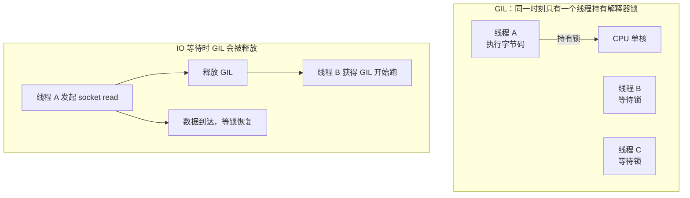
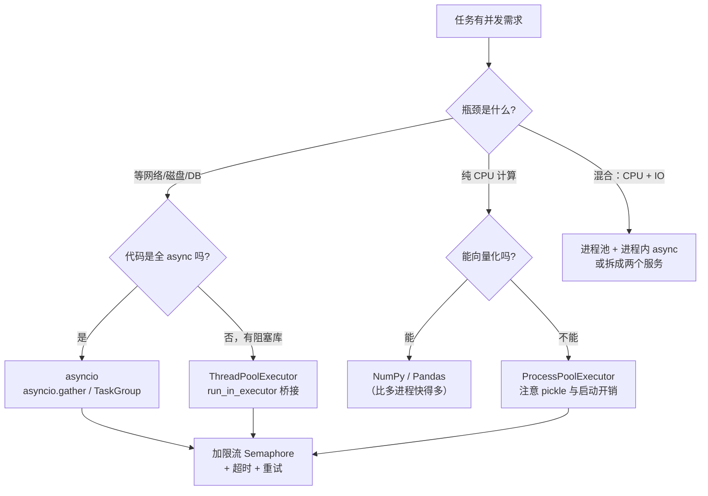
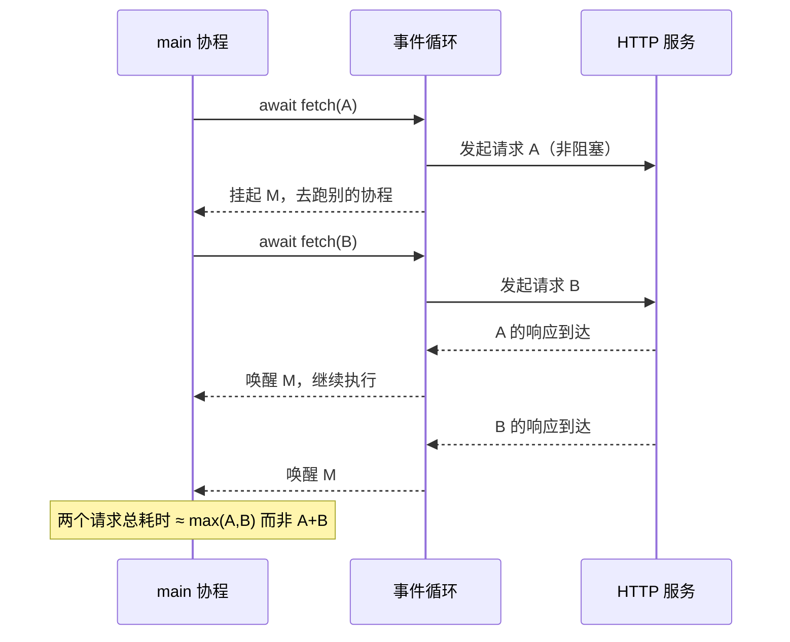

# 阶段三 · 并发与异步

> [!tldr] 一句话结论
> **IO 密集用 `asyncio`（首选）或 `threading`；CPU 密集用 `multiprocessing`。**
> GIL 不会让 IO 并发失效，它只锁住"同一时刻只有一个线程执行 Python 字节码"。

---

## 一、GIL：只锁住 CPU，不锁住等待



| 场景 | GIL 影响 | 该用什么 |
| --- | --- | --- |
| 调 HTTP / DB / LLM API（等网络） | ⚠️ 等待时会释放锁，所以多线程**有效** | `asyncio` > `threading` |
| 大量正则、图像处理、数值计算 | ❌ 无法并行，多线程反而更慢 | `multiprocessing` / NumPy |
| 调用 C 扩展（NumPy、OpenCV） | ✅ 多数会释放 GIL | 多线程也能吃到多核 |
| Python 3.13+ free-threading 版本 | 可选关闭 GIL（实验性） | 未来可期，暂不依赖 |

> [!warning] 常见误解
> "GIL 让 Python 多线程没用"——**错**。IO 等待期间线程会主动释放 GIL，所以并发 100 个 HTTP 请求用线程池依然从 100s 降到 2s。
> 真正没用的是"用多线程做 CPU 计算"。

---

## 二、选型决策图



---

## 三、三种模型对照（带 Java 类比）

| 维度 | `asyncio` | `threading` | `multiprocessing` |
| --- | --- | --- | --- |
| 并发单位 | 协程（用户态） | 线程（OS） | 进程（OS） |
| 上下文切换 | 极轻（函数级） | 中等 | 极重（进程创建 ~50ms） |
| 内存 | 单线程，共享内存 | 共享内存 + GIL 竞争 | 独立内存，需序列化 |
| 上限并发数 | 1 万+ | 几百~几千 | ≈ CPU 核数 |
| 适合 | 高并发 IO | 阻塞库并发 | CPU 密集 |
| Java 类比 | `CompletableFuture` + Netty | `ExecutorService` | 多 JVM / ForkJoin（真并行） |
| 最大坑 | 一处阻塞全卡死 | 数据竞争 | 传参必须可 pickle |

---

## 四、asyncio 核心：只有五个概念

```python
import asyncio, httpx

async def fetch(client: httpx.AsyncClient, url: str) -> str:
    r = await client.get(url, timeout=10)      # await = 我让出控制权
    r.raise_for_status()
    return r.text

async def main():
    async with httpx.AsyncClient() as client:  # 异步上下文管理器
        # 1. 并发跑一批，任一失败即取消其余
        async with asyncio.TaskGroup() as tg:
            tasks = [tg.create_task(fetch(client, u)) for u in urls]
        results = [t.result() for t in tasks]

        # 2. gather：收集所有结果，return_exceptions 可容错
        results = await asyncio.gather(
            *(fetch(client, u) for u in urls),
            return_exceptions=True,
        )

        # 3. 超时控制
        try:
            await asyncio.wait_for(fetch(client, urls[0]), timeout=3)
        except TimeoutError:
            print("超时")

asyncio.run(main())     # 唯一的入口，不要在协程里再调
```



> [!note] `TaskGroup` vs `gather`
> `TaskGroup`（3.11+）是**结构化并发**：任一子任务抛异常，其余自动取消，异常以 `ExceptionGroup` 抛出。
> `gather` 更宽松，`return_exceptions=True` 时会把异常当结果返回。**生产代码优先 `TaskGroup`**。

### 限流 + 重试 + 超时（生产三件套）

```python
import asyncio, random

sem = asyncio.Semaphore(10)          # 最多 10 个在飞

async def safe_call(url: str, retries: int = 3) -> str | None:
    async with sem:
        for attempt in range(retries):
            try:
                async with asyncio.timeout(10):        # 3.11+
                    return await fetch(client, url)
            except (TimeoutError, httpx.HTTPError) as e:
                if attempt == retries - 1:
                    logger.warning("give up %s: %s", url, e)
                    return None
                await asyncio.sleep(2 ** attempt + random.random())  # 指数退避 + 抖动
```

---

## 五、五个必踩的坑

### 1. 在协程里调阻塞函数（最致命）

```python
async def bad():
    time.sleep(1)             # ❌ 整个事件循环停 1 秒，所有请求卡住

async def good():
    await asyncio.sleep(1)    # ✅

async def bridge():           # 老库没法改时，丢进线程池
    await asyncio.to_thread(requests.get, url)
```

> [!danger] 判据
> 只要函数是 `async def`，**里面每一行业务代码都必须是异步的**。
> `requests` / `pymysql` / `open()` 大文件读，全是隐形炸弹。

### 2. 忘记 `await`

```python
async def f(): ...
f()             # ❌ 只创建了协程对象，什么都没发生，还会警告
await f()       # ✅
task = asyncio.create_task(f())   # ✅ 后台并发执行
```

用 `ruff` 的 `RUF006` 规则 + `-W error::RuntimeWarning` 拦住。

### 3. 在 `asyncio.run` 之外创建 Task

```python
task = asyncio.create_task(f())   # ❌ 没有运行中的 loop → RuntimeError
asyncio.run(main())               # Task 必须在 loop 内部创建
```

### 4. 协程里混用 `threading.Lock`

`threading.Lock` 会阻塞线程，不能 await；协程间共享状态用 `asyncio.Lock()`。

### 5. 忘记取消/清理

```python
async with asyncio.TaskGroup() as tg:  # 退出时自动等待或取消
    ...
# 手动管理时，程序退出前必须 cancel 并 await，否则 "Task was destroyed but it is pending"
```

---

## 六、线程池：桥接阻塞世界

```python
from concurrent.futures import ThreadPoolExecutor, ProcessPoolExecutor

with ThreadPoolExecutor(max_workers=16) as pool:
    futures = [pool.submit(requests.get, u) for u in urls]
    for f in futures:
        try:
            print(f.result(timeout=5))
        except Exception as e:
            print("fail", e)

# CPU 密集（注意：函数与参数必须可 pickle，不能是 lambda/闭包）
with ProcessPoolExecutor() as pool:
    results = list(pool.map(cpu_heavy, big_list))
```

> [!warning] 进程池三个限制
> 1. 传参和返回值都要 **pickle**（`lambda`、本地类、打开的文件句柄都不行）。
> 2. **必须放在 `if __name__ == "__main__":` 下**，否则 macOS/Windows 会递归重启进程。
> 3. 进程启动开销大，适合"少量大任务"，不适合"海量小任务"。

---

## 七、性能：先测量，再优化

```bash
python -m cProfile -s cumtime script.py | head -30
pip install py-spy && py-spy top --pid 12345     # 线上无侵入采样
```

```python
import time
from contextlib import contextmanager

@contextmanager
def timer(label):
    t0 = time.perf_counter()
    yield
    print(f"{label}: {(time.perf_counter()-t0)*1000:.1f}ms")
```

> [!tip] 优化优先级（收益从高到低）
> 1. **改算法 / 减少调用次数**（去掉 N+1 查询、批量接口）
> 2. **向量化**（pandas/NumPy 替代 for 循环，常见 10-100 倍）
> 3. **缓存**（`lru_cache`、Redis）
> 4. 并发化
> 5. 微优化（`__slots__`、局部变量）——不到万不得已别做

---

## 八、练习

| # | 任务 | 验收 |
| --- | --- | --- |
| 1 | 用 `asyncio` 并发抓 100 个 URL，限流 10 | 总耗时 < 单请求耗时 × 15 |
| 2 | 加指数退避重试 + 单请求 10s 超时 | 失败不拖垮整体 |
| 3 | 对比 sync / threading / asyncio 三版耗时 | 写一张对比表进笔记 |
| 4 | 用 `ProcessPoolExecutor` 算 4 个 CPU 密集任务 | 观察是否真并行（`top` 看 CPU） |
| 5 | 故意在协程里放 `time.sleep`，观察阻塞现象 | 能解释原因 |

---

> [!next] 下一篇
> [[04-阶段四-数据与 AI 应用]] —— 用 FastAPI 把异步能力变成接口，把 LLM 接进来。
