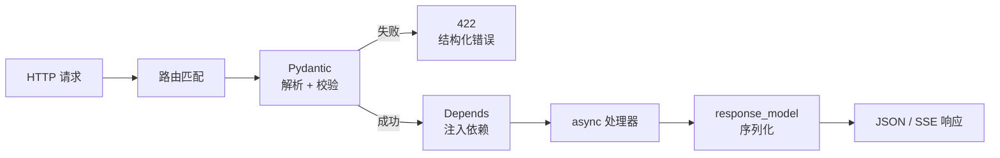
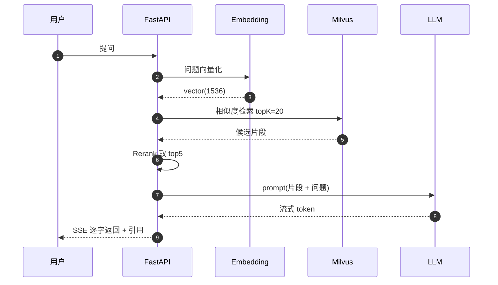
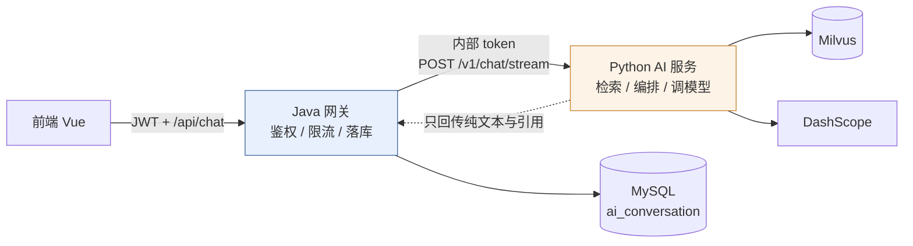

# 阶段四 · 数据与 AI 应用

> [!tldr] 本阶段目标
> 用 **FastAPI 起一个异步 AI 服务**：接收请求 → 校验 → 检索 → 调 LLM → 流式吐回。
> 交付标准：前端能像 ChatGPT 一样逐字看到输出，断线不崩、超时可控。

---

## 一、pandas / NumPy 最小可用集

> [!tip] 只学到"够用"
> 你的目标是**处理 AI 相关的表格数据**（评测集、日志、埋点），不是做数据分析师。

```python
import pandas as pd, numpy as np

df = pd.read_csv("eval.csv", encoding="utf-8")
df = pd.read_json("data.jsonl", lines=True)     # LLM 评测集常见格式

df.head(5); df.info(); df.describe()
df["score"] = pd.to_numeric(df["score"], errors="coerce")
df = df.dropna(subset=["question"]).reset_index(drop=True)

# 过滤 + 聚合（替代 SQL 的肌肉记忆）
top = (df[df["score"] > 0.8]
       .groupby("category", as_index=False)
       .agg(count=("id", "size"), avg=("score", "mean"))
       .sort_values("avg", ascending=False))

# 向量化：别写 for
df["normalized"] = df["text"].str.lower().str.strip()
df["is_hit"] = df["rank"] <= 5
hit_rate = df["is_hit"].mean()

df.to_csv("out.csv", index=False)
```

> [!warning] 三个常见误用
> 1. **`iterrows()` 慢到离谱**——优先向量化，必须遍历用 `itertuples()`。
> 2. **链式赋值**（`df[df.a>1]["b"]=0`）不生效——用 `.loc[mask, "b"] = 0`。
> 3. **忽略 dtype**——`read_csv` 后先 `info()`，字符串列别当数字算。

---

## 二、FastAPI：十分钟起一个生产级接口

```python
from contextlib import asynccontextmanager
from fastapi import FastAPI, Depends, HTTPException
from pydantic import BaseModel, Field

@asynccontextmanager
async def lifespan(app: FastAPI):
    app.state.http = httpx.AsyncClient(timeout=30)   # 启动建连接池
    yield
    await app.state.http.aclose()                    # 关闭释放

app = FastAPI(title="AI Service", lifespan=lifespan)

class ChatRequest(BaseModel):
    conversation_id: int
    message: str = Field(min_length=1, max_length=4000)
    stream: bool = True

class ChatResponse(BaseModel):
    answer: str
    citations: list[str] = []

@app.get("/health")
async def health():
    return {"status": "ok"}

@app.post("/chat", response_model=ChatResponse)
async def chat(req: ChatRequest, svc = Depends(get_chat_service)):
    if not req.message.strip():
        raise HTTPException(status_code=422, detail="消息不能为空")
    return await svc.chat(req)
```



| Spring 对照 | FastAPI |
| --- | --- |
| `@RestController` | `APIRouter` / `app` |
| `@RequestBody` + Bean Validation | Pydantic `BaseModel` |
| `@Autowired` | `Depends(...)` |
| `@GetMapping` | `@app.get` |
| `application.yml` | `pydantic-settings` + `.env` |
| `ResponseEntity` | 直接 return 对象 / `Response` |

---

## 三、SSE 流式：和你现有的 `SseEmitter` 一一对应

```python
from fastapi.responses import StreamingResponse
import json

async def event_stream(req: ChatRequest):
    try:
        async for chunk in llm.stream(req.message):
            # SSE 格式：data: <payload>\n\n
            yield f"data: {json.dumps({'delta': chunk}, ensure_ascii=False)}\n\n"
    except asyncio.CancelledError:            # 客户端断开
        logger.info("client disconnected, conv=%s", req.conversation_id)
        raise
    except Exception as e:
        logger.exception("stream failed")
        yield f"data: {json.dumps({'error': str(e)})}\n\n"
    finally:
        yield "data: [DONE]\n\n"

@app.post("/chat/stream")
async def chat_stream(req: ChatRequest):
    return StreamingResponse(
        event_stream(req),
        media_type="text/event-stream",
        headers={
            "Cache-Control": "no-cache",
            "X-Accel-Buffering": "no",     # 关键：关掉 Nginx 缓冲
            "Connection": "keep-alive",
        },
    )
```

> [!success] 和你 Java 侧的对应关系
> | Java (`SseEmitter`) | Python (`StreamingResponse`) |
> | --- | --- |
> | `emitter.send(SseEmitter.event().data(x))` | `yield f"data: {x}\n\n"` |
> | `emitter.complete()` | `yield "data: [DONE]\n\n"` |
> | `@EventListener` 监听完成 | `finally` 块 |
> | 异步线程池推流 | `async for` + 事件循环 |
>
> 两者对前端是**同一套协议**，前端 `EventSource` / `fetch` 读流的代码可以复用。

---

## 四、调用 LLM：OpenAI 兼容 SDK 通吃

```python
from openai import AsyncOpenAI

client = AsyncOpenAI(
    api_key=settings.dashscope_key,
    base_url="https://dashscope.aliyuncs.com/compatible-mode/v1",
)

async def chat(prompt: str, history: list[dict]) -> str:
    resp = await client.chat.completions.create(
        model="qwen-plus",              # 或 deepseek-chat
        messages=[*history, {"role": "user", "content": prompt}],
        temperature=0.3,
        max_tokens=2000,
    )
    return resp.choices[0].message.content

async def stream(prompt: str):
    async with await client.chat.completions.create(
        model="qwen-plus",
        messages=[{"role": "user", "content": prompt}],
        stream=True,
    ) as s:
        async for event in s:
            delta = event.choices[0].delta.content
            if delta:
                yield delta
```

### 结构化输出（用 Pydantic 约束模型）

```python
from pydantic import BaseModel

class Intent(BaseModel):
    intent: Literal["查询订单", "退款", "咨询", "其他"]
    confidence: float
    slots: dict[str, str] = {}

resp = await client.beta.chat.completions.parse(
    model="qwen-plus",
    messages=[{"role": "system", "content": "识别用户意图"},
              {"role": "user", "content": "我上周买的还没发货"}],
    response_format=Intent,
)
intent: Intent = resp.choices[0].message.parsed   # 直接拿到对象
```

> [!warning] 生产必备四件事
> 1. **超时**：`timeout=60`，没有超时的外部调用等于定时炸弹。
> 2. **重试**：只对 429/5xx 重试，指数退避；对 400 重试没意义。
> 3. **成本**：记录 `usage.prompt_tokens` / `completion_tokens`，按 conversation 累计。
> 4. **兜底**：模型挂了要有降级回复，别让接口 500。

---

## 五、LangChain：概念映射（别从零学新词）

| LangChain 概念 | 你已有的认知 | 作用 |
| --- | --- | --- |
| `ChatModel` | Spring AI `ChatModel` | 统一模型调用 |
| `PromptTemplate` | 模板引擎 | 变量占位 + 格式化 |
| `Runnable` / LCEL (`\|`) | 管道 / Stream | 组合调用链 |
| `Retriever` | DAO 查询 | 按语义取文档 |
| `Tool` | Spring AI `@Tool` | 让模型调函数 |
| `Memory` | `ai_message` 表 | 历史上下文 |
| `OutputParser` | 反序列化 | 把文本变结构体 |

```python
from langchain_openai import ChatOpenAI
from langchain_core.prompts import ChatPromptTemplate
from langchain_core.output_parsers import StrOutputParser

prompt = ChatPromptTemplate.from_messages([
    ("system", "你是{wpt}的客服，只根据资料回答，不确定就说不知道。\n资料：\n{context}"),
    ("human", "{question}"),
])

chain = prompt | llm | StrOutputParser()
answer = await chain.ainvoke({"question": q, "context": ctx, "wpt": "微拍堂"})
async for token in chain.astream({...}):
    print(token, end="")
```

> [!tip] 什么时候别用 LangChain
> 单次调用 + 简单 prompt，直接用官方 SDK 更清晰。
> LangChain 的价值在**编排**（多步、检索、工具、回调），链路一长它的抽象才开始回本。

---

## 六、RAG 全链路



### 切分：最容易丢信息的一层

```python
from langchain_text_splitters import RecursiveCharacterTextSplitter

splitter = RecursiveCharacterTextSplitter(
    chunk_size=500,          # 中文建议 300-600 字
    chunk_overlap=80,        # 10-15% 重叠，防切断语义
    separators=["\n\n", "\n", "。", "！", "？", " ", ""],
)
chunks = splitter.split_text(text)
```

| 环节 | 常见坑 | 对策 |
| --- | --- | --- |
| 解析 | PDF 表格/双栏错行 | 用版面解析（如 `unstructured`），表格单独转 markdown |
| 切分 | 固定长度切断句子 | 按语义分隔符递归切，加 overlap |
| 向量化 | 中英混用同一模型 | 中文优先 bge / DashScope `text-embedding-v3` |
| 检索 | 只做向量，专有名词召不回 | **混合检索**（BM25 + 向量）+ RRF 融合 |
| 重排 | topK 直接喂模型，噪音大 | Cross-Encoder rerank 取 top5 |
| 生成 | 模型编造 | Prompt 明确"仅依据资料"，要求输出引用编号 |
| 评估 | 凭感觉说"效果不错" | 30-50 条评测集，算 hit@5 / 忠实度 |

### Milvus 最小写入/查询

```python
from pymilvus import MilvusClient

mc = MilvusClient(uri="http://192.168.0.106:19530")

mc.create_collection(
    collection_name="kb_docs",
    dimension=1024,
    metric_type="COSINE",
    auto_id=True,
)

mc.insert("kb_docs", [
    {"vector": vec, "text": chunk, "source": "手册.pdf", "page": 12}
])

hits = mc.search(
    collection_name="kb_docs",
    data=[q_vec],
    limit=20,
    output_fields=["text", "source", "page"],
)
```

---

## 七、Java / Python 的边界怎么划



> [!note] 三条铁律
> 1. **用户身份只在 Java 侧解析**，Python 侧只认内部 token + `user_id` header，绝不信前端传的 id。
> 2. **Python 服务必须无状态**，会话存在 MySQL/Redis，任意实例可接管，才能水平扩容。
> 3. **降级路径要预先设计**：Python 服务超时 → Java 侧返回"稍后再试"或走纯模型直连兜底。

> [!tip] 往下深挖
> 跨语言的 RPC、注册发现、限流熔断、分布式锁与事务怎么分工，见专题：
> [[07-专题-Python 的分布式能力边界（对比 Java 生态）]]
> 一句话结论：**Nacos 能用，Sentinel 和 Seata 不能在 Python 侧用**。

---

## 八、练习

| # | 任务 | 验收 |
| --- | --- | --- |
| 1 | 用 pandas 统计一份 LLM 调用日志的 P95 延迟 | 一行 groupby 搞定 |
| 2 | FastAPI 实现 `/chat` 同步接口 | Swagger 可测，参数校验生效 |
| 3 | 加 `/chat/stream` SSE 接口 | `curl -N` 能看到逐字输出 |
| 4 | 接入 DashScope，支持多轮 | 带 3 轮历史仍正确 |
| 5 | 写切分 + 入库脚本，导入 10 篇文档 | Milvus 可检索到 |
| 6 | 做 30 条评测集，算 hit@5 | 输出一张指标表 |

---

> [!next] 下一篇
> [[05-阶段五-项目实战与验收]] —— 把上面所有零件组装成三个能写进简历的项目。
