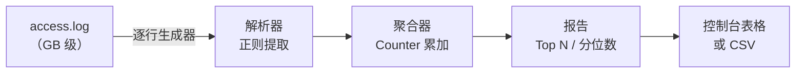
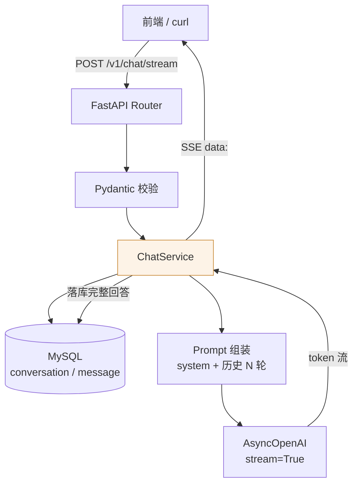
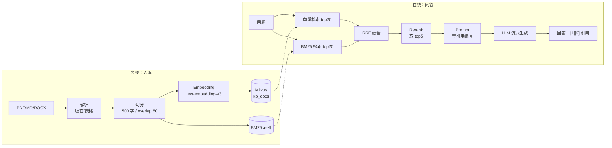
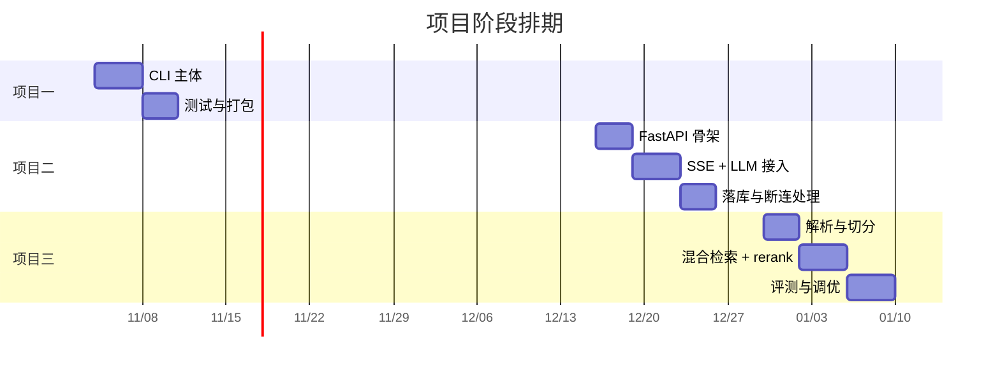

# 阶段五 · 项目实战与验收

> [!tldr] 原则
> **三个项目，难度递进，每个都能独立跑起来、都有 README、都能报出数字。**
> 宁可三个小而完整，不要一个大而跑不通。

---

## 项目一：日志分析 CLI（W1-W2 交付）

**目的**：把语法阶段的东西全部串一遍，且必须处理"大文件"。



**功能清单**

- [ ] `myapp analyze access.log --top 10 --level ERROR`
- [ ] 流式读取，内存占用与文件大小无关（用 `tracemalloc` 验证）
- [ ] 支持 `.gz` 直接读（`gzip.open` 也是迭代器）
- [ ] 输出：状态码分布、Top URL、P50/P95 耗时
- [ ] 有 `--json` 输出模式，便于管道

**验收**

| 指标 | 标准 |
| --- | --- |
| 1GB 文件内存峰值 | < 80MB |
| 处理速度 | > 50MB/s |
| 代码结构 | `src/myapp/` 包 + 入口脚本 |
| 测试 | 至少 10 个用例，含畸形日志行 |

---

## 项目二：流式 AI 问答服务（W7 交付）

**目的**：打通 FastAPI + 异步 + LLM 流式 + 会话持久化，**与你现有 Java 侧能力对齐**。



**功能清单**

- [ ] `/v1/chat`（同步）与 `/v1/chat/stream`（SSE）两个接口
- [ ] 多轮记忆：取最近 10 轮，超长时按 token 截断
- [ ] 流式过程中**边收边落库**，客户端断连也要保存已生成内容
- [ ] 全链路超时（LLM 60s / 整体 90s）+ 429 退避重试
- [ ] Token 用量统计，按 conversation 累计
- [ ] `/health` + `/metrics`（QPS、P95 延迟、错误率）

**验收**

| 指标 | 标准 |
| --- | --- |
| 首 token 延迟 | < 1.5s（含网络） |
| 断连处理 | kill 客户端后日志有 `client disconnected`，DB 有半截回答 |
| 并发 | 50 并发不崩，错误率 < 1% |
| 部署 | `Dockerfile` + `docker run` 一条命令起 |

> [!tip] 这一步做完，你就有了"Python AI 服务"的完整肌肉记忆
> 它和你的 Spring AI `SseEmitter` 版是**同一件事的两种实现**——这个对比本身就是很好的技术分享素材。

---

## 项目三：文档知识库问答（W8 交付）

**目的**：RAG 全链路 + 可量化评估。这是简历上最值钱的一个。



**功能清单**

- [ ] 上传接口：支持 md/pdf/docx，单文件 ≤ 20MB，异步解析
- [ ] 混合检索（向量 + BM25）+ RRF 融合 + rerank
- [ ] 回答必须带引用来源（文件名 + 页码），点击可回溯原文
- [ ] 无召回时明确说"资料中没有"，**不许编**
- [ ] 评测脚本：30-50 条问答对，输出 hit@5 / MRR / 平均耗时

**验收**

| 指标 | 标准 |
| --- | --- |
| hit@5 | ≥ 85%（自建评测集） |
| 幻觉率 | 抽样 20 条，编造 ≤ 1 条 |
| 入库吞吐 | 100 页 PDF < 3 分钟 |
| 可复现 | README 里有完整命令，别人能跑起来 |

---

## 时间分配建议



---

## 面试高频题（Python 方向）

> [!example] 语言层
> 1. 可变默认参数为什么是坑？两种修法。
> 2. `list` 和 `tuple` 的底层差异？为什么 tuple 能当 dict key。
> 3. 生成器和迭代器的区别？生成器为什么只能遍历一次。
> 4. 浅拷贝和深拷贝，什么时候必须 deepcopy。
> 5. `@property` / `@classmethod` / `@staticmethod` 各自使用场景。
> 6. `__new__` 和 `__init__` 的区别。
> 7. LEGB 是什么，`nonlocal` 解决什么问题。

> [!example] 并发层
> 8. GIL 是什么？为什么 IO 密集多线程仍有效？
> 9. `asyncio` 和线程池怎么选？协程里调阻塞函数会怎样？
> 10. `TaskGroup` 和 `gather` 的区别。
> 11. 进程池传参为什么要 pickle？`lambda` 为什么不行。
> 12. 如何做限流、超时、重试？（要能手写）

> [!example] 工程层
> 13. `pyproject.toml` 里 dependencies 和 dependency-groups 的区别。
> 14. 为什么推荐 src 布局？
> 15. pytest fixture 的 yield 和 return 有什么区别。
> 16. 类型注解运行时会生效吗？Pydantic 为什么能校验。
> 17. 生产环境如何做结构化日志与链路追踪。

> [!example] AI 应用层
> 18. 你的 RAG 链路每一层可能丢什么信息？
> 19. 为什么需要混合检索？RRF 怎么算？
> 20. 怎么评估 RAG 效果？hit@k 怎么定义？
> 21. 流式响应中断了怎么保证数据不丢？
> 22. 怎么控制 LLM 调用成本？

---

## 复盘模板（每个项目结束填一次）

```markdown
## 项目：xxx

**做了什么**（一句话）：

**关键数字**：
- 性能：
- 质量：
- 成本：

**踩过的 3 个坑**：
1.
2.
3.

**如果重做，会改什么**：

**能讲 5 分钟的技术点**（面试用）：
```

---

## 完成标志

> [!success] 全部达成就毕业
> - [ ] 三个项目都能在干净机器上按 README 跑起来
> - [ ] 每个项目有测试、有 CI（GitHub Actions 跑 pytest + ruff + mypy）
> - [ ] 能画出项目二的 SSE 时序图和项目三的 RAG 链路图
> - [ ] 能对着白板讲清 GIL、asyncio、RAG 三件事，不卡壳
> - [ ] 至少写一篇技术对比文：*Spring AI 与 Python LangChain 实现流式对话的差异*

---

> [!quote] 最后
> 学 Python 对 Java 老手最大的价值，不是多会一门语言，
> 而是**获得了"快速试错"的能力**——一小时能验证一个想法，这才是 AI 时代真正的杠杆。
