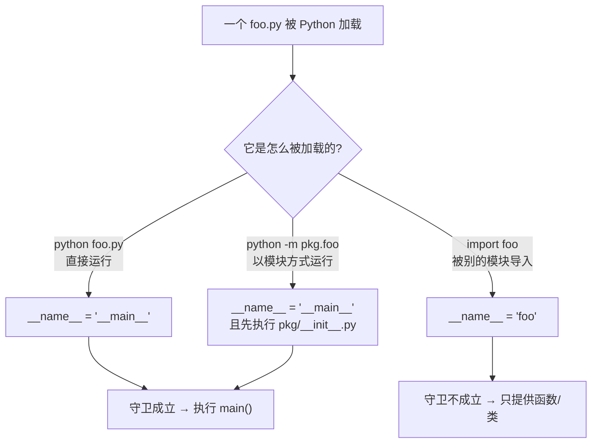
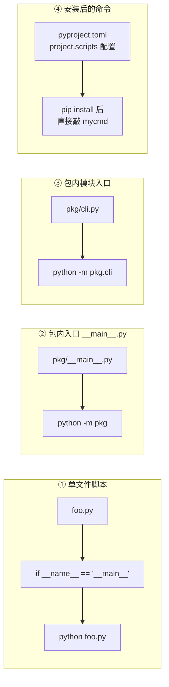

# 专题 · `if __name__ == "__main__":` 到底是什么

> [!tldr] 一句话
> 这是 Python 的**「文件被直接运行」判定**，等价于 Java 的 `public static void main(String[] args)`：
> **只有当我这个文件被当作程序启动时才执行下面的代码；被别人 import 时不执行。**

它不是什么魔法语法，就是**读一个内置变量、比一下字符串**。理解 `__name__` 这个变量，一切就都通了。

---

## 一、`__name__` 是什么

每个 `.py` 文件都是一个**模块对象**，Python 在加载时会往它的命名空间里塞几个内置属性：

| 属性 | 含义 |
| --- | --- |
| `__name__` | 模块的名字（**字符串**） |
| `__file__` | 文件路径 |
| `__doc__` | 模块文档字符串 |
| `__package__` | 所属包名 |

关键是 `__name__` 的**取值规则只有两条**：



> [!note] 为什么直接运行时叫 `"__main__"` 而不是文件名
> 因为 Python 把"入口脚本"本身也当成一个模块，而入口模块的固定名字就是 `__main__`。
> 所以**直接运行时，你的文件名已经被忘掉了**——这也是为什么 `python foo.py` 之后你没法 `import foo`（它不在 `sys.modules['foo']` 里）。

实证（三行就能验证）：

```bash
$ python -c 'print(__name__)'
__main__

$ echo 'print("__name__ =", __name__)' > foo.py
$ python foo.py
__name__ = __main__

$ python -c 'import foo'
__name__ = foo
```

---

## 二、为什么需要这个守卫

Python **没有**"入口类"或"入口方法"的约定。一个文件既可以当库，也可以当脚本。守卫就是用来区分这两种身份的：

```python
# foo.py
def add(a, b):
    return a + b

if __name__ == "__main__":        # ← 只有直接运行时才进来
    print(add(1, 2))
```

| 使用方式 | 结果 |
| --- | --- |
| `python foo.py` | 打印 `3` |
| `import foo`（在别的文件里） | **什么都不打印**，只拿到 `add` 函数 |
| `pytest` 导入 `test_foo.py` | 测试函数能跑，模块级副作用不触发 |
| 被 `multiprocessing` 子进程重新导入 | 不会重复执行入口逻辑 ⭐ |

> [!success] 去掉守卫会怎样（这就是它存在的理由）
> ```python
> # foo.py 没有守卫
> def add(a, b): ...
> print(add(1, 2))      # 模块级代码
> ```
> 别人一句 `import foo`，就会**在他自己的程序里凭空打印一个 3**。
> 更糟的是 `multiprocessing`：子进程会重新导入主模块，于是又创建子进程、又导入、又创建……**无限递归，直到机器卡死**（macOS / Windows 默认 `spawn` 启动方式）。

---

## 三、标准写法：守卫 + `main()` 函数

```python
import sys
import logging

logger = logging.getLogger(__name__)

def parse_args(argv: list[str]) -> dict:
    ...

def main(argv: list[str] | None = None) -> int:
    args = parse_args(sys.argv[1:] if argv is None else argv)
    logger.info("start with %s", args)
    ...
    return 0

if __name__ == "__main__":
    sys.exit(main())        # 把返回值变成进程退出码
```

为什么不把逻辑直接写在 `if` 里面？

| 写法 | 可测试性 | 说明 |
| --- | --- | --- |
| `if __name__ == "__main__": main()` | ✅ | 测试里 `from foo import main` 直接调 |
| `if __name__ == "__main__": <50 行逻辑>` | ❌ | 想测只能 `subprocess` 跑脚本 |
| 顶部直接写逻辑 | ❌❌ | 一 import 就执行，还会触发副作用 |

> [!tip] 三条规矩
> 1. **模块顶层只放定义**（函数、类、常量），不放执行逻辑。
> 2. 入口逻辑收进 `main()`，守卫里只有一行调用。
> 3. 用 `sys.exit(main())` 而不是 `main()`，让退出码可控（CI、shell 脚本依赖它）。

---

## 四、四种"入口"写法的区别

这是最容易混的一组概念，很多人写了几年也没分清：



| 方式 | 命令 | 什么时候用 |
| --- | --- | --- |
| 单文件脚本 | `python foo.py` | 临时工具、一次性脚本 |
| 包入口 | `python -m pkg` | 一个包对外只暴露一个 CLI |
| 包内模块 | `python -m pkg.cli` | 包里有多个子命令模块 |
| console script | `mycmd` | **要发布给别人用**，装完即可用 |

```python
# pkg/__main__.py  —— 让 python -m pkg 有东西可跑
from pkg.cli import main
raise SystemExit(main())
```

```toml
# pyproject.toml —— 装完变成系统命令
[project.scripts]
mycmd = "pkg.cli:main"
```

> [!warning] `python pkg/cli.py` 是错的
> 它会让 `from .core import X` 直接报 `ImportError: attempted relative import with no known parent package`。
> **正确姿势只有 `python -m pkg.cli`**（`-m` 会把包正确加入 `sys.path` 并设置 `__package__`）。

---

## 五、七个坑

### 1. 在 `-m` 模式下 `__file__` 和 `sys.path[0]` 变了

`python foo.py` 时 `sys.path[0]` 是脚本所在目录；`python -m pkg.foo` 时 `sys.path[0]` 是**当前工作目录**。所以按"脚本同级目录"找配置文件会突然失效。

```python
from pathlib import Path
BASE = Path(__file__).resolve().parent        # ✅ 永远基于文件自身定位
```

### 2. 不要把 `"__main__"` 当模块名去 import

```python
import __main__        # 拿到的是"当前正在运行的入口模块"，不是你想的那个文件
from __main__ import main   # 能用，但极脆弱，重构即断
```

### 3. 守卫写在函数里没有意义

```python
def run():
    if __name__ == "__main__":     # ❌ __name__ 是模块级变量，这里恒为同一个值
        ...
```
它判断的是**模块**，不是调用栈。想判断"是不是被当脚本跑"，只能在模块顶层判断一次。

### 4. 多重入口时只判断一次

模块被 `import` 后，`__name__` 就固定了，中途不会再变。用 `runpy.run_module(..., run_name="__main__")` 才会重新以入口身份执行一遍。

### 5. `multiprocessing` 必须配守卫（这条最实用）

```python
from multiprocessing import Process

def work(): ...

if __name__ == "__main__":        # ⭐ 不加这行，macOS/Windows 会无限创建进程
    p = Process(target=work)
    p.start(); p.join()
```

原因：`spawn` 启动的子进程要**重新导入主模块**来拿到 `work` 函数，导入时又会执行模块顶层代码 → 又 `p.start()` → 又导入……守卫是唯一的刹车。

### 6. 同名模块遮蔽

如果项目里有个 `json.py`，`import json` 会拿到你的文件而不是标准库。守卫救不了这个，只能靠**命名**和 `src` 布局避免。

### 7. 守卫 ≠ 只在"主线程"执行

它跟线程无关。被 import 时不执行，被直接运行时执行——仅此而已。

---

## 六、和 Java 对照

| Java | Python |
| --- | --- |
| JVM 自动找 `main(String[])` | 没有约定，靠 `if __name__ == "__main__"` 手动模拟 |
| 一个类一个 `main`，可有多个 | 一个文件一个守卫，**每个文件都能当入口** |
| `public static void main` | `def main() -> int` + 守卫调用 |
| 编译期就能确定入口类 | 运行时决定，`python -m` 可切换入口 |
| `System.exit(1)` | `sys.exit(1)` / `raise SystemExit(1)` |
| jar 的 `Main-Class` 清单 | `pyproject.toml` 的 `[project.scripts]` |

> [!note] 心智模型
> Java 是「**有一个入口**」；Python 是「**每个文件都可能是入口**」。
> 守卫的作用不是"声明入口"，而是"**避免被导入时误当成入口执行**"——它是防御性的，不是声明性的。

---

## 七、自测

- [ ] 说出 `python foo.py`、`import foo`、`python -m pkg.foo` 三种情况下 `__name__` 的值。
- [ ] 解释为什么 `python foo.py` 之后无法 `import foo`。
- [ ] 写出"守卫 + main 函数 + `sys.exit`"的标准骨架。
- [ ] 说明 `pkg/__main__.py` 和 `[project.scripts]` 各自的用途。
- [ ] 解释 `multiprocessing` 不加守卫为什么会无限递归。
- [ ] 判断：`python pkg/cli.py` 里 `from .core import X` 为什么报错，怎么改。

---

> [!quote] 一句话记住
> `__name__` 是模块的"身份证"，导入时印的是**名字**，直接运行时印的是 **`__main__`**。
> 你只是在问它："**现在这趟，我是被当成程序跑，还是被当成库用？**"

---

> [!next] 相关
> [[01-阶段一-语法速通（Java 对照）]] · [[02-阶段二-数据模型与工程化]] · [[03-阶段三-并发与异步]]
