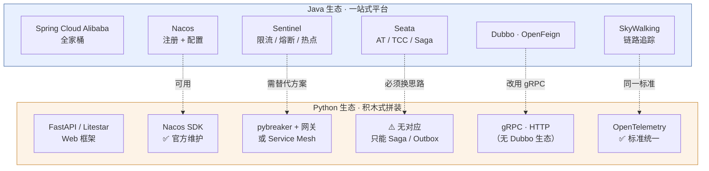
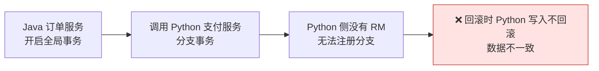
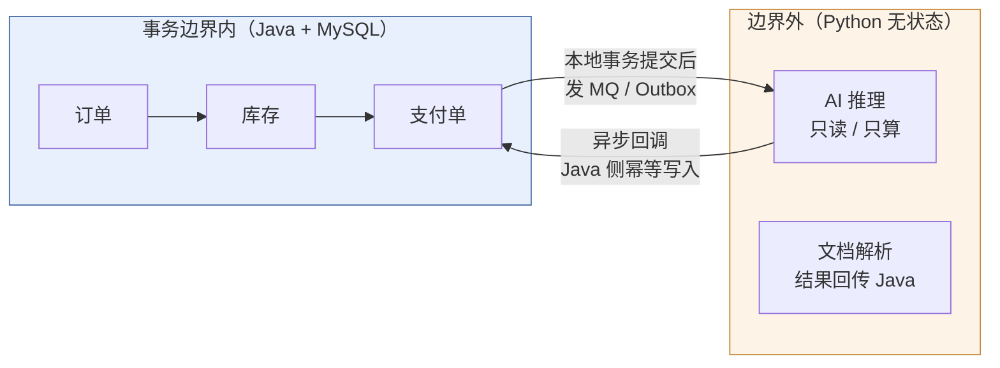
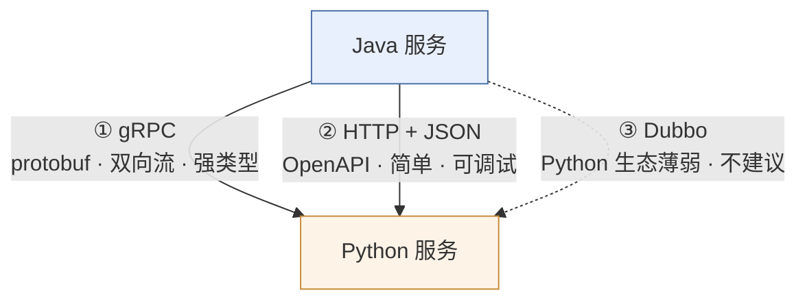
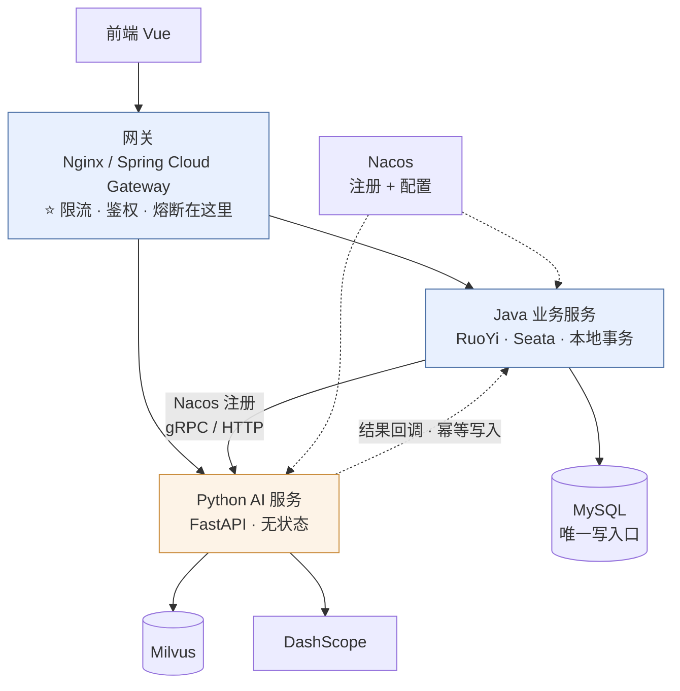

# 专题 · Python 的分布式能力边界

> [!tldr] 一句话结论
> **Python 有微服务、有 RPC、有限流熔断、有分布式锁，但没有"Spring Cloud Alibaba"这种一站式套件。**
> Java 那套中间件里：**Nacos 官方支持 Python（可用）**，**Sentinel 没有 Python 客户端（不可用）**，**Seata 的 Python 版是 2021 年的个人练手项目（不可用）**。
> 所以正确姿势不是"把 Java 那套搬到 Python"，而是**让 Java 继续承担分布式职责，Python 只做无状态计算**。

---

## 一、先看全景：两边的形态根本不同



**本质差异**：

| 维度 | Java | Python |
| --- | --- | --- |
| 微服务范式 | 框架驱动（注解 + 自动装配） | 库驱动（自己组装） |
| 治理能力 | 中间件 SDK 侵入式 | **下沉到网关 / Sidecar** |
| 生态成熟度 | 每个环节都有事实标准 | 每个环节都有 2-3 个可选，但都小一号 |
| 典型服务数 | 一个业务拆 20-50 个服务 | 通常 3-10 个服务，多数是单体 |

> [!note] 一句话理解
> Java 的微服务是**平台思维**（买整套家具）；Python 的微服务是**工具思维**（自己挑件组装）。
> 所以 Python 项目的正确做法是：**能不放 Python 的分布式职责，就不要放。**

---

## 二、逐项对照（带成熟度评级）

| 能力 | Java 方案 | Python 方案 | 成熟度 | 是否推荐 |
| --- | --- | --- | --- | --- |
| Web 框架 | Spring Boot | FastAPI / Litestar / Django | ⭐⭐⭐⭐⭐ | ✅ 完全够用 |
| RPC | Dubbo / Feign | **gRPC**（`grpcio` + `grpc.aio`） | ⭐⭐⭐⭐ | ✅ 首选跨语言 |
| 服务注册 | Nacos / Eureka | **`nacos-sdk-python` 官方** | ⭐⭐⭐⭐ | ✅ 可用 |
| 配置中心 | Nacos / Apollo | Nacos 官方 SDK | ⭐⭐⭐⭐ | ✅ 可用 |
| 限流 | Sentinel / Resilience4j | `limits` / `slowapi` / Redis Lua | ⭐⭐⭐ | ⚠️ 建议放网关 |
| 熔断降级 | Sentinel / Resilience4j | `pybreaker` / `aiobreaker` | ⭐⭐⭐ | ⚠️ 建议放 Mesh |
| 分布式锁 | Redisson | `redis-py` 自带 `Lock` | ⭐⭐⭐⭐ | ✅ 可用 |
| 分布式事务 | Seata | **无可用实现** | ⭐ | ❌ 换 Saga/Outbox |
| 链路追踪 | SkyWalking / Sleuth | OpenTelemetry | ⭐⭐⭐⭐ | ✅ 可用 |
| 消息队列 | RocketMQ / Kafka | `kafka-python` / `aiokafka` / `pulsar-client` | ⭐⭐⭐⭐ | ✅ 可用 |
| 服务网格 | 少见 | **Istio / Envoy 原生友好** | ⭐⭐⭐⭐⭐ | ✅ 异构系统首选 |

> [!success] 关键判断
> Python 缺的不是"能力"，而是"**开箱即用的治理 SDK**"。
> 一旦把限流、熔断、重试、超时下沉到 **网关或 Sidecar**，Python 侧的短板立刻消失——这也是云原生时代的标准答案。

---

## 三、三个 Java 中间件的实测结论

### 1. Nacos ✅ 能用，而且是官方维护

| 项目 | 事实 |
| --- | --- |
| 包名 | `nacos-sdk-python` |
| 最新版本 | **3.2.0**（官方组织 `nacos` 发布） |
| Python 要求 | 3.10+ |
| 服务端 | Nacos 3.x+（v2 模块为 gRPC 长连接，兼容 2.x） |
| 能力 | 配置中心、服务注册发现，甚至含 AI Client（MCP Server / Agent Card） |

```python
import asyncio
from v2.nacos import (
    ClientConfigBuilder, GRPCConfig,
    NacosNamingService, RegisterInstanceParam,
)

async def register():
    cfg = (ClientConfigBuilder()
           .server_address("192.168.0.106:8848")
           .namespace("public")
           .username("nacos")
           .password("nacos")
           .grpc_config(GRPCConfig(grpc_timeout=5000))
           .build())

    naming = await NacosNamingService.create_naming_service(cfg)
    await naming.register_instance(RegisterInstanceParam(
        service_name="ai-service",
        ip="192.168.0.20",
        port=8000,
        weight=1.0,
        cluster_name="DEFAULT",
        ephemeral=True,          # 临时实例：断连自动摘除
    ))
    # 进程退出前记得 deregister_instance
```

> [!warning] 但要注意
> V2 走 gRPC 长连接（端口 `服务端口 + 1000`，即 8848 → 9848）。Nacos 开了鉴权时，Python 客户端的报错信息很难懂，**先把 9848 端口和 ACL 打通再写业务代码**。
> 具体 API 以官方文档为准：`nacos-group.github.io` 的 Python SDK 手册。

### 2. Sentinel ❌ 没有 Python 客户端

实测证据：

- PyPI 上 **`sentinel-py` 不存在**（404）
- Sentinel 官方多语言实现只有 **Java / Go（sentinel-golang）/ C++（sentinel-cpp）**
- 网上流传的"Sentinel 支持 Python"，多数是把 **Java 代码示例** 和 **多语言宣传图** 混在一起的二手内容

> [!danger] 不要相信"有 Python 版 Sentinel"
> 即使找到某个第三方包，它也无法复用 Sentinel Dashboard 的规则推送（依赖 Java 侧的 `sentinel-transport` 私有协议）。
> **结论：Python 侧不要指望 Sentinel。**

**替代方案（按推荐度排序）：**

1. **把限流放在唯一入口**（Nginx / APISIX / Spring Cloud Gateway）— 最省事，Python 完全不感知
2. **Service Mesh**（Istio + Envoy）— `VirtualService` 里配限流、超时、熔断、重试，语言无关
3. **应用内轻量实现**（只有确实需要业务维度限流时才做）

```python
# 方案 3：Redis 滑动窗口（Lua 保证原子性）
SLIDING_WINDOW_LUA = """
local key = KEYS[1]
local now = tonumber(ARGV[1])
local window = tonumber(ARGV[2])
local limit = tonumber(ARGV[3])
redis.call('ZREMRANGEBYSCORE', key, 0, now - window)
local count = redis.call('ZCARD', key)
if count < limit then
  redis.call('ZADD', key, now, ARGV[4])
  redis.call('PEXPIRE', key, window)
  return 1
end
return 0
"""

async def allow(redis, key: str, limit: int, window_ms: int = 1000) -> bool:
    import time, uuid
    now = int(time.time() * 1000)
    ok = await redis.eval(SLIDING_WINDOW_LUA, 1, key, now, window_ms, limit, uuid.uuid4().hex)
    return bool(ok)
```

### 3. Seata ❌ Python 版是个人练手项目

这是最需要说清楚的一条，因为网上很多文章还在推荐它：

| 项目 | 事实 |
| --- | --- |
| 仓库 | `opentrx/seata-python`（原 `seata/fescar-python`） |
| PyPI | `seata-python` **0.1** |
| 发布时间 | **2021-09-26**（之后没有正式版本） |
| 作者自述 | "本人不是 python 开发者，主要是为了学习一下 python 才写的这个项目，**目前项目还没有写完**，主要是完成 seata AT 模式" |
| TODO 列表 | TCC / XA / SAGA / TM / RPC 通信 / 防悬挂 / 空补偿 / 配置中心 / 注册中心 / 指标监控 — **全部未完成** |

> [!danger] 生产环境结论
> **不要在 Python 里接 Seata。** 它不是"能用但不完善"，而是"从未完成"。
> 一个只实现了一半 AT 模式、五年没发版的客户端，任何一次异常分支都可能让数据处在不确定状态——这比不用分布式事务更危险。

---

## 四、那 Python 的分布式事务怎么办？

答案是：**不要让它需要分布式事务。**

### 反例（错误做法）



### 正例（架构上消除问题）



三种可落地的模式：

| 模式 | 做法 | 适用 |
| --- | --- | --- |
| **事务归 Java** ⭐ | Python 不写业务库，所有写操作回调 Java 接口，由 Java 本地事务保证 | 你现在的场景，强烈推荐 |
| **Saga** | 每步有正向 + 补偿操作，失败反向补偿；Python 必须提供补偿接口 | 跨服务长流程 |
| **Outbox + 幂等** | 业务表 + outbox 表同事务写入，投递器扫表发 MQ，消费端幂等 | 最终一致，最稳 |

```python
# Outbox + 幂等消费（Python 侧只需做"幂等 + 补偿"，不参与全局事务）
async def handle_message(msg: dict):
    async with db.transaction():
        # 幂等表：同一 message_id 只处理一次
        inserted = await db.execute(
            "INSERT IGNORE INTO processed_msg(message_id) VALUES (:id)",
            {"id": msg["message_id"]},
        )
        if not inserted:
            return                      # 已处理，直接返回
        await do_business(msg)
    # 事务提交后才 ack，避免"消息丢了但业务做了"
    await mq.ack(msg)
```

> [!tip] 判断标准
> 如果你发现"Python 需要和 Java 在同一个事务里"，几乎总是**边界划错了**：
> 要么这个写操作本来就该归 Java，要么它其实可以异步化。

---

## 五、RPC：Python 用什么和 Java 通信



| 方案 | 优点 | 缺点 | 建议 |
| --- | --- | --- | --- |
| **gRPC** | 强类型、性能好、支持流式、跨语言一等公民 | 需要维护 `.proto`，调试不如 HTTP 直观 | **服务间调用首选** |
| **HTTP + JSON** | 零门槛、Swagger 可调、网关友好 | 无 schema 约束、序列化开销 | **对外接口 / 简单场景** |
| Dubbo | 复用现有注册中心 | Python 侧生态远不如 Go | ❌ 别为了复用 Dubbo 而接 |

```protobuf
// ai.proto
syntax = "proto3";
package ai.v1;

service ChatService {
  rpc Chat (ChatRequest) returns (ChatResponse);
  rpc ChatStream (ChatRequest) returns (stream ChatChunk);   // 服务端流
}

message ChatRequest {
  int64 conversation_id = 1;
  string message = 2;
}
message ChatResponse { string answer = 1; }
message ChatChunk    { string delta  = 1; }
```

```python
# Python 服务端：grpc.aio 原生异步，和 FastAPI 同一个事件循环思路
import grpc
from grpc import aio
import ai_pb2, ai_pb2_grpc

class ChatServicer(ai_pb2_grpc.ChatServiceServicer):
    async def Chat(self, request, context):
        answer = await llm.chat(request.message)
        return ai_pb2.ChatResponse(answer=answer)

    async def ChatStream(self, request, context):
        async for delta in llm.stream(request.message):
            yield ai_pb2.ChatChunk(delta=delta)

async def serve():
    server = aio.server()
    ai_pb2_grpc.add_ChatServiceServicer_to_server(ChatServicer(), server)
    server.add_insecure_port("[::]:50051")
    await server.start()
    await server.wait_for_termination()
```

> [!warning] gRPC 的三个坑
> 1. **超时必须显式设**：`await stub.Chat(req, timeout=60)`，不设就是无限等。
> 2. **流式接口要注意背压**：客户端消费慢时服务端会堆积内存。
> 3. **Java 侧用 `grpc-spring-boot-starter`**，注意它默认端口和 Nacos 注册要单独配。

---

## 六、分布式锁：能用的和不能用的

| 方案 | 状态 | 评价 |
| --- | --- | --- |
| `redis-py` 自带 `Lock` | ✅ 活跃 | **首选**，SET NX PX + Lua 释放，token 防误删 |
| `python-redis-lock` | ✅ 活跃 | 功能更全（可重入、超时续期） |
| `redlock-py` | ❌ **2016-03-08 停更** | 别用，Python 2.6 时代的代码 |
| etcd / ZooKeeper | ✅ 可用 | 强一致，但运维成本高，一般不必 |
| PostgreSQL 咨询锁 | ✅ 可用 | 已有 PG 时很省事 |

```python
import redis.asyncio as redis

r = redis.from_url("redis://192.168.0.106:6379/0")

async def with_lock(key: str, ttl_ms: int = 3000):
    lock = r.lock(f"lock:{key}", timeout=ttl_ms / 1000, blocking_timeout=2)
    if not await lock.acquire():
        raise TimeoutError("获取锁失败")
    try:
        yield
    finally:
        await lock.release()      # 内部用 Lua 校验 token，不会误删别人的锁
```

> [!danger] Redlock 的争议必须知道
> Martin Kleppmann 那篇著名的批评文章指出：**依赖时钟的分布式锁在 GC 停顿 / 网络延迟下会失效**，多节点 Redlock 也不能真正保证互斥。
> 工程上的正确处理是 **fencing token**（带单调递增版本号，下游校验版本，拒绝旧持有者的写入），而不是纠结锁算法。
> 更重要的：**能用"幂等 + 唯一索引"解决的，就别用分布式锁。**

---

## 七、熔断与重试：库很小，但要配对使用

```python
import pybreaker, httpx
from tenacity import retry, stop_after_attempt, wait_exponential_jitter, retry_if_exception_type

# 熔断：连续 5 次失败后打开 60s，之后半开放 1 个请求探测
llm_breaker = pybreaker.CircuitBreaker(fail_max=5, reset_timeout=60, success_threshold=2)

@llm_breaker
@retry(
    stop=stop_after_attempt(3),
    wait=wait_exponential_jitter(initial=0.5, max=8),
    retry=retry_if_exception_type((httpx.TimeoutException, httpx.HTTPStatusError)),
    reraise=True,
)
async def call_llm(prompt: str) -> str:
    ...
```

> [!warning] 顺序很重要
> `@breaker` 在外、`@retry` 在内 —— **先重试，重试全失败才算一次熔断失败**。
> 反过来的话，一次请求的 3 次重试就会把熔断器打满，误熔断。
> 另外：**对 4xx 不要重试**（参数错重试一万次还是错）。

---

## 八、给你这套系统的落地建议

你的现状：RuoYi（Java，稳态）+ Python AI 服务 + Milvus。建议这样划：



**责任划分**（照着做就不会踩坑）：

| 职责 | 归属 | 理由 |
| --- | --- | --- |
| 鉴权 / 用户身份 | Java | 已有 JWT + 权限模型 |
| 限流 / 熔断 / 超时 | **网关** | 一处配置，两种语言都受益 |
| 分布式事务 | Java（Seata） | Python 没有可用 RM |
| 所有业务写库 | Java | 保证事务边界单一 |
| 计算 / 检索 / 模型调用 | Python | 生态优势在这里 |
| 分布式锁 | Java（Redisson） | 避免两套锁实现打架 |
| 链路追踪 | OpenTelemetry | 两边统一标准，跨语言可串联 |

> [!success] 三条硬规则
> 1. **一个数据只有一个写入口。** Python 要写数据，就回调 Java 接口，别直连业务库。
> 2. **治理逻辑只在一层。** 限流在网关，就别在 Python 里再写一套——两套阈值会互相打脸。
> 3. **跨语言只用 gRPC 或 HTTP。** 不要为了"统一"去接 Dubbo/Seata 的 Python 半成品。

---

## 九、什么时候 Python 不该做微服务

| 信号 | 说明 | 建议 |
| --- | --- | --- |
| 需要强事务一致性 | 订单、支付、账务 | 留在 Java |
| 高并发短请求（>5000 QPS/实例） | GIL + 单进程模型，靠扩容堆 | 用 Go / Java |
| 团队只有 Python 经验但业务复杂 | 缺治理经验容易失控 | 先单体，别拆 |
| 只是"想用 Python 写业务" | 没有生态优势 | 别拆，收益为负 |

反过来，**该用 Python 的信号**很明确：AI/LLM 编排、文档解析、数据处理、算法实验、快速验证——这些是 Java 生态明显更贵的地方。

---

## 十、评审/面试话术（可直接用）

> [!example] 被问"为什么 Python 侧不接 Seata？"
> "Seata 的多语言生态里 Go 是完整实现，Python 只有 2021 年一个未完成的 AT 模式实验客户端，连 TM/RM 都没写完。所以我们在架构上把事务边界收敛到 Java，Python 侧通过回调 + 幂等写入参与，一致性由 Outbox 保证。这不是妥协，是**避免跨语言两阶段提交带来的可用性下降**。"

> [!example] 被问"Sentinel 不是支持多语言吗？"
> "Sentinel 官方只有 Java/Go/C++，Python 没有官方客户端，也没有 Dashboard 规则推送协议。所以限流我们放在网关层做，Python 服务本身不感知——这样反而避免了多语言规则不同步的问题。"

> [!example] 被问"Python 能做微服务吗？"
> "能，但形态不同。Java 是框架驱动，Python 是库驱动，治理能力要靠网关和 Mesh 补。我们的做法是：Java 负责有状态和事务，Python 负责无状态计算，两边用 gRPC 通信、Nacos 注册。"

---

## 十一、自测

- [ ] 说出 Nacos / Sentinel / Seata 三者对 Python 的支持现状，并给出证据。
- [ ] 解释为什么"Python 接 Seata 做分布式事务"在架构上是错的，而不只是"库不好用"。
- [ ] 画出 Outbox 模式的完整链路（含幂等表与 ack 时机）。
- [ ] 说明熔断与重试的装饰器顺序，以及顺序反了会怎样。
- [ ] 列举分布式锁的三种实现，并说明 fencing token 解决什么问题。
- [ ] 判断：一个需要 8000 QPS 的短请求接口，该不该用 Python 写？

---

> [!quote] 一句话记住
> **Java 的分布式能力在框架里，Python 的分布式能力在架构里。**
> 前者你调用它，后者你必须自己设计它——这就是两者最大的差别。

---

> [!next] 相关
> [[00-Python 学习计划总览]] · [[03-阶段三-并发与异步]] · [[04-阶段四-数据与 AI 应用]]
