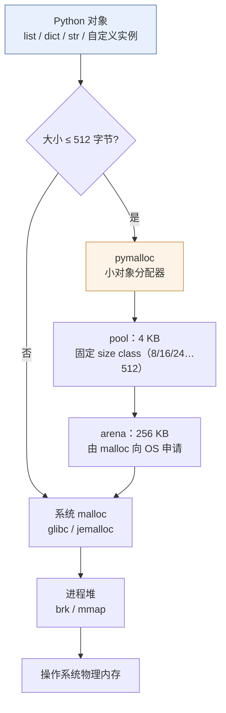
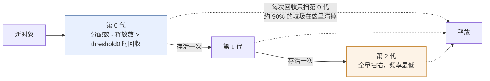

# 专题 · Python 内存管理与垃圾回收

> [!tldr] 一句话结论
> **Python 有垃圾回收，但没有"JVM 那一套"。**
> CPython 的模型是：**引用计数为主（实时回收）+ 分代循环 GC 兜底（处理循环引用）+ pymalloc 自建小对象分配器**。
> 没有 `-Xmx`，没有可插拔收集器，没有内存整理（compact），内存还给 OS 也很不积极——所以**"RSS 只涨不降"是常态，不是 bug**。

---

## 一、先对齐概念：Python 有"虚拟机"吗

严格说：**Python 有虚拟机，但没有"虚拟机规范"。**

| | Java | CPython |
| --- | --- | --- |
| 规范层 | JVMS 定义了字节码、内存模型、GC 语义 | 只有语言规范（Reference），**内存与 GC 是实现细节** |
| 实现层 | HotSpot / OpenJ9 / GraalVM | CPython（官方参考实现）/ PyPy / GraalPy |
| 执行方式 | 字节码 → JIT 编译为机器码 | 字节码 → 逐条解释（3.13+ 有实验性 JIT） |
| 内存模型 | JMM 明确定义 happens-before | 无正式内存模型，靠 GIL 兜底 |
| 换实现的影响 | 行为基本一致 | **行为可能不同**（PyPy 的 GC 是 tracing，不是引用计数） |

> [!note] 关键含义
> 因为 GC 不是规范的一部分，**换掉 CPython 就可能换掉一整套内存行为**。
> PyPy 用 tracing GC，对象不会在 `del` 时立即消失；这也是为什么"依赖 `__del__` 立即执行"的代码不可移植（`with` 才是正解）。

---

## 二、内存的三层结构



三个要点：

1. **≤512 字节走 pymalloc**。小对象被切成 8、16、24 … 512 字节的 size class，从 4KB 的 pool 里取，pool 又放在 256KB 的 arena 里。目的是**避开 `malloc` 的锁和碎片**，让 `dict`/`tuple`/小字符串的分配变成"挪一下指针"。
2. **arena 只有完全空了才可能还给 OS**。只要里面还有一个活对象，整块 256KB 就留着。碎片一多，RSS 就下不来。
3. **CPython 不做内存整理（no compaction）**。JVM 的老年代收集器会移动对象消除碎片，CPython 不会——它压根没有"移动存活对象"的能力（有 C 扩展持有裸指针）。

> [!warning] 所以 `RSS 不降` ≠ 泄漏
> 常见现象：批量导入 10 万条数据，RSS 涨到 800MB，任务结束回落到 500MB 就不再降。
> 这不是泄漏，是 **arena 碎片 + free list 缓存**。判断泄漏要看**重复执行后是否持续单调上涨**。

---

## 三、主回收器：引用计数

每个 Python 对象头上都有两个字段：

```c
typedef struct _object {
    Py_ssize_t ob_refcnt;      // 引用计数
    PyTypeObject *ob_type;     // 类型指针
} PyObject;
```

规则极简：**引用 +1，解除引用 -1，减到 0 立刻释放**。

```python
import sys

a = []
print(sys.getrefcount(a) - 1)   # 1（getrefcount 自己会临时 +1，所以要减）
b = a
print(sys.getrefcount(a) - 1)   # 2
del b
print(sys.getrefcount(a) - 1)   # 1
```

哪些操作会 +1：

| 操作 | 说明 |
| --- | --- |
| 赋值 `b = a` | 局部/全局变量表持有一份 |
| 放进容器 `lst.append(a)` | 容器持有一份 |
| 作为参数传参 | 调用期间栈帧持有一份 |
| 属性赋值 `obj.x = a` | 实例 `__dict__` 持有一份 |

### 优点与代价

| 优点 | 代价 |
| --- | --- |
| **实时回收**，不用等 GC，内存曲线平滑 | 每次赋值都要改计数，**写操作开销** |
| 实现简单，无 STW 停顿 | **无法处理循环引用** |
| 释放时机确定（`del` 后立即） | 计数更新在多线程下需要原子操作（GIL 下靠锁） |

> [!note] 「释放时机确定」只是 CPython 的性质
> `del x` 后对象立即析构，是因为引用计数归零。
> 但如果你依赖 `__del__` 做资源释放（关文件、断连接），**在 PyPy 或 free-threading 构建下可能延后到进程退出**。
> 正确做法永远是 `with` / `try...finally` / `contextlib`。

---

## 四、兜底回收器：分代循环 GC

### 为什么必须有第二个 GC

```python
class Node:
    def __init__(self, name): self.name = name

x, y = Node("x"), Node("y")
x.peer, y.peer = y, x        # 互相引用
del x, y                     # 外部引用没了，但两者计数各为 1
# 引用计数永远到不了 0 → 内存泄漏
```

实测（Python 3.13）：

```
循环引用 del 后仍存活? True
gc.collect() 回收: 2 | 仍存活? False
```

### 它只追踪"容器"

不是所有对象都会被循环 GC 检查：

```python
import gc
gc.is_tracked((1, 2, 3))   # False —— 只含不可变标量的 tuple 不追踪
gc.is_tracked([1, 2, 3])   # True  —— list/dict/set/自定义实例 追踪
```

原理：只有**可能形成环的对象**（能引用别的对象的容器）才需要扫描。这一点让 GC 的开销远小于"全堆扫描"。

### 分代假设

绝大多数对象活得很短（临时变量、中间结果），少数活得很久（模块级对象、连接池）。于是：



阈值在**不同版本不一样**，这点很多资料是错的：

| 版本 | `gc.get_threshold()` 默认值 | 说明 |
| --- | --- | --- |
| ≤ 3.12 | `(700, 10, 10)` | 经典三代模型 |
| **3.13** | **`(2000, 10, 10)`** | 改为**增量式** GC，老年代拆成 visited / pending 两个空间轮转，单次暂停更短 |
| 3.14.0–3.14.4 | 增量式 | 继续沿用 |
| **3.14.5+** | **回退为 3.13 的分代式** | 官方说明：生产环境出现明显内存压力，**回退了增量 GC** |

> [!warning] 这条要记牢（2026 年的现状）
> Python 3.14.5 的发布说明明确写着：增量 GC 因"若干生产环境内存压力报告"被**回退**到 3.13 的分代收集器。
> 所以你在不同小版本上看到的 `gc.get_stats()` 语义可能不同——**别写依赖代数语义的调优代码**。
> 官方原话大意：试图操纵循环 GC 行为的代码"可能不完全按预期工作，但几乎不会有害"。

---

## 五、和 JVM 的正面对照

| 维度 | JVM | CPython |
| --- | --- | --- |
| 堆上限 | `-Xmx` 显式控制，超了 OOM | **没有**，只能靠容器/cgroup/`ulimit` |
| 回收算法 | 可插拔（G1/ZGC/Parallel…） | **固定一套**：引用计数 + 分代循环 GC |
| 分配方式 | TLAB + bump pointer | pymalloc 的 size class 池 |
| 回收触发 | 分配压力驱动 | 引用计数**即时** + 阈值驱动循环 GC |
| STW 停顿 | 可能几十到几百 ms（ZGC 可 <1ms） | 极短（增量后更短），但**没有"停顿预算"概念** |
| 内存整理 | 有 compact，消除碎片 | **没有**，碎片靠 arena 回收间接处理 |
| 内存归还 OS | 部分归还（可配） | 很不积极，arena 空才可能还 |
| 类卸载 | 支持 | **不支持**，模块/类基本常驻 |
| 诊断工具 | GC log / JFR / jmap / MAT | `tracemalloc` / `gc` / `objgraph` / `memray` / `py-spy` |
| 调优手段 | 堆比例、收集器参数、GC 日志 | 基本只有 `gc.set_threshold` / `gc.freeze` / 换分配器 |

> [!tip] 心智换算
> **JVM 的 GC 是"工程"（可调、可观测、可换算法）；CPython 的 GC 是"约定"（你少造垃圾，它就不惹事）。**
> 所以 Python 的性能优化重点不在 GC 调参，而在**少分配**：用生成器、避免大对象拷贝、用 `__slots__`、向量化。

### free-threading（3.13t / 3.14t）改变了什么

3.14 起 free-threaded 构建是**官方支持**的（PEP 779），但内存行为有实质变化：

| 变化 | 影响 |
| --- | --- |
| 分配器换成 **mimalloc** | 并发分配更快，但**内存占用更高** |
| **偏向/延迟引用计数** | 对象可能不在计数归零时立即释放 |
| **immortal 对象**（interned 字符串、code 常量） | 永不回收，长期占用 |
| **QSBR 延迟回收** | 逻辑删除到物理可复用之间有窗口，RSS 看起来"下不去" |

> [!danger] 结论
> **不要假设"对象一定在最后一个引用消失的瞬间被释放"。**
> 在 free-threading 构建下这是明确不成立的——这是设计取舍，不是 bug。

---

## 六、五种"假泄漏"与真泄漏

| # | 现象 | 原因 | 处理 |
| --- | --- | --- | --- |
| 1 | RSS 涨上去不降 | arena/free list 缓存 | 看是否单调上涨，否则忽略 |
| 2 | 循环引用 + `__del__` | 老式 finalizer 阻塞回收 | 用 `weakref` 断环，或 `with` |
| 3 | 全局缓存无上限 | `@lru_cache(maxsize=None)`、模块级 dict | 设上限 / TTL / `WeakValueDictionary` |
| 4 | 闭包/回调持有大对象 | 函数对象持有外层变量 | 用 `functools.partial` 或显式置 `None` |
| 5 | 异常栈持有 traceback | `except` 里存了异常对象 | 别存异常本身，存 `str(e)` |
| 6 | C 扩展没释放 | 第三方库 bug | `memray` 定位，升级或隔离进程 |

```python
# 典型真泄漏：缓存无上限
@lru_cache(maxsize=None)          # ❌ 永不淘汰
def embed(text): ...

@lru_cache(maxsize=1024)          # ✅
def embed(text): ...

# 典型"假泄漏"：异常对象被长期持有
class Service:
    def run(self):
        try:
            ...
        except Exception as e:
            self.last_error = e   # ❌ traceback → 整个栈帧 → 所有局部变量
            self.last_error = str(e)   # ✅
```

> [!warning] 循环 GC 的一个细节
> 只有**容器类型**会被追踪，所以"环"必须由容器构成。
> 但 `obj.__dict__` 本身就是 dict，所以**任何带属性的实例都可能成环**——包括你以为很"轻"的 dataclass。

---

## 七、排查工具（按使用顺序）

```python
# 1. 先看总量分布：哪类对象最多
import gc, collections
cnt = collections.Counter(type(o).__name__ for o in gc.get_objects())
print(cnt.most_common(10))

# 2. 谁在引用它（找泄漏源头）
import gc
gc.collect()
target = [o for o in gc.get_objects() if isinstance(o, MyBigThing)][:1]
print(gc.get_referrers(target[0]))

# 3. 分配快照对比：两次差集就是泄漏点
import tracemalloc
tracemalloc.start()
snap1 = tracemalloc.take_snapshot()
...  # 跑 1000 次业务
snap2 = tracemalloc.take_snapshot()
for stat in snap2.compare_to(snap1, "lineno")[:10]:
    print(stat)
```

| 工具 | 用途 | 安装 |
| --- | --- | --- |
| `tracemalloc` | 标准库，按行号看 Python 层分配 | 内置 |
| `gc.get_objects` / `get_referrers` | 找人、找环 | 内置 |
| `objgraph` | 画引用图，直观 | `uv add --dev objgraph` |
| `memray` | 追踪 **C 层**分配，能看 native 泄漏 | `uv add --dev memray` |
| `py-spy dump` | 线上无侵入看栈 | `uv tool install py-spy` |

> [!tip] 线上服务的三条保命配置
> 1. **worker 进程定期重启**（gunicorn `--max-requests 2000 --max-requests-jitter 200`）——最土但最有效，把缓慢泄漏变成可控成本。
> 2. **容器内存 limit 要留 30% 余量**，因为 CPython 不会因为"快满了"就回收，直接 OOMKilled。
> 3. **`gc.freeze()` 在 fork 之前调用**，把已有对象移出 GC 扫描范围，避免 worker 各自扫描共享页（配合 `preload_app` 能显著降内存）。

```python
# gunicorn 的 post_fork 钩子里
def post_fork(server, worker):
    gc.freeze()   # fork 前的老对象不再参与循环 GC 扫描
```

> [!warning] glibc 的坑
> 大量小对象 + 多线程时，glibc malloc 会开很多 arena（每线程最多 8 个 × 64MB 虚拟），RSS 飙升。
> 容器里加环境变量 `MALLOC_ARENA_MAX=2` 通常能显著压下来。

---

## 八、和 Java 开发者最相关的四条实践

1. **不要指望"内存不够会自动回收"**。Python 只在阈值到了才跑循环 GC，且不感知 RSS。容器里必须自己设 `--max-requests` 兜底。
2. **不要用 `__del__` 管资源**。用 `with`、`contextmanager`、`try...finally`。`__del__` 在环里、在解释器退出时、在 PyPy 上行为都不可靠。
3. **不要做大对象拷贝**。`df.copy()`、`list(big_list)`、切片都会实打实复制；用视图、生成器、`memoryview`。
4. **`sys.getsizeof` 会骗你**。它只算对象本身，不算引用的子对象。看真实占用用 `tracemalloc` 或 `pympler.asizeof`。

---

## 九、自测

- [ ] 说出 CPython 的两个回收器，以及各自负责什么。
- [ ] 解释为什么循环引用不会被引用计数回收，并写出验证代码。
- [ ] 为什么 `gc.is_tracked((1,2,3))` 是 False，而 `[1,2,3]` 是 True？
- [ ] 为什么"RSS 不下降"通常不是内存泄漏？怎么区分？
- [ ] Python 3.13 的 GC 阈值是多少？3.14.5 发生了什么变化？
- [ ] 对比 JVM，说出三个 CPython 在内存管理上"做不到"的事。
- [ ] 线上服务怀疑缓慢泄漏，给出你的排查顺序。

---

> [!quote] 一句话记住
> **JVM 帮你管内存，Python 只是"记账"。**
> 记账（引用计数）能立刻发现欠债，但发现不了互相担保（循环引用）——那需要另一个专门的审计员（分代循环 GC）。
> 而这两个人都不负责"整理房间"（compact），所以房间会越来越乱，但不会塌。

---

> [!next] 相关
> [[03-阶段三-并发与异步]] · [[07-专题-Python 的分布式能力边界（对比 Java 生态）]] · [[00-Python 学习计划总览]]
