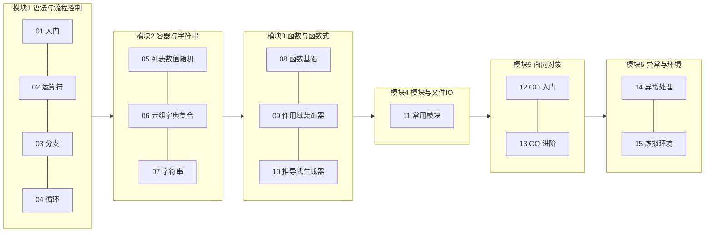
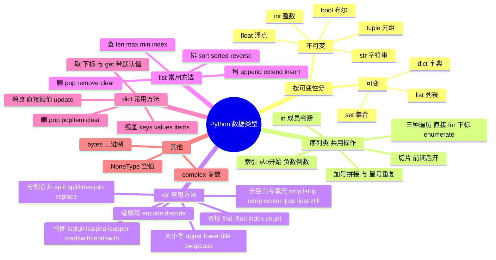

# 🐍 Python 基础课总索引

> [!tldr] 这套笔记是什么
> 智泊AI 基础课 15 节随堂笔记的**重整版**。原笔记是课堂速记（代码块里混说明、结构零散），这里按 **6 大模块**重新组织：概念表格化、代码提纯、坑点标出，并补了 **Java 对照**（你从 Java 过来，这条线索最省力）。

> [!note] 与 00 计划的关系
> 这 15 课的内容 ≈ [[00-Python 学习计划总览]] 里**阶段一（语法速通）**的完整展开。学完这 6 篇，就可以直接进入 01-阶段一 的查漏与 02-阶段二 的类与 dunder。

---

## 一、15 课 → 6 模块映射

| 模块 | 整理版笔记 | 覆盖课次 | 核心内容 | 00 计划对应 |
| --- | --- | --- | --- | --- |
| M1 | [[10-基础课01-04-语法与流程控制]] | 01~04 | 变量、格式化、运算符、if、while/for、break/continue | 阶段一·第 1 周 |
| M2 | [[11-基础课05-07-容器与字符串]] | 05~07 | list/tuple/dict/set/str、切片、可变性、深浅拷贝 | 阶段一·容器与推导式 |
| M3 | [[12-基础课08-10-函数与函数式]] | 08~10 | 参数四件套、作用域 LEGB、闭包/装饰器、推导式/生成器/迭代器 | 阶段一·函数与生成器 |
| M4 | [[13-基础课10-11-模块与文件IO]] | 10(部分)+11 | 模块与 pip、os/time/json、文件读写 with-as | 阶段一·异常与模块 |
| M5 | [[14-基础课12-13-面向对象]] | 12~13 | 类/对象、`__init__`、封装@property、类方法/静态方法、继承 | 阶段一收尾 + 阶段二入口 |
| M6 | [[15-基础课14-15-异常与虚拟环境]] | 14~15 | try/except/finally、raise/assert、venv 全流程 | 阶段一·异常 + 工程化前菜 |

---

## 二、Python 数据类型总图（思维导图版）

> 对应你那张《Python数据类型总结》思维导图 + 02/05/06/07 课的内容，转成可检索的 mermaid：

> [!tip] 一张表记死可变性
> **不可变**：int / float / bool / str / tuple ——「改」其实是创建新对象；
> **可变**：list / dict / set ——原地修改，所有引用一起变。
> 这一条直接决定后面的**深浅拷贝、字典键的限制、默认参数陷阱**三件事。

---

## 三、全局易错点 Top 8（跨课次汇总）

| # | 坑 | 出处 | 一句话记忆 |
| --- | --- | --- | --- |
| 1 | `/` 永远返回 float，`//` 才是整除（向下取整） | 02 | Java 的 `/` 看类型，Python 的 `/` 只看心情（都是小数） |
| 2 | `and`/`or` 返回的是**操作数本身**，不是布尔值 | 02 | `0 and 4` → 0，`3 or 4` → 3 |
| 3 | `input()` 返回的永远是字符串，要自己 `int()` | 01/03 | 忘了转就 `TypeError` |
| 4 | 单元素元组必须带逗号：`(3,)`，`(3)` 是 int | 06 | 逗号才是元组的灵魂，括号不是 |
| 5 | `extend("秦始皇")` 会把字符串拆成 3 个字 | 05 | extend 逐个塞可迭代对象，append 整体塞 |
| 6 | 浅拷贝只拷外壳：二维列表改子列表，两边一起变 | 06 | 嵌套结构必须 `copy.deepcopy` |
| 7 | 设了默认参数/不定长参数，必须放参数列表**最后** | 08 | 语法直接报错，没有商量 |
| 8 | 生成器函数直接调用**不执行**，要 `next()` 驱动 | 10 | 看到 yield，就想到"暂停键" |

---

## 四、怎么用这套笔记

> [!example]- 建议节奏（6 天走完）
> - **D1**：M1 语法与流程控制（有 Java 底子，这天是"翻译"不是"学习"）
> - **D2~D3**：M2 容器与字符串（信息量最大的一天半，重点吃透可变性 + 切片）
> - **D4**：M3 函数与函数式（装饰器、生成器是 Python 面试高频）
> - **D5**：M4 模块与文件 + M6 异常与环境（工程化前菜）
> - **D6**：M5 面向对象（对照 Java 学，重点看差异：self、多继承、@property）
>
> 每篇末尾有「自检问答」，折叠状态的，先自己想再看答案。

> [!info] 原始材料位置
> 15 课原始随堂笔记在 PyCharm 项目：
> `/Users/vic/PycharmProjects/ai_agent_developer/pythonProject/pythonProject/01~15_*/笔记/0X笔记.md`
> 整理版只保留高频核心；完整课堂代码（练习题等）以原笔记为准。
