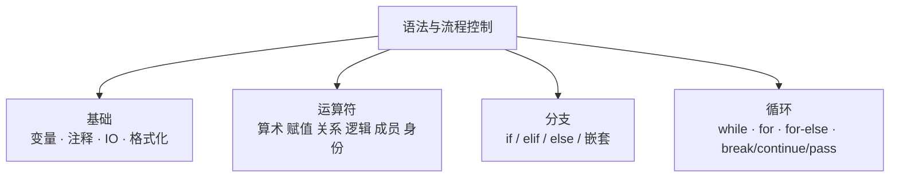

# 模块 1 · 语法与流程控制（01~04 课）

> [!tldr] 一句话总结
> 变量不用声明类型、代码块靠**缩进**不靠花括号、`/` 永远得小数、`and`/`or` 返回操作数本身——把这四个"反 Java 直觉"记住，本模块就赢了一半。



---

## 一、程序骨架与编码规范

| 规范 | 内容 |
| --- | --- |
| 语句结尾 | **不加分号**，一行一条语句 |
| 代码块 | **缩进 4 个空格**区分（Python 的"花括号"） |
| 文件名 | 避免中文和空格，后缀 `.py` |
| 注释 | 单行 `#`；多行 `'''...'''` 或 `"""..."""`（双引号注释不能嵌套） |
| 入口 | `print(100)` 就是完整程序；右键 Run 即运行 |

> [!note] Java 对照
> Java：`public static void main(String[] args)` + `{}` + 每句分号。
> Python：**没有 main 包裹**（`__name__` 那套后面再说），缩进即结构。缩进错 → `IndentationError`，不是风格问题，是语法问题。

---

## 二、变量、标识符、输入输出

| 概念 | 要点 |
| --- | --- |
| 变量 | 直接赋值即创建，**无需声明类型**（动态类型） |
| 关键字 | `import keyword; print(keyword.kwlist)` 查看全部 |
| 标识符 | 数字/字母/下划线组成；不能数字开头；不能是关键字；**严格区分大小写** |
| `input()` | 从控制台读入，**返回值永远是 str**，要数字就 `int(input())` |
| `print()` | 多参数默认空格分隔；`end=` 控制结尾；`print()` 单独一行即换行 |

### 字符串格式化三种方式（f-string 优先）

```python
name, age, salary = "杰伦", 40, 10000.4567

# 1. f-string（3.6+，推荐）
print(f"我是{name},今年{age}岁,年薪{salary}万")

# 2. % 占位符（老代码常见）
print("我是%s,今年%d岁,年薪%.2f万" % (name, age, salary))   # %.2f 保留两位

# 3. str.format()（了解）
print("我是{},今年{}岁".format(name, age))
print("我是{a},今年{b}岁".format(a=name, b=age))            # 具名可换序
```

---

## 三、数据类型一览（02 课）

| 类型 | 例子 | 说明 |
| --- | --- | --- |
| `int` | `100` | **任意大小**整数，不会溢出 |
| `float` | `3.14` | 浮点运算有精度误差（同 Java 的 double） |
| `complex` | `3+4j` | 复数（了解） |
| `str` | `"hello"` | 字符串 |
| `bool` | `True / False` | 注意**首字母大写**，等价于 1 / 0 |
| `NoneType` | `None` | 空值（≈ Java 的 null） |
| `list` | `[1, 2, 3]` | 有序可变 |
| `tuple` | `(1, 2, 3)` | 有序**不可变** |
| `dict` | `{"name": "张三"}` | 键值对 |
| `set` | `{1, 2, 3}` | 无序、不重复 |
| `bytes` | `b"hello"` | 二进制 |

> 类型查看：`type(x)`；Java 对照：Python 是**动态类型**，变量像"标签"贴在对象上，类型跟着值走而不是跟着变量走。

---

## 四、运算符【02 课·掌握】

### 4.1 六类运算符速查

| 类别 | 符号 | 关键差异点 |
| --- | --- | --- |
| 算术 | `+ - * / % ** //` | `/` 恒得 float；`//` 向下取整；`**` 幂（Java 没有） |
| 赋值 | `= += -= *= /= ...` | 先算右边再赋左边；无 `++`/`--`，用 `i += 1` |
| 比较 | `> < >= <= == !=` | 返回 bool；可链式：`1 < x < 5`（Java 没有） |
| 逻辑 | `and or not` | **返回操作数本身**；有短路 |
| 成员 | `in / not in` | 查元素是否在序列/集合里 |
| 身份 | `is / is not` | 比内存地址（同对象），不是比值 |

### 4.2 逻辑运算的真相表（易错 ⭐）

```python
print(0 and 4)        # 0    → and: 遇假返回那个假值
print(3 and [] and 6) # []   → 全真则返回最后一个
print(0 or 4)         # 4    → or: 遇真返回那个真值
print(3 or 4)         # 3    → 全假则返回最后一个
```

**bool 隐式判断（什么算"假"）**：

| 值 | 布尔 | 值 | 布尔 |
| --- | --- | --- | --- |
| `0`, `0.0` | 假 | `""` 空串 | 假 |
| `None` | 假 | `[]` `()` `{}` `set()` | 假 |
| 其余数值 | 真 | 非空容器/字符串 | 真 |

> [!note] Java 对照
> Java 的 `&&`/`||` **只能**操作 boolean 并返回 boolean；Python 的 `and`/`or` 是"返回决定短路的那个操作数"，所以有 `name = user_input or "默认名"` 这种惯用法（input 为空串时取默认值）。

---

## 五、分支结构【03 课·重点】

```python
# 单分支
if num1 != num2:
    num1 = 100

# 双分支
if num % 2 == 0:
    print(num, "是偶数")
else:
    print(num, "不是偶数")

# 多分支：从上往下匹配，命中即退出，最多进一个分支
if score >= 90:
    print("优秀")
elif score >= 80:
    print("良好")
elif score >= 70:
    print("还行")
else:
    print("加油")
```

| 要点 | 说明 |
| --- | --- |
| 匹配规则 | `if-elif-else` **只会进一个分支**（顺序匹配，命中即止） |
| 条件顺序 | 范围条件**从小到大或从大到小**排好，别交叉（先判 `>=90` 再 `>=80` 才对） |
| 嵌套 | 语法不限层，**建议不超过 3 层**，深了先考虑提前返回或条件合并 |

> [!note] Java 对照
> 语法几乎一一对应（`elif` = `else if`）。差异：Python **没有 switch**（3.10+ 有 `match-case`，结构匹配，功能更强）。

---

## 六、循环结构【04 课·重点】

### 6.1 while：三要素

```python
i = 1            # 1. 初始化（只执行一次）
while i <= 100:  # 2. 条件表达式
    print(i)
    i += 1       # 3. 更新（忘了就是死循环）
```

### 6.2 for + range（主力）

```python
# range(start, end, step)：含头不含尾
list(range(5))         # [0,1,2,3,4]
list(range(1, 10, 2))  # [1,3,5,7,9] 奇数

for i in range(1, 101):        # 遍历 1~100
    ...

# 遍历列表的三种姿势
for star in stars:             # 直接拿元素
    ...
for i in range(len(stars)):    # 拿下标
    ...
for j, star in enumerate(stars):  # 下标+元素，最 Pythonic
    ...
```

### 6.3 for-else（Java 没有的结构 ⭐）

```python
for i in seq:
    if 满足退出条件:
        break
else:
    # 只有循环"完整跑完、没被 break"才会执行
    print("没找到")
```

**用途**：搜索场景——找到就 `break`，没找到走 `else`。记住口诀：**break 跳出则跳过 else**。`while-else` 同理。

### 6.4 嵌套循环

- **外层控行数，内层控个数；外层走一步，内层跑一圈**；
- 经典：九九乘法表

```python
for i in range(1, 10):
    for j in range(1, i + 1):
        print(f"{j}*{i}={i*j}", end="\t")
    print()   # 换行
```

### 6.5 break / continue / pass

| 关键字 | 作用 |
| --- | --- |
| `break` | **跳出整个循环**，执行循环后的代码 |
| `continue` | 跳过本次，进入下一次循环（while 里注意先更新变量再 continue，否则死循环） |
| `pass` | 什么都不干的占位符，保证结构完整（函数还没想好写什么时用） |

> [!note] Java 对照
> `break/continue` 语义相同。`for-else` Java 完全没有（等价于 `found` 标志位写法）；`pass` 对应 Java 里的 `{}` 空块或 `// TODO`。

---

## 七、本模块易错点

> [!warning] 7 个高频坑
> 1. `5 / 2` → `2.5`（float！），`5 // 2` → `2`，`-5 // 2` → `-3`（**向下取整**不是向零取整，和 Java 的 `int` 除法不同）
> 2. `input()` 忘 `int()` → 运行时 `TypeError`
> 3. `if x == 1 or 2` 永远为真——`2` 本身是真值！要写 `x == 1 or x == 2` 或 `x in (1, 2)`
> 4. while 里 `continue` 前忘了 `i += 1` → 死循环
> 5. `True`/`False` 必须大写，`true` 是未定义变量
> 6. `bool` 参与运算时是 1/0：`True + True == 2`
> 7. 嵌套 if 的缩进层级错一格，逻辑就全变了——这是 Python 最大的新手杀手

---

## 八、自检问答

> [!question]- `print(10 and print(666) and print(888))` 输出什么？
> 先输出 `666`（第二个 print 执行了），整体返回 `None`（print 返回 None，and 链在这里返回 None 并打印 `None`）。考察点：and 返回操作数本身 + print 返回 None。

> [!question]- `range(1, 10, 2)` 生成什么？
> `[1, 3, 5, 7, 9]`——含头不含尾，步长 2。

> [!question]- for-else 的 else 什么时候执行？
> 循环**没有被 break 打断、正常跑完**时执行。被 break 则跳过。

> [!question]- 怎么用 for 循环同时拿到列表的下标和元素？
> `for i, v in enumerate(lst):` ——不用 `range(len(lst))` 那种 Java 味写法。

> [!question]- `1 < x < 5` 在 Python 里合法吗？
> 合法且推荐，链式比较，等价于 `1 < x and x < 5`。Java 里这是布尔运算的语法错误。
