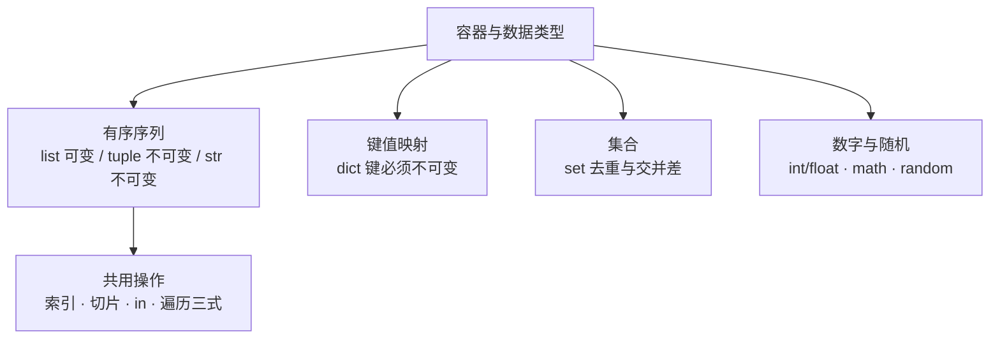

# 模块 2 · 容器与字符串（05~07 课）

> [!tldr] 一句话总结
> 五种容器 = Java 五个集合类的"轻量版"：list≈ArrayList、dict≈HashMap、set≈HashSet、tuple≈不可变 List、str≈String（但能切片）。
> 本模块的胜负手只有一个概念：**可变性**——它解释了深浅拷贝、字典键限制、一切"莫名其妙一起变"的现象。



---

## 一、先分清：可变 vs 不可变 ⭐

| 不可变类型 | 可变类型 |
| --- | --- |
| `int` `float` `bool` `str` `tuple` | `list` `dict` `set` |

**含义**：
- 不可变对象"修改" = **创建新对象**，原对象不动（str 的 `replace` 返回新串就是这个原因）；
- 可变对象原地修改，**所有指向它的变量一起变**（这是后面"赋值 vs 拷贝"的根源）。

> [!note] Java 对照
> Java 的 String 也是不可变，直觉可平移；但 Java 的 int 是值类型，Python 的 int 是**对象**（`a = 257; b = 257` 在交互环境里可能是两个对象）。

---

## 二、list 列表【05 课·掌握】

### 2.1 创建与访问

```python
list1 = []                       # 空列表
list2 = ["五菱宏光", "哈弗", 12, True]   # 可混类型，自动扩容

list2[0]     # 第一个
list2[-1]    # 最后一个
len(list2)   # 个数
list2[2] = "天狗"   # 修改
```

### 2.2 增删查排 API 速查（面试/日常高频）

| 操作 | 方法 | 说明 |
| --- | --- | --- |
| 尾部加一个 | `append(x)` | **整体**追加 |
| 尾部加多个 | `extend(iterable)` | **逐个**展开追加：`extend("秦始皇")` → 加 3 个字！ |
| 指定位置插 | `insert(i, x)` | 后面的元素依次后移 |
| 按下标删 | `pop(i)` | 不传参删最后一个，**返回被删元素** |
| 按值删 | `remove(x)` | 删第一个匹配；不存在报错 |
| 清空 | `clear()` | |
| 查位置 | `index(x)` | 不存在报错 |
| 最值长度 | `max() min() len()` | |
| 原地排序 | `sort(reverse=False)` | **不生成新列表**；降序传 `reverse=True` |
| 生成新排序 | `sorted(lst)` | **返回新列表**，原列表不动 |
| 翻转 | `reverse()` | 原地翻转 |

### 2.3 切片（list/str/tuple 通用）⭐

```python
nums = [13, 45, 2, 35, 7, 9]
nums[1:4]    # [45, 2, 35]   前闭后开
nums[:4]     # 前 4 个
nums[1:]     # 第 2 个到结尾
nums[-2:]    # 最后 2 个
nums[::2]    # 步长 2
nums[::-1]   # 反转（str 同理，见下）
```

### 2.4 运算与判断

```python
[1, 2] + [3]        # 合并
[1, 2] * 3          # 重复
12 in list1         # 成员判断，返回 bool
```

### 2.5 遍历三式（贯穿全课）

```python
for x in lst: ...                  # 直接拿元素
for i in range(len(lst)): ...      # 拿下标
for i, x in enumerate(lst): ...    # 下标 + 元素
```

---

## 三、tuple 元组【06 课】

```python
t = (12, 34, "hello", True)
t[0], t[-1]          # 访问同 list
t[1:4]               # 切片也支持

single = (3,)        # ⭐ 单元素必须带逗号
not_tuple = (3)      # 这只是 int 3！
```

| 要点 | 说明 |
| --- | --- |
| 本质 | 不可变的 list：不能增删改元素 |
| 单元素 | `(3,)` 才是元组，括号不是元组的标志，**逗号才是** |
| 能做的 | `+` 合并、`*` 重复、`in`、切片、len/max/min、`tuple(lst)` 转换、三种遍历 |
| 场景 | 函数多返回值、字典的键、不想被人改的数据 |

> [!note] Java 对照
> Java 没有内置元组（`Map.entry` / 自定义 record 凑合）。Python 函数 `return a, b` 返回的就是元组，这是"多返回值"的真相。

---

## 四、dict 字典【06 课·掌握】

### 4.1 概念与选型

| 对比 | list | dict |
| --- | --- | --- |
| 查找方式 | 下标 | 键（名字） |
| 适合存 | 一堆**同类**数据 | 一个对象的**不同属性** |
| 键的要求 | — | **必须不可变**（str/int/tuple/bool），且**唯一**（重复键后者覆盖前者） |

> [!note] Java 对照
> `dict` ≈ `HashMap<K,V>`。差异：Python 字典字面量直接写 `{"k": v}`；键必须可哈希（不可变），Java 的 HashMap 对 key 同样要求 hashCode 稳定——思路一致。

### 4.2 API 速查

```python
d = {"name": "小明", "age": 25}

d["name"]                    # 直接取，键不存在 → KeyError
d.get("money")               # 不存在 → None（不报错！）
d.get("money", 10000)        # 不存在 → 返回默认值 10000
d.keys(); d.values(); d.items()   # 三个视图

d["size"] = 6.8              # 增（键不存在即新增）
d["color"] = "骚粉"          # 改（键存在即覆盖）
d.pop("color")               # 按键删
d.popitem()                  # 删最后一对
d.clear()                    # 清空
d.update({"sex": "男"})      # 合并字典
len(d)
```

### 4.3 遍历三式

```python
for k in d: ...                    # 默认遍历 key
for v in d.values(): ...           # 只遍历 value
for k, v in d.items(): ...         # 键值对，最常用
```

---

## 五、赋值、浅拷贝、深拷贝【06 课·易错重灾区】⭐

```python
import copy

# 1. 赋值 = 只是起别名，同一个对象
a = [12, 34, 57]
b = a
a[1] = 78          # b 也变成 78！

# 2. 浅拷贝：拷外壳，不拷内层子对象
c = [14, 53, [31, 89], 42]
d = c.copy()       # 或 list(c) / c[:]
c[0] = 99          # d 不变（外层独立）
c[2][1] = 11       # d 的子列表也变了！（内层还是同一个对象）

# 3. 深拷贝：连内层一起克隆
e = [14, 53, [31, 89], 42]
f = copy.deepcopy(e)
e[2][1] = 11       # f 不受影响
```

| 方式 | 一维列表 | 嵌套（二维）结构 |
| --- | --- | --- |
| `=` 赋值 | 完全联动 | 完全联动 |
| `.copy()` 浅拷贝 | 独立 ✅ | 内层联动 ❌ |
| `deepcopy()` | 独立 ✅ | 完全独立 ✅ |

> 可视化神器（课堂推荐）：`pythontutor.com` 逐步看引用关系。

> [!note] Java 对照
> Java 里 `=` 传引用同理；"深拷贝"要自己写拷贝构造或序列化克隆。Python 一行 `deepcopy` 解决，但**你得记得用**。

---

## 六、set 集合【06 课·了解】

```python
s = {12, 345, 633, 21}
empty = set()          # 空集合必须 set()，{} 是空字典！

s.add(98)              # 加单个
s.update([1, 2, 3])    # 加多个
s.pop()                # 随机删一个
s.remove(2)            # 按值删，不存在报错
s.discard(21)          # 按值删，不存在不报错 ⭐ 更安全

# 交并差（数学味）
a & b   # 交集
a | b   # 并集
a - b   # 差集
a > b   # a 是否真包含 b
```

特点：**无序、元素唯一、不能下标访问**。用途：去重（`set(lst)`）、成员判断（比 list 快）。

> [!note] Java 对照
> ≈ `HashSet`。`& | -` 是 Python 独有的运算符糖，Java 要写 `retainAll/addAll/removeAll`。

---

## 七、str 字符串【07 课·掌握】

### 7.1 定义与转义

```python
s = "apple"; s1 = 'orange'     # 单双引号等价
s2 = "\"张三\""                # 转义
s3 = "张哥,'有点厉害'"          # 单双互相嵌套
path = r"C:\Users\ijeff\笔记"  # r 原始串：反斜杠不转义，正则/路径必用
```

### 7.2 方法分组速查（按用途记，别背清单）

| 用途 | 方法 | 要点 |
| --- | --- | --- |
| 长度/计数 | `len(s)` `s.count(sub)` | |
| 查找 | `find` `rfind` `index` | find 找不到返回 **-1**；index 找不到**报错** |
| 大小写 | `upper` `lower` `swapcase` `title` | |
| 去空白/字符 | `strip` `lstrip` `rstrip` | 默认去空格，可传指定字符 |
| 分割/合并 | `split` `splitlines` `join` | `"-".join(tuple1)` 是拼接序列的标准姿势 |
| 替换 | `replace(old, new[, n])` | 可限次数；**返回新串**（不可变） |
| 判断 | `isdigit` `isalpha` `isupper` `islower` `istitle` `startswith` `endswith` | 全返回 bool |
| 填充 | `center` `ljust` `rjust` `zfill` | 了解 |
| 编解码 | `encode()` / `bytes.decode()` | 默认 utf-8，可传 gbk |
| ASCII | `chr(65)→'A'` `ord('a')→97` | |

### 7.3 字符串"运算"

```python
s[0]           # 下标
s[1:6]         # 切片
s[::2]         # 隔一个取一个
s[::-1]        # ⭐ 反转字符串
"good" in s    # 成员判断
s1 + s2        # 拼接（只能 str + str）
s * 3          # 重复
```

> [!note] Java 对照
> Java：`indexOf`（≈find）、`split`（正则参数！Python split 是普通字符串）、`String.join`（≈join）。
> Python 独有：**切片**（`s[::-1]` 反转一行搞定，Java 要 `new StringBuilder(s).reverse()`）。

---

## 八、数字类型与随机数【05 课】

```python
import math
math.ceil(19.23)     # 20 向上取整
math.floor(19.23)    # 19 向下取整
math.sqrt(9)         # 3.0
abs(-10); round(78.12345, 3)   # 78.123 保留 3 位

import random
random.choice([12, 34, 21])        # 随机选一个
random.randrange(1, 101, 2)        # 1~100 的奇数（含头不含尾）
random.randint(1, 10)              # 1~10 且双端都含 ⭐ 和 randrange 不同
random.random()                    # [0, 1) 浮点
random.shuffle(list1)              # 原地洗牌
```

> [!warning] `randrange(1,10)` vs `randint(1,10)`
> 前者**不含** 10，后者**含** 10。课程笔记里这两个示例的注释混了，以这里为准。

---

## 九、本模块易错点

> [!warning] 8 个高频坑
> 1. `(3)` 是 int，`(3,)` 才是元组
> 2. `extend("abc")` 拆成 3 个字符；想整体加就 `append`
> 3. `pop(i)` 按下标、`remove(x)` 按值——传错参数类型报的错很难看懂
> 4. `sort()` 返回 **None**（原地改），`lst = lst.sort()` 把列表弄丢了！要新列表用 `sorted()`
> 5. 浅拷贝 `.copy()` 对嵌套结构无效，必须 `deepcopy`
> 6. 空集合是 `set()`，`{}` 是字典
> 7. `remove` 不存在的元素抛 KeyError/ValueError；`discard` 不会
> 8. dict 键重复时**后者覆盖前者**，不报错——静默丢数据最可怕

---

## 十、自检问答

> [!question]- `a = [1,2,[3,4]]; b = a.copy(); a[2].append(5)`，b 是什么？
> `[1, 2, [3, 4, 5]]`——浅拷贝共享内层子对象。

> [!question]- 为什么 tuple 能当 dict 的键，list 不行？
> 键必须可哈希（不可变）。list 可变，哈希值会漂移，查找就乱了。str/int/tuple 都不可变所以可以。

> [!question]- `sort()` 和 `sorted()` 怎么选？
> 要保留原列表用 `sorted(lst)`（返回新列表）；确定不需要原序、想省内存用 `lst.sort()`。**千万不要** `lst = lst.sort()`。

> [!question]- 怎么反转一个字符串/列表？
> `s[::-1]`（切片步长 -1）。列表也可以 `lst.reverse()`（原地）或 `list(reversed(lst))`。

> [!question]- `random.randrange(1,10)` 和 `random.randint(1,10)` 差在哪？
> randrange 不含尾（1~9），randint 双闭（1~10）。
