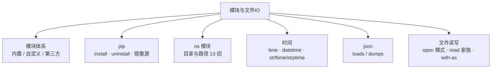

# 模块 4 · 模块与文件 IO（10~11 课）

> [!tldr] 一句话总结
> 一个 `.py` 文件 = 一个模块；pip ≈ Maven；`with open(...) as f` ≈ try-with-resources；os 管"路径与目录"，time/datetime 管"时间"，json 管"序列化"。
> 本模块是工程化的地基，命令要能盲打。



---

## 一、包和模块【10 课·掌握】

### 1.1 概念与封装层级

**封装思路**：`函数 → 类 → 模块 → 包 → 项目`

| 模块分类 | 例子 | 是否要安装 |
| --- | --- | --- |
| 内置模块 | `os` `random` `time` `json` | 否，Python 自带 |
| 自定义模块 | 自己写的 `.py` 文件 | 否，同项目直接 import |
| 第三方模块 | `numpy` `pandas` `requests` | **要** `pip install` |

**为什么拆模块**：提高可维护性、复用性、避免命名冲突。

> [!note] Java 对照
> 模块 ≈ Java 的类文件；包 ≈ Java 的 package；pip ≈ Maven/Gradle；PyPI ≈ Maven Central。

### 1.2 四种导入写法

```python
import os                          # 1. 导整块：用 os.listdir()
from random import randint         # 2. 精确导入（推荐）：直接 randint()
from module1 import name, age      #    精确导入多个
import random as r                 # 3. 起别名：r.randint()
from module1 import *              # 4. 模糊导入：全部倒进来（❌ 不推荐，命名空间被污染）
```

---

## 二、pip 与镜像源【10 课】

```bash
pip -V                          # 查版本
pip list                        # 已装的所有包
pip install requests            # 安装
pip uninstall requests          # 卸载
pip show requests               # 看包信息

# 临时用国内镜像（快）
pip install numpy -i https://mirrors.aliyun.com/pypi/simple/

# 永久设置镜像
pip config set global.index-url https://mirrors.aliyun.com/pypi/simple/

# 升级 pip 本身
python -m pip install --upgrade pip
```

PyCharm 里也可以：设置 → 项目 → Python 解释器 → `+` 装 / `-` 卸。

> 虚拟环境的完整玩法（venv）在 [[15-基础课14-15-异常与虚拟环境]]。

---

## 三、os 模块【11 课·掌握】

> 用途：操作**文件和文件夹**。13 个常用功能背下来。

| 功能 | 说明 |
| --- | --- |
| `os.listdir(path)` | 列出目录下所有文件/文件夹（返回列表） |
| `os.getcwd()` | 当前工作路径 |
| `os.mkdir("demo")` | 创建目录（已存在报错） |
| `os.makedirs("a/b/c")` | 创建**多层**目录 |
| `os.rmdir("demo")` | 删目录（只能删**空**目录） |
| `os.remove("1.py")` | 删**文件** |
| `os.rename(old, new)` | 重命名文件/目录 |
| `os.path.join("c:/jeff", "1.py")` | **拼接路径**（跨平台，别手动拼 `/`） |
| `os.path.split(path)` | 拆成 (目录, 文件名) |
| `os.path.splitext(path)` | 拆成 (文件名, 扩展名) |
| `os.path.abspath("1.py")` | 转绝对路径 |
| `os.path.getsize(path)` | 文件大小 |
| `os.path.isfile / isdir / exists` | 判断：是文件？是目录？存在？ |

> [!note] Java 对照
> ≈ `java.io.File` + `java.nio.file.Paths`。`os.path.join` ≈ `Paths.get(dir, name)`——同样是"让库帮你拼路径，别手动拼分隔符"。

---

## 四、时间模块【11 课·掌握】

### 4.1 time（轻量）

```python
import time
time.time()        # 时间戳：1970-01-01 至今的秒数
time.sleep(2)      # 暂停 2 秒
```

### 4.2 datetime（主力，time 的封装）

```python
import datetime

d = datetime.datetime.now()                  # 当前时间对象
d.year, d.month, d.day, d.hour               # 取字段

d.strftime("%Y-%m-%d %H:%M:%S")              # ⭐ 对象 → 字符串（format）
datetime.datetime.strptime("2026-08-15 10:40:21",
                           "%Y-%m-%d %H:%M:%S")   # ⭐ 字符串 → 对象（parse）

datetime.datetime.fromtimestamp(1823046991.0)  # 时间戳 → 对象

d1 - d2                                       # 两个日期相减 → timedelta
dt = datetime.timedelta(days=5, hours=8)      # 时间差
d1 + dt                                       # 日期加减
```

**记忆锚点**：`f` = format（对象→字符串），`p` = parse（字符串→对象）。**配对使用同一个格式串**，否则 ValueError。

**常用格式符**：`%Y` 四位年、`%m` 月、`%d` 日、`%H` 时(24)、`%M` 分、`%S` 秒。够用 90% 场景。

> [!note] Java 对照
> ≈ Java 8 的 `LocalDateTime` + `DateTimeFormatter`。`strftime` ≈ `format()`，`strptime` ≈ `parse()`。命名方向相反容易混（Python 是"f 出 p 入"）。

---

## 五、json 模块【11 课】

```python
import json

# 反序列化：json字符串 → 字典
s = '{"name": "ikun", "age": 26}'
d = json.loads(s)          # dict

# 序列化：字典 → json字符串
s2 = json.dumps(d)         # str
```

记忆：**loads = load string（字符串进来）**，**dumps = dump string（字符串出去）**。

> [!note] Java 对照
> ≈ Jackson 的 `readValue` / `writeValueAsString`。Python 字典与 JSON 几乎同构，所以"字典 ↔ json"是无痛互转——这也是后面 AI 接口全是 json 的原因。

---

## 六、文件操作【11 课·掌握】

### 6.1 open 模式速查

| 模式 | 含义 | 注意 |
| --- | --- | --- |
| `r` | 只读 | 文件不存在**报错** |
| `w` | 只写 | **文件不存在会创建；存在则清空重写！** |
| `a` | 追加 | 不覆盖原有内容 |
| `rb` / `wb` | 二进制读写 | 图片、音视频用这个 |

建议都带 `encoding="utf-8"`，否则 Windows 默认 gbk，中文全是乱码。

### 6.2 读文件

```python
# 标准三步：open → read → close
f = open("a.txt", "r", encoding="utf-8")
s = f.read()          # 全部内容
s = f.read(2)         # 读指定字符数（流式游标往后走）
s = f.readline()      # 读一行
lines = f.readlines() # 全部按行 → 列表
f.close()             # 必须关，释放资源

# ⭐ with-as 写法（推荐）：自动关闭，忘了 close 也不怕
with open("a.txt", "r", encoding="utf-8") as f:
    result = f.read()
```

### 6.3 写文件

```python
with open("a.txt", "w", encoding="utf-8") as f:
    f.write("hello")

with open("a.txt", "a", encoding="utf-8") as f:   # 追加
    f.write("world\n")
```

> [!note] Java 对照
> `with open(...) as f` ≈ **try-with-resources**（`try (FileReader fr = ...)`）——都是自动关闭资源的语法糖。`readlines()` ≈ `Files.readAllLines()`。

---

## 七、本模块易错点

> [!warning] 6 个高频坑
> 1. `"w"` 模式**清空原文件**——想追加用 `"a"`
> 2. 忘 `encoding="utf-8"` → Windows 下中文乱码
> 3. `open("x.txt", "r")` 文件不存在直接 FileNotFoundError；`"w"` 反而会静默创建
> 4. 读二进制（图片/视频）必须 `"rb"`，用 `"r"` 报 UnicodeDecodeError
> 5. `read()` 是流式游标：连续 read(2) 是接着往下读，不是每次从头
> 6. `os.rmdir` 只能删空目录；`os.remove` 只能删文件，两者别混

---

## 八、自检问答

> [!question]- import 的四种写法哪个最该避免？
> `from module import *`——把所有名字倒进当前命名空间，容易覆盖已有变量、来源不可查。用 `import 模块` 或精确导入。

> [!question]- strftime 和 strptime 哪个是"字符串→日期对象"？
> `strptime`（p = parse）。`strftime` 是对象→字符串（f = format）。方向记反就 ValueError。

> [!question]- 两个日期对象相减得到什么？
> `timedelta`（时间差对象），可以和日期再加减：`d1 + timedelta(days=5)`。

> [!question]- 为什么推荐 with-as 而不是手动 close？
> 自动关闭，异常时也不会泄漏文件句柄——和 Java try-with-resources 同一个动机。

> [!question]- json.loads 的输入和输出？
> 输入 JSON 字符串，输出 Python 字典（ loads = load from string）。json.dumps 反向。
