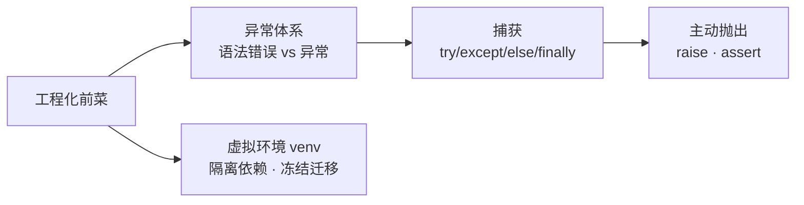

# 模块 6 · 异常处理与虚拟环境（14~15 课）

> [!tldr] 一句话总结
> try/except/else/finally 和 Java 几乎同构（except=catch），多了 **else**（无异常才走）和 **raise**（=throw）；
> 虚拟环境 = 每个项目一个独立小世界，venv 命令五条走天下：创建→激活→干活→导出→迁移。



---

## 一、错误 vs 异常【14 课】

| 类别 | 含义 | 例子 |
| --- | --- | --- |
| **语法错误** Error | 代码写错了，**跑都跑不起来** | 缩进错、冒号漏 |
| **异常** Exception | 代码语法正确，**运行时**才炸 | 索引越界、除零、名字未定义 |

**异常的破坏性**：程序终止在异常处，后面的代码全部不执行。
**处理目标**：越过异常，保证后续代码继续跑。

### 常见异常速查

| 异常 | 触发场景 |
| --- | --- |
| `NameError` | 变量未定义 |
| `TypeError` | 类型不匹配的操作（`"1" + 1`） |
| `IndexError` | 列表索引越界 |
| `KeyError` | 字典访问不存在的键 |
| `ValueError` | 值不合法（`int("abc")`） |
| `AttributeError` | 访问不存在的属性/方法 |
| `ImportError` | 模块导入失败 |
| `ZeroDivisionError` | 除零 |
| `UnboundLocalError` | 访问了还没赋值的局部变量 |

---

## 二、捕获异常的四种姿势【掌握】

```python
# 1. try-except：只要不崩就行（粗粒度）
try:
    num = 12 / 0
except:
    print("报错了")

# 2. try-except as：拿到异常对象（常用 ⭐）
try:
    num = 12 / 0
except Exception as e:
    print(e, type(e))        # division by zero <class 'ZeroDivisionError'>

# 3. try-except-else：没异常才走 else（和 if-elif-else 一个味）
try:
    num = 24 / 1
except Exception as e:
    print("报错了")
else:
    print("没报错，走这里")

# 4. try-except-finally：无论如何都执行（清理资源）
try:
    num = 24 / 0
except Exception as e:
    print("报错了")
finally:
    print("收尾代码，必跑")
```

**工作原理**：先跑 try；没异常 → 跳过所有 except（走 else）；有异常 → 按顺序匹配 except，匹配到就处理；**全都匹配不上 → 异常继续往上炸**。

> [!note] Java 对照
> `except` = `catch`，`raise` = `throw`，`finally` 完全同义。两大差异：
> ① Python **没有受检异常**（checked exception）——不用 `throws` 声明，编译器不逼你处理，全靠自觉；
> ② Python 多了 **else** 分支（Java 得把"成功逻辑"塞进 try 尾部，容易误判 try 范围）。

---

## 三、主动抛异常与断言

### 3.1 raise（= Java 的 throw new）

```python
try:
    num = input("请输入一个数字:")
    if not num.isdigit():
        raise ValueError("num必须是数字")     # 手动抛出
    print(num)
except Exception as e:
    print("引发异常", repr(e))
```

场景：**参数校验、业务规则违反**——不是为了让程序崩，而是抛给上层去统一捕获处理。

### 3.2 assert 断言

```python
def test(a):
    assert a != 0        # 断定条件为真；为假 → AssertionError
    print(12 / a)

test(0)                  # AssertionError
```

对某个条件做"预言"，失败就当场终止。多用于**开发期自检**，别拿它做业务校验。

---

## 四、虚拟环境【15 课·工程化必会】

### 4.1 为什么需要

| 痛点 | venv 怎么解决 |
| --- | --- |
| 依赖冲突：A 项目要 requests 2.x，B 项目要 3.x | 每个项目一套独立 site-packages |
| 污染全局：卸载一个库全机器遭殃 | 依赖装在项目目录里，互不影响 |
| 可移植：同事/服务器环境不一致 | `requirements.txt` 冻结依赖，一键复原 |

> [!note] Java 对照
> venv ≈ **给每个项目配一个独立的 JDK + 私有 lib 目录**。Java 靠 Maven/Gradle 做依赖隔离（pom.xml），Python 靠 venv + requirements.txt——思路同源，机制不同：venv 隔离的是**解释器+包环境**，pip 只管装包。

### 4.2 venv 全流程命令（Python 3.3+ 自带）

```bash
# 1. 检查可用
python -m venv --help

# 2. 创建（推荐在项目根目录，.venv 是惯例名）
python -m venv .venv

# 3. 激活
# Windows:
.venv\Scripts\activate          # 提示符变成 (.venv)
# macOS/Linux:
source .venv/bin/activate

# 4. 确认激活（应指向虚拟环境内的 python）
which python       # macOS/Linux
where python       # Windows

# 5. 退出
deactivate

# 6. 删除：直接删目录
rm -rf .venv

# 7. 迁移：冻结 → 复原
pip freeze > requirements.txt          # 老项目导出依赖
pip install -r requirements.txt        # 新环境一键装回
```

> [!tip] PyCharm 会帮你做
> 新建项目时勾选 "New environment using venv" 即自动创建激活；解释器设置里可随时切换。日常命令行跑脚本前，**先看提示符有没有 `(.venv)`**。

---

## 五、本模块易错点

> [!warning] 6 个高频坑
> 1. 裸 `except:` 连 `KeyboardInterrupt`、`SystemExit` 都吞掉——至少写 `except Exception as e`
> 2. except 分支匹配不到的异常**不会被拦截**，照样往上炸
> 3. `finally` 里放 return 会**吞掉** try/except 的返回值和异常（进阶坑，先知道存在）
> 4. 没激活虚拟环境就 pip install → 装到全局去了；装完发现"import 不对"多半是这个
> 5. `pip freeze` 会把**整个环境**的包全导出（包括装着玩的），干净做法是项目专环境专用
> 6. assert 可被 `-O` 优化掉，**不能**用于生产环境校验

---

## 六、自检问答

> [!question]- try-except-else-finally 四个块的执行关系？
> try 正常 → 跳过 except → 执行 else → 执行 finally；try 出异常且匹配 → 执行对应 except → 跳过 else → 执行 finally。

> [!question]- raise 和 assert 区别？
> raise 主动抛任意异常对象（生产可用，供上层捕获）；assert 断言调试期条件，条件假抛 AssertionError，且可被解释器 -O 关闭。

> [!question]- Python 有受检异常吗？
> 没有。Java 编译器强制 catch/throws，Python 全部"自愿处理"——这也是 Python 代码更容易漏处理异常的原因，靠 code review 和测试兜底。

> [!question]- requirements.txt 怎么生成和使用？
> `pip freeze > requirements.txt` 导出；新环境 `pip install -r requirements.txt` 复原。≈ Java 把 pom.xml 交给同事后 `mvn install`。

> [!question]- 激活虚拟环境的标志是什么？
> 提示符前缀出现 `(.venv)`；并用 `which python` 确认指向 `.venv/bin/python`。
