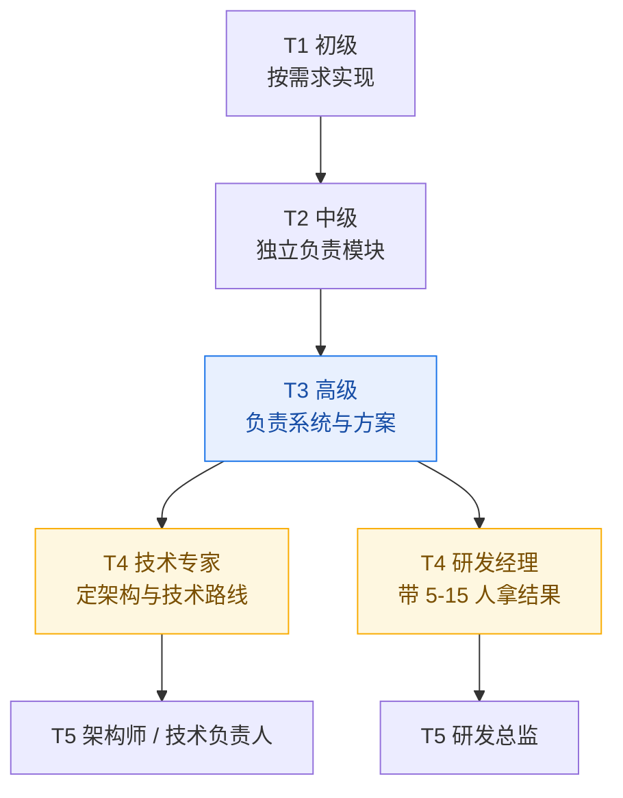

# 高级 AI 工程师 / AI 研发经理成长路线

> [!tldr] 五句话结论
> 1. **高级工程师的本质是「在信息不足、方案不唯一的问题上，独立交付确定的结果」**，不是「会用更多框架」。
> 2. **AI 方向的分水岭不是模型知识，而是工程闭环**：能不能评测、能不能控成本、能不能把 badcase 变成迭代。
> 3. **管理的分水岭不是「会不会带人」，而是「你的产出是否开始通过他人放大」**。
> 4. 技术线和管理线**前 5 年共用同一套底座**，越早把「指标意识 + 权衡表达」练出来，两条路都通。
> 5. 判断自己有没有进步，只看一件事：**你上个月做的决策，有多少能拿出数据证明是对的**。

---

## 一、先把两个角色说清楚

### 1.1 四个岗位的真实差别

| 维度 | 中级 AI 工程师 | **高级 AI 工程师** | **AI 研发经理** |
| --- | --- | --- | --- |
| 核心产出 | 能跑的功能 | 能上线的系统 + 技术方案 | 能被交付的业务结果 |
| 问题定义 | 别人给 | **自己把模糊需求拆成技术问题** | 自己定义「做什么、不做什么」 |
| 成功标准 | 按时完成、无 bug | 指标达标、方案可复用、成本可控 | 团队产能、业务效果、人员成长 |
| 时间分配 | 80% 编码 | 40% 设计 + 40% 编码 + 20% 沟通 | 30% 决策 + 50% 人与事 + 20% 技术判断 |
| 典型失败 | 交付延期、返工 | **选错方案**（架构/模型/粒度） | **团队空转**（方向错、人或流程错） |
| 价值证明 | 我做完了 | **我为什么这样选，代价是什么** | **我不在的时候，团队仍然能跑** |

### 1.2 职业阶梯

> [!important] 关键认知
> T2 → T3 靠**能力深度**；T3 → T4 靠**影响半径**。
> 影响半径的三种形态：① 你的方案被别的团队采用；② 你带的人能独立交付；③ 你定的标准成为团队默认。三种都算升级，不只是「当经理」。

### 1.3 一个 30 秒自测：你现在在哪一级

对下面 5 句话，数一下有几条成立：

- [ ] 我负责的模块，线上出问题我能独立定位到根因（不是靠猜、靠加日志试）
- [ ] 我能说清楚当前方案被放弃的替代方案，以及为什么放弃
- [ ] 我做过的技术决策，有数据能证明它带来了多少改善
- [ ] 我的方案/工具/文档，被至少一个别的团队用过
- [ ] 我能在需求还很模糊的时候，主动提出「我们先验证哪个假设」

0–1 条 → T2 中期；2–3 条 → T2 后期到 T3 门槛；4–5 条 → 已经是 T3，该考虑 T4 的路径选择。

---

## 二、能力模型：三层九格

高级工程师不是「什么都懂一点」，而是**三个维度同时到 L3**，其中至少一个到 L4。

| 层级 | 工程底座 | AI 专项 | 业务影响力 |
| --- | --- | --- | --- |
| **L1 入门** | 能读懂、能改 | 会调 API、跑通 demo | 完成分配任务 |
| **L2 独立** | 独立负责模块，写测试，能排障 | 能搭完整 RAG / Agent 链路 | 模块内被信任，不需要人盯 |
| **L3 高级** | 设计系统、定技术方案、扛线上稳定性 | 会选型权衡、建评测体系、控成本延迟 | 跨团队影响，能推动别人改 |
| **L4 专家/经理** | 定架构方向与技术标准 | 定模型策略、定技术路线投入 | 组织级结果，对业务指标负责 |

> [!tip] 用「行为证据」而不是「知识清单」定位自己
> 不要问「我会不会 Milvus」，要问「我有没有用它解决过一个召回率不达标的问题，并说得出改善了多少」。
> 知识可以突击，行为证据只能积累——而晋升答辩、面试，考的全是行为证据。

---

## 三、高级 AI 工程师：六项硬能力

每一项都给出**合格标准 / 典型不合格表现 / 怎么练**。这套标准适用于国内绝大多数「AI 应用 / AI 平台」岗位。

### 3.1 模型能力边界的判断力

- **合格标准**：给定一个业务需求，能在 30 分钟内说清「用哪个档位的模型、为什么、成本与延迟大概多少、什么情况下会失败、失败时的降级方案」。
- **不合格表现**：所有场景都用最强模型；或反过来，为了省钱全用小模型然后靠堆提示词硬撑。
- **怎么练**：给自己常做的任务建一张「模型能力卡」——同一批 20 条输入，横评 3 个模型（如 DeepSeek / Qwen / 小参数模型），记录准确率、P95 延迟、单次成本。这张表就是你的选型依据。

### 3.2 RAG 的工程化能力（不是 demo 化）

- **合格标准**：能独立设计并调优一条完整链路——文档解析 → 切分策略 → 向量化 → 混合检索（向量 + 关键词）→ 重排 → 上下文组装 → 引用溯源 → 增量更新 → 权限过滤。
- **不合格表现**：只会「切 500 字 + topK=3」，召回不准就换 embedding 模型，答不准就改提示词，没有定位手段。
- **怎么练**：拿一份真实文档（制度/合同/手册），先手工标注 50 条「问题 → 正确出处」，再逐项归因：是**召回没找到**，还是**找到了但被截断**，还是**模型读错**。这三类的修法完全不同。

### 3.3 Agent 与工具调用的可靠性

- **合格标准**：工具调用**幂等**、超时可控、有重试上限、有执行轨迹（每一步入参出参可查）、失败能人工接管、危险操作有确认闸门。
- **不合格表现**：Agent 跑飞了查不到原因；一个工具失败导致整条链路 500；重试把订单创建了三次。
- **怎么练**：做一个「会改数据」的 Agent（下单/改配置/发通知），强制给自己加：审计日志、幂等键、最大步数、人工确认。可靠性不是写出来的，是被故障逼出来的。

### 3.4 评测与数据闭环（最被低估的一项）

- **合格标准**：能建一套可回归的评测集（100–300 条，含正常、边界、对抗、应拒答四类），每次改提示词/换模型/调检索都能一键跑分；线上 badcase 有归因分类，能被转成新的评测用例。
- **不合格表现**：「我感觉改完更好了」；上线靠人工点几次；同样的 bug 修了三次又回来。
- **怎么练**：任何 AI 功能，先写评测脚本再写业务代码。**没有评测集的 AI 项目，等于没有测试的支付系统**——能上线，但一定会出事。

### 3.5 推理成本与性能

- **合格标准**：能说清当前单次请求的 token 成本、月度成本、成本结构（输入/输出/重试）；会用流式输出改善体感、用缓存降本、用小模型分流、用批处理摊平峰值。
- **不合格表现**：只知道「账单变贵了」，说不清贵在哪；上下文无脑塞满。
- **怎么练**：给自己项目加一个 token 计量中间件（按用户/接口/功能维度打点），做一版成本看板。看得见才管得住。

### 3.6 生产化：可观测、灰度、回滚

- **合格标准**：AI 链路有全链路 trace（含 prompt 版本、模型版本、检索结果、耗时、token）；支持按比例灰度新 prompt / 新模型；出问题能 5 分钟内回滚到上一版本。
- **不合格表现**：prompt 写在代码里，改一个字要发版；出了问题只能看服务器日志猜。
- **怎么练**：把 prompt 当**配置**管理（版本号 + 灰度 + 回滚），这是 AI 工程和普通后端最大的工程差异之一。

> [!warning] 六项里最容易露怯的是 3.4 和 3.6
> 大部分候选人能把 RAG 讲得头头是道，但一问「你怎么证明它变好了」「prompt 怎么灰度」就答不上来。这两项恰恰是高级岗与中级岗的分界线。

---

## 四、把现有积累变成筹码

> 已有的东西不是「学过的技术」，而是「可以讲的决策」。同样的项目，讲技术栈是中级叙事，讲权衡与指标才是高级叙事。

| 已有积累 | 中级叙事（弱） | 高级叙事（强） |
| --- | --- | --- |
| RuoYi + Spring AI + SSE 流式对话 | 我用 Spring AI 做了个聊天功能 | 在 Spring MVC 非响应式栈下用 `SseEmitter` 实现流式，解决了线程占用与超时断连问题，首字延迟从 X 秒降到 Y 秒 |
| Milvus + DashScope embedding 的 RAG | 我接了向量库做知识库 | 我把 embedding 从 OpenAI 迁到 DashScope，用同一批 200 条问题回归，召回率变化 Z%，成本下降 N% |
| Flink / 大数据背景 | 我懂实时计算 | 我能把 AI 推理接到实时链路上（特征、日志、增量入库），这是纯算法背景的人做不了的 |
| 多 provider 路由 / 网关（OmniRoute 类） | 我调研过 AI 网关 | 我设计了按成本/延迟/能力路由的降级策略，并用看板量化了节省 |

### 4.1 三个「值得做」的项目升级方向

**项目 A：企业知识库问答 —— 从「能答」到「可评测」**
- 必须有的交付物：评测集（≥100 条，含应拒答）、指标看板、badcase 归因表、增量更新方案、权限隔离方案。
- 关键指标：答案正确率、引用命中率、拒答准确率（防幻觉）、P95 延迟、单次成本。
- 面试价值：证明你有**闭环能力**，这是最高频的考察点。

**项目 B：Agent 工单/运维助手 —— 从「能调工具」到「敢上生产」**
- 必须有的交付物：工具契约（幂等/超时/重试）、执行轨迹、人工接管入口、危险操作确认、失败率统计。
- 关键指标：任务完成率、平均步数、工具失败率、人工接管率。
- 面试价值：证明你懂**可靠性工程**，不是玩 demo。

**项目 C：模型网关 / 路由层 —— 从「会用」到「会算账」**
- 必须有的交付物：统一接入层、路由与降级策略、token 计量与成本看板、prompt 版本管理。
- 关键指标：可用性、平均成本/请求、降级触发率。
- 面试价值：证明你有**平台视角**，天然通向技术负责人。

> [!tip] 项目选题的唯一标准
> 能不能用一个数字说明它比之前好。说不出数字的项目，写进简历也只是「参与过」。

---

## 五、12 个月路线图

假设你现在是「能独立做 AI 应用模块」的状态（T2 后期），目标是拿到高级岗或开始带小团队。

| 阶段 | 目标 | 关键动作 | 达标判定 |
| --- | --- | --- | --- |
| **0–3 月** 补闭环 | 从「能跑」到「可证明」 | 给现有 RAG/对话项目补：评测集、成本看板、prompt 版本化 | 能一键跑分并输出对比报告 |
| **3–6 月** 出成果 | 做出一个有指标的完整项目 | 完成上述项目 A 或 B，做到可演示、有数据、有复盘 | 能讲 15 分钟，全程有数字和权衡 |
| **6–9 月** 扩半径 | 影响从模块到团队 | 输出：内部分享 2 次、技术方案评审 3 次、帮 1–2 个同事解决 AI 落地问题 | 有人主动来找你评审方案 |
| **9–12 月** 探管理 | 验证自己是否适合带人 | 主动承接一个 2–3 人的小项目，做排期、分工、验收；观察自己在「人」上的耗能 | 项目按期交付，且你愿意再来一次 |

> [!note] 关于「要不要转管理」
> 不要在没带过人的情况下幻想管理岗。最便宜的验证方式：**带一个 3 人、2 个月的小项目**。
> 如果你在其中的真实感受是「协调比写代码更累但更有成就感」→ 可以走管理；如果是「被会议切碎、只想回去写代码」→ 走技术专家线，同样能到 T5，且薪资不低。

---

## 六、转向 AI 研发经理：五个断层

这五个断层每一个都会真实地让人摔一跤，提前知道能少走一年弯路。

### 断层 1：从「我做」到「我让别人做成」

- **踩坑**：看不上下属的代码，自己上手重写；进度慢了就自己加班补。
- **本质**：你还在用「个人产能」证明价值，而组织买的是「团队产能」。
- **动作**：把任务拆到「别人能接」的粒度；接受 70 分的交付 + 明确改进点，而不是自己做到 95 分；每周留出固定时间做「不产出代码但产出确定性」的事。

### 断层 2：从「技术最优」到「业务最优」

- **踩坑**：坚持用最好的方案，拖三个月，业务方失去耐心。
- **本质**：工程师优化「方案质量」，经理优化「投入产出与时间窗」。
- **动作**：每个方案都写清「最快能验证的版本」和「完整版」；先上 60 分能验证价值的版本，再迭代。

### 断层 3：从「接任务」到「定方向」

- **踩坑**：等上级派活；团队闲时不敢立项，忙时全在救火。
- **本质**：方向感 = 知道「现在最该验证的假设是什么」，并能说服别人一起投入。
- **动作**：每季度输出一页「我们的三个技术判断 + 对应的投入建议」；把「不做清单」也写出来。

### 断层 4：从「同事」到「上级」

- **踩坑**：不敢给负面反馈，绩效沟通变成「你很好，继续努力」；或者反过来，只讲问题不讲方法。
- **本质**：你要对「人的成长」负责，而成长需要真实反馈。
- **动作**：1on1 固定节奏（双周 30 分钟，下属说 70%）；反馈用「事实 → 影响 → 期待」三段式；绩效结论提前一个月给信号，不要突袭。

### 断层 5：从「确定性」到「信息不足下决策」

- **踩坑**：什么都想调研清楚再定，结果错过窗口；或者拍脑袋定，团队反复返工。
- **本质**：管理岗的决策永远是「信息 60% 时下注，并设计好纠错机制」。
- **动作**：每个重要决策写「决策记录」：背景、备选方案、选择理由、什么信号出现就该改。这既是纠错机制，也是向上汇报的素材。

---

## 七、AI 研发经理的四个工作面

| 工作面 | 核心问题 | 固定动作 | 常见失职 |
| --- | --- | --- | --- |
| **人** | 谁能干什么、谁想干什么 | 双周 1on1；季度成长计划；招聘画像 | 只会派活，不管成长；走人了才后悔 |
| **事** | 怎么按期、按质交付 | 周排期 + 风险清单；质量门禁（评测、灰度、回滚） | 只追进度，不设质量闸门 |
| **方向** | 技术路线与投入 | 季度技术判断；模型/框架选型的决策记录 | 跟风换框架，团队疲于迁移 |
| **向上** | 资源与预期 | 月度进展一页纸（结果、风险、需要什么）；坏消息第一时间说 | 报喜不报忧，最后一起爆雷 |

> [!important] AI 团队特有的两个管理难点
> 1. **不确定性极高**：模型能力、效果上限无法提前承诺。对策：把承诺从「效果」改成「阶段性验证里程碑」。
> 2. **迭代靠数据不靠人力**：管理抓手不是「多加人」，而是「评测集、数据标注、badcase 流转」。团队里必须有人对「数据质量」负责。

---

## 八、上任 90 天

| 阶段 | 主题 | 具体动作 |
| --- | --- | --- |
| **0–30 天** | 听，不动刀 | 一对一聊完所有人（问：最近最烦什么、你觉得哪里最该改）；梳理现有系统与线上问题；搞清楚上级对你的三个期待 |
| **30–60 天** | 定，只定三件 | 定一个看得见的目标、一套最小流程（排期 + 评审 + 复盘）、一条质量底线；不要一次改十件事 |
| **60–90 天** | 交，拿小胜 | 交付一个可展示的成果（哪怕很小）；把「什么算做好」写成团队共识；开始谈人的成长 |

---

## 九、面试与晋升：两条线考什么

### 9.1 高级 AI 工程师

| 考察维度 | 面试官真正想听 | 常见致命回答 |
| --- | --- | --- |
| 方案权衡 | 你放弃了什么，为什么 | 只讲「我们用了 X」，没有备选方案 |
| 指标意识 | 改善了多少，怎么量的 | 「效果明显提升」但说不出数字 |
| 故障复盘 | 你从线上事故学到什么 | 甩锅给模型/上游/需求方 |
| 边界认知 | 你知道这套方案的失效条件吗 | 认为自己的方案万能 |
| 工程化 | prompt 版本、灰度、回滚、成本 | 只有 notebook 和 demo |
| 协作影响 | 你怎么推动别人配合 | 全是「我」，没有「我们」 |

**叙事模板（比 STAR 更适合技术岗）**：
背景与约束 → 我判断的核心矛盾 → 备选方案与取舍 → 我的选择及代价 → 指标结果 → 如果重来我会改什么。

最后一句「如果重来」是加分项，它证明你有反思能力，而不是只会背项目。

### 9.2 AI 研发经理

| 考察维度 | 面试官真正想听 | 常见致命回答 |
| --- | --- | --- |
| 团队规模与结构 | 你怎么分工、怎么补短板 | 只说人数，不说结构 |
| 目标管理 | 你怎么把业务目标拆成团队目标 | 只会说「按时交付」 |
| 冲突处理 | 具体的一次冲突，你怎么解的 | 讲原则，不讲案例 |
| 招人与留人 | 你的招聘画像、你留住过谁 | 「我们团队氛围很好」 |
| 失败案例 | 一次真实的判断失误 | 一个失败案例都讲不出来（最致命） |
| 技术判断力 | 你还跟得上技术吗 | 完全脱离技术，只会讲流程 |

> [!warning] 经理岗面试最大的坑
> **讲不出失败案例**。面试官会认为你要么没真正负责过，要么不敢承担。准备 1 个「我做错了、造成了什么损失、我怎么补救、后来改了什么机制」的完整故事。

---

## 十、八个常见误区

1. **只调 API，不做工程**：会写 prompt 不叫 AI 工程师，能把不确定性系统化才叫。
2. **追框架，不做评测**：框架三个月换一代，评测能力十年不过时。
3. **模型万能论**：以为换个更强的模型就能解决业务问题，掩盖了数据和流程问题。
4. **模型无用论**：用过一次效果不好就否定，没做检索质量、提示结构、任务拆解的基本功。
5. **管理后彻底不碰技术**：失去判断力，团队说什么信什么，最后被技术决策反噬。
6. **管理后还抢活干**：既当经理又当主力，团队成长不起来，自己也累垮。
7. **用加班证明价值**：组织认的是杠杆，不是工时。
8. **简历写技术栈不写指标**：「熟悉 Milvus、Spring AI、LangChain」不如「把知识库答案正确率从 62% 提到 84%，单次成本降 40%」。

---

## 十一、季度自检表（每季度末打一次分，1–5 分）

| # | 自检项 | 分数 |
| --- | --- | --- |
| 1 | 本季度我做的技术决策，有数据支撑的比例 | |
| 2 | 我负责的系统，线上问题我能独立定位根因 | |
| 3 | 我的 AI 功能有可回归的评测集，改动前先跑分 | |
| 4 | 我能说清当前单次请求的成本与延迟构成 | |
| 5 | 我至少有一次方案被别的团队采用 | |
| 6 | 我主动做过一次失败复盘并改了机制 | |
| 7 | 我帮助过至少一位同事解决具体问题 | |
| 8 | 我能讲清当前技术路线被放弃的替代方案 | |
| 9 | 我有输出（分享/文档/复盘），且有人看过 | |
| 10 | 我对「下一步该验证什么」有明确判断 | |

- **35 分以上**：T3 稳定，该谈 T4 的路径选择（技术专家 or 管理）。
- **25–34 分**：T3 门槛，重点补第 1、3、5 项。
- **25 分以下**：还在 T2，先把一个项目做深、做出数字，别铺摊子。

---

## 十二、关联笔记

- [[01-学习路径总览]] —— 8 周压缩版学习节奏（短期冲刺用，本文是长期主线）
- [[05-技术转管理-角色转变与面试叙事]] —— 管理转型的面试表达细节
- [[06-团队管理-授权1on1与向上汇报]] —— 上任后的日常管理动作
- [[0-Agent 面试通关：8 站通关作战地图]] —— Agent 方向的面试考点
- [[05-项目与求职阶段]] —— 项目与求职的时间安排

---

> [!quote] 一句话收尾
> 高级工程师靠「判断力」被信任，研发经理靠「让他人被信任」被需要。
> 前者练的是把不确定变确定，后者练的是把确定复制给别人。
