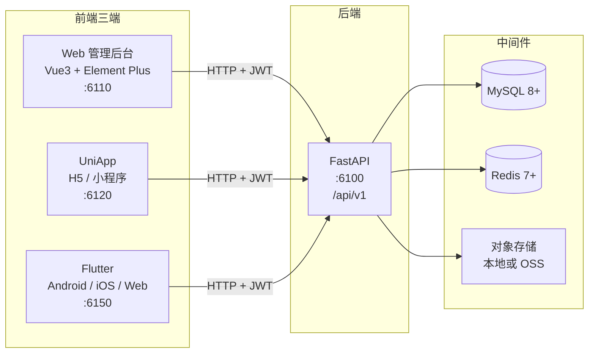
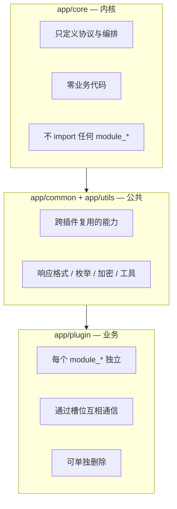
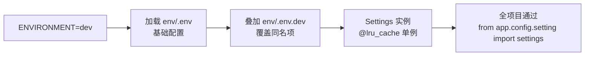

# 01 · 技术栈与工程结构

> [!tldr] 本篇三件事
> 1. 这套项目**用了什么、什么版本**（以 `pyproject.toml` 为准，不看文档）
> 2. 目录**为什么这么摆**（内核 / 插件 / 公共，三层切分）
> 3. 怎么在**5 分钟内跑起来**

---

## 一、整体形态：一套后端，三端前端



三端不是"同一套代码编译三次"，而是**三个独立前端工程共用一份后端契约**。后端的价值就在于这一份契约：

- 同样的 `/api/v1/system/auth/login`
- 同样的 RBAC 权限字符串
- 同样的统一响应体 `{code, msg, data}`
- 三端**登录加密方式不同**（`sm-crypto` vs `gm_crypto`），但后端能同时解——细节见 [[06-国密加密体系]]

> [!note] 如果只做后端
> `frontend/` 整个目录可以完全不看。后端 304 个 `.py` 文件自成体系，前端只是消费者。本笔记集也**只讲后端**。

---

## 二、依赖清单（真实版本）

以下全部取自 `backend/pyproject.toml`，不是文档里写的。注意 `requirements.txt` 已过时（见 [[00-FastApiAdmin-项目总览]] 第 5 节）。

### 2.1 Web 框架层

| 库 | 版本 | 作用 | 与本项目的关系 |
|---|---|---|---|
| **FastAPI** | `0.141.1` | Web 框架 | 路由、依赖注入、自动 OpenAPI |
| **Uvicorn** | `0.53.0` | ASGI 服务器 | `factory=True` 模式加载 `create_app` |
| **Gunicorn** | `26.2.0` | 进程管理 | 生产多 worker，`uvicorn.workers` 已弃用后走 gunicorn |
| **Starlette** | 跟随 FastAPI | ASGI 工具 | `BaseHTTPMiddleware` 写中间件 |
| **Typer** | `0.27.2` | CLI 框架 | `python main.py run/upgrade/revision` |
| **fastapi-limiter** | `>=0.2.0` | 接口限流 | 0.2.0 起改用 `pyrate-limiter` 后端 |
| **pyrate-limiter** | `>=4.0.0` | 限流桶 | 提供 Redis / 内存两种后端 |

### 2.2 数据层

| 库 | 版本 | 作用 |
|---|---|---|
| **SQLAlchemy** | `2.0.52` | ORM，全异步 |
| **asyncmy** | `0.2.14` | MySQL 异步驱动（性能优于 aiomysql） |
| **aiosqlite** | `0.22.1` | SQLite 异步（测试用） |
| **asyncpg** | `0.31.0` | PostgreSQL 异步 |
| **Alembic** | `1.20.0` | 迁移；插件可自带迁移目录 |
| **Pydantic** | `2.12.5` | Schema 校验 + 序列化 |
| **pydantic-settings** | `2.15.0` | `.env` 多级加载 |
| **Redis** | `8.1.0` | 缓存 / 会话 / 限流（`redis.asyncio` 已内置） |

### 2.3 安全与工具

| 库 | 版本 | 作用 |
|---|---|---|
| **PyJWT** | `2.14.0` | JWT 签发/校验。**注意不是 python-jose**，文档写错了 |
| **snowland-smx** | `1.0.0.post2` | 国密 SM2/SM3/SM4（导入名 `pysmx`），替代停更的 `gmssl` |
| **loguru** | `0.7.3` | 日志，带 `correlation_id` |
| **APScheduler** | `3.11.3` | 定时任务 |
| **pandas** + **openpyxl** | `2.3.3` / `3.1.5` | Excel 导入导出 |
| **bleach** | `6.4.0` | HTML 清洗（富文本防 XSS） |
| **jinja2** | `3.1.6` | 代码生成器模板 |

### 2.4 AI 相关（可选插件用）

| 库 | 版本 | 说明 |
|---|---|---|
| **agno** | `>=3.0.0` | Agent 框架，带 pgvector 支持 |
| **openai** | `2.28.0` | OpenAI 兼容客户端（可接 DashScope / DeepSeek） |
| **fastembed** | `0.8.0` | 本地 embedding，依赖 `pillow>=12` |
| **prefect** | `>=3.5,<4` | 工作流编排 |

> [!tip] 版本锁定策略
> 项目对**主版本**很敏感的几个库都写了注释说明为什么锁：
> - `fastapi-limiter>=0.2.0`：0.1.x 遍历 `app.routes` 会在 FastAPI ≥0.141 报 `_IncludedRouter` 错误
> - `websockets>=15.0.1,<17.0`：15.0.1 是 Python 3.14 上唯一有纯 Python 轮子的版本
> - `fastembed==0.8.0`：不锁会静默降级到 0.7.4
>
> 这种"注释即决策记录"的写法值得抄。

---

## 三、目录结构：内核 / 插件 / 公共

```
backend/
├── main.py                 ← Typer CLI 入口（run / revision / upgrade / reset-passwords）
├── alembic.ini             ← 迁移配置，插件迁移目录要登记到 version_locations
├── pyproject.toml          ← 依赖唯一真源
├── env/
│   ├── .env                ← 基础配置（始终加载）
│   ├── .env.example
│   └── .env.prod.example   ← 生产环境叠加层
├── app/
│   ├── config/             ← 配置层
│   │   ├── setting.py      ← 唯一的 Settings 类（460+ 行，全项目配置中心）
│   │   └── path_conf.py    ← 路径常量（BASE_DIR / ENV_DIR）
│   ├── core/               ← ★ 内核：不含任何业务
│   │   ├── database.py     ← 异步引擎 + Session 工厂 + create_tables
│   │   ├── base_model.py   ← MappedBase / ModelMixin / TenantMixin / UserMixin
│   │   ├── base_crud.py    ← 泛型 CRUDBase（645 行，白送全套 CRUD）
│   │   ├── base_schema.py  ← Schema 基类
│   │   ├── base_params.py  ← PaginationQueryParam
│   │   ├── permission.py   ← ★ 数据权限（五档）
│   │   ├── auth/           ← ★ 功能权限（RBAC）+ 会话
│   │   │   ├── permission.py   ← AuthPermission 依赖
│   │   │   ├── schema.py       ← AuthSchema / JWTPayloadSchema
│   │   │   └── session.py      ← 在线会话管理
│   │   ├── plugin/         ← ★ 插件系统内核（9 个文件）
│   │   ├── discover.py     ← 路由自动发现（扫 module_*/**/controller.py）
│   │   ├── middlewares.py  ← CORS / GZip / 请求日志
│   │   ├── router_class.py ← OperationLogRoute（操作日志自动采集）
│   │   ├── http_limit.py   ← 限流器（Redis / 内存双后端）
│   │   ├── ap_scheduler.py ← APScheduler 封装
│   │   ├── exceptions.py   ← CustomException + 全局处理器
│   │   ├── security.py     ← JWT 签发/解析（**不含密码哈希**）
│   │   ├── dependencies.py ← get_current_user
│   │   ├── logger.py / redis_crud.py / seed.py / serialize.py / validator.py / docs.py
│   ├── common/             ← 枚举 / 常量 / 统一响应
│   │   ├── enums.py        ← EnvironmentEnum / PermissionFilterStrategy
│   │   ├── response.py     ← SuccessResponse / ErrorResponse / StreamResponse
│   │   └── constant.py
│   ├── scripts/
│   │   └── init_app.py     ← 注册中间件/路由/异常/静态资源 + lifespan
│   ├── utils/              ← 国密、时间、导入导出、IP 定位
│   │   ├── sm_crypto.py        ← SM2/SM3/SM4 算法层
│   │   ├── sm_crypto_util.py   ← 统一门面（CommonCryptogramUtil / PwdUtil）
│   │   └── ip_local_util.py
│   └── plugin/             ← ★ 9 个业务插件
│       ├── module_system/      ← 81 个文件：用户/角色/菜单/部门/字典/参数/日志/租户/岗位/通知
│       ├── module_storage/     ← 24 个：文件节点/上传/工作流
│       ├── module_ai/          ← 22 个：模型/对话/知识库/RAG
│       ├── module_task/        ← 18 个：Cron 任务/执行节点/日志
│       ├── module_monitor/     ← 18 个：服务器/缓存/在线用户
│       ├── module_example/     ← 14 个：demo + demo01（新模块抄这里）
│       ├── module_generator/   ← 11 个：代码生成
│       ├── module_application/ ← 9 个：门户
│       └── module_common/      ← 8 个：上传/健康检查
├── tests/                  ← pytest（含路由快照、插件解耦、国密 golden 用例）
└── sql/                    ← 初始化 SQL
```

### 3.1 三层切分的原则



这个切分带来一个硬性质：**删除任意一个 `module_*` 目录，应用仍能启动**。代价是内核必须用"槽位"做可选依赖——这是 [[03-插件系统内核]] 的主题。

> [!warning] 内核不许 import 插件
> `tests/test_plugin_decoupling.py` 会验证这一点。如果你在内核里写了 `from app.plugin.module_system.user.model import UserModel`，测试会红。内核需要用户模型时，走 `AuthSchema.user`（运行时是 `Any`）或槽位。

---

## 四、端口与访问入口

| 用途 | 地址 | 说明 |
|---|---|---|
| 后端 API | `http://127.0.0.1:6100` | `SERVER_PORT` |
| Swagger UI | `http://127.0.0.1:6100/api/v1/docs` | 本地静态资源，不走 CDN |
| ReDoc | `http://127.0.0.1:6100/api/v1/redoc` | |
| LangJin UI | `http://127.0.0.1:6100/api/v1/ljdoc` | 第三方美化版文档 |
| 健康检查 | `GET /api/v1/common/health/ping` | 免鉴权 |
| 就绪检查 | `GET /api/v1/common/health/ready` | 检查 DB / Redis |
| Web 后台 | `http://127.0.0.1:6110` | Vite dev server |
| UniApp H5 | `http://127.0.0.1:6120` | |
| Flutter Web | `http://127.0.0.1:6150` | |

> [!note] 为什么文档路径带 `/api/v1`
> `ROOT_PATH = "/api/v1"`，且 `reset_api_docs()` 把 `/docs` 也挂在了 root_path 下。所以你访问 `:6100/docs` 会是 404，必须 `:6100/api/v1/docs`。这一点和标准 FastAPI 项目不一样，容易踩。

---

## 五、环境变量：两层加载



| 文件 | 作用 | 是否入库 |
|---|---|---|
| `env/.env` | 基础配置，所有环境共享 | 是（不含真实密钥） |
| `env/.env.dev` | 开发环境覆盖 | 否 |
| `env/.env.prod` | 生产环境覆盖 | 否 |
| `env/.env.example` | 模板（新人照抄） | 是 |

关键配置项（摘自 `setting.py`）：

```python
ENVIRONMENT: EnvironmentEnum = EnvironmentEnum.DEV   # dev / prod
SERVER_HOST: str = "0.0.0.0"
SERVER_PORT: int = 6100
ROOT_PATH: str = "/api/v1"

# 数据库
DATABASE_TYPE: Literal["mysql", "postgres", "sqlite"] = "mysql"
POOL_SIZE: int = 10
MAX_OVERFLOW: int = 20
POOL_RECYCLE: int = 1800        # 30 分钟回收，防 MySQL 8h 断连

# JWT
SECRET_KEY: str = "change-me-to-a-secure-random-key"   # 生产必须改
ALGORITHM: str = "HS256"
ACCESS_TOKEN_EXPIRE_SECONDS: int = 1800                # 30 分钟
REFRESH_TOKEN_EXPIRE_SECONDS: int = 1800
TOKEN_SLIDING_EXPIRE: bool = True                      # 滑动过期
TOKEN_REQUEST_PATH_EXCLUDE: list[str] = [
    "/api/v1/system/auth/sm-public-key",               # 白名单
]

# 国密
SM2_PRIVATE_KEY: str = ""      # 64 hex chars
SM2_PUBLIC_KEY: str = ""       # 130 hex chars，含 04 前缀
SM4_KEY: str = ""              # 32 hex chars
```

> [!danger] 改完 `.env` 不生效？
> 因为 `get_settings()` 用了 `@lru_cache`。运行中改文件无效，必须：
> - 开发模式：`uvicorn --reload` 会重启进程，自然失效
> - 手动场景：`get_settings.cache_clear()` 后重新取
>
> `main.py` 的每个 CLI 命令开头都显式 `cache_clear()` 了一次，就是在防这个坑。

---

## 六、启动三步

```bash
# ① 装依赖（推荐 uv，读 pyproject 装到正确版本）
cd backend
uv sync

# ② 准备环境变量（缺 .env.dev 就复制模板）
cp env/.env.example env/.env.dev
# 编辑 env/.env.dev：DATABASE_* / REDIS_* / SM2_* / SM4_KEY

# ③ 启动
python main.py run --env=dev
```

启动后你应该在终端看到一个彩色横幅和这些日志：

```
✅ mysql数据库表结构初始化完成
✅ 全局事件模块加载完成
✅ 定时任务调度器初始化完成
✅ 请求限流器初始化完成（RedisLimiter 分布式限流）
✅ 插件 setup 完成
✅ 插件启动阶段完成
✅ 插件运行时启动完成
```

> [!warning] `✅ 插件启动阶段完成` 没出现？
> 说明插件装配中途失败。往下翻日志找 `ERROR` 或 `Traceback`，对照 [[03-插件系统内核]] 第 6 节的四条红线排查。

### 6.1 三种启动方式对比

| 方式 | 命令 | 适用 |
|---|---|---|
| **Typer CLI**（推荐） | `python main.py run --env=dev` | 日常开发，自动 reload |
| **uvicorn 直连** | `uvicorn main:create_app --factory --reload --port 6100` | 调试启动流程 |
| **Gunicorn** | `gunicorn main:create_app -k uvicorn.workers.UvicornWorker -w 4` | 生产多进程 |

为什么必须加 `--factory`？因为 `main.py` 导出的是 `create_app()` 函数而不是 `app` 实例。这是为了**让配置在创建 app 之前加载完成**——`ENVIRONMENT` 决定读哪个 `.env.{env}`，必须早于任何 import 副作用。

---

## 七、常用命令速查

```bash
# 启动
python main.py run --env=dev

# 数据库迁移
python main.py revision --env=dev     # 自动生成迁移脚本
python main.py upgrade  --env=dev     # 应用到 head

# 重置所有用户密码（国密迁移后常用）
python main.py reset-passwords --env=dev --default-pwd=123456

# 代码质量双门禁（项目要求两条都过）
ruff check .
pyright

# 测试
uv run pytest
uv run pytest tests/test_route_snapshot.py -v   # 路由快照
```

> [!tip] `ruff` 和 `pyright` 缺一不可
> `AGENTS.md` 明确写了：ruff 不做类型检查，只跑 ruff 会漏掉"参数不匹配 / 属性访问错误 / 协程漏 await"这类真实缺陷。项目注释里甚至记录了为什么**故意不启用**某些 ruff 规则（如 `RUF029` 会漏检 `@classmethod`），这种取舍值得学。

---

## 八、练习

1. 找到 `setting.py` 里控制**验证码开关**和**跨域开关**的字段名。
2. 数一数 `app/core/plugin/` 下有几个文件，各自职责是什么（答案在 [[03-插件系统内核]]）。
3. 试着把 `SERVER_PORT` 改成 `6200`，验证生效需要做什么操作？

---

下一篇：[[02-五层架构与请求全链路]]
