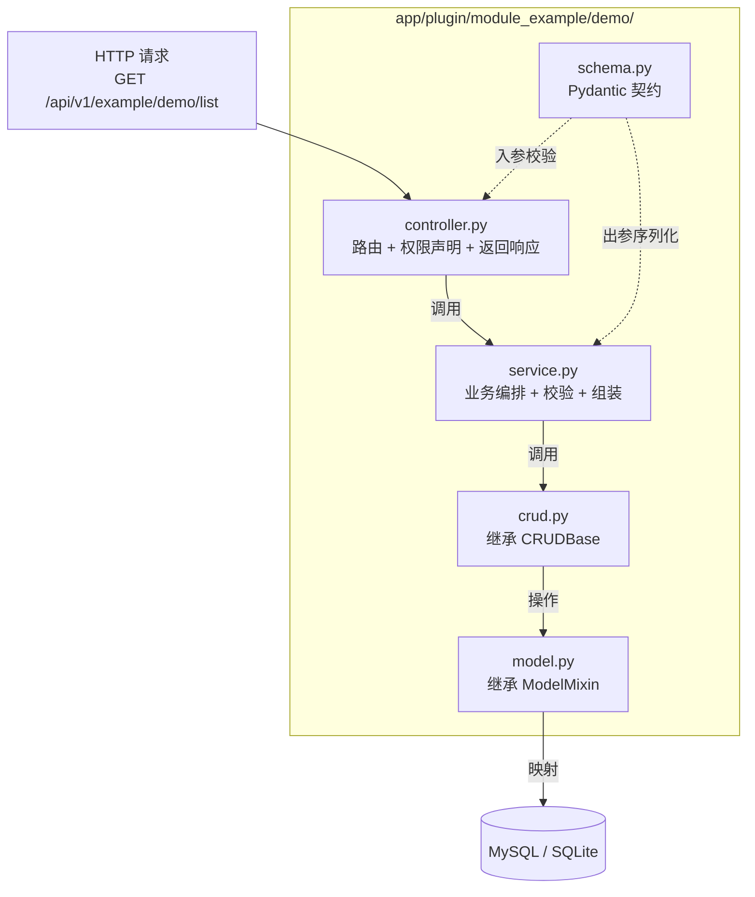
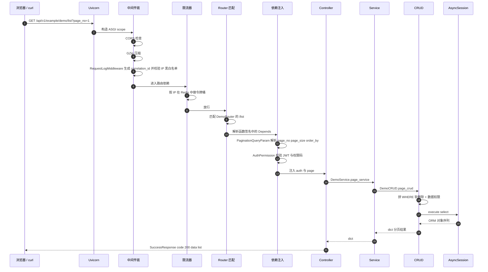
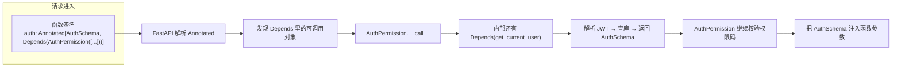

# 02 · 五层架构与请求全链路

> [!tldr] 一篇讲完"一次请求怎么走"
> 每个业务模块都是同一套五文件结构：`model → schema → crud → service → controller`。
> 五层不是形式主义，每一层都有**明确的不做什么**。看懂这篇，你就知道该改哪个文件。

---

## 一、五层职责与"不做清单"

| 层 | 文件 | 负责 | **明确不做** | Java 对照 |
|---|---|---|---|---|
| **Model** | `model.py` | 表结构、字段、关系 | 不写查询、不写校验 | `@TableName` 实体 |
| **Schema** | `schema.py` | 入参校验、出参序列化 | 不碰数据库 | `DTO` + `@Valid` |
| **CRUD** | `crud.py` | 单表增删改查、条件拼接 | 不写业务判断 | `BaseMapper` |
| **Service** | `service.py` | 业务规则、多表编排、事务 | 不拼 SQL、不返 HTTP | `@Service` |
| **Controller** | `controller.py` | 路由、参数接收、权限声明 | 不写业务、不碰 ORM | `@RestController` |



> [!note] schema 是"横切"的一层
> 它不在调用链上，而是被 controller 和 service **同时使用**：controller 用它接参数，service 用它构造返回值。所以它是虚线。

---

## 二、一次请求的完整链路

以 `GET /api/v1/example/demo/list` 为例，从 TCP 包进来到 JSON 出去：



### 2.1 逐段说明

| 步骤 | 位置 | 关键点 |
|---|---|---|
| ① ASGI 接收 | Uvicorn | 不解析业务，只把 HTTP 转成 `scope` + `receive` + `send` |
| ② 中间件 | `core/middlewares.py` | 注册顺序是 `settings.MIDDLEWARE_LIST[::-1]`，**倒序注册**才能正序执行 |
| ③ 限流 | `scripts/init_app.py` | 走全局 `Depends(_rate_limit)`，插件路由也继承，绕不过 |
| ④ 路由匹配 | `core/discover.py` | 路由是**目录扫描**出来的，不是注解 |
| ⑤ 依赖注入 | `core/auth/permission.py` | 依赖是"可调用对象"，每次请求都执行一次 |
| ⑥ Controller | `xxx/controller.py` | 只做三件事：收参、调 service、包响应 |
| ⑦ Service | `xxx/service.py` | 业务规则唯一入口，可编排多个 CRUD |
| ⑧ CRUD | `core/base_crud.py` | 白送软删除过滤 + 数据权限 + 分页 |
| ⑨ Session | `core/database.py` | `async with async_db_session()` 自动 commit/rollback |
| ⑩ 响应 | `common/response.py` | 统一 `{code, msg, data}` |

> [!warning] 中间件顺序是反的，别被绕晕
> `register_middlewares()` 里写的是 `for mw in settings.MIDDLEWARE_LIST[::-1]: app.add_middleware(mw)`。
> Starlette 的 `add_middleware` 是**后加的先执行**（洋葱模型，先进后出），所以必须倒序注册，最终请求才按配置里写的顺序进入。

---

## 三、五层的代码骨架（可直接抄）

### 3.1 Model 层 —— 表结构

```python
# app/plugin/module_example/demo/model.py
from datetime import datetime
from sqlalchemy import Boolean, DateTime, Integer, String
from sqlalchemy.orm import Mapped, mapped_column

from app.core.base_model import ModelMixin, UserMixin


class DemoModel(ModelMixin, UserMixin):
    """示例模型：Mixin 已经给了 id / uuid / status / 时间戳 / 软删除 / 审计人。"""

    __tablename__ = "gen_demo"

    name: Mapped[str] = mapped_column(String(64), nullable=False, comment="名称")
    a: Mapped[int | None] = mapped_column(Integer, nullable=True, comment="整数")
    d: Mapped[bool] = mapped_column(Boolean, default=True, comment="布尔")
    g: Mapped[datetime | None] = mapped_column(DateTime, nullable=True, comment="时间")
```

继承 `ModelMixin` 白拿 8 个字段，继承 `UserMixin` 再白拿 3 个审计字段——**业务模型只需要写自己的字段**。

详细字段表见 [[04-数据层-Model-Schema-CRUD]]。

### 3.2 Schema 层 —— 契约

同一个 Model 通常要 4 个 Schema：

```python
# app/plugin/module_example/demo/schema.py
from pydantic import BaseModel, ConfigDict, Field


class DemoCreateSchema(BaseModel):
    """创建入参：必填字段 + 校验规则"""
    name: str = Field(..., max_length=64, description="名称")
    a: int | None = None
    d: bool = True


class DemoUpdateSchema(BaseModel):
    """更新入参：全部可选"""
    name: str | None = Field(default=None, max_length=64)


class DemoOutSchema(BaseModel):
    """响应出参：允许从 ORM 对象构造"""
    id: int
    name: str
    d: bool
    created_time: datetime

    model_config = ConfigDict(from_attributes=True)


class DemoQueryParam(BaseModel):
    """查询条件：全部可选，用于拼 WHERE"""
    name: str | None = None
    status: str | None = None
```

> [!tip] `from_attributes=True` 是 ORM 模式开关
> Pydantic v1 叫 `orm_mode`，v2 改成 `from_attributes`。没有它，`DemoOutSchema.model_validate(orm_obj)` 会报 `ValidationError`。这是 v1→v2 迁移最常见的坑。

### 3.3 CRUD 层 —— 数据访问

```python
# app/plugin/module_example/demo/crud.py
from app.core.base_crud import CRUDBase
from app.core.auth.schema import AuthSchema

from .model import DemoModel
from .schema import DemoCreateSchema, DemoOutSchema, DemoUpdateSchema


class DemoCRUD(CRUDBase[DemoModel, DemoCreateSchema, DemoUpdateSchema]):
    """只要泛型参数给对，一行代码不写也能用。"""

    def __init__(self, auth: AuthSchema) -> None:
        super().__init__(model=DemoModel, auth=auth)
```

**CRUDBase 白送了什么**（详见 [[04-数据层-Model-Schema-CRUD]]）：

- `get` / `get_or_404` / `list` / `exists` / `count` / `tree_list`
- `page`（数据库分页，自动带 total）
- `create` / `update` / `delete`（软删除）/ `clear` / `set` / `restore`
- 自动过滤 `is_deleted=True`
- 自动填充 `created_id` / `updated_id`
- 自动追加数据权限 `WHERE`

### 3.4 Service 层 —— 业务编排

```python
# app/plugin/module_example/demo/service.py（节选）
class DemoService:
    @classmethod
    async def create_service(cls, auth: AuthSchema, data: DemoCreateSchema) -> dict:
        # ① 业务校验：CRUD 层管不了"重名"这种规则
        exist = await DemoCRUD(auth).get_by_name(data.name)
        if exist:
            raise CustomException(msg="名称已存在")

        # ② 落库
        obj = await DemoCRUD(auth).create_crud(data=data)

        # ③ 组装响应
        return DemoOutSchema.model_validate(obj).model_dump()

    @classmethod
    async def page_service(
        cls, auth: AuthSchema, page_no: int, page_size: int,
        search: DemoQueryParam, order_by: list[dict] | None = None,
    ) -> dict:
        offset = (page_no - 1) * page_size
        return await DemoCRUD(auth).page_crud(
            offset=offset, limit=page_size,
            order_by=order_by, search=search.model_dump(exclude_none=True),
        )
```

> [!note] 为什么 Service 大量用 `@classmethod` / `@staticmethod`
> 因为 Python 里 Service 是**无状态的**——没有成员变量要维护，每次调用需要的 `auth` 都是显式传进来的。用类方法能省一次实例化，也避免有人误以为它有状态。

### 3.5 Controller 层 —— HTTP 边界

```python
# app/plugin/module_example/demo/controller.py（节选）
from typing import Annotated
from fastapi import APIRouter, Depends, Path
from fastapi.responses import JSONResponse

from app.common.response import ResponseSchema, SuccessResponse
from app.core.auth.permission import AuthPermission
from app.core.auth.schema import AuthSchema
from app.core.base_params import PaginationQueryParam
from app.core.router_class import OperationLogRoute

from .schema import DemoOutSchema, DemoQueryParam
from .service import DemoService

# ① 模块级 APIRouter（必须！discover.py 只认顶层变量）
DemoRouter = APIRouter(
    route_class=OperationLogRoute,     # 挂上自动操作日志
    prefix="/demo",                     # 最终路径 = /api/v1/example + /demo + /list
    tags=["示例模块"],
)


@DemoRouter.get(
    "/list",
    summary="查询示例列表",
    response_model=ResponseSchema[list[DemoOutSchema]],   # ② 自动校验并写进 OpenAPI
)
async def get_obj_list_controller(
    page: Annotated[PaginationQueryParam, Depends()],                    # ③ 分页参数
    search: Annotated[DemoQueryParam, Depends()],                        # ④ 查询条件
    auth: Annotated[AuthSchema, Depends(AuthPermission(["module_example:demo:query"]))],
) -> JSONResponse:
    result = await DemoService.page_service(
        auth=auth, page_no=page.page_no, page_size=page.page_size,
        search=search, order_by=page.order_by,
    )
    return SuccessResponse(data=result, msg="查询示例列表成功")
```

**路径是怎么拼出来的**：

```
/api/v1          ← ROOT_PATH（全局前缀）
  /example       ← 目录名 module_example 去掉 module_ 前缀
    /demo        ← APIRouter(prefix="/demo")
      /list      ← @DemoRouter.get("/list")
```

这个拼接规则由 `core/discover.py` 决定，改目录名就会改 URL——**目录名就是 API 的一部分**。

---

## 四、依赖注入：FastAPI 最核心的机制



### 4.1 与 Spring 的 DI 差异

| 维度 | Spring | FastAPI |
|---|---|---|
| 注册方式 | 容器扫描 + `@Component` | 无需注册，`Depends()` 里直接写 |
| 生命周期 | 单例 / 原型 / request | **每次请求调用一次**（除非自己加缓存） |
| 作用域 | 容器统一管理 | 函数参数级，用完即弃 |
| 循环依赖 | 容器报错 | 运行时无限递归直到 RecursionError |
| 优雅写法 | 构造器注入 | `Annotated[T, Depends(fn)]` |

> [!warning] 默认不是单例，这点最容易误解
> 如果 `Depends(fn)` 里的 `fn` 每次都要查库，那就是**每次请求查一次**。想复用必须显式加 `@lru_cache`：
> ```python
> @lru_cache
> def get_settings() -> Settings: ...
> ```
> 项目里 `settings` 就是靠 `@lru_cache` 实现单例的。

### 4.2 三个常用内置依赖

| 依赖 | 作用 | 来源 |
|---|---|---|
| `Depends()`（空参） | 把 Pydantic 模型当查询参数接收 | `PaginationQueryParam` / `DemoQueryParam` |
| `Depends(AuthPermission([...]))` | RBAC 校验 + 注入 `AuthSchema` | `core/auth/permission.py` |
| `Depends(get_current_user)` | 只解析 JWT 不校验权限 | `core/dependencies.py` |

第三个常用于"登录即可，不需要特定权限"的接口。

---

## 五、统一响应格式

所有接口都返回同一个信封：

```json
{
  "code": 200,
  "msg": "查询示例列表成功",
  "data": { "list": [], "total": 0 }
}
```

对应 `app/common/response.py` 里的三种：

| 类 | 用途 |
|---|---|
| `SuccessResponse(data=..., msg=...)` | 普通成功 |
| `ErrorResponse(msg=..., code=...)` | 业务失败（默认 HTTP 200，业务码非 0） |
| `StreamResponse(data=..., media_type=...)` | 文件下载 / 流式 |

> [!tip] 异常也走信封
> `CustomException` 被全局处理器捕获后，返回的仍是 `{code, msg}` 结构，只是 `code` 非 200。前端可以统一在拦截器里判 `code`，不用区分"HTTP 错误"和"业务错误"。
>
> 注意登录失败用的是 `status_code=200` + `code=10401`，不是 HTTP 401——这是刻意设计，为了让前端能拿到 msg 提示而不是触发浏览器原生 401。

---

## 六、Controller 为什么不写业务

看 `demo/controller.py` 里最长的那个方法，也就 10 行：

```python
async def export_obj_list_controller(search, auth) -> StreamingResponse:
    result_list = await DemoService.list_service(search=search, auth=auth)
    export_result = await DemoService.batch_export_service(obj_list=result_list)
    return StreamResponse(data=bytes2file_response(export_result), ...)
```

原因有三：

1. **可测试性**：Service 可以脱离 HTTP 直接 `pytest`，不需要构造 Request
2. **可复用**：定时任务、消息消费者也能调同一个 Service
3. **权限与业务的边界清晰**：权限挂在路由上，业务在 Service 里，改权限不影响业务

> [!danger] 反模式：在 Controller 里直接 `select()`
> 一旦这么写，软删除过滤、数据权限、审计字段填充**全部失效**，因为那些都是 `CRUDBase` 提供的。项目里 304 个文件没有一处这么干，别开先例。

---

## 七、练习

1. 打开 `module_example/demo01/`，对比 `demo/`，找出两者差异（这能帮你理解"五层结构是模板，不是约束"）。
2. 如果给 `/demo/list` 加一个"按创建时间范围筛选"，要改哪几个文件？（答案：`schema.py` 加字段，`service.py` 无需改，`crud.py` 的 `page` 已支持 `between`）
3. 为什么 `DemoRouter` 必须定义在模块顶层？如果放进函数里会怎样？

---

上一篇：[[01-技术栈与工程结构]] · 下一篇：[[03-插件系统内核]]
