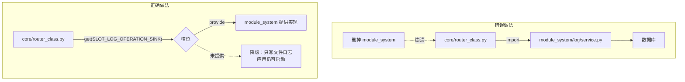
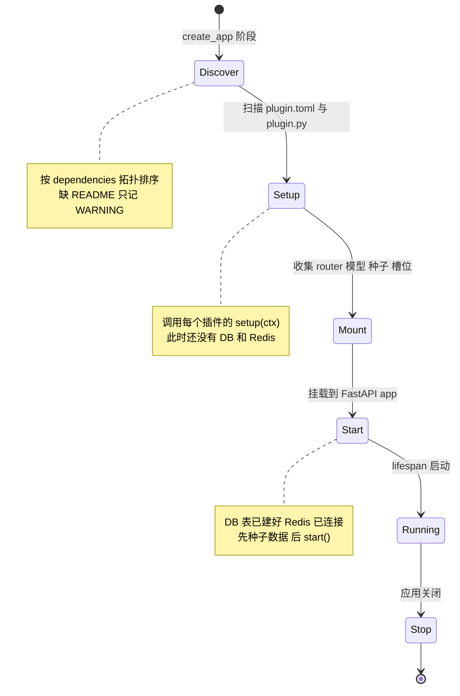
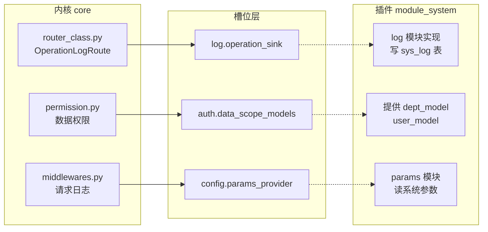
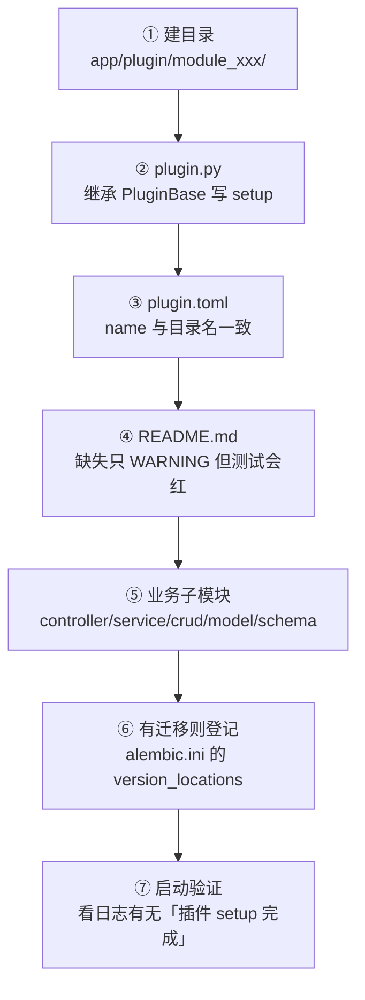

# 03 · 插件系统内核

> [!tldr] 这是整个项目最值钱的部分
> 目标是：**删掉任意一个业务模块，应用还能启动**。
> 手段是两套机制：**目录约定发现**（不需要注册表）+ **命名槽位**（内核不依赖具体业务）。

`app/core/plugin/` 一共 9 个文件、零业务代码。看懂这 9 个文件，你就理解了"插件化"在 Python 里到底怎么落地。

---

## 一、先看目标：为什么不能直接 import

假设不做插件化，`module_system` 里的操作日志想落库，最直觉的写法是：

```python
# ❌ 内核直接依赖业务
from app.plugin.module_system.log.service import OperationLogService

async def write_log(entry):
    await OperationLogService.create_log_service(entry)
```

问题立刻出现：

1. 内核 `core/` 依赖了 `plugin/module_system/`，**删掉 module_system 就 ImportError**
2. 换一个日志存储（比如写 ClickHouse）要改内核代码
3. 想单独测试内核，得把整个 module_system 拖进来

所以内核必须"只声明我需要什么能力，不关心谁提供"。这就是槽位。



---

## 二、机制一：目录约定发现

`core/discover.py` 用 **glob 扫描**代替注册表：

```python
controller_files = base_dir.glob("module_*/**/controller.py")
```

规则很硬，四条全满足才会被注册：

| # | 规则 | 违反后果 |
|---|---|---|
| 1 | 顶级目录必须 `module_` 开头 | 不扫描 |
| 2 | 文件名必须是 `controller.py`（大小写敏感） | Linux 上 `Controller.py` 无效 |
| 3 | 每一级目录名必须是合法 Python 标识符 | 含中划线/空格/中文 → `ModuleNotFoundError` |
| 4 | `APIRouter` 必须定义在**模块顶层**并赋值给变量 | 定义在函数内 → 扫不到，只记 WARNING |

### 2.1 前缀映射规则

```
目录 module_example  →  容器前缀 /example      （去掉 "module_" 共 7 个字符）
目录 module_ai       →  容器前缀 /ai
目录 module_system   →  容器前缀 /system
```

所以 `module_example/demo/controller.py` 里的 `APIRouter(prefix="/demo")` 最终路径是：

```
/api/v1/example/demo/list
       │       │     │
       │       │     └── APIRouter 的 prefix + 路由路径
       │       └──────── 目录名映射
       └──────────────── ROOT_PATH
```

> [!warning] 目录名就是 API 的一部分
> 把 `module_example` 改名成 `module_demo`，所有接口路径会从 `/example/*` 变成 `/demo/*`，前端全挂。改名要同步改前端。

### 2.2 为什么不用注册表

对比 RuoYi 的 `@RestController` 注解扫描，目录扫描的取舍：

| 维度 | 注解扫描（Java） | 目录扫描（本项目） |
|---|---|---|
| 新增模块 | 加类 + 加注解 | 加目录 + 加文件 |
| 漏注册风险 | 忘写注解 | 目录名/文件名的隐式约定 |
| 启动速度 | 反射扫描 classpath | glob 文件 + import |
| 可预测性 | 高 | 中（依赖约定） |

代价是**大量隐式约定**，所以项目写了 `tests/test_route_snapshot.py` 做路由快照回归——路由集合一变更，测试立刻红。

---

## 三、机制二：五阶段生命周期



### 3.1 各阶段能做什么、不能做什么

| 阶段 | 触发位置 | 能用什么 | 典型用途 |
|---|---|---|---|
| **discover** | `register_routers()` | 只有文件系统 | 解析 `plugin.toml`、依赖排序 |
| **setup** | `discover_and_setup()` | `PluginContext`，**无 DB/Redis** | 声明模型、注册路由、注册槽位 |
| **mount** | `PluginRuntime.mount(app)` | FastAPI app | 挂载 router、加依赖 |
| **start** | `lifespan` 内 | DB + Redis 就绪 | 缓存预热、种子数据、后台任务 |
| **stop** | `lifespan` finally | 同上 | 清理连接、停止任务 |

> [!danger] 最常见的错误：在 setup 里查数据库
> `setup()` 执行时数据库连接还没建立。所有需要 DB 的初始化必须放 `start()`。项目注释写得很清楚："种子数据与系统配置/字典缓存预热均归属 module_system 插件，在 runtime.start() 内部按「种子 → 插件 start()」顺序完成"。

### 3.2 启动顺序的真实代码

```python
# app/scripts/init_app.py
@asynccontextmanager
async def lifespan(app: FastAPI):
    runtime = get_runtime(app)

    # ① 建表（插件模型已在 create_app 阶段注册到 metadata）
    await create_tables()
    # ② 全局事件模块
    await import_modules_async(modules=settings.EVENT_LIST, app=app, status=True)
    # ③ 调度器
    await SchedulerUtil.init_scheduler(redis=redis_client)
    # ④ 限流器（Redis 可用则分布式，否则内存降级）
    _limiter = RateLimiter(backend=await build_limiter(redis_client), ...)
    # ⑤ 插件运行时启动（内部：种子 → 各插件 start）
    await runtime.start(redis=redis_client)
    # ⑥ 槽位缺失告警（不是报错，只是告警）
    if _get_slot(SLOT_LOG_OPERATION_SINK) is None:
        log.warning("⚠️ 槽位 log.operation_sink 未提供：操作日志仅写文件日志")

    yield

    # 关闭：反序
    await runtime.stop()
    await SchedulerUtil.shutdown(wait=False)
```

注意第 ⑥ 步——**槽位缺失是告警不是异常**，这是"可删插件"的保证。

---

## 四、PluginBase：只有 1 个必填钩子

```python
class PluginBase(ABC):
    @abstractmethod
    def setup(self, ctx: PluginContext) -> None:
        """声明插件能力（必须实现）"""

    async def start(self) -> None:          # 可选，空实现
    def set_redis(self, redis) -> None:     # 可选，空实现
    async def stop(self) -> None:           # 可选，空实现
```

最简插件只有 6 行：

```python
# app/plugin/module_example/plugin.py
from app.core.plugin.base import PluginBase
from app.core.plugin.context import PluginContext

MODEL_PATHS = ("demo.model", "demo01.model")

class Plugin(PluginBase):
    def setup(self, ctx: PluginContext) -> None:
        ctx.add_models(*MODEL_PATHS)

PLUGIN = Plugin()      # ← 运行时按这个名字找实例，缺了整插件被跳过
```

> [!warning] `PLUGIN` 变量名是硬编码的
> `runtime.ENTRY_VAR == "PLUGIN"`。写成 `plugin = Plugin()` 或 `my_plugin = Plugin()` 都会被判为"入口不可用"，然后 **ERROR + 静默跳过整个插件**——路由、模型、种子全没，但应用能正常启动。这是最难查的故障。

---

## 五、槽位：内核与插件之间的唯一契约

`core/plugin/slots.py` 只有 30 行，是一个带名字的字典：

```python
_slots: dict[str, Any] = {}

def provide(name: str, impl: Any) -> None:  # 后注入覆盖先注入
    _slots[name] = impl

def get(name: str, default: Any = None) -> Any:
    return _slots.get(name, default)

def clear_slots() -> None:  # 测试隔离用
    _slots.clear()
```

### 5.1 五个槽位

| 槽位常量 | 值 | 提供方 | 消费方 | 缺失时降级 |
|---|---|---|---|---|
| `SLOT_AUTH_USER_RESOLVER` | `auth.user_resolver` | module_system | 内核鉴权 | 无法解析用户 |
| `SLOT_AUTH_DATA_SCOPE_MODELS` | `auth.data_scope_models` | module_system | `Permission` 数据权限 | 不做数据隔离 |
| `SLOT_LOG_OPERATION_SINK` | `log.operation_sink` | module_system | `OperationLogRoute` | 只写文件日志 |
| `SLOT_CONFIG_PARAMS_PROVIDER` | `config.params_provider` | module_system | 请求日志中间件 | 演示模式/IP 黑白名单全关 |
| `SLOT_SCHEDULER_JOB_LOG_SINK` | `scheduler.job_log_sink` | module_task | 调度器 | 任务日志只写文件 |

### 5.2 解耦效果



**内核 import 的是槽位常量，不是实现类**。所以 `tests/test_plugin_decoupling.py` 才能验证"内核零插件引用"。

### 5.3 契约用 Protocol 描述

`core/plugin/contracts.py` 定义了 4 个 `runtime_checkable` Protocol：

```python
@runtime_checkable
class OperationLogSink(Protocol):
    async def write(self, entry: OperationLogEntry, session, redis) -> None: ...
```

Protocol 相当于 Python 的"结构化接口"——不要求显式 `implements`，只要有同名方法就算满足。比 ABC 松，适合跨插件。

> [!tip] 为什么不用 ABC
> ABC 要求提供方 `import` 基类，那提供方就依赖内核了；Protocol 是**鸭子类型 + 静态检查**，提供方可以完全不知道自己实现了某个 Protocol。这是"依赖倒置"最轻的实现。

---

## 六、四条静默失败红线（务必背下来）

`AGENTS.md` 和 `core/plugin/README.md` 都强调这四条：**不报错，但功能整体失效**。

| # | 红线 | 症状 | 正确做法 |
|---|---|---|---|
| **1** | `plugin.py` 缺模块级 `PLUGIN = Plugin()` | 只记一条 ERROR，整个插件被跳过 | 必须写这一行 |
| **2** | 在 `plugin.py` 里 `ctx.add_router()` 重复挂载 controller | 同一路径注册两次，路由冲突 | controller 的顶层 `APIRouter` 由 `discover.py` 自动挂载，**别手动加** |
| **3** | 模型没写进 `ctx.add_models(*MODEL_PATHS)` | 字符串 `relationship()` 抛 `KeyError: 'UserModel'`，往往在别的测试才炸 | 列出**全部**模型模块，不只 import 一个 |
| **4** | 槽位提供方在 `setup()` 里 `provide()`，消费方没判空 | 写入被静默丢弃 | 提供方在 `start()` 里 provide；消费方 `get()` 判空后**降级并记日志** |

### 6.1 红线 2 的细节

这是最容易搞错的。`discover.py` 已经会扫描 `module_*/**/controller.py` 并挂载顶层 `APIRouter`，所以：

```python
# ✅ 正确：controller.py 顶层定义，discover 自动挂载
DemoRouter = APIRouter(route_class=OperationLogRoute, prefix="/demo", tags=["示例模块"])

# ✅ 正确：非 controller.py 的路由（如 WebSocket）才手动 add_router
ctx.add_router(ws_router)

# ❌ 错误：重复挂载，同一「方法+路径」注册两次
ctx.add_router(DemoRouter)
```

守卫测试：`tests/test_route_snapshot.py::test_no_duplicate_routes`。

### 6.2 红线 4 的细节

槽位是"可选依赖"，所以**消费方必须假设它为 None**：

```python
# ✅ 正确：判空 + 降级
sink = get(SLOT_LOG_OPERATION_SINK)
if sink is None:
    log.info(f"操作日志: {request.method} {request.url.path}")
else:
    async with async_db_session() as session:
        await sink.write(entry, session, redis)

# ❌ 错误：直接调用，插件缺失时 AttributeError
await get(SLOT_LOG_OPERATION_SINK).write(entry, session, redis)
```

注意降级时的日志级别：**热路径用 `info`，启动期用 `warning`**。因为每个请求都 warning 会刷爆日志（项目在 `init_app.py` 里统一告警，热路径只 info）。

---

## 七、事件总线：与槽位的分工

`core/plugin/events.py` 提供简单的发布订阅：

```python
event_bus.subscribe("user.created", handler)
event_bus.publish("user.created", user)
```

**槽位 vs 事件总线，什么时候用哪个**：

| 维度 | 槽位 | 事件总线 |
|---|---|---|
| 语义 | "我需要一个能力，谁有？" | "我发生了这件事，谁关心？" |
| 方向 | 消费方主动取 | 提供方主动通知 |
| 返回 | 有返回值 | 无返回值（fire and forget） |
| 典型 | 日志落库、参数读取 | 用户注册后发邮件、发积分 |

一句话：**要结果用槽位，只通知用事件**。

---

## 八、plugin.toml：元数据，不是依赖声明

```toml
# app/plugin/module_example/plugin.toml
name = "example"              # 必须与目录名剥离 module_ 后一致
title = "示例插件"
version = "1.0.0"
description = "演示 module_* 目录约定与动态路由注册"
optional = true
tags = ["demo", "sample"]
```

> [!warning] 它不用于装依赖
> `plugin.toml` 里的 `dependencies` 只用于**拓扑排序**（决定 setup 顺序），不会触发 pip 安装。真正依赖在 `pyproject.toml`。项目注释专门写了这点，因为很多人以为它是"插件级 requirements"。

---

## 九、两种插件形态

| 形态 | 条件 | 行为 |
|---|---|---|
| **完整插件** | 有 `plugin.py` + `PLUGIN` 实例 | 走 setup/mount/start 全流程 |
| **存量插件** | 无 `plugin.py` | 由目录扫描回退挂载其 controller，无生命周期钩子 |

新写模块一律用完整形态。存量回退是为了兼容历史代码，别主动用。

---

## 十、扩展一个插件需要做什么



详细步骤和完整代码见 [[09-开发实战与踩坑清单]]。

---

## 十一、练习

1. `app/core/plugin/` 里 `manifest.py` / `loader.py` / `registry.py` / `runtime.py` 各自负责什么？
2. 如果 `module_system` 被删掉，应用启动后哪些功能会降级？哪些会直接不可用？
3. 为什么槽位用字符串名字而不是枚举？提示：想想跨插件引用枚举要付出什么代价。

---

上一篇：[[02-五层架构与请求全链路]] · 下一篇：[[04-数据层-Model-Schema-CRUD]]
