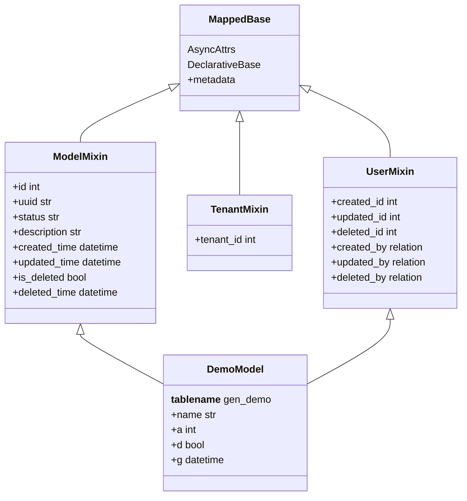
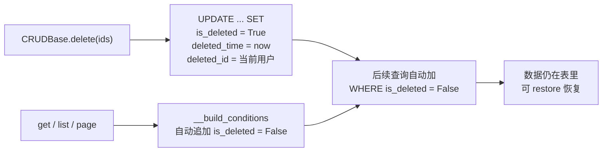

# 04 · 数据层：Model / Schema / CRUD

> [!tldr] 数据层三件套的分工
> **Model 描述表**（SQLAlchemy）→ **Schema 描述契约**（Pydantic）→ **CRUD 描述操作**（泛型基类）。
> 三者职责不重叠。混用就会出现"接口返回了数据库密码字段"这类事故。

---

## 一、Model：靠 Mixin 白拿 11 个字段

### 1.1 类继承结构



### 1.2 三个 Mixin 的字段清单

**`ModelMixin`** — 所有业务表都要有：

| 字段 | 类型 | 默认 | 说明 |
|---|---|---|---|
| `id` | int PK | 自增 | 主键 |
| `uuid` | str(64) | uuid4 字符串 | 对外暴露用，避免暴露自增 ID |
| `status` | str(10) | `"0"` | 0 正常 / 1 停用 |
| `description` | str / None | None | 备注 |
| `created_time` | datetime | `now()` | |
| `updated_time` | datetime | `onupdate=now()` | |
| `is_deleted` | bool | `False` | 软删除标记 |
| `deleted_time` | datetime / None | None | |

**`TenantMixin`** — 多租户表才有：

| 字段 | 说明 |
|---|---|
| `tenant_id` | 租户 ID，配合 `TenantMixin` 做自动隔离 |

**`UserMixin`** — 需要审计的表才有：

| 字段 | 说明 |
|---|---|
| `created_id` / `updated_id` / `deleted_id` | 操作人 ID（由 `CRUDBase` 自动填充） |
| `created_by` / `updated_by` / `deleted_by` | 关系属性，字符串 `relationship` |

> [!warning] 字符串 `relationship` 是红线 3 的根源
> `UserMixin` 里用的是 `relationship("UserModel")`（字符串）。SQLAlchemy 靠**映射器注册表**解析字符串，如果某个插件只 import 了自己模型、没声明 `ctx.add_models(...)`，解析时就会 `KeyError: 'UserModel'`。这就是为什么插件必须显式声明全部模型路径。

### 1.3 为什么用 2.0 新语法

```python
# SQLAlchemy 1.x 旧写法
name = Column(String(64), nullable=False)

# SQLAlchemy 2.0 新写法（项目采用）
name: Mapped[str] = mapped_column(String(64), nullable=False, comment="名称")
```

`Mapped[T]` 的价值：**类型注解即类型约束**，pyright 能静态检查出"给 int 字段赋了 str"。代价是 `Optional` 必须写成 `Mapped[str | None]`，否则 pyright 会认为该字段不可为 None 而 `mapped_column(nullable=True)` 的意图没被类型系统表达。

---

## 二、Schema：一个 Model 配四个 Schema

| Schema | 用途 | 特征 |
|---|---|---|
| `XxxCreateSchema` | POST 创建入参 | 必填字段用 `Field(...)` |
| `XxxUpdateSchema` | PUT 更新入参 | **全部可选**，支持局部更新 |
| `XxxOutSchema` | 响应出参 | `from_attributes=True` |
| `XxxQueryParam` | GET 查询条件 | 全部可选，配 `Depends()` 用 |

```python
# 出参的关键配置
class DemoOutSchema(BaseModel):
    id: int
    name: str
    created_time: datetime

    model_config = ConfigDict(from_attributes=True)   # 允许 model_validate(orm_obj)
```

### 2.1 为什么出参必须单独定义

如果直接把 ORM 对象返回：

```python
return SuccessResponse(data=demo_obj)     # ❌
```

后果：

1. 依赖 SQLAlchemy 的默认序列化，字段名是数据库列名，**`is_deleted` 这类内部字段会泄露**
2. `relationship` 会触发懒加载，异步 Session 下直接抛 `MissingGreenlet`
3. 改表结构就改接口契约，前端被动

正确做法永远是 `OutSchema.model_validate(orm_obj).model_dump()`。

### 2.2 校验能力

Pydantic v2 的校验比 `@Valid` 更宽：

```python
from pydantic import Field, field_validator

class DemoCreateSchema(BaseModel):
    name: str = Field(..., min_length=2, max_length=64)
    age: int = Field(default=0, ge=0, le=150)
    ip: str | None = None

    @field_validator("ip")
    @classmethod
    def check_ip(cls, v):
        if v and not is_valid_ip(v):
            raise ValueError("IP 格式不合法")
        return v
```

校验失败时 FastAPI 自动返回 **422** + 详细字段错误清单，不用写一行 try/except。

> [!example] 422 响应长什么样
> ```json
> {"detail":[{"type":"string_too_short","loc":["body","name"],
>   "msg":"String should have at least 2 characters","input":""}]}
> ```
> 注意这个格式**没有** `{code, msg, data}` 信封——因为它在进入业务代码前就被拦下了。前端拦截器要单独处理 422。

---

## 三、CRUDBase：白送的 13 个方法

```python
class CRUDBase(Generic[ModelType, CreateSchemaType, UpdateSchemaType]):
    def __init__(self, model: type[ModelType], auth: AuthSchema) -> None:
        self.model = model
        self.auth = auth          # ★ 注意：auth 里带着 db session
```

| 方法 | 作用 | 备注 |
|---|---|---|
| `get(**kwargs)` | 查单条 | 支持 `preload` 预加载 |
| `get_or_404(**kwargs)` | 查单条，没有则抛异常 | |
| `list(**kwargs)` | 查列表 | 支持 `order_by` / `preload` / 不分页 |
| `exists(**kwargs)` | 是否存在 | |
| `count(**kwargs)` | 计数 | |
| `tree_list(**kwargs)` | 树形列表 | 部门/菜单用 |
| **`page(offset, limit, order_by, search, out_schema)`** | 数据库分页 | 返回 `{page_no, page_size, total, has_next, items}` |
| `create(data)` | 创建 | 自动填审计字段 |
| `update(id, data)` | 更新 | 支持局部更新 |
| `delete(ids)` | 批量删除 | **软删除**，不是真删 |
| `clear()` | 清空 | 慎用 |
| `set(ids, **kwargs)` | 批量改字段 | 如批量改 status |
| `restore(ids)` | 恢复软删除 | |

### 3.1 分页的真实返回结构

```python
{
    "page_no": 1,
    "page_size": 10,
    "total": 42,
    "has_next": True,
    "items": [ {...}, {...} ]      # ← 注意是 items，不是 list
}
```

> [!warning] 与原始文档不一致
> `docs/后端技术文档.md` 里写"返回分页数据（含总数、列表）"，容易被理解成 `list` 字段。实际源码是 `items`。前端对接时按 `items` 取。

### 3.2 分页实现里的两个细节

```python
# ① count 用主键而非 count(*)，省一次全表扫描
pk_cols = list(sa_inspect(self.model).primary_key)
count_sql = select(func.count(pk_cols[0])).select_from(self.model)

# ② count 也要过数据权限，否则总数会泄露
count_sql = await self.__filter_permissions(count_sql)
```

第 ② 点是**容易漏的安全问题**：如果只给列表查询加权限过滤、count 不加，攻击者能从 `total` 推断出别人的数据量。

### 3.3 查询条件的写法

`search` 是个 dict，值可以是单值（精确匹配）或元组（操作符）：

```python
# 精确匹配
search = {"status": "0"}

# 元组形式 → 操作符
search = {
    "name":           ("like", "张"),                      # 模糊
    "id":             ("in", [1, 2, 3]),                    # IN
    "created_time":   ("between", ["2026-01-01", "2026-12-31"]),  # 区间
    "status":         ("!=", "1"),                          # 不等
    "age":            (">=", 18),                           # 比较
    "deleted_time":   ("None", None),                       # IS NULL
    "description":    ("not None", None),                   # IS NOT NULL
    "created_time":   ("date", "2026-11-07"),               # 按日期匹配
    "created_time":   ("month", "2026-11"),                 # 按月匹配
}
```

完整操作符表：

| 元组第一位 | 含义 | SQL |
|---|---|---|
| `like` | 模糊 | `LIKE '%v%'` |
| `in` | 集合 | `IN (...)` |
| `between` | 区间 | `BETWEEN a AND b` |
| `!=` / `ne` | 不等 | `<>` |
| `>` / `gt`、`>=` / `ge`、`<` / `lt`、`<=` / `le` | 比较 | |
| `==` / `eq` | 相等 | `=` |
| `None` | 空 | `IS NULL` |
| `not None` | 非空 | `IS NOT NULL` |
| `date` | 按日 | `DATE_FORMAT(col,'%Y-%m-%d')=v` |
| `month` | 按月 | `DATE_FORMAT(col,'%Y-%m')=v` |

> [!tip] `("in", [])` 会返回空集，不是全量
> 源码专门处理了这个边界：空列表时拼 `false()`。注释写着"不能跳过条件导致查询退化成全量"。这是个**安全设计**——如果跳过，前端传空数组筛选反而能拿到所有数据。

---

## 四、软删除：为什么 `delete` 不是 `DELETE`



三个要点：

1. **过滤是自动的**：`__build_conditions` 里 `if hasattr(self.model, "is_deleted")` 就追加条件，业务代码不用管
2. **恢复是内置的**：`restore(ids)` 把 `is_deleted` 置回 False
3. **支持软删的模型才能恢复**：没有 `is_deleted` 字段的模型，`restore` 抛 `CustomException`

> [!danger] 软删除的三个副作用
> 1. **唯一索引会冲突**：删掉 `username='admin'` 后无法再创建同名用户（行还在）。解法是把唯一索引改成 `(username, is_deleted)` 复合，或删除时给字段加后缀。
> 2. **表会一直变大**：需要定期归档，项目没内置清理任务。
> 3. **原生 SQL 不会自动过滤**：任何 `session.execute(text("select ..."))` 都绕过了软删除条件。

---

## 五、数据权限：挂在 CRUD 层的隐形过滤器

```python
async def __filter_permissions(self, sql: Select) -> Select:
    filter = Permission(model=self.model, auth=self.auth)
    return await filter.filter_query(sql)
```

`core/permission.py` 里的 `Permission` 会根据模型的 `__permission_strategy__` 选择策略，最终往 SQL 追加 `WHERE`。

### 5.1 五档数据范围

| 常量 | 值 | 含义 | 追加的条件 |
|---|---|---|---|
| `DATA_SCOPE_SELF` | 1 | 仅本人 | `created_id = 当前用户` |
| `DATA_SCOPE_DEPT` | 2 | 本部门 | `dept_id = 当前部门` |
| `DATA_SCOPE_DEPT_AND_CHILD` | 3 | 本部门及以下 | `dept_id IN 递归子部门` |
| `DATA_SCOPE_ALL` | 4 | 全部 | 不加条件 |
| `DATA_SCOPE_CUSTOM` | 5 | 自定义 | `dept_id IN 角色配置的部门集` |

> [!warning] 编号顺序与 RuoYi 不同！
> RuoYi 是 `1=全部, 2=自定义, 3=本部门, 4=本部门及以下, 5=仅本人`。
> 本项目是 **`1=本人, 2=部门, 3=部门及以下, 4=全部, 5=自定义`** —— 顺序几乎相反。
> 迁移数据或对照文档时**必须查常量名**，不能靠数字记忆。

### 5.2 依赖槽位

`Permission._models()` 通过 `get(SLOT_AUTH_DATA_SCOPE_MODELS)` 拿 `dept_model` 和 `user_model`——内核不认识具体的部门/用户模型，这是解耦的体现。槽位缺失时**不做数据隔离**（返回 None，条件为空）。

> [!danger] 槽位缺失 = 数据权限完全失效
> 这不是"降级"，而是"静默放行全部数据"。所以 `init_app.py` 在启动时对槽位缺失打 `warning`。生产环境务必确认启动日志里没有这条告警。

---

## 六、多数据库适配

项目同时支持 MySQL / PostgreSQL / SQLite，靠三处适配：

### 6.1 连接串动态拼装

`setting.py` 里按 `DATABASE_TYPE` 生成不同的 DSN，驱动分别是 `asyncmy` / `asyncpg` / `aiosqlite`。

### 6.2 大文本列类型

```python
def get_log_text_column_type():
    if DATABASE_TYPE == "mysql":   return LONGTEXT
    if DATABASE_TYPE == "postgres": return TEXT
    return Text        # SQLite
```

MySQL 的 `TEXT` 只有 64KB，日志的 `request_payload` / `response_json` 很容易超，所以必须 `LONGTEXT`。

### 6.3 测试用 SQLite

`tests/conftest.py` 设置 `TESTING` 环境变量 + `SLQ_DB_ENABLE`，用 `aiosqlite` 跑全量测试，不依赖外部 MySQL。

> [!note] 可移植性的代价
> `func.date_format()` 是 MySQL 函数，PostgreSQL 上没有。虽然项目声明支持 PG，但 `date`/`month` 操作符在 PG 下会报错。如果要上 PG，这两处需要改成 `func.to_char`。

---

## 七、Java 对照速查

| MyBatis-Plus | 本项目 | 差异 |
|---|---|---|
| `BaseMapper<T>` | `CRUDBase[T, C, U]` | MP 靠泛型+反射，本项目靠泛型+`AuthSchema.db` |
| `LambdaQueryWrapper` | `search` dict + 元组操作符 | 无链式 API，靠约定 |
| `IPage<T>` | `{page_no, page_size, total, has_next, items}` | 自定义结构 |
| `@TableLogic` | `ModelMixin.is_deleted` | 自动过滤，与 MP 一致 |
| `MetaObjectHandler` | `CRUDBase.create/update` 内填充 | 无 AOP，直接在方法里写 |
| `@DataScope` + AOP | `Permission.filter_query()` | 直接拼 SQL，无注解魔法 |
| `@TableField(fill=...)` | `mapped_column(default=...)` | |
| 多数据源 `@DS` | `DATABASE_TYPE` 全局单值 | **不支持多数据源** |

> [!tip] 最大的思维差
> MyBatis-Plus 的 Wrapper 是**链式构建**；本项目是**字典描述**。前者灵活但要写代码，后者声明式但表达能力有限（比如不支持 OR 组合、嵌套条件）。遇到复杂查询，项目会在 `crud.py` 里写自定义方法用 `select()` 手拼。

---

## 八、练习

1. 给 `DemoModel` 加一个 `sort: Mapped[int]` 字段，需要动哪几个文件？（提示：model / schema 三处）
2. `page` 返回 `has_next` 是怎么算的？如果用 `cursor` 分页该怎么改？
3. 为什么 `count_sql` 也要 `__filter_permissions`？不这么做会泄露什么？

---

上一篇：[[03-插件系统内核]] · 下一篇：[[05-认证鉴权-JWT与RBAC]]
