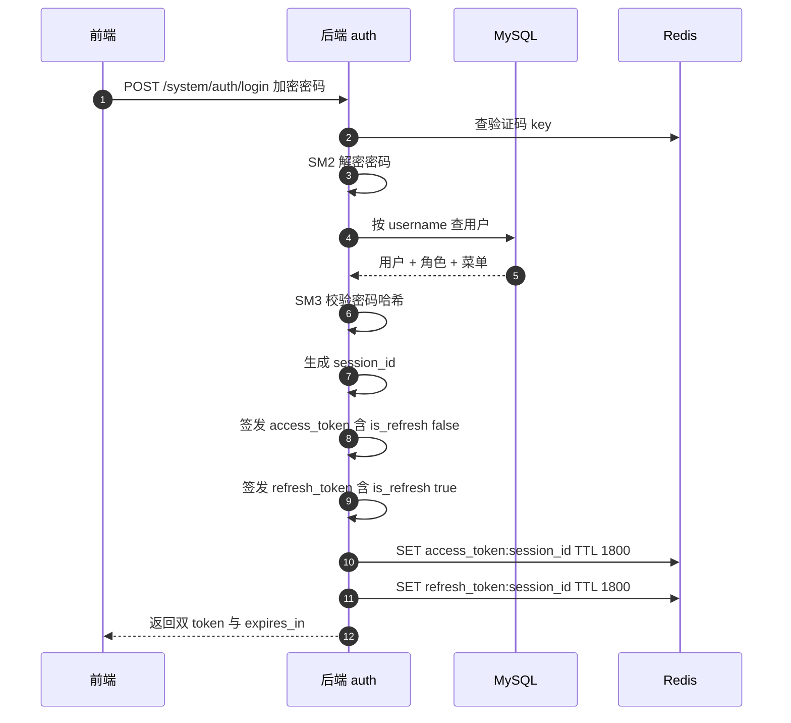
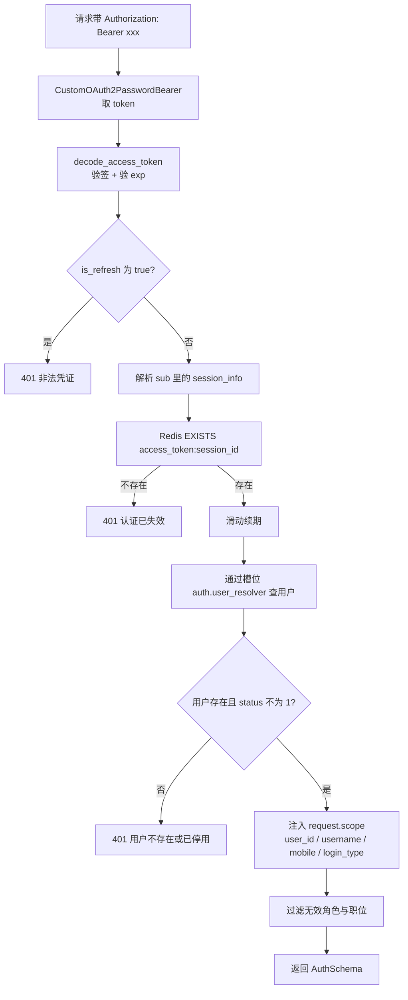
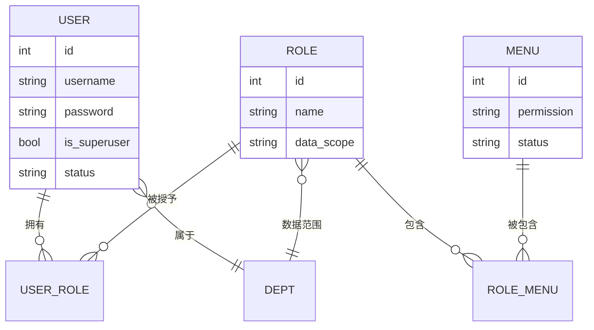
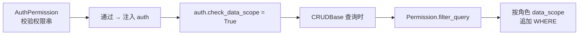

# 05 · 认证鉴权：JWT 与 RBAC

> [!tldr] 三层结构，别搞混
> **认证**（你是谁）→ JWT + Redis 会话；**功能权限**（你能调哪个接口）→ RBAC 权限字符串；**数据权限**（你能看哪些行）→ `Permission` 拼 WHERE。
> 三个层次的文件完全不同，混起来就会"改了半天权限没反应"。

| 层 | 文件 | 判定依据 |
|---|---|---|
| 认证 | `core/security.py` + `core/dependencies.py` | Token 有效 + Redis 有会话 |
| 功能权限 | `core/auth/permission.py` | 权限字符串匹配 |
| 数据权限 | `core/permission.py` | 角色数据范围 + 部门树 |

---

## 一、JWT 里装了什么

大多数项目 JWT 的 `sub` 放 `userId`。这个项目放的是**一坨 JSON**：

```json
{
  "sub": "{\"session_id\":\"a1b2c3\",\"user_id\":1,\"name\":\"张三\",
           \"user_name\":\"admin\",\"ipaddr\":\"192.168.1.100\",
           \"login_location\":\"广东省深圳市\",\"os\":\"Mac\",
           \"browser\":\"Chrome\",\"login_time\":\"2026-11-07T09:00:00\",
           \"login_type\":\"PC\"}",
  "is_refresh": false,
  "exp": 1794000000
}
```

为什么这么设计：

1. **免查库拿会话信息**：请求日志、在线用户列表直接读 `scope`，不用再查一次
2. **`session_id` 是 Redis 的 key**：登出/踢人只需删这一个 key
3. **`is_refresh` 区分双 Token**：access 不能当 refresh 用，反之亦然
4. **`login_type` 带上登录端**：`PC` / `UNIAPP` / `FLUTTER`，日志和会话管理都要用

> [!warning] `sub` 必须是字符串
> PyJWT 2.x 强制 `sub` 为 str，塞 dict 会 `InvalidSubjectError`。项目用 `model_dump_json()` 序列化后再放进去。

---

## 二、双 Token + Redis 会话



### 2.1 两个 Token 的差别

| 项 | access_token | refresh_token |
|---|---|---|
| `is_refresh` | `false` | `true` |
| Redis key | `access_token:{session_id}` | `refresh_token:{session_id}` |
| 用途 | 调业务接口 | 换新 token |
| 校验 | `is_refresh` 必须为 false | `is_refresh` 必须为 true |
| 默认有效期 | 1800s（30 分钟） | 1800s |

> [!note] 两个默认值一样长
> `ACCESS_TOKEN_EXPIRE_SECONDS` 和 `REFRESH_TOKEN_EXPIRE_SECONDS` 默认都是 `60*30`。所以"用 refresh 换新 token"的意义主要在于**主动续期**，而不是"access 短、refresh 长"的常见设计。要按标准玩法走，把 refresh 调成 7 天。

### 2.2 滑动过期

```python
if settings.TOKEN_SLIDING_EXPIRE:
    await RedisCURD(redis).expire(f"access_token:{session_id}", ACCESS_TOKEN_EXPIRE_SECONDS)
    await RedisCURD(redis).expire(f"refresh_token:{session_id}", REFRESH_TOKEN_EXPIRE_SECONDS)
```

**每次请求都会重置 TTL**。效果是：只要用户在 30 分钟内有一次操作，就永远不会掉线。代价是 Redis 每个请求多两次写入——所以生产环境要注意 Redis 的 QPS。

> [!tip] JWT 的 exp 不会跟着变
> 滑动过期只刷新 **Redis 的 TTL**，JWT 里的 `exp` 是签发时写死的。所以实际有效期取两者较小值：JWT 的 exp 到了，`decode_access_token` 会抛 `ExpiredSignatureError`，不管 Redis 里还在不在。
> 想真正做到"一直活跃不掉线"，必须靠 refresh 换新 JWT。

---

## 三、每次请求的鉴权链路



### 3.1 第 ② 步：Redis 才是真凭据

关键设计：**JWT 有效 ≠ 登录有效**。必须 Redis 里还有 `access_token:{session_id}` 才放行。

这让"踢人下线"变成一次 `DEL`——不用等 JWT 自然过期。登出就是：

```python
await RedisCURD(redis).delete(f"access_token:{session_id}")
```

> [!danger] 这依赖 Redis 一定可用
> `REDIS_ENABLE=False` 时整条鉴权链路直接不可用（源码注释明确写了"redis_connect 直接抛错"）。测试里靠 `fakeredis` 兜底。**这个项目不能无 Redis 运行**，和"限流器可降级"是两回事。

### 3.2 第 ⑦ 步：为什么数据权限要关掉

```python
auth = AuthSchema(db=db, check_data_scope=False)   # ← 注意这里
```

查当前用户本身时，如果开着数据权限，会变成"用当前用户的数据范围去查当前用户"，某些配置下会查不到自己。所以先关掉，等业务查询时再由 `AuthPermission` 打开：

```python
# core/auth/permission.py
auth.check_data_scope = self.check_data_scope   # 由依赖决定
```

### 3.3 第 ⑧ 步：scope 是隐式传参通道

```python
request.scope["user_id"] = user.id
request.scope["user_username"] = user.username
request.scope["user_mobile"] = user.mobile
request.scope["login_type"] = user_info.get("login_type")
```

`OperationLogRoute` 就是从这里取操作人信息的（见 [[07-操作日志与审计]]）。好处是**日志层不用再查一次库**。

---

## 四、功能权限：RBAC

### 4.1 数据模型



权限字符串挂在**菜单**上，不是角色上。用户 → 角色 → 菜单 → 权限字符串，四跳。

### 4.2 权限字符串格式

```
模块:资源:动作
```

实例：

| 权限串 | 含义 |
|---|---|
| `module_system:user:query` | 系统-用户-查询 |
| `module_system:user:create` | 系统-用户-新增 |
| `module_system:log:export` | 系统-日志-导出 |
| `module_example:demo:detail` | 示例-示例-详情 |

与 RuoYi 的 `system:user:list` 几乎一样，只是**模块前缀多了 `module_`**。

### 4.3 校验实现

```python
class AuthPermission:
    def __init__(self, permissions: list[str] | None = None, check_data_scope: bool = True):
        self.permissions = permissions or []
        self.check_data_scope = check_data_scope

    async def __call__(self, auth: AuthSchema = Depends(get_current_user)) -> AuthSchema:
        auth.check_data_scope = self.check_data_scope

        # ① 超管直接放行
        if auth.user and getattr(auth.user, "is_superuser", False):
            return auth
        # ② 没声明权限要求 → 登录即可
        if not self.permissions:
            return auth
        # ③ 通配符放行
        if "*" in self.permissions or "*:*:*" in self.permissions:
            return auth
        # ④ 没角色 → 403
        roles = getattr(auth.user, "roles", None)
        if not roles:
            raise CustomException(msg="无权限操作", code=10403, status_code=403)

        # ⑤ 汇总用户权限集合（只算启用状态的角色和菜单）
        user_permissions = {
            menu.permission
            for role in roles
            for menu in getattr(role, "menus", [])
            if role.status == "0" and menu.permission and menu.status == "0"
        }
        # ⑥ 满足任一即可（OR 语义，不是 AND）
        if not any(perm in user_permissions for perm in self.permissions):
            raise CustomException(msg="无权限操作", code=10403, status_code=403)
        return auth
```

> [!warning] 第 ⑥ 步是 OR，不是 AND
> 传 `["a", "b"]` 表示"有 a 或 b 任一即可"。如果你想要"必须同时有"，得在 service 里自己判，或者拆成两个依赖（FastAPI 多个 `Depends` 是 AND）。

### 4.4 三种声明方式

```python
# ① 参数注入（推荐，能拿到 auth 对象）
async def handler(
    auth: Annotated[AuthSchema, Depends(AuthPermission(["module_system:user:query"]))]
): ...

# ② 路由级依赖（只要权限，不要 auth 对象）
@Router.get("/list", dependencies=[Depends(AuthPermission(["module_system:user:query"]))])
async def handler(): ...

# ③ 只要登录，不要具体权限
async def handler(auth: Annotated[AuthSchema, Depends(AuthPermission())]): ...
```

> [!tip] 导出接口的两个坑
> ① 导出用 `StreamingResponse`，不走 `response_model`，容易忘加权限 → 变成未授权可下载。
> ② 下载文件时前端要读 `Content-Disposition` 文件名，必须在响应头加 `Access-Control-Expose-Headers: Content-Disposition`，否则浏览器跨域读不到。项目里 `demo/controller.py` 的模板下载接口专门加了这一行。

---

## 五、数据权限（简述，详见数据层篇）

功能权限管"能不能调接口"，数据权限管"能看到哪些行"。判定入口在 `CRUDBase.__filter_permissions()`，五档范围见 [[04-数据层-Model-Schema-CRUD]] 第 5 节。

两者的关系：



**只加功能权限、不加数据权限**是常见漏洞：用户能调列表接口，但能看到全公司的数据。所以项目在 `AuthPermission` 里留了 `check_data_scope` 开关，默认 `True`。

---

## 六、白名单与免鉴权

```python
TOKEN_REQUEST_PATH_EXCLUDE: list[str] = [
    "/api/v1/system/auth/sm-public-key",   # 登录前要拿公钥，必须免鉴权
]
```

另外 `POST /system/auth/login`、`/system/auth/captcha`、`/common/health/*` 也在免鉴权范围（在中间件层判断）。

> [!note] 为什么公钥接口必须在白名单
> 登录要先用公钥加密密码，如果拿公钥也要 token，就鸡生蛋了。这也是"明文降级已移除"后必须保证的链路：拿不到公钥 → 前端直接抛异常，不允许降级发明文。

---

## 七、多端登录控制

`session_id` 是每端独立的。同一用户 PC + 小程序登录会产生两个 session：

```
access_token:a1b2c3   ← PC
access_token:d4e5f6   ← 小程序
```

`core/auth/session.py` 管理在线会话列表，"在线用户"页面能看到每个 session 的 IP、地点、OS、浏览器、登录端。踢人就是删对应的 key。

| 需求 | 做法 |
|---|---|
| 允许同端多开 | 不做限制 |
| 同端只能一个 | 登录时先删该用户同 `login_type` 的旧 session |
| 全端只能一个 | 登录时删该用户所有 session |
| 强制下线 | 删指定 `session_id` 的 key |

---

## 八、Java 对照

| RuoYi / Spring Security | 本项目 | 差异 |
|---|---|---|
| `JwtAuthenticationTokenFilter` | `get_current_user` 依赖 | 无过滤器链，靠 `Depends` |
| `TokenService` + Redis | `create_token_service` + `RedisCURD` | 思路一致：JWT + Redis 双校验 |
| `LoginUser` | `AuthSchema` + `SessionInfo` | |
| `@PreAuthorize("@ss.hasPermi('system:user:list')")` | `Depends(AuthPermission([...]))` | 字符串格式几乎一样 |
| `SecurityUtils.getLoginUser()` | 函数参数 `auth: AuthSchema` | 无 ThreadLocal，靠显式传参 |
| `@DataScope` | `Permission.filter_query()` | 见数据层篇 |
| `SecurityContextHolder` | `request.scope[...]` | scope 只放标量字段 |

> [!tip] 最大的好处：没有隐式上下文
> Spring 里到处 `SecurityUtils.getLoginUser()`，代码读起来不知道用户哪来的。FastAPI 强制你在函数签名里声明 `auth`，依赖关系一眼可见——这是显式优于隐式的典型案例。

---

## 九、练习

1. 如果把 `access_token` 有效期改成 5 分钟、`refresh_token` 改成 7 天，前端需要做哪些改造？
2. 用户被停用（`status == "1"`）后，已签发的 token 还能用吗？在哪一步被拦？
3. `AuthPermission(["a", "b"])` 是 OR 还是 AND？如果要 AND 怎么实现？

---

上一篇：[[04-数据层-Model-Schema-CRUD]] · 下一篇：[[06-国密加密体系]]
