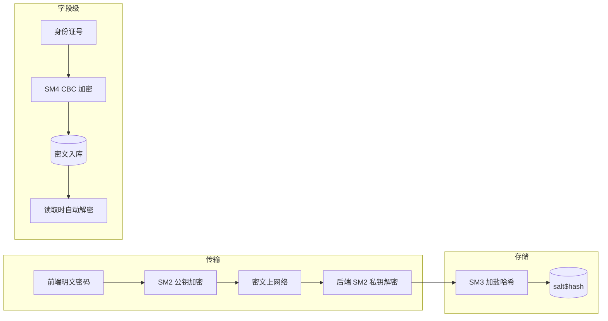
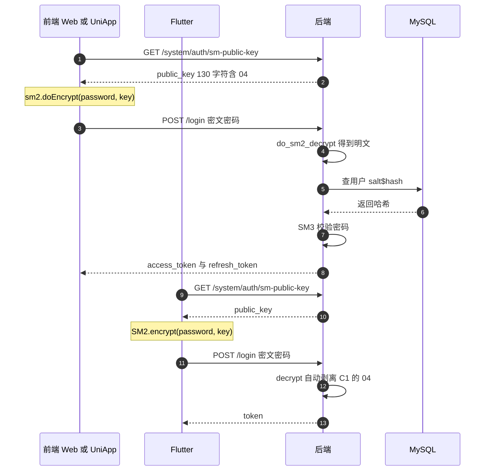

# 06 · 国密加密体系

> [!tldr] 三个算法各管一段
> **SM2**（非对称）管传输和签名 · **SM3**（哈希）管密码存储 · **SM4**（对称）管字段加密。
> 这套项目用国密**完全替代**了 bcrypt / RSA / AES，不是可选开关——`SM_CRYPTO_ENABLE` 这个开关已经被删掉了。

---

## 一、三个算法的分工

| 算法 | 类型 | 在项目里干什么 | 替换了谁 |
|---|---|---|---|
| **SM2** | 非对称（椭圆曲线） | 登录密码传输加密、日志完整性签名 | RSA |
| **SM3** | 哈希（256 位） | 密码加盐哈希、SM2 签名摘要 | bcrypt / SHA-256 |
| **SM4** | 对称（128 位分组） | 敏感字段落库加密（身份证、手机号） | AES |



---

## 二、为什么从 gmssl 迁到 snowland-smx

| 维度 | `gmssl`（旧） | `snowland-smx`（现） |
|---|---|---|
| 最后发布 | 2023-02，已停更 | 持续维护 |
| 协议 | MIT | BSD-3-Clause |
| 实现 | 纯 Python | 纯 Python |
| 跨平台 | 无需编译 | 无需编译 |
| 导入名 | `gmssl` | `pysmx` |

迁移的关键约束：**对外契约和存量数据完全不能变**。因为：

- 数据库里已存的日志签名，换库后必须还能验签
- 已存的密码哈希必须还能登录
- 前端三端加密的密文必须还能解

项目用 `tests/core/test_sm_crypto.py` 的 **39 条 golden 用例**（含存量密文、签名、密码哈希）锁定这些契约，迁移后原样全绿。

> [!tip] 这是"可迁移"的正确姿势
> 不是"跑一遍看没问题"，而是**把历史数据固化成测试用例**。任何加密/序列化/编码相关的重构都该这么干——这类 bug 往往在几个月后才发现，且无法回滚。

---

## 三、SM2：那个 `04` 前缀的坑

### 3.1 格式约定

| 环节 | 格式 | 长度 |
|---|---|---|
| 生成/存储/返回公钥 | `04` + 128 hex | 130 字符 |
| 密文 | 裸 C1C3C2（`x(32)‖y(32)‖C3(32)‖C2(n)`） | 变长 |
| 签名 | 裸 `r‖s`（无 ASN.1 包装） | 128 hex |

`04` 是**非压缩点标志位**（uncompressed point），表示后面跟着完整的 x 和 y 坐标。

### 3.2 历史 bug：`lstrip("04")`

旧代码这么去前缀：

```python
public_key = public_key.lstrip("04")     # ❌ 危险
```

`lstrip` 的参数是**字符集合**，不是前缀字符串。它会把开头**所有** `0` 或 `4` 字符全剥掉：

```
"04a4b0..."  →  lstrip("04")  →  "a4b0..."      ✅ 碰巧对
"0440a4..."  →  lstrip("04")  →  "a4..."        ❌ 少剥了，公钥长度变奇数
```

公钥长度变奇数后，签名直接抛 `Odd-length string`。

正确做法是精确剥离两个字符：

```python
@staticmethod
def _strip_04(public_key: str) -> str:
    if public_key.startswith("04") and len(public_key) == 130:
        return public_key[2:]
    return public_key
```

> [!warning] 另一个方向的坑：Flutter 的密文也带 04
> `gm_crypto` 加密后 C1 部分会带 `04` 前缀，而后端期望裸 C1C3C2。所以 `decrypt()` 要检测**密文的第一个字节**是否为 `0x04`，是则截掉。这和公钥的 04 是两回事。

### 3.3 签名摘要必须自己算

`snowland-smx` 的 `Sign` / `Verify` 只接受**算好的摘要**，不帮你做 ZA 计算。所以要按 GM/T 0003 手工拼：

```
ZA = SM3(ENTL ‖ ID ‖ a ‖ b ‖ xG ‖ yG ‖ xA ‖ yA)     # ID 默认 1234567812345678
E  = SM3(ZA ‖ M)
```

> [!danger] 这一步一个 bit 都不能变
> 只要 ZA 的拼装顺序、ID 默认值、编码方式有任何差异，**磁盘上已存的所有日志签名都会验不过**。项目专门用 golden 用例锁定了这个值。

### 3.4 核心类接口

```python
class Sm2Cipher:
    _strip_04(public_key) -> str                    # 精确剥离 04，归一化为 128 字符
    generate_key_pair() -> tuple[str, str]          # 返回 (private, "04"+public)
    encrypt(public_key, data: bytes) -> bytes       # C1C3C2 裸格式
    decrypt(private_key, ciphertext: bytes) -> bytes
    sign(private_key, public_key, data: bytes) -> str
    verify(public_key, data: bytes, signature: str) -> bool
```

---

## 四、SM3：密码为什么不用 bcrypt

### 4.1 存储格式

```
{salt_hex}${hash_hex}

示例：a1b2c3d4e5f6a7b8c9d0e1f2a3b4c5d6$8f14e45fceea167a5a36dedd4bea2543...
      └────── 32 hex = 16 bytes ──────┘ └────── 64 hex = 32 bytes ──────┘
```

```python
class Sm3Cipher:
    hash(data: bytes) -> str
    generate_salt() -> str                        # 16 字节随机
    hash_password(password, salt) -> tuple[str, str]
    verify_password(password, stored) -> bool
```

### 4.2 与 bcrypt 的差别

| 维度 | bcrypt | SM3 加盐 |
|---|---|---|
| 抗暴力破解 | 强（可调 cost，故意慢） | **弱**（单次哈希，快） |
| 抗彩虹表 | 强（自带盐） | 需手动加盐（项目做了） |
| 合规要求 | 国际通用 | **国密合规必需** |
| 性能 | 慢（约 100ms/次） | 快（微秒级） |

> [!warning] SM3 裸哈希不等同于 bcrypt 的安全强度
> 项目选 SM3 是**合规驱动**，不是安全驱动。如果想在合规前提下提高强度，标准做法是 **SM3 + 迭代**（PBKDF2 思路，迭代 1 万次以上）。项目目前是单次哈希——这点值得在安全评审时提出。

### 4.3 bcrypt 已彻底移除

不要在新代码里 import `bcrypt` 或 `passlib`。项目里 `hash_bcrpy_util.py` 已删除，只剩 `utils/sm_crypto_util.py` 的 `PwdUtil`。

---

## 五、SM4：字段级加密

### 5.1 用 TypeDecorator 做透明加解密

```python
class Sm4CbcTypeHandler(TypeDecorator):
    """写入时加密，读取时解密，业务代码完全无感。"""
    impl = String

# 模型里直接用
id_card: Mapped[str | None] = mapped_column(
    Sm4CbcTypeHandler(255), nullable=True, comment="身份证号(SM4加密)"
)
```

> [!warning] 构造参数是长度整数，不是 `String()`
> 正确：`Sm4CbcTypeHandler(255)`
> 错误：`Sm4CbcTypeHandler(String(255))`
> 因为 `impl = String` 已声明，再套一层会类型冲突。文档专门标注了这点，说明踩过。

### 5.2 输出格式

```
iv(16 bytes) ‖ ciphertext
```

IV 随机生成，拼在密文前面。解密时前 16 字节取出当 IV，剩余部分是密文。这样同一个明文每次加密结果都不同（语义安全）。

### 5.3 代价

| 问题 | 说明 |
|---|---|
| **不能模糊查询** | `WHERE id_card LIKE '%1234%'` 永远查不到 |
| **不能排序** | 密文排序无意义 |
| **不能建索引** | 除非建在密文上（但随机 IV 让相同明文密文不同，索引也没用） |
| **密钥不能丢** | `SM4_KEY` 丢了数据永久不可读 |

> [!danger] 换 SM4 密钥 = 数据全废
> 没有密钥轮换机制。如果真要做轮换，需要：新密钥加密新数据 + 后台任务用旧密钥解密后重新加密。项目目前**没有**这个能力，`SM4_KEY` 必须纳入备份体系。

---

## 六、登录加密全链路



### 6.1 三端兼容矩阵

| 端 | 库 | 调用 | 输出格式 | 后端能解 |
|---|---|---|---|---|
| Web | `sm-crypto@^0.4.0` | `sm2.doEncrypt(pwd, key)` | C1C3C2 | ✅ |
| UniApp | `sm-crypto` | `sm2.doEncrypt(pwd, key, 1)` | C1C3C2 | ✅ |
| Flutter | `gm_crypto` | `SM2.encrypt(pwd, key)` | C1C3C2 + C1 带 04 | ✅（自动剥离） |

三端密文都能被后端 `do_sm2_decrypt()` 还原（项目实测用 `Admin@12345` 验证过）。

### 6.2 没有明文降级

```python
# ✅ 正确：解密失败就抛异常
plain = CommonCryptogramUtil.do_sm2_decrypt(login_form.password)
# 失败 → CustomException（HTTP 200 + 业务码非 0）

# ❌ 错误：解密失败当明文用
try:
    plain = decrypt(...)
except:
    plain = login_form.password    # 降级 → 攻击者发明文就能登录
```

项目明确移除了降级逻辑，**所有前端+后端都不允许**。前端拿不到公钥直接抛异常。

> [!tip] 为什么登录失败的 HTTP 状态是 200
> 用 `CustomException(code=10401, status_code=200)`。原因是浏览器对 401 有原生动效（弹框、清缓存），而业务上"密码错"应该是普通提示。前端统一判 `code` 就行。

---

## 七、配置项

```bash
# backend/env/.env
SM2_PRIVATE_KEY="64 位 hex"                     # 32 字节
SM2_PUBLIC_KEY="04 + 128 位 hex"                # 必须含 04，共 130 字符
SM4_KEY="32 位 hex"                             # 16 字节
```

| 配置 | 长度 | 生成方式 |
|---|---|---|
| `SM2_PRIVATE_KEY` | 64 hex | `Sm2Cipher.generate_key_pair()` |
| `SM2_PUBLIC_KEY` | 130 hex（含 04） | 同上，返回时已加 04 |
| `SM4_KEY` | 32 hex | `Sm4Cipher.generate_key()` |

> [!danger] 三个 secret 必须入库管理
> `SECRET_KEY`（JWT）、`SM2_PRIVATE_KEY`、`SM4_KEY` 一旦丢失：JWT 全部失效（可重登）、密码无法验证（可通过 `main.py reset-passwords` 重置）、SM4 加密字段永久不可读（**不可恢复**）。

---

## 八、统一门面：只 import 一个文件

```python
from app.utils.sm_crypto_util import CommonCryptogramUtil, PwdUtil, Sm4CbcTypeHandler
```

| 类 | 方法 | 用途 |
|---|---|---|
| `CommonCryptogramUtil` | `do_sm2_encrypt` / `do_sm2_decrypt` / `do_signature` / `do_verify_signature` / `do_hash_value` | 通用门面，自动读 settings 里的密钥 |
| `PwdUtil` | `set_password_hash` / `verify_password` | 密码专用 |
| `Sm4CbcTypeHandler` | — | SQLAlchemy 字段类型 |

算法实现细节在 `utils/sm_crypto.py`（`Sm2Cipher` / `Sm3Cipher` / `Sm4Cipher`），业务代码**不应该**直接 import 它。

---

## 九、Java 对照

| Java 生态 | 本项目 | 备注 |
|---|---|---|
| `Hutool SecureUtil.sm2()` | `Sm2Cipher` | |
| `BCECPublicKey` / BouncyCastle | `snowland-smx` | 纯 Python，无需 JCE provider |
| `BCryptPasswordEncoder` | `PwdUtil`（SM3 加盐） | 强度更低，合规更高 |
| `AESUtil` | `Sm4Cipher` | |
| `@EncryptField` 注解 + 拦截器 | `Sm4CbcTypeHandler` | Python 用类型系统而非注解 |
| `MyBatis TypeHandler` | SQLAlchemy `TypeDecorator` | 概念完全一致 |

> [!note] 一个有意思的巧合
> MyBatis 的 `TypeHandler` 和 SQLAlchemy 的 `TypeDecorator` 是同一设计模式的不同实现：都在 ORM 与数据库之间插一层做转换。会 MyBatis 的话这个概念直接迁移。

---

## 十、练习

1. 为什么 `public_key.lstrip("04")` 会出 bug？给一个会失败的公钥样例。
2. SM4 加密的字段能用来做模糊搜索吗？如果不能，有什么替代方案？（提示：分词后单独存索引表）
3. 如果要求"密码哈希要抗暴力破解"，在保持国密合规的前提下可以怎么做？

---

上一篇：[[05-认证鉴权-JWT与RBAC]] · 下一篇：[[07-操作日志与审计]]
