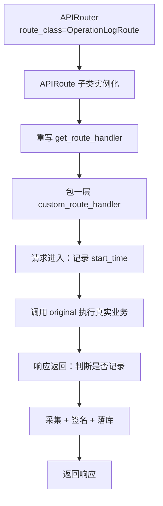
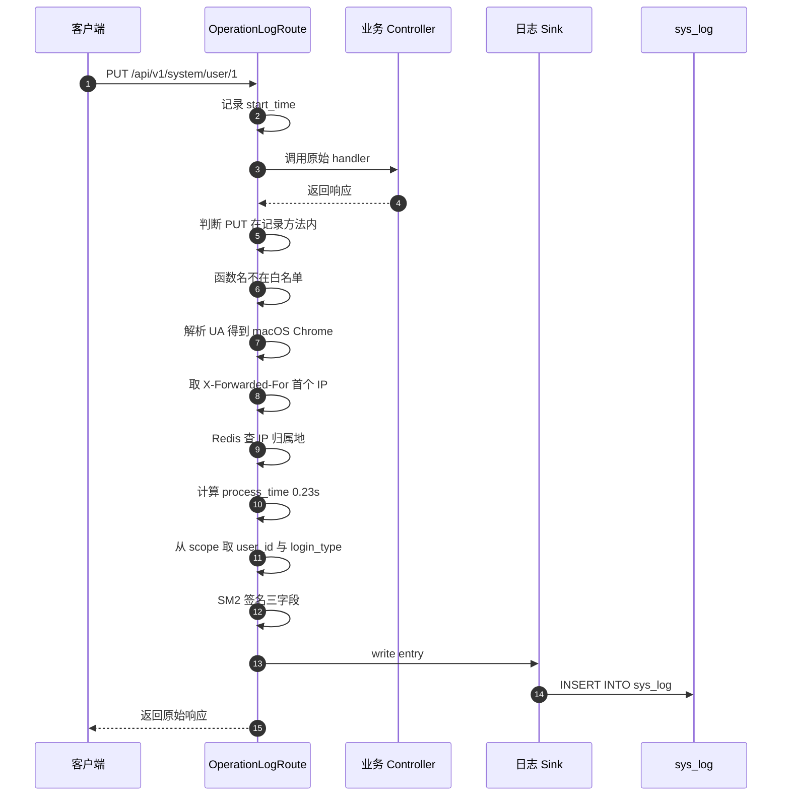

# 07 · 操作日志与审计

> [!tldr] 一行 `route_class` 换来全量审计
> ```python
> DemoRouter = APIRouter(route_class=OperationLogRoute, prefix="/demo", tags=["示例模块"])
> ```
> 挂上这个参数后，**这组路由下所有写操作自动落库**，业务代码零改动。
> 这不是装饰器，是 FastAPI 的 `APIRoute` 子类——粒度是"整组接口"。

---

## 一、为什么不用装饰器

Spring 里写 `@Log(title="用户管理", businessType=INSERT)` 挂在方法上，AOP 切面拦截。FastAPI 没有 AOP，但有更原生的钩子：**路由类**。

```python
class OperationLogRoute(APIRoute):
    def get_route_handler(self):
        original = super().get_route_handler()

        async def custom_route_handler(request: Request) -> Response:
            start = time.time()
            response = await original(request)      # ← 先执行原逻辑
            # 响应返回后，在这里采集日志
            ...
            return response

        return custom_route_handler
```

`APIRoute.get_route_handler()` 返回的是"处理这个请求的协程函数"。重写它就能在前后插逻辑——**等价于 AOP 的 around 通知**，但作用域是 router 而非方法。



### 1.1 与装饰器/AOP 的对比

| 维度 | Spring `@Log` + AOP | `route_class` |
|---|---|---|
| 粒度 | 单个方法 | **整组路由** |
| 声明位置 | 方法上方 | `APIRouter(...)` 构造参数 |
| 能否拿到响应体 | 需要额外包装 | 原生可拿 `response.body` |
| 能否跳过 | 注解参数 | 配置项 + 函数名白名单 |
| 改造成本 | 加注解 | 改一行 router 定义 |

> [!tip] 粒度是优点也是坑
> 整组路由挂载意味着**同一个 router 下无法"只记某些接口"**。想精细控制只能靠 `IGNORE_OPERATION_FUNCTION` 白名单，或者拆 router。

---

## 二、三个跳过条件

```python
if not settings.OPERATION_LOG_RECORD:                       # ① 全局开关
    return response
if request.method not in settings.OPERATION_RECORD_METHOD:   # ② 方法过滤
    return response
route: APIRoute = request.scope.get("route")
if route.name in settings.IGNORE_OPERATION_FUNCTION:         # ③ 函数名白名单
    return response
```

| 配置 | 默认值 | 说明 |
|---|---|---|
| `OPERATION_LOG_RECORD` | `True` | 全局开关 |
| `OPERATION_RECORD_METHOD` | `{"POST","PUT","DELETE","PATCH"}` | **不含 GET**——查询不记日志 |
| `IGNORE_OPERATION_FUNCTION` | 含 `get_obj_list_controller` 等 | 防止日志接口自己被记录 |

还有两个隐式跳过：

- **来自 Swagger / ReDoc 的请求**：`referer` 以 `docs` / `redoc` 结尾则跳过
- **请求体超长**：payload > 2000 字符时记为 `"请求参数过长"`

> [!warning] 请求体截断会丢审计信息
> 2000 字符是日志表字段长度限制导致的。如果审计要求完整记录（比如金融场景），必须把 `request_payload` 改成 `LONGTEXT` 并去掉这个截断——否则大表单提交的内容查不到。

---

## 三、采集了哪些信息

| 字段 | 来源 | 说明 |
|---|---|---|
| `type` | 有无 `scope["user_id"]` | 1=登录日志，2=操作日志 |
| `request_path` | `request.url.path` | |
| `request_method` | `request.method` | |
| `request_payload` | body / form | JSON 或 `k: v` 文本，超 2000 截断 |
| `request_ip` | `X-Forwarded-For` 首个 / `client.host` | 优先取代理头 |
| `login_location` | `IpLocalUtil` | IP 归属地，走 Redis 缓存 |
| `request_os` | `user_agents.parse(UA)` | 如 `Mac` |
| `request_browser` | 同上 | 如 `Chrome` |
| `response_code` | `response.status_code` | |
| `response_json` | `response.body` | 仅 `application/json` |
| `process_time` | `time.time()` 差值 | 格式 `0.23s` |
| `signature` | SM2 签名 | 覆盖 payload / response / process_time |
| `username` / `mobile` | `scope` | 由 `get_current_user` 提前注入 |
| `login_platform` | `scope["login_type"]` | PC / UNIAPP / FLUTTER |
| `description` | `route.summary` | 接口的中文摘要，直接当操作描述 |

> [!tip] `login_location` 的快路径设计
> 原来同步查 IP 归属地会阻塞响应最长 3 秒。现在改成：
> 登录请求优先复用 `auth` 提前写入 `scope` 的结果（含缓存命中）→ 公网未命中返回 `PENDING` → 由日志 sink 后台回填。
> **关键路径零外网请求**，这是很典型的审计性能优化。

---

## 四、SM2 签名：完整性保护

```python
sign_data = f"{payload}|{response_data_str}|{process_time}"
signature, signed_fields = build_operation_log_signature(sign_data)
```

签名覆盖三个字段：**请求参数、响应、耗时**。落库时把签名值和被签字段名（JSON）一起存。

意义：事后能验证"这条日志有没有被改过"。攻击者直接改数据库里的 `request_payload`，签名就对不上。

### 4.1 一个反直觉的实测结论

源码里有一段很长的注释，值得完整抄下来：

> ⚠️ **实测结论：放进线程执行无效，故保持同步调用。**
> `asyncio.to_thread` 在并发 ≥ 4 时对事件循环停顿无改善（实测 1.0×），单请求场景反而因线程切换变慢一倍（3.0 ms → 6.0 ms）——因为线程与事件循环争抢同一个 GIL。若要真正并行，只能走进程池；否则应直接关闭本开关。

这段的价值在于：**它推翻了一个看似正确的优化**。SM2 签名是纯 Python 实现，约 3.6ms，受 GIL 限制。直觉上应该扔线程池，但实测没用——因为 Python 线程不能并行执行 CPU 密集代码。

| 方案 | 效果 | 结论 |
|---|---|---|
| 同步调用 | 3.0ms | 采用 |
| `asyncio.to_thread` | 单请求 6.0ms，并发无改善 | ❌ |
| 进程池 | 理论可并行 | 成本高，未采用 |
| 关闭开关 | 0ms | 高并发场景的推荐选项 |

所以项目给了配置 `OPERATION_LOG_SIGN_ENABLE`——**高并发下建议直接关掉签名**。

> [!warning] 关掉签名 = 日志失去防篡改能力
> 这是个取舍：签名带来约 3.6ms/请求的固定开销。如果 QPS 上千，这就是 3.6 秒/秒的 CPU 时间。合规要求防篡改就不能关；纯排障用可以关。

---

## 五、落库走槽位

```python
sink = get(SLOT_LOG_OPERATION_SINK)
if sink is None:
    # 槽位缺失 = module_system 未安装 → 降级为写文件日志
    log.info(f"操作日志: {request.method} {request.url.path} {response.status_code}")
else:
    entry = OperationLogEntry(...)
    async with async_db_session() as session:
        async with session.begin():
            await sink.write(entry, session, login_redis)
```

这是 [[03-插件系统内核]] 里红线 4 的标准示范：

| 情况 | 行为 |
|---|---|
| `module_system` 在 | 走 sink 落 `sys_log` 表 |
| `module_system` 不在 | 只写文件日志，**应用照常运行** |

注意 `async with session.begin()` 是**独立事务**——日志落库失败不能影响主业务响应。

> [!danger] 但这里有个隐含风险
> 日志写入在**响应返回前**同步执行。如果数据库慢（比如锁表），接口响应会被拖慢。
> 更稳的做法是丢进队列异步消费，但项目选择了简单实现。压测时要重点看这个点。

---

## 六、sys_log 表结构

| 分组 | 字段 |
|---|---|
| 主键与类型 | `id`、`type`（1 登录 / 2 操作） |
| 请求信息 | `request_path`、`request_method`、`request_payload`、`request_ip` |
| 来源解析 | `login_location`、`request_os`、`request_browser`、`login_platform` |
| 操作人（冗余） | `username`、`mobile` |
| 响应信息 | `response_code`、`response_json`、`process_time` |
| 完整性 | `signature`、`signed_fields` |
| 通用字段 | `status`、`description`、`created_id`、`created_time`、`updated_*`、`is_deleted`、`deleted_time` |

**为什么冗余 `username` / `mobile`**：日志是历史快照，用户改名或删除后，日志仍要显示当时的操作人。这是审计表的标准做法——**不做外键关联**。

### 6.1 大文本字段适配

```python
def get_log_text_column_type():
    if DATABASE_TYPE == "mysql":    return LONGTEXT     # 64KB 不够用
    if DATABASE_TYPE == "postgres": return TEXT
    return Text
```

MySQL 的 `TEXT` 上限 64KB，`response_json` 里带列表数据很容易超。

---

## 七、查询与导出

### 7.1 接口清单

| 方法 | 路径 | 权限串 |
|---|---|---|
| GET | `/system/log/list` | `module_system:log:query` |
| GET | `/system/log/detail/{id}` | `module_system:log:detail` |
| DELETE | `/system/log/delete` | `module_system:log:delete` |
| POST | `/system/log/export` | `module_system:log:export` |

### 7.2 查询参数的操作符映射

| 参数 | 操作符 | 说明 |
|---|---|---|
| `type` | `eq` | 必须是 1 或 2 |
| `request_path` | `like` | 模糊 |
| `request_method` | `eq` | 白名单校验 |
| `request_ip` | `eq` | IPv4/IPv6 格式校验 |
| `response_code` | `eq` | |
| `username` / `mobile` | `like` | |
| `created_time` | `between` | `[起, 止]` |

> [!tip] 参数校验放在 Schema 里
> `type` 限 1/2、`request_method` 限 HTTP 动词、`request_ip` 校验 IP 格式——都用 Pydantic `field_validator` 做，非法值直接 422，不进 SQL。

### 7.3 Excel 导出

`ExcelUtil.export_list2excel()`（pandas + openpyxl），20 个字段映射成中文表头（编号/操作账号/手机号/登录平台/请求URL/请求方式/请求参数/操作地址/登录位置/操作系统/浏览器/返回参数/相应状态/处理时间/备注/创建时间/更新时间/创建者ID/更新者ID）。

> [!warning] 导出接口的两个必查项
> ① 必须加 `Depends(AuthPermission([...]))`，否则未授权也能下载全部日志。
> ② 必须加 `Access-Control-Expose-Headers: Content-Disposition`，否则前端读不到文件名。

---

## 八、一次 PUT 请求的完整数据流



---

## 九、Java 对照

| Spring 生态 | 本项目 |
|---|---|
| `@Log(title, businessType)` | `APIRouter(route_class=OperationLogRoute)` |
| `@Aspect` + `@Around` | 重写 `APIRoute.get_route_handler` |
| `HttpServletRequest` 取 UA/IP | `request.headers` + `request.client.host` |
| `SecurityUtils.getLoginUser()` | `request.scope["user_id"]` |
| `LogAspect` 异步落库 | sink + 独立事务 |
| `SysOperLog` 实体 | `OperationLogModel` → `sys_log` |
| `ExcelUtil.exportExcel` | `ExcelUtil.export_list2excel` |

> [!note] 一个关键差异
> Spring AOP 基于**代理**，只能拦截 Spring 管理的 Bean 的 public 方法。FastAPI 的 `route_class` 直接替换**路由处理函数**，更底层，也更可控——你能拿到响应 body，而 Spring 要拿到响应体得包 `ContentCachingResponseWrapper`。

---

## 十、练习

1. 如果想让 GET 请求也记日志（比如敏感数据查询审计），需要改什么？会有什么副作用？
2. `process_time` 为什么用字符串 `"0.23s"` 而不是毫秒整数？
3. SM2 签名的 3.6ms 开销在什么场景下值得关掉？关掉后怎么补审计完整性？

---

上一篇：[[06-国密加密体系]] · 下一篇：[[08-启动流程与配置管理]]
