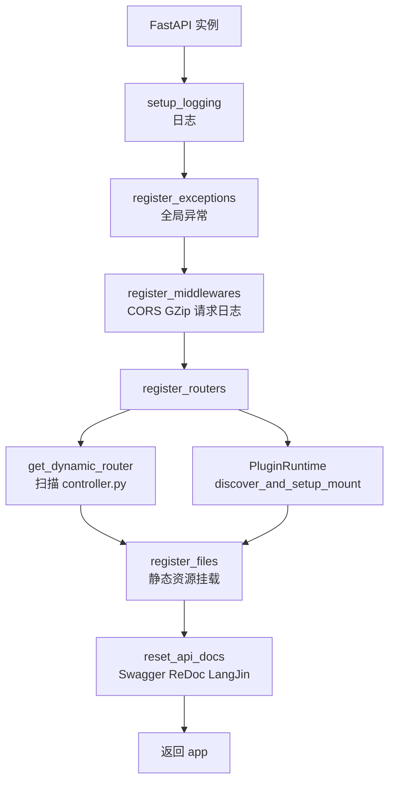
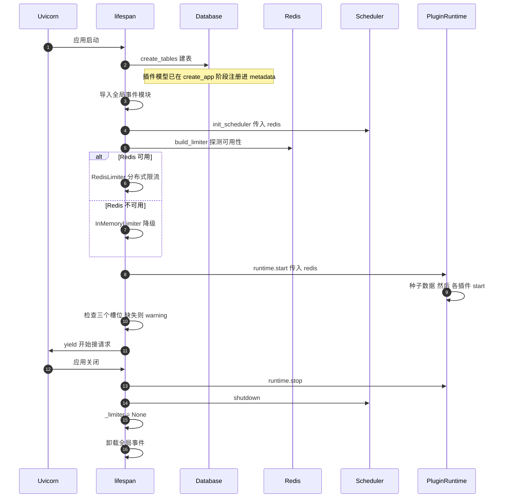

# 08 · 启动流程与配置管理

> [!tldr] 一句话
> `python main.py run --env=dev` → Typer 设环境变量 → `create_app()` 装配 6 个组件 → Uvicorn 起服务 → `lifespan` 初始化 DB/Redis/调度器/限流/插件。
> **顺序不能乱**，尤其"建表"必须在"插件 start"之前。

---

## 一、main.py：一个 CLI，四个命令

```python
fastapiadmin_cli = typer.Typer()
alembic_cfg = Config("alembic.ini")
```

| 命令 | 作用 | 关键代码 |
|---|---|---|
| `run` | 启动服务 | `uvicorn.run(app="main:create_app", factory=True, reload=is_dev)` |
| `revision` | 生成迁移脚本 | `command.revision(cfg, autogenerate=True)` |
| `upgrade` | 应用迁移 | `command.upgrade(cfg, "head")` |
| `reset-passwords` | 重置全部用户密码 | 遍历 `UserModel` 批量 `update` |

### 1.1 每个命令都做同一件事

```python
os.environ["ENVIRONMENT"] = env.value          # ① 设环境变量
get_settings.cache_clear()                     # ② 清配置缓存
settings = get_settings()                      # ③ 重新加载配置
```

这三行的顺序是必须的：

- ① 必须在 ② 之前——`Settings` 的 `env_file` 列表依赖 `os.getenv("ENVIRONMENT")`
- ② 必须存在——否则 `@lru_cache` 会返回上次加载的配置
- ③ 只在需要读配置的命令里做（`revision`/`upgrade` 只清缓存不实例化）

> [!tip] 为什么用 `--env` 而不是环境变量
> Typer 的枚举参数能自动补全和校验：
> ```python
> env: Annotated[EnvironmentEnum, typer.Option("--env", help="运行环境")] = EnvironmentEnum.DEV
> ```
> 传错值（如 `--env=test`）Typer 直接报错列出可选项，比 `export ENVIRONMENT=test` 后运行时才崩要友好得多。

---

## 二、create_app：六个组件的装配顺序

```python
def create_app() -> FastAPI:
    app = FastAPI(**settings.FASTAPI_CONFIG, lifespan=lifespan)
    app.state.redis = None          # ← 预置占位，见下文
    setup_logging()                 # ① 日志（必须最先，后面都要打日志）
    register_exceptions(app)        # ② 异常处理器
    register_middlewares(app)       # ③ 中间件
    register_routers(app)           # ④ 路由（含插件发现）
    register_files(app)             # ⑤ 静态资源
    reset_api_docs(app)             # ⑥ 自定义文档页
    return app
```



### 2.1 顺序为什么不能换

| 顺序约束 | 原因 |
|---|---|
| 日志最先 | 后续每步都要打日志，没有 logger 就只能 print |
| 异常早于中间件 | 中间件抛异常要能被全局处理器接住 |
| 中间件早于路由 | 路由的 `dependencies` 依赖中间件写入的 `scope` |
| 插件发现早于静态资源 | 插件可能挂载自己的静态目录 |
| 文档最后 | 需要等所有路由注册完，OpenAPI schema 才完整 |

### 2.2 那行 `app.state.redis = None` 是干嘛的

```python
# 预置 Redis 占位（None）。REDIS_ENABLE=False 时 setting.EVENT_LIST 不会注册
# app.core.database.redis_connect，app.state.redis 也就永不被赋值；若不预置，
# lifespan 里对 app.state.redis 的访问会抛 AttributeError。
app.state.redis = None
```

这是个典型的**条件注册导致的属性缺失**：关闭 Redis 时没人给 `app.state.redis` 赋值，后面读它就 AttributeError。预置 `None` 是防御式写法。

> [!note] 这类 bug 的通用解法
> 只要"某个属性只在特定配置下被赋值"，就一定要在创建对象时先给它一个默认值。Python 没有 Java 的字段默认初始化，这点容易忘。

### 2.3 为什么用 factory 模式

```python
uvicorn.run(app="main:create_app", factory=True, ...)
```

因为 `create_app()` 里做了大量装配动作，必须在**配置加载完成后**才能执行。如果用模块级 `app = create_app()`，那在 `import main` 的瞬间就跑了——此时 `ENVIRONMENT` 还没设好。

| 模式 | 风险 |
|---|---|
| `app = FastAPI()` 模块级 | import 即初始化，配置未就绪 |
| `create_app()` + `factory=True` | ✅ 显式调用，时机可控 |

---

## 三、lifespan：启动与关闭的完整序列



### 3.1 启动期的四个"必须"

| # | 必须 | 违反后果 |
|---|---|---|
| 1 | `create_tables()` 在任何业务查询前 | 表不存在，插件 start 报错 |
| 2 | 插件模型在 `create_app` 阶段就导入 | `metadata` 里没表，`create_tables` 建不出来 |
| 3 | `runtime.start()` 在调度器之后 | 插件 start 里注册的定时任务找不到 scheduler |
| 4 | 槽位检查在任何请求前 | 用户第一次请求才发现功能缺失 |

第 2 点最容易忽略：**建表用的是 `metadata`，而 `metadata` 靠 import 填充**。所以 `discover_and_setup()` 里 `ctx.add_models()` 不只是声明，它真的会 import 模块，把模型注册进 `MappedBase.metadata`。

### 3.2 启动日志怎么读

正常启动应该有这些行（按顺序）：

```
✅ mysql数据库表结构初始化完成
✅ 全局事件模块加载完成
✅ 定时任务调度器初始化完成
✅ 请求限流器初始化完成（RedisLimiter 分布式限流）
✅ 插件 setup 完成
✅ 插件启动阶段完成
✅ 插件运行时启动完成
```

| 缺失的行 | 说明 |
|---|---|
| 建表完成 | DB 连接失败，或模型没注册 |
| 限流器完成 | 会显示 `⚠️ Redis 未启用：降级为 InMemoryLimiter` |
| 插件 setup 完成 | 插件装配中途异常，往上翻 `ERROR` |
| 插件启动阶段完成 | `start()` 里抛异常（常见：种子数据外键冲突） |

还有一类**告警不阻断**的：

```
⚠️ 槽位 log.operation_sink 未提供（module_system 插件缺失？）：操作日志仅写文件日志，不落库
⚠️ 槽位 config.params_provider 未提供：演示模式/IP 白名单等按默认值执行
```

看到这些说明**功能降级了但服务能跑**。生产环境不允许出现。

---

## 四、配置管理：两层 env + 单例


### 4.1 三个优先级（从低到高）

```python
model_config = SettingsConfigDict(
    env_file=[
        ENV_DIR / ".env",                                    # ① 基础
        *([ENV_DIR / f".env.{os.getenv('ENVIRONMENT')}"]     # ② 环境覆盖
          if os.getenv("ENVIRONMENT") else []),
    ],
    env_file_encoding="utf-8",
    extra="ignore",
    case_sensitive=True,
    env_parse_none_str="null",
)
```

| 优先级 | 来源 | 说明 |
|---|---|---|
| 最低 | `Settings` 类里的默认值 | 代码里的 `= "0.0.0.0"` |
| 中 | `env/.env` | 基础配置 |
| 中高 | `env/.env.{ENVIRONMENT}` | 覆盖同名项 |
| **最高** | **真实环境变量** | `export SERVER_PORT=6200` 会盖掉文件 |

`pydantic-settings` 的规则：**真实环境变量 > env_file > 类默认值**。所以 Docker/K8s 里注入环境变量能覆盖配置文件，这是标准做法。

### 4.2 三个容易踩的配置行为

| 配置 | 行为 | 坑 |
|---|---|---|
| `case_sensitive=True` | 大小写敏感 | `server_port` 不会匹配 `SERVER_PORT` |
| `extra="ignore"` | 未知字段忽略 | 拼错字段名**不报错**，静默用默认值 |
| `env_parse_none_str="null"` | `null` 解析为 None | 想传真的字符串 `"null"` 要用引号 |

> [!danger] `extra="ignore"` 是最坑的一个
> 你在 `.env` 里写 `DATABSE_TYPE=mysql`（拼错），配置不报错，程序用默认值 `mysql` 跑起来了——直到你换 PostgreSQL 才发现读的是错的变量名。
> 调试配置问题时，第一件事是打印 `settings.model_dump()` 看实际值。

### 4.3 缓存失效

```python
@lru_cache
def get_settings() -> Settings:
    return Settings()
```

`@lru_cache` 让 `Settings` 成为单例，但也意味着**改了 `.env` 不会自动生效**。

| 场景 | 是否需要手动清缓存 |
|---|---|
| `--reload` 开发模式 | 否（进程重启，缓存清空） |
| 生产改配置 | 是（重启服务） |
| 测试里换环境变量 | 是（`get_settings.cache_clear()`） |
| CLI 多命令 | 是（`main.py` 已内置） |

---

## 五、生产部署

### 5.1 三种方式

```bash
# ① 开发：单进程 + 自动 reload
python main.py run --env=dev

# ② 准生产：单进程多协程
uvicorn main:create_app --factory --host 0.0.0.0 --port 6100 --workers 4

# ③ 生产：Gunicorn 管理 Uvicorn worker
gunicorn main:create_app \
  -k uvicorn.workers.UvicornWorker \
  -w 4 \
  -b 0.0.0.0:6100 \
  --timeout 120
```

### 5.2 多 worker 的三个坑

| 坑 | 原因 | 解法 |
|---|---|---|
| **限流不准** | 每个 worker 独立内存，`InMemoryLimiter` 各算各的 | 必须用 Redis 后端 |
| **调度器重复执行** | 每个 worker 都起一个 scheduler | 用 Redis 分布式锁（项目有 `APSCHEDULER_LOCK_KEY`） |
| **定时任务只跑一次** | 没加锁时 4 个 worker 跑 4 次 | 同上 |

> [!warning] 多 worker 下必须开 Redis
> 项目的限流器有 Redis / 内存两种后端，`build_limiter()` 会自动选。但**多 worker 场景下内存后端等于没限流**（每个 worker 独立计数，实际上限是配置值 × worker 数）。

### 5.3 Docker 部署目录

```
docker/
├── docker-compose.yml       # MySQL + Redis + Backend + Nginx
├── .env                     # 容器环境变量
└── nginx/
    └── default.conf         # 反向代理 + 静态资源
```

`deploy.sh` 封装了构建、启动、日志查看。注意 `ENVIRONMENT=prod` 时 `reload=False`、日志级别要调成 `INFO`（`LOGGER_LEVEL`）。

---

## 六、配置项分组速查

`setting.py` 有 460+ 行，按注释分块：

| 分组 | 关键配置 |
|---|---|
| 项目环境 | `ENVIRONMENT` |
| 服务器 | `SERVER_HOST`、`SERVER_PORT` |
| API 文档 | `TITLE`、`VERSION`、`DOCS_URL`、`REDOC_URL`、`ROOT_PATH` |
| 日志 | `LOGGER_LEVEL` |
| 跨域 | `CORS_ORIGIN_ENABLE`、`ALLOW_ORIGINS`、`ALLOW_CREDENTIALS` |
| 认证 | `SECRET_KEY`、`ALGORITHM`、`ACCESS_TOKEN_EXPIRE_SECONDS`、`TOKEN_SLIDING_EXPIRE` |
| 多租户 | `TENANT_HOST_ENFORCE`、`TENANT_HOST_BASE_DOMAIN` |
| 数据库 | `SQL_DB_ENABLE`、`DATABASE_TYPE`、`POOL_SIZE`、`POOL_RECYCLE` |
| 国密 | `SM2_PRIVATE_KEY`、`SM2_PUBLIC_KEY`、`SM4_KEY` |
| 日志审计 | `OPERATION_LOG_RECORD`、`OPERATION_RECORD_METHOD`、`IGNORE_OPERATION_FUNCTION`、`OPERATION_LOG_SIGN_ENABLE` |
| 限流 | 限流开关与速率 |
| 静态资源 | `STATIC_ENABLE`、`STATIC_URL`、`STATIC_ROOT` |

### 6.1 上线前必查的 6 项

| # | 检查项 | 期望值 |
|---|---|---|
| 1 | `ENVIRONMENT` | `prod`（关 reload） |
| 2 | `SECRET_KEY` | 已改，非默认值 |
| 3 | `SM2_PRIVATE_KEY` / `SM4_KEY` | 已配置，且已备份 |
| 4 | `CORS_ORIGIN_ENABLE` | 按需，且 `ALLOW_ORIGINS` 不是 `["*"]` |
| 5 | `LOGGER_LEVEL` | `INFO`（不是 DEBUG） |
| 6 | `DATABASE_ECHO` | `False`（否则每个 SQL 都打日志） |

---

## 七、Java 对照

| Spring Boot | 本项目 |
|---|---|
| `SpringApplication.run()` | `uvicorn.run(app="main:create_app", factory=True)` |
| `@PostConstruct` | 插件 `start()` |
| `@PreDestroy` | 插件 `stop()` |
| `ApplicationRunner` | `lifespan` 启动段 |
| `application.yml` + profile | `.env` + `.env.{env}` |
| `@ConfigurationProperties` | `BaseSettings` 类字段 |
| `@Value` | `settings.XXX` |
| Actuator `/health` | `/common/health/ping`、`/ready` |
| `--spring.profiles.active=dev` | `--env=dev` |
| Banner | `utils/banner.py` 的 `worship()` |

> [!note] 一个本质差异
> Spring 的 Bean 生命周期由容器管，`@PostConstruct` 的执行顺序由依赖关系推导。FastAPI 没有容器，`lifespan` 是一个**手写的顺序流程**——你必须自己保证"建表在插件 start 之前"。好处是顺序完全可见，坏处是不能自动推导依赖。

---

## 八、练习

1. 如果把 `create_tables()` 挪到 `runtime.start()` 之后，会发生什么？
2. `--reload` 模式下改了 `setting.py` 会生效吗？改 `.env.dev` 呢？
3. Gunicorn 起 4 个 worker，限流配成 100 QPS，实际允许多少？怎么修？

---

上一篇：[[07-操作日志与审计]] · 下一篇：[[09-开发实战与踩坑清单]]
