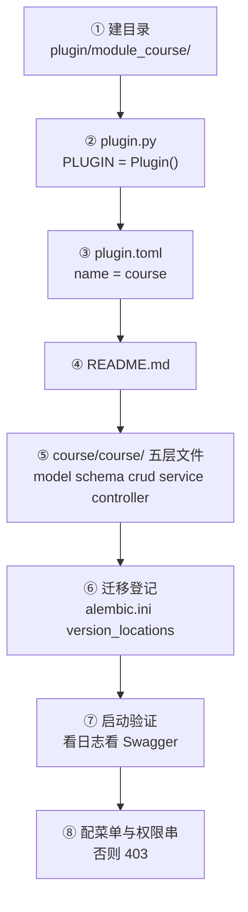
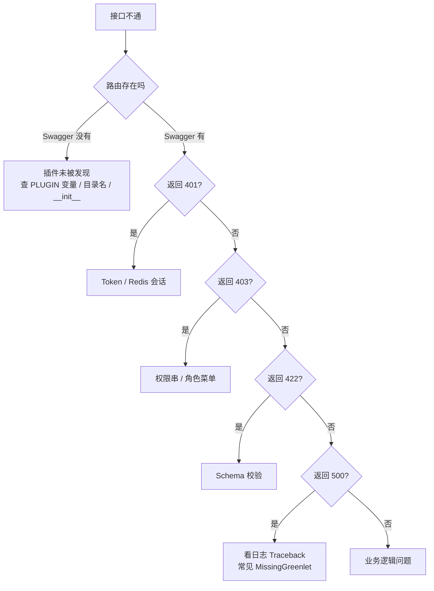

# 09 · 开发实战与踩坑清单

> [!tldr] 这篇是操作手册
> 前半部分是**从零加一个业务模块的 8 步**（可照抄），后半部分是**症状 → 原因 → 解法**的排查表。
> 如果只读一篇，读这篇。

---

## 一、8 步加一个业务模块

假设要做「课程管理」。



### 1.1 目录结构

```
app/plugin/module_course/
├── __init__.py
├── plugin.py               ← 必须有 PLUGIN 变量
├── plugin.toml             ← name 必须与目录名剥离 module_ 后一致
├── README.md               ← 缺失只 WARNING，但测试会红
├── seeds/                  ← 可选，种子数据
└── course/
    ├── __init__.py
    ├── model.py
    ├── schema.py
    ├── crud.py
    ├── service.py
    └── controller.py
```

### 1.2 ① model.py

```python
from sqlalchemy import Integer, String
from sqlalchemy.orm import Mapped, mapped_column

from app.core.base_model import ModelMixin, UserMixin


class CourseModel(ModelMixin, UserMixin):
    """课程表"""

    __tablename__ = "biz_course"
    __table_args__ = {"comment": "课程表"}

    name: Mapped[str] = mapped_column(String(128), nullable=False, comment="课程名称")
    teacher: Mapped[str | None] = mapped_column(String(64), nullable=True, comment="讲师")
    credit: Mapped[int] = mapped_column(Integer, default=0, comment="学分")
```

> [!tip] 表名规范
> 业务表用 `biz_` 前缀，系统表用 `sys_`。避免和 `module_system` 的表撞。

### 1.3 ② schema.py

```python
from datetime import datetime
from pydantic import BaseModel, ConfigDict, Field


class CourseCreateSchema(BaseModel):
    name: str = Field(..., min_length=1, max_length=128, description="课程名称")
    teacher: str | None = Field(default=None, max_length=64)
    credit: int = Field(default=0, ge=0, le=100)


class CourseUpdateSchema(BaseModel):
    name: str | None = Field(default=None, max_length=128)
    teacher: str | None = None
    credit: int | None = Field(default=None, ge=0, le=100)


class CourseOutSchema(BaseModel):
    id: int
    name: str
    teacher: str | None
    credit: int
    status: str
    created_time: datetime

    model_config = ConfigDict(from_attributes=True)


class CourseQueryParam(BaseModel):
    name: str | None = Field(default=None, description="课程名称，模糊匹配")
    teacher: str | None = None
    status: str | None = None
```

### 1.4 ③ crud.py

```python
from collections.abc import Sequence

from app.core.auth.schema import AuthSchema
from app.core.base_crud import CRUDBase

from .model import CourseModel
from .schema import CourseCreateSchema, CourseOutSchema, CourseUpdateSchema


class CourseCRUD(CRUDBase[CourseModel, CourseCreateSchema, CourseUpdateSchema]):
    """课程数据层：继承基类即可，无需额外代码。"""

    def __init__(self, auth: AuthSchema) -> None:
        super().__init__(model=CourseModel, auth=auth)

    async def get_by_name_crud(self, name: str) -> CourseModel | None:
        """按名称查（业务自定义查询）"""
        return await self.get(name=name)

    async def page_crud(
        self, offset: int, limit: int,
        order_by: list[dict] | None = None,
        search: dict | None = None,
    ) -> dict:
        return await self.page(
            offset=offset, limit=limit,
            order_by=order_by or [{"id": "desc"}],
            search=search or {},
            out_schema=CourseOutSchema,
        )
```

### 1.5 ④ service.py

```python
from app.core.auth.schema import AuthSchema
from app.core.exceptions import CustomException

from .crud import CourseCRUD
from .model import CourseModel
from .schema import CourseCreateSchema, CourseOutSchema, CourseQueryParam, CourseUpdateSchema


class CourseService:
    @classmethod
    async def detail_service(cls, auth: AuthSchema, id: int) -> dict:
        obj = await CourseCRUD(auth).get_or_404(id=id)
        return CourseOutSchema.model_validate(obj).model_dump()

    @classmethod
    async def page_service(
        cls, auth: AuthSchema, page_no: int, page_size: int,
        search: CourseQueryParam, order_by: list[dict] | None = None,
    ) -> dict:
        offset = (page_no - 1) * page_size
        return await CourseCRUD(auth).page_crud(
            offset=offset, limit=page_size,
            order_by=order_by,
            search=search.model_dump(exclude_none=True),
        )

    @classmethod
    async def create_service(cls, auth: AuthSchema, data: CourseCreateSchema) -> dict:
        # 业务校验：CRUD 层管不了
        if await CourseCRUD(auth).get_by_name_crud(data.name):
            raise CustomException(msg="课程名称已存在")

        obj = await CourseCRUD(auth).create(data=data)
        return CourseOutSchema.model_validate(obj).model_dump()

    @classmethod
    async def update_service(cls, auth: AuthSchema, id: int, data: CourseUpdateSchema) -> dict:
        obj = await CourseCRUD(auth).update(id=id, data=data)
        return CourseOutSchema.model_validate(obj).model_dump()

    @classmethod
    async def delete_service(cls, auth: AuthSchema, ids: list[int]) -> None:
        if not ids:
            raise CustomException(msg="请选择要删除的数据")
        await CourseCRUD(auth).delete(ids=ids)
```

### 1.6 ⑤ controller.py

```python
from typing import Annotated

from fastapi import APIRouter, Body, Depends, Path
from fastapi.responses import JSONResponse

from app.common.response import ResponseSchema, SuccessResponse
from app.core.auth.permission import AuthPermission
from app.core.auth.schema import AuthSchema
from app.core.base_params import PaginationQueryParam
from app.core.router_class import OperationLogRoute

from .schema import CourseCreateSchema, CourseOutSchema, CourseQueryParam, CourseUpdateSchema
from .service import CourseService

# ⚠️ 必须模块顶层，且不要在 plugin.py 里重复 ctx.add_router
CourseRouter = APIRouter(route_class=OperationLogRoute, prefix="/course", tags=["课程管理"])


@CourseRouter.get("/detail/{id}", summary="获取课程详情",
                  response_model=ResponseSchema[CourseOutSchema])
async def get_obj_detail_controller(
    id: Annotated[int, Path(description="课程ID")],
    auth: Annotated[AuthSchema, Depends(AuthPermission(["module_course:course:detail"]))],
) -> JSONResponse:
    result = await CourseService.detail_service(auth=auth, id=id)
    return SuccessResponse(data=result, msg="获取课程详情成功")


@CourseRouter.get("/list", summary="查询课程列表",
                  response_model=ResponseSchema[list[CourseOutSchema]])
async def get_obj_list_controller(
    page: Annotated[PaginationQueryParam, Depends()],
    search: Annotated[CourseQueryParam, Depends()],
    auth: Annotated[AuthSchema, Depends(AuthPermission(["module_course:course:query"]))],
) -> JSONResponse:
    result = await CourseService.page_service(
        auth=auth, page_no=page.page_no, page_size=page.page_size,
        search=search, order_by=page.order_by,
    )
    return SuccessResponse(data=result, msg="查询课程列表成功")


@CourseRouter.post("/create", summary="创建课程",
                   response_model=ResponseSchema[CourseOutSchema])
async def create_obj_controller(
    data: CourseCreateSchema,
    auth: Annotated[AuthSchema, Depends(AuthPermission(["module_course:course:create"]))],
) -> JSONResponse:
    result = await CourseService.create_service(auth=auth, data=data)
    return SuccessResponse(data=result, msg="创建课程成功")


@CourseRouter.put("/update/{id}", summary="修改课程",
                  response_model=ResponseSchema[CourseOutSchema])
async def update_obj_controller(
    data: CourseUpdateSchema,
    id: Annotated[int, Path(description="课程ID")],
    auth: Annotated[AuthSchema, Depends(AuthPermission(["module_course:course:update"]))],
) -> JSONResponse:
    result = await CourseService.update_service(auth=auth, id=id, data=data)
    return SuccessResponse(data=result, msg="修改课程成功")


@CourseRouter.delete("/delete", summary="删除课程", response_model=ResponseSchema[None])
async def delete_obj_controller(
    ids: Annotated[list[int], Body(description="ID列表")],
    auth: Annotated[AuthSchema, Depends(AuthPermission(["module_course:course:delete"]))],
) -> JSONResponse:
    await CourseService.delete_service(auth=auth, ids=ids)
    return SuccessResponse(msg="删除课程成功")
```

最终路径：`/api/v1/course/course/list`

```
/api/v1      ← ROOT_PATH
  /course    ← 目录 module_course 剥离前缀
    /course  ← APIRouter(prefix="/course")
      /list
```

> [!warning] 路径会出现两次 course
> 因为目录名和 router prefix 都叫 course。想避免就改成 `prefix=""` 或把子目录命名为 `info`。这不是 bug，是设计使然——目录层级就是 URL 层级。

### 1.7 ⑥ plugin.py

```python
"""course 插件入口。"""

from __future__ import annotations

from app.core.plugin.base import PluginBase
from app.core.plugin.context import PluginContext

MODEL_PATHS: tuple[str, ...] = ("course.model",)


class Plugin(PluginBase):
    def setup(self, ctx: PluginContext) -> None:
        ctx.add_models(*MODEL_PATHS)
        # 不要在这里 ctx.add_router(CourseRouter) —— discover.py 会自动挂载


PLUGIN = Plugin()      # ⚠️ 变量名必须叫 PLUGIN
```

### 1.8 ⑦ plugin.toml

```toml
name = "course"          # 与目录名 module_course 剥离前缀后一致
title = "课程管理"
version = "1.0.0"
description = "课程管理模块"
optional = true
tags = ["biz"]
```

### 1.9 ⑧ 迁移与权限

**迁移**（有表结构变更时）：

```bash
python main.py revision --env=dev
# 检查生成的脚本，确认只含本月新表
python main.py upgrade --env=dev
```

如果模块自带 `migrations/` 目录，必须登记到 `alembic.ini`：

```ini
version_locations = %(here)s/app/alembic/versions %(here)s/app/plugin/module_course/migrations
```

> [!danger] 不登记 = 迁移静默消失
> `alembic heads` / `history` **不执行 `env.py`**。只在 `env.py` 里 `set_main_option` 的话，插件迁移不会出现在 heads 里，你以为是"没有迁移"，实际是"没被识别"。自检：临时放一个 revision 进去，`alembic heads` 应该多出一个 head。

**权限**：菜单表里加一条记录，`permission` 填权限串，然后给角色授权。否则调用会 403。

---

## 二、四条静默失败红线（复查一遍）

这四条**不报错**，但功能整体失效。新建模块后必须逐条核对。

| # | 检查项 | 怎么验证 |
|---|---|---|
| **1** | `plugin.py` 有 `PLUGIN = Plugin()` | 看启动日志有没有 `插件 setup 完成` |
| **2** | 没有 `ctx.add_router(CourseRouter)` | `pytest tests/test_route_snapshot.py::test_no_duplicate_routes` |
| **3** | `ctx.add_models()` 列全了模型 | 启动不报 `KeyError: 'UserModel'` |
| **4** | 槽位 get 判空 | `pytest tests/test_plugin_decoupling.py` |

### 2.1 红线 1 的真实症状

```python
# ❌ 错误写法
plugin = Plugin()          # 小写
MyPlugin = Plugin()        # 名字不对
```

表现：

```
ERROR  插件入口不可用: module_course
```

然后**整个插件被跳过**：

- Swagger 里没有 `/course` 相关接口
- 表不会被创建
- 种子数据不执行
- 槽位不提供

但应用**正常启动**，日志只有一行 ERROR 很容易被刷过去。

### 2.2 红线 3 的隐蔽性

```python
# ❌ 只 import 一个模型
MODEL_PATHS = ("course.model",)

# 但如果 course.model 里有 relationship("UserModel")，
# 而 UserModel 所在的模块没被 import 进 metadata，
# SQLAlchemy 解析字符串时找不到它
```

报错时机很刁钻：**往往在别的模块的测试里才炸**，因为那时才第一次触发 mapper 配置。

```python
# ✅ 正确：所有涉及 relationship 的模型都要注册
MODEL_PATHS = ("course.model", "course.tag_model")
```

---

## 三、报错速查表

### 3.1 启动阶段

| 症状 | 原因 | 解法 |
|---|---|---|
| `KeyError: 'UserModel'` | 模型没全注册进 metadata | `ctx.add_models()` 列全 |
| `Address already in use` | 6100 被占 | `lsof -i:6100` 找到并杀 |
| `ModuleNotFoundError: app.plugin.module_xxx` | 目录缺 `__init__.py` 或名字非法 | 补齐 + 改名 |
| 启动只到"全局事件加载完成"就停 | DB 连接失败 | 检查 `DATABASE_*` |
| `⚠️ 槽位 xxx 未提供` | 提供方插件没装或没 provide | 检查 module_system |
| 所有业务接口 404，只剩 `/docs` | 插件全部没被发现 | 看有没有 `插件 setup 完成` |
| `Odd-length string` | SM2 公钥长度异常 | 检查是否 130 字符含 04 |

### 3.2 请求阶段

| 症状 | 原因 | 解法 |
|---|---|---|
| `422 Unprocessable Entity` | Schema 校验失败 | 看 `detail` 里的 `loc` 和 `msg` |
| 返回 `{code:10401}` | Token 无效或 Redis 无会话 | 重新登录；检查 Redis |
| 返回 `{code:10403}` | 权限串不匹配 | 菜单表加权限 + 角色授权 |
| `MissingGreenlet` | 异步上下文里访问了懒加载关系 | 用 `preload` 预加载 |
| 接口返回了 `is_deleted` 字段 | 直接把 ORM 对象序列化了 | 用 `OutSchema.model_validate()` |
| 分页 total 不对 | 只给列表加了权限过滤，count 没加 | 已在 `CRUDBase` 修好，自定义查询要自己加 |
| 导出的 Excel 前端拿不到文件名 | 缺 `Access-Control-Expose-Headers` | 加响应头 |
| 一个接口注册了两次 | 红线 2：重复 `add_router` | 删掉 `plugin.py` 里的 `add_router` |

### 3.3 数据层

| 症状 | 原因 | 解法 |
|---|---|---|
| 建表少字段 | 改了 model 没跑迁移 | `revision` + `upgrade` |
| 迁移脚本是空的 | `version_locations` 没登记插件目录 | 改 `alembic.ini` |
| 删了数据又建同名报唯一冲突 | 软删除，行还在 | 唯一索引加 `is_deleted`，或物理删除 |
| `date`/`month` 操作符在 PG 报错 | 用了 MySQL 的 `date_format` | 改 `to_char` |
| 查询查不到刚插入的数据 | 事务未提交 | 检查是否在 `session.begin()` 内 |
| 数据权限"没生效" | 槽位缺失或 `check_data_scope=False` | 看启动告警 |

### 3.4 排查顺序建议



---

## 四、从 RuoYi 迁过来的认知差

| 事项 | RuoYi 习惯 | 本项目 | 注意 |
|---|---|---|---|
| 加一个接口 | 写 Controller 方法 | 写 controller.py 顶层 router | 目录决定 URL |
| 注册路由 | `@RequestMapping` 自动扫 | 目录扫描 | 改名就改 URL |
| 分页返回 | `TableDataInfo{rows,total}` | `{items,total,page_no,...}` | 字段名不同 |
| 分页参数 | `pageNum/pageSize` | `page_no/page_size` | |
| 数据权限编号 | 1=全部…5=本人 | **1=本人…4=全部** | 顺序几乎相反 |
| 密码加密 | BCrypt | SM3 加盐 | 强度更低但合规 |
| 接口鉴权 | `@PreAuthorize` | `Depends(AuthPermission)` | OR 语义 |
| 操作日志 | `@Log` 注解 | router 级 `route_class` | 粒度更粗 |
| 状态字段 | `status '0'/'1'` | 同 | |
| 逻辑删除 | `del_flag` | `is_deleted` | 自动过滤 |
| 多数据源 | `@DS` 注解 | **不支持** | 全局单库 |
| 事务 | `@Transactional` | `async with session.begin()` | 手动 |
| 定时任务 | Quartz | APScheduler | 配置方式不同 |

> [!danger] 最容易出事的两个差异
> **① 数据权限编号顺序相反**——迁移角色数据时如果按数字直接搬，权限会全错（原本能看全部的人变成只能看自己）。
> **② 分页字段名不同**——前端不分页/分页组件要改，`rows` → `items`。

---

## 五、自检清单（新建模块后逐条打勾）

```markdown
- [ ] 目录名 module_xxx，每级都有 __init__.py
- [ ] plugin.py 有模块级 PLUGIN = Plugin()
- [ ] plugin.py 没有重复 ctx.add_router(controller 里的 router)
- [ ] ctx.add_models() 列全了所有 model 模块
- [ ] plugin.toml 的 name 与目录名一致
- [ ] README.md 存在
- [ ] controller.py 的 APIRouter 在模块顶层
- [ ] 每个接口都有 AuthPermission 声明
- [ ] 有迁移的话已登记 alembic.ini 的 version_locations
- [ ] 启动日志出现「插件 setup 完成」「插件启动阶段完成」
- [ ] 无 ⚠️ 槽位缺失告警
- [ ] Swagger 里能看到新接口，路径符合预期
- [ ] pytest 全绿（尤其 route_snapshot 与 plugin_decoupling）
- [ ] 菜单表加了权限记录，角色已授权
- [ ] 实际操作一遍增删改查，确认 sys_log 有记录
```

---

## 六、练习

1. 把上面的 `module_course` 真正建出来，跑通增删改查。
2. 故意把 `PLUGIN` 改成 `plugin`，观察启动日志和 Swagger 的变化。
3. 在 `plugin.py` 里加一行 `ctx.add_router(CourseRouter)`，看路由快照测试报什么。
4. 给 `CourseModel` 加一个 `dept_id` 字段，让它走"本部门及以下"的数据权限——需要改哪些地方？

---

上一篇：[[08-启动流程与配置管理]] · 回到 [[00-FastApiAdmin-项目总览]]
