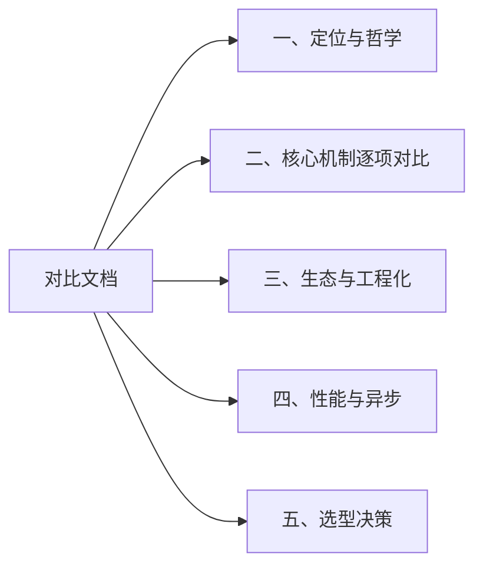
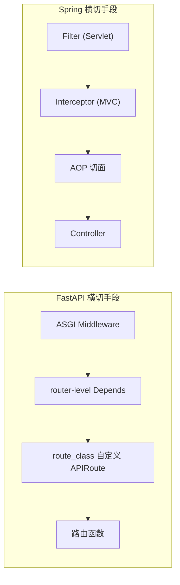
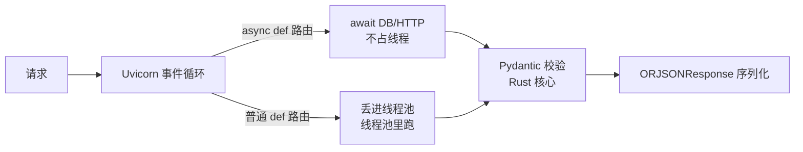
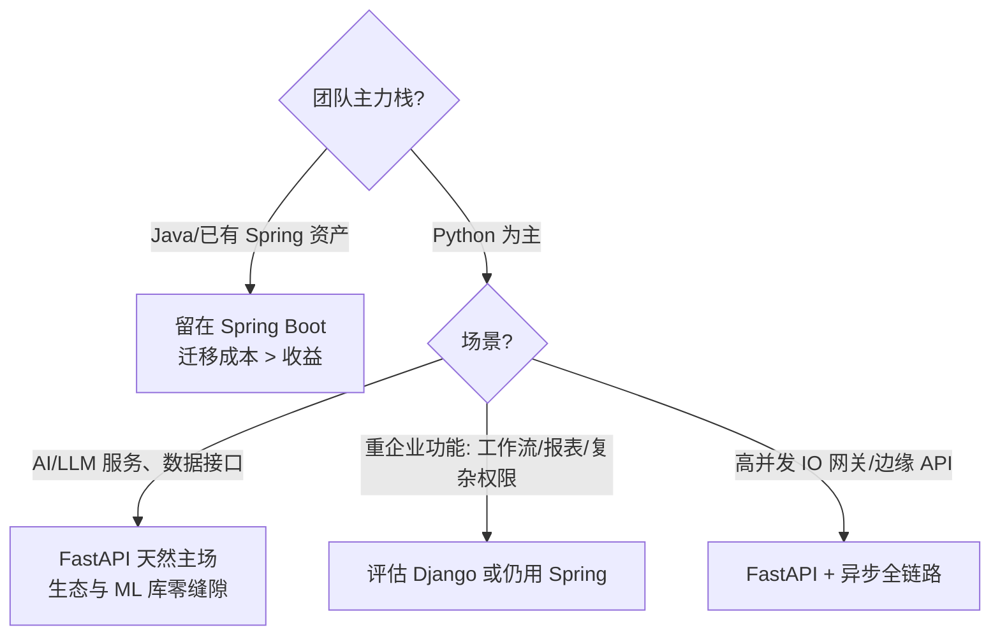

# FastAPI 与 Spring Boot 全面对比

> [!abstract] 一句话定位
> Spring Boot 是**全家桶企业框架**：IoC 容器 + AOP + 生态整合，什么都替你管。FastAPI 是**现代 Python 的 API 框架**：类型驱动 + 标准库规范（ASGI/Pydantic），只管 API 这一层，其余交给你选的库。**理念差异一句话：Spring 靠容器装配，FastAPI 靠类型推导。**

## 🗺️ 全篇导航



---

## 一、定位与哲学

| 维度 | Spring Boot | FastAPI |
|---|---|---|
| 诞生 | 2014（Spring 体系 2002） | 2018 |
| 语言 | Java/Kotlin（静态强类型） | Python（动态强类型 + 可选类型标注） |
| 定位 | 企业级全家桶（Web/批处理/消息/安全/云） | API 框架（单点突破） |
| 核心规范 | 自有体系（Spring 抽象） | 站在标准上：ASGI、OpenAPI、Pydantic、类型注解 |
| 设计哲学 | 约定大于配置，容器统一管理 | 显式优于隐式（Zen of Python），函数优先 |
| 类型系统 | 编译期强制 | 运行时不强制，靠 Pydantic/类型标注补齐 |

> [!important] 最根本的一条差异
> Java 的类型在**编译期**被强制，所以 Spring 能靠反射+注解做容器装配；Python 类型标注**运行时可绕过**，所以 FastAPI 反过来把类型标注当成**运行时校验和文档生成的数据源**——同一套标注，Java 用来编译，FastAPI 用来生成 OpenAPI 和校验入参。

---

## 二、核心机制逐项对比

### 2.1 依赖注入

| | Spring | FastAPI |
|---|---|---|
| 机制 | IoC 容器，`@Autowired` 注入 Bean | `Depends(...)` 依赖声明 |
| 注册方式 | `@Component/@Service/@Bean` 注解扫描 | 函数即依赖，无需注册 |
| 生命周期 | singleton/prototype/request/session | 每请求新建；`yield` 依赖实现 setup/teardown |
| 条件装配 | `@ConditionalOnXxx` 家族 | 函数里自己 `if` |
| 循环依赖 | 容器报错/三级缓存解决 | 天然难写出（函数调用图） |

```python
# FastAPI：依赖就是普通函数，无容器、无注册
def get_current_user(token: str = Depends(oauth2_scheme)) -> User:
    ...

@router.get("/me")
def me(user: User = Depends(get_current_user)):
    return user
```

```java
// Spring：声明 Bean，容器负责装配
@Service
public class UserService {
    private final UserRepository repo;
    public UserService(UserRepository repo) { this.repo = repo; } // 构造注入
}
```

> [!tip] 对照记忆
> `Depends` ≈ `@Autowired`，但它是**显式写在参数上**的，看得见、可嵌套、可覆写（测试时 `dependency_overrides` 一行换掉鉴权，比 Spring 的 `@MockBean` 更轻）。

### 2.2 分层与项目结构

| Spring 惯例 | FastAPI 惯例 | 备注 |
|---|---|---|
| 按层分包：`controller/ service/ dao/ entity/` | 按功能分包：`user/` 内含 `router.py service.py crud.py models.py schemas.py` | 详见 [[00-FastApiAdmin-项目总览]] |
| `@RestController` | `APIRouter` 模块级变量 | 命名习惯不同，职责相同 |
| Service 接口 + Impl | service 层可选，常直接函数 | Python 不强求接口层 |
| MyBatis-Plus `BaseMapper` | `CRUDBase[T, Create, Update]` 泛型 | fastapiadmin 的等价物 |
| DTO + `@Valid` | `schemas.py`（Pydantic） | FastAPI 校验由框架在路由层自动做 |

### 2.3 ORM / 数据访问

| | Spring 生态 | FastAPI/Python 生态 |
|---|---|---|
| 主流 ORM | MyBatis / MyBatis-Plus / Spring Data JPA(Hibernate) | SQLAlchemy 2.0 / Django ORM / Tortoise |
| 风格 | MyBatis：SQL 中心；JPA：对象中心 | SQLAlchemy 2.0 `Mapped[...]` 声明式 ≈ JPA |
| 迁移 | Flyway / Liquibase | Alembic（SQLAlchemy 官方配套） |
| 异步 | JPA 阻塞，需连接池 + 线程模型 | SQLAlchemy async + asyncmy/asyncpg 原生异步 |

### 2.4 数据校验

| Spring | FastAPI |
|---|---|
| Bean Validation（`@NotNull @Size @Pattern`） | Pydantic 模型字段约束（`Field(min_length=..)`） |
| 手动 `@Valid` 触发 | 路由参数声明即校验，自动 422 |
| 校验失败 → `MethodArgumentNotValidException` | 校验失败 → 统一 `RequestValidationError`，可全局改写响应体 |

### 2.5 中间件 vs AOP



| 切面需求 | Spring 做法 | FastAPI 做法 |
|---|---|---|
| 全局请求处理 | Filter | ASGI/Starlette Middleware |
| 接口级前置/后置 | Interceptor | `dependencies=[...]`（router 级、路由级） |
| 注解式审计（`@Log`） | AOP + 自定义注解 | 自定义 `APIRoute` 类（fastapiadmin 的 `OperationLogRoute`），一行 `route_class=` 全量生效 |
| 全局异常 | `@ControllerAdvice` | `@app.exception_handler` |
| 声明式鉴权 | `@PreAuthorize` | `Depends(AuthPermission([...]))` |

### 2.6 认证与安全

| | Spring Security | FastAPI |
|---|---|---|
| 定位 | 独立重型安全框架 | 框架自带 OAuth2/JWT 工具 + Depends 组合 |
| RBAC | `@PreAuthorize("hasAuthority(...)")` | 依赖函数里查库校验（fastapiadmin 的 `core/auth/permission.py`） |
| 数据权限 | `@DataScope` AOP 拼接 SQL | `Permission(model, auth).filter_query()` 显式调用 |
| 学习成本 | 高（过滤器链深） | 低（一个依赖函数讲清楚） |

> [!note] 公平地说
> Spring Security 的过滤器链复杂但**可插拔点位多**（记住我、CSRF、OAuth2 登录服务器全是现成的）；FastAPI 的鉴权是「自己用 Depends 拼」，灵活但连 OAuth2 授权服务器这种都要自己搭或选库（如 Authlib）。

### 2.7 配置管理

| Spring | FastAPI |
|---|---|
| `application.yml` + profile + `@ConfigurationProperties` | `.env` + pydantic-settings（`Settings` 类 + 类型校验） |
| 配置中心 Nacos/Apollo（你们在用 Nacos） | 无官方中心化方案，接 Nacos 要用 nacos-sdk-python 或开箱自定义 |
| `@Value` 注入 | 直接读 `settings.xxx` 属性 |

### 2.8 任务与消息

| 能力 | Spring | FastAPI |
|---|---|---|
| 定时任务 | `@Scheduled` | APScheduler / Celery Beat |
| 异步任务队列 | @Async + RabbitMQ/Kafka | Celery / ARQ / Dramatiq |
| 事件 | ApplicationEvent | 无内置，可用 pydantic 信号或自己发布订阅 |
| WebSocket | spring-websocket | 原生支持（`@app.websocket`） |

---

## 三、生态与工程化

### 3.1 生态对照表

| 领域 | Java/Spring | Python/FastAPI |
|---|---|---|
| 包管理 | Maven/Gradle | pip + requirements.txt / **uv**（新主流，fastapiadmin 在用） |
| 运行时容器 | JVM 内嵌 Tomcat | Uvicorn / Hypercorn（ASGI server） |
| 测试 | JUnit + MockMvc + Testcontainers | pytest + httpx `AsyncClient` + `dependency_overrides` |
| API 文档 | springdoc-openapi（需引入） | **内置**：`/docs`、`/redoc` 自动生成 |
| 数据库版本管理 | Flyway/Liquibase | Alembic |
| 微服务 | Spring Cloud 全家桶（Gateway/Config/...） | 无对等体系，常用 K8s + 独立组件 |

### 3.2 部署

| | Spring Boot | FastAPI |
|---|---|---|
| 产物 | fat jar（一个文件） | 代码目录 + venv / Docker 镜像 |
| 运行 | `java -jar app.jar` | `uvicorn app.main:app --workers 4`（多进程）或 gunicorn -k uvicorn.workers.UvicornWorker |
| 进程模型 | JVM 多线程处理请求 | 多进程 × 事件循环（async） |
| 镜像体积 | JRE 基础 ≈ 200MB+ | python-slim ≈ 100MB 内 |

---

## 四、性能与异步

| | Spring Boot(MVC) | Spring WebFlux | FastAPI |
|---|---|---|---|
| 模型 | 一请求一线程（线程池） | Reactor 响应式 | 事件循环 + async/await |
| 并发 IO 密集 | 中（线程开销） | 高 | 高 |
| CPU 密集 | 好 | 差 | 差（GIL；需多进程/Pydantic-core 用 Rust 补） |
| 心智负担 | 低（阻塞直觉） | 高（响应式学习曲线） | 低（async/await 直觉） |
| 框架基准（JSON 序列化类） | 中 | 中 | **快**（uvicorn+orjson 同档；Starlette 裸跑接近 Go 一档，FastAPI 因校验略降） |



> [!warning] 三个性能相关的常见误判
> 1. FastAPI 里写**普通 `def` 路由**不丢人——框架会自动丢线程池，阻塞库（如多数 ORM 旧版）照样能用；
> 2. 但 `async def` 里**绝不能调阻塞函数**（`time.sleep`、`requests`），会卡死整个事件循环；
> 3. 官方 benchmark 里 Starlette 裸框架比 FastAPI 快，快出来的部分主要是**跳过了 Pydantic 校验**——校验是花钱买的功能，不是白送的。

---

## 五、选型决策



| 场景 | 建议 |
|---|---|
| AI/LLM 应用后端（流式 SSE、调模型） | **FastAPI**（与 Python AI 生态无缝，你们的 ruoyi-chat 场景里 AI 模块用它是顺势） |
| 传统企业管理系统、复杂报表、强事务 | Spring Boot（生态成熟度仍碾压） |
| 团队 Java 背景、想快速出 Python API | FastAPI 类型风格迁移成本最低 |
| 超大团队、强规范诉求 | Spring（规范生态多）或 FastAPI + 项目级约定（fastapiadmin 的插件式约定可抄） |

> [!summary] 收束成三句话
> 1. **概念几乎全能对上**：Router↔Controller、Depends↔@Autowired、Schema↔DTO、CRUDBase↔BaseMapper、route_class↔AOP、exception_handler↔@ControllerAdvice——学会一个，另一个就是查词。
> 2. **组织方式相反**：Spring 按层分包 + 注解装配；FastAPI 按功能分包 + 类型装配。
> 3. **分工现实**：企业中后台继续 Spring，AI/IO 密集的新服务上 FastAPI，两者经 Nacos/HTTP 共存，正是当下最常见的混合架构。

---

## 附、术语对照速查

| Java/Spring | Python/FastAPI |
|---|---|
| Bean | 依赖函数 / 实例 |
| `@Autowired` | `Depends()` |
| `@RestController` | `APIRouter` |
| `@RequestMapping` | `@router.get/post(...)` |
| `@PathVariable / @RequestParam / @RequestBody` | 路径参数 / Query 参数 / Pydantic Body |
| DTO / VO | `schemas.py`（Pydantic BaseModel） |
| `@Valid` + Bean Validation | Pydantic 字段约束（自动 422） |
| MyBatis-Plus `BaseMapper` | `CRUDBase[T, Create, Update]` |
| JPA `@Entity` | SQLAlchemy `Mapped[...]` 模型 |
| Flyway | Alembic |
| `@ControllerAdvice` | `exception_handler` |
| Filter / Interceptor / AOP | Middleware / router Depends / 自定义 APIRoute |
| `@Scheduled` | APScheduler / Celery Beat |
| `application.yml` | `.env` + pydantic-settings |
| Maven/Gradle | uv / pip |
| JUnit | pytest |
| 内嵌 Tomcat | Uvicorn（ASGI） |
