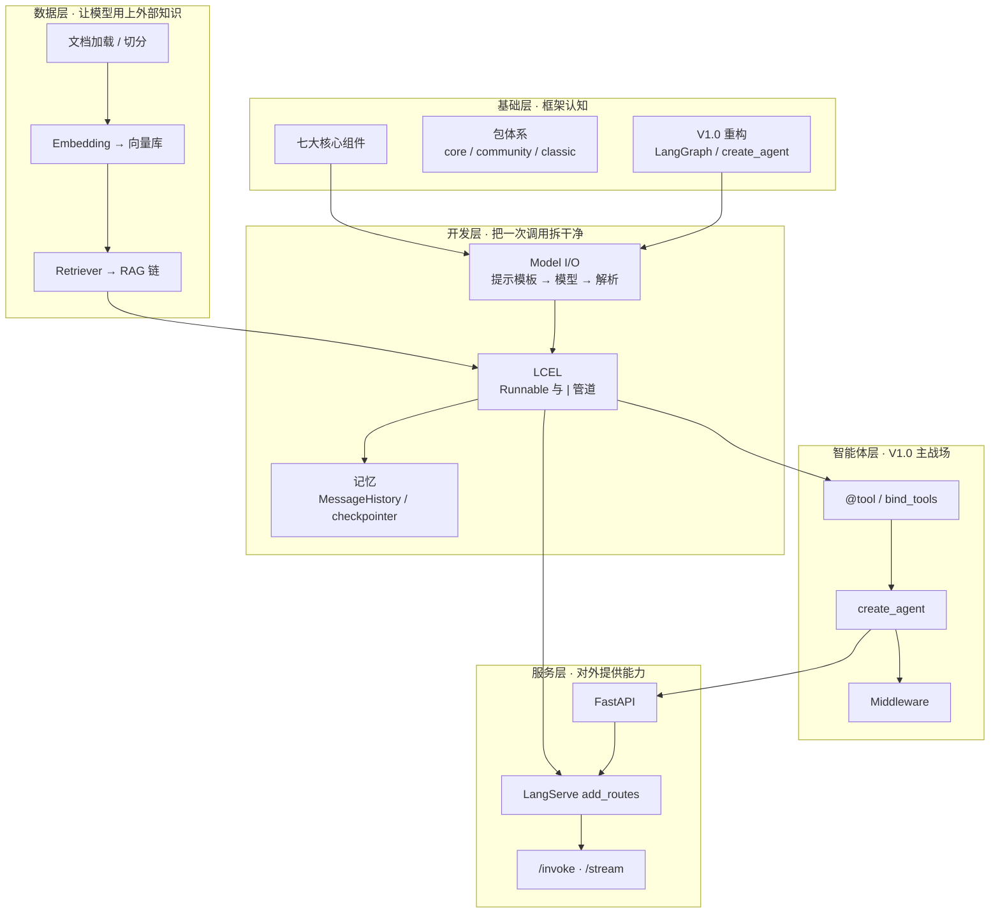

# LangChain V1.0 学习总览 · 笔记集索引

> [!tldr] 一句话
> **LangChain 1.0 = 建在 LangGraph 之上的 Agent 工程化框架**。主线是：`Model I/O → LCEL 链 → RAG 数据连接 → Agent / 中间件 → FastAPI + LangServe 部署`。前四步解决"应用怎么搭"，最后一步解决"应用怎么给别的系统用"。

这套笔记把课程资料**合并成一条完整链路**，而不是逐份摘抄。所有结论以 `LangChainV1.0讲义.pdf` 为主干，PPT 用于还原课堂结构，两份 Markdown 教程补齐服务端知识。资料里混用了 v0.3 与 v1.0 的写法，本系列统一以 **V1.0 为准**，旧写法单独标注。

> [!info] 关于 day02 / day03 资料（2026-11-11 补记）
> **讲义 PDF 三天是同一份**（md5 完全一致），不是三本讲义，而是一本完整讲义按天挑章节讲。day02 附带的 FastAPI / LangServe 教程也与 day01 相同；day03 则没再附这两份。
> - **day02**：唯一新增的 11 页课件只讲「链和 LCEL + 记忆」→ [[07-Day02 课堂复盘 LCEL 与会话记忆]]（资料核对、三向索引、讲义细节与勘误）。
> - **day03**：新增 V1.0（23 页）与 **V0.3（26 页）** 两份课件 → [[08-Day03 课堂复盘 RAG 实战与工具中间件]]。逐页对比发现 **RAG 章在 V0.3 → V1.0 几乎逐字未改，真正的新增是 Middleware**；另补齐了 4 种检索器、7 种文档加载器、6 个中间件钩子等课件独有知识点。
>
> 两份复盘都是**增量**，没有重复造笔记，也没有回改 `01`–`06`。

---

## 一、课程资料与各自的定位

| 资料 | 体量 | 在笔记里的角色 |
|---|---|---|
| `LangChainV1.0讲义.pdf` | 64 页 | **主干**。V1.0 重构、体系、Model I/O、LCEL、RAG、工具调用、中间件，含全部示例代码；**day01 / day02 / day03 为同一文件** |
| `1.LangChainV1.0从入门到精通.pptx`（day01） | 27 页 | **整门课大纲**。确认讲授顺序与重点：什么是 V1.0 → 体系 → 核心组件 → 第一个应用 → 部署阶段；含环境准备（Python 3.11、API-KEY 放系统变量） |
| `LangChainV1.0从入门到精通-day02.pptx`（day02） | 11 页 | **第二次课切片**。目录列 6 项，实际只展开「链和 LCEL」并延伸到记忆；对应讲义 P27–P38，见 [[07-Day02 课堂复盘 LCEL 与会话记忆]] |
| `2、LangChainV1.0从入门到精通.pptx`（day03） | 23 页 | **第三次课切片 · V1.0**。只讲「RAG 实战 + 工具调用 + 中间件」；对应讲义 P38–P64，见 [[08-Day03 课堂复盘 RAG 实战与工具中间件]] |
| `2、LangChainV0.3从入门到精通.pptx`（day03） | 26 页 | **旧版对照课件**。LCEL + RAG + 工具实战，**完全没有中间件**；用于还原 V0.3 → V1.0 到底改了什么，见 `08` §二 |
| `FastAPI 框架入门.md` | 16 章 | **服务端基础**。路由、Pydantic、依赖注入、认证、中间件、部署；day01 / day02 为同一文件 |
| `LangServe 入门指南.md` | 8 章 | **部署落地**。`add_routes` 把链变 REST API、端点、认证、生产化；day01 / day02 为同一文件 |

> [!warning] 资料本身存在版本混杂
> - `LangServe 入门指南.md` 的示例用了 `from langchain.llms import OpenAI` + `LLMChain`，这是 **v0.3 及更早**的写法，V1.0 已移到 `langchain-classic`。
> - 讲义里 `ConversationBufferMemory`、`create_sql_query_chain`、`create_retrieval_chain` 也都明确标注为"旧版 / 已废弃，仅作了解"。
> - `FastAPI 框架入门.md` 里的 `BaseSettings`、`Query(regex=...)` 属于 Pydantic v1 写法，Pydantic v2 已变更；这类是**依赖库升级**，不是 LangChain 废弃。
>
> 完整废弃项、替代方案与「哪些其实没废弃」见本篇 **§5.1**；资料级勘误见 [[06-服务化部署 FastAPI 与 LangServe]] 的「版本勘误」一节。

---

## 二、知识地图



一句话记住分层：**Model I/O 是一次调用，LCEL 是多次调用的组合，RAG 是给组合加外部数据，Agent 是让模型自己决定调用几次，LangServe 是把这一切包成 HTTP。**

---

## 三、系列笔记索引

| 编号 | 主题 | 回答什么问题 | 主要来源 |
|---|---|---|---|
| [[00-LangChain V1.0 学习总览]] | 索引与版本速查 | 资料有哪些、怎么学、v0.3 → v1.0 改了什么 | 三天资料综合 |
| [[01-V1.0 重构与整体体系]] | 框架认知 | V1.0 到底变了什么？包怎么分？核心组件有哪些？ | 讲义 P1–P7、PPT 第 10–16 页 |
| [[02-Model I-O 模型提示词与输出解析]] | 单次调用 | 模型怎么接、提示词怎么模板化、输出怎么变结构化 | 讲义 P8–P27、PPT 第 18–26 页 |
| [[03-链与 LCEL]] | 组合编排 | `\|` 是什么？Runnable 家族各管什么？多轮记忆怎么做？ | 讲义 P28–P38 |
| [[04-RAG 数据连接与检索]] | 外部知识 | 文档 → 向量 → 检索 → 生成，完整链路怎么串 | 讲义 P38–P45 |
| [[05-Agent 工具调用与中间件]] | V1.0 核心 | `create_agent` 怎么用？工具谁执行？中间件拦在哪？ | 讲义 P45–P64 |
| [[06-服务化部署 FastAPI 与 LangServe]] | 对外服务 | 怎么把链变成 API？怎么调、怎么鉴权、怎么上生产 | 两份 Markdown 教程 + 讲义 P19–P21、PPT 第 27 页 |
| [[07-Day02 课堂复盘 LCEL 与会话记忆]] | day02 增量复盘 | 第二天讲了什么？和已有笔记怎么对上？有哪些讲义细节和勘误？ | day02 课件 11 页 + 讲义 P27–P38 |
| [[08-Day03 课堂复盘 RAG 实战与工具中间件]] | day03 增量复盘 + 版本对比 | 第三天讲了什么？V0.3 → V1.0 到底改了哪章？课件里还有哪些补充知识点？ | day03 V0.3 / V1.0 双课件 + 讲义 P38–P64 |
| [[09-LangChain 1.0 API 速查菜单]] | **纯 V1.0 API 菜单** | 最新版每个 API 干什么、怎么 import、怎么写？「我要做 X」该用哪个？ | 三天资料中的 V1.0 写法汇总 |

> [!tip] 写代码时查 API
> 直接进 [[09-LangChain 1.0 API 速查菜单]]：只收 V1.0 当前 API，按功能分菜单，含一页速查卡；不含旧版写法与版本对照。看废弃项与替代回本篇 §5.1。

---

## 四、建议的学习路径

**第 1 阶段 · 跑通一次调用**
`01` → `02`。目标：能用一个 `ChatPromptTemplate | client | StrOutputParser` 得到干净的字符串，理解 `content_blocks` 为什么是 V1.0 的关键设计。

**第 2 阶段 · 会组装**
`03` → `04`。目标：能用 `RunnablePassthrough` 把用户问题和检索结果拼进提示词，做出一个最小 RAG。
> 若按课堂进度复习：第二天的课对应 `03`（LCEL + 记忆），配合 `07` 的三向索引和自测清单过一遍即可，不必另起一套笔记。

**第 3 阶段 · 交给模型自己决策**
`05`。目标：理解「模型只发起工具调用请求，执行由应用负责」这个分工，用 `create_agent` + `checkpointer` 做出带会话记忆的助手。
> 按课堂进度：第三天的课横跨 `04`（RAG）与 `05`（工具 / 中间件），配合 [[08-Day03 课堂复盘 RAG 实战与工具中间件]] 的双课件对比，能看清「V1.0 新增的是 Agent 工程化能力，不是 RAG」。

**第 4 阶段 · 服务化**
`06`。目标：`add_routes` 之后能在 `/docs` 里看到接口，用 `RemoteRunnable` 或 curl 调通。

> [!tip] 与已有知识串联
> 若已熟悉 Spring 生态：讲义给的定位是 **LangChain ≈ Spring Boot（脚手架）+ Apache Camel（集成总线）**；`Depends` 对应 IoC 注入、`Middleware` 对应 AOP 环绕、`@tool` 对应可被发现的 Bean 方法。详见 [[10-FastAPI与SpringBoot全面对比]]。
> RAG 的向量库部分可衔接 [[Milvus 学习文档]]、[[pgvector vs Milvus 选型对比]] 与 Spring AI 侧的实现。

---

## 五、V0.3 → V1.0 速查表

| 旧写法（v0.3 及以前） | V1.0 写法 | 说明 |
|---|---|---|
| `AgentExecutor` / `initialize_agent` / `create_react_agent` | `langchain.agents.create_agent` | 统一的 Agent 创建入口，底层跑在 LangGraph 上 |
| `ConversationBufferMemory` | `checkpointer`（如 `InMemorySaver`）+ `thread_id` | 记忆改成「状态持久化」，不再是独立的 Memory 类 |
| `LLMChain` / 各种内置 Chain | `LCEL`（`prompt \| model \| parser`）或 `create_agent` | 内置链整体迁到 `langchain-classic` |
| 各厂商 `AIMessage` 结构不一，需分别解析 | `message.content_blocks` | 统一为 `text / reasoning / tool_call / citation` 内容块 |
| 结构化输出靠额外一次 LLM 调用 + Prompt 技巧 | `response_format` 直接进主循环 | 少一次调用，降 Token 与延迟 |
| `AgentType.OPENAI_FUNCTIONS` | `create_agent` 内置 Tool Calling 循环 | 含错误重试与消息历史管理 |
| 无流程拦截点 | `middleware=[...]` | 模型/工具调用前后可插钩子 |
| `from langchain.prompts import ...` | `from langchain_core.prompts import ...` | 核心抽象收敛到 `langchain_core` |
| Python 3.9 | **Python 3.10+**（课程用 3.11） | V1.0 放弃 3.9 |

**升级决策**（讲义原话）：新项目直接用 `create_agent` + V1.0 API；维护旧项目先装 `langchain-classic` 保证能跑，再逐步用 Middleware 和 `create_agent` 替换老的 Chain / Executor。

### 5.1 完整废弃清单与替代（按状态分层）

> [!important] 先纠正一个容易混淆的说法
> 讲义原话是「**V1.0 已移除各种 Chain，但 LCEL 作为一种思想仍有必要学**」（[[01-V1.0 重构与整体体系]] §四、[[07-Day02 课堂复盘 LCEL 与会话记忆]] §三）。所以「课程里旧了但值得学」的内容要分三层，**不能一概叫废弃**：
>
> | 状态 | 含义 | 代表 |
> |---|---|---|
> | ① **真废弃** | 主包已移除或官方标 Deprecated；新代码不要写，维护旧项目装 `langchain-classic` | 预制 Chain 类、`AgentExecutor`、`ConversationBufferMemory` |
> | ② **教学路径** | API 在 V1.0 仍可用，但不再是推荐入口 | `ChatMessageHistory` + `RunnableWithMessageHistory`、`MessagesPlaceholder` + `session_id` |
> | ③ **没废弃，是 V1.0 地基** | 继续用，且是新项目的标准写法 | **LCEL（`Runnable` / `\|` / `RunnablePassthrough`）**、`ChatOpenAI`、`content_blocks` |
>
> 一句话：**`LCEL` 和 `MessageHistory` 本身没有废弃**，废弃的是「预制 Chain 类」和「Memory 组件类」。上面 §五 的速查表是「一行一个迁移决策」，下面这张是「按状态分层的完整清单」。

**① 真废弃 → V1.0 替代**

| 废弃项 | V1.0 替代 | 为什么还值得学 | 出处 |
|---|---|---|---|
| `initialize_agent` / `AgentExecutor` / `create_react_agent` / `AgentType.OPENAI_FUNCTIONS` / `handle_parsing_errors` | `langchain.agents.create_agent`，LangGraph 内置 Tool Calling 循环，参数填错自动捕获并反馈模型重试 | 看清「模型只发起调用请求，执行与结果回灌由应用负责」这个分工；对比旧版手工兜底的痛点 | `01` §一、`05` §2.1 |
| 输入 `{"input": ...}` / 输出 `output` | `{"messages": [...]}`，含全部中间步骤，答案取 `result["messages"][-1].content` | 理解 Agent 状态为什么是一条消息列表 | `05` §2.1 |
| Tool 的 `return_direct` 逐工具声明 | 内置循环统一接管结果回灌，不再逐个声明 | 理解旧版为何要人显式决定「工具结果是否终止循环」 | `08` §2.2 |
| `ConversationBufferMemory` 等 Memory 组件 | `checkpointer`（如 `InMemorySaver`）+ `thread_id` 传给 `create_agent` | 「模型无状态、会话状态由应用按会话标识注入」；`thread_id` 就是 `session_id` 换名 | `01` §三、`03` §3.4、`07` §五 |
| `LLMChain` / 各种预制 Chain | `prompt \| model \| parser` 或 `create_agent`；旧代码到 `langchain_classic` 找 | 链的本质是数据流动；看懂老项目与网上教程 | `03` §四、`06` §三 |
| `create_retrieval_chain` / `create_stuff_documents_chain` | LCEL 手写 `{"context": retriever, "question": RunnablePassthrough()} \| prompt \| model \| parser` | 理解 RAG 里检索结果怎么进提示词 | `04` §七、`08` §七 |
| `create_sql_query_chain` + 手写 `SQLCleaner` + `RunnablePassthrough.assign` 五步链 | `create_agent` + `SQLDatabaseToolkit` | 数据流动的教科书；对比才知道 V1.0 内置了工具选择、执行、错误重试、消息历史 | `05` §3.3–3.4 |
| `from langchain.chains / langchain.prompts / langchain.llms import ...` | `langchain_core.*`（抽象）、`langchain.*`（Agent 高层 API）、`langchain_classic.*`（老代码）；模型统一 `ChatOpenAI` / `init_chat_model` | 靠 import 路径一眼判断代码版本；纯文本补全 LLM 的 API 已停更，国内厂商普遍不支持 | `01` §二、`02` §一 |
| 结构化输出靠「额外一次 LLM 调用 + Prompt 技巧」 | `create_agent(response_format=YourPydanticModel)` / `with_structured_output` | 理解校验为什么必须进主循环（少一次调用、降 Token 与延迟） | `02` §六、`00` §五 |
| 各厂商 `AIMessage` 结构分别解析 | `message.content_blocks`（text / reasoning / tool_call / citation） | 理解跨厂商解耦点，也是 `create_agent` 统一工具调用的前提 | `01` §1.2 |

**② 教学路径（V1.0 仍可用，但别当生产入口）**

| 写法 | 状态 | 建议 | 出处 |
|---|---|---|---|
| `ChatMessageHistory` + `RunnableWithMessageHistory` + `MessagesPlaceholder` + `session_id` | 仍可用 | 只用来理解「历史怎么注入」；生产直接 `checkpointer` + `thread_id` | `03` §3.4、`07` §五 |
| `RedisChatMessageHistory` 讲义示意 | 讲义自述**代码未经测试** | 只作跨进程持久化的思路参考，需自行补 import / TTL / 降级 | `07` §4.2 |
| `langchain.debug = True` | 仍可用 | 本地调试够用；团队级追踪评估用 LangSmith | `03` §五 |

**③ 没废弃，V1.0 继续用**

| 写法 | 定位 | 出处 |
|---|---|---|
| `Runnable` 三方法 `invoke / batch / stream` 与 `\|` 管道 | 组件间组合的通用协议，`create_agent` 也建立在这套抽象上 | `03` §一、§二 |
| `RunnablePassthrough.assign` / `RunnableParallel` / `RunnableLambda` | 手写链的标准件，最小 RAG 就是它们拼出来的 | `03` §三 |
| `ChatPromptTemplate \| ChatOpenAI \| StrOutputParser` | 最小应用的标准写法，第 1 阶段学习路径 | `00` §四、`02` §一 |
| `content_blocks` / `response_format` / `middleware=[...]` | V1.0 新增能力，不是替代品而是新地基 | `01` §一、`05` |

**④ 容易混进来的「非 LangChain 废弃」**（依赖库升级或教程笔误，性质不同）

| 资料写法 | 当前写法 | 性质 | 出处 |
|---|---|---|---|
| `@custom_serve` 装饰器 | `Runnable.with_types(input_type=..., output_type=...)` | 教程自定义装饰器，**从来不是官方 API** | `06` §三 |
| `Query(regex=)` / `pydantic.BaseSettings` / `sqlalchemy.ext.declarative` / `__get_validators__` | `pattern=` / `pydantic-settings` + `SettingsConfigDict` / `sqlalchemy.orm` / `__get_pydantic_core_schema__` | Pydantic v2、SQLAlchemy 2.x 升级 | `06` §三 |
| `FROM python:3.9-slim` | **Python 3.10+**（课程 3.11） | V1.0 放弃 3.9 | `00` §五、`06` §三 |
| `/invoke` 请求体两种写法冲突 | 以 `/docs` 自动生成的 schema 为准 | 讲义与 LangServe 指南互相矛盾 | `06` §2.3 |

> [!tip] 查旧 API 用哪个文档站
> V1.0 下内置链已迁到 `langchain_classic`，day02 课件给的地址 `https://reference.langchain.com/python/langchain_classic/chains/` 比讲义里的旧地址更贴切；两份都提醒**标在 `Deprecated classes` / `Deprecated functions` 里的不要用**。见 `03` §四、`07` §4.6。

---

## 六、环境与约定

```bash
# 课程环境：Python 3.11，一次性装齐依赖
pip install -r requirements.txt
```

```python
# API-KEY 统一从操作系统环境变量读取，不写进代码
import os
from langchain_openai import ChatOpenAI

client = ChatOpenAI(
    api_key=os.getenv("DASHSCOPE_API_KEY"),
    base_url="https://dashscope.aliyuncs.com/compatible-mode/v1",  # OpenAI 兼容端点
    model="qwen-max-latest",
)
```

> [!important] 三条约定
> 1. 只要是 **OpenAI 兼容** 的模型（阿里百炼 / DeepSeek / 腾讯混元等），都可以用 `ChatOpenAI` 包装器；非兼容模型用 `init_chat_model`。
> 2. 讲义把上面这段封装成了 `models.py::get_lc_model_client()`，后续示例一律用 `client = get_lc_model_client()`，笔记沿用这个约定。
> 3. 嵌入模型用 `DashScopeEmbeddings`，与对话模型不是同一个客户端，见 [[04-RAG 数据连接与检索]]。

---

## 七、一句提醒

课程里有大量「旧版写法但值得学」的内容，day02 与 day03 的 V0.3 课件里尤其集中。准确说法见 **§5.1**：真正废弃的是**预制 Chain 类、旧 Agent 入口、Memory 组件**；`LCEL` 与 `MessageHistory` 并没有废弃，前者是 V1.0 的地基，后者是「会话状态由应用注入」的教学路径。**学的是思想，不是 import 路径**：链的思想是数据流动，RAG 的思想是检索增强，Agent 的思想是把决策权交给模型。真正写新代码时，Agent 的入口只有一个——`create_agent`；简单组合仍然用 LCEL。
