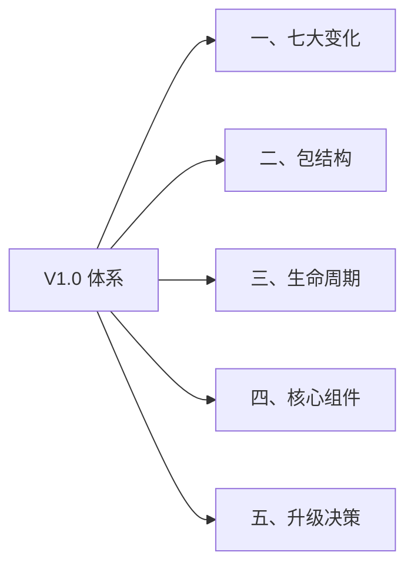
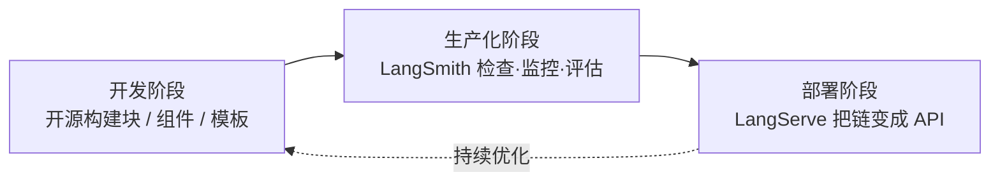
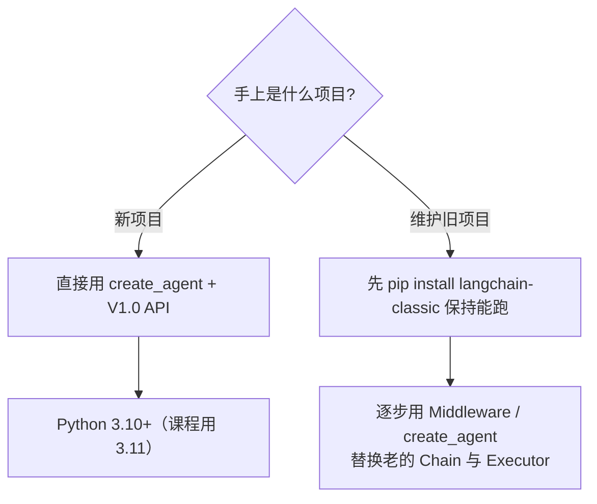

# LangChain V1.0 重构与整体体系

> [!abstract] 一句话定位
> V1.0 **不再是"链式调用工具箱"，而是构建在 LangGraph 之上的「Agent 快速通道」**：LangGraph 管底层图编排与精细控制，LangChain 管开箱即用的高层抽象。几行代码就能跑起一个生产级 Agent。

V1.0 于 **2025 年 10 月 23 日**正式发布（10 月 22 日官方预告，LangGraph 同步 1.0）。相较 V0.3 是一次面向生产级工程化的重大升级：API 大幅简化，架构、可维护性、稳定性与扩展能力整体重做。

---

## 🗺️ 全篇导航



---

## 一、七大变化（重构详解）

| # | 变化 | 关键内容 | 带来的收益 |
|---|---|---|---|
| 1 | **全面拥抱 LangGraph** | 所有 V1.0 Agent 跑在 LangGraph 运行时上 | 直接获得持久化、流式输出、Time Travel 调试 |
| 2 | **`create_agent` 统一入口** | 取代 `AgentExecutor`、`langgraph.prebuilt.create_react_agent`、旧 ReAct 构建方式 | 比 LangGraph 简单、比旧版 Agent 灵活 |
| 3 | **中间件 Middleware** | 模型调用前后、工具调用前后可插逻辑 | 像 Web 中间件一样做流程控制 |
| 4 | **标准化内容块 `content_blocks`** | 跨提供商统一访问文本 / 推理 / 引用 / 工具调用 | 上层代码与底层模型解耦，切换模型不改解析代码 |
| 5 | **结构化输出进主循环** | 不再需要额外一次 LLM 调用 | 降 Token、降延迟，不用堆 Prompt 技巧 |
| 6 | **命名空间清理** | 核心包只留 Agent / Model / Tools；旧 Chain、AgentExecutor 移到 `langchain-classic` | 包更轻，旧项目装 `langchain-classic` 仍可运行 |
| 7 | **其他** | 放弃 Python 3.9，建议 3.10+；LangGraph 同步 1.0 承诺 API 稳定 | 版本基线收敛 |

### 1.1 中间件：V1.0 最大亮点

在 Agent 生命周期里插自定义逻辑，官方预置了常用件：

| 内置中间件 | 作用 |
|---|---|
| `PIIMiddleware` / PII Redaction | 发送给 LLM 前自动去除敏感信息 |
| `SummarizationMiddleware` | 上下文过长时自动总结历史对话 |
| `HumanInTheLoopMiddleware` | 执行敏感操作前暂停，等待人工批准 / 编辑 / 拒绝 |
| `ModelCallLimitMiddleware` | 限制模型调用次数，防死循环与成本失控 |
| `ToolCallLimitMiddleware` | 限制工具调用次数（可全局或按工具） |

代码见 [[05-Agent 工具调用与中间件]]。

### 1.2 `content_blocks`：为什么值得单独记

不同大模型（OpenAI / Anthropic / Gemini / 通义）返回的 `AIMessage` 结构不一样。V1.0 在 LangChain 层把异构响应统一成标准内容块：

```python
for block in ai_msg.content_blocks:
    if block["type"] == "reasoning":
        print("推理过程:", block["reasoning"])
    elif block["type"] == "text":
        print("回答内容:", block["text"])
    elif block["type"] == "tool_call":
        print("请求调用:", block["name"], block["args"])
```

> [!important] 解耦点的价值
> 内容与原始字符串解耦后，多模态和复杂输出的处理变成类型安全的。这也是后续 `create_agent` 能统一处理工具调用的前提——模型只管"我要调什么"，框架负责把意图解析成标准块。

---

## 二、LangChain 体系：包怎么分

| 包 | 定位 |
|---|---|
| `langchain` | 主入口，V1.0 后**只含构建 Agent 所需的核心组件**（Agent / Model / Tools） |
| `langchain-core` | 生态共用的核心接口与抽象（`Runnable`、`BaseMessage`、`ChatPromptTemplate` 都在这里） |
| `langchain-community` | 第三方集成（各类加载器、向量库、嵌入模型、工具类） |
| `langchain-classic` | **旧版实现**：遗留 Chain、`AgentExecutor`、旧工具 |
| 合作伙伴包 | `langchain-openai`、`langchain-anthropic` 等，仅依赖 `langchain-core` 的轻量集成库 |
| `LangGraph` | 把步骤建模成图的节点与边，构建有状态、多参与者应用；可独立使用 |
| `DeepAgents` | 能规划、用子代理、借文件系统处理复杂任务的代理 |
| `LangServe` | 把链部署成 REST API |
| `LangSmith` | 调试、测试、评估、监控 LLM 应用的开发者平台 |

> [!tip] import 路径速记
> `langchain_core.*` = 抽象与接口；`langchain.*` = V1.0 的 Agent 高层 API；`langchain_community.*` = 具体集成；`langchain_classic.*` = 老代码收容所。看到 `from langchain.chains import ...` 基本可以判定是旧版写法。

### 2.1 应用生命周期三阶段



Day01 的课程安排正好对应这条线：前半程讲开发（Model I/O、LCEL、RAG、Agent），最后落到「部署阶段：发布应用 → 通过 HTTP / 客户端访问」（PPT 第 27 页）。

---

## 三、七大核心组件（V1.0）

| 组件 | 是什么 | V1.0 的关键变化 |
|---|---|---|
| **Agents** | 应用的核心构建块。本质是**一个循环**：接收输入 → 决定是否调工具 → 处理结果 → 重复直到完成 | 统一 `create_agent`；默认基于 LangGraph，原生支持状态管理、分支、持久化 |
| **Models** | Agent 的"大脑" | 输出统一为 `content_blocks`；**推荐全面使用 Chat Model**（而非纯文本 LLM），以支持多模态与结构化交互 |
| **Messages** | 模型交互的基础数据单元 | 结构严格规范（见下表）；Agent 的"短期记忆"本质就是消息列表 |
| **Tools** | 连接外部世界（API / DB / 搜索）的桥梁 | `@tool` 装饰器把 Python 函数变成工具；**工具参数填错时自动捕获错误并反馈给 Agent 自我修正重试** |
| **短期记忆** | 跨轮次保留上下文 | 弃用 `ConversationBufferMemory`，改用 **Checkpointer** 保存每一步状态；传 `thread_id` 即可恢复上下文 |
| **Streaming** | 运行过程实时反馈 | 三层：流式 Token（打字机）、流式进度、流式自定义更新（业务信号如"已下载 10/100 条"） |
| **结构化输出** | 让模型直接产出可校验的数据 | `create_agent` 的 `response_format` 传 Pydantic 类，结果捕获校验后放在状态的 `structured_response` 键 |

### 3.1 消息类型

| 类型 | 含义 |
|---|---|
| `SystemMessage` | 设定 Agent 的行为准则、角色、约束 |
| `HumanMessage` | 用户输入 |
| `AIMessage` | 模型回复，含思维过程 `thought_process` 与 `tool_calls` |
| `ToolMessage` | 工具执行后返回的结果 |

---

## 四、早期分类 vs V1.0 分类（PPT 与讲义的差异）

PPT 第 15–16 页给的是**早期 6 大分类**，讲义 P5–P7 给的是 **V1.0 七大组件**。二者不是矛盾，是同一套东西在不同版本下的切法：

| 早期 6 大部分 | V1.0 对应 |
|---|---|
| 模型包装器 Model I/O（语言模型 / 提示模板 / 输出解析器） | Models + Messages 中的提示部分 |
| 数据连接 Data Connection（加载器 / 切分 / 嵌入 / 向量库 / 检索器） | 归入 RAG 组件，见 [[04-RAG 数据连接与检索]] |
| 链 Chains | LCEL 思想保留，实现类移到 `langchain-classic` |
| 记忆 Memory | 短期记忆（Checkpointer） |
| 代理 Agents 与工具 | Agents + Tools |
| 中间件 Middleware | Middleware（V1.0 才成为一等公民） |

> [!note] 讲义里那句最重要的话
> 「**虽然 LangChain v1.0 已经移除了各种 Chain，但 LCEL 作为 LangChain 的一种思想还是有必要去学习的**」。所以 [[03-链与 LCEL]] 讲的是编排思想，不是让你在新项目里用内置 Chain。

---

## 五、定位与类比（给 Java/Spring 背景）

| 类比 | 含义 |
|---|---|
| Spring Boot | 脚手架：快速构建应用，10 行代码起一个智能客服 |
| Apache Camel | 集成总线：200+ 工具与服务，动态调用外部资源 |
| ROS + gRPC（C++ 生态） | 组件编排 + 通信层 |

LangChain 的核心价值不是"封装了几个 API"，而是**用标准化工具链把 LLM 的原始能力转成可落地的行业解决方案**：一边给足自由度（比 Dify / RAGFlow 这类平台灵活），一边省掉从零造轮子的成本。

---

## 六、升级决策



> [!warning] 别踩的坑
> 1. 别在 V1.0 里找 `LLMChain` / `ConversationBufferMemory`，它们不在主包了。
> 2. 别把 `langchain` 和 `langchain-core` 的 import 混着写还以为是同一个包版本问题——这是有意的命名空间拆分。
> 3. Python 3.9 环境装不上 / 不受支持，先升解释器。
> 4. `create_agent` 的输入是标准 `messages` 列表，输出是含完整消息历史的 dict；取最终答案要 `result["messages"][-1].content`，不是 `.content` 直接拿。详见 [[05-Agent 工具调用与中间件]]。
