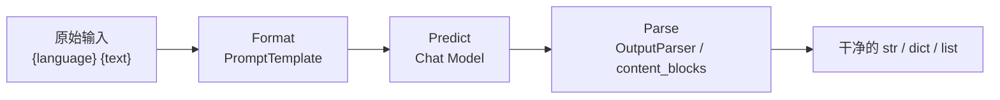

# Model I/O 模型、提示词与输出解析

> [!abstract] 一句话
> 一次模型调用拆成三段：**Format（提示模板）→ Predict（模型）→ Parse（输出解析）**。LangChain 为每一段都准备了组件，三者用 `|` 串起来就是最小应用。



---

## 一、模型包装器：LangChain 支持哪三类模型

| 类型 | 输入 → 输出 | 现状 |
|---|---|---|
| **LLM（非对话模型 / 文本补全）** | 字符串 → 补全字符串 | ⛔ **不用学**：OpenAI 文本补全 API 2023-07 最后一次更新，现仅能访问旧模型；国内厂商普遍不支持 |
| **Chat Model（聊天模型）** | 消息列表 → 消息 | ✅ V1.0 主推，支持多轮、多模态、结构化交互 |
| **Embedding Model（文本嵌入）** | 文本 → 向量 | 严格说不属于模型包装器范畴，RAG 阶段单独用，见 [[04-RAG 数据连接与检索]] |

### 1.1 两个包装器怎么选

| 情况 | 用哪个 |
|---|---|
| 模型是 **OpenAI 兼容 API**（阿里百炼 DashScope、DeepSeek、腾讯混元、OpenAI …） | `ChatOpenAI`，指定 `base_url` |
| 模型**不兼容** OpenAI 协议 | `init_chat_model`，兼容任意大模型 |
| 直接用厂商专属类 | 如 `from langchain_community.chat_models import ChatTongyi`（讲义 `content_blocks` 对比实验用的就是它） |

```python
import os
from langchain_openai import ChatOpenAI

# 讲义把这段封装为 models.py::get_lc_model_client()
client = ChatOpenAI(
    api_key=os.getenv("DASHSCOPE_API_KEY"),
    base_url="https://dashscope.aliyuncs.com/compatible-mode/v1",
    model="qwen-max-latest",
)

msg = [
    ("system", "请将以下的内容翻译成英文"),
    ("human", "你好，你今天过得好吗？"),
]
result = client.invoke(msg)
print(result)   # AIMessage(content='...', additional_kwargs=..., response_metadata=...)
```

> [!warning] 第一个程序暴露的两个问题（讲义 P9 / PPT 第 22 页）
> 1. **提示词写死**：想把"英文"换成"意大利文"、把原文换掉，只能改代码字符串。→ 用**提示词模板**解决。
> 2. **原始答复太杂**：`AIMessage` 里混着 `additional_kwargs`、`response_metadata`、`usage_metadata` 等额外信息。→ 用**输出解析器**解决。
>
> 这两个痛点就是 Model I/O 后两节存在的理由。

---

## 二、提示模板 Prompt Template

模板 = 带占位符的字符串，运行时填变量生成具体 prompt。价值：清晰易懂、可重用、易维护、自动处理变量、参数化生成。

### 2.1 五类模板

| 类型 | 用途 |
|---|---|
| `PromptTemplate` | 常用 String 模板，生成字符串 |
| `ChatPromptTemplate` | 组合多角色消息模板，生成消息列表；配套 `SystemMessagePromptTemplate` / `HumanMessagePromptTemplate` / `AIMessagePromptTemplate` |
| `FewShotPromptTemplate` | 用示例教模型怎么回答 |
| 部分格式化 `partial()` | 先给部分变量赋值（日期、系统配置），其余运行时再填 |
| 自定义模板 | 基于已有模板类定制 |

### 2.2 `PromptTemplate` 两种创建方式

```python
from langchain_core.prompts import PromptTemplate

# 方式一：从模板字符串推导变量（推荐）
template = "您是一位专业的程序员。\n对于信息 {text} 进行简短描述"
prompt = PromptTemplate.from_template(template)
print(prompt.format(text="langchain"))

# 方式二：显式声明 input_variables
prompt2 = PromptTemplate(
    input_variables=["text"],
    template="您是一位专业的程序员。\n对于信息 {text} 进行简短描述",
)
print(prompt2.format(text="langchain框架"))
```

### 2.3 `ChatPromptTemplate`：三种取值方法的区别

```python
from langchain_core.prompts import ChatPromptTemplate, SystemMessagePromptTemplate

chat_template = ChatPromptTemplate.from_messages([
    SystemMessagePromptTemplate.from_template("请将以下的内容翻译成 {language}"),
    ("human", "{text}"),          # 元组简写，等价 HumanMessagePromptTemplate
])

kwargs = {"language": "意大利文", "text": "朋友啊再见！"}

chat_template.format(**kwargs)           # → str，纯文本
chat_template.format_messages(**kwargs)  # → list[BaseMessage]，可直接喂给模型
chat_template.format_prompt(**kwargs)    # → ChatPromptValue；.to_messages() / .to_string()
```

> [!important] 三者别混用
> `-messages` 形式才能保留 **system / human 角色**。`format()` 得到的是拼好的字符串，角色语义会丢失。讲义里三种都 `client.invoke()` 过（Chat Model 都吃得下），但**做多轮对话、工具调用时必须用 `format_messages` 或 `format_prompt`**，否则 system 指令会被当成普通文本。

### 2.4 少样本模板 FewShotPromptTemplate

```python
from langchain_core.prompts import PromptTemplate
from langchain_core.prompts.few_shot import FewShotPromptTemplate

examples = [
    {"input": "2+2", "output": "4", "description": "加法运算"},
    {"input": "5-2", "output": "3", "description": "减法运算"},
]

# 单个示例的格式
example_prompt = PromptTemplate.from_template(
    "算式：{input} 值：{output} 类型：{description}"
)

prompt = FewShotPromptTemplate(
    examples=examples,
    example_prompt=example_prompt,
    prefix="你是一个数学专家, 能够准确说出算式的类型，",
    suffix="现在给你算式: {input} ， 值: {output} ，告诉我类型：",
    input_variables=["input", "output"],
)

print(prompt.format(input="2*5", output="10"))
result = client.invoke(prompt.format(input="2*5", output="10"))
print(result.content)   # 乘法运算
```

聊天版对应 `FewShotChatMessagePromptTemplate`，用法基本一致。

### 2.5 部分格式化 partial()

适合"某些值不该由用户每次输入"的场景：当前日期、系统内部配置、用户已选定的学科分类等。

```python
from datetime import datetime
from langchain_core.prompts import PromptTemplate

prompt = PromptTemplate(
    template="讲一个关于{date}的{story_type}",
    input_variables=["date", "story_type"],
)
# 先固化 date，运行时只传 story_type
half_prompt = prompt.partial(date=datetime.now().strftime("%Y-%m-%d %H:%M:%S"))

client.invoke(half_prompt.format(story_type="笑话"))
client.invoke(half_prompt.format(story_type="悲伤故事"))
```

同样的机制还用在解析器上：`partial_variables={"format_instructions": parser.get_format_instructions()}`。

---

## 三、输出解析器 Output Parser

> 职责：把 LLM 的输出转成更合适的格式，顺带把非结构化文本变成可处理的结构化数据。

| 解析器 | 输出 |
|---|---|
| `StrOutputParser` | 纯字符串（最常用，去掉 `AIMessage` 外壳） |
| `CommaSeparatedListOutputParser` | 逗号分隔 → `list` |
| `DatetimeOutputParser` | 日期时间字符串 → `datetime` |
| `JsonOutputParser` | 符合约定结构的 JSON / `dict` |
| `XMLOutputParser` | XML 格式结果 |

```python
from langchain_core.output_parsers import JsonOutputParser, StrOutputParser
from langchain_core.prompts import ChatPromptTemplate

parser = StrOutputParser()
print(parser.invoke(result))        # 直接从 AIMessage 拿到文本

# 链式写法（[[03-链与 LCEL]] 的主角）
chain = prompt | client | parser
```

**带格式指令的解析器**必须把 `get_format_instructions()` 塞进提示词，否则模型不知道该按什么格式输出：

```python
from langchain_core.output_parsers import DatetimeOutputParser
from langchain_core.prompts import PromptTemplate

output_parser = DatetimeOutputParser()
prompt = PromptTemplate.from_template(
    "回答用户的问题：{question}\n{format_instructions}",
    partial_variables={"format_instructions": output_parser.get_format_instructions()},
)
# get_format_instructions() 会生成如：
# "Write a datetime string that matches '%Y-%m-%dT%H:%M:%S.%fZ'.
#  Return ONLY this string, no other words!"

chain = prompt | client | output_parser
print(chain.invoke({"question": "新中国是什么时候成立的？"}))   # 1949-10-01 00:00:00
```

> [!tip] 解析器选型
> 只是想去掉 `AIMessage` 外壳 → `StrOutputParser`；要机器可读结构 → `JsonOutputParser` + Pydantic；V1.0 里更推荐直接用 `create_agent(response_format=YourPydanticModel)`，结构化输出已集成进主循环，不再额外调用一次模型。

---

## 四、`content_blocks`：V1.0 的标准化输出（重点）

解决了不同厂商消息格式不统一的痛点。**在 LangChain 层把所有异构 API 响应统一成标准内容块**，上层应用与底层模型实现解耦。

```python
from langchain_community.chat_models import ChatTongyi

qwen_model = ChatTongyi(model_name="qwen-max")
qwen_response = qwen_model.invoke("你是谁")
deepseek_response = client.invoke("你是谁")   # ChatOpenAI

# 原始 AIMessage 结构不同，但 content_blocks 一致
print(qwen_response.content_blocks)
print(deepseek_response.content_blocks)
```

### 4.1 工具调用场景

```python
from langchain.tools import tool
from langchain.messages import HumanMessage

@tool
def get_current_weather(location: str, unit: str = "celsius") -> str:
    """获取指定地点的当前天气信息。"""
    if "北京" in location:
        return f"北京今天天气晴朗，气温为 25 度 {unit}。"
    return f"抱歉，无法查询 {location} 的天气。"

model_with_tools = qwen_model.bind_tools([get_current_weather])
ai_msg = model_with_tools.invoke([HumanMessage(content="今天北京的天气怎么样？")])

for block in ai_msg.content_blocks:
    if block["type"] == "reasoning":
        print("推理过程:", block["reasoning"])
    elif block["type"] == "text":
        print("回答内容:", block["text"])
    elif block["type"] == "tool_call":
        print("请求调用:", block["name"], "参数:", block["args"])
```

> [!important] 这里有个必须分清的分工
> 模型**只发起工具调用请求**（`tool_call` 内容块），**执行工具的是我们的应用**。所以「模型 → 工具结果 → 模型」往往要往返多次才有最终答案。V1.0 用 `create_agent` 把这个循环内置了，见 [[05-Agent 工具调用与中间件]]。

### 4.2 结构化输出（V1.0）

```python
# create_agent 自动处理：通过 response_format 传 Pydantic 类
# 结果被捕获、校验，放在代理状态的 "structured_response" 键中返回
```
讲义只给了机制说明，完整代码在 [[05-Agent 工具调用与中间件]]。

---

## 五、把三段串起来：第一个完整应用

```python
from langchain_core.output_parsers import StrOutputParser
from langchain_core.prompts import ChatPromptTemplate
from models import get_lc_model_client     # 讲义统一封装的客户端

client = get_lc_model_client()
parser = StrOutputParser()
chat_template = ChatPromptTemplate.from_messages([
    ("system", "请将以下的内容翻译成 {language}"),
    ("human", "{text}"),
])

chain = chat_template | client | parser
print(chain.invoke({"language": "意大利文", "text": "朋友啊再见！"}))
```

这一行 `|` 就是 LCEL 的入口，下一篇展开。

---

## 六、踩坑清单

| 现象 | 原因 / 处理 |
|---|---|
| `from langchain.prompts import PromptTemplate` 报错或告警 | V1.0 收敛到 `langchain_core.prompts`；讲义里两种写法混用，新代码统一用 core |
| 模型不理会 system 指令 | 用了 `format()` 得到纯字符串，角色丢失 → 改 `format_messages()` / `format_prompt()` |
| `JsonOutputParser` 解析失败 | 没把 `get_format_instructions()` 注入提示词，模型输出了自由文本 |
| 想取文本内容却拿到一大坨对象 | 直接用了 `client.invoke()` 的返回值 → 加 `StrOutputParser` 或读 `.content_blocks` |
| 切换模型后解析代码全崩 | 别再按厂商解析 `AIMessage`，统一走 `content_blocks` |
| 纯文本补全模型调不通 | 国内厂商普遍不支持 LLM 文本补全 API，用 Chat Model |

> [!note] 版本提示
> PPT 第 26 页列的输出解析器只有 `Str / CSV / 日期 / JSON` 四种，讲义补充了 `XMLOutputParser` 和 `content_blocks`。以讲义为准。
