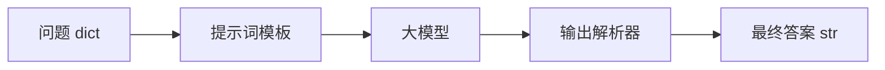

# 链与 LCEL 表达式语言

> [!abstract] 一句话
> LCEL（LangChain Expression Language）用**声明式的方式把组件链接起来**：每个组件都是 `Runnable`，统一暴露 `invoke / batch / stream`，用 `|` 串成一条数据流。LangChain 的名字就来自这个设计——把各个组件"链"成复杂应用。

> [!important] 先摆正位置
> 讲义原话：**「虽然 LangChain v1.0 已经移除了各种 Chain，但 LCEL 作为 LangChain 的一种思想还是有必要去学习的」**。
> 新项目入口是 `create_agent`（见 [[05-Agent 工具调用与中间件]]）；本篇学的是**数据流动与组合的思想**，也是读懂 RAG 链、`RunnablePassthrough`、中间件钩子的前置知识。

---

## 一、Runnable 统一接口

所有能被链起来的组件（模型、解析器、检索器、提示模板、自定义函数）都实现同一套方法：

| 方法 | 语义 |
|---|---|
| `invoke(input)` | 单次输入 → 单次输出 |
| `batch([i1, i2, ...])` | 批量输入 → 输出列表（内部可并行） |
| `stream(input)` | 流式返回响应块（打字机效果的基础） |

所以**由它们组成的链，调用的也是这三个方法**。这是 LCEL 一切组合能力的前提。

---

## 二、最小链：管道 `|`

```python
from langchain_core.output_parsers import StrOutputParser
from langchain_core.prompts import ChatPromptTemplate
from models import get_lc_model_client

client = get_lc_model_client()
chat_template = ChatPromptTemplate.from_messages([
    ("system", "请将以下的内容翻译成 {language}"),
    ("human", "{text}"),
])
parser = StrOutputParser()

# 写法一：管道操作符（最常见）
chain = chat_template | client | parser
print(chain.invoke({"language": "意大利文", "text": "朋友啊再见！"}))

# 写法二：RunnableSequence，等价
from langchain_core.runnables import RunnableSequence
chain2 = RunnableSequence(chat_template, client, parser)
```

**数据流**：`dict → PromptValue → AIMessage → str`。每一步的输出类型必须匹配下一步的输入类型，这是 LCEL 报错最常见的原因。



---

## 三、Runnable 家族

| 组件 | 解决什么 | 典型场景 |
|---|---|---|
| `RunnableSequence` | 顺序执行 | `a \| b \| c` |
| `RunnableLambda` | 把普通 Python 函数变成可链组件 | 自定义清洗、计算、格式转换 |
| `RunnableParallel` | 多个任务**同时**执行 | 同时取检索结果与原始问题 |
| `RunnablePassthrough` | 原样透传 / `assign` 增强数据 | RAG 链里把 `{question, context}` 拼齐 |
| `RunnableWithMessageHistory` | 自动管理多轮会话历史 | 多用户聊天机器人 |

### 3.1 RunnableLambda：自定义函数入链

```python
from operator import itemgetter
from langchain_core.prompts import ChatPromptTemplate
from langchain_core.runnables import RunnableLambda, chain

chat_template = ChatPromptTemplate.from_template("{a} + {b}是多少？")
chain1 = chat_template | client

def length_function(text):
    return len(text)

def _multiple_length_function(text1, text2):
    return len(text1) * len(text2)

@chain     # @chain 装饰器也能把函数变成 Runnable
def multiple_length_function(_dict):
    return _multiple_length_function(_dict["text1"], _dict["text2"])

# itemgetter 从输入 dict 里取字段；字典字面量会自动变成 RunnableParallel
chain = (
    {
        "a": itemgetter("foo") | RunnableLambda(length_function),
        "b": {"text1": itemgetter("foo"), "text2": itemgetter("bar")}
             | multiple_length_function,
    }
    | chain1
)
print(chain.invoke({"foo": "abc", "bar": "abcd"}))
```

### 3.2 RunnableParallel：并行分支

```python
from langchain_core.runnables import RunnableLambda, RunnableParallel

add_one   = RunnableLambda(lambda x: x + 1)
mul_two   = RunnableLambda(lambda x: x * 2)
mul_three = RunnableLambda(lambda x: x * 3)

chain_seq = add_one | mul_two | mul_three
print(chain_seq.invoke(1))    # 12 —— 1+1=2 → 2*2=4 → 4*3=12

chain = add_one | RunnableParallel(mul_two=mul_two, mul_three=mul_three)
print(chain.invoke(1))        # {'mul_two': 4, 'mul_three': 6}
```

The user wants me to explain the RunnableParallel_demo.py code. Let me explain it clearly, showing the difference between sequential and parallel execution.
这段代码演示了 LangChain LCEL 中**顺序链**和**并行链**的区别。我来逐步解释：

## 先看三个小 Runnable（第 3-5 行）

```python
add_one   = RunnableLambda(lambda x: x + 1)
mul_two   = RunnableLambda(lambda x: x * 2)
mul_three = RunnableLambda(lambda x: x * 3)
```

就是三个简单的加工函数，用 `RunnableLambda` 包装后可以用 `|` 串联。

## 第一部分：顺序链（第 7-8 行）

```python
chain_seq = add_one | mul_two | mul_three
print(chain_seq.invoke(1))   # 结果: 12
```

数据**一个接一个**流过每个环节：

```
输入 1 → add_one → 2 → mul_two → 4 → mul_three → 12
```

计算过程：`((1+1) × 2) × 3 = 12`

## 第二部分：并行链（第 13-14 行）

```python
chain = add_one | RunnableParallel(mul_two=mul_two, mul_three=mul_three)
print(chain.invoke(1))   # 结果: {"mul_two": 4, "mul_three": 6}
```

`RunnableParallel` 把**同一个输入同时发给多个分支**，**并行处理**，最后把所有结果收集到一个字典里。

```
输入 1 → add_one → 2
                        ├──→ mul_two   → 4
                        └──→ mul_three → 6
                        
          最终输出: {"mul_two": 4, "mul_three": 6}
```

计算过程：
1. 先 `add_one`：1 → 2
2. **同时**把 2 发给两个分支：
   - `mul_two` 分支：2 × 2 = 4
   - `mul_three` 分支：2 × 3 = 6
3. 汇总成字典返回

## 对比总结

| | 顺序链 `|` | 并行链 `RunnableParallel()` |
|---|---|---|
| 执行方式 | 一个接一个，串行 | 同一个输入同时发多个分支，并行 |
| 输出类型 | 单一值 | **字典**（key 是你给的名字） |
| 类比 | 工厂流水线 | 工厂分车间同时加工 |

## 还有一种写法（你之前见过的）

不用显式写 `RunnableParallel`，直接写**字典字面量**效果一样：

```python
# 这两种写法完全等价：

chain = add_one | RunnableParallel(mul_two=mul_two, mul_three=mul_three)

chain = add_one | {"mul_two": mul_two, "mul_three": mul_three}
```

LangChain 看到 `|` 后面跟着一个普通 `dict`，会**自动**把它转成 `RunnableParallel`。


> [!tip] 记住这个执行图
> 顺序链是 `1 → 2 → 4 → 12`；并行链是 `1 → 2` 之后**分叉**：`2*2=4` 与 `2*3=6` 同时算，结果装进一个 dict。RAG 链正是靠这个模式同时准备 `question` 和 `context`。

### 3.3 RunnablePassthrough：透传与数据增强

```python
from langchain_core.runnables import RunnableParallel, RunnablePassthrough

# ① 原样传递
runnable = RunnableParallel(
    passed=RunnablePassthrough(),
    modified=lambda x: x["num"] + 1,
)
print(runnable.invoke({"num": 1}))
# {'passed': {'num': 1}, 'modified': 2}

# ② assign()：在透传的同时追加字段
runnable = RunnableParallel(
    passed=RunnablePassthrough().assign(query=lambda x: x["num"] + 2),
    modified=lambda x: x["num"] + 1,
)
print(runnable.invoke({"num": 1}))
# {'passed': {'num': 1, 'query': 3}, 'modified': 2}
```

`.assign()` 是讲义里 SQL 实战链的灵魂：`RunnablePassthrough.assign(query=...).assign(result=...)` 一步步把 `question / query / result` 三个字段攒齐，再喂给最终提示词。

### 3.4 RunnableWithMessageHistory：多轮记忆

**问题**：大模型是无状态的。

```python
chain = chat_template | client | parser
print(chain.invoke({"text": "你好，我是云帆"}))
print(chain.invoke({"text": "你好，我是谁？"}))   # 答不上来
```

**手工版** `ChatMessageHistory`（要自己 save 每一轮，麻烦）：

```python
from langchain_community.chat_message_histories import ChatMessageHistory
from langchain_core.prompts import MessagesPlaceholder

chat_template = ChatPromptTemplate.from_messages([
    ("system", "你是人工智能助手"),
    MessagesPlaceholder(variable_name="messages"),
])
chain = chat_template | client | StrOutputParser()

history = ChatMessageHistory()
history.add_user_message("你好，我是云帆")
response = chain.invoke({"messages": history.messages})
history.add_ai_message(response)          # 手动回写
response = chain.invoke({"messages": history.messages})
```

**自动版** `RunnableWithMessageHistory`（支持多用户 + 流式）：

```python
from langchain_core.runnables import RunnableWithMessageHistory
from langchain_community.chat_message_histories import ChatMessageHistory

prompt_template = ChatPromptTemplate.from_messages([
    ("system", "你是一个聊天助手，用{language} 回答所有的问题"),
    MessagesPlaceholder(variable_name="history"),   # 历史消息占位
    ("human", "{input}"),
])
chain = prompt_template | client | StrOutputParser()

store = {}    # 演示用内存；生产换 Redis（RedisChatMessageHistory）
def get_session(session_id: str):
    if session_id not in store:
        store[session_id] = ChatMessageHistory()
    return store[session_id]

chatbot = RunnableWithMessageHistory(
    chain,
    get_session,
    input_messages_key="input",
    history_messages_key="history",
)

# session_id 区分不同用户 / 不同会话
cfg_zh = {"configurable": {"session_id": "yunfang_chinese"}}
cfg_en = {"configurable": {"session_id": "yunfang_english"}}

chatbot.invoke({"input": "你好，我是云帆。", "language": "中文"}, config=cfg_zh)
chatbot.invoke({"input": "请问我的名字是什么？", "language": "中文"}, config=cfg_zh)
# → 能记住"云帆"；换成 cfg_en 则是独立上下文

# 流式
for chunk in chatbot.stream({"input": "讲个笑话", "language": "中文"}, config=cfg_zh):
    print(chunk, end="", flush=True)
```

> [!warning] V1.0 里该用哪个？
> 以上是**讲义的教学路径**（理解消息历史机制）。V1.0 的 `create_agent` 已用 **Checkpointer + `thread_id`** 内置了这件事，见 [[01-V1.0 重构与整体体系]] 与 [[05-Agent 工具调用与中间件]]。旧版 `ConversationBufferMemory` 已废弃，不要在新项目里用。

---

## 四、常用内置 LCEL 链（了解即可）

> 讲义标注：**「LangChain v1.0 已经把各种内置 Chain 移到 `langchain-classic` 中，以下内容简单了解即可」**。

`create_stuff_documents_chain`：取文档列表，全部格式化进提示词，再交给 LLM。

```python
from langchain_classic.chains.combine_documents import create_stuff_documents_chain
from langchain_community.document_loaders import WebBaseLoader
from langchain_text_splitters import RecursiveCharacterTextSplitter
from langchain_core.prompts import ChatPromptTemplate

prompt = ChatPromptTemplate.from_messages([
    ("system", "根据提供的上下文: {context} \n\n 回答问题"),
    ("user", "问题：{input}"),
])
chain = create_stuff_documents_chain(client, prompt)

loader = WebBaseLoader(web_path="https://www.gov.cn/xinwen/2020-06/01/content_5516649.htm")
docs = loader.load()
splitter = RecursiveCharacterTextSplitter(chunk_size=1000, chunk_overlap=50)
documents = splitter.split_documents(docs)

res = chain.invoke({"input": "民事法律行为?", "context": documents[:5]})
```

查更多内置链：https://python.langchain.com/api_reference/langchain/chains.html ——注意 **"Deprecated classes / Deprecated functions" 里的不要用**。

---

## 五、查看链结构与调试

链复杂时（官网提到有人在生产跑 100+ 步的 LCEL 链），需要看清组件、顺序、输入输出 schema：

```python
print(parser.input_schema.model_json_schema())
print(parser.output_schema.model_json_schema())
print(chain.input_schema.model_json_schema())
print(chain.output_schema.model_json_schema())
print(chain.get_prompts())          # 打印链里所有提示模板
chain.get_graph().print_ascii()     # 结构图，需 pip install grandalf
```

**调试两条路**：

| 方式 | 说明 |
|---|---|
| `langchain.debug = True` | 免费、本地，输出每个组件的输入输出，课程推荐 |
| LangSmith | 官方追踪 / 评估平台；个人有免费额度，企业收费，课程不考虑 |

```python
import langchain
langchain.debug = True
print(chain.invoke({"language": "意大利文", "text": "朋友啊再见！"}))
```

---

## 六、踩坑清单

| 坑 | 说明 |
|---|---|
| `a \| b` 报错类型不匹配 | 上一步输出必须是下一步能接受的输入；用 `input_schema` / `output_schema` 查 |
| `itemgetter('query') \| execute_sql_tools` 到底谁先执行 | **先 itemgetter 取字段，再交给工具，最后赋值**：等价于 `result = (itemgetter('query') \| execute_sql_tools)` |
| 字典字面量悄悄变成并行 | LCEL 里 `{...}` 会自动转成 `RunnableParallel`，不是普通 dict |
| 多轮对话记不住 | 模型无状态，必须显式带 `MessagesPlaceholder` + 历史组件（或 V1.0 的 checkpointer） |
| `get_graph().print_ascii()` 报错 | 缺 `grandalf`，`pip install grandalf` |
| 内置 Chain import 失败 | v1.0 主包已移除，去 `langchain_classic` 找，或改用 LCEL / `create_agent` |

> [!note] 讲义里的另一种说法
> PPT 第 25 页把「链」描述成 `问题 → 提示词模板 → 大模型 → 答复 → 输出解析器 → 最终答案` 的流水线；LCEL 就是这条流水线的声明式实现。两者是同一件事的不同抽象层次。
