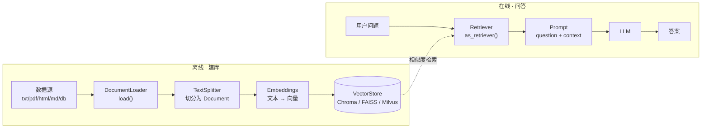

# RAG 数据连接与检索

> [!abstract] 一句话
> 用户的数据往往不在模型里，而在外部系统或文档中。**数据连接（Data Connection）** 就是把这些数据接进来：`文档加载 → 切分转换 → 嵌入向量化 → 向量存储 → 检索 → 交给大模型生成`。前半段是离线建库，后半段是在线问答。



---

## 一、Document：全链路流通的数据单元

LangChain 中数据以 **Document 对象**和向量形式在各组件间流动：

```python
from langchain_core.documents import Document

documents = [
    Document(page_content="猫是柔软可爱的动物，但相对独立",
             metadata={"source": "常见动物宠物文档"}),
    Document(page_content="金鱼是我们常常喂养的观赏动物之一，活泼灵动",
             metadata={"source": "鱼类宠物文档"}),
    # ...
]
```

| 字段 | 含义 |
|---|---|
| `page_content` | 文本内容（会被拿去嵌入） |
| `metadata` | 来源、页码、章节等元信息（检索结果里可回溯出处） |

> 文档加载器的任务是把各种源转成 `Document`；文档转换器（切分器）把大文档切成多个 `Document`；之后交给嵌入模型包装器变成向量，存入向量库。

---

## 二、文档加载器 Document Loaders

统一接口是 **`load()`**：从数据源读取，返回一个或多个 `Document`。支持 CSV、文件目录、HTML、JSON、Markdown、PDF，甚至网页、视频转录字幕。第三方集成大多在 `langchain_community.document_loaders`。

```python
from langchain_community.document_loaders import WebBaseLoader
import bs4

loader = WebBaseLoader(
    web_path=["https://www.news.cn/fortune/20250212/895ac6738b7b477db8d7f36c315aae22/c.html"],
    bs_kwargs=dict(
        parse_only=bs4.SoupStrainer(class_=("main-left left", "title"))  # 只抓正文区域
    ),
)
docs = loader.load()
```

> [!tip] `bs4.SoupStrainer` 不是可选项
> 网页直接 `load()` 会把导航、广告、页脚一起塞进上下文，浪费 Token 还干扰回答。按 CSS class / id 圈定正文是实战第一步。

---

## 三、文本切分器 Text Splitters

转换器分两步：**① 切分 ② 转成 Document 对象**。

| 切分器 | 特点 |
|---|---|
| `CharacterTextSplitter` | 按字符（默认 `\n\n`）切，用字符数衡量块大小 |
| `RecursiveCharacterTextSplitter` | **最常用**；递归按分隔符切，还支持按编程语言（python/java/go/cpp/js/php…）切代码 |
| `MarkdownHeaderTextSplitter` | 按 Markdown 标题层级切，保留章节结构 |

```python
from langchain_text_splitters import RecursiveCharacterTextSplitter

splitter = RecursiveCharacterTextSplitter(chunk_size=500, chunk_overlap=100)
documents = splitter.split_documents(docs)
```

| 参数 | 作用 |
|---|---|
| `chunk_size` | 每块大小（讲义示例：500 / 1000） |
| `chunk_overlap` | 相邻块重叠量（50 / 100），避免把一句完整语义切断 |

更多内置切分器：https://python.langchain.com/api_reference/text_splitters/index.html

---

## 四、文本嵌入模型 Embeddings

`Embeddings` 类为各家嵌入模型（OpenAI、Cohere、HuggingFace、DashScope …）提供统一接口。实例化的产物叫**嵌入模型包装器**，与 LLM / Chat Model 包装器并称三大模型包装器。它同时负责把**文档**和**查询问题**转成向量，才能算向量空间里的相似度。

```python
import os
from langchain_community.embeddings import DashScopeEmbeddings

llm_embeddings = DashScopeEmbeddings(
    model="text-embedding-v3",          # 讲义用常量 ALI_TONGYI_EMBEDDING_MODEL
    dashscope_api_key=os.getenv("DASHSCOPE_API_KEY"),
)
```

> [!warning] 别把两个客户端搞混
> `get_lc_model_client()` 是**对话模型**（`ChatOpenAI`），`DashScopeEmbeddings` 是**嵌入模型**，两者用途、模型名、甚至计费都不同。RAG 里两个都要用到。可用实现列表见 `langchain_community/embeddings/__init__.py`。

---

## 五、向量数据库 VectorStore（以 Chroma 为例）

```python
from langchain_chroma import Chroma

vector_store = Chroma.from_documents(documents=documents, embedding=llm_embeddings)

# 相似度检索
print(vector_store.similarity_search("狸花猫"))

# 带分数：值越小越相似（Chroma 默认是 L2 距离）
print(vector_store.similarity_search_with_score("狸花猫"))

# 把检索方法包成 Runnable，bind(k=1) 只取最相似的一条
from langchain_core.runnables import RunnableLambda
docs_find = RunnableLambda(vector_store.similarity_search).bind(k=1)
print(docs_find.batch(["狸花猫", "海豚"]))   # 批量查
```

### 5.1 为什么还要 Retriever？

> 讲义原问题：「看起来检索器可有可无，因为向量库本身就提供了检索功能，为何 LangChain 中还要提供一个检索器呢？」

因为向量库种类繁多（Chroma / FAISS / Pinecone / Milvus …），直接交互就得懂各自查询语法、连接管理、异常处理。LangChain 封装了 **`VectorStoreRetriever`**，提供统一接口：

```python
retriever = vector_store.as_retriever()   # 返回 VectorStoreRetriever 实例
```

> [!important] 一句话
> **检索器 = 向量库的包装器**。底层换成 Milvus 或 FAISS，查询代码一个字不改。这跟 `ChatOpenAI` 屏蔽各家 Chat API 差异是同一个思路。

---

## 六、用 RunnablePassthrough 组装最小 RAG 链

讲义里最关键的一段：定义链时还不知道用户要问什么，用 `RunnablePassthrough()` 把问题**动态透传**进来，同时并行查出 `context`。

```python
from langchain_core.prompts import ChatPromptTemplate
from langchain_core.runnables import RunnableLambda, RunnablePassthrough

message = """仅使用提供的上下文回答下面的问题：
{question}
上下文：
{context}"""
prompt_template = ChatPromptTemplate.from_messages([("human", message)])

# {"question": 原样透传, "context": 检索结果} → 提示模板 → 模型
chain = (
    {"question": RunnablePassthrough(), "context": docs_find}
    | prompt_template
    | client
)
resp = chain.invoke("请介绍一下猫")
print(resp.content)
```

> [!warning] 讲义里明确验证过的坑
> 不写 `RunnablePassthrough()` 就得手动拼 `{"question": q, "context": vector_store.similarity_search(q, k=1)}`，而且**直接把 `docs_find`（一个 Runnable）塞进 `context` 是行不通的**——它不会被自动执行。字典字面量在 LCEL 里会变成 `RunnableParallel`，每个值必须是 Runnable 或可调用对象。

---

## 七、完整实现：基于在线网页的 RAG

把前面所有组件串起来（讲义 P43–P45）：

```python
import os, bs4
from langchain_community.document_loaders import WebBaseLoader
from langchain_community.embeddings import DashScopeEmbeddings
from langchain_community.vectorstores import Chroma
from langchain_core.prompts import ChatPromptTemplate
from langchain_text_splitters import RecursiveCharacterTextSplitter
from langchain_classic.chains.combine_documents import create_stuff_documents_chain
from langchain_classic.chains.retrieval import create_retrieval_chain
from models import get_lc_model_client

client = get_lc_model_client()
llm_embeddings = DashScopeEmbeddings(
    model="text-embedding-v3", dashscope_api_key=os.getenv("DASHSCOPE_API_KEY")
)

# 1. 加载网页
loader = WebBaseLoader(
    web_path=["https://www.news.cn/fortune/20250212/895ac6738b7b477db8d7f36c315aae22/c.html"],
    bs_kwargs=dict(parse_only=bs4.SoupStrainer(class_=("main-left left", "title"))),
)
docs = loader.load()

# 2. 切分
splitter = RecursiveCharacterTextSplitter(chunk_size=500, chunk_overlap=100)
documents = splitter.split_documents(docs)

# 3. 向量化 + 入库
vector_store = Chroma.from_documents(documents=documents, embedding=llm_embeddings)

# 4. 检索器
retriever = vector_store.as_retriever()

# 5. 提示词（明确约束：不知道就说不知道）
system_prompt = """您是问答任务的助理。使用以下检索到的上下文来回答问题。
如果你不知道答案，就说你不知道。"""
prompt_template = ChatPromptTemplate.from_messages([
    ("system", system_prompt),
    ("assistant", "{context}"),
    ("human", "{input}"),
])

# 6. 组合：文档链 → 检索链
chain1 = create_stuff_documents_chain(client, prompt_template)
chain2 = create_retrieval_chain(retriever, chain1)

resp = chain2.invoke({"input": "张成刚是谁？"})
print(resp["answer"])
```

> [!warning] 版本提示
> 讲义这段用的是 `from langchain.chains...`（v0.3 路径）。V1.0 里 `create_stuff_documents_chain` / `create_retrieval_chain` 都在 **`langchain_classic`**（上面代码已改），或直接用 LCEL 手写等价的 `{"context": retriever, "question": RunnablePassthrough()} | prompt | model | parser`。新项目更推荐后者。

---

## 八、踩坑清单

| 坑 | 处理 |
|---|---|
| 检索结果牛头不对马嘴 | `bs4.SoupStrainer` 圈正文；调 `chunk_size` / `chunk_overlap`；换更合适的 embedding 模型 |
| `similarity_search_with_score` 分数越大越相关？ | **反了**：Chroma 默认 L2 距离，分数越小越相似 |
| 切换向量库要改一堆代码 | 统一用 `as_retriever()`，别直接调各家 API |
| 把 Runnable 当文档塞进 context | 需用 `RunnablePassthrough` + 字典字面量组成 `RunnableParallel` |
| 模型回答里夹着 SQL 代码围栏标记 | 讲义 SQL 实战里专门写了 `SQLCleaner(StrOutputParser)` 清理，见 [[05-Agent 工具调用与中间件]] |
| V1.0 找不到 `create_retrieval_chain` | 已移到 `langchain_classic`，或改 LCEL |

> [!note] 往哪走
> 这里是最基础的 RAG。课程后续章节（Advanced RAG、RAG 评估、通用文档智能问答系统）会在此基础上做查询改写、重排、混合检索与效果评估。向量库换成 Milvus 时可参考 [[Milvus 学习文档]] 与 [[pgvector vs Milvus 选型对比]]。
