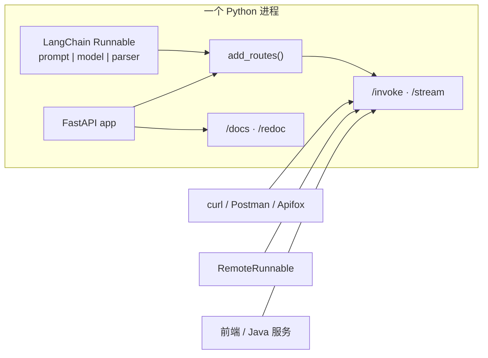

# 服务化部署 FastAPI 与 LangServe

> [!abstract] 一句话
> 应用开发完要解决的是「**如何和别的系统协同工作**」：① 发布应用 ② 通过 HTTP / 客户端访问（PPT 第 27 页）。FastAPI 提供 Web 层，LangServe 用一行 `add_routes(app, chain, path=...)` 把 LangChain 的 Runnable 变成带文档的 REST API。



---

## 一、FastAPI 速览

**特点**：基于 Starlette + Pydantic，性能接近 Node.js / Go；类型提示驱动，自动补全效率提升 200%–300%、人为错误减少约 40%；基于 OpenAPI 与 JSON Schema 标准，**自动生成交互式文档**。

```bash
python -m venv fastapi-env && source fastapi-env/bin/activate
pip install "fastapi" "uvicorn[standard]"
uvicorn main:app --reload      # main.py 里的 app = FastAPI()
```

```python
from fastapi import FastAPI

app = FastAPI()

@app.get("/")
async def root():
    return {"message": "Hello World"}
```

打开 `http://localhost:8000/docs`（Swagger UI）或 `/redoc`（ReDoc）即可看到自动文档。

### 1.1 路由与参数

| 类型 | 写法 | 说明 |
|---|---|---|
| 路径参数 | `@app.get("/items/{item_id}")` + `item_id: int` | 自动类型转换与校验 |
| 查询参数 | `skip: int = 0, limit: int = 10` | 有默认值即可选 |
| 请求体 | `item: Item`（Pydantic `BaseModel`） | 自动解析、验证、序列化 |
| 装饰器 | `get / post / put / delete / patch / options / head / trace` | 对应 HTTP 方法 |

```python
from pydantic import BaseModel, Field
from fastapi import FastAPI, Query, Path

class Item(BaseModel):
    name: str
    description: str = Field(None, max_length=300)
    price: float = Field(..., gt=0, description="价格必须大于 0")

@app.post("/items/", response_model=Item, status_code=201)
async def create_item(item: Item):
    return item

@app.get("/items/{item_id}")
async def read_item(item_id: int = Path(..., gt=0, le=1000),
                    q: str = Query(None, min_length=3, max_length=50)):
    return {"item_id": item_id, "q": q}
```

### 1.2 依赖注入 `Depends`

```python
from fastapi import Depends, Header, HTTPException

def get_db():                       # yield 依赖：请求前 setup，请求后 teardown
    db = SessionLocal()
    try:
        yield db
    finally:
        db.close()

async def verify_token(x_token: str = Header(...)):
    if x_token != "fake-super-secret-token":
        raise HTTPException(status_code=400, detail="X-Token header invalid")

@app.get("/items/", dependencies=[Depends(verify_token)])
async def read_items(db: Session = Depends(get_db)):
    ...
```

> 对 Spring 背景：`Depends` 是函数级的 IoC，没有容器、无需注册；`yield` 依赖等价于 `@PreDestroy` / 环绕清理。详见 [[10-FastAPI与SpringBoot全面对比]]。

### 1.3 认证、中间件、测试、部署

| 主题 | 要点 |
|---|---|
| API Key | `APIKeyHeader(name="X-API-Key")` + `Depends`，失败抛 401 |
| JWT | `OAuth2PasswordBearer(tokenUrl="token")` + `python-jose` 签发/校验 + `passlib` 加盐哈希；`/token` 换 token，`/users/me` 用 `get_current_user` 依赖 |
| 错误处理 | `HTTPException(status_code, detail)`；`@app.exception_handler(...)` 自定义异常 |
| 中间件 / CORS | `@app.middleware("http")` 统计耗时；`CORSMiddleware` 配 `allow_origins` |
| 后台任务 | `BackgroundTasks.add_task(...)` |
| WebSocket | `@app.websocket("/ws")` + `receive_text()` / `send_text()` |
| 测试 | `TestClient(app)`，可覆盖依赖 |
| 部署 | `uvicorn main:app --host 0.0.0.0 --port 8000`；生产 `gunicorn -w 4 -k uvicorn.workers.UvicornWorker main:app`；Docker 镜像 `python:3.9-slim` + `CMD ["uvicorn", ...]` |

---

## 二、LangServe：把链变成 API

**定位**：专为部署 LangChain 应用设计，把提示模板、链、Agent 等 Runnable 快速转成生产就绪的 API，无需手写服务代码。

**核心优势**：一行 `add_routes` 部署；基于 FastAPI 自动生成 Swagger / ReDoc；Pydantic 类型安全；原生支持流式输出；完全兼容 FastAPI 生态（自定义路由、中间件、认证）。

```bash
pip install langserve
```

### 2.1 完整示例（讲义的翻译服务，LCEL 版）

```python
from fastapi import FastAPI
from langchain_core.output_parsers import StrOutputParser
from langchain_core.prompts import ChatPromptTemplate
from langserve import add_routes
from models import get_lc_model_client

client = get_lc_model_client()
parser = StrOutputParser()
prompt_template = ChatPromptTemplate.from_messages([
    ("system", "请将以下的内容翻译成 {language}"),
    ("human", "{text}"),
])

chain = prompt_template | client | parser       # 一个标准 Runnable

app = FastAPI(title="基于LangChain的服务", version="V1.5", description="翻译服务")
add_routes(app, chain, path="/tslServer")      # ← 全部部署代码就这一行

if __name__ == "__main__":
    import uvicorn
    uvicorn.run(app, host="localhost", port=8000)
```

### 2.2 自动生成的端点

| 端点 | 作用 |
|---|---|
| `POST /{path}/invoke` | 完整调用，返回最终结果 |
| `POST /{path}/stream` | 流式返回（链支持流式时） |
| `GET /docs`、`/redoc` | 自动交互式文档 |

> [!tip] 以 `/docs` 为准
> 资料只演示了 `/invoke` 和 `/stream`。LangServe 实际还会暴露 `/batch`、`/input_schema`、`/output_schema`、`/playground` 等辅助端点，**具体清单和请求体结构以部署后 `/docs` 里生成的 schema 为准**。

**输入输出模型自动推导**：LangServe 根据链的结构生成 Pydantic 模型。例如单变量问答链会推导出 `Input(question: str)` / `Output(text: str)`。需要自定义结构时用 `with_types`：

```python
from pydantic import BaseModel
from typing import Optional, List

class CustomInput(BaseModel):
    query: str
    context: Optional[str] = None

class CustomOutput(BaseModel):
    answer: str
    sources: List[str]

typed_chain = chain.with_types(input_type=CustomInput, output_type=CustomOutput)
add_routes(app, typed_chain, path="/custom-qa")
```

> [!warning] 资料勘误：`@custom_serve`
> `LangServe 入门指南.md` 里写了一个 `@custom_serve` 装饰器。LangServe 官方自定义输入输出类型的常规做法就是上面的 **`Runnable.with_types(...)`**（讲义代码里也是这么用的）。落地时请以官方文档为准，不要照抄那个装饰器。
> 官方文档：https://langserve.readthedocs.io/

### 2.3 三种调用方式

```bash
# ① curl（LangServe 指南写法：直接给字段）
curl -X POST 'http://localhost:8000/qa/invoke' \
  -H 'Content-Type: application/json' \
  -d '{"question": "什么是机器学习？"}'

# ② curl（讲义写法：外层包 input）
curl -X POST 'http://localhost:8000/tslServer/invoke' \
  -H 'Content-Type: application/json' \
  -d '{"input": {"language": "意大利文", "text": "为了部落！"}}'
```

> [!important] 两份资料在这里对不上，必须留意
> 指南用 `{"question": ...}`，讲义明确写 `{"input": {"language": ..., "text": ...}}`。差异来自**被部署的 Runnable 输入类型不同**（单输入链 vs 多变量字典链）与 LangServe 版本差异。**别猜，打开 `/docs` 看该端点生成的 Request schema**，照着填。这是联调时最常见的 422 报错来源。

```python
# ③ 用 LangChain 自己做客户端（最简单）
from langserve import RemoteRunnable

client = RemoteRunnable("http://localhost:8000/tslServer")
print(client.invoke({"language": "意大利文", "text": "为了部落！"}))
# RemoteRunnable 实现了 Runnable 接口，也能 .batch() / .stream()
```

其他语言 / Postman / Apifox 走普通 RESTful API 即可。

### 2.4 认证、自定义路由与 CORS

```python
from fastapi import Depends, HTTPException, APIRouter
from fastapi.security import HTTPBearer, HTTPAuthorizationCredentials
from fastapi.middleware.cors import CORSMiddleware

security = HTTPBearer()
def verify_token(credentials: HTTPAuthorizationCredentials = Depends(security)):
    if credentials.credentials != "your-secret-token":
        raise HTTPException(status_code=401, detail="Invalid authentication credentials")

# 给某条链加认证
add_routes(app, chain, path="/secure-qa", dependencies=[Depends(verify_token)])

# 额外自定义路由
router = APIRouter()
@router.get("/health")
async def health_check():
    return {"status": "ok"}
app.include_router(router, prefix="/api")

# 前端跨域
app.add_middleware(
    CORSMiddleware,
    allow_origins=["http://localhost:3000"],
    allow_credentials=True, allow_methods=["*"], allow_headers=["*"],
)
```

### 2.5 生产化

```bash
uvicorn main:app --reload                                  # 本地开发
pip install gunicorn
gunicorn -w 4 -k uvicorn.workers.UvicornWorker main:app -b 0.0.0.0:8000
```

Docker：

```dockerfile
FROM python:3.11-slim
WORKDIR /app
COPY requirements.txt .
RUN pip install --no-cache-dir -r requirements.txt
COPY . .
CMD ["uvicorn", "main:app", "--host", "0.0.0.0", "--port", "80"]
```

| 常见问题 | 处理 |
|---|---|
| 前端跨域被拦 | 配 `CORSMiddleware`，别在生产无脑 `allow_origins=["*"]` + credentials |
| 调试看不到链内部 | `uvicorn --reload`；开发期 `chain.verbose = True` 或 `langchain.debug = True`（见 [[03-链与 LCEL]]） |
| 高并发性能 | 用异步 LLM 提供者、增加 worker 数（`-w 8`）、前面挂 Nginx 负载均衡 |

---

## 三、版本勘误总表（整理时最该带走的一节）

四份资料横跨 v0.3、V1.0 与 Pydantic v1/v2，直接照抄容易踩坑：

| 出处 | 资料写法 | 当前建议 |
|---|---|---|
| LangServe 指南 3.1 | `from langchain.llms import OpenAI`、`LLMChain` | V1.0 已移到 `langchain-classic`；改用 `ChatOpenAI` + LCEL（`prompt \| model \| parser`）或 `create_agent` |
| LangServe 指南 4.3 | `@custom_serve` 装饰器 | 用 `Runnable.with_types(input_type=..., output_type=...)` |
| 讲义 P19 / 指南 3.3 | `/invoke` 请求体两种写法 | 以 `/docs` 生成的 schema 为准，见上文 2.3 |
| FastAPI 教程 5.1 | `Query(..., regex="^fixedquery$")` | Pydantic v2 / FastAPI 新版改用 `pattern=` |
| FastAPI 教程 15.2 | `from pydantic import BaseSettings` + `class Config: env_file` | Pydantic v2 拆到 `pydantic-settings`，用 `SettingsConfigDict(env_file=".env")` |
| FastAPI 教程 10.1 | `from sqlalchemy.ext.declarative import declarative_base` | SQLAlchemy 2.x 用 `from sqlalchemy.orm import declarative_base` |
| FastAPI 教程 10.2 | `PyObjectId.__get_validators__` / `__modify_schema__` | Pydantic v2 改为 `__get_pydantic_core_schema__` / `__get_pydantic_json_schema__` |
| 讲义 P43–P45 | `from langchain.chains import create_retrieval_chain` | V1.0 在 `langchain_classic`，或手写 LCEL |
| 各教程 Dockerfile | `FROM python:3.9-slim` | V1.0 要求 **Python 3.10+**，课程环境为 3.11 |

> [!tldr] 落地前的一句话
> **概念照资料学，import 路径和请求体格式按当前装的版本验证。** 最稳的办法：跑起来先打开 `/docs`，让自动生成的 schema 告诉你该发什么。
