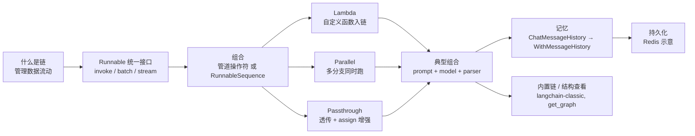

# Day02 课堂复盘 · LCEL 与会话记忆

> [!tldr] 先说结论
> day02 的四份资料里，**三份与 day01 逐字节相同**（md5 一致），只有课件换成了 11 页的 day02 版；而这 11 页讲的正是 [[03-链与 LCEL]] 已完整覆盖的「链与 LCEL」一章。
> 所以本篇**不重复造一套笔记**，只做三件有增量的事：① 资料差异核对；② 11 页课件 → 讲义页码 → 现有笔记的三向索引；③ 补齐 `03` 里被简化的讲义细节、版本差异与勘误。

---

## 一、资料核对：day02 到底新了什么

| 文件 | day01 | day02 | 结论 |
|---|---|---|---|
| `LangChainV1.0讲义.pdf` | 4.9 MB / 64 页 | 4.9 MB | **md5 相同**，内容一致 |
| `FastAPI 框架入门.md` | 20 KB / 16 章 | 20 KB | **md5 相同**，内容一致 |
| `LangServe 入门指南.md` | 10 KB / 8 章 | 10 KB | **md5 相同**，内容一致 |
| 课件 PPTX | `1.LangChainV1.0从入门到精通.pptx` 14 MB / 27 页 | `LangChainV1.0从入门到精通-day02.pptx` 12 MB / **11 页** | **唯一新增** |

> [!important] 这意味着什么
> - 讲义、两份服务端教程完全相同 → [[02-Model I-O 模型提示词与输出解析]]、[[04-RAG 数据连接与检索]]、[[05-Agent 工具调用与中间件]]、[[06-服务化部署 FastAPI 与 LangServe]] **无需任何改动**。
> - day01 的 27 页课件是**整门课的大纲**（V1.0 → 体系 → 核心组件 → 第一个应用 → 部署）；day02 的 11 页课件是**第二次课的章节切片**：目录仍列 6 大项，但只展开第 4 项「LangChain 的链和 LCEL」，并在末尾延伸到「记忆」。
> - 因此 day02 不是新知识包，而是**把 day01 大纲里的一章放大讲**。复习时以 `03` 为主，本篇负责对齐课堂顺序。

---

## 二、11 页课件 → 讲义 → 笔记 三向索引

| 课件页 | 要点 | 讲义位置 | 复习去哪 |
|---|---|---|---|
| 1 | 封面：智泊AI / 主讲大白 | — | — |
| 2 | 目录 6 项：什么是 V1.0、体系、应用开发、**链和 LCEL**、RAG、工具与中间件 | 全书 | [[00-LangChain V1.0 学习总览]] |
| 3 | 章节过渡页「LangChain的链和LCEL」 | P27 | `03` 开头 |
| 4 | **什么是链**：名字源自用链把组件连起来；管理数据流动，像工厂流水线 | P27 | `03` §一 |
| 5 | **LCEL 链**：声明式组合；组件统一支持 `stream / invoke / batch`；遗留链不讲 | P28 | `03` §一、§二 |
| 6 | **如何组合链**：管道操作符，或 `RunnableSequence` | P28–P29 | `03` §二 |
| 7 | `RunnableLambda`（自定义函数入链）、`RunnableParallel` / `RunnableMap`（并行） | P29–P31 | `03` §3.1、§3.2 |
| 8 | `RunnablePassthrough`（原样透传 / `assign` 增强）+ 智能电商客服实战 | P31–P32 | `03` §3.3、`05` SQL 链 |
| 9 | 常用预制 LCEL 链、`create_stuff_documents_chain`、避开 Deprecated | P36–P37 | `03` §四 |
| 10 | **记忆**：模型无状态；`ConversationBufferMemory` 已废弃；改用 `ChatMessageHistory` + `RunnableWithMessageHistory` | P32–P33 | `03` §3.4 |
| 11 | **记忆持久化**：Redis 存储 + 自动化管理；多用户聊天机器人案例 | P33–P35 | `03` §3.4 + 本篇 §四 |

> [!note] 课件点名、讲义却没收录的内容
> 第 8 页的「智能电商客服实战」和第 11 页的「多用户聊天机器人案例」都是**课堂演示标题**。
> - 多用户案例能在讲义 P33–P35 找到近似实现（`store = {}` + `session_id` 分流）。
> - 「智能电商客服实战」在讲义里**没有对应完整代码**。从知识点位置推测，它演示的是 `RunnablePassthrough.assign` 逐步攒字段；最接近的可运行参考是 [[05-Agent 工具调用与中间件]] 里那套 SQL 链（`question → query → result`）。这部分若需要，只能回看录播。

---

## 三、课堂主线复述（一页纸）



这条线的重心始终是**数据怎么流**：`dict → PromptValue → AIMessage → str`，以及怎么在流里插入自定义步骤、并行分支和历史消息。讲义 P27 特意写明「虽然 V1.0 已移除各种 Chain，但 LCEL 作为一种思想仍有必要学」——**学的是组合思想，不是 import 路径**。

---

## 四、`03` 之外，讲义里值得补回的细节

以下都是讲义原文里有、但 [[03-链与 LCEL]] 为了可读性简化或改写过的地方，复习时容易被忽略。

### 4.1 提示模板的两种等价写法（P28、P33）

讲义在「链的基本使用」和「ChatMessageHistory」两处都用了**显式的消息模板类**，并附注释说明可以简写成元组：

```python
from langchain_core.prompts import (
    ChatPromptTemplate, SystemMessagePromptTemplate,
    HumanMessagePromptTemplate, MessagesPlaceholder,
)

# 讲义写法：显式模板类
chat_template = ChatPromptTemplate.from_messages([
    SystemMessagePromptTemplate.from_template("请将以下的内容翻译成 {language}"),
    HumanMessagePromptTemplate.from_template("{text}"),
])

# 等价简写（讲义原文注释）
chat_template = ChatPromptTemplate.from_messages([
    ("system", "请将以下的内容翻译成 {language}"),
    ("human", "{text}"),
])

# 历史占位也有两种写法（P33 注释里给了第二种）
ChatPromptTemplate.from_messages([
    ("system", "你是人工智能助手"),
    MessagesPlaceholder(variable_name="messages"),
    # ("placeholder", "{messages}"),   # 讲义注释掉的等价写法
])
```

> [!tip] 为什么值得记
> 三种角色模板（`AIMessagePromptTemplate` / `SystemMessagePromptTemplate` / `HumanMessagePromptTemplate`）分别对应 AI 应答、系统约束、用户任务。看讲义源码时别以为和 `("system", ...)` 是两套东西。

### 4.2 消息历史三层递进（P32–P35）

| 层次 | 组件 | 谁负责存 / 取 | 讲义位置 |
|---|---|---|---|
| ① 手工 | `ChatMessageHistory` + `MessagesPlaceholder` | 你自己 `add_user_message` / `add_ai_message` | P33 |
| ② 自动 | `RunnableWithMessageHistory` + `get_session(session_id)` | 框架自动回写，`store = {}` 在内存 | P34–P35 |
| ③ 持久化 | `RedisChatMessageHistory`（示意） | Redis，跨进程 / 跨重启 | P34 注释 |

讲义给出的 Redis 示意（**原文在一段三引号字符串里，且自带免责声明**）：

```python
REDIS_URL = os.getenv("REDIS_URL", "redis://localhost:6379")

def get_redis_history(session_id: str) -> BaseChatMessageHistory:
    return RedisChatMessageHistory(session_id, redis_url=REDIS_URL)

# 然后把 get_session 换成 get_redis_history 传给 RunnableWithMessageHistory
```

> [!warning] 别直接抄这段 Redis 代码
> 讲义原话：**「代码未经测试，只做示范」**。真实落地还要补齐：`os` / `BaseChatMessageHistory` / `RedisChatMessageHistory` 的 import、`langchain-redis` 等依赖、TTL 与过期策略、连接池、Redis 不可用时的降级。
> 更要紧的是版本坐标：**V1.0 新项目应直接用 `create_agent` + checkpointer（`InMemorySaver` 或持久化 saver）+ `thread_id`**，见 [[05-Agent 工具调用与中间件]]。上面这套是理解机制用的教学路径。

### 4.3 讲义的 `input` 传的是消息对象列表，不是字符串

讲义 P34–P35 的调用长这样：

```python
from langchain.messages import HumanMessage

resp = chatbot_with_his.invoke(
    {"input": [HumanMessage(content="你好，我是云帆。")], "language": "中文"},
    config={"configurable": {"session_id": "yunfang_chinese"}},
)
```

而 [[03-链与 LCEL]] §3.4 为便于理解，写成了 `{"input": "你好，我是云帆。", "language": "中文"}`。两者都能跑（取决于底层链接受的类型），但**同一条链里别混用**——`input_messages_key` 期望的类型一旦不一致，容易出现历史消息拼接错位或校验报错。以讲义的 `HumanMessage` 列表写法为准更稳妥。

### 4.4 流式输出代码在讲义里是注释状态

讲义 P35 把整段 `.stream(...)` 用 `#` 注释掉了，只留了注释样例（`print(respon.content, end="-")`）。`03` §3.4 里那段 `for chunk in chatbot.stream(...)` 是**笔记补全的可运行版**，不是讲义原文。这不影响正确性，但对照讲义时别以为漏抄了一段。

### 4.5 `create_stuff_documents_chain` 的网页抓取细节

讲义 P36 在 `WebBaseLoader` 上带了 `bs_kwargs`，只抓取指定 DOM 区域；`03` §四省略了这个参数：

```python
import bs4
from langchain_community.document_loaders import WebBaseLoader

loader = WebBaseLoader(
    web_path="https://www.gov.cn/xinwen/2020-06/01/content_5516649.htm",
    bs_kwargs=dict(parse_only=bs4.SoupStrainer(id="UCAP-CONTENT")),
)
docs = loader.load()
```

不加 `SoupStrainer` 会把导航栏、页脚一起塞进文档，切分后噪声明显变多——这是网页 RAG 里很实用的一行，详见 [[04-RAG 数据连接与检索]]。

### 4.6 内置链的官方文档地址，两版资料给的不一样

| 出处 | 地址 |
|---|---|
| 讲义 P36 / day01 课件 | `https://python.langchain.com/api_reference/langchain/chains.html` |
| **day02 课件第 9 页** | `https://reference.langchain.com/python/langchain_classic/chains/` |

V1.0 把内置链整体迁到了 `langchain-classic`，**day02 课件给的新文档站地址更贴切**。两份都提醒：标在 `Deprecated classes` / `Deprecated functions` 里的不要用。

---

## 五、记忆这条线的版本坐标（别学错 API）

| 写法 | 状态 | 什么时候用 |
|---|---|---|
| `ConversationBufferMemory` 等 Memory 组件 | **已废弃**（day02 课件第 10 页明确） | 只用于读老代码 |
| `ChatMessageHistory` + `RunnableWithMessageHistory` | 教学路径，V1.0 仍可用 | 理解「无状态模型怎么注入历史」；本套笔记 `03` 的写法 |
| `checkpointer` + `thread_id`（`create_agent` 内置） | **V1.0 生产路径** | 写新代码时的唯一入口 |
| `RedisChatMessageHistory` | 讲义示意，未经测试 | 需要跨进程持久化时的思路参考，需自行补完 |

> [!important] 为什么 day02 还要讲"已废弃"的东西
> 因为 `MessagesPlaceholder` + `session_id` 这套机制，正是 `create_agent` 里 checkpointer 的前置概念：**会话状态不放在模型里，而是由应用按会话标识注入**。把这个机制看懂，`thread_id` 就只是换个名字。真正写新代码时入口只有一个——`create_agent`。

---

## 六、Day02 自测清单

| 自问 | 答得上来说明 | 回看 |
|---|---|---|
| 为什么框架叫 LangChain？ | 理解「链 = 管理组件间数据流动」，不只是名字由来 | `03` §一 |
| 一个组件凭什么能被链起来？ | 能说出 `invoke / batch / stream` 三个方法 | `03` §一 |
| 管道符和 `RunnableSequence` 什么关系？ | 知道二者等价 | `03` §二 |
| 自己的 Python 函数怎么进链？ | `RunnableLambda` 或 `@chain` 装饰器 | `03` §3.1 |
| 顺序链 `1 → 2 → 4 → 12` 换成并行后输出长什么样？ | 能说出 `{'mul_two': 4, 'mul_three': 6}` 这个 dict | `03` §3.2 |
| 字典字面量 `{...}` 在 LCEL 里会变成什么？ | 会自动转成 `RunnableParallel` | `03` 踩坑清单 |
| `RunnablePassthrough` 的 `assign` 解决了什么？ | 在透传原字段的同时追加新字段，攒齐提示词入参 | `03` §3.3、`05` SQL 链 |
| 模型为什么记不住上一轮？怎么修？ | 模型无状态，靠 `MessagesPlaceholder` 显式注入历史 | `03` §3.4 |
| `session_id` 的作用？ | 区分不同用户 / 会话的历史，避免串上下文 | 本篇 §4.2 |
| V1.0 写带记忆的助手该用哪个？ | `create_agent` + checkpointer + `thread_id` | [[05-Agent 工具调用与中间件]] |
| 内置 Chain 现在去哪找？ | `langchain-classic`，且避开 Deprecated 标记 | 本篇 §4.6 |

---

## 七、勘误与信息缺口汇总

| 条目 | 出处 | 处理 |
|---|---|---|
| Redis 持久化代码未经测试 | 讲义 P34 原文自述 | 本篇 §4.2 原样保留并标注风险，不当作可运行方案 |
| 流式输出整段被注释 | 讲义 P35 | `03` 已补可运行版，此处说明是笔记补全而非讲义原文 |
| `input` 类型：字符串 vs `HumanMessage` 列表 | 讲义 P34 vs `03` §3.4 | 以讲义为准，同一链内不混用 |
| 内置链文档地址两版不一致 | 讲义 P36 / day02 课件第 9 页 | V1.0 下以 `reference.langchain.com/.../langchain_classic/` 为准 |
| 「智能电商客服实战」无代码 | day02 课件第 8 页 | 讲义未收录，需回看录播；参考 `05` 的 SQL 链理解 `assign` |
| day02 课件目录列 6 项但只讲 1 项 | day02 课件第 2 页 | 判定为章节切片课件，不是完整大纲 |
| 讲义标注 `ConversationBufferMemory` 已废弃 | 讲义 P32、day02 课件第 10 页 | 与 `00` 版本速查表一致，无需新增勘误 |

> [!note] 与 day01 笔记的关系
> 本篇是 **day02 的增量复盘**，主体知识仍在 [[03-链与 LCEL]]；[[00-LangChain V1.0 学习总览]] 已把本篇挂进索引。
> 若想把 day02 独立重排成一套完整笔记（而不是这份对照型复盘），可以基于 `03` 拆分扩充，但会与现有 7 篇大量重复。
