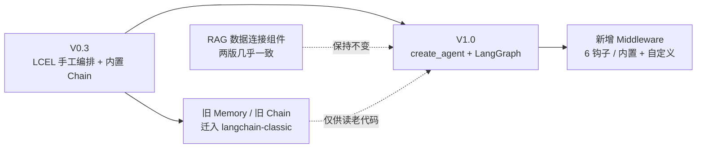

# Day03 课堂复盘 · RAG 实战与工具中间件

> [!tldr] 先说结论
> day03 的讲义 PDF 与前两天**仍是同一份**（md5 一致）；真正新增的是**两份课件**：`V1.0` 版 23 页、`V0.3` 版 26 页。
> 最有价值的发现是逐页对比结果：**RAG 那一章在 V0.3 → V1.0 之间几乎逐字未改，真正的变化全部集中在「工具调用之后新增了中间件」**。V0.3 课件压根没有 Middleware 章节。
> 另外课件里还有几处 [[04-RAG 数据连接与检索]] / [[05-Agent 工具调用与中间件]] 未收录的硬知识（4 种检索器、7 种加载器、6 个钩子），本篇一并补齐。

---

## 一、资料核对

| 文件 | 体量 | 与前两天的关系 |
|---|---|---|
| `LangChainV1.0讲义.pdf` | 4.9 MB / 64 页 | **md5 与 day01、day02 完全相同**，三天共用一本完整讲义 |
| `2、LangChainV1.0从入门到精通.pptx` | 14 MB / 23 页 | **新增**。day03 的 V1.0 章节切片：RAG 实战 + 工具调用 & 中间件 |
| `2、LangChainV0.3从入门到精通.pptx` | 21 MB / 26 页 | **新增且最有价值**。旧版同主题课件，用于对照 V0.3 → V1.0 的差异 |

> [!important] 三天课件的分工现在清楚了
>
> | 课件 | 页数 | 覆盖 |
> |---|---|---|
> | day01 `1.LangChainV1.0...` | 27 | 整门课大纲：V1.0 → 体系 → 核心组件 → 第一个应用 → 部署 |
> | day02 `...-day02.pptx` | 11 | 只讲「链和 LCEL + 记忆」 |
> | day03 `2、...V1.0...` | 23 | 只讲「RAG 实战 + 工具调用 + 中间件」 |
> | day03 `2、...V0.3...` | 26 | 旧版：LCEL + RAG + 工具实战（**无中间件**） |
>
> 也就是说，**day02 + day03 的 V1.0 课件合起来，才是 day01 那份 27 页大纲里后三项的展开**。

---

## 二、V0.3 vs V1.0 课件逐章对比（本篇核心）

| 维度 | V0.3 课件（26 页） | V1.0 课件（23 页） |
|---|---|---|
| 目录 | **7 项**：什么是 LangChain / 体系 / 应用程序生命周期 / **增强提示词模版和增强输出解析器** / 链和 LCEL / RAG 实战 / 工具调用实战 | **6 项**：什么是 LangChain **1.0** / 体系 / 应用程序开发 / 链和 LCEL / RAG 实战 / **工具调用和中间件** |
| LCEL 章 | P3–P11（9 页，含记忆、常用链、查看链组件） | 本份不含（day02 单独讲过） |
| RAG 章 | P12–P22（11 页） | P3–P12（10 页） |
| 工具章 | P23–P26（4 页，「工具调用实战」） | P13–P17（5 页，「工具调用」） |
| **中间件** | **完全没有** | **P18–P23（6 页），V1.0 新增** |

### 2.1 RAG 章：几乎逐字相同

把两份课件的 RAG 页对齐后，文字几乎完全一致：

| 主题 | V0.3 页 | V1.0 页 | 差异 |
|---|---|---|---|
| 数据连接组件（加载 → 切割 → 转换 → 嵌入 → 向量存储 → 检索 → 生成） | P15 | P6 | 无 |
| 文档与文档加载（7 种 Loader） | P17 | P7 | 无 |
| 文档转换器 – 切割（3 种 Splitter） | P18 | P8 | 无 |
| 文档转换器（两步 + Document 对象） | P19 | P9 | V0.3 多了「加载器 → 转换器 → 嵌入包装器 → 向量库」的流转说明 |
| 嵌入模型包装器和向量数据库 | P20 | P10 | V0.3 多了「向量化后需要保存，所以需要向量数据库」的承接句 |
| 检索（4 种检索器代码） | P21 | P11 | **完全一致** |
| 示例应用（stuff + retrieval chain） | P22 | P12 | **完全一致** |

> [!tip] 这说明什么
> **RAG 不是 V1.0 的改动重点**。文档加载、切分、嵌入、检索这套数据连接组件在 V0.3 就已定型，V1.0 只是把它们继续留在体系里。
> 反过来说，[[04-RAG 数据连接与检索]] 那篇笔记的知识**跨版本通用**——唯一的版本坑是 `create_stuff_documents_chain` / `create_retrieval_chain` 的 import 路径从 `langchain.chains` 挪到了 `langchain_classic`，笔记里已经改好。

### 2.2 工具章：加了中间件，工具定义也微调了

| 主题 | V0.3 | V1.0 |
|---|---|---|
| Function Call 引子 | P24，荀子「君子生非异也，善假于物也」 | P14，同样保留 |
| 工具定义要素 | P25：**名称 / 描述 / 参数 / 要调用的函数 / 是否应将工具结果直接返回给用户** | P16：名称 / 描述 / 参数 / 要调用的函数 / **工具返回结果** |
| 调用流程 | 未单独成页 | P15 新增「调用的流程」 |
| 自定义 / 预定义工具 | 合并在 P26 | 拆成 P16 自定义、P17 预定义（点名 `Toolkits` 与 `Arxiv`） |
| 中间件 | — | P18–P23：定义、能力、内置、钩子、两种自定义方式 |

> [!note] 五要素里那一项改动别忽略
> V0.3 的「**是否应将工具结果直接返回给用户**」对应旧版 Tool 的 `return_direct` 语义——早期要人显式决定工具结果是否终止 Agent 循环。
> V1.0 换成中性的「工具返回结果」，因为 `create_agent` 把「工具结果回灌给模型继续推理」做成了内置循环，不再需要逐个工具声明。这条正呼应 [[05-Agent 工具调用与中间件]] 里「模型只发起调用请求，执行与回灌由应用/Agent 负责」的分工。

### 2.3 结论：三天资料合起来的版本主线



**V1.0 真正新增的是 Agent 工程化能力（统一入口 + 中间件 + 状态持久化），不是 RAG，也不是 LCEL。** 这与 [[01-V1.0 重构与整体体系]] 的七大变化一致。

---

## 三、day03 V1.0 课件 → 讲义 → 笔记 三向索引

| 课件页 | 要点 | 讲义位置 | 复习去哪 |
|---|---|---|---|
| 1–2 | 封面 / 目录 6 项 | — | [[00-LangChain V1.0 学习总览]] |
| 3–5 | 章节过渡「LangChain与RAG实战」、快速复习 RAG（图示页，无正文） | P38 | `04` 开头 |
| 6 | 数据连接组件全链路 | P38 | `04` §一 |
| 7 | **文档与文档加载**：7 种 Loader + 统一 `load()` | P38–P39 | `04` §二 + 本篇 §4.1 |
| 8 | **文档转换器 – 切割**：3 种 Splitter | P39 | `04` §三 |
| 9 | 文档转换器两步 + `Document` 对象 | P39 | `04` §一、§三 |
| 10 | 嵌入模型包装器 + 向量数据库、三大模型包装器 | P40 | `04` §四、§五 |
| 11 | **检索**：FAISS / Chroma / BM25 / Ensemble 四种创建方式 | P43–P45 | `04` §5.1 + 本篇 §4.2 |
| 12 | 示例应用：`create_stuff_documents_chain` + `create_retrieval_chain` | P43–P45 | `04` §七 + 本篇 §6 |
| 13–15 | 章节过渡、Function Call、工具调用流程（图示页） | P45–P47 | `05` §一 |
| 16 | 自定义工具：定义五要素 | P47 | `05` §一 + 本篇 §2.2 |
| 17 | 预定义工具、`Toolkits`、`Arxiv`、查数据库实战 | P47–P50 | `05` §三 + 本篇 §4.5 |
| 18–20 | 中间件定义、能做什么、内置 Middleware | P59–P60 | `05` §四 |
| 21 | `SummarizationMiddleware` 触发条件 | P60 | `05` §4.1 + 本篇 §4.4 |
| 22 | **自定义 Middleware 的 6 个钩子** | P61–P63 | `05` §4.3 + 本篇 §4.3 |
| 23 | 装饰器式 vs 类式两种自定义 | P62 | `05` §4.3 |

> [!note] V0.3 课件怎么对上
> V0.3 的 P3–P11（LCEL 九页）几乎就是 [[07-Day02 课堂复盘 LCEL 与会话记忆]] 那份 11 页课件的**来源**：day02 课件把它重排成「LCEL 组合 → 记忆 → Redis 持久化」，并多拆出一页 Redis、少了一页「查看链及其组件」。day03 的 V0.3 课件则完整保留了「查看链及其组件」（P11，提到生产里有人跑 100+ 步的 LCEL 链），对应 [[03-链与 LCEL]] §五。

---

## 四、课件独有、`04` / `05` 未收录的知识点

> [!important] 为什么单列一节
> 这些是**课件里有、但现有笔记没写全**的硬知识。为保持前两天的零侵入做法，这里只补充、不回改 `04` / `05`；查资料时从 [[00-LangChain V1.0 学习总览]] 的索引进本篇即可。

### 4.1 文档加载器速查（V1.0 P7 / V0.3 P17）

统一接口是 **`load()`**：从数据源读取并转成一个或多个 `Document`。

| 数据源 | 加载器 |
|---|---|
| TXT | `TextLoader` |
| PDF | `PyPDFLoader` |
| CSV | `CSVLoader` |
| JSON | `JSONLoader` |
| HTML | `UnstructuredHTMLLoader` |
| Markdown | `UnStructuredMarkdownLoader` |
| 整个文件目录 | `DirectoryLoader` |
| 网页 | `WebBaseLoader`（[[04-RAG 数据连接与检索]] §二，配 `bs4.SoupStrainer`） |

> [!tip] 和你的文档上传场景联系一下
> 上传页支持 md / pdf / txt / doc / docx / xlsx / csv 时，前面四个能直接对上表里的 Loader；`doc/docx/xlsx` 需要 `UnstructuredWordDocumentLoader` / `UnstructuredExcelLoader` 一类（多依赖 `unstructured`），或直接先转 PDF/MD 再走统一链路。这套分类正是「按格式选 Loader，之后全链路一致」的设计意图。

### 4.2 四种检索器创建方式（V1.0 P11 / V0.3 P21，两版完全相同）

```python
# 1. FAISS 语义检索（纯文本列表建库）
retriever_faiss = FAISS.from_texts(texts, embeddings).as_retriever()

# 2. Chroma 语义检索（Document 列表建库）
retriever_chroma = Chroma.from_documents(docs, embeddings).as_retriever()

# 3. BM25 关键词检索（不依赖 embedding）
retriever_bm25 = BM25Retriever.from_texts(texts)

# 4. 混合检索：语义 + 关键词，按权重融合
ensemble_retriever = EnsembleRetriever(
    retrievers=[retriever_faiss, retriever_bm25],
    weights=[0.7, 0.3],
)
```

| 类型 | 擅长 | 注意 |
|---|---|---|
| FAISS / Chroma（向量） | 语义相近、改写过的问法 | 依赖 embedding 质量，对专有名词 / 编号可能不准 |
| BM25（关键词） | 精确术语、型号、编号、人名 | 同义词、语义扩展无能为力 |
| `EnsembleRetriever` | 两者互补 | `weights` 需与各检索器得分量级一起调，默认等权不等于最优 |

`04` §5.1 只讲了 `vector_store.as_retriever()` 这一条路径和「检索器 = 向量库的包装器」。课件这段补上了**关键词检索与混合检索**——这也是 `04` 末尾「往哪走」里提到但没展开的「混合检索」。

> [!warning] 依赖提示
> `BM25Retriever` 需要 `rank_bm25`，`FAISS` 需要 `faiss-cpu`；`EnsembleRetriever` 在 `langchain_community.retrievers` / `langchain_classic.retrievers`，V1.0 下 import 路径以当前版本文档为准。这几行是课件示意，不是讲义里跑通的完整代码。

### 4.3 自定义中间件的 6 个钩子（V1.0 P22）

课件把钩子分成两组，`05` §4.3 只写了 `before_model` / `after_model` 两个：

| 组 | 钩子 | 触发时机 |
|---|---|---|
| **环绕型** | `wrap_model_call` | 围绕每次模型调用 |
| **环绕型** | `wrap_tool_call` | 围绕每次工具调用 |
| **前后型** | `before_agent` | Agent 启动之前（**每次调用一次**） |
| **前后型** | `after_agent` | Agent 完成后（**每次调用一次**） |
| **前后型** | `before_model` | 每次模型调用之前 |
| **前后型** | `after_model` | 每次模型响应之后 |

> [!important] 区分「每次调用一次」和「每步一次」
> `before_agent` / `after_agent` 是**整次 invoke 级别**的；`before_model` / `after_model` / `wrap_*` 在 Agent 循环里可能触发**多次**（工具调用会来回好几轮）。写限流、审计、计费这类逻辑时选错钩子会差好几倍。

自定义方式两种（V1.0 P23）：**基于装饰器**适合单钩子的快速实现；**基于类**（`AgentMiddleware` 子类）适合多钩子的复杂中间件。`05` §4.3 的类式示例（`FixedSensitiveDataMiddleware`）可作模板，但别忘了那条警告——讲义自己标注过 API 签名曾变过，落库前要核对当前版本。

### 4.4 `SummarizationMiddleware` 的触发条件（V1.0 P21）

课件原话：**「当接近会话次数上限时，自动汇总对话历史记录」**，用途是上下文压缩。
`05` §4.1 写的是「对话历史过长时自动压缩」——方向对，但课件给出了更精确的触发口径：**按会话轮次 / 次数阈值，而不是按 token 数**。配置时找的是轮次上限参数。

### 4.5 预定义工具与 `Toolkits`（V1.0 P17）

课件点名 `Arxiv`（检索学术论文，让 Agent 搜索并获取科学文献）作为预定义工具的例子，并说明：

- `Tools` 组件里既有**用户自定义**的，也有 LangChain **预定义**的；
- `Toolkits` 是为某个特定目标打包好的**一组** Tools（[[05-Agent 工具调用与中间件]] §三的 `SQLDatabaseToolkit` 就是典型）；
- 章节末尾落到实战：**使用工具查询数据库表**，对应讲义 P50 起的 MySQL 实战。

---

## 五、Day03 自测清单

| 自问 | 答得上来说明 | 回看 |
|---|---|---|
| 数据连接组件有哪几步？ | 加载 → 切割 → 转换 → 嵌入 → 向量存储 → 检索 → 生成 | `04` §一 |
| `Document` 对象两个字段是什么？ | `page_content` + `metadata` | `04` §一 |
| 按 Markdown 标题切分用哪个？ | `MarkdownHeaderTextSplitter` | `04` §三 |
| 为什么向量库之外还要 Retriever？ | 统一接口，换底层库不用改查询代码 | `04` §5.1 |
| BM25 和向量检索各擅长什么？怎么合起来？ | 精确词 vs 语义；`EnsembleRetriever` + `weights` | 本篇 §4.2 |
| `create_stuff_documents_chain` 适合什么场景？ | 文档量小、能塞进上下文窗口，一次性全交给 LLM | 本篇 §6 |
| V0.3 → V1.0，RAG 章变了吗？ | 几乎没变，变的是 Agent 与中间件 | 本篇 §2.1 |
| V1.0 新增了哪块能力？ | Middleware（内置 + 自定义） | `05` §四 |
| 6 个中间件钩子分哪两组？哪两个是整次调用一次？ | 环绕 `wrap_*` + 前后 `before/after_*`；`before_agent` / `after_agent` | 本篇 §4.3 |
| 旧版「是否应将工具结果直接返回给用户」为什么不见了？ | `create_agent` 内置循环接管了结果回灌 | 本篇 §2.2 |

---

## 六、勘误与信息缺口汇总

| 条目 | 出处 | 处理 |
|---|---|---|
| **V1.0 课件第 12 页仍写 `create_retrieval_chain`** | V1.0 P12 / V0.3 P22 | 课件标题虽是 V1.0，示例却沿用 V0.3 的内置链；V1.0 下这两个函数已迁到 `langchain_classic`，新代码用 LCEL 手写或用 `create_agent`。`04` §七 已改好 import 并标注 |
| 讲义 PDF 三天完全相同 | md5 核对 | 不是三本讲义，是一本完整讲义按天挑章节讲；无需重复抽取 |
| 「增强提示词模版和增强输出解析器」目录项消失 | V0.3 P2 → V1.0 P2 | V1.0 目录并入「应用程序开发」；对应知识见 [[02-Model I-O 模型提示词与输出解析]]，其中 `content_blocks` 是 V1.0 新设计 |
| V0.3 课件无中间件、V1.0 课件无 LCEL | 两份课件 | 判定为按天切片，不是内容缺失；LCEL 看 day02 课件 + `03` / `07` |
| 部分页面只有图示无正文 | V1.0 P4、P5、P15、P19、P20 | `slidep` 只抽到标题，流程图内容需回看录播；讲义对应章节可补文字 |
| 「智能电商客服实战」仍无代码 | day02 P8 | 与 [[07-Day02 课堂复盘 LCEL 与会话记忆]] 记录一致，V0.3 课件里也没有对应实现 |
| 检索器 4 行代码未在讲义出现 | V1.0 P11 / V0.3 P21 | 属课件补充，本篇 §4.2 收录并标注依赖与 import 风险，不当作讲义原文 |

> [!note] 与已有笔记的关系
> 本篇是 **day03 的增量复盘**：RAG 主线在 [[04-RAG 数据连接与检索]]，工具与中间件主线在 [[05-Agent 工具调用与中间件]]，LCEL 与记忆在 [[03-链与 LCEL]] / [[07-Day02 课堂复盘 LCEL 与会话记忆]]。
> 本篇新增的速查表**没有回改** `04` / `05`；若要长期查用，可以考虑把 §4.1 / §4.2 合进 `04`、§4.3 / §4.4 合进 `05`，说一声即可。
