# 🔴 一次讲透 Redis（详细整理版）

> 本篇是对 [B 站视频《一次讲透Redis》](https://www.bilibili.com/video/BV1DgRiB9ExN/)（约 23 分钟）的**逐段深度整理**：视频用"**数据城档案馆**"的比喻，从"为什么需要 Redis"一路讲到数据结构底层、持久化、高可用、缓存问题与分布式锁，是一条完整的学习主线。
> 整理内容：修正语音字幕错漏（见 [附录 A](#附录-a语音转写asr勘误对照)，约 40 条）、补齐 Mermaid 原理图、把散点串成"**六大板块**"的知识结构。
> 原始字幕稿：[[一次讲透Redis]]。配套：[[0-Redis.excalidraw]]（图）、[[07-Redis与缓存]]（面试题卡）。
> 分工说明：**缓存与数据库一致性**、**三大缓存问题的深挖**由 [[6-缓存一致性与高可用]] 负责；**分布式锁的完整方案对比**由 [[3-分布式锁]] 负责；本篇负责**Redis 本体的全景知识**。

---

## 〇、知识地图

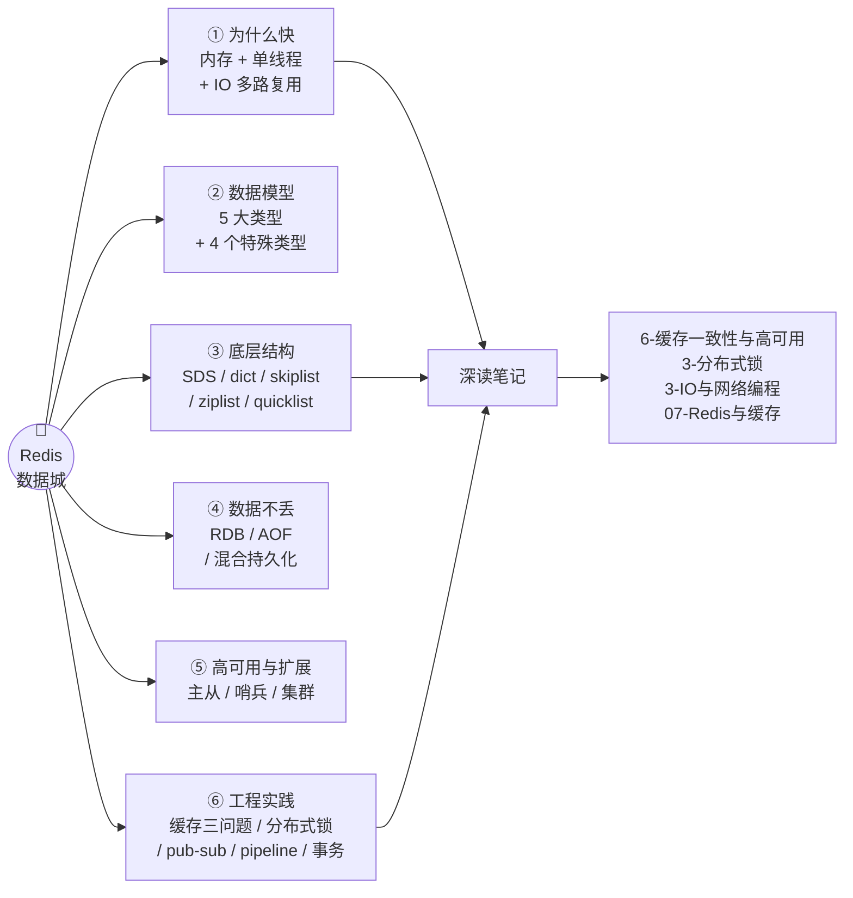

### 视频时间轴

| 时间 | 主题 | 本篇章节 |
| --- | --- | --- |
| 00:01 | 磁盘数据库的痛点 → 内存数据库 | [一](#一为什么需要-redis内存-vs-磁盘) |
| 01:14 | 核心数据模型：键值对 | [二](#二核心数据模型键值对) |
| 01:51 | 单线程为什么能扛高并发 | [三](#三单线程模型为什么快) |
| 02:51 | String：最灵活的积木块 | [4.1](#41-string最灵活的积木块) |
| 03:40 | String 存 JSON vs Hash | [4.2](#42-hash对象型数据) |
| 04:26 | List：传送带与阻塞队列 | [4.3](#43-list传送带与阻塞队列) |
| 05:22 | Set：去重与集合运算 | [4.4](#44-set去重与集合运算) |
| 06:12 | Sorted Set：排行榜 | [4.5](#45-sorted-set排行榜) |
| 07:01 | Bitmap / HyperLogLog / GEO / Stream | [4.6](#46-四个特殊类型) |
| 07:52 | SDS：为什么不用 C 字符串 | [5.1](#51-sds为什么不用-c-字符串) |
| 08:41 | 字典与渐进式 rehash | [5.2](#52-字典-dict-与渐进式-rehash) |
| 09:31 | 跳跃表为什么快 | [5.3](#53-跳跃表-skiplist) |
| 10:22 | ziplist 与 quicklist | [5.4](#54-紧凑编码-ziplist-与-quicklist) |
| 11:17 | RDB：fork + 写时复制 | [6.1](#61-rdb定期拍全景快照) |
| 12:03 | AOF：记录每条写命令 | [6.2](#62-aof记录每一条写命令) |
| 12:42 | 混合持久化与生产配置 | [6.3](#63-混合持久化40-与生产配置) |
| 13:39 | 过期键怎么删 | [7.1](#71-过期键删除惰性--定期) |
| 14:29 | 内存淘汰策略 | [7.2](#72-内存淘汰策略八种) |
| 15:14 | 主从复制 | [8.1](#81-主从复制) |
| 16:03 | 哨兵：自动故障转移 | [8.2](#82-哨兵-sentinel) |
| 16:47 | 集群：哈希槽分片 | [8.3](#83-集群-cluster) |
| 17:42 | 缓存穿透 / 击穿 / 雪崩 | [九](#九缓存三大问题) |
| 20:07 | 分布式锁与 RedLock | [十](#十分布式锁) |
| 20:58 | 发布订阅 / Pipeline / 事务 | [十一](#十一其他能力) |

---

## 一、为什么需要 Redis：内存 vs 磁盘

> 视频比喻：传统数据库像档案馆，**管理员每次查询都要起身去翻柜子**；机械硬盘的**寻道时间是毫秒级**。并发一上来（成千上万请求同时到达），**磁盘 IO 瓶颈就暴露了**。
> Redis 则像一栋"所有档案都摊在手边"的楼——**完全基于内存（RAM）**，伸手就能拿到。

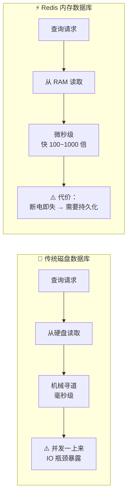

| 维度 | 磁盘数据库（MySQL 等） | Redis（内存数据库） |
| --- | --- | --- |
| 存储介质 | 磁盘（HDD/SSD） | **内存 RAM** |
| 读取延迟 | 毫秒级（机械寻道 ~10ms） | **微秒级** |
| 容量 | TB 级，便宜 | GB 级，**贵得多** |
| 并发能力 | 受 IO 限制 | 单机可支撑**数万 QPS** |
| 数据安全性 | 天然持久 | ⚠️ **断电即失** → 必须配持久化 |

> [!important] 一句话定性
> **Redis 不是"更快的数据库"，而是"用内存换速度、用持久化换安全"的缓存与数据结构服务器。**
> 它解决的是"**热点数据的极速读写 + 原子操作 + 分布式协调**"这三类问题。

---

## 二、核心数据模型：键值对

> 视频对话：`SET myname shy` → `GET myname` **瞬间返回**。"每个数据都有一个唯一的 key（门牌号），对应的 value 就是房间里存的东西——**这是最简单的模型，但也是最灵活的**。"

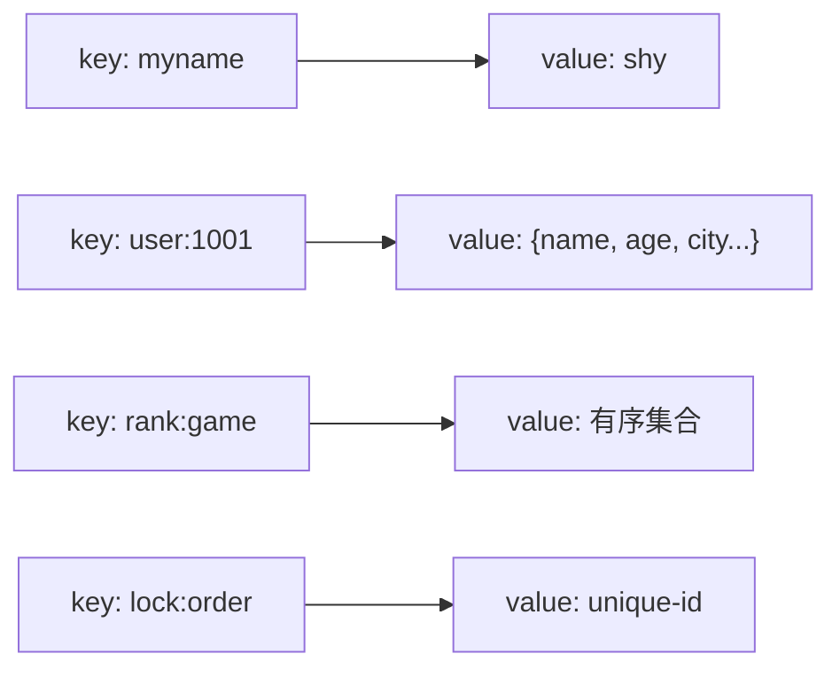

| 要点 | 说明 |
| --- | --- |
| 基本操作 | `SET` / `GET` / `DEL` / `EXISTS` / `EXPIRE` |
| key 设计 | 推荐**冒号分层**：`业务:对象:id:字段`，如 `user:1001:name` |
| ⚠️ 大 key 危害 | 单 value 过大（如几 MB 的 String、百万元素的 Hash）会导致**阻塞、网络拥塞、删除耗时**；删除大 key 用 `UNLINK`（异步） |
| ⚠️ 慢命令 | `KEYS *`、`HGETALL` 大 Hash、`FLUSHALL` 都会**阻塞单线程**——生产禁用，用 `SCAN` 系列代替 |

---

## 三、单线程模型：为什么快

> 视频对话（第 02:00 段）："Redis 使用**单线程处理命令**，避免了多线程的**锁竞争和上下文切换开销**；同时利用操作系统的 **IO 多路复用**技术——就像**一个人同时盯着很多个快递通道，哪个通道有货就处理哪个**，不是傻等一个通道。"

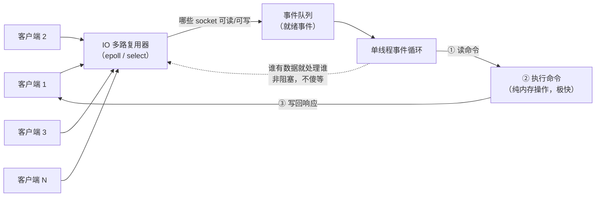

### 3.1 快的三个原因

| 原因 | 说明 |
| --- | --- |
| **纯内存操作** | 命令执行不碰磁盘（持久化是异步/后台的），**每个命令执行极快，排队时间极短** |
| **单线程免锁** | 没有锁竞争、没有线程上下文切换、没有并发修改数据结构的一致性问题 |
| **IO 多路复用 + 事件驱动** | 一个线程同时管理成千上万连接（epoll），**非阻塞 IO**，所以单线程也能支撑数万并发 |

### 3.2 单线程的代价

> 视频对话："如果某个命令执行时间过长，**后面的请求就得干等**——所以要避免 `KEYS *` 这种慢查询。"

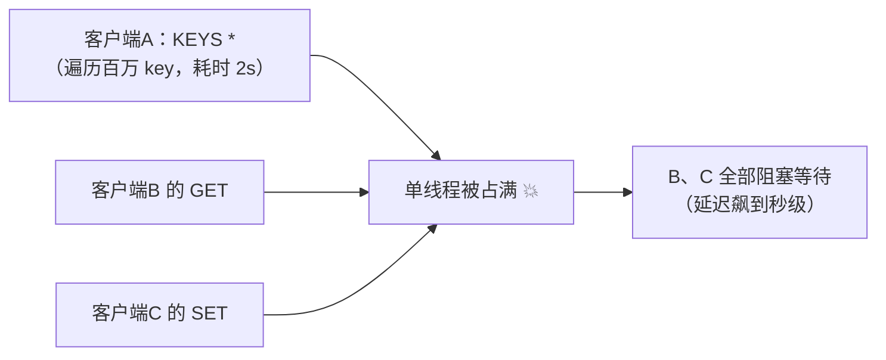

> [!warning] 会阻塞单线程的操作（生产禁忌）
> `KEYS *`、`FLUSHALL`/`FLUSHDB`、大 key 的 `DEL`/`HGETALL`、复杂度过高的 `SORT`/`ZUNIONSTORE`、以及 **Lua 脚本里的死循环**。
> 替代方案：`SCAN`/`HSCAN`/`SSCAN`（游标分批）、`UNLINK`（异步删除）。

> [!note] 版本补充（视频未提，面试常问）
> **Redis 6.0 引入了多线程 IO**：把"**网络读写和协议解析**"拆给多个 IO 线程并行做，但**命令执行依然是单线程**（保证无锁与原子性）。所以"Redis 是单线程"这句话在今天要加限定：**命令执行单线程，IO 可以多线程**。
> 相关：IO 多路复用的底层原理见 [[3-IO与网络编程]]。

---

## 四、五大基本类型 + 四个特殊类型

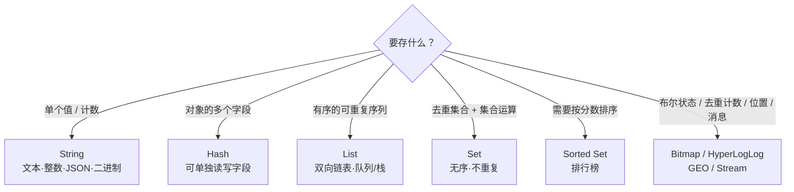

| 类型 | 一句话 | 典型场景 | 底层编码 |
| --- | --- | --- | --- |
| **String** | 最灵活的积木块 | 计数器、缓存、分布式锁、限流 | int / embstr / raw（SDS） |
| **Hash** | 对象的字段表 | 用户信息、商品属性 | **ziplist → hashtable** |
| **List** | 双向链表 | 队列、栈、轻量消息队列 | **quicklist**（3.2+） |
| **Set** | 去重集合 | 共同好友、抽奖、标签 | intset / **ziplist → hashtable** |
| **Sorted Set** | 带分数的有序集合 | 排行榜、热搜、延时队列 | **ziplist → skiplist** |
| **Bitmap** | 位图 | 签到、活跃度 | String |
| **HyperLogLog** | 基数估算 | UV 统计 | 稀疏/稠密 HLL |
| **GEO** | 地理位置 | 附近的人、两地距离 | **ZSet + geohash** |
| **Stream** | 持久化消息队列 | 可靠消息、消费者组 | radix tree |

### 4.1 String：最灵活的积木块

> 视频对话："String 不止字符串——它可以存**文本、整数、浮点数，甚至序列化后的 JSON 对象**，最大能存 **512MB**（虽然能存，但不建议）。"

| 要点 | 说明 |
| --- | --- |
| 能存什么 | 文本 / 整数 / 浮点数 / 二进制（图片、序列化对象） |
| 容量上限 | **512MB**（⚠️ 不要拿它当文件存储） |
| ⭐ **亮点：原子操作** | `INCR` / `DECR` / `INCRBY` / `SETNX`——**高并发下计数也准确**，而在传统数据库里需要**加锁**才能做到 |
| 典型场景 | **网站访问量计数器**、缓存、**分布式锁**、**限流器** |
| 常用命令 | `SET` `GET` `MSET` `MGET` `INCR` `DECR` `SETEX` `SETNX` `APPEND` `STRLEN` |

> [!important] 为什么"原子计数"这么重要？
> `INCR` 是**单线程内的一次原子操作**：读-加-写不可分割，不需要任何锁。
> 而在 MySQL 里做"库存 -1"，你得 `SELECT ... FOR UPDATE` 加行锁，或者 `UPDATE ... SET x = x - 1` 让数据库自己保证——**并发一高就是锁竞争**。这正是 Redis 计数器/限流器的价值所在。

### 4.2 Hash：对象型数据

> 视频对话："用 String 存 JSON，每次想改**一个字段**，都得把**整个对象读出来、改完再写回去**；而 Hash 可以**单独读写每个字段**。"

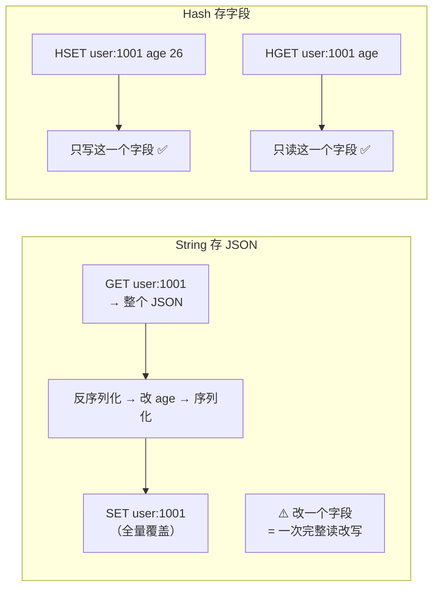

| 维度 | String 存 JSON | **Hash** |
| --- | --- | --- |
| 改单个字段 | ❌ 读整个 → 改 → 写整个 | ✅ `HSET` 单字段 |
| 读单个字段 | ❌ 读整个再解析 | ✅ `HGET` 单字段 |
| 内存占用 | 较大 | **字段少时用 ziplist 紧凑存储，更省内存** |
| 并发粒度 | 整个对象 | 可到字段级 |
| 适用 | 整体读写的配置/快照 | ⭐ **对象型数据（用户信息、商品属性）** |

**底层编码转换**：字段少且值小 → **ziplist**（紧凑省内存）；字段特别多/值大 → **hashtable**。阈值由 `hash-max-ziplist-entries`（默认 128）和 `hash-max-ziplist-value`（默认 64 字节）控制。

### 4.3 List：传送带与阻塞队列

> 视频对话："数据从一边进、另一边出，这就是队列。List 本质上是一个**双向链表**，支持从两端操作。"

| 要点 | 说明 |
| --- | --- |
| 结构 | **双向链表**，两端 O(1) 操作 |
| 能当什么 | **队列**（`LPUSH`+`RPOP`，FIFO）、**栈**（`LPUSH`+`LPOP`，LIFO）、**轻量消息队列** |
| ⭐ 阻塞命令 | `BLPOP` / `BRPOP`——**队列为空时消费者优雅等待**，有新数据立刻被唤醒，**避免无意义的轮询空转** |
| 常用命令 | `LPUSH` `RPUSH` `LPOP` `RPOP` `LRANGE` `LLEN` `BLPOP` `BRPOP` `LTRIM` |

**List 当消息队列 vs Kafka**：

| 维度 | Redis List | Kafka 等专业 MQ |
| --- | --- | --- |
| 定位 | **轻量级**、简单快速 | 高吞吐、强可靠 |
| 持久化 | 依赖 RDB/AOF，可能丢 | 多副本 + 磁盘顺序写，可靠 |
| 消费确认 | 无 ACK（`BRPOPLPUSH` 可折中） | 有 offset 与消费组 ACK |
| 适用 | 可靠性要求**不那么极端**、要简单的场景 | 大数据量、要求不丢不重的场景 |

### 4.4 Set：去重与集合运算

> 视频对话："两个关键区别：**Set 是无序的且元素不重复；List 是有序的，可以有重复元素**。"

| 维度 | List | Set |
| --- | --- | --- |
| 顺序 | **有序**（插入顺序） | **无序** |
| 重复 | **允许重复** | **自动去重** |
| 访问 | 按下标/两端 | 按成员（O(1) 判断存在） |
| 运算 | 无 | ⭐ **交集/并集/差集** |

| 场景 | 用法 |
| --- | --- |
| **共同好友** | `SINTER user:A:friends user:B:friends` |
| **抽奖活动** | `SADD` 存参与用户（**自动去重**）+ `SRANDMEMBER`/`SPOP` 抽奖 |
| **标签系统** | 一篇文章的标签不重复；`SINTER` 找有共同标签的文章 |
| 去重统计 | `SCARD` 统计独立访客 |

> [!important] 关键点：**运算在服务端完成**
> `SINTER`（交集）/ `SUNION`（并集）/ `SDIFF`（差集）**在 Redis 服务端直接算完**，**不需要把数据拉到客户端再处理**——数据量越大，这个优势越明显。

### 4.5 Sorted Set：排行榜

> 视频对话："Sorted Set 就是在 Set 基础上加了**排序**——每个元素关联一个 **score**，Redis 自动按分数排序；**score 相同则按字典序排**。"

| 要点 | 说明 |
| --- | --- |
| 结构 | 成员 + **score（分数）**，按 score 自动排序 |
| 排序规则 | score 升序；**score 相同按成员字典序** |
| 底层 | **跳跃表（skiplist）** + 字典——查找效率接近二分 |
| 常用命令 | `ZADD` `ZSCORE` `ZRANGE` `ZREVRANGE` `ZRANK` `ZINCRBY` `ZRANGEBYSCORE` |
| 典型场景 | ⭐ **游戏积分榜、热搜榜、延时队列**（score = 到期时间戳）——"**只要涉及排序，Sorted Set 就是首选**" |

### 4.6 四个特殊类型

| 类型 | 是什么 | 关键数字 / 特点 | 场景 |
| --- | --- | --- | --- |
| **Bitmap** | 用**每一个 bit** 表示一个状态 | 365 天签到记录只占 **46 字节**（365 bit ≈ 45.6 B） | 签到、**用户活跃度统计** |
| **HyperLogLog** | **概率统计**结构，估算不重复元素数 | **12KB 就能统计接近 2^64 个不同元素**，误差约 **0.81%** | **UV 统计**（不需要精确值） |
| **GEO** | 地理位置处理 | 底层是 ZSet + geohash | **附近的人**、两地距离 |
| **Stream** | **Redis 5.0 引入的持久化消息队列** | 支持**消费者组**、ACK、消息回溯，比 List 强大 | 可靠消息队列 |

> [!tip] 记忆口诀
> **"位图存状态，HLL 估个数，GEO 算距离，Stream 当队列。"**

---

## 五、底层数据结构（原理篇）

### 5.1 SDS：为什么不用 C 字符串

> 视频对话："C 语言字符串有很多痛点：**获取长度要遍历（O(n)）、拼接容易缓冲区溢出、不支持二进制数据**——所以 Redis 自己实现了 **SDS**（Simple Dynamic String）。"

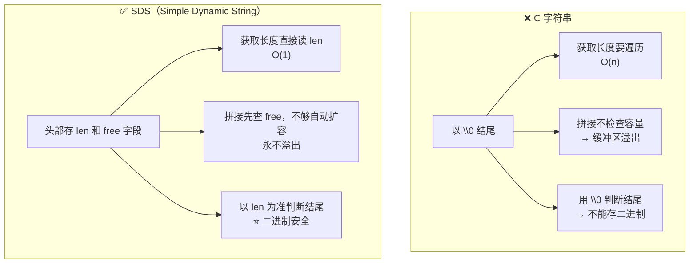

| C 字符串的痛点 | SDS 的解法 |
| --- | --- |
| 获取长度要 `strlen` 遍历 → **O(n)** | 头部存 **`len`** → **O(1)** 取长度 |
| 拼接不检查空间 → **缓冲区溢出** | 头部存 **`free`**，拼接前检查，不够则**自动扩容** |
| 以 `\0` 结尾 → **不能存二进制** | **以 `len` 为准**判断结尾 → **二进制安全**，可存图片、序列化对象 |
| 修改长度要**重新分配内存** | **空间预分配 + 惰性释放**，减少内存重分配次数 |

> [!important] "二进制安全"到底什么意思？
> 意思是：数据中间**可以出现 `\0` 字节**而不被截断。
> C 字符串靠 `\0` 找结尾，所以 `"a\0b"` 只能读到 `"a"`；SDS 记录长度，`"a\0b"` 长度是 3，完整保留——所以能存**图片、protobuf/Java 序列化字节流**。

### 5.2 字典 dict 与渐进式 rehash

> 视频对话："Hash 类型底层用的就是这个字典；**而且不仅是 Hash——Redis 的全局键空间本身就是一个大字典**，每个键值对都存在这个字典里。"

**哈希冲突**：用**拉链法**——同一个槽位上的多个元素用**链表**串起来，**新节点插在链表头部**（O(1)）。

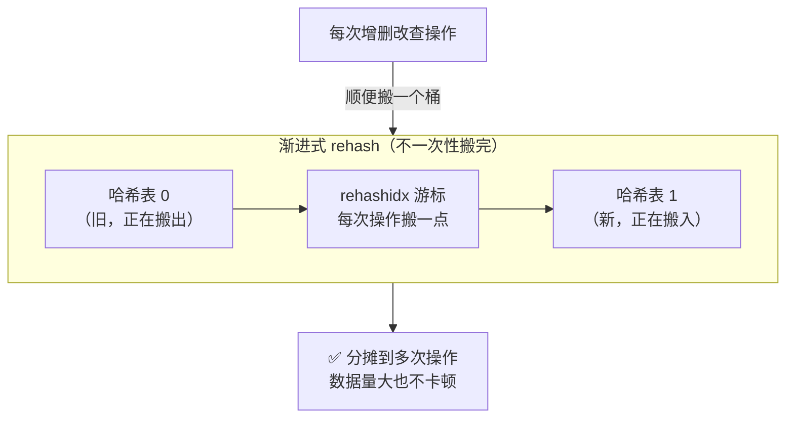

| 问题 | Redis 的做法 |
| --- | --- |
| 表满了怎么办 | **扩容**（`ht[0]` → `ht[1]`） |
| 一次性搬完会怎样 | ❌ **数据量大时会卡顿**（阻塞单线程） |
| 所以怎么办 | ⭐ **渐进式 rehash**：不一次搬完，**每次操作顺便搬一点**，分摊到多次操作中 |
| 搬迁期间的查询 | 先查 `ht[0]`，查不到再查 `ht[1]`（新增只写 `ht[1]`） |

### 5.3 跳跃表 skiplist

> 视频比喻："像**高速公路**——底层是普通道路（每个节点都停），上层是高速路（**跳过大段**）；从高速路**逐层下来**就能快速定位。"

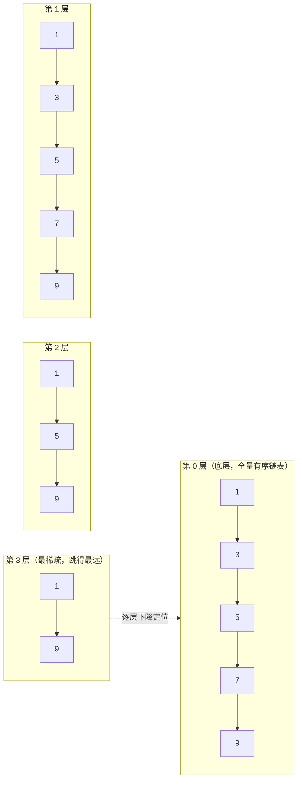

| 要点 | 说明 |
| --- | --- |
| **层数怎么定** | **随机抛硬币**：每个节点 **50% 升一层、25% 升两层**、以此类推——**随机化保证整体效率稳定**（统计学上的 O(log n)） |
| 查找过程 | 从最高层开始，能往右就往右，不能就往下一层 → **接近二分查找** |
| ⭐ **为什么不用平衡树** | ① **实现简单、代码量少**；② **范围查询非常方便**——找到起点后**沿底层链表遍历**即可；③ 平衡树的区间查询更复杂（需要中序遍历/回溯） |

### 5.4 紧凑编码 ziplist 与 quicklist

> 视频对话："Hash 和 List 在数据少的时候内存很省，就是用了 **ziplist**——它把所有元素**紧凑排列在一块连续内存**中，**省去了指针开销**。但它有个**致命弱点**：插入或删除时**后面的元素都得移动**，数据量大时效率低。"

```mermaid
flowchart TB
    subgraph ZIP["ziplist：一整块连续内存"]
        direction LR
        Z1["元素1"] --- Z2["元素2"] --- Z3["元素3"] --- Z4["元素4"]
        ZN["✅ 无指针开销，省内存<br/>❌ 中间插入/删除要搬动后续元素"]
    end
    subgraph QL["quicklist（Redis 3.2+）：多个小 ziplist 串成双向链表"]
        direction LR
        Q1["ziplist A<br/>（几十个元素）"] <-->|"双向指针"| Q2["ziplist B"] <-->|"双向指针"| Q3["ziplist C"]
        QN["✅ 既保留内存效率<br/>✅ 又避免"单个大块整体移动"的代价"]
    end
    ZIP -->|"数据量大时的问题"| QL
```

**各类型的编码转换阈值**（都可以配置调整）：

| 类型 | 小数据（省内存） | 大数据（保速度） | 相关配置 |
| --- | --- | --- | --- |
| List | **quicklist**（内部节点是 ziplist） | 同上（由 `list-max-ziplist-size` 控制每个节点大小） | `list-max-ziplist-size` |
| Hash | **ziplist / listpack** | **hashtable** | `hash-max-ziplist-entries`（128）、`hash-max-ziplist-value`（64） |
| Set | **intset**（纯整数）/ **ziplist** | **hashtable** | `set-max-intset-entries`（512） |
| Sorted Set | **ziplist / listpack** | **skiplist + dict** | `zset-max-ziplist-entries`（128） |

> [!note] listpack 是什么？
> Redis 7.0 用 **listpack** 逐步替代 ziplist（解决了 ziplist 的**连锁更新**问题：中间节点变长可能导致后续节点级联扩容）。面试提到"ziplist 的连锁更新"是个加分点。

---

## 六、持久化：RDB / AOF / 混合

> 视频对话："Redis 数据在内存里，一关机就没了——怎么保证不丢数据？这就是**持久化**的作用。"

### 6.1 RDB：定期拍全景快照

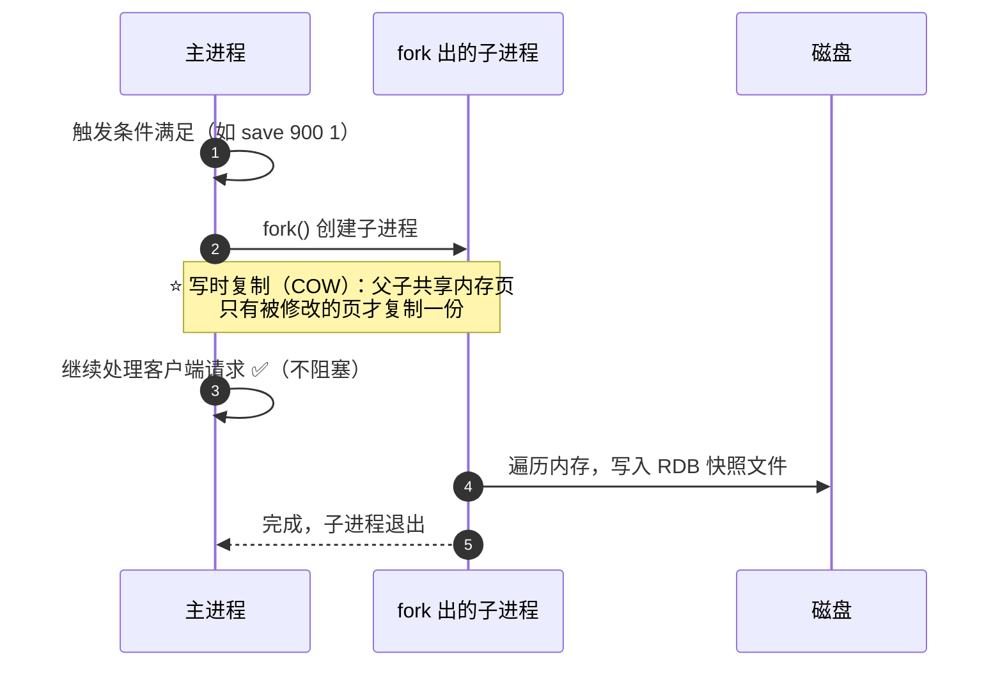

| 要点 | 说明 |
| --- | --- |
| 是什么 | **定期把内存数据全量快照到磁盘**（二进制压缩文件） |
| 恢复 | 启动时**直接读取快照文件**，速度快 |
| ⭐ 怎么做到不阻塞 | **fork 子进程**去拍照，主进程继续服务；靠操作系统的**写时复制（COW：Copy-On-Write）**——**只有被修改的内存页才复制**，大部分内存共享 |
| ⚠️ 缺点 | **两次快照之间服务器挂了，这之间的数据就丢了** |
| 相关命令 | `SAVE`（阻塞，禁用）/ `BGSAVE`（fork 子进程，推荐） |

### 6.2 AOF：记录每一条写命令

> 视频对话："AOF 就是记录**每一条写命令**……文件会越来越大，所以 Redis 提供了 **AOF 重写**，把冗余命令合并压缩——比如**十次 INCR 可以合并成一次 SET**。"

| 要点 | 说明 |
| --- | --- |
| 是什么 | **追加记录每一条写命令**（类似 MySQL binlog） |
| 恢复 | 启动时**重放所有命令**（数据量大时较慢） |
| **AOF 重写** | 文件膨胀 → `BGREWRITEAOF` **合并压缩冗余命令**（十条 `INCR` → 一条 `SET`） |
| 优点 | **丢数据少**（取决于刷盘策略），可读性好（文本协议） |

**刷盘（fsync）策略三选一**：

| 策略 | 含义 | 安全性 | 性能 | 建议 |
| --- | --- | --- | --- | --- |
| `always` | **每条命令都刷盘** | ⭐ 最安全（几乎不丢） | ❌ 最慢 | 极端重要的数据 |
| **`everysec`** | **每秒刷一次** | **最多丢 1 秒** | ✅ 好 | ⭐ **最常用（性能与安全的平衡）** |
| `no` | 交给操作系统决定 | ⚠️ 可能丢更多 | ✅ 最快 | 不推荐 |

### 6.3 混合持久化（4.0+）与生产配置

> 视频对话："最佳实践是**两者结合**：用 RDB 做定期全量备份（恢复快），用 AOF 做实时增量记录（数据全）；**Redis 4.0 还支持混合持久化——RDB 快照 + AOF 增量**，兼顾速度和安全。"


**生产环境推荐配置**：

```conf
# ① RDB 触发条件（900 秒内有 1 个 key 变更就快照）
save 900 1
save 300 10
save 60 10000

# ② 开启 AOF，每秒刷盘
appendonly yes
appendfsync everysec

# ③ 开启混合持久化（RDB 快照 + AOF 增量）
aof-use-rdb-preamble yes

# ④ AOF 重写触发条件
auto-aof-rewrite-percentage 100
auto-aof-rewrite-min-size 64mb
```

> [!important] 这套配置的"最坏情况"
> **最坏也只丢 1 秒的数据**（`everysec` 的窗口），且重启恢复**先读 RDB 很快、再补 AOF 尾部很全**。
> 这基本就是"**备份和日志两手抓**"的标准答案。

---

## 七、过期键与内存管理

### 7.1 过期键删除：惰性 + 定期

> 视频对话："Redis 用了两种策略配合：**惰性删除**（用到才检查）和**定期删除**（主动巡检抽查）。"

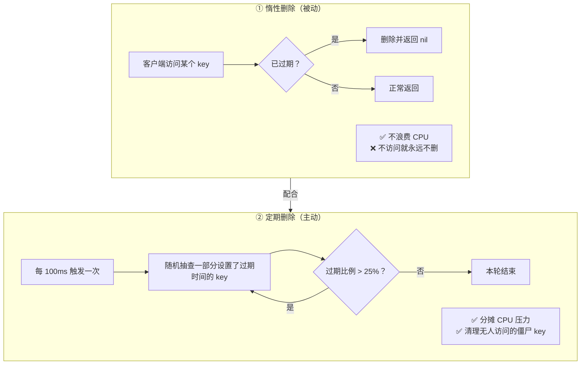

| 问题 | 答案 |
| --- | --- |
| 为什么不"**定时删除**"（到点就删）？ | 如果有**10 万个 key 同时到期**，同时删除会造成 **CPU 尖峰**，影响正常请求 |
| 定期删除怎么避免尖峰？ | **每次只抽查一部分**，把清理工作**平摊开** |
| 有些过期 key 一直没人访问、也没被抽到呢？ | **可能暂时残留在内存中**，但定期删除会**持续巡检，最终会被清理** |
| 万一内存满了呢？ | **内存淘汰机制兜底**（下一节） |

### 7.2 内存淘汰策略（八种）

> 视频对话："Redis 提供了**八种策略**，最常用的是 **allkeys-lru**（在所有 key 中淘汰最久没用的）……**LFU** 看的是**访问次数而非时间**，适合有冷热数据区分的场景。"

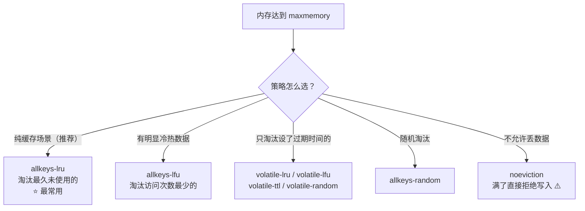

| 策略 | 候选范围 | 淘汰依据 |
| --- | --- | --- |
| **`allkeys-lru`** | 所有 key | **最久未使用**（时间） ⭐ 缓存首选 |
| **`allkeys-lfu`** | 所有 key | **最少使用**（次数）——适合冷热分明 |
| `allkeys-random` | 所有 key | 随机 |
| `volatile-lru` | **仅设了过期时间的** | 最久未使用 |
| `volatile-lfu` | 仅设了过期时间的 | 最少使用 |
| `volatile-random` | 仅设了过期时间的 | 随机 |
| `volatile-ttl` | 仅设了过期时间的 | **剩余 TTL 最小**（最快过期的先淘汰） |
| `noeviction` | 不淘汰 | ⚠️ **满了拒绝写入**（可做 DB 用，做缓存不推荐，容易丢数据） |

> [!tip] LRU vs LFU
> **LRU（Least Recently Used）= 看"多久没用"**；**LFU（Least Frequently Used）= 看"用了多少次"**。
> 一个刚被访问一次的"一次性冷数据"会把 LRU 挤掉热点；LFU 因为看次数，能更好地保护热点——所以**有明显冷热区分时选 LFU**。
> 补充：Redis 的 LRU 是**近似 LRU**（随机采样 `maxmemory-samples` 个 key，默认 5，挑最久未用的淘汰），不是精确 LRU——为了省内存和 CPU。

---

## 八、高可用与扩展


### 8.1 主从复制

> 视频对话："一个 master 可以带多个 replica 实时同步……分为两个阶段：**全量复制**和**增量复制**。"

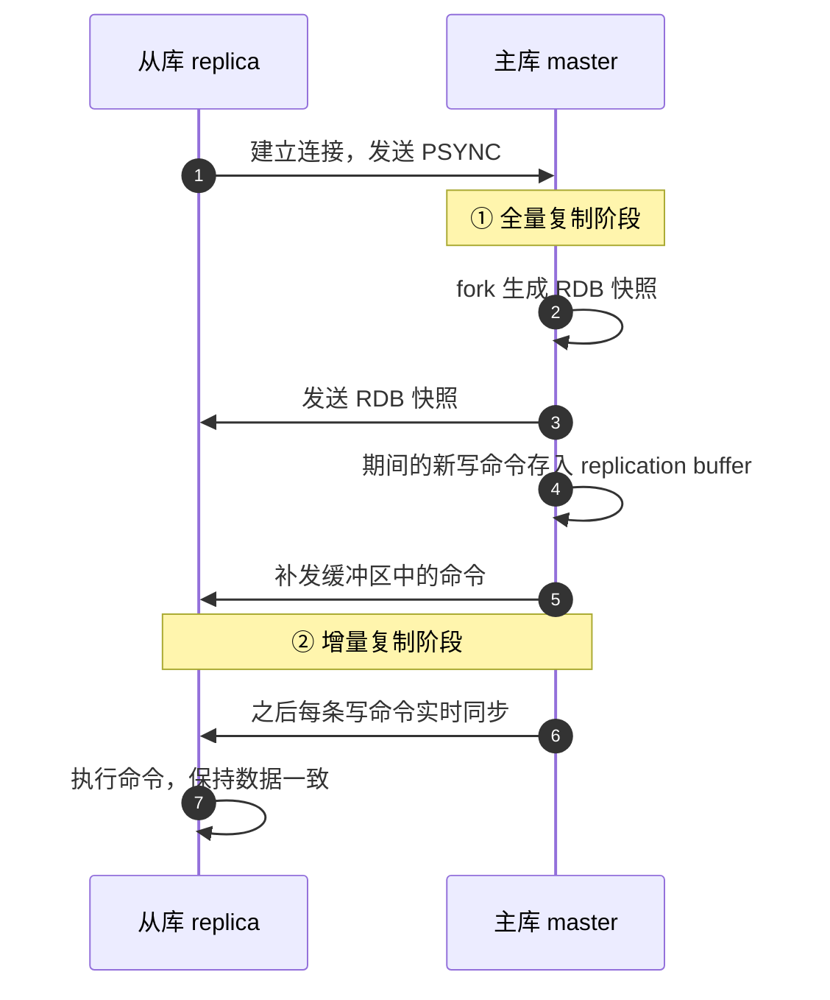

| 要点 | 说明 |
| --- | --- |
| 两阶段 | **全量复制**（首次连接给 RDB 快照）+ **增量复制**（之后实时同步写命令，靠 repl_backlog 环形缓冲支持断线重连） |
| 从库能写吗 | ❌ **默认只能读，写必须走主**（保证一致性）；可配置 `replica-read-only no` 允许从写，**但不推荐** |
| 作用 | 数据冗余备份 + **读写分离**（主写从读，分摊读压力） |

> [!note] 关于"无盘复制"的澄清（视频表述不够准确）
> 视频说"Redis **7.0 之后**才支持无盘复制"——实际上 **`repl-diskless-sync` 在 Redis 2.8.18 就已引入**（主库直接把 RDB 通过 socket 发给从库，**不落盘**，减少磁盘 IO）；
> **Redis 7.0 的变化是把它默认打开**（默认值从 `no` 变为 `yes`）。
> 面试时说"7.0 起**默认启用**无盘复制"是准确的，"7.0 才开始支持"就不准确了。

### 8.2 哨兵 Sentinel

> 视频对话："哨兵是一组**独立的 Redis 进程**，专门监控主从状态；主挂了，哨兵会**自动选一个从提升为新主**。"

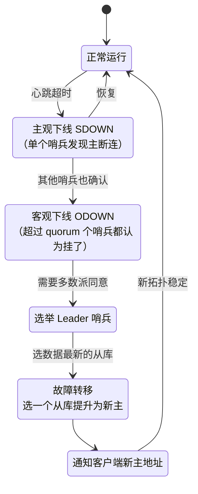

| 概念 | 含义 |
| --- | --- |
| **主观下线（SDOWN）** | **单个哨兵**发现主库断连，是自己的判断 |
| **客观下线（ODOWN）** | **超过 quorum 数量的哨兵都认为主挂了**，才形成客观判定 |
| 故障转移 | 选一个从库提升为新主，其他从库改指向新主，并**通知客户端** |
| ⚠️ 哨兵自己挂了怎么办 | **哨兵也要部署多个（至少 3 个，奇数节点）**，保证投票能形成多数 |
| 补充 | 防脑裂：`min-replicas-to-write` + `min-replicas-max-lag` 可让主库在从库不足时**拒绝写入**，减少数据丢失 |

### 8.3 集群 Cluster

> 视频对话："主从 + 哨兵的数据**都在一个节点上，受单机内存限制**；集群模式把数据**分片到多个节点**，每个节点只存一部分，可以**横向扩展**。"

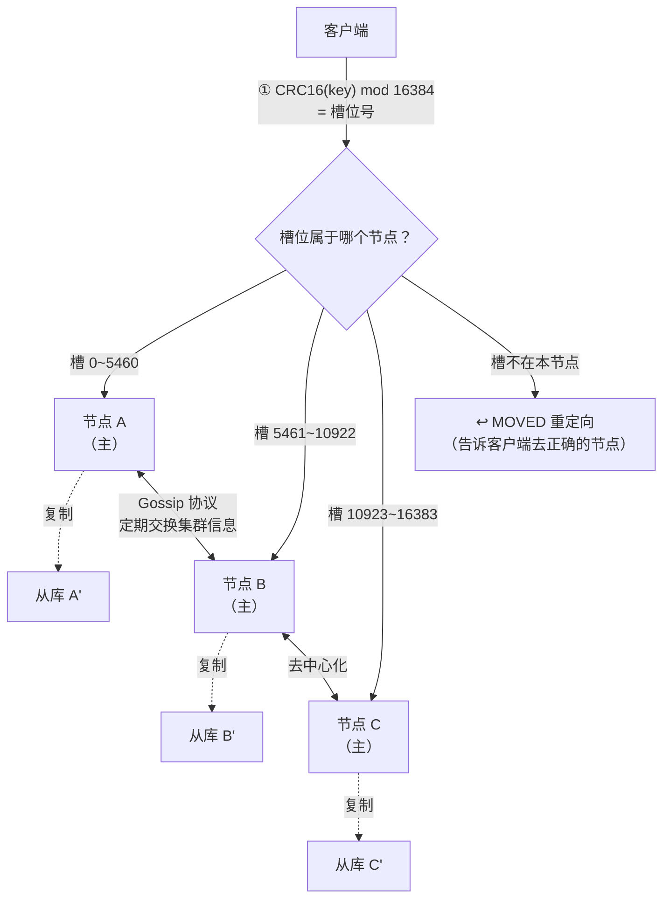

| 要点 | 说明 |
| --- | --- |
| **哈希槽** | 总共 **16384 个槽位**；每个 key 通过 **`CRC16(key) mod 16384`** 映射到一个槽，槽再分配给节点 |
| 为什么是 16384 | 槽位少则**分片粒度粗**（单节点数据不均）、多则**集群心跳包太大**——16384 是折中 |
| 路由 | 客户端访问时，节点若发现 key 不属于自己，返回 **`MOVED`**（永久重定向）或 **`ASK`**（迁移中临时重定向） |
| 节点间通信 | **Gossip 协议**：节点之间**定期交换信息、传播状态变更**——**去中心化**，即使部分节点挂了，集群信息也能**最终一致** |
| 多 key 操作限制 | `MGET`/`SINTER` 等跨槽操作会失败，需用 **hash tag**（`{user}:1`、`{user}:2` 强制同槽） |
| 规模建议 | 至少 **3 主 3 从**（6 节点）才能保证高可用 |
| 补充 | 集群总线端口 = 服务端口 **+10000**（如 6379 → 16379） |

> [!tip] 与一致性哈希的区别（易混淆点）
> **Redis Cluster 用的是"固定 16384 个槽"而非一致性哈希环**。
> 槽的好处：**迁移以槽为单位**，粒度固定、路由计算是 O(1) 取模；一致性哈希则需要维护虚拟节点环、迁移和扩容时的数据分布计算更复杂。详见 [[5-一致性哈希与负载均衡]]。

---

## 九、缓存三大问题

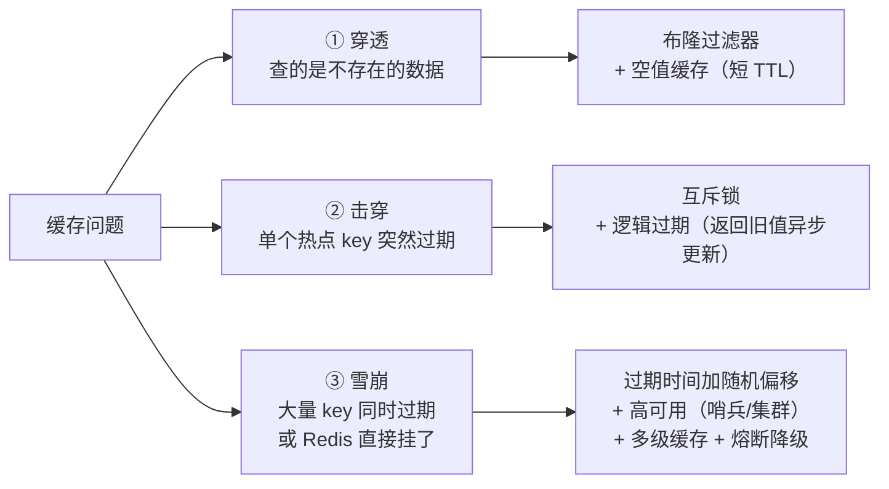

| 问题 | 触发条件 | 后果 | 解决方案 |
| --- | --- | --- | --- |
| **穿透** | 查询**大量不存在的 key**（恶意攻击） | 缓存和 DB 都没有 → **请求全打到数据库** | ⭐ **布隆过滤器**（判断"一定不存在"/"可能存在"）+ **空值缓存**（确认不存在也存空值，**TTL 设短**） |
| **击穿** | **某个超级热门 key 刚好过期** | 过期瞬间**海量请求直接打到数据库**，可能把 DB 打垮 | ⭐ **互斥锁**（只让一个请求查库重建缓存，其他等待）+ ⭐ **逻辑过期**（物理过期时间长，维护逻辑过期字段，发现逻辑过期就**返回旧值并异步更新**） |
| **雪崩** | **大量 key 同时过期** 或 **Redis 宕机** | 最严重的缓存问题，DB 瞬间被压垮 | **过期时间加随机偏移**（防同时过期）+ **Redis 高可用**（哨兵/集群，防单点）+ **多级缓存**（本地缓存兜底）+ **熔断降级**（DB 压力过大时自动保护） |

> [!important] 击穿的两个方案怎么选（视频对话原文）
> **逻辑过期更优雅**——用户**不需要等待**（直接返回旧值），但**实现稍复杂**；
> **互斥锁更简单**——适合**一致性要求高**的场景（用户拿到的一定是新值，但要等）。
> 面试时把这两个的取舍讲清楚，比只背名字强得多。

> [!note] 更深的展开
> 三大问题的**完整原理、代码示例、方案对比决策树**见 [[6-缓存一致性与高可用]] §四；
> **缓存与数据库的一致性**（为什么是删除而不是更新、四种操作顺序、延迟双删、补偿方案）见该篇 §三；
> 缓存模式全景（Cache-Aside / Read-Through / Write-Through / Write-Behind）见该篇 §二。

---

## 十、分布式锁

> 视频对话："Redis 实现分布式锁很经典：`SET lock_key unique_value NX PX 30000`。"

```mermaid
sequenceDiagram
    autonumber
    participant C1 as 客户端1
    participant R as Redis
    participant C2 as 客户端2
    C1->>R: SET lock:order uuid-1 NX PX 30000
    R-->>C1: OK ✅ 拿到锁
    C2->>R: SET lock:order uuid-2 NX PX 30000
    R-->>C2: nil ❌ 锁已被占用
    Note over C1: 执行业务……
    C1->>R: Lua 脚本：<br/>if get(key)==uuid-1 then del(key) end
    R-->>C1: 释放成功 ✅
    C2->>R: SET lock:order uuid-2 NX PX 30000
    R-->>C2: OK ✅ 这时才拿到
```

| 要素 | 作用 |
| --- | --- |
| `NX` | **key 不存在时才设置**（互斥） |
| `PX 30000` | **设置过期时间，防止死锁**（客户端崩溃后锁能自动释放） |
| `unique_value` | ⭐ **唯一标识（如 UUID）**——释放锁时**验证只能释放自己持有的锁** |
| **Lua 脚本** | ⭐ **原子性**：**先比对 value 一致才删除**，避免"判断完刚过期，误删了别人的锁" |

**三大坑与对策**（详细方案见 [[3-分布式锁]]）：

| 坑 | 后果 | 对策 |
| --- | --- | --- |
| 没设过期时间 | 客户端崩溃 → **死锁** | `SET ... NX PX`（一条命令原子完成） |
| 业务执行时间 > 锁过期时间 | 锁提前释放 → **超卖** | **Redisson 看门狗自动续期** |
| **单节点主库宕机** | 锁可能丢失（未同步到从库） | **RedLock 算法**：在**多个独立节点**上获取锁，**多数节点成功才算成功**，更安全 |

> [!warning] RedLock 的争议
> RedLock 由 Redis 作者 Antirez 提出，但分布式系统专家 **Martin Kleppmann 曾公开质疑**（依赖时钟、GC 停顿下仍可能失效）。
> 面试加分答法："RedLock 提升了安全性但**依赖各节点时钟**，且实现复杂；**如果业务能接受幂等，优先用'唯一值 + Lua + 看门狗'的单节点方案；对强一致要求极高时考虑 ZooKeeper/etcd**。"详见 [[3-分布式锁]]。

---

## 十一、其他能力

### 11.1 发布订阅 pub/sub

> 视频对话："发布者发消息到频道，**所有订阅该频道的客户端都能实时收到**。"与 List 的核心区别是**推 vs 拉**。

```mermaid
flowchart LR
    subgraph PS["pub/sub（推送模式）"]
        direction TB
        P1["发布者 PUBLISH"] --> CH["频道 channel"] --> SUB1["订阅者 1<br/>立刻收到"]
        CH --> SUB2["订阅者 2<br/>立刻收到"]
        PN["⚠️ 消息不持久<br/>离线就收不到"]
    end
    subgraph LS["List / Stream（拉取模式）"]
        direction TB
        L1["生产者 LPUSH / XADD"] --> Q["队列（消息存着）"]
        Q --> CON1["消费者自己来取 ✅"]
        LN["✅ 更可靠<br/>Stream 还有消费者组 + ACK"]
    end
```

| 维度 | pub/sub | List / Stream |
| --- | --- | --- |
| 模式 | **推送**（来了立刻推给所有订阅者） | **拉取**（消息存着，消费者自己取） |
| 持久化 | ❌ **消息不持久**，离线收不到 | ✅ 消息在队列里，更可靠 |
| 广播能力 | ✅ 天然一对多广播 | ❌ 一条消息只能被一个消费者拿走（Stream 消费者组可部分解决） |
| 适用 | **实时通知、聊天消息**（允许丢失） | **重要消息**（用 Stream） |

### 11.2 Pipeline

> 视频对话："每次发一条命令都要等回复太慢了——所以有 **Pipeline，把多条命令打包一起发、一起执行、一起返回**，大幅减少网络往返时间（RTT）。"

```mermaid
flowchart TB
    subgraph NOP["❌ 不用 Pipeline：N 次往返"]
        N1["命令1"] -->|RTT| N2["命令2"] -->|RTT| N3["命令3"] -->|RTT| N4["……"]
    end
    subgraph WITH["✅ 用 Pipeline：1 次往返"]
        W1["命令1 + 命令2 + 命令3<br/>一次性发出"] -->|"1 × RTT"| W2["依次执行并一起返回"]
    end
```

> [!warning] Pipeline 不是"原子操作"
> Pipeline **只是减少了网络往返**，命令之间**没有原子性保证**——中间可能被其他客户端的命令插队。
> 要原子性得用**事务（MULTI/EXEC）**或 **Lua 脚本**（Lua 才是真正的原子执行）。

### 11.3 事务 MULTI / EXEC / WATCH

> 视频对话："`MULTI` 和 `EXEC` 将多条命令**原子执行**，执行期间**不会被其他命令插队**——但**它不支持回滚**，某条命令失败**不影响其他命令**……算**弱事务**。Redis 认为失败通常是编程错误，应该在开发阶段发现。"

```mermaid
sequenceDiagram
    participant C as 客户端
    participant R as Redis
    C->>R: WATCH balance（乐观锁监视）
    C->>R: MULTI（开启事务，后续命令入队）
    C->>R: DECR balance
    C->>R: INCR stock
    C->>R: EXEC（一次性执行）
    alt 监视的 key 未被改动
        R-->>C: 返回各命令结果 ✅
    else 监视的 key 被其他客户端改过
        R-->>C: 返回 nil（事务被取消）❌
    end
```

| 特性 | 说明 |
| --- | --- |
| 原子执行 | `MULTI` 后的命令**入队**，`EXEC` 时**一次性连续执行**，中间不被插队 |
| ⚠️ **不支持回滚** | 某条命令失败，**其他命令照常执行**（"弱事务"） |
| 为什么设计成不回滚 | Redis 认为：**语法错误可以在开发阶段发现；运行时错误（如类型错误）是编程错误**，回滚也无法挽救逻辑错误，反而增加复杂度 |
| `WATCH` | 实现**乐观锁**：监视的 key 被改动 → `EXEC` 返回 nil（事务取消），需重试 |
| ⭐ 更好的选择 | **Lua 脚本**：真原子执行 + 支持条件逻辑，比事务更常用（分布式锁释放就用它） |

### 11.4 生态：Redis Stack

> 视频结尾提到的进化方向：

| 模块 | 能力 |
| --- | --- |
| **RedisJSON** | 原生支持 JSON 文档的读写与路径查询（`JSON.SET` / `JSON.GET`） |
| **RediSearch** | 全文检索、二级索引、聚合 |
| **RedisTimeSeries** | 时序数据（监控指标） |
| **RedisBloom** | 布隆过滤器、Cuckoo Filter、Top-K、Count-Min Sketch |
| **RedisGraph / RedisAI** | 图、AI 推理（已并入 Redis Stack 生态） |

---

## 十二、面试速查（30 秒版）

| 问题 | 一句话答案 |
| --- | --- |
| Redis 为什么快 | ① **纯内存** ② **单线程免锁免切换** ③ **IO 多路复用 + 事件驱动**（非阻塞） |
| "单线程"还准确吗 | 命令执行单线程；**Redis 6.0 起网络 IO 可多线程** |
| 单线程的代价 | 慢命令（`KEYS *`、大 key、`FLUSHALL`）会**阻塞所有后续请求** |
| String vs Hash 存对象 | Hash 可**单独读写字段**、字段少时 **ziplist 更省内存**；String 改一个字段要整体读改写 |
| List 做消息队列的短板 | 无 ACK、可靠性一般；可靠场景用 **Stream**（5.0+，消费者组） |
| Set vs List | Set **无序不重复** + **服务端集合运算**；List **有序可重复** + 两端操作 |
| Sorted Set 底层 | **跳跃表 + 字典**；score 相同按字典序 |
| 跳跃表为什么不用平衡树 | 实现简单、**范围查询方便**（沿底层链表遍历） |
| 为什么用 SDS | O(1) 取长度、**自动扩容防溢出**、**二进制安全**（以 len 判断结尾） |
| 渐进式 rehash 为什么 | 一次性搬迁会**卡顿**；分摊到每次操作中，避免阻塞 |
| ziplist 的弱点 / quicklist | ziplist 连续内存省指针，但**插入删除要移动后续元素**；quicklist = 多个小 ziplist 串成双向链表（3.2+） |
| RDB 怎么不阻塞 | **fork 子进程 + 写时复制（COW）**，只复制被修改的内存页 |
| RDB 的缺点 | **两次快照之间宕机 → 丢数据** |
| AOF 刷盘三策略 | `always`（最安全最慢）/ ⭐ **`everysec`（最多丢 1 秒）** / `no` |
| 混合持久化 | **RDB 快照 + AOF 增量**（4.0+）；恢复先读 RDB 再重放 AOF 尾部 |
| 生产持久化配置 | `save 900 1` + `appendonly yes` + `appendfsync everysec` + `aof-use-rdb-preamble yes` |
| 过期键怎么删 | **惰性删除 + 定期删除**；不做定时删除是为了**避免 CPU 尖峰** |
| 内存淘汰八种 | 缓存首选 ⭐ **allkeys-lru**；冷热分明用 **allkeys-lfu**；`noeviction` 满了拒写 |
| LRU vs LFU | LRU 看**多久没用**（时间）；LFU 看**用了多少次** |
| 主从复制两阶段 | **全量**（RDB 快照）+ **增量**（实时写命令）；从库默认只读 |
| 哨兵怎么判挂 | **主观下线**（单哨兵）→ **客观下线**（超 quorum）→ 选举 + 故障转移；哨兵至少 **3 个奇数** |
| 集群怎么分片 | **16384 个哈希槽**，`CRC16(key) mod 16384`；节点间 **Gossip** 协议 |
| 集群为什么不是一致性哈希 | 槽位粒度固定、**迁移以槽为单位**、路由 O(1)；一致性哈希要维护哈希环 |
| 缓存穿透 / 击穿 / 雪崩 | 穿透→**布隆过滤器/空值缓存**；击穿→**互斥锁/逻辑过期**；雪崩→**随机 TTL + 高可用 + 多级缓存 + 熔断降级** |
| 分布式锁怎么写 | `SET key uuid NX PX 30000` + **Lua 脚本校验后删除**；防主从丢锁用 **RedLock** |
| pub/sub vs List/Stream | pub/sub **推送、不持久、离线丢**；List/Stream **拉取、消息存着、更可靠** |
| Pipeline 是原子吗 | ❌ 不是，只减少 RTT；要原子用**事务或 Lua** |
| Redis 事务支持回滚吗 | ❌ **不支持**（弱事务）：一条失败不影响其他命令；用 `WATCH` 做乐观锁 |

---

## 附录 A：语音转写（ASR）勘误对照

原始字幕稿由 vCaptions 生成，本篇修正约 40 处：

| 原始转写 | 应为 |
| --- | --- |
| REDIS / reddish | **Redis** |
| 避免多线程的所竞争 | 避免多线程的**锁竞争** |
| 非阻塞 AO 加事件驱动 | 非阻塞 **IO** + 事件驱动 |
| peace 星号 | **`KEYS *`** |
| increased | **`INCR`** |
| 保证技术准确 | 保证**计数**准确 |
| SIMPLIST 压缩列表 / sp list | **ziplist** |
| HASHTABLE | **hashtable** |
| five four 站，Leo | **FIFO**、**LIFO** |
| bop pop 和 blue pop | **`BLPOP`** / **`BRPOP`** |
| this is 适合轻量级 | **Redis** 适合轻量级 |
| 你和另一个用户的 sat 取交集 | **SET** 取交集 |
| 用 size 存参与用户自动去中 | 用 **SET** 存参与用户自动**去重** |
| Center sanaa stiff | **`SINTER` / `SUNION` / `SDIFF`** |
| big map | **bitmap** |
| hyper log log | **HyperLogLog** |
| 字符串头不存了 LN 和 free | 字符串头**部存了 `len`** 和 `free` |
| 直接读 lo1 复杂度 | 直接读，**O(1)** 复杂度 |
| 不以反斜杠零判断结尾 | 不以 **`\0`** 判断结尾 |
| 字典对 | 字典（**dict**） |
| 在欧拉 N 为什么不用平衡术 | **O(log n)** 为什么不用平衡**树** |
| 平衡数 | 平衡**树** |
| 3.2 之后引入了 quick list | **quicklist** |
| DOF 重写 | **AOF 重写** |
| 十次 increased 合并成一次 set | 十次 **`INCR`** 合并成一次 **`SET`** |
| every sec | **everysec** |
| RDB 和 AOS 哪个更好 / 用 AF 做实时增量 | RDB 和 **AOF** |
| 数据全 read 4.0 | **Redis 4.0** |
| 再重放 AOF 尾八全兼顾了 | 再重放 **AOF 尾部**，**全**兼顾了 |
| save910 这种 rd b 触发条件 | **`save 900 1`** 这种 **RDB** 触发条件 |
| 最常用的是 OK4O | 最常用的是 **`allkeys-lru`** |
| K 素肉或 K 素服 | **`allkeys-lru`** 或 **`allkeys-lfu`** |
| NO eviction | **`noeviction`** |
| 减少磁盘 L | 减少磁盘 **IO** |
| 一组独立的 release 进程 | 一组独立的 **Redis** 进程 |
| 叫主官下线 / 客观下限 | **主观下线（SDOWN）** / **客观下线（ODOWN）** |
| 超过 QUN 数量 | 超过 **quorum** 数量 |
| 至少三个基数节点 | 至少三个**奇数**节点 |
| 1 万 6384 个槽位 | **16384** 个槽位 |
| 通过 C2C16 哈希 | **CRC16** 哈希 |
| 陆游也很高效 | **路由**也很高效 |
| 缓存穿套 | 缓存**穿透** |
| VIDAS 直接挂了 | **Redis** 直接挂了 |
| 又层加多级缓存 | **再**加多级缓存 |
| set log 下划线 key unique，下划线 value nx p x30000 | `SET lock_key unique_value NX PX 30000` |
| 为什么只要设成 unique 下划线 value | 为什么 **value 要设成 unique** |
| 先笔对值一致才删除 | 先**比对**值一致才删除 |
| red lock 算法 | **RedLock** |
| pop sub 是推送模式 | **pub/sub** |
| MOTI 和 exec | **`MULTI`** 和 **`EXEC`** |
| 算若事物 | 算**弱事务** |
| 刷盘策略"every sec 丢最多一秒" | ✅ 正确（`everysec` 最多丢 1 秒） |

> [!note] 一处需要纠正的技术表述
> 视频说"**Redis 7.0 之后还支持无盘复制**"——无盘复制（`repl-diskless-sync`）**早在 2.8.18 就支持**，**7.0 只是把默认值改成开启**。已在 [§8.1](#81-主从复制) 中澄清。

## 附录 B：命令速查

| 类型 | 常用命令 |
| --- | --- |
| **String** | `SET` `GET` `MSET` `MGET` `INCR` `DECR` `INCRBY` `SETEX` `SETNX` `APPEND` `STRLEN` |
| **Hash** | `HSET` `HGET` `HMSET` `HMGET` `HDEL` `HGETALL` `HINCRBY` `HKEYS` `HLEN` |
| **List** | `LPUSH` `RPUSH` `LPOP` `RPOP` `LRANGE` `LLEN` `LTRIM` `BLPOP` `BRPOP` `BRPOPLPUSH` |
| **Set** | `SADD` `SREM` `SMEMBERS` `SISMEMBER` `SCARD` `SINTER` `SUNION` `SDIFF` `SPOP` `SRANDMEMBER` |
| **Sorted Set** | `ZADD` `ZSCORE` `ZRANGE` `ZREVRANGE` `ZRANK` `ZINCRBY` `ZRANGEBYSCORE` `ZREMRANGEBYRANK` |
| **Bitmap** | `SETBIT` `GETBIT` `BITCOUNT` `BITOP` `BITFIELD` |
| **HyperLogLog** | `PFADD` `PFCOUNT` `PFMERGE` |
| **GEO** | `GEOADD` `GEODIST` `GEORADIUS` `GEOPOS` `GEOHASH` |
| **Stream** | `XADD` `XLEN` `XRANGE` `XREAD` `XREADGROUP` `XACK` `XPENDING` |
| **通用** | `DEL` `UNLINK` `EXISTS` `EXPIRE` `TTL` `TYPE` `SCAN` `HSCAN` `OBJECT ENCODING` |
| **事务/Lua** | `MULTI` `EXEC` `DISCARD` `WATCH` `EVAL` `EVALSHA` |
| **持久化/运维** | `BGSAVE` `BGREWRITEAOF` `INFO` `SLOWLOG GET` `MEMORY USAGE` `CLUSTER INFO` |

> [!tip] 排查利器
> `SLOWLOG GET`（慢查询日志）、`INFO memory`（内存与碎片率）、`MEMORY USAGE key`（单 key 内存）、`OBJECT ENCODING key`（**看底层编码**，验证 ziplist/quicklist/skiplist 是否如你预期）、`--bigkeys`（扫描大 key）。
