# 🚚 一次了解 Kafka（详细整理版）

> 本篇是对 [B 站视频《一次了解 Kafka》](https://www.bilibili.com/video/BV16BLp6zE8P/)（约 5 分钟）的**逐段深度整理**。
> 视频用"**大促刚开始系统就崩了**"这个事故，把 Kafka 的骨架走了一遍：
> **物流中心比喻 → Topic/Partition → 消费者组与 Rebalance → 三大用途 → 消息丢失三环节 → 幂等与 Exactly-Once → 多副本高可用 → Consumer Lag 监控 → 五条最佳实践**。
> （原稿是语音转写，错别字较多，尤其"**幂等**"被识别成"**密等**"、"**acks**"被识别成"**X**"，见 [附录 A](#附录-a语音转写asr勘误对照)）
>
> **定位**：这是一篇**"一次了解"级别的入门全景**——5 分钟把 Kafka 的骨架走通。
> **本目录已有完整系列**，机制细节由它们承担（本篇只给骨架 + 链接）：
> [[2-架构与核心概念]]（架构与术语）、[[3-生产者原理]]（acks/分区器/幂等）、
> [[4-消费者与Rebalance]]（消费组/重平衡）、[[5-日志存储与副本机制]]（ISR/Leader 选举）、
> [[6-事务与Exactly-Once]]（事务）、[[8-性能优化与高吞吐原理]]（为什么快）。
>
> 原始字幕稿：[[0-一次了解 Kafka]]。
> 相关：[[高并发系统设计（详细整理版）]]（MQ 在高并发里的位置）、
> [[50万QPS实时推荐 延迟从小时压到毫秒（详细整理版）]]（Kafka 分区实战）、
> [[一次讲透Redis（详细整理版）]]、[[理解 kafka 基本盘（详细整理版）]]。

---

## 〇、从一次雪崩说起：为什么需要 Kafka

> [!example] 视频开场事故
> **"咱们的电商系统在大促刚开始就崩了，所有服务像多米诺骨牌一样全倒了。"**
> **"你的订单服务是不是直接调用了库存、支付、物流所有接口？"**
> **"一个环节阻塞，整个调用链就全挂。"**

### 0.1 病根：同步调用链

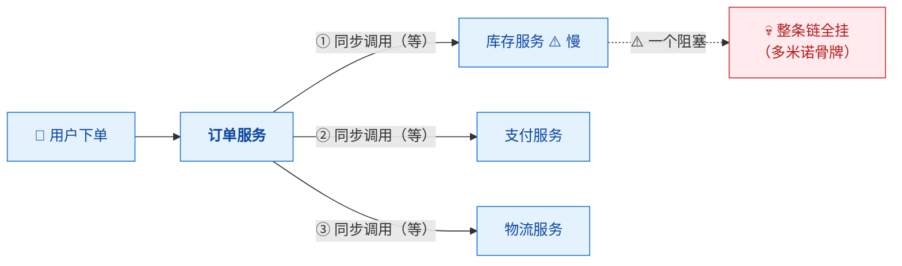

> [!important] ⭐ 病根与药方（视频原话）
> **"你需要的是把这个紧绷的同步链条打断。"**
>
> **同步链的两个死穴**：
> | 死穴 | 说明 |
> |---|---|
> | **耦合** | **任何一个下游慢/挂，上游一起挂**（级联故障） |
> | **响应时间 = 各环节之和** | **用户要等库存+支付+物流全部完成** |
>
> 👉 **这正是 [[高并发系统设计（详细整理版）]] §七讲的"级联故障"**——
> **MQ 是它的标准解法之一。**

### 0.2 药方：Kafka 把"同步链"打断

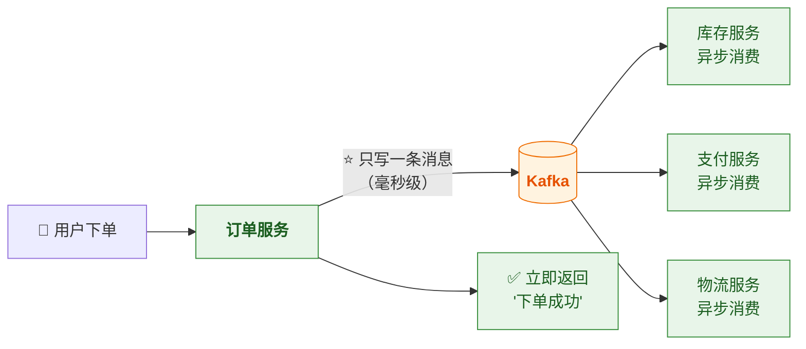

| | 同步调用 | ⭐ **经 Kafka 异步** |
|---|---|---|
| 响应时间 | **各环节之和**（数百 ms） | ⭐ **只等"写消息"**（毫秒级） |
| 下游挂了 | ⚠️ **上游一起挂** | ✅ **消息还在 Kafka，恢复后接着消费** |
| 峰值 | **直接压到下游** | ⭐ **Kafka 先接住，下游按能力消费** |

> [!success] ⭐ 这就是 Kafka 的三大价值（视频原话概括）
> **① 削峰填谷**（蓄水池）**② 解耦**（打断同步链）**③ 异步提速**（用户感觉快）
>
> ⚠️ **代价**：**异步 = 最终一致性**（详见 §五、§十）。

---

## 一、物流中心比喻：Kafka 的全景图

> 视频原话："**把 Kafka 想象成一个超级物流中心——
> 上游商家 Producer 只管把货卸到中心，不用管谁来取包裹；
> 消息在这里被自动分拣到不同的传送带 Partition 上，并行处理；
> 下游的配送员 Consumer 只用来中心取自己负责的传送带上的包裹。**"

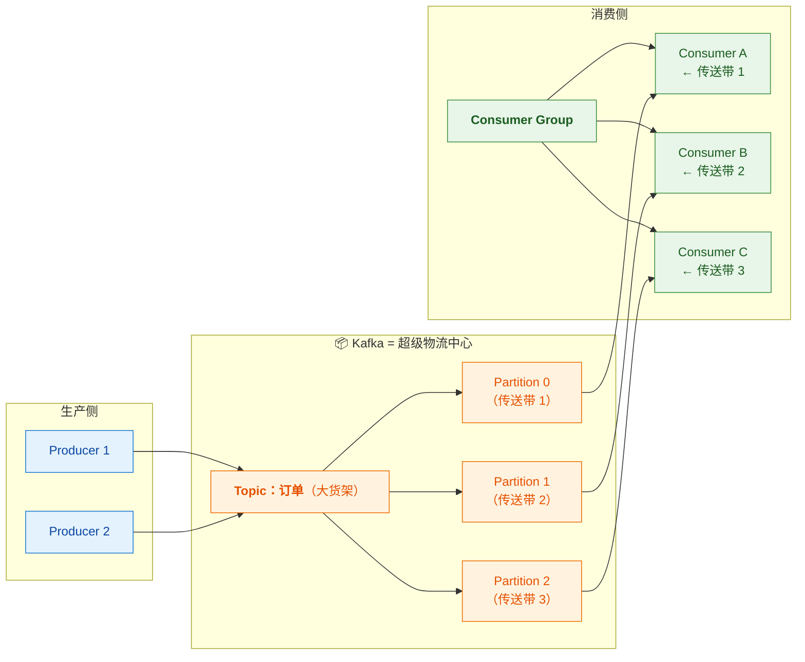

### 1.1 比喻 ↔ 真实概念对照表（全文反复回看）

| 比喻 | 真实概念 | 作用 |
|---|---|---|
| 商家卸货 | **Producer** | 生产消息，**不管谁来消费** |
| 物流中心 | **Kafka 集群（Broker）** | 存储 + 分拣 + 缓冲 |
| 大货架（分类） | **Topic** | **逻辑分类**（如"订单"） |
| ⭐ **传送带** | ⭐ **Partition** | **物理并行单位，高吞吐的核心** |
| 配送员 | **Consumer** | 拉取消息（⭐ **是"拉"不是"推"**） |
| 配送小组 | **Consumer Group** | 组内分摊分区 |
| 慢悠悠取也不影响上游 | ⭐ **解耦 + 削峰** | 上下游速率解耦 |

> [!important] ⭐ 一个比喻里藏着的关键设计：**"拉"模型**
> **"配送员只用来中心取"**——**是 Consumer 主动拉取（pull），不是 Kafka 推送（push）**。
>
> **为什么这很重要**：
> - **Consumer 按自己的能力拉** → **天然不会被压垮**（削峰的底层机制）
> - **Push 模式**（如某些 MQ）要考虑"推多快"，**Pull 把节奏控制权交给消费端**
>
> 👉 **"慢悠悠取也不影响上游继续卸货"这句话，技术本质就是 pull 模型 + 日志保留。**

---

## 二、⭐ Topic 与 Partition：高吞吐的核心秘密

> 视频原话："**Partition 就是 Kafka 实现高吞吐的核心秘密。
> 一个 Topic 就像一个大货架，分成多个 Partition，
> 就相当于开了好几条并行的传送带。**"

### 2.1 Topic 与 Partition 的关系

| 概念 | 是什么 | 数量关系 |
|---|---|---|
| **Topic** | **逻辑分类**（如 order、log、click） | 一 Topic 多 Partition |
| ⭐ **Partition** | **物理上的有序日志（追加写）** | ⭐ **并行度的基本单位** |

> [!important] ⭐⭐ Partition 为什么是"核心秘密"
> **因为"并行 + 顺序"在这里统一了：**
> 1. **每个 Partition 是一个独立追加日志** → **可以独立被一个消费者处理** → **并行**
> 2. **分区内消息严格有序**（追加写，offset 递增） → **顺序性**
>
> **Kafka 的顺序保证是"分区内有序"**，**不是全局有序**——
> **这是最重要的一条边界**（见下）。

### 2.2 ⭐⭐ 消息怎么决定去哪个分区：key 哈希取模

> 视频原话："**你发的消息，通过 key 的哈希取模会固定落到某一条上。**"

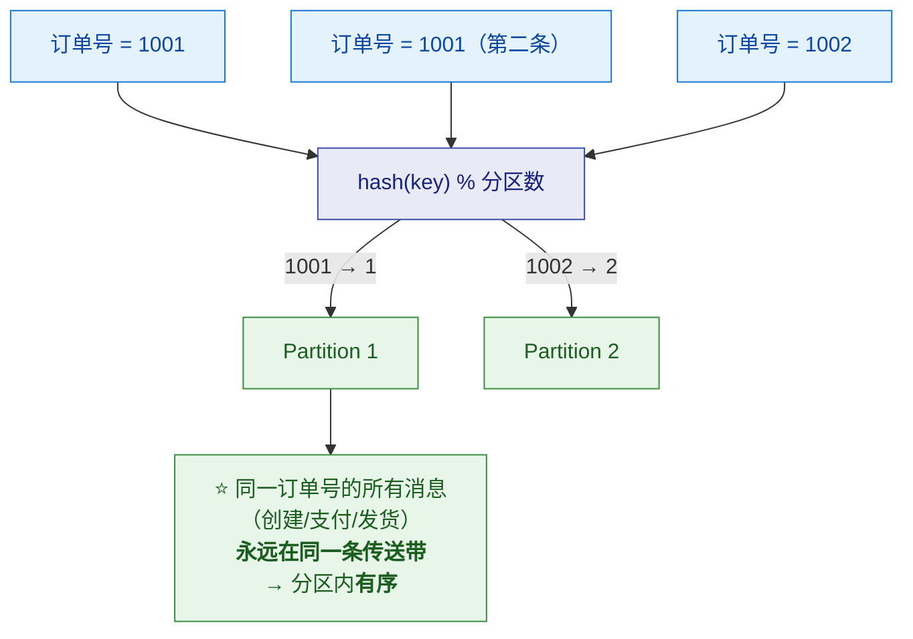

> [!important] ⭐⭐ 这条规则直接指导工程实践
> **"想让什么有序，就拿什么做 key。"**
>
> | 需求 | key 选什么 |
> |---|---|
> | **同一订单的状态流转有序** | ⭐ **`order_id`** |
> | **同一用户的行为有序** | ⭐ **`user_id`** |
> | **同一账户的余额变更有序** | ⭐ **`account_id`** |
>
> ⚠️ **反过来，随手用 `UUID` 做 key = 顺序性全无**（每次都散到不同分区）。
>
> 👉 **这与 [[50万QPS实时推荐 延迟从小时压到毫秒（详细整理版）]] §三完全一致**：
> **"Kafka 分区键应与下游 Flink 的 keyBy 字段一致"**——
> **因为分区聚集是分组聚合的前提。**

> [!note] 补充两个边界（视频没讲，但要知道）
> **① key 为 null 时**：**不会哈希取模**——老版本轮询，**2.4+ 用"粘性分区"**（攒一批换一个，提高批量效率）。
> **② 分区数变化会打破映射**：**`hash % n` 的 n 变了，同 key 的后续消息可能落到新分区**——
> **所以"按 key 保序"的业务要谨慎扩分区**（见 §八最佳实践第 4 条）。

### 2.3 ⭐ Consumer Group：负载均衡

> 视频原话："**多个消费者可以组成一个消费者组，组内每个消费者负责一个或多个 Partition，互不重复，这就是负载均衡。**"

| 规则 | 说明 |
|---|---|
| ⭐ **组内互不重复** | **一个 Partition 同一时刻只被组内一个 Consumer 消费** |
| **组间广播** | **不同 Group 各自消费全量**（如"实时计算组"和"入湖组"都要全量数据） |
| ⭐ **消费者数 ≤ 分区数** | **多出来的消费者会空闲**（没分区可分） |

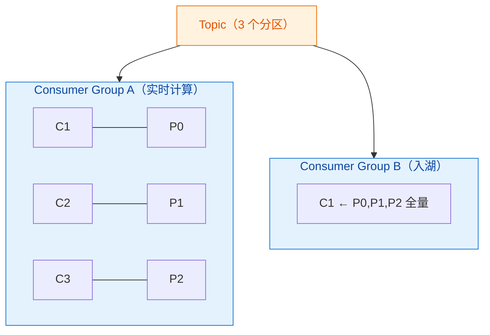

> [!tip] ⭐ 分区数与消费者数的三种情况（必懂）
> | 情况 | 结果 |
> |---|---|
> | **消费者 < 分区数** | ✅ 正常，有人多分几个分区 |
> | **消费者 = 分区数** | ⭐ **最理想，一人一条传送带**（视频原话） |
> | **消费者 > 分区数** | ⚠️ **多的人闲置**（白花资源） |
>
> 👉 **这就是 [[50万QPS实时推荐 延迟从小时压到毫秒（详细整理版）]] "分区:消费者 = 1:1 或 1:2" 的原因**——
> **分区数是消费并行度的硬上限。**
> **详见 [[4-消费者与Rebalance]]。**

### 2.4 ⭐ Rebalance：挂了怎么办

> 视频原话："**如果一个消费者挂了呢？Kafka 会立刻触发重平衡，
> 把挂掉的那个人负责的 Partition 自动转交给组里还活着的成员。
> 虽然这个过程会有短暂的消费停顿，但保证了服务的连续性。**"

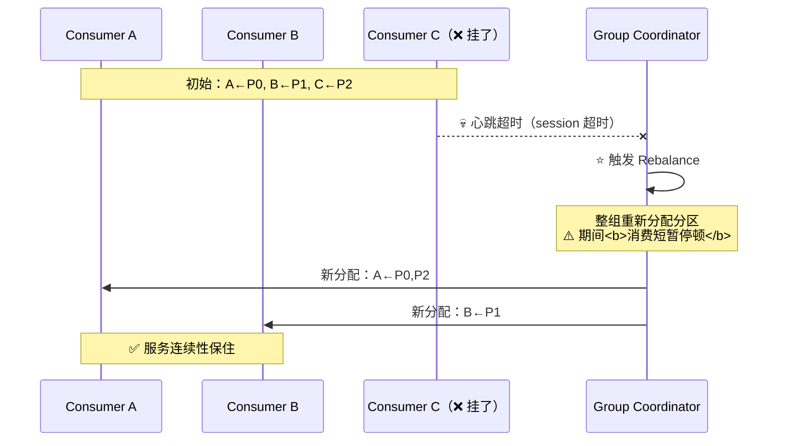

> [!important] ⭐ Rebalance 的两面
> | 好 | 坏 |
> |---|---|
> | ✅ **高可用的来源**（挂了自动接手） | ⚠️ **Rebalance 期间整组停顿（stop-the-world）** |
> | | ⚠️ **频繁 Rebalance 会反复停顿**（常见于"处理太慢被踢出组"） |
>
> 👉 **Rebalance 的触发条件、分区分配策略（Range/RoundRobin/Sticky/Cooperative）、
> "max.poll.interval.ms 超时被踢"这个高频坑，详见 [[4-消费者与Rebalance]]。**

---

## 三、Kafka 的三大经典用途

> 视频原话依次讲了三个：**削峰填谷、日志收集、流处理。**

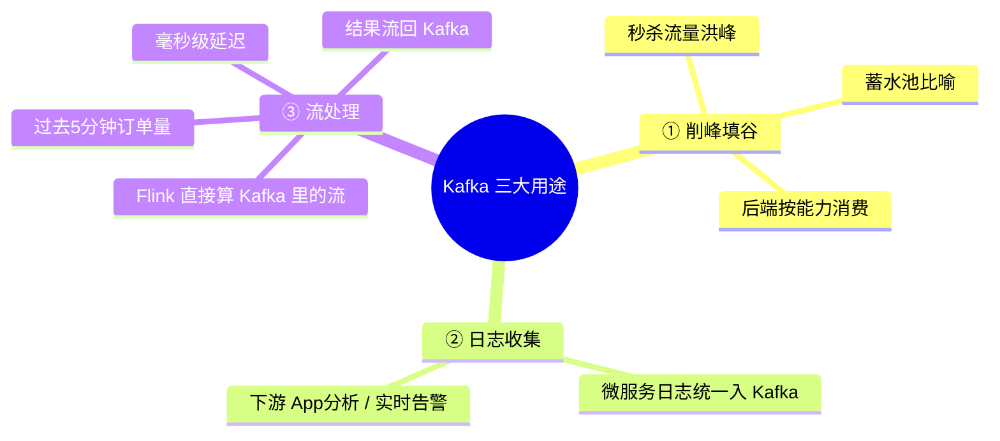

### 3.1 ① 削峰填谷（最经典）

> 视频原话："**秒杀瞬间的流量洪峰，后端服务根本扛不住。
> Kafka 就像一个巨大的蓄水池——把洪水先接住，
> 然后按后端能处理的速度慢慢地稳稳地放出去。**"

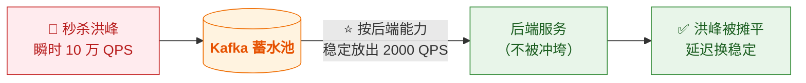

> [!warning] ⚠️ 蓄水池不是无限的
> **生产持续 > 消费持续 → 消息堆积 → 最终磁盘满。**
> **所以必须监控 Consumer Lag（§七）并告警。**
> **详见 [[高并发系统设计（详细整理版）]] §十"MQ 三件套"。**

### 3.2 ③ 流处理（与本库 Flink 系列衔接）

> 视频原话："**数据在 Kafka 里流动的时候，就可以被像 Flink 这样的引擎实时计算——
> 比如不用等一天结束，现在就算出过去 5 分钟的订单量，结果再流回 Kafka，整个过程毫秒级延迟。**"

> [!note] 这就是"Kafka + Flink"黄金组合
> **Kafka 是"流数据的存储与分发层"，Flink 是"流的计算层"。**
> **完整落地案例见 [[50万QPS实时推荐 延迟从小时压到毫秒（详细整理版）]]（推荐链路）、
> [[Kafka消息入Hive方案]]（入仓链路）。**
> **Flink 侧机制见 [[5-bigdata/0-flink/0-Flink总览|Flink 系列]]。**

---

## 四、⭐⭐ 消息丢失：只可能发生在三个地方

> 视频原话："**Kafka 不背这个锅。消息丢失只可能发生在三个地方：
> 第一，你自己生产的时候没等确认（acks=0）；
> 第二，你存副本的机器在数据同步完之前全挂了；
> 第三，你消费的时候还没处理完就把 offset 交了。
> 每一个都是配置和使用不当的坑。**"

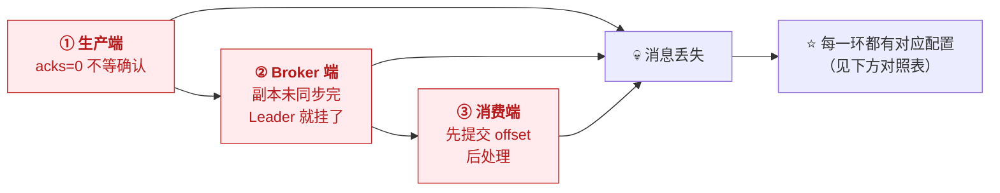

### 4.1 ① 生产端：acks 的三种语义（必背）

| acks | 含义 | 性能 | 丢失风险 |
|---|---|---|---|
| ⚠️ **`acks=0`** | **发出去就算成功，不等确认** | ⭐ **最快** | ❌ **网络抖动/Leader 挂即丢** |
| **`acks=1`** | **Leader 写入自己就确认** | 中 | ⚠️ **Leader 确认后、Follower 同步前挂了 → 丢** |
| ⭐ **`acks=all`** | **ISR 全部同步完才确认** | 慢 | ✅ **（配合 `min.insync.replicas`）基本不丢** |

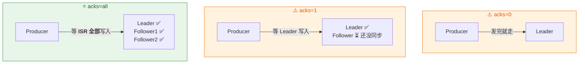

### 4.2 ② Broker 端：副本同步与两个参数

> 视频原话："**你存副本的机器在数据同步完之前全挂了。"**

> [!important] ⭐ 精确化这句话（视频是简化说法）
> **真正的丢失路径是**：
> **Producer 收到了 `acks=all` 的确认 → Leader 挂了 →
> 新 Leader 由"落后的 Follower"顶上（unclean 选举）→ 已确认的数据不在新 Leader 上 → 丢。**
>
> **两个关键参数一起防住它：**
>
> | 参数 | 作用 |
> |---|---|
> | ⭐ **`min.insync.replicas=2`** | **ISR 数量不足 2 时，拒绝写入**（宁可不可写，不可丢数据） |
> | ⭐ **`unclean.leader.election.enable=false`** | ⭐ **禁止"落后的副本"当 Leader**（默认 false，**千万别开**） |
>
> 👉 **"acks=all 只在 ISR ≥ min.insync.replicas 时生效"**——
> **如果 ISR 只剩 Leader 自己，`acks=all` 退化成 `acks=1`**——
> **这是"以为配了 all 就安全"的最大陷阱。**

### 4.3 ③ 消费端：offset 提交时机（最常见的坑）

> 视频原话："**你消费的时候还没处理完就把 offset 交了。"**

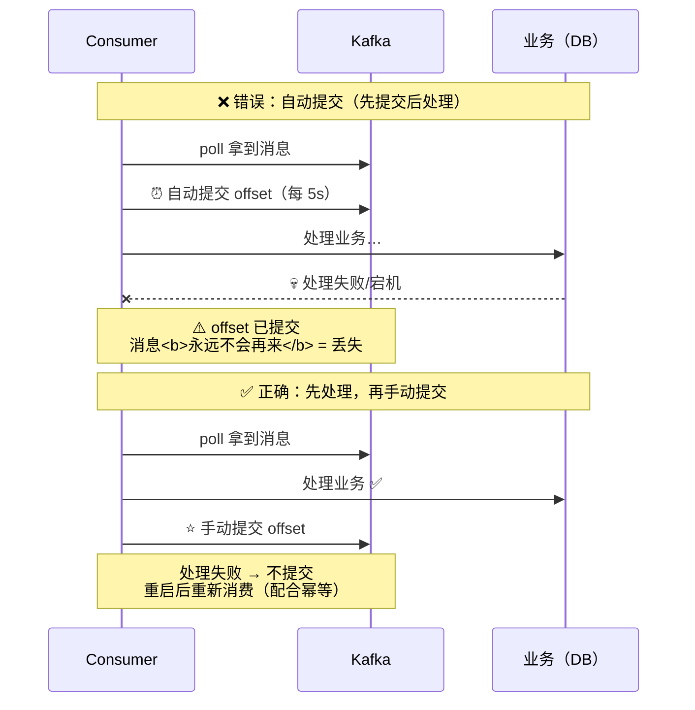

| 配置 | 行为 | 后果 |
|---|---|---|
| ⚠️ **`enable.auto.commit=true`** | **定时自动提交**（默认 5s） | **先提交后处理 → 可能丢** |
| ⭐ **`enable.auto.commit=false` + 手动提交** | **业务成功后才提交** | **不丢，但可能重复**（见 §五） |

> [!success] ⭐⭐ 一个必须想通的权衡
> **"先提交后处理"会丢消息；"先处理后提交"会重复消费。**
> **两害相权：⚠️ 丢失不可接受（业务损失），重复可以用幂等消灭。**
>
> 👉 **所以标准姿势是：⭐ "先处理后提交 + 业务幂等"**——
> **这就是视频最佳实践第 2 条的全部逻辑。**

---

## 五、⭐ 重复消费与 Exactly-Once

> 视频原话："**解决重复消费，从生产端就该做起——开启 Kafka 的幂等，
> Producer 每条消息都会带上唯一标识，Broker 会记住这个 id，重复的消息就直接扔掉。
> ……Consumer 端你自己业务上也得保证幂等，比如用数据库唯一键去重。
> 双重保险，才能真正做到 Exactly-Once。**"

### 5.1 为什么会重复

| 重复来源 | 说明 |
|---|---|
| **Producer 重试** | **网络超时 → Producer 重发 → Broker 其实已收到 → 重复** |
| ⭐ **Rebalance 重消费** | **已处理但 offset 未提交 → 分区转给别人 → 从旧 offset 再来一遍** |
| **消费者重启** | 同上（从上次提交的 offset 开始） |

### 5.2 ⭐ 生产端幂等（Idempotent Producer）

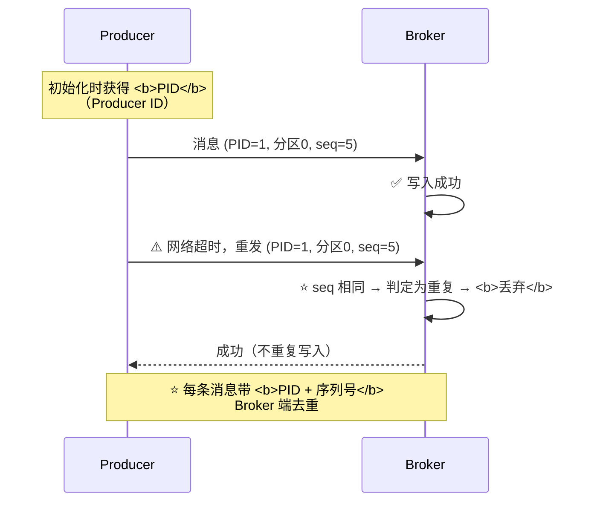

> [!important] ⭐⭐ 生产端幂等的两个边界（视频没讲，必须知道）
> | 边界 | 含义 |
> |---|---|
> | ⚠️ **只保证"单分区"** | **PID+序列号是按分区的**——跨分区不保证 |
> | ⚠️ **只保证"单会话"** | **Producer 重启后拿到新 PID** → **旧会话的重试无法去重** |
>
> 👉 **所以要"跨会话、跨分区"的 Exactly-Once，需要"事务"（`transactional.id`）**——
> **详见 [[6-事务与Exactly-Once]]。**
>
> **配置**：`enable.idempotence=true`（**3.0+ 默认开启**），
> 且要求 `acks=all`、`retries > 0`、`max.in.flight.requests.per.connection ≤ 5`。

### 5.3 ⭐⭐ 消费端幂等：业务层的"双重保险"

> 视频原话："**Consumer 端你自己业务上也得保证幂等，比如用数据库唯一键去重。**"

| 方案 | 做法 |
|---|---|
| ⭐ **数据库唯一索引** | **消息携带业务唯一 ID（订单号）→ 插入冲突即跳过** |
| **去重表** | **处理前先 `INSERT` 消息 ID，冲突说明处理过** |
| **状态机** | **只允许合法状态流转**（重复请求落在非法流转上被拒） |
| **Redis SETNX 标记** | 处理前抢标记（⚠️ 有过期与一致性考量） |

### 5.4 ⭐⭐ Exactly-Once 的"公式"

> 视频原话："**双重保险，才能真正做到 Exactly-Once。"**

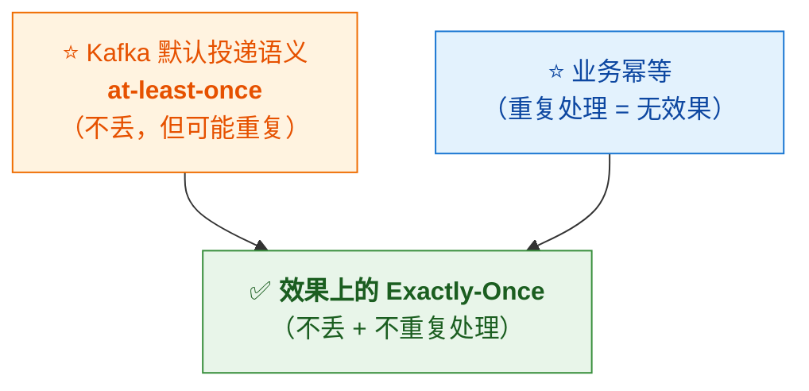

> [!important] ⭐⭐ 一个必须澄清的概念
> **"at-least-once + 业务幂等 = 效果上的 exactly-once"**——
> **这里幂等做在"业务侧"，与 Kafka 内部的"事务型 Exactly-Once"是两回事**：
>
> | | **效果上的 EOS（本篇）** | **Kafka 事务 EOS** |
> |---|---|---|
> | 机制 | **业务幂等** | **Producer 事务（transactional.id）** |
> | 范围 | **任何下游**（DB/ES/任意系统） | ⚠️ **主要覆盖 Kafka 内部**（读-处理-写） |
> | 复杂度 | ⭐ **低，通用** | 高 |
>
> 👉 **生产上"业务幂等"是必修课，事务是选修**——
> **深入见 [[6-事务与Exactly-Once]]。**

---

## 六、⭐ 高可用：多副本机制

> 视频原话："**Kafka 集群的高可用靠的就是多副本机制——
> 每个分区的数据都有一个 Leader 和多个 Follower 备份，
> Leader 负责读写，Follower 只负责同步。**"

### 6.1 Leader / Follower / ISR

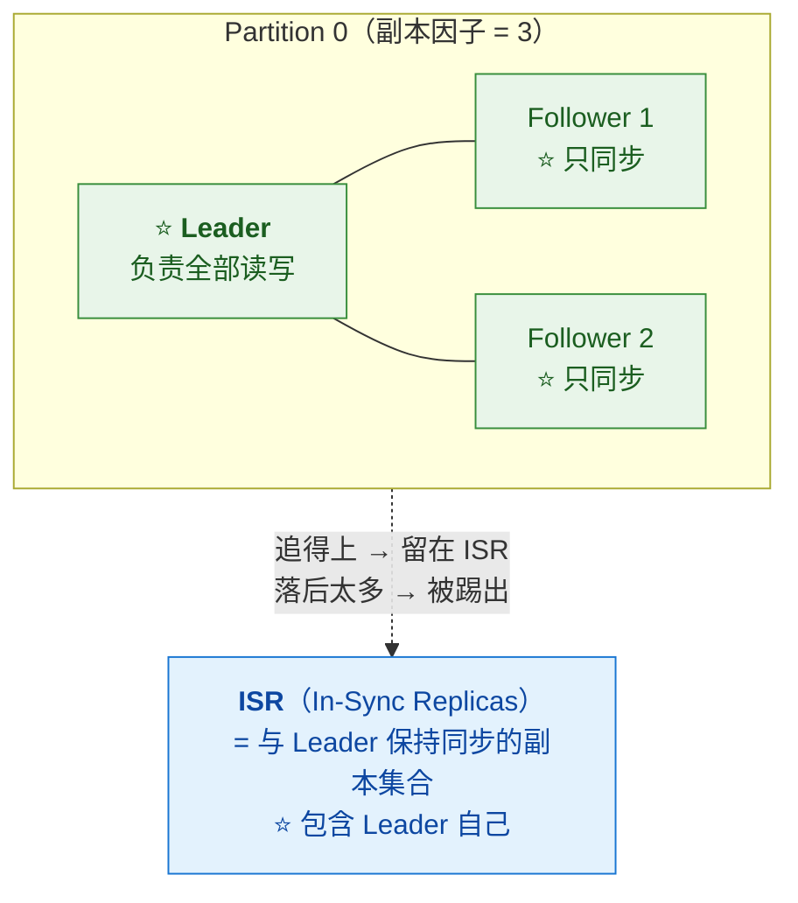

| 概念 | 说明 |
|---|---|
| **Leader** | **每个分区只有一个**，**处理全部读写** |
| **Follower** | **只同步，不服务读写**（默认） |
| ⭐ **ISR** | **"跟得上"的副本集合**（含 Leader）；**落后的会被踢出，追上再回来** |
| **副本因子（RF）** | **总副本数**（生产建议 **≥ 3**） |

### 6.2 ⭐ Leader 挂了：故障转移

> 视频原话："**Leader 这台机器要是挂了呢？看挂了吧——
> 但只要 ISR 里还有活着的 Follower，Kafka 的 Controller 就会在几秒内
> 把它提拔成新 Leader，你的客户端会自动重连，服务中断时间极短，
> 这叫优雅的故障转移。**"

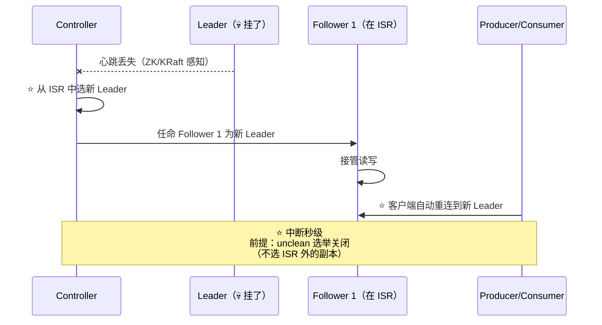

> [!important] ⭐ 故障转移的两个前提（呼应 §4.2）
> **① `unclean.leader.election.enable=false`**——**只在 ISR 里选**（宁可不可用，不可丢数据）。
> **② `min.insync.replicas` 满足**——**ISR 被打穿时宁可拒绝写入**。
>
> 👉 **可用性与一致性在这里正面冲突，Kafka 把选择权交给你（默认偏一致）**——
> **"CAP 的取舍不是抽象概念，就是这两个参数"**。
> **深入见 [[5-日志存储与副本机制]]。**

---

## 七、⭐ 监控：死盯 Consumer Lag

> 视频原话："**监控就是你的眼睛。其中最关键的指标叫 Consumer Lag——
> 就是生产者已经写入、但消费者还没处理的消息量。
> 一旦它开始起飞，就说明消费速度跟不上生产速度了，
> 消息在大量积压，你的业务延迟正在急剧增加。**"

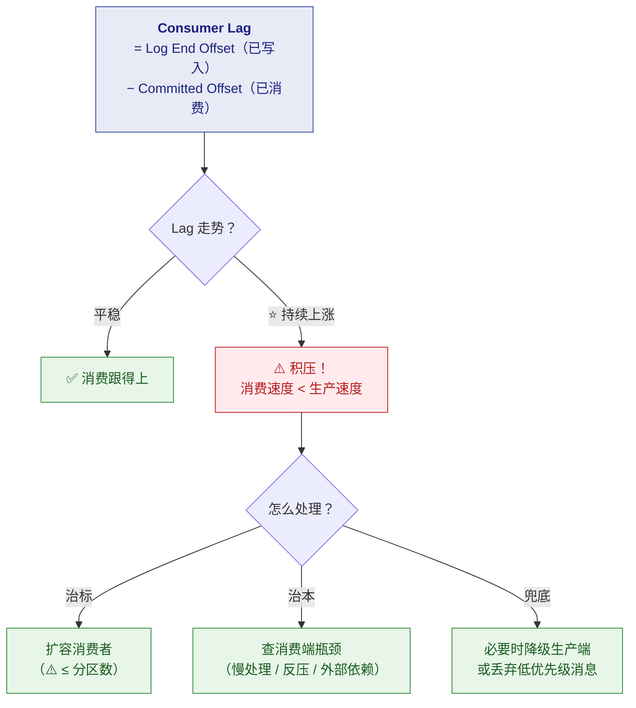

> [!important] ⭐ 为什么 Lag 是"最重要的一个指标"
> **因为它是"业务延迟的直接代理"**——
> **Lag = 消息等了多久才被处理**。
> **QPS/RT 再健康，Lag 起飞 = 用户拿到的数据是旧的。**
>
> 👉 **监控要点**：**按"消费组 × 分区"维度监控 + 阈值告警 + 趋势告警（持续上涨比瞬时值更危险）**。
> **详见 [[7-运维与集群调优]]、[[高并发系统设计（详细整理版）]] §八"MQ 三件套"。**

---

## 八、⭐⭐ 最佳实践五条（视频原话 Checklist）

> 视频原话："**最后记住这几条，保你平安的最佳实践。**"

| ✅ | # | 实践 | 对应本篇 |
|---|---|---|---|
| [ ] | 1 | ⭐ **Producer：`acks=all` + 开启幂等** | §四、§五 |
| [ ] | 2 | ⭐ **Consumer：先处理业务，再手动提交 offset + 业务幂等** | §4.3、§5.3 |
| [ ] | 3 | ⭐ **Broker：副本因子 ≥ 3，`min.insync.replicas` ≥ 2** | §四、§六 |
| [ ] | 4 | **集群：避免分区倾斜，扩容务必限速** | —— |
| [ ] | 5 | ⭐ **监控：死盯 Consumer Lag** | §七 |

> [!tip] 第 4 条展开（视频一句带过，两个点值得说清）
> **① 分区倾斜**：**如果 key 分布不均（少数热点 key 占大头），对应分区流量畸高** →
> **该消费者成为瓶颈，其余闲置**。**缓解**：业务允许时给 key 加盐打散（⚠️ 代价：破坏该 key 顺序性）。
> **② 扩容限速**：**分区迁移（reassignment）会搬大量数据**——
> **不限速会打满集群带宽，把线上业务挤垮**。**用 `kafka-reassign-partitions.sh` 的 throttle 参数**。
>
> ⚠️ **另外记住 §2.2 的边界**：**扩分区会改变 `hash % n` 的映射**——
> **"按 key 保序"的业务要谨慎**。

> [!success] ⭐ 这五条与 [[高并发系统设计（详细整理版）]] "MQ 三件套"互相印证
> **监控堆积（= Lag）+ 幂等消费 + 死信队列**——
> **两份材料从不同角度得到了同一套结论，这种"交叉验证"最值得信。**

---

## 九、30 秒速查表

| 问题 | 一句话答案 |
|---|---|
| Kafka 解决什么 | ⭐ **打断同步调用链**：**削峰填谷 + 解耦 + 异步提速** |
| Topic vs Partition | **Topic 逻辑分类；Partition 物理并行单位（追加日志）** |
| ⭐⭐ Partition 为什么是核心 | **一个分区独立处理（并行）+ 分区内有序（顺序）** |
| ⭐ 消息怎么路由到分区 | **`hash(key) % 分区数`**；**key 为 null 轮询/粘性** |
| ⭐ 想要什么有序就怎么设计 | **"想让什么有序，就拿什么做 key"**（订单→order_id，用户→user_id） |
| Kafka 的顺序保证范围 | ⚠️ **只保证分区内有序，不保证全局** |
| Consumer Group 规则 | **组内一个分区只归一个消费者（负载均衡）；组间各自全量（广播）** |
| 消费者数 > 分区数 | ⚠️ **多出来的闲置**——分区数是并行度上限 |
| Rebalance 是什么 | **消费者变动时整组重新分配分区**；⚠️ **期间短暂停顿** |
| ⭐ 消息丢失只可能在哪三处 | **生产端（acks）→ Broker（副本同步）→ 消费端（先提交后处理）** |
| `acks` 三种语义 | **0（不等）** / **1（Leader 写入）** / ⭐ **all（ISR 全部）** |
| ⚠️ `acks=all` 的陷阱 | **ISR 只剩 Leader 时退化成 acks=1** → **必须配 `min.insync.replicas`** |
| 消费端怎么不丢 | ⭐ **`enable.auto.commit=false`，先处理成功再手动提交** |
| ⚠️ "先处理后提交"的代价 | **会重复消费** → **靠业务幂等消灭** |
| 生产端幂等机制 | ⭐ **PID + 分区内序列号**，Broker 对重复 seq 丢弃 |
| ⚠️ 生产端幂等的边界 | **只保证单分区 + 单会话**（重启 = 新 PID） |
| ⭐⭐ Exactly-Once 的公式 | **at-least-once（默认）+ 业务幂等 = 效果上的 EOS** |
| 高可用靠什么 | ⭐ **多副本（Leader 读写 + Follower 同步）+ ISR + Controller 选举** |
| ISR 是什么 | **"跟得上"的副本集合（含 Leader）；落后的被踢出** |
| ⚠️ 为什么不能开 unclean 选举 | **会选落后的副本当 Leader → 已确认数据丢失** |
| ⭐ 最关键的监控指标 | **Consumer Lag**（= 已写入 − 已消费），**起飞 = 积压** |
| ⭐ 生产五条最佳实践 | **acks=all+幂等 / 先处理后提交+幂等 / RF≥3+ISR≥2 / 防倾斜+扩容限速 / 盯 Lag** |
| 消费模型是推还是拉 | ⭐ **Pull**——消费端按能力拉取，这是"不被压垮"的底层机制 |

---

## 十、学习检查清单

- [ ] ⭐ 能画出**同步调用雪崩 → MQ 解耦**的前后对比
- [ ] ⭐ 能用**物流中心比喻**对出 Kafka 全部核心概念（含"拉模型"）
- [ ] ⭐⭐ 能说清 **Partition 为什么同时解决"并行"和"顺序"**
- [ ] ⭐⭐ 能说出**"想让什么有序就拿什么做 key"**并举三个例子
- [ ] ⚠️ 能说出**顺序保证只到分区**、**key 为 null 的行为**、**扩分区破坏映射**三个边界
- [ ] ⭐ 能说清 **Consumer Group 的组内互斥与组间广播**
- [ ] ⭐ 能画出 **Rebalance 流程**并说出它的代价（stop-the-world）
- [ ] ⭐ 能说出 Kafka 的**三大用途**（削峰/日志/流处理）
- [ ] ⭐⭐ 能背出**消息丢失三环节**及每一环的对应配置
- [ ] ⭐ 能背出 **acks 三种语义**及各自的丢失风险
- [ ] ⚠️ 能说清 **`acks=all` 退化陷阱**（ISR 打穿）与 `min.insync.replicas` 的配合
- [ ] ⭐ 能说清**消费端 offset 提交时机**的权衡（丢 vs 重复）
- [ ] ⭐ 能说出**重复消费的三个来源**
- [ ] ⭐ 能讲清**生产端幂等机制**（PID+序列号）及其**两个边界**
- [ ] ⭐⭐ 能写出 **Exactly-Once 公式**（at-least-once + 业务幂等）
- [ ] ⭐ 能画出 **Leader/Follower/ISR** 结构与故障转移流程
- [ ] ⚠️ 能说清 **unclean 选举与可用性/一致性的取舍**
- [ ] ⭐ 能解释 **Consumer Lag 的定义**，以及它为什么是最重要指标
- [ ] ⭐ 能背出**五条最佳实践**，并展开第 4 条（倾斜 + 限速）

---

## 附录 A：语音转写（ASR）勘误对照

> 原稿是语音转写，错误较多。**阅读原始字幕稿时对照此表。**

| 原稿（错） | 正确 | 位置 |
|---|---|---|
| ⭐ **密等**（×3） | ⭐ **幂等** | 03:16、03:35、03:41 等处 |
| ⭐ **X等于零** | ⭐ **acks=0** | 03:03"没等确认，acks=0" |
| ⭐ **X等于O加密等** | ⭐ **acks=all + 幂等** | 04:35 最佳实践第 1 条 |
| **KAKA / 卡夫卡 / 咔咔** | **Kafka** | 全文多处 |
| **刘处理** | **流处理** | 02:34 |
| **i is2 / i is 2** | ⭐ **ISR** | 03:58"只要 ISR 里还有活着的 follower" |
| **CONTROLER** | ⭐ **Controller** | 04:01 |
| **consumer la** | ⭐ **Consumer Lag** | 04:13 |
| **分裂又聚合** | —— | —— |
| **这个分裂又聚合的是什么** | —— | （本稿无此句，属另一视频记忆混淆，忽略） |
| **把挂掉的那个人负责的partition。** | **……负责的 Partition 自动转交** | 01:52（句子被切分） |
| **看挂了吧** | **会挂** | 03:57（"leader 挂了呢？——会挂"） |
| **这是卡夫卡最经典的用途** | **这是 Kafka 最经典的用途** | 02:02 |
| **做app分析** | **做 App 分析** | 02:28 |
| **kickoff** | —— | —— |
| **保你平安的最佳实践** | （原文正确） | 04:33 |
| **扩容务必限速** | （原文正确） | 04:51 |

> [!note] 本稿 ASR 质量说明
> **与前几篇（高并发/实时推荐）相比，本稿技术词错误集中在"幂等 / acks / ISR / Lag"四个词**，
> **而概念逻辑本身基本正确**——**属于"好文档的底子 + 差转写的皮"**。
> **最有价值的勘误是"X"→"acks"**：**不修的话最佳实践第 1 条完全读不通。**

---

## 附录 B：本篇没展开、但面试会追问的（索引）

| 追问 | 去哪看 |
|---|---|
| **Rebalance 的触发条件与分配策略（Range/Sticky/Cooperative）** | [[4-消费者与Rebalance]] |
| **Producer 分区器、批量、压缩、重试细节** | [[3-生产者原理]] |
| **ISR 收缩/扩张机制、HW/LEO、日志分段与索引** | [[5-日志存储与副本机制]] |
| **Kafka 事务、read_committed、consume-transform-produce** | [[6-事务与Exactly-Once]] |
| **为什么 Kafka 吞吐高（顺序写/零拷贝/批量/页缓存）** | [[8-性能优化与高吞吐原理]] |
| **Kafka 与 RocketMQ/RabbitMQ 选型对比** | [[1-Kafka总览]] |
| **Kafka 在实时数仓/入湖里的工程实践** | [[Kafka消息入Hive方案]]、[[Kafka入湖标准流程与方案选型]] |

---

> 关联：[[高并发系统设计（详细整理版）]]（MQ 在高并发架构中的位置）·
> [[50万QPS实时推荐 延迟从小时压到毫秒（详细整理版）]]（分区实战与 Lag 监控）·
> [[5-bigdata/0-flink/0-Flink总览|Flink 系列]]（流处理下游）
> 原始字幕稿：[[0-一次了解 Kafka]]
