# 📦 Kafka 温习一下（详细整理版 · 入门直觉篇）

> 本篇是对 [B 站视频《Kafka 温习一下》](https://www.bilibili.com/video/BV1DTR1B2Edp/)（约 14 分钟）的**逐段深度整理**：视频用"**快递分拣中心**"这一个比喻串起了 Kafka 的全部核心概念，非常适合**建立第一层直觉**。
> 本篇定位：**入门直觉篇**——负责"比喻 ↔ 真实概念"的映射与全景图；**源码级细节**（RecordAccumulator、HW/LEO、Rebalance 协议、事务协调器）由深度系列 [[1-Kafka总览]] 负责，每节都标了对应的深读笔记。
> 原始字幕稿：[[Kafka 温习一下]]（这份字幕里 **Kafka 被识别成 "cf cat / calf cat / KFCAT"** 20 余处，见 [附录 A](#附录-a语音转写asr勘误对照)）。配套：[[0-概念脑图.excalidraw]]。

---

## 〇、入门地图

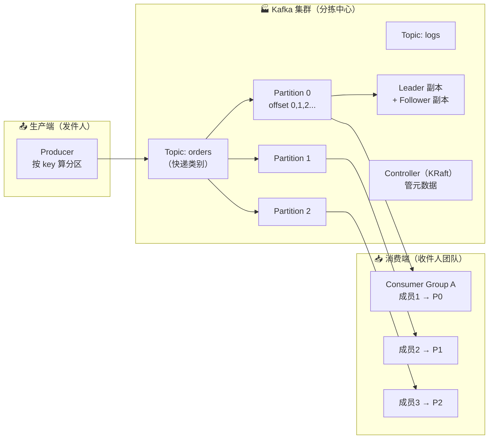

### 视频时间轴

| 时间 | 主题 | 本篇章节 |
| --- | --- | --- |
| 00:00 | 消息队列是什么（快递分拣中心） | [一](#一为什么需要消息队列快递分拣中心) |
| 00:53 | Topic 与 Partition | [二](#二topic-与-partition类别与传送带) |
| 02:06 | 消息结构（一张快递单） | [三](#三消息结构一张快递单) |
| 03:20 | Producer / Consumer / Consumer Group | [四](#四producer--consumer--consumer-group) |
| 05:04 | 副本机制与 ISR | [五](#五副本机制数据保险箱) |
| 06:34 | ZooKeeper → KRaft | [六](#六集群指挥中心zookeeper--kraft) |
| 07:53 | 日志保留与压缩、Segment | [七](#七消息保留与清理保质期与压缩) |
| 09:07 | 为什么这么快 | [八](#八为什么这么快四大杀手锏) |
| 10:29 | 四大常见问题 | [九](#九常见问题与解决四大坑) |
| 12:02 | 实战：发一条 Hello Kafka | [十](#十实战发一条-hello-kafka) |
| 13:11 | 全链路总结与下一步 | [十一](#十一全链路总结与下一步) |

### 比喻 ↔ 真实概念对照（全文反复回看）

| 快递分拣中心 | Kafka 概念 | 深读笔记 |
| --- | --- | --- |
| 分拣中心 | **Broker 集群** | [[2-架构与核心概念]] |
| 快递类别（订单/日志/行为） | **Topic** | [[2-架构与核心概念]] |
| 类别下的多条传送带 | **Partition（分区）** | [[2-架构与核心概念]] |
| 快递单上的收件人姓名 | **消息 key** | [[3-生产者原理]] |
| 包裹内容 | **消息 value** | [[3-生产者原理]] |
| 包裹上的唯一编号 | **offset（位移）** | [[4-消费者与Rebalance]] |
| 书签（读到第几条） | **消费者位移提交** | [[4-消费者与Rebalance]] |
| 发件人 / 收件人 | **Producer / Consumer** | [[3-生产者原理]]、[[4-消费者与Rebalance]] |
| 快递团队分工 | **Consumer Group** | [[4-消费者与Rebalance]] |
| 保险箱里的多份备份 | **Replica（副本）+ ISR** | [[5-日志存储与副本机制]] |
| 调度室 / 指挥中心 | **Controller（旧：ZooKeeper）** | [[2-架构与核心概念]] |
| 车厢 | **Segment** | [[5-日志存储与副本机制]] |

---

## 一、为什么需要消息队列：快递分拣中心

> 视频对话："当有很多包裹（消息）需要发送时，如果让**发件人直接找收件人**，那场面得多混乱；所以消息队列就像一个**中间站**——发件人把包裹放到分拣中心，收件人**按自己的节奏来取**，大家互不干扰，井然有序。"

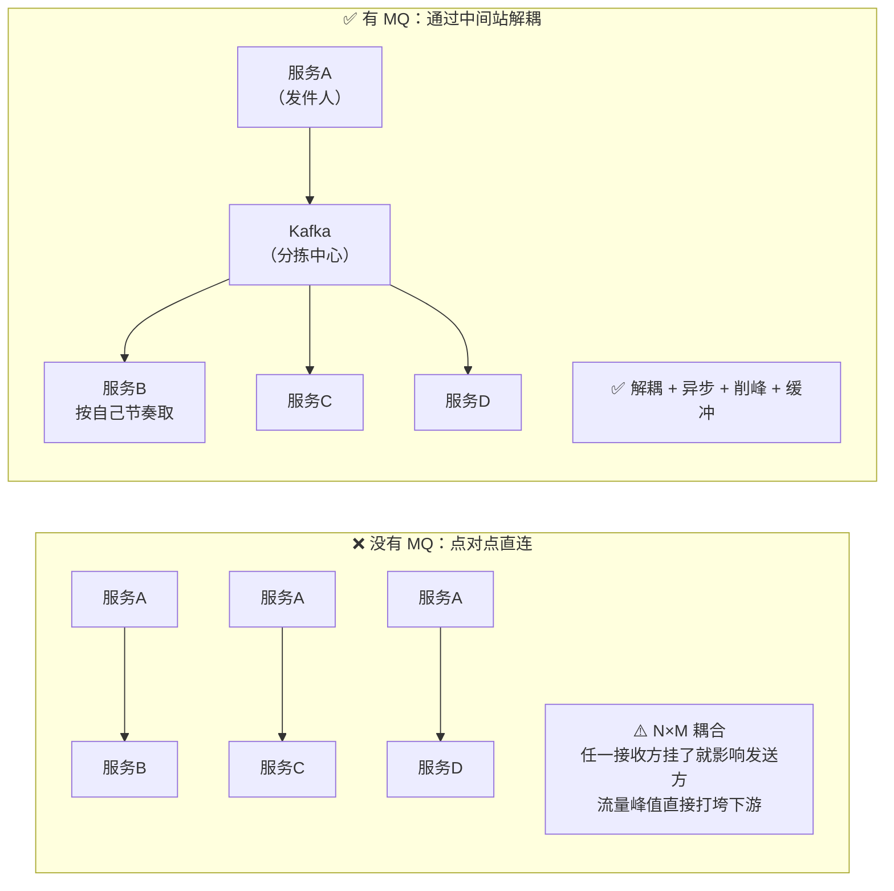

| MQ 的四大价值 | 说明 |
| --- | --- |
| **解耦** | 生产者不需要知道有哪些消费者、有几个消费者 |
| **异步** | 生产者发完就走，不必等下游处理完 |
| **削峰填谷** | 流量高峰先堆在 MQ，下游按自己的能力慢慢消费 |
| **缓冲/重放** | 消息留存一段时间，消费者可以按 offset 重放 |

> [!important] Kafka 的准确定位
> 视频说"Kafka 是 Apache 开源的**分布式流处理平台**，本质上是一个**超高性能的消息分拣中心**"——这句很关键。
> Kafka 官方定位是 **分布式、分区、多副本的提交日志（Commit Log）**，所以它同时是：**① 消息系统 ② 存储系统 ③ 流处理平台**（配合 Kafka Streams）。详见 [[2-架构与核心概念]]。

---

## 二、Topic 与 Partition：类别与传送带

> 视频对话："彩色区域叫 **Topic**，可以理解为**快递类别**（蓝色=订单、绿色=日志、橙色=用户行为）；每个区域里的多条传送带是 **Partition（分区）**——就是 Topic 下面的子传送带。"

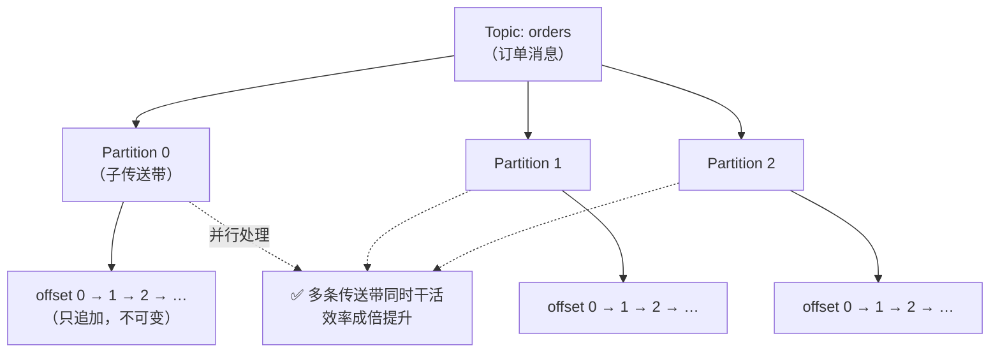

| 概念 | 说明 |
| --- | --- |
| **Topic** | 逻辑上的消息分类（一个业务/一类消息一个 Topic） |
| **Partition** | Topic 的**物理分片**，是**并行、存储、顺序**的基本单位 |
| ⭐ 为什么分区 | **如果所有订单都挤在一条传送带上会堵死**；分成多条**并行处理**，吞吐直接翻倍 |
| 分区内有序 | 每个 Partition 内部按 offset **严格有序**；**Topic 全局无序** |

### 分区策略：包裹怎么决定进哪条传送带

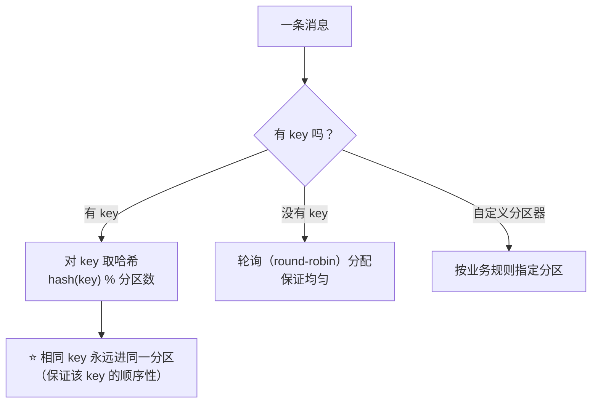

> [!warning] 分区数不是越多越好
> 视频原话："分区越多并行处理能力越强，**但也不是越多越好——分区太多会增加管理开销**，一般根据**实际业务量和消费者数量**来定。"
> **补充**（深度系列）：分区数还会影响**文件句柄数**（每个分区一组 segment 文件）、**Rebalance 耗时**（分区越多重分配越慢）、**端到端延迟**（攒批时间）以及**故障恢复时间**。详见 [[2-架构与核心概念]]。

深读：[[2-架构与核心概念]]（分区数规划）、[[3-生产者原理]]（DefaultPartitioner 与自定义分区器）。

---

## 三、消息结构：一张快递单

> 视频对话："每个消息就像一张**快递单**，包含几个关键字段……还有一个很大的数字，那是 **offset，消息的身份证号**。"

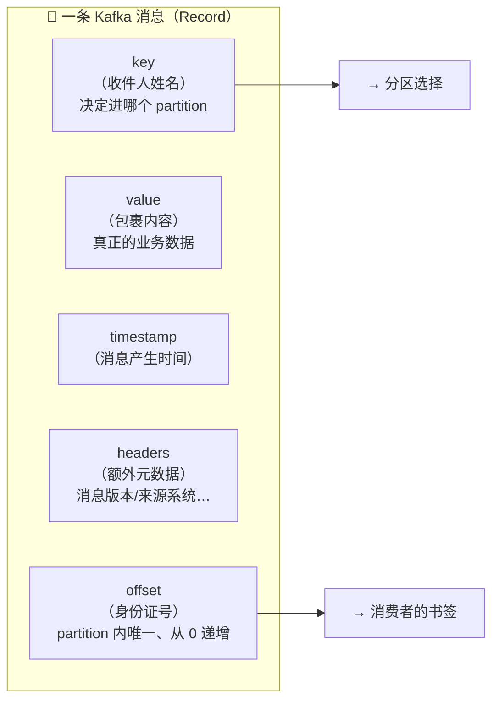

| 字段 | 含义 | 关键作用 |
| --- | --- | --- |
| **key** | 消息的"路由键" | ⭐ **决定消息进入哪个 partition**（相同 key → 相同分区 → 分区内有序） |
| **value** | 实际业务数据 | 如订单消息里的订单 JSON |
| **timestamp** | 消息产生时间 | 用于日志保留（按时间清理）、流处理的时间语义 |
| **headers** | 附加元数据 | 消息版本、来源系统、链路追踪 ID 等（不参与分区） |
| **offset** | ⭐ **分区内的唯一编号**，从 0 开始递增 | **消费者就是通过 offset 记录自己读到哪了** |

> [!important] "书签"这个比喻是理解消费模型的关键
> 消费者说"我已经读到第 100 条了，下次从 101 开始读"——**offset 是消费者自己维护的进度**。
> 所以即使消费者挂了重启，只要位移提交过，就能**接着上次的位置继续读，不会丢数据**。
> **补充**：offset 只在**分区内**唯一（不同分区的 offset 互不相干）；现代版本里消费者位移提交到内部 Topic **`__consumer_offsets`**（老版本存 ZooKeeper）。详见 [[4-消费者与Rebalance]]。

---

## 四、Producer / Consumer / Consumer Group

> 视频对话："发消息的叫 **Producer**，收消息的叫 **Consumer**。一个 Consumer 能读多个 Partition 吗？——**可以，但反过来不行：一个 Partition 同一时间只能被一个 Consumer 读**。"

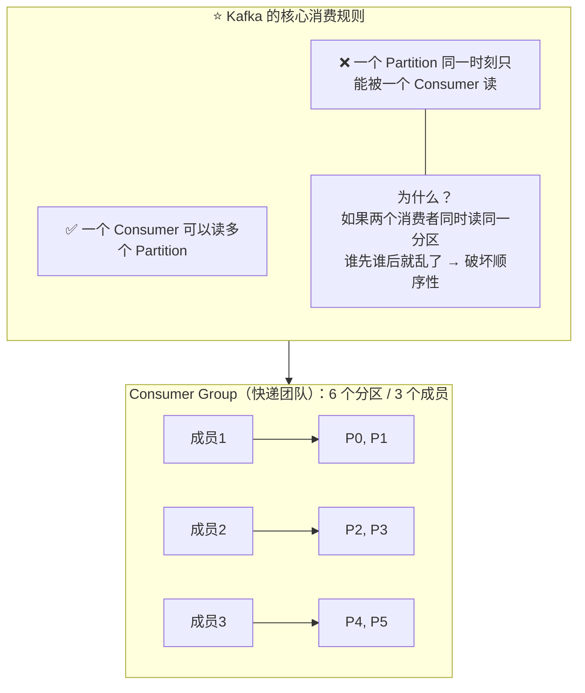

| 角色 | 职责 | 比喻 |
| --- | --- | --- |
| **Producer** | 把消息发送到指定 Topic（按 key 选分区） | 发件人 |
| **Consumer** | 从 Topic 的 Partition 里读取消息 | 收件人 |
| **Broker** | 存储消息、对外提供读写服务 | 分拣中心的货架 |
| **Consumer Group** | 多个消费者**分工合作**，共同消费一个 Topic | 快递团队 |

### Rebalance（再均衡）

> 视频对话："消息量大了，再加成员，**Partition 会自动重新分配**——这个重新分配叫 **Rebalance**。就是当 Consumer **加入或退出**时，Kafka 自动重新分配 Partition，**保证负载均衡**。"

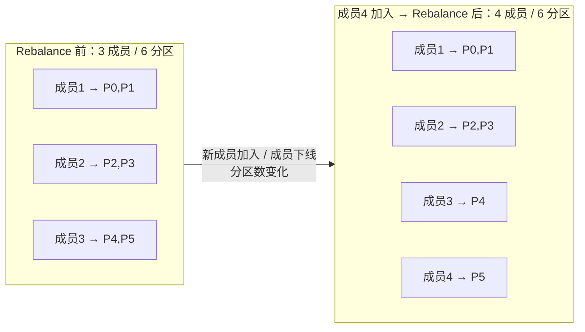

| 要点 | 说明 |
| --- | --- |
| 触发条件 | 成员**加入/退出**、订阅的 Topic 变化、**分区数变化** |
| 作用 | 自动重新分配分区，**保证负载均衡** |
| ⚠️ 代价 | Rebalance 期间**消费会暂停**（Stop-The-World），分区越多耗时越长 |
| 重要推论 | **消费者数量 > 分区数时，多出来的消费者会空闲**（没分区可分） |
| 好的实践 | 用 `CooperativeStickyAssignor`（增量式再均衡），并设置 `group.instance.id` 静态成员减少抖动 |

深读：[[4-消费者与Rebalance]]（Rebalance 协议、三种分配策略、Lag 监控）。

---

## 五、副本机制：数据保险箱

> 视频对话："Kafka 可是出了名的**数据保险箱**——每个 Partition 的消息都有**多个副本**，分别存在**不同的 Broker** 上。副本分 **leader 和 follower**：leader 负责读写，follower 从 leader 同步数据。"

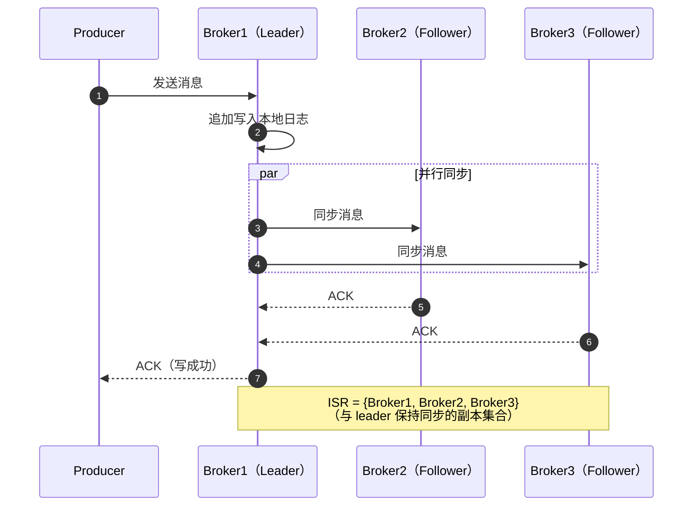

### 5.1 Leader 挂了怎么办：ISR 决定谁接班

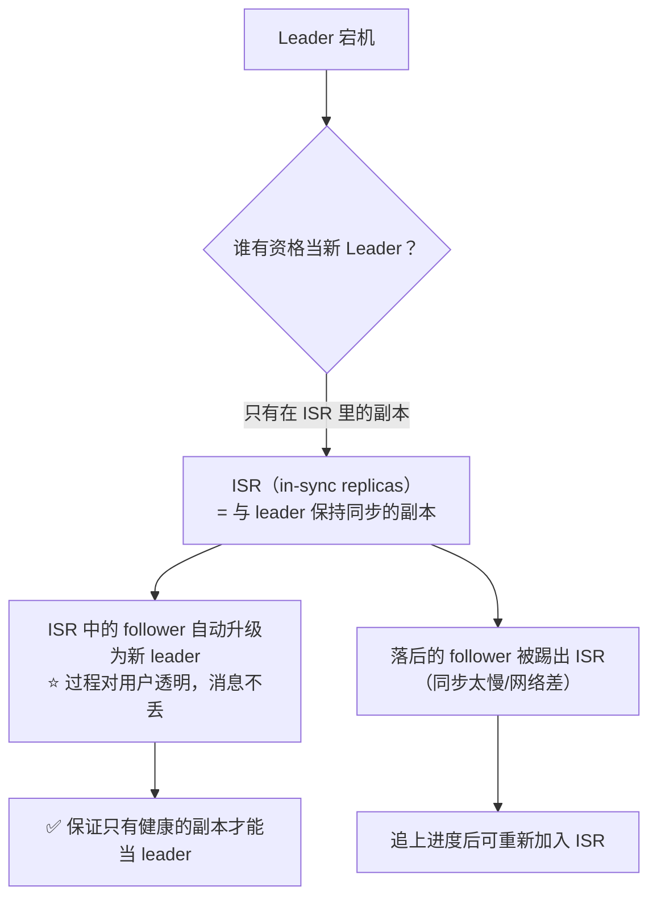

| 概念 | 说明 |
| --- | --- |
| **Replica（副本）** | 每个 Partition 有多个副本，分散在**不同 Broker**（故障隔离） |
| **Leader** | **唯一负责读写的副本**（生产者和消费者都只跟它交互） |
| **Follower** | 只负责**从 leader 同步**，不对外提供读写 |
| ⭐ **ISR** | **in-sync replicas**：与 leader 数据保持同步的副本集合——**只有 ISR 里的副本才能当选新 leader** |
| 进/出 ISR | follower 落后太多（超过 `replica.lag.time.max.ms`，默认 30s）被**踢出**；**追上后再重新加入** |

> [!important] 为什么"只有 ISR 能当 leader"这么重要？
> 如果让一个**严重落后**的副本当 leader，就会**丢数据**（它没有那些消息）。
> Kafka 的默认策略是**宁可不可用，也不丢数据**（`unclean.leader.election.enable=false`）——这就把"数据不丢"和"高可用"的取舍显式化了。
> **补充概念**（深度系列）：**HW（高水位）**= 所有 ISR 都同步到的位置，**消费者只能读到 HW**；**LEO**=每个副本自己的日志末端。详见 [[5-日志存储与副本机制]]。

### 5.2 持久化：不是存在内存里

> 视频对话："Kafka **默认会把数据持久化到磁盘**，**不是存在内存里**——即使所有机器都重启，数据也不会丢。"

| 存储 | 说明 |
| --- | --- |
| 落盘 | 消息写入**磁盘日志文件**（顺序追加），不是驻留内存 |
| 为什么还快 | 靠**顺序写 + 页缓存 + 零拷贝**（见 [§八](#八为什么这么快四大杀手锏)）——"写磁盘"不等于"慢" |
| 持久化时长 | 由保留策略决定（默认 7 天，见 [§七](#七消息保留与清理保质期与压缩)） |

深读：[[5-日志存储与副本机制]]（HW/LEO/Leader Epoch、副本同步与故障恢复）。

---

## 六、集群指挥中心：ZooKeeper → KRaft

> 视频对话："Kafka 集群里那么多机器，**谁来管他们**？——这就需要指挥中心。"

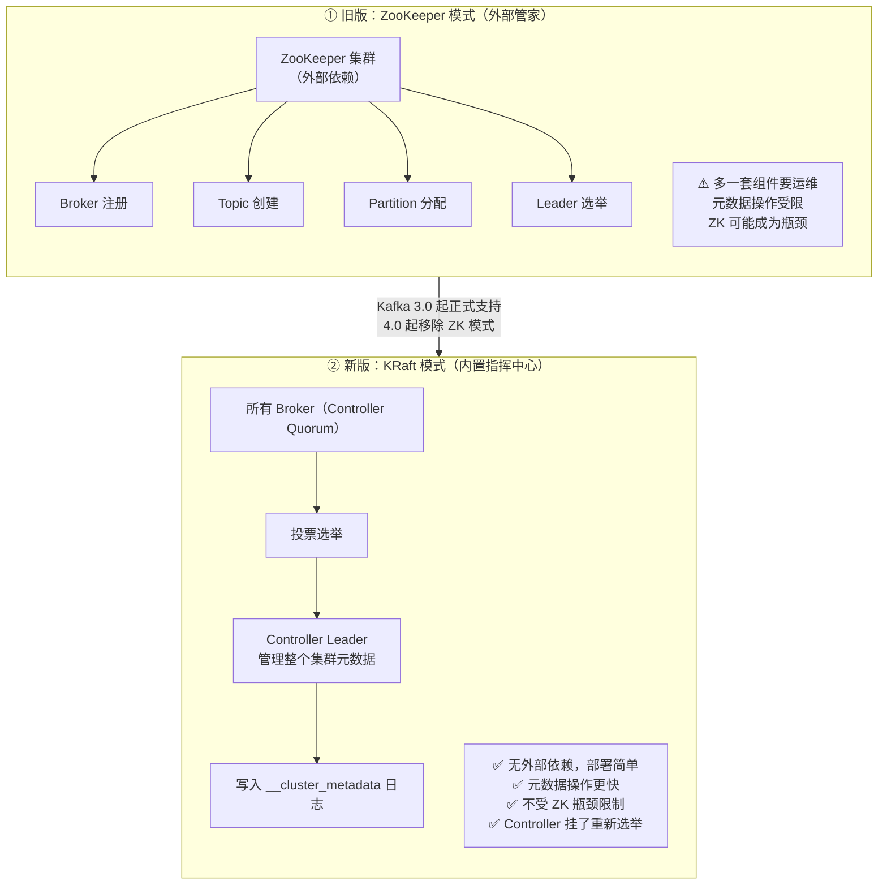

| 为什么去掉 ZooKeeper（视频给了三个理由） | 说明 |
| --- | --- |
| ① **减少依赖，部署更简单** | 不用再单独运维一套 ZK 集群 |
| ② **提高性能，元数据操作更快** | 元数据直接走 Kafka 自己的日志（`__cluster_metadata`） |
| ③ **避免 ZooKeeper 成为瓶颈** | 分区数/集群规模大时，ZK 的 watch 与写入压力是硬伤 |

| 对比 | ZooKeeper 模式 | **KRaft 模式** |
| --- | --- | --- |
| 元数据存储 | 外部 ZooKeeper | **内置 Controller Quorum 日志** |
| 选举 | ZK 选 Controller | **Broker 投票选出 Controller** |
| Controller 挂了 | 重新选举 | 重新选举 |
| 版本 | 旧版默认 | **3.0 正式支持；4.0 起 ZK 模式已移除** |

> [!note] 版本事实补充
> 视频说"**Kafka 3.0 之后正式支持 KRaft，新项目建议直接用 KRaft**"——完全正确。
> 再往前一步：**Kafka 4.0 已经彻底移除 ZooKeeper 模式**（KRaft 成为唯一选择），所以现在说"新项目用 KRaft"已经是默认答案，而不是可选项。详见 [[2-架构与核心概念]]。

---

## 七、消息保留与清理：保质期与压缩

> 视频对话："Kafka 里的消息**当然不会永远保存**——有日志保留策略，**就像食品的保质期**。"

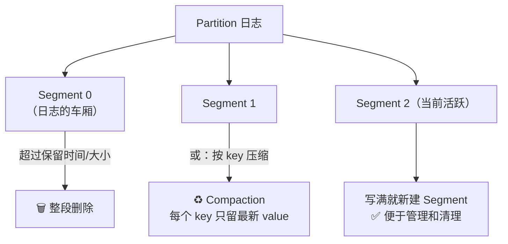

### 7.1 两种清理策略

| 策略 | 规则 | 适用场景 |
| --- | --- | --- |
| **delete（按时间/大小删除）** | 默认**保留 7 天**，超时自动删除；`retention.ms` 可改成 30 天/90 天甚至永久 | 普通消息流（日志、订单） |
| **compact（日志压缩）** | ⭐ **不按时间删除，而是按 key 保留最新版本** | 变更日志 / 状态存储 |

> 视频对话解释 compaction："比如你用 Kafka 存储**用户配置**：key 是**用户 id**，value 是**配置信息**——压缩策略会**保留每个用户的最新配置，旧配置自动删除**。这样既省空间，又不会丢最新数据。"

**两种策略可以组合**（`cleanup.policy=compact,delete`）——既按 key 保留最新，又限制最长保留时间。

### 7.2 Segment：日志的车厢

> 视频对话："segment 就是**日志的车厢**——每个 Partition 的日志被分成多个 segment，**文件满了就新建一个**，这样便于管理和清理。"

| 要点 | 说明 |
| --- | --- |
| 是什么 | Partition 的日志被切成多个**有序的文件段**（一个 `.log` + `.index` + `.timeindex`） |
| 何时新建 | 当前 segment 达到 `log.segment.bytes`（默认 1GB）或超过 `log.roll.ms` |
| 为什么要分段 | **删除和压缩的最小单位是 segment**（整段删除，不用改文件内部）；便于按时间/大小批量清理 |
| 相关索引 | 每个 segment 有**稀疏索引**（默认每 4KB 记一条），使得"按 offset 查找"不必全量扫描 |

深读：[[5-日志存储与副本机制]]（稀疏索引、Compaction 实现、`log.retention` 参数族）。

---

## 八、为什么这么快：四大杀手锏

> 视频对话："Kafka 高性能可不是吹的，它有**几个杀手锏**。"

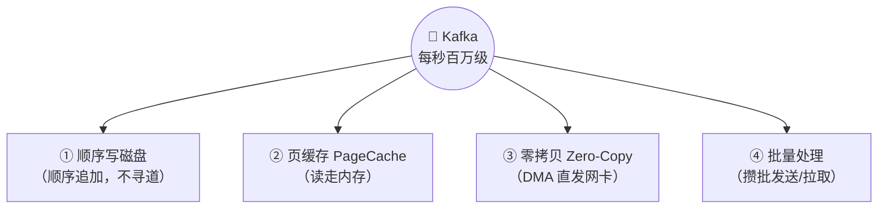

### 8.1 顺序写磁盘

> 视频对话："传统数据库是**随机写磁盘，磁头要来回跳**，效率很低；Kafka 是**顺序追加写**——就像在高速公路上直线行驶，速度飞快。"

### 8.2 页缓存（PageCache）

> 视频对话："读的时候用**页缓存 PageCache**，充分利用操作系统的缓存——**热点数据直接走内存，不走磁盘**。"

### 8.3 零拷贝（Zero-Copy）——终极武器

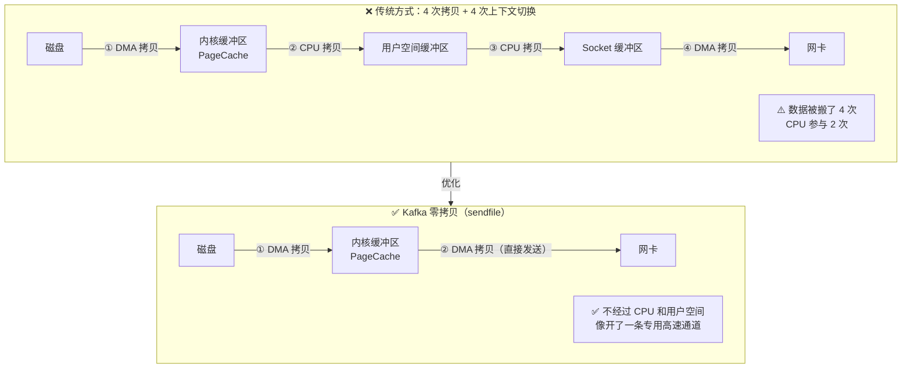

> 视频对话："零拷贝技术让数据**直接从 PageCache 通过 DMA 发送到网卡，根本不经过 CPU 和用户空间**——就像开了条专用高速通道。"

### 8.4 批量处理

> 视频对话："Producer 不是一条一条发，而是**攒一批一起发**；Consumer 也是**一批一批读**——减少网络往返，效率翻倍。"

| 杀手锏 | 一句话原理 |
| --- | --- |
| **顺序写** | 追加写避免磁盘寻道（顺序写甚至比随机写内存还快） |
| **PageCache** | 读写都优先走 OS 页缓存，热点数据零磁盘 IO |
| **零拷贝** | `sendfile` + DMA，数据不经 CPU/用户空间，省掉多次拷贝 |
| **批量** | 生产者攒批（`batch.size`/`linger.ms`）、消费者批量拉取，摊薄网络往返 |
| ➕ 补充 | **分区并行**（横向扩展）、**消息压缩**（省网络与磁盘）、**稀疏索引**（快速按 offset 定位） |

深读：[[8-性能优化与高吞吐原理]]（各参数的取舍与端到端调优清单）。

---

## 九、常见问题与解决：四大坑

> 视频对话："任何技术都不是完美的——我给你讲几个常见问题。"

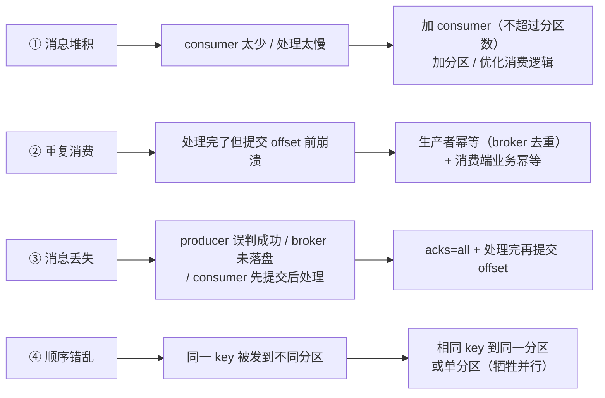

### 9.1 消息堆积

| 项 | 说明 |
| --- | --- |
| 现象 | "producer 发得太快，consumer 处理不过来，消息就堆积——**就像快递站爆仓**" |
| 解决 | ⭐ **加 consumer**（消费组里加机器，**Partition 重新分配**，处理能力直接提升） |
| ⚠️ 上限 | **消费者数不能超过分区数**（多出来的会空闲）；必要时先**扩分区** |
| 排查 | 看 **Lag**（消费延迟）指标，定位是"消费慢"还是"生产暴增" |

### 9.2 重复消费

| 项 | 说明 |
| --- | --- |
| 现象 | "consumer **处理完消息，但在提交 offset 前崩溃了**，重启后他会**重新消费**这条消息" |
| Kafka 的解法 | ⭐ **幂等生产者**：producer 开启后，**即使发送重复，broker 也会自动去重** |
| 消费端解法 | **业务幂等**（唯一键/去重表/状态机）——这才是根本，因为 at-least-once 下重复不可避免 |

### 9.3 消息丢失

> 视频原话："比如 producer 发消息没收到 **ACK** 就认为是成功了，结果 broker 没存下来；或者 consumer **先提交 offset 再处理消息**，处理失败消息就丢了。"

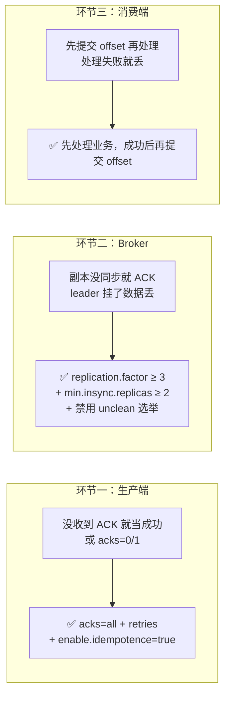

| 环节 | 丢数据的原因 | 解决 |
| --- | --- | --- |
| **生产端** | `acks=0/1`，broker 没落盘就返回成功 | **`acks=all`** + 重试 + 幂等 |
| **Broker** | 副本数不足、允许 unclean 选举 | `replication.factor≥3`、`min.insync.replicas≥2` |
| **消费端** | 先提交位移再处理业务 | ⭐ **处理完再提交 offset**（关闭自动提交） |

### 9.4 顺序错乱

| 项 | 说明 |
| --- | --- |
| 原因 | "如果**同一个 key 的消息发到不同 partition，顺序就乱了**" |
| 解决 | ⭐ **保证相同 key 的消息发到同一个 partition**（默认分区器就是按 key 哈希）；极端情况可**整个 Topic 只用一个 partition**（但放弃了并行） |

深读：[[10-面试高频题]]（不丢不重的标准答案）、[[6-事务与Exactly-Once]]（事务与 EOS）。

---

## 十、实战：发一条 Hello Kafka

> 视频演示："首先创建一个 topic，叫 **hello-topic**，**3 个 partition，副本因子 2**；然后启动 producer 发送消息 `Hello Kafka`；再启动 consumer 订阅——输出 `Hello Kafka`。"

### 10.1 命令行三连

```bash
# ① 创建 Topic：3 分区、2 副本
kafka-topics.sh --create \
  --topic hello-topic \
  --partitions 3 \
  --replication-factor 2 \
  --bootstrap-server localhost:9092

# ② 启动生产者，输入消息
kafka-console-producer.sh --topic hello-topic \
  --bootstrap-server localhost:9092
> Hello Kafka

# ③ 启动消费者，从头读
kafka-console-consumer.sh --topic hello-topic \
  --from-beginning \
  --bootstrap-server localhost:9092
Hello Kafka        # ← 收到了
```

### 10.2 Java 代码要点

> 视频对话："producer 要配置 **bootstrap.servers**；consumer 要配置 **group.id**，还要指定**反序列化器**。Java 里引入 **kafka-clients** 就行，producer 用 `KafkaProducer`，consumer 用 `KafkaConsumer`，**都是线程安全的**。"

```java
// ===== 生产者 =====
Properties props = new Properties();
props.put("bootstrap.servers", "localhost:9092");
props.put("key.serializer",   "org.apache.kafka.common.serialization.StringSerializer");
props.put("value.serializer", "org.apache.kafka.common.serialization.StringSerializer");
props.put("acks", "all");                  // ⭐ 不丢：等所有 ISR 确认
props.put("enable.idempotence", "true");   // ⭐ 不重：幂等生产者

try (Producer<String, String> producer = new KafkaProducer<>(props)) {
    // key = 收件人姓名（决定分区）；value = 包裹内容
    producer.send(new ProducerRecord<>("hello-topic", "user-1", "Hello Kafka"));
    producer.flush();
}

// ===== 消费者 =====
Properties cprops = new Properties();
cprops.put("bootstrap.servers", "localhost:9092");
cprops.put("group.id", "demo-group");      // ⭐ 消费组，决定分工
cprops.put("key.deserializer",   "org.apache.kafka.common.serialization.StringDeserializer");
cprops.put("value.deserializer", "org.apache.kafka.common.serialization.StringDeserializer");
cprops.put("enable.auto.commit", "false"); // ⭐ 手动提交：先处理再提交

try (Consumer<String, String> consumer = new KafkaConsumer<>(cprops)) {
    consumer.subscribe(List.of("hello-topic"));
    while (true) {
        ConsumerRecords<String, String> records = consumer.poll(Duration.ofMillis(500));
        for (ConsumerRecord<String, String> r : records) {
            System.out.printf("key=%s value=%s partition=%d offset=%d%n",
                    r.key(), r.value(), r.partition(), r.offset());
            // ……业务处理（幂等）……
        }
        consumer.commitSync();   // ⭐ 处理完成后才提交位移
    }
}
```

| 要点 | 说明 |
| --- | --- |
| Maven 依赖 | `org.apache.kafka:kafka-clients`（Spring 项目用 `spring-kafka`，见 [[9-SpringBoot实战]]） |
| `bootstrap.servers` | 只需给**部分** Broker 地址，客户端会自动发现整个集群 |
| `group.id` | ⭐ 决定消费组归属——**不同 group 可以各自独立消费同一 Topic 的全量消息** |
| 序列化器 | key/value 都要指定（生产端序列化、消费端反序列化） |
| 线程安全 | `KafkaProducer` / `KafkaConsumer` **都是线程安全的**；但消费者通常**一个线程一个实例** |

---

## 十一、全链路总结与下一步

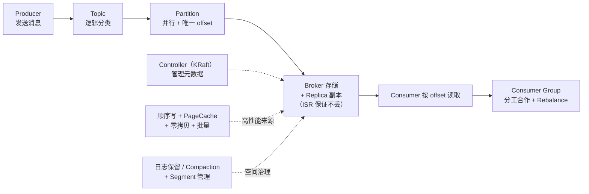

> 视频原话总结："**producer 发送消息到 topic → topic 被分成多个 partition 并行处理 → partition 里有唯一 offset → consumer 从 partition 读取 → 多个 consumer 组成 consumer group 分工合作 → 消息存在 broker 上，每个 partition 有多个 replica 保证不丢数据 → controller 管理集群元数据 → Kafka 通过顺序写、页缓存、零拷贝、批量处理实现高性能 → 还有日志保留和压缩策略管理。**"

### 11.1 下一步学什么（视频给的四个方向）

| 方向 | 说明 | 对应笔记 |
| --- | --- | --- |
| **Kafka Streams** | 用 Kafka 做实时流处理（无外部计算引擎） | — |
| **Kafka Connect** | 连接各种数据源（CDC、Sink/Source 连接器） | [[7-FlinkCDC与实时数仓]] |
| **监控与调优** | Prometheus + Grafana 监控集群（Lag、吞吐、ISR 变化） | [[7-运维与集群调优]] |
| **源码阅读** | 深入理解底层原理 | [[3-生产者原理]]、[[5-日志存储与副本机制]] |

### 11.2 三条阅读路径（衔接深度系列）

> [!tip] 按需选择
> **面试突击（1~2 天）**：[[10-面试高频题]] → [[2-架构与核心概念]] → [[8-性能优化与高吞吐原理]] → [[5-日志存储与副本机制]]
> **上手干活（1 周）**：[[2-架构与核心概念]] → [[9-SpringBoot实战]] → [[3-生产者原理]] → [[4-消费者与Rebalance]] → [[7-运维与集群调优]]
> **系统吃透（持续）**：本篇建立直觉后，从 [[1-Kafka总览]] 的 1→7 顺序精读。

---

## 附录 A：语音转写（ASR）勘误对照

原始字幕稿由 vCaptions 生成，最典型的是 **Kafka 被反复识别成"cf cat / calf cat / KFCAT"**：

| 原始转写 | 应为 |
| --- | --- |
| **cf cat / calf cat / KFCAT / cf cat0**（全文 20+ 处） | **Kafka** |
| ZOKEEPER / zoo keeper | **ZooKeeper** |
| craft 模式 | **KRaft 模式** |
| i s r in sync replicas / ISR | **ISR（in-sync replicas）** |
| 液缓存 / Page cash | 页缓存 **PageCache** |
| 零拷贝 / 0 拷贝 | **零拷贝（Zero-Copy / sendfile）** |
| 首先是 T 件 | 首先是 **key** 字段 |
| 没有 P 的话 | 没有 **key** 的话 |
| act 配置，X 等于 all | **acks 配置，`acks=all`** |
| 没收到 AK 就认为成功 | 没收到 **ACK** |
| ho topic / hello topic | **hello-topic** |
| boots Trap server | **`bootstrap.servers`** |
| group id | **`group.id`** |
| kafka clients | **`kafka-clients`** |
| REBALANCE 再均衡 | **Rebalance（再均衡）** |
| retention ms | **`retention.ms`** |
| 日志压缩 compaction | **Compaction（日志压缩）** |
| 旧配置自动删除 | **旧配置**自动删除 |
| 管理整个集群的原数据 | 管理整个集群的**元数据** |
| 监控用 prometheus graph anna | **Prometheus + Grafana** |
| kafka streams / kafka connect | **Kafka Streams / Kafka Connect** |
| 消费者就是通过 offset 记录自己读到哪了 | ✅ 正确 |
| Message Hello Kafka | 发送 **Hello Kafka** 消息 |

## 附录 B：30 秒速查

| 问题 | 一句话答案 |
| --- | --- |
| MQ 解决什么 | **解耦 + 异步 + 削峰 + 缓冲**（不再点对点直连） |
| Kafka 是什么 | 分布式、分区、多副本的**提交日志**；兼消息系统 / 存储系统 / 流处理平台 |
| Topic vs Partition | Topic 是逻辑分类；**Partition 是物理分片**，是并行/存储/顺序的基本单位 |
| 为什么要分区 | 一条传送带会堵死；**多条并行**才能横向扩展吞吐 |
| 分区怎么选 | 有 key → **hash(key) % 分区数**（相同 key 同分区）；无 key → 轮询 |
| 消息有什么 | key / value / timestamp / headers / **offset** |
| offset 是什么 | **分区内唯一编号**（从 0 递增），是消费者的"**书签**" |
| 消费规则 | **一个分区同一时刻只能被一个消费者读**；一个消费者可读多个分区（保顺序） |
| Consumer Group | 消费者分工合作；成员增减触发 **Rebalance**（期间 Stop-The-World） |
| 副本机制 | 每分区多副本分布在不同 Broker；**leader 读写、follower 同步**，leader 挂了自动切换 |
| ISR 是什么 | 与 leader 保持同步的副本集合；⭐ **只有 ISR 里的副本能当 leader**（防丢数据） |
| 数据存哪 | **磁盘**（顺序追加），不是内存；靠 PageCache + 零拷贝加速 |
| 谁管集群 | 旧版 **ZooKeeper**；新版 **KRaft**（内置 Controller，3.0 支持、**4.0 已移除 ZK 模式**） |
| 消息保留多久 | 默认 **7 天**（`retention.ms` 可改）；或用 **Compaction** 按 key 留最新 |
| Segment 是什么 | 日志的"**车厢**"：分区日志切成多个文件段，**便于删除与压缩** |
| 为什么快 | **顺序写 + PageCache + 零拷贝 + 批量**（+ 分区并行、压缩、稀疏索引） |
| 四大坑 | 堆积→加消费者/分区；重复→幂等；丢失→**acks=all + 先处理再提交**；乱序→相同 key 同分区 |
| 不丢的配置 | 生产端 `acks=all` + 幂等；Broker `replication.factor≥3` + `min.insync.replicas≥2`；消费端**处理完再提交位移** |
