# 🔥 Kafka 线上故障排查手册（详细整理版）

> 本篇是对 [B 站视频《Kafka 问题》](https://www.bilibili.com/video/BV1PLLA69Eit/)（约 5.5 分钟）的**逐段深度整理**。视频是一场"**618 大促上线半小时，系统疯了**"的事故复盘：**至少 7 个地方在着火**，按"症状 → 根因 → 修复 → 配置"一条条排掉。
> 本篇定位：**生产排查篇**——承接 [[Kafka 温习一下（详细整理版）]]（入门直觉），落地 [[1-Kafka总览]] 的深度原理，最后沉淀成一份**上线前检查清单**。
> 原始字幕稿：[[Kafka 问题]]（字幕里 Kafka 被称为 **"cf cat"**、大促被识别成 **"大醋缸"**，见 [附录 A](#附录-a语音转写asr勘误对照)）。

> [!danger] 事故起因（视频开场）
> **"我就改了个 `batch.size` 啊……"**
> —— 一个看似无害的参数改动，在 618 大促的高并发下引爆了 7 个问题。这篇的价值就在于：**让你知道每个参数背后的连锁反应**。

---

## 〇、事故全景：7 个着火点

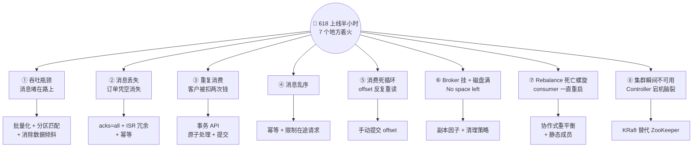

### 按"紧急度"排序的排查优先级

| 优先级 | 问题 | 为什么优先 |
| --- | --- | --- |
| 🔴 P0 | ② 消息丢失 | **数据不可恢复**，涉及资金 |
| 🔴 P0 | ③ 重复消费 | **资损**（客户被扣两次钱） |
| 🟠 P1 | ⑥ 磁盘满 / Broker 挂 | **集群级不可用** |
| 🟠 P1 | ⑧ Controller 宕机 | **全局不可用** |
| 🟡 P2 | ① 吞吐瓶颈 | 业务受影响但数据不丢 |
| 🟡 P2 | ⑦ Rebalance 死亡螺旋 | 消费能力骤降，恶性循环 |
| 🟢 P3 | ④ 乱序 / ⑤ 死循环 | 局部数据质量问题 |

> [!important] 视频的排查方法论
> **"一个个来，先从最紧急的开始"**——先止血（数据可靠性），再优化（吞吐），最后治理（稳定性）。
> **注意**：这些问题**互为因果**——数据倾斜既造成吞吐瓶颈（问题①），又造成磁盘热点（问题⑥）；Rebalance 既造成重复消费（问题③），又形成死亡螺旋（问题⑦）。所以下面的顺序是按"视频讲解顺序"排的，**真正排查时要先画因果链**。

---

## 一、问题①：吞吐瓶颈（消息堵在路上）

### 1.1 症状

> 视频对话："你的 producer **每秒扔 5000 条**消息进来，但 consumer **每秒只处理 200 条**——消息全堵在路上了，这不就是堵车吗？"

### 1.2 修复一：批量化双剑合璧

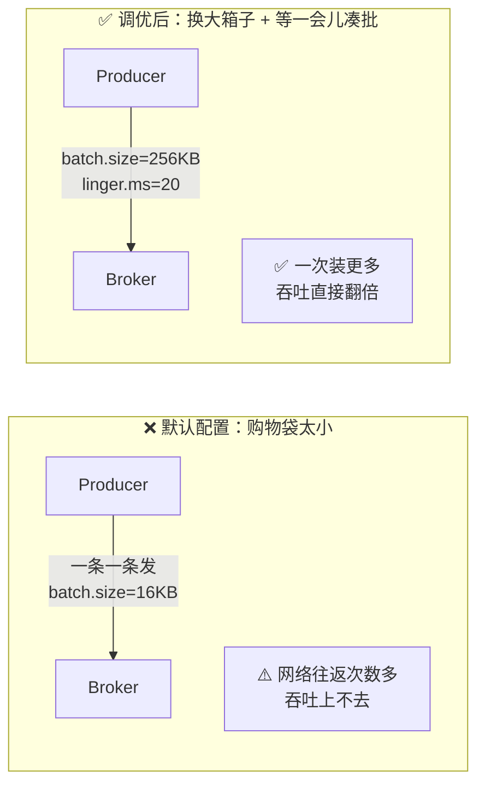

| 参数 | 默认值 | 调优值 | 比喻 / 原理 |
| --- | --- | --- | --- |
| **`batch.size`** | **16KB** | **256KB** | "搬家用购物袋装东西 → **换成大箱子**，一次装更多" |
| **`linger.ms`** | 0 | **20ms** | "**让他等 20ms 凑批**"——用一点点延迟换更大的批次 |
| `compression.type` | none | `lz4` / `zstd` | 批次压缩，省网络与磁盘（视频未提，配合 batch 效果更佳） |

> [!tip] batch.size 与 linger.ms 是"双剑合璧"
> - `batch.size` 决定**单批上限**（到了就发）；
> - `linger.ms` 决定**最多等多久**（哪怕没满也发）。
> 只调大 batch.size 而 linger.ms=0，消息往往**攒不满就被发走**了——两个要配合使用。

### 1.3 修复二：消费者数量要匹配分区数

> 视频对话："consumer 数量要跟 **partition 数匹配**——你**三个 partition 却只跑了一个 consumer** 啊！"

| 规则 | 说明 |
| --- | --- |
| 消费者数 ≤ 分区数 | 多出来的消费者**会空闲**（没分区可分） |
| 消费者数 = 分区数 | 每个消费者负责一个分区，**并行度最大** |
| 消费者数 > 分区数 | 浪费资源，**必须先扩分区** |

### 1.4 修复三：还是慢？查分区分布 → 数据倾斜

> 视频对话："我加了三个 consumer 了，怎么还是很慢？——**看一下 partition 分布**：数据倾斜了，**一个 partition 堵死，其他两个闲着**。"

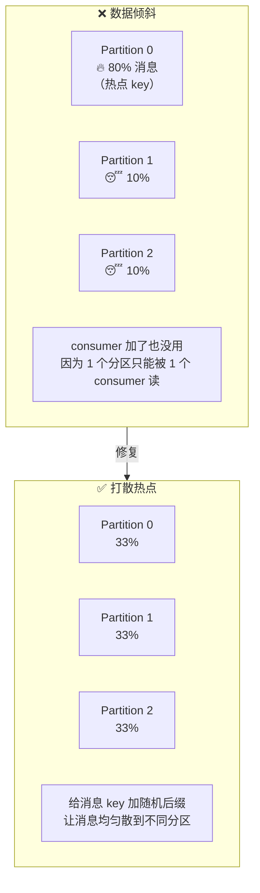

**修复动作**：**给消息 key 加随机后缀**（如 `order_123` → `order_123_7`），让 hash 结果均匀落到不同分区。

> [!warning] ⚠️ 视频没说的代价：加随机后缀会破坏"同一 key 的顺序性"
> 因为相同 key 加了不同后缀后**会落到不同分区**，而 Kafka **只保证分区内有序**。
> 所以这个方案**只适用于对顺序不敏感的 key**（如纯统计类、日志类）。
> **如果业务要求同一订单/同一用户的消息严格有序**，正确做法是：
> ① 优化 key 设计（换一个基数更大、分布更均匀的业务字段做 key）；
> ② 或"**两阶段聚合**"（先打散局部聚合，再按真实 key 全局聚合）；
> ③ 或接受倾斜（把该热点 key 单独走专用 Topic）。
> 这类取舍详见 [[3-生产者原理]]（分区器与顺序性）、[[8-性能优化与高吞吐原理]]。

### 1.5 修复四：`fetch.min.bytes` 让 broker"团购"

> 视频对话："`fetch.min.bytes` 默认 **1 字节**，改成 **64KB**——**让 broker 团购数据再返回**，就像搬家一次多搬几个箱子、少跑几趟。"

| 参数 | 默认值 | 调优值 | 作用 |
| --- | --- | --- | --- |
| **`fetch.min.bytes`** | **1** | **64KB** | broker 至少攒到这个量才返回，**减少拉取次数** |
| `fetch.max.wait.ms` | 500 | 500 | 配合上一项：最多等这么久（攒不够也得返回，避免延迟过大） |
| `max.partition.fetch.bytes` | 1MB | 按需 | 单分区每次最多返回多少 |
| `max.poll.records` | 500 | 按处理能力调 | 单次 `poll()` 最多返回多少条（防处理超时） |

### 1.6 连带问题：磁盘热点告警

> 视频对话："磁盘告警了，有一块盘使用率快 100% 了！—— **数据倾斜导致的热点问题**，给消息 key 加随机后缀，让消息均匀散到不同分区。"

**因果链**：数据倾斜 → 某个分区写入量巨大 → **该分区所在的 Broker 磁盘被打满** → 触发问题⑥（`No space left on device`）。

### 1.7 吞吐问题排查决策树

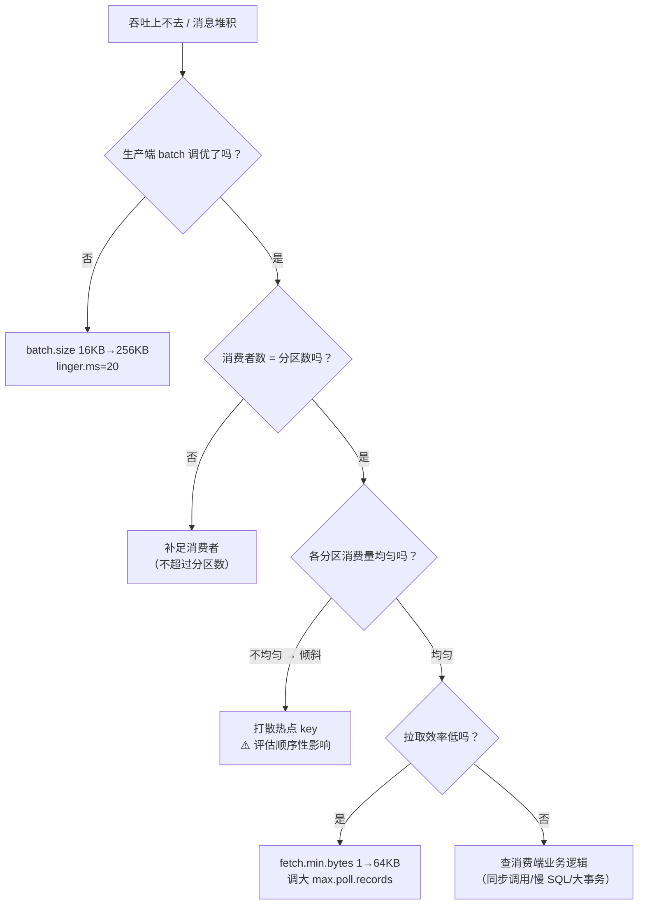

---

## 二、问题②：消息丢失（订单凭空消失）

### 2.1 症状与根因

> 视频对话："订单怎么会凭空消失？—— 你 **producer 的 `acks` 配成了 0**！我看文档说 0 是最快的，**最快，但最危险**——线上环境必须 `acks=all`。"

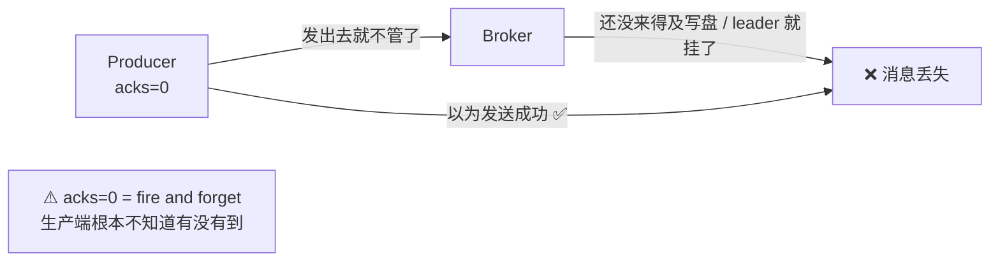

**`acks` 三档对比**：

| `acks` | 含义 | 可靠性 | 性能 | 适用 |
| --- | --- | --- | --- | --- |
| **0** | 发出去就不管（fire and forget） | ❌ **可能丢** | 最快 | 允许丢的日志/埋点 |
| **1** | leader 写入成功即返回 | ⚠️ leader 挂了可能丢 | 中 | 一般场景 |
| ⭐ **all（-1）** | **所有 ISR 副本都写入成功才返回** | ✅ 最可靠 | 最慢 | ⭐ **线上关键业务** |

### 2.2 完整修复：四道防线

> 视频对话："线上环境必须 **`acks=all`**；如果 ISR 里只剩 leader 一个，**`min.insync.replicas`** 配的又是 **1**，leader 一挂，然后选了一个**数据严重落后的 follower** 当 leader —— 这就是 **unclean leader election**。线上一定要 **`unclean.leader.election.enable=false`**。"

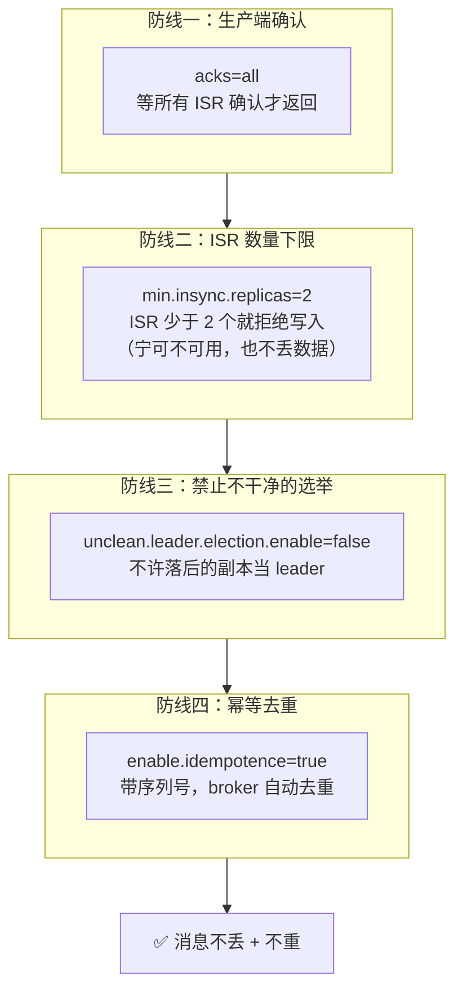

| 配置 | 默认值 | 推荐值 | 作用 |
| --- | --- | --- | --- |
| `acks` | `all`（3.0+） | **`all`** | 等所有 ISR 确认 |
| `min.insync.replicas` | **1** ⚠️ | **2**（配合 RF=3） | ISR 少于该值**拒绝写入**，避免"只剩 leader 也算成功" |
| `unclean.leader.election.enable` | `false`（0.11+） | **`false`** | 禁止**落后副本**当选 leader（否则丢数据） |
| `replication.factor` | 1 ⚠️ | **3** | 副本数，冗余的基础 |
| `enable.idempotence` | `true`（3.0+） | **`true`** | 幂等生产者，broker 侧去重 |
| `retries` | Integer.MAX | 保持或显式设置 | 配合幂等重试安全 |

> [!danger] `min.insync.replicas=1` + `acks=all` 是个**假安全**
> 很多人以为"`acks=all` 就安全了"，但如果 `min.insync.replicas=1`：
> ISR 可能只剩 leader 一个 → `acks=all` 由 **leader 自己确认**就返回 → **leader 这时挂掉，消息就没了**。
> ⭐ **`acks=all` 必须配合 `min.insync.replicas ≥ 2`（RF=3）才有意义。**

### 2.3 幂等的边界：为什么跨会话需要事务

> 视频对话："producer 崩溃重启，序列号会重置吗？—— **PID 会变**，所以**幂等只在单次会话内有效，跨会话需要事务**。"

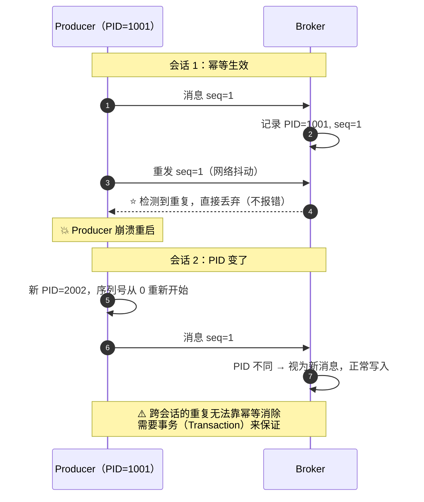

| 机制 | 作用范围 | 能解决什么 |
| --- | --- | --- |
| **幂等生产者**（`enable.idempotence`） | **单次会话（单 PID）内** | 重试导致的重复写入、乱序 |
| **事务**（`transactional.id`） | **跨会话** | 跨会话/跨分区的原子写（详见 [[6-事务与Exactly-Once]]） |

---

## 三、问题③：重复消费（客户被扣了两次钱）

### 3.1 症状与根因

> 视频对话："客户投诉说被扣了两次钱——同一条订单消息被处理了两遍。经典的 **at-least-once** 语义：consumer **处理完了但还没提交 offset，就被 Rebalance 掉了**。"

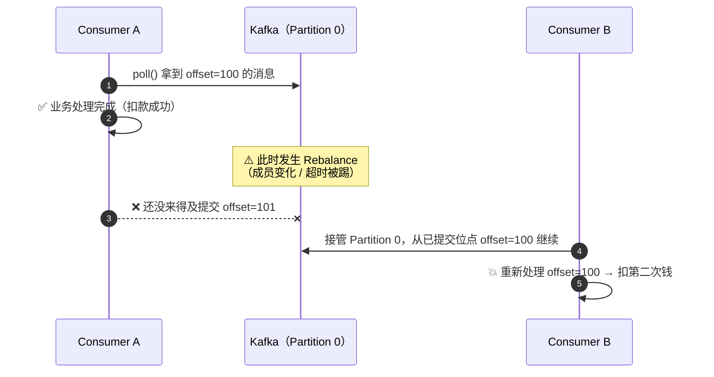

**at-least-once 的本质**：Kafka **保证消息不丢（至少一次）**，代价是**可能重复**。

| 语义 | 保证 | 实现方式 |
| --- | --- | --- |
| at-most-once | 最多一次（**可能丢**） | 先提交 offset 再处理 |
| ⭐ **at-least-once**（默认） | 至少一次（**可能重**） | 先处理再提交 offset |
| exactly-once | 恰好一次 | 事务 + 幂等（有成本） |

### 3.2 修复：Kafka 事务 API

> 视频对话："用 **Kafka 事务 API**，把**处理消息 + 提交 offset 绑定成一个原子操作**——就像转账，**要么都成功，要么都失败**。"

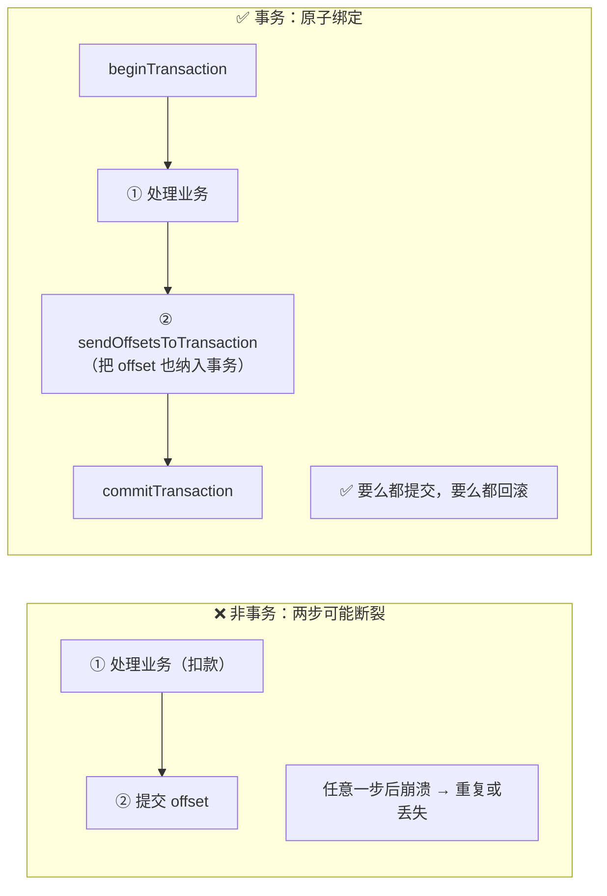

```java
// 消费-处理-生产 的 exactly-once 骨架
producer.initTransactions();
producer.beginTransaction();
try {
    for (ConsumerRecord<String, String> r : records) {
        // ① 业务处理 + ② 结果写回 Kafka
        producer.send(new ProducerRecord<>("output-topic", r.key(), process(r.value())));
    }
    // ③ 把消费位移也纳入事务（关键！）
    producer.sendOffsetsToTransaction(currentOffsets, consumer.groupMetadata());
    producer.commitTransaction();     // 原子提交
} catch (Exception e) {
    producer.abortTransaction();      // 原子回滚
}
```

> [!important] 事务不是万能的——**外部系统（MySQL/Redis）不受 Kafka 事务保护**
> Kafka 事务只能保证"**Kafka 内部**的多分区写 + 位移提交"原子。如果业务是"消费 Kafka → 写 MySQL"，那 **MySQL 的写入不在事务范围内**。
> 这时正确的做法是：**消费端业务幂等**（唯一键/去重表/状态机）——这才是根本保障。详见 [[6-事务与Exactly-Once]]、[[10-面试高频题]]。

---

## 四、问题④：消息乱序

### 4.1 根因：发送端并发太多

> 视频对话："消息乱序的**根本原因是发送端并发太多**——`max.in.flight.requests.per.connection` 控制了在途请求数。"

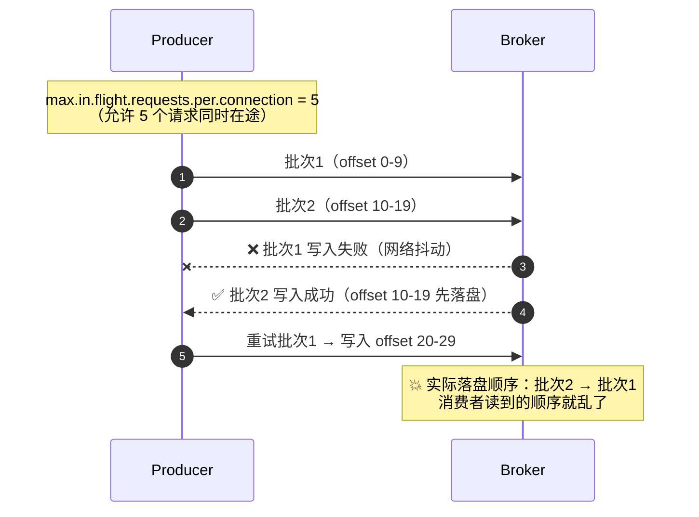

### 4.2 修复：幂等 + 限制在途请求数

> 视频对话："**开启幂等 + 限制飞行数**，顺序和唯一性就稳了。"

| 方案 | 配置 | 说明 |
| --- | --- | --- |
| ⭐ **推荐：幂等 + 在途 ≤ 5** | `enable.idempotence=true`（`max.in.flight` 默认 5） | Kafka 在**幂等模式下**保证：即使有 5 个在途请求+重试，**写入顺序依然与发送顺序一致**（broker 按序列号重排/拒绝） |
| 保守：在途 = 1 | `max.in.flight.requests.per.connection=1` | 严格串行，**吞吐下降明显**；无幂等时的唯一保序手段 |
| 业务层保序 | 相同 key → 相同分区 | Kafka 只保证**分区内有序**；跨分区无序 |

> [!warning] 关键前提：`max.in.flight > 1` 想保序，**必须开启幂等**
> 无幂等时，`max.in.flight=5` + 重试 = 必然乱序（如上图）。
> 开启幂等后，`max.in.flight ≤ 5` 是安全的（Kafka 用序列号保证顺序）；超过 5 会抛配置错误。详见 [[3-生产者原理]]。

---

## 五、问题⑤：消费死循环与 offset 异常

### 5.1 症状一：一直重读旧消息（死循环）

> 视频对话："consumer 一直在重新读之前读过的消息，死循环了——**offset 丢了**。"

| 参数 | 含义 | 坑 |
| --- | --- | --- |
| `auto.offset.reset` | **没有已提交位移时**从哪开始读 | `earliest` → 从头读（可能重读海量历史）；`latest` → 只读新消息 |
| `enable.auto.commit` | 是否**自动提交位移** | ⭐ 默认 `true`，**每 5 秒**（`auto.commit.interval.ms`）提交一次 |

**"自动提交就像定时闹钟，每五秒响一次——不管你消息有没有处理完。"**

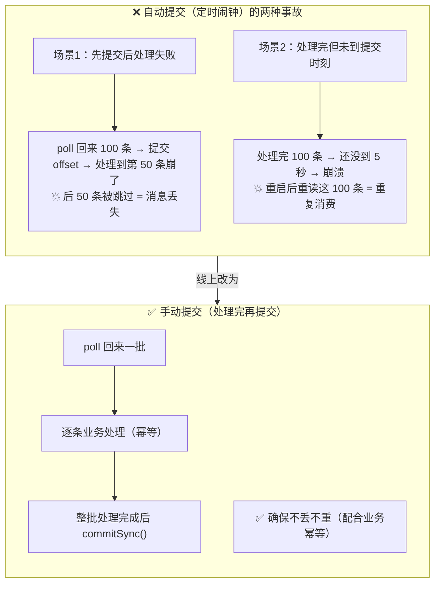

### 5.2 症状二：`OffsetOutOfRangeException`

> 视频对话："`OffsetOutOfRangeException` 是什么鬼？—— **consumer 想消费的 offset 在 topic 里不存在**，最简单修复是**重置 offset**（`earliest` 或 `latest`）。"

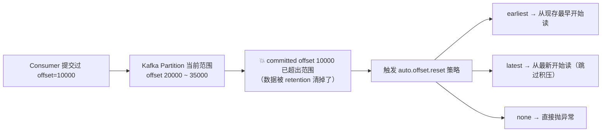

| 触发原因 | 说明 |
| --- | --- |
| 数据被保留策略清理 | 提交的位移对应的消息**已被删除**（超过 `retention`） |
| 消费者长时间离线 | 位移太旧，日志已滚动 |
| 手工误操作 | 重置过位移、Topic 被删重建 |

**修复命令**：

```bash
# 查看消费组的位点与 Lag
kafka-consumer-groups.sh --bootstrap-server localhost:9092 \
  --describe --group demo-group

# 重置位移到最早（需先停掉消费者）
kafka-consumer-groups.sh --bootstrap-server localhost:9092 \
  --group demo-group --topic hello-topic \
  --reset-offsets --to-earliest --execute
```

---

## 六、问题⑥：Broker 挂掉与磁盘打满

### 6.1 Broker 挂了会丢数据吗

> 视频对话："broker 挂了数据不会丢吧？—— **看你 `replication.factor` 设的几**，3 的话有三副本，**leader 选举会自动切换**。"

| 副本因子 | 容忍故障 | 说明 |
| --- | --- | --- |
| 1 | ❌ 0 个 Broker | 该 Broker 挂了分区就不可用（且可能丢数据） |
| 2 | ⚠️ 1 个 | 可以容忍 1 个，但 ISR 缩到 1 时就不能再挂了 |
| ⭐ **3**（生产推荐） | ✅ **1~2 个** | 配合 `min.insync.replicas=2`，可容忍 1 个 Broker 挂而**不丢数据** |

### 6.2 磁盘满：`No space left on device`

> 视频对话："有个 broker 挂了，日志显示 **`No space left on device`**——磁盘满了。**Kafka 是日志型存储，全靠清理策略**：`log.retention.bytes` 和 `log.retention.hours` **都要配**。"

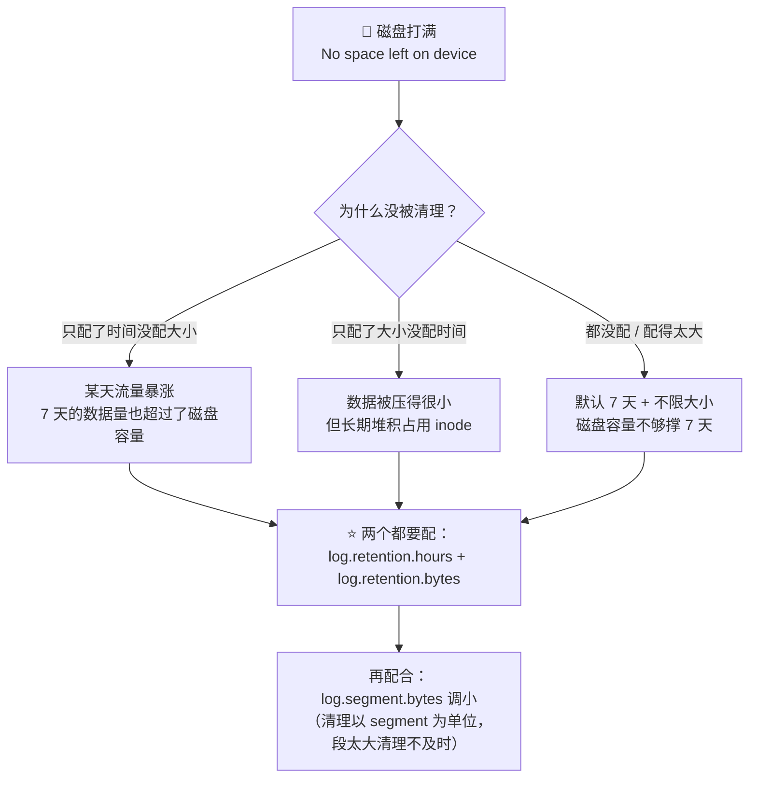

| 参数 | 默认值 | 说明 |
| --- | --- | --- |
| `log.retention.hours` | **168（7 天）** | 按时间清理 |
| `log.retention.bytes` | **-1（不限）** | ⭐ **必须显式设置**，按分区大小上限清理 |
| `log.segment.bytes` | 1GB | 清理的最小单位是 segment；段越小清理越及时（但文件数变多） |
| `log.cleanup.policy` | `delete` | `delete`（按时间/大小删）/ `compact`（按 key 留最新，见 [[Kafka 温习一下（详细整理版）]] §七） |
| `log.retention.check.interval.ms` | 5 分钟 | 检查周期 |

> [!danger] 磁盘打满的连锁反应
> ① 该 Broker 上的分区**无法写入** → ② 生产端 `acks=all` 一直等不到确认 → ③ **生产端阻塞 / 超时重试** → ④ 上游积压 → ⑤ 整条链路雪崩。
> **磁盘水位必须监控**（建议 70% 告警、85% 紧急处理）。

---

## 七、问题⑦：Controller 宕机与集群瞬间不可用

> 视频对话："刚才集群有一个瞬间**完全不可用**——**Controller 宕机后选举这段时间集群处于脑裂状态**；用 **KRaft 模式**替代 ZooKeeper 能更快恢复。"

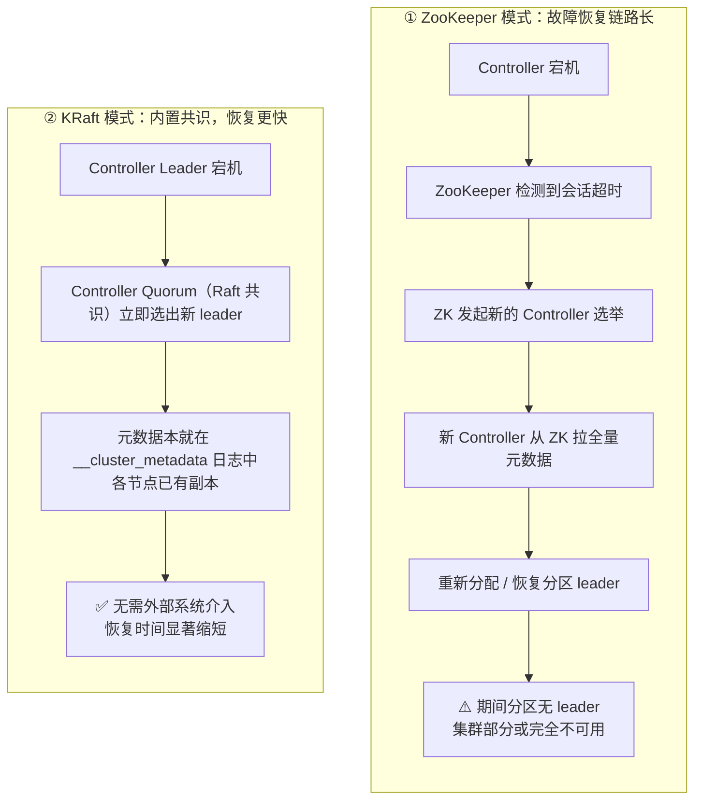

| 维度 | ZooKeeper 模式 | **KRaft 模式** |
| --- | --- | --- |
| 元数据存储 | 外部 ZK | 内置 `__cluster_metadata` 日志 |
| 故障检测 | ZK 会话超时（秒级） | Raft 心跳（更快） |
| 恢复过程 | ZK 选举 + 全量元数据同步 | Quorum 内部立即选主，元数据已在各节点 |
| 依赖 | 多一套 ZK 要运维，且可能成瓶颈 | **无外部依赖** |
| 版本 | 旧版默认（**4.0 已移除**） | **3.0 正式支持，4.0 起唯一选择** |

> [!note] 澄清："脑裂"在这里的准确含义
> 严格说，Kafka 的 Controller 选举本身**不会产生真正的双主脑裂**（ZK/Raft 保证只有一个 leader）。
> 视频说的"脑裂状态"更准确的描述是：**Controller 失效到新 Controller 就绪的窗口期内，部分分区没有 leader → 集群处于"部分不可用"状态**。
> 但如果配置了 `unclean.leader.election.enable=true`，**分区级**确实可能出现"两个副本各自认为自己是 leader"的危险情况——这才是要严禁的。详见 [[5-日志存储与副本机制]]、[[7-运维与集群调优]]。

---

## 八、问题⑧：Rebalance 死亡螺旋

### 8.1 症状

> 视频对话："consumer 一直在重启，日志里疯狂打 **Rebalance**！"

**Rebalance 的定义与代价**：

> "consumer group **成员变化时**，所有 partition **重新分配**——**分配期间消费完全停止**（Stop-The-World）。"

### 8.2 什么是"死亡螺旋"

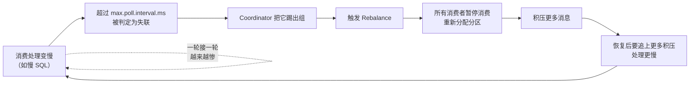

> 视频对话："这不就是**死亡螺旋**吗？一轮接一轮越来越惨。"

### 8.3 修复三件套

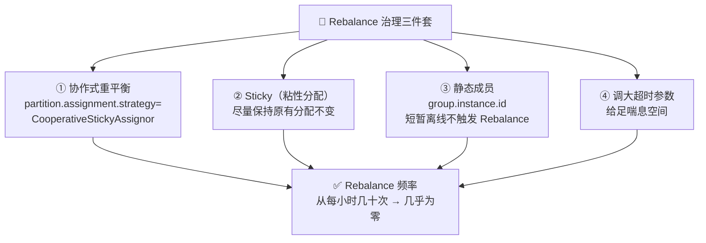

| 手段 | 配置 | 效果 |
| --- | --- | --- |
| ⭐ **协作式重平衡** | `partition.assignment.strategy=CooperativeStickyAssignor` | **增量式**：消费者**一个一个退**，已分配的分区不被回收，**不用全组停**（对比 Eager 协议的"全部撤销再重分"） |
| ⭐ **粘性分配** | `StickyAssignor` / `CooperativeStickyAssignor` | 重新分配时**尽量保持原有分配不变**，减少分区迁移成本 |
| ⭐ **静态成员** | `group.instance.id=<唯一实例名>` | 消费者**短暂离线**（重启、发布）在 `session.timeout.ms` 内不触发 Rebalance |
| **调大超时** | 见下表 | 给消费处理留足时间，避免被误判失联 |

**超时相关参数**：

| 参数 | 默认值 | 含义 | 调优方向 |
| --- | --- | --- | --- |
| `session.timeout.ms` | 45s（3.0+） | 多久没心跳判定为死 | 适当调大（但要小于 `max.poll.interval.ms`） |
| `heartbeat.interval.ms` | 3s | 心跳间隔 | 通常为 session 的 1/3 |
| `max.poll.interval.ms` | **5 分钟** | **两次 poll 的最大间隔**（业务处理太慢会被踢） | ⭐ 按**单批最大处理耗时**调大；同时用 `max.poll.records` 减小单批条数 |

> [!important] 治本比调参更重要
> 参数只是"给足喘息空间"，**真正的解法是让消费变快**：
> ① 降低 `max.poll.records`（单批少拿点）；② 把慢逻辑异步化 / 批量写 / 加缓存；③ 消费端水平扩容（但要先扩分区）。

深读：[[4-消费者与Rebalance]]（Rebalance 协议、Eager vs Cooperative、分配策略对比）。

---

## 九、上线前检查清单

> 视频原话："**这六条不是圣经，是血淋淋的工单堆出来的检查清单**——每次上线前过一遍，**能避开 90% 的 Kafka 深夜告警**。"

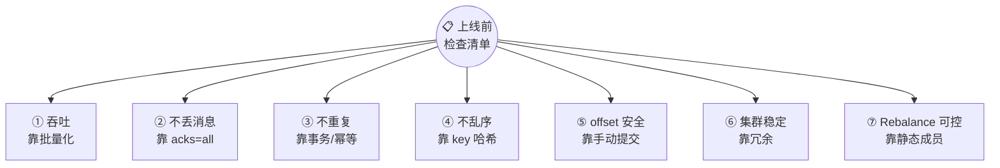

| # | 检查项 | 关键配置 | 不做的后果 |
| --- | --- | --- | --- |
| ① | **吞吐：批量化** | `batch.size=256KB`、`linger.ms=20`、`fetch.min.bytes=64KB`、消费者数 = 分区数 | 消息堆积、Lag 飙升 |
| ② | **不丢消息** | `acks=all` + `min.insync.replicas=2` + `unclean.leader.election.enable=false` + `retries>0` | 订单凭空消失 |
| ③ | **不重复** | `enable.idempotence=true`；跨会话用**事务**；消费端**业务幂等** | 客户被扣两次钱 |
| ④ | **不乱序** | 相同业务 key → 同一分区（`key` 不为 null）+ `max.in.flight.requests.per.connection` 配合幂等 | 状态错乱、数据覆盖 |
| ⑤ | **offset 安全** | `enable.auto.commit=false` + **处理完再 `commitSync()`** | 重复消费或丢消息 |
| ⑥ | **集群稳定** | `replication.factor=3`、监控磁盘水位、配 `log.retention.hours` + `log.retention.bytes` | Broker 挂 / 磁盘打满 |
| ⑦ | **Rebalance 可控** | `CooperativeStickyAssignor` + `group.instance.id` + 调大 `max.poll.interval.ms` | 死亡螺旋 |

> [!note] 一处与视频口播不一致的地方
> 视频结尾说"**这六条**不是圣经"，但逐条数下来实际是 **7 条**（可能把"offset 安全靠手动提交"并入了"不重复"，或把"集群稳定"与"Rebalance 可控"合并计数）。
> 本篇按**实际条目列全 7 条**——宁可多检查一项，不要漏。

> [!danger] 第八条（视频没明说，但血泪教训）：**任何配置改动都要评估影响**
> 这次事故的**起因就是"我就改了个 `batch.size`"**。
> **原则**：① 参数改动走**变更评审 + 灰度**；② 大促前**不要改参数**；③ 改动后**持续观察 Lag、ISR、磁盘、Rebalance 频率**四个指标。

### 大促前的四个必看指标

| 指标 | 健康标准 | 异常含义 |
| --- | --- | --- |
| **Consumer Lag** | 接近 0 且平稳 | 持续上涨 = 消费能力不足（问题①） |
| **ISR 数量** | 等于副本因子 | 缩水 = 有副本同步落后（问题②⑥） |
| **磁盘使用率** | 低于 70% | 快速上涨 = 倾斜或清理策略失效（问题①⑥） |
| **Rebalance 频率** | 接近 0 | 频繁 = 死亡螺旋前兆（问题③⑦） |

---

## 十、症状 → 根因 → 修复 速查表

| 症状 | 可能根因 | 关键指标 / 日志 | 修复动作 |
| --- | --- | --- | --- |
| 消息堆积、Lag 持续上涨 | 生产者太快 / 消费者太少 / 批太小 | Consumer Lag | `batch.size`↑、`linger.ms`↑、加消费者（≤分区数） |
| 加了消费者还是慢 | **数据倾斜**（热点 key） | 各分区消费量不均 | 打散 key（⚠️ 评估顺序性）、优化分区键 |
| 拉取效率低 | `fetch.min.bytes` 太小 | 网络往返频繁 | 调到 64KB |
| 磁盘告警、某块盘 100% | 数据倾斜导致热点分区 | 各 Broker 磁盘水位 | 打散 key + 配 `log.retention.bytes` |
| **消息丢失** | `acks=0/1`、`min.insync.replicas=1`、unclean 选举 | 生产端无异常但数据缺失 | `acks=all` + `min.insync.replicas≥2` + 禁 unclean |
| **重复消费**（重复扣款） | 未提交位移就 Rebalance、自动提交 | 重复的业务单号 | 事务 API + 业务幂等 + 手动提交 |
| 消息乱序 | 在途请求多 + 重试（未开幂等） | 业务状态错乱 | `enable.idempotence=true`（在途 ≤5）或设为 1 |
| 消费者死循环重读 | `auto.offset.reset=earliest` + 位移丢失 | 反复读同一批 | 手动提交 + 修正 reset 策略 + 重置位移 |
| `OffsetOutOfRangeException` | 位移超出日志范围（数据被清理） | 该异常堆栈 | `--reset-offsets`（earliest/latest） |
| `No space left on device` | 保留策略未配全 | Broker 日志 | 配 `log.retention.hours` + `.bytes`，调小 segment |
| 集群瞬间不可用 | Controller 宕机选举 | Controller 日志 | 升级 **KRaft**（4.0 已默认） |
| 日志疯狂打 Rebalance | 消费超时被踢 → 死亡螺旋 | Rebalance 频率 | `CooperativeStickyAssignor` + `group.instance.id` + 调大 `max.poll.interval.ms` |

---

## 附录 A：语音转写（ASR）勘误对照

原始字幕稿由 vCaptions 生成，本篇修正约 30 处：

| 原始转写 | 应为 |
| --- | --- |
| **cf cat / KAFKA / KFCAT** | **Kafka** |
| 618 **大醋缸**上线半小时 | 618 **大促**上线半小时 |
| batch size | **`batch.size`** |
| linger ms | **`linger.ms`** |
| fetch man BIS 默认一字节 | **`fetch.min.bytes`** 默认 1 字节 |
| 给消息 T1 加随机后缀 | 给消息 **key** 加随机后缀 |
| 你 producer 的 ex 配的几零 | 你 producer 的 **`acks`** 配成了 **0** |
| X 等于 all / X 等于 or | **`acks=all`** |
| i is2 / Mean in in sync replicas | **ISR** / **`min.insync.replicas`** |
| Unclean leader election（enable 等于 false） | ✅ 正确，即 **`unclean.leader.election.enable=false`** |
| IDENTENCE 等于 true | **`enable.idempotence=true`** |
| 每条消息**待**序列号 | 每条消息**带**序列号 |
| pad 会变 / me 等指在单次会话内有效跨会画 | **PID** 会变 / **幂等只在单次会话内有效，跨会话** |
| cf cat 事务 API | **Kafka 事务 API** |
| max in flight requests Poor connection | **`max.in.flight.requests.per.connection`** |
| 开启**密等** | 开启**幂等** |
| Auto offset reset 等于 earliest | **`auto.offset.reset=earliest`** |
| offset 下划线 out 下划线 OF 下划线 range | **`OffsetOutOfRangeException`** |
| Log retention **bias** | **`log.retention.bytes`** |
| log retention **ours** | **`log.retention.hours`** |
| 用 **craft** 模式替代 ZOKEEPER | 用 **KRaft** 模式替代 **ZooKeeper** |
| Controller 宕机后…处于**脑裂**状态 | 更准确：**部分分区无 leader 的不可用窗口期**（已在 §七澄清） |
| Partition assignment strategy 等于 cooperative sticky | **`partition.assignment.strategy=CooperativeStickyAssignor`** |
| Sticky **signore** | **Sticky**（粘性分配） |
| 确保不丢不**中** | 确保不丢不**重** |
| 增量式协作**重平衡** | ✅ 正确（**增量式协作再均衡**） |

## 附录 B：生产环境配置模板

```properties
# ============ 生产端（Producer）============
bootstrap.servers=kafka-1:9092,kafka-2:9092,kafka-3:9092
acks=all                                   # ② 不丢：等所有 ISR 确认
enable.idempotence=true                    # ③ 不重：幂等（broker 去重）
retries=2147483647                         # 配合幂等，无限重试安全
max.in.flight.requests.per.connection=5    # ④ 不乱序：幂等模式下 ≤5 安全
batch.size=262144                          # ① 吞吐：256KB
linger.ms=20                               # ① 吞吐：等 20ms 凑批
compression.type=lz4                       # ① 吞吐：批次压缩
key.serializer=org.apache.kafka.common.serialization.StringSerializer
value.serializer=org.apache.kafka.common.serialization.StringSerializer

# ============ 消费端（Consumer）============
group.id=order-service
enable.auto.commit=false                   # ⑤ 手动提交（关键！）
auto.offset.reset=earliest                 # 无位移时从头读（按业务选）
max.poll.records=200                       # 单批条数（配合处理耗时）
max.poll.interval.ms=600000                # ⑦ 给足处理时间（防死亡螺旋）
partition.assignment.strategy=org.apache.kafka.clients.consumer.CooperativeStickyAssignor
group.instance.id=order-consumer-1         # ⑦ 静态成员（防短暂离线触发 Rebalance）
fetch.min.bytes=65536                      # ① 吞吐：broker 攒够 64KB 再返回
fetch.max.wait.ms=500
key.deserializer=org.apache.kafka.common.serialization.StringDeserializer
value.deserializer=org.apache.kafka.common.serialization.StringDeserializer

# ============ Broker 端 ============
replication.factor=3                       # ⑥ 冗余：3 副本
min.insync.replicas=2                      # ② 不丢：ISR 少于 2 拒绝写入
unclean.leader.election.enable=false       # ② 不丢：禁止落后副本当选
log.retention.hours=168                    # ⑥ 保留 7 天（按业务调）
log.retention.bytes=107374182400           # ⑥ 每分区 100GB 上限（必配！）
log.segment.bytes=1073741824               # 1GB 段，便于及时清理
log.retention.check.interval.ms=300000
```

> [!tip] 一键自检
> 上线前把上面这份与你的实际配置逐行 diff；大促前额外检查四个指标：**Lag、ISR 数量、磁盘水位、Rebalance 频率**。
