# 🚨 Kafka 深夜告警风暴：优化与建议（详细整理版）

> 本篇是对 [B 站视频《kafka 问题优化和建议》](https://www.bilibili.com/video/BV1v7LP63EKe/) 的**逐条深度整理**。
> 视频场景：**深夜监控大屏爆红，Kafka 集群告警此起彼伏，值班工程师从梦中惊醒**——用"速查口诀"的方式把常见故障与优化动作一口气过了一遍。
> 视频自己给了组织线索：**"Kafka 问题就这三层：资源层、集群层、元数据层"**——本篇就按这三层重构（原字幕稿是一整段无标点粘连文本，见下方说明）。
> 原始字幕稿：[[kafka 问题优化和建议]]。
> 三篇配套：[[Kafka 温习一下（详细整理版）]]（**入门**：概念是什么）→ [[Kafka 问题（详细整理版）]]（**排查**：7 个着火点）→ **本篇**（**优化**：参数与建议速查）。

> [!warning] 关于本篇的转录质量（请先读）
> 原始字幕稿由 vCaptions 生成，**没有时间戳、没有任何标点、且存在明显语序混乱**（整段约 900 字连成一片），部分术语被严重误识别（如 `FTTO`、`死性毒射御值`、`网络物`）。
> 本篇的做法：**按"资源层 / 集群层 / 元数据层"三层骨架重组内容**，并把每一条还原成"**现象 → 根因 → 配置**"；凡是无法确证的短语，都在 [附录 A](#附录-a语音转写asr勘误与不确定项) 中**显式标注为"推测"**，不硬凑。
> 文中标注 ⚠️ 的配置值为**视频口播值**，落地前请结合自己的集群压测确认。

---

## 〇、全景：故障分三层 + 12 条优化建议

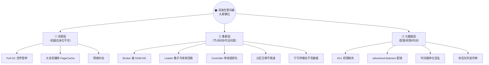

| 层 | 编号 | 问题 | 一句话对策 | 关键配置 |
| --- | --- | --- | --- | --- |
| **资源层** | 1 | Full GC → 世界暂停 | 固定堆 + G1 + 提前并发标记 | `-Xms6g -Xmx6g -XX:+UseG1GC -XX:InitiatingHeapOccupancyPercent=35` |
| | 2 | 100MB JSON 像大象塞进油桶 | broker 限单条大小 + producer 分片 | `max.message.bytes=1MB` |
| | 3 | 网络抖动 | 放宽超时，给系统耐心 | `replica.lag.time.max.ms=60s` |
| **集群层** | 4 | Broker 被 OOM Kill | **别急着重启**，先确认再追平 | `unclean.leader.election.enable=false` |
| | 5 | Leader 像乒乓球来回跳 | 调大会话与 Lag 超时 | ZK 会话 30s |
| | 6 | Controller 单线程排队 | 上 KRaft 架构 | `process.roles=controller,broker` |
| | 7 | 宁可停服也不丢数据 | 明确取舍并接受 | `unclean...=false` |
| | 8 | 大 V 用户 key 全哈希到一个分区 | 迁移**限速**，错峰出行 | `--throttle` |
| **元数据层** | 9 | 认证过了但授权没配 | ACL：**Topic 写 + Group 读**缺一不可 | `kafka-acls.sh` |
| | 10 | 客户端拿到内网 IP 连不上 | 修正 `advertised.listeners` | `advertised.listeners=公网地址` |
| | 11 | 时间戳混入纳秒 | 全链路统一 **UTC 毫秒** | `message.timestamp.type` |
| | 12 | 死信堆积变成炸弹 | DLQ 独立 Topic + **独立 TTL 与监控** | `retention.ms` + 告警 |

### 排查三字经（视频自带的速记口诀）

> 视频原话（转录修正后）："**排查三字经：GC 停、看堆；大消息、做拆分；Leader 跳、调超时；分区偏、重新算；权限坑、查 ACL；网络堵、查 DNS；时间戳、统一走；死信毒、设阈值。**"

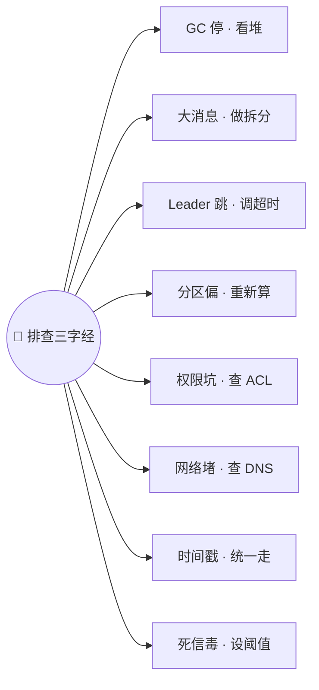

> [!note] 视频里还有一句更短的"12 字"口诀
> 转录为："**GC 停看堆，G1 不行换 ZGC；网络抖查 DNS，advertise 别写错**"——四句覆盖了资源层与元数据层最容易踩的两个坑。
> ⚠️ 由于原字幕无标点，"12 字"的准确切分无法确证，这里按语义重构（详见 [附录 A](#附录-a语音转写asr勘误与不确定项)）。

---

## 一、资源层：机器自身扛不住

### 1.1 Full GC = 世界暂停

> 视频原话："**Full GC 就是世界暂停**——ZooKeeper 收不到心跳，以为 broker 挂了。"


**修复：固定堆 + G1 + 提前并发标记**（视频口播值 ⚠️）：

| 参数 | 值 | 作用 |
| --- | --- | --- |
| `-Xms6g -Xmx6g` | **固定 6G**（"堆固定 6G"） | ⭐ **Xms = Xmx**，避免堆动态伸缩带来的额外停顿 |
| `-XX:+UseG1GC` | 换 **G1** | 可预测停顿，替代老的 CMS/Parallel 长停顿 |
| `-XX:InitiatingHeapOccupancyPercent=35` | **35%** | ⭐ **老年代到 35% 就开始并发标记**——"别等水杯满了才喝"，避免到接近满时才被迫 Full GC |
| `-XX:MaxGCPauseMillis` | 20~50ms | 目标停顿时间（Kafka 官方推荐 20ms 级别） |
| `-XX:+ExplicitGCInvokesConcurrent` | 开启 | 让 `System.gc()` 走并发而非 Full GC |

> [!tip] 完整建议（比视频更细）
> 生产上通常还会配：`-XX:G1HeapRegionSize=16M`、`-XX:MetaspaceSize=96m`、`-XX:+ParallelRefProcEnabled`、`-Xlog:gc*:file=...`（**必须开 GC 日志**，否则无法定位）。
> Kafka 官方文档给出的 G1 起步参数就是"**IHOP=35 + MaxGCPauseMillis=20**"这一组。

> [!note] "G1 不行，换 ZGC"
> 视频提到 G1 效果不好时换 **ZGC**。适用边界要说清：
> - **ZGC 需要 JDK 11+**（Kafka 4.0 起要求 JDK 17，天然满足）；
> - ZGC 停顿是**亚毫秒级**，适合**超大堆（几十 GB 以上）**；堆不大（6G）时 G1 通常已足够，换 ZGC 收益有限；
> - ZGC 吞吐略低、CPU 占用略高——**不是免费午餐**，要压测后再定。

### 1.2 大消息：100MB 的 JSON 像大象塞进油桶

> 视频原话："**100 兆的 JSON，就像大象塞进油桶，PageCache 直接被碾碎**。"

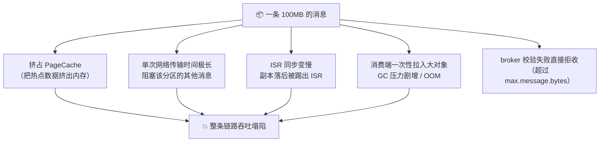

**修复两侧一起做**：

| 侧 | 配置 | 说明 |
| --- | --- | --- |
| **Broker** | `max.message.bytes=1048576`（**1MB**） | 超过直接拒收——"别让一辆卡车堵死高速公路" |
| **Producer** | `max.request.size`（默认 1MB，需 ≥ 单条大小） | 与 broker 限制对齐 |
| **Producer** | ⭐ **分片发送**（"producer 端分片发送"） | 大 JSON **拆成多条小消息**（带序号，消费端重组） |
| **两者** | `compression.type=lz4`/`zstd` | 先压缩再发，JSON 压缩比通常很高 |
| **架构** | **Claim Check 模式** | 大 payload 存对象存储/S3，Kafka 里只传**引用地址**（最优解） |

> [!important] 为什么 Kafka 对大消息这么敏感？
> Kafka 的性能建立在 **顺序写 + PageCache + 零拷贝** 上——这三样都假设"**消息小而多**"。
> 一条 100MB 消息会：① 把 PageCache 里的热点消息挤出去（缓存命中率崩）；② 让一个分区的传输队列被独占；③ 让 ISR 同步超时。**"碾碎 PageCache"这个说法非常准确。**

### 1.3 网络抖动（现象归类）

> 视频把"网络抖动"归在资源层，但它的**处置动作在集群层**（调超时参数）——见 [§2.2](#22-leader-像乒乓球网络抖动的连锁反应)。

---

## 二、集群层：节点间协作出问题

### 2.1 Broker 被 OOM Kill：别急着重启

> 视频原话："**broker 被 OOM Kill 了，但别急着重启**——先确认 `unclean.leader.election.enable=false`，重启后先看 **ISR 同步**，确认数据追平，再宣告复活。"

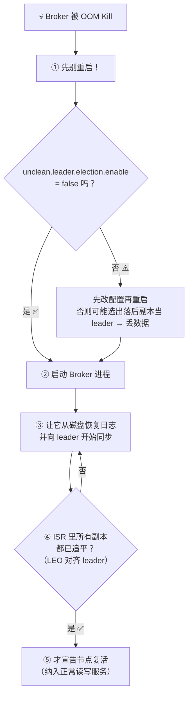

| 步骤 | 动作 | 为什么 |
| --- | --- | --- |
| ① | **先别重启** | 重启前若 unclean 选举为 true，可能选出**落后副本**当 leader → 永久丢数据 |
| ② | 确认 `unclean.leader.election.enable=false` | 宁可该分区**不可用**，也不接受丢数据 |
| ③ | 启动进程，等待日志恢复 + 同步 | 从磁盘恢复本地日志（Kafka 是**日志型存储**） |
| ④ | **观察 ISR 是否追平** | 用 `kafka-topics.sh --describe` 看 ISR 与 LEO 差 |
| ⑤ | 追平后才宣告复活 | 避免"延迟加入"导致再次脑裂 / 反复选举 |

> [!danger] 反面教材：直接重启的后果
> Broker 刚被 OOM Kill，内存/磁盘压力还在，**立刻重启会再次 OOM**（重启风暴）；
> 若此时集群正在选举，新起的 Broker 带着**旧数据**加入，可能把落后数据"顶"成 leader 副本。

### 2.2 Leader 像乒乓球：网络抖动的连锁反应

> 视频原话："**leader 像乒乓球一样来回跳，生产者不停重连**——这是网络抖动的连锁反应。把 **Lag 超时调到 60 秒**，**ZK 会话超时调到 30 秒**，给系统多一点耐心。"


**修复：放宽两个超时，给系统"耐心"**（视频口播值 ⚠️）：

| 参数 | 默认值 | 视频建议 | 作用 |
| --- | --- | --- | --- |
| `replica.lag.time.max.ms` | **30s** | ⭐ **60s** | follower 超过这么久没追上才踢出 ISR——**调大能容忍网络毛刺，避免 ISR 频繁抖动** |
| `zookeeper.session.timeout.ms` | **18s** | ⭐ **30s** | ZK 判定 broker 失联的时间——调大避免"GC 停顿/网络毛刺"被误判为宕机 |
| `zookeeper.connection.timeout.ms` | 6s | 可同步调大 | 建连超时 |
| `controller.quorum.request.timeout.ms`（KRaft 模式） | — | 按需 | KRaft 下对应的是 Controller Quorum 超时，**不再有 ZK 会话** |

> [!warning] 调大超时的代价：故障发现变慢
> 超时调大 = **更不容易误判**，但也意味着**真故障时切换更慢**（该分区的不可用窗口变长）。
> 60s / 30s 是视频给出的经验值，**正确做法是按你的网络 P99 抖动 + 故障恢复目标（RTO）来定**。

### 2.3 Controller 单线程排队 → KRaft

> 视频原话："**旧架构的 controller 是单线程排队，KRaft 模式才能解开这把锁。**"

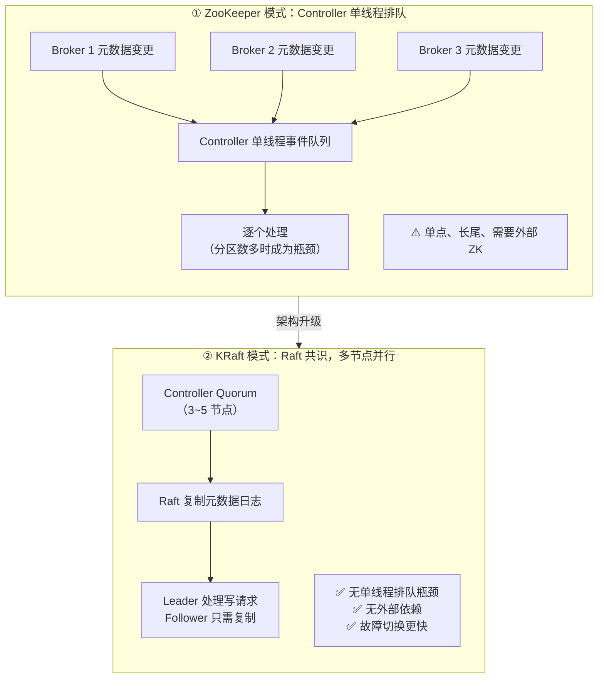

| 对比 | ZooKeeper 模式 | **KRaft 模式** |
| --- | --- | --- |
| 元数据处理 | **Controller 单线程**顺序处理 | **Raft 共识**，多节点 |
| 瓶颈 | 分区/副本数多时，元数据操作排队 | 明显缓解 |
| 外部依赖 | 需要 ZK 集群 | 无 |
| 故障恢复 | ZK 会话超时 + 选举 + 全量同步 | Quorum 内部快速选主 |
| 版本 | **4.0 已移除** | **3.0 正式支持，4.0 唯一选择** |

### 2.4 关键取舍：宁可停服，也不丢数据

> 视频原话："**`unclean.leader.election.enable=false`，意味着宁可停服也不丢数据。**"

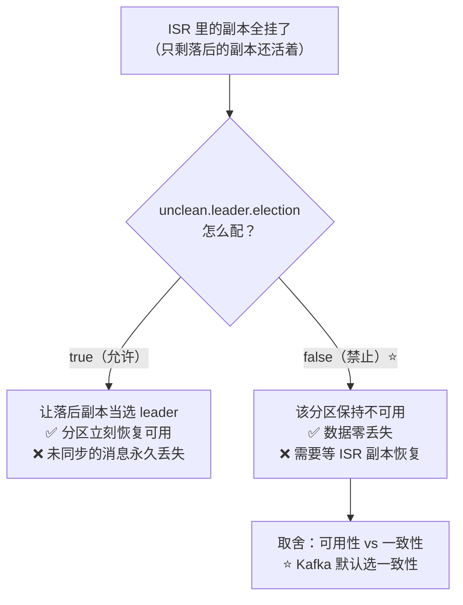

| 配置 | 语义 | 适用 |
| --- | --- | --- |
| `false`（默认，0.11+） | ⭐ **宁可分区不可用，也不丢数据** | 金融、订单、支付等一切**不能丢**的场景 |
| `true` | 允许落后副本当选，**牺牲数据换可用** | 允许丢数据的日志/埋点场景，且对可用性要求极高 |

> [!important] 面试时的标准答法
> "`unclean.leader.election.enable=false` 是**用可用性换一致性**：当 ISR 全部不可用时，宁愿这个分区停服，也不让落后副本当 leader 造成数据丢失。
> 反过来，如果业务允许丢数据（如行为埋点），可以开 `true` 换取更高的可用性——**这是一个业务决策，不是技术默认值。**"

### 2.5 分区迁移要限速：大 V 用户的 key 全哈希到一个分区

> 视频原话："**大 V 用户的 key 全哈希到一个分区，就像食堂一个窗口排长队**——迁移用 **限速**，就像给搬家车队发通行证，**错峰出行**。"

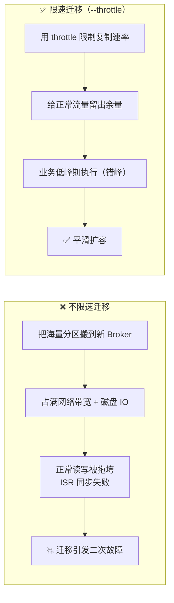

| 手段 | 说明 |
| --- | --- |
| ⭐ `kafka-reassign-partitions.sh --throttle <bytes/sec>` | 迁移副本时的**复制速率上限**（"给搬家车队发通行证"） |
| `leader.replication.throttled.rate` / `follower.replication.throttled.rate` | broker 级限流兜底 |
| **错峰执行** | 业务低峰期迁移（"错峰出行"） |
| **先治倾斜，再搬家** | 迁移只是搬运；**根因是 key 设计**——大 V 的 key 天然热点，见 [[Kafka 问题（详细整理版）]] §一"数据倾斜" |

```bash
# 迁移并限速（示例）
kafka-reassign-partitions.sh --bootstrap-server localhost:9092 \
  --reassignment-json-file reassign.json \
  --throttle 52428800 \
  --execute          # 50MB/s
```

---

## 三、元数据层：配置、权限与时间

### 3.1 权限：认证过了，还得授权

> 视频原话："**认证过了还得建立健全 topic 写权限、group 读权限，缺一不可。**"

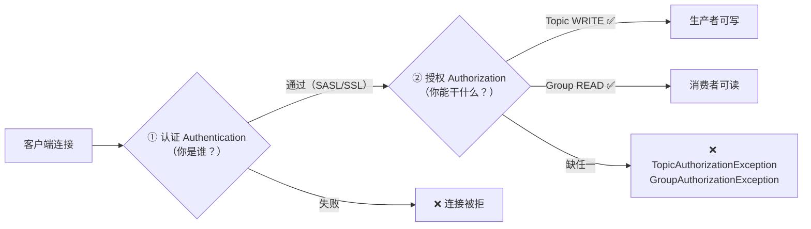

| 环节 | 是什么 | 缺了会怎样 |
| --- | --- | --- |
| **认证（Authentication）** | 证明身份（SASL/PLAIN、SCRAM、Kerberos、mTLS） | 连不上 / `AuthenticationException` |
| **授权（Authorization）** | 是否能对某资源做某操作（ACL） | 认证通过但**读写被拒** |

⭐ **最容易漏的一对**：

```bash
# 生产者需要：Topic 的 WRITE（往往还要 DESCRIBE）
kafka-acls.sh --bootstrap-server localhost:9092 --add \
  --allow-principal User:order-app \
  --operation Write --operation Describe --topic orders

# 消费者需要：Topic 的 READ + ⭐ Group 的 READ（漏掉 group 就报 GroupAuthorizationException）
kafka-acls.sh --bootstrap-server localhost:9092 --add \
  --allow-principal User:order-app \
  --operation Read --topic orders
kafka-acls.sh --bootstrap-server localhost:9092 --add \
  --allow-principal User:order-app \
  --operation Read --group order-service      # ⭐ 这条最常被忘
```

> [!warning] "认证过了为什么还连不上？"的经典回答
> 因为**认证（你是谁）和授权（你能干什么）是两关**。
> 消费者除了 Topic 的 READ，还必须有**消费组（Group）的 READ**——这条最常被漏，报错是 `GroupAuthorizationException`。

### 3.2 `advertised.listeners` 配错：客户端拿到内网 IP

> 视频原话："**`advertised.listeners` 配错，客户端拿到的 IP 是内网的，隔公网当然连不上。**"

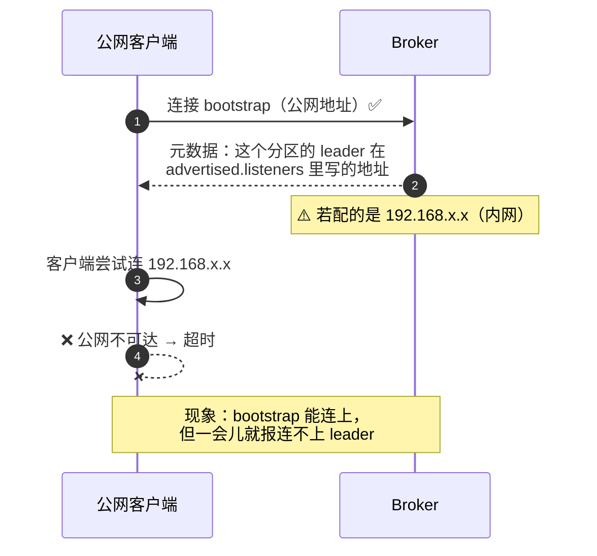

| 概念 | 作用 |
| --- | --- |
| `listeners` | **Broker 实际绑定**的监听地址（如 `0.0.0.0:9092`） |
| ⭐ `advertised.listeners` | **告诉客户端"用哪个地址来找我"**——必须是对客户端**可达**的地址 |
| 典型错误 | 内网集群对外提供服务，却把 `advertised.listeners` 写成了内网 IP/主机名 |
| 现象特征 | **bootstrap 能连上，但拿不到分区数据**（客户端按返回地址去连，连不上） |
| 修复 | 改成公网 IP/域名；或内外网双 listener（`internal` + `external` + `listener.security.protocol.map`） |

> [!tip] 一句话记忆
> **`listeners` 决定"我绑在哪"，`advertised.listeners` 决定"客户端去哪找我"**——配错后者，症状是"能连上集群、却读不到数据"。

### 3.3 时间戳：全链路统一 UTC 毫秒

> 视频原话："**铁律：全链路 UTC 毫秒级时间戳，别让纳秒混进来。**"

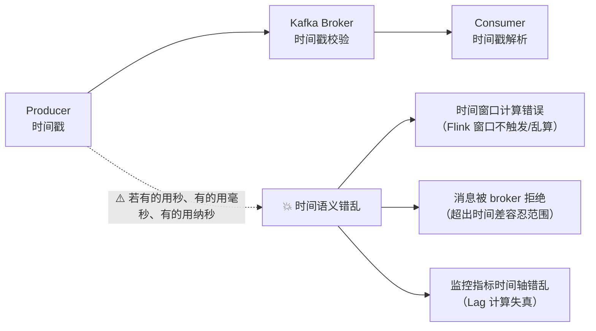

| 要点 | 说明 |
| --- | --- |
| **统一单位** | ⭐ **毫秒（millis）**——Kafka 原生 `timestamp` 就是毫秒 |
| **统一时区** | ⭐ **UTC**（存储统一 UTC，展示时再转本地时区，避免时区换算错乱） |
| `message.timestamp.type` | `CreateTime`（生产者时间）/ `LogAppendTime`（broker 时间） |
| `message.timestamp.difference.max.ms` | 若显式配置，**超出允许时间差的消息会被拒收**——纳秒当毫秒用（差 100 万倍）必然被拒 |
| 常见坑 | Java `System.currentTimeMillis()`（毫秒）vs `Instant.now().getNano()`（纳秒）混用 |

> [!important] 为什么这条是"铁律"
> 时间戳一旦单位混乱：**① 流计算的时间窗口全错**（[[2-时间与窗口]] 里讲的 Event Time 直接失效）；**② broker 可能拒收消息**；**③ 排障时对不上时间轴**。
> 规范做法：**接入层就统一成 UTC 毫秒**，并在 Schema/文档里写死。

---

## 四、死信队列：别让死信变成炸弹

> 视频原话："**重试三次后扔进 DLQ 死信 topic，独立配 TTL 和监控，别让死信变成炸弹。**"

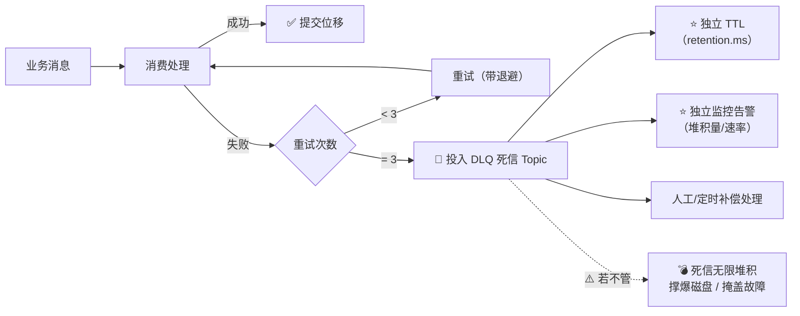

| 要点 | 说明 |
| --- | --- |
| 何时进 DLQ | 重试 N 次（视频建议 **3 次**）后仍失败 |
| ⭐ **独立 Topic** | 与业务 Topic 隔离，便于单独消费与排查 |
| ⭐ **独立 TTL** | 视频强调"独立配 TTL"——DLQ 的 `retention.ms` 要**按补偿窗口设定**（如 7~30 天），不能沿用业务 Topic |
| ⭐ **独立监控** | 死信堆积量/增长速率必须告警（**"别让死信变成炸弹"**） |
| 补偿机制 | 定时任务/人工审核后重放回原 Topic |
| 关键细节 | ⭐ **先提交位移再把消息投 DLQ**，或让 DLQ 投递与位移提交在同一事务内，否则可能"重复投递"或"既没处理也没进 DLQ" |

```java
// Spring Kafka：重试 3 次后进 DLQ
@Bean
public DefaultErrorHandler errorHandler(KafkaTemplate<String, String> template) {
    var recoverer = new DeadLetterPublishingRecoverer(template);          // 投递到 xxx.DLT
    var handler = new DefaultErrorHandler(recoverer,
            new FixedBackOff(1000L, 3));                                   // 重试 3 次，间隔 1s
    handler.addNotRetryableExceptions(DeserializationException.class);     // 反序列化失败不重试，直接进 DLQ
    return handler;
}
```

---

## 五、深夜排查：从症状到动作

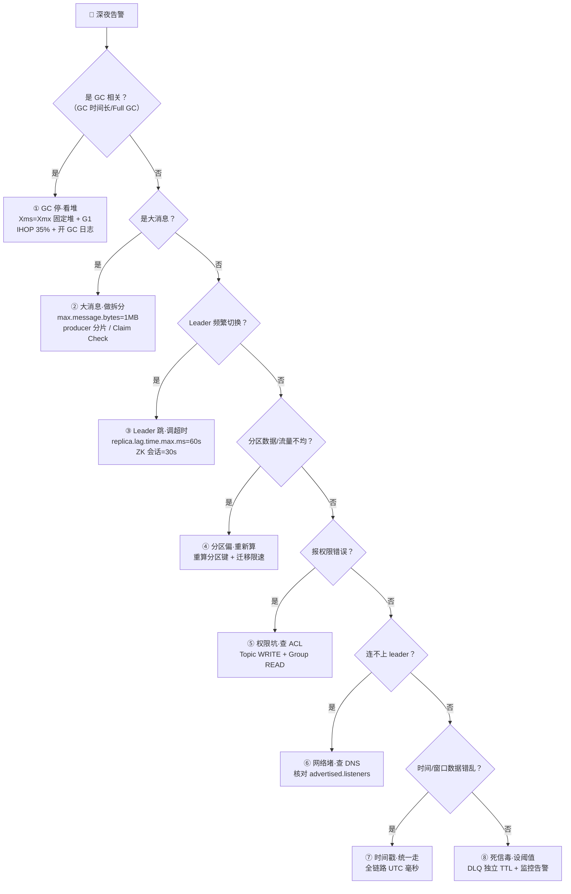

### 三层对应的排查命令

| 层 | 看什么 | 命令 / 指标 |
| --- | --- | --- |
| **资源层** | GC 停顿、堆使用、磁盘、PageCache | `-Xlog:gc*` 日志、磁盘水位、`iostat` |
| **集群层** | ISR、Leader 切换、UnderReplicated 分区 | `kafka-topics.sh --describe`（看 ISR 与 Leader）、`UnderReplicatedPartitions` 指标 |
| **集群层** | 消费延迟、Rebalance 频率 | `kafka-consumer-groups.sh --describe`（看 LAG）、`RebalanceRate` 指标 |
| **元数据层** | 授权失败、连接失败、时间戳 | Broker 日志里的 `AuthorizationException`、`advertised.listeners` 配置核对 |

---

## 附录 A：语音转写（ASR）勘误与不确定项

> 本份字幕是**历次最差的一份**：无时间戳、无标点、语序混乱。下表前半部分是**可确证的修正**，后半部分**显式标注为推测**，供你回看视频时核对。

### A.1 可确证的修正

| 原始转写 | 应为 |
| --- | --- |
| KAFKA | **Kafka** |
| ZOKEEPER / ZK | **ZooKeeper** |
| full gc 就是世界暂停 | **Full GC 是 Stop-The-World** |
| 堆固定 6G 换 G1 | 堆固定 **6G**，换成 **G1GC** |
| 老年代到 35% 就开始并发标记 | **`-XX:InitiatingHeapOccupancyPercent=35`** |
| page cash | **PageCache** |
| max message biz 等于一兆 | **`max.message.bytes=1MB`** |
| broker 被 o m kill | **OOM Killer** 杀掉 |
| unclean leader election enable 等于 false | **`unclean.leader.election.enable=false`** |
| 先看 i is2 同步确认数据追平 | 先看 **ISR** 同步、确认数据**追平** |
| lag 超时调到 60 秒 | **`replica.lag.time.max.ms=60000`** |
| ZK 会话超时调到 30 秒 | **`zookeeper.session.timeout.ms=30000`** |
| craft 模式 | **KRaft 模式** |
| Advertise listeners | **`advertised.listeners`** |
| 奈秒 | **纳秒（nanosecond）** |
| DLQ 死性 topic | **DLQ 死信 Topic** |
| 死性毒 | **死信堆积成"毒"** |
| 健全 topic 写权限 | 建立 **Topic 写权限** |

### A.2 ⚠️ 推测项（无法确证，已按语义还原）

| 原始转写           | 我的推测                                                    | 置信度               |
| -------------- | ------------------------------------------------------- | ----------------- |
| `FTTO 限速`      | **分区迁移限速**（`--throttle` / `replication.throttled.rate`） | 高（上下文是"迁移""搬家车队"） |
| `死性毒射御值`       | **死信毒 → 设阈值**（DLQ 独立 TTL + 监控阈值）                        | 中高                |
| `网络物`（三字经中）    | **网络堵 / 网络无** → 查 **DNS** 与 `advertised.listeners`      | 中                 |
| `GC 停看堆零`      | **GC 停 → 看堆**（"零"疑为语气词或"0G"残留）                          | 中                 |
| `记住这 12 字`     | 疑指四句口诀；**无法确证哪 12 个字**                                  | 低                 |
| `资源层，集群层，原数据层` | **资源层 / 集群层 / 元数据层**（本篇的组织骨架）                           | 高                 |
| `分区篇，重新算`      | **分区偏（倾斜）→ 重新计算（分区键/分配）**                               | 中高                |

> [!note] 处理原则
> 这份字幕**无法逐字复原**。本篇的做法是：**能确证的写成配置（给出参数名与推荐值），不能确证的标注推测并给出技术依据**——宁可有据地补全，也不硬编造参数。

## 附录 B：参数速查（按三层）

```properties
# ========== ① 资源层：JVM（Broker 启动参数）==========
-Xms6g -Xmx6g                                  # 固定堆，避免动态伸缩停顿
-XX:+UseG1GC                                   # 用 G1
-XX:InitiatingHeapOccupancyPercent=35          # ⭐ 老年代 35% 就并发标记
-XX:MaxGCPauseMillis=20                        # 目标停顿
-XX:+ExplicitGCInvokesConcurrent               # System.gc() 走并发
-Xlog:gc*:file=/var/log/kafka/gc.log:time,uptime:filecount=10,filesize=50M   # 必须开日志

# ========== ① 资源层：大消息防护 ==========
max.message.bytes=1048576                      # Broker 端单条上限 1MB
# producer 端：max.request.size（≥单条）、compression.type=lz4/zstd
# 架构上：大 payload 走对象存储 + Claim Check

# ========== ② 集群层：副本与超时 ==========
replica.lag.time.max.ms=60000                  # ⭐ Lag 超时 60s（容忍网络毛刺）
zookeeper.session.timeout.ms=30000             # ⭐ ZK 会话 30s（ZK 模式）
# KRaft 模式：process.roles=controller,broker + controller.quorum.voters=...
replication.factor=3
min.insync.replicas=2
unclean.leader.election.enable=false           # ⭐ 宁可停服也不丢数据
auto.leader.rebalance.enable=false             # 建议关闭自动均衡，改人工错峰

# ========== ② 集群层：迁移限速 ==========
# kafka-reassign-partitions.sh --throttle 52428800 --execute
leader.replication.throttled.rate=52428800
follower.replication.throttled.rate=52428800

# ========== ③ 元数据层 ==========
advertised.listeners=PLAINTEXT://kafka.example.com:9092   # ⭐ 必须是客户端可达地址
message.timestamp.type=CreateTime
message.timestamp.difference.max.ms=9223372036854775807   # 或按需收紧，全链路统一 UTC 毫秒
# ACL：Topic WRITE + Group READ（消费者两条都要）
```

## 附录 C：上线 / 大促前 Checklist（12 条）

| # | 检查项 | 通过标准 |
| --- | --- | --- |
| 1 | GC 配置 | `-Xms=-Xmx`、G1、IHOP=35、**已开 GC 日志** |
| 2 | 堆使用率 | 老年代使用率长期低于 60%，无 Full GC |
| 3 | 单条消息大小 | 99 分位小于 1MB；大 payload 已拆分或外置 |
| 4 | `replica.lag.time.max.ms` | 已按网络 P99 抖动调大（如 60s） |
| 5 | ZK 会话 / KRaft Quorum 超时 | 与故障恢复目标匹配；**已迁 KRaft 更佳** |
| 6 | `unclean.leader.election.enable` | **false**（或明确业务决策允许丢数据） |
| 7 | 副本与 ISR | `replication.factor=3`、`min.insync.replicas=2`，**UnderReplicated 长期为 0** |
| 8 | 分区迁移 | 已限速 + 错峰；有迁移 SOP |
| 9 | ACL | **Topic WRITE + Group READ 都已授权**并演练过 |
| 10 | `advertised.listeners` | 内外网客户端都能连通（已实测） |
| 11 | 时间戳 | 全链路 **UTC 毫秒**，已写入接入规范 |
| 12 | 死信队列 | DLQ 独立 Topic、独立 TTL、**有堆积告警**、有补偿流程 |
