# 🎯 理解 Kafka 基本盘（详细整理版）

> 本篇是对 [B 站视频《理解 kafka 基本盘》](https://www.bilibili.com/video/BV16WL26TEFH/)（约 4.5 分钟）的**逐段深度整理**。视频从"**订单系统要扛千万级消息**"的场景出发，把 Kafka 的**可靠性基本盘**讲成了一条完整推理链：**acks 怎么从 0 走到 all、幂等为什么只能管一个会话、auto commit 为什么必须关、顺序性怎么"既要局部有序又要全局并行"**。
> 本篇定位：**核心答题框架篇**——把"**不丢、不重、有序、不积压**"这四件事讲成可复述的逻辑链，面试和方案评审时直接照着答。
> 原始字幕稿：[[理解 kafka 基本盘]]（ASR 把关 "acks" 识别成 "X"、Kafka 识别成 "CASA / KFK / cf c"，见 [附录 A](#附录-a语音转写asr勘误对照)）。

### 四篇笔记的分工

| 笔记 | 定位 | 回答什么 |
| --- | --- | --- |
| [[Kafka 温习一下（详细整理版）]] | 入门直觉 | Kafka **是什么**（Topic/Partition/副本/KRaft…） |
| **本篇** | ⭐ **核心答题框架** | 为什么**不丢/不重/有序/不积压**，每条链路的**推导与配置** |
| [[Kafka 问题（详细整理版）]] | 故障排查 | 线上**炸了**怎么按症状定位（7 个着火点） |
| [[kafka 问题优化和建议（详细整理版）]] | 参数优化 | 按**资源/集群/元数据三层**的 12 条调优建议 |
| [[1-Kafka总览]] | 原理深挖 | 10 篇源码级细节（RecordAccumulator、HW/LEO、事务协调器…） |

---

## 〇、基本盘全景：三件事 + 四条口诀

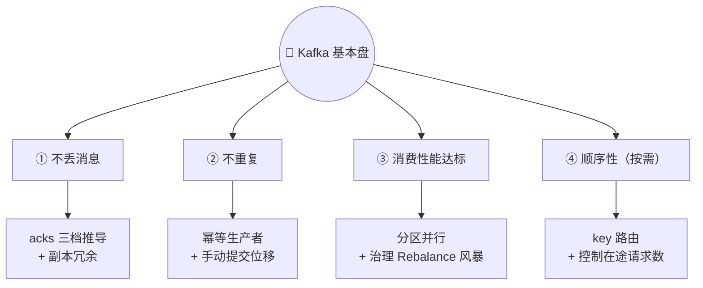

> 视频原话："Kafka 的核心就**三件事**：**不丢消息、不重复、消费性能达标**。记住**四条口诀**：**防丢靠确认与副本，防重靠幂等，保序靠 key，消积压靠扩容与异步**。做到这些，**90% 的生产事故都能避免**。"

**四条口诀 = 可复述的答题骨架**：

| 口诀 | 原理 | 关键配置 | 详见 |
| --- | --- | --- | --- |
| **防丢靠确认与副本** | 生产端等确认（acks）+ 服务端有冗余（副本/ISR） | `acks=all` + `min.insync.replicas=2` + `replication.factor=3` | [§三](#三基本盘之一不丢消息acks-的完整推导) |
| **防重靠幂等** | 消息带 PID + 序列号，broker 自动去重 | `enable.idempotence=true`（跨会话用事务） | [§四](#四基本盘之二不重复幂等事务与先干活再打卡) |
| **保序靠 key** | 相同 key 进同一分区 → 分区内有序 | `key=业务主键`（如 `user_id`） | [§五](#五基本盘之三顺序性局部有序--全局并行) |
| **消积压靠扩容与异步** | 短期加消费者/分区，长期治 Rebalance 风暴 | `CooperativeStickyAssignor` + 超时参数 + 消费逻辑异步化 | [§六](#六基本盘之四不积压分区并行与-rebalance-治理) |

> [!note] 一处值得注意的细节
> 视频先说"核心就**三件事**"（不丢、不重、性能），后面列的却是**四条口诀**——多出来的"**保序**"。
> 这不是口误：**顺序性是"按需"的第四要素**——只有业务要求有序时才成立（且只需"局部有序"）。面试时把这一点讲出来，说明你分得清"必须满足"与"按需满足"。

---

## 一、Kafka 为什么存在：解耦与削峰

> 视频比喻："想象一下它就像一个**智能快递系统**——把包裹扔进快递柜，**收件人什么时候取、谁来取，你都不用操心**，这就是**解耦**；双 11 消息量暴增，**快递柜帮你暂存着**，这就是**削峰**。"

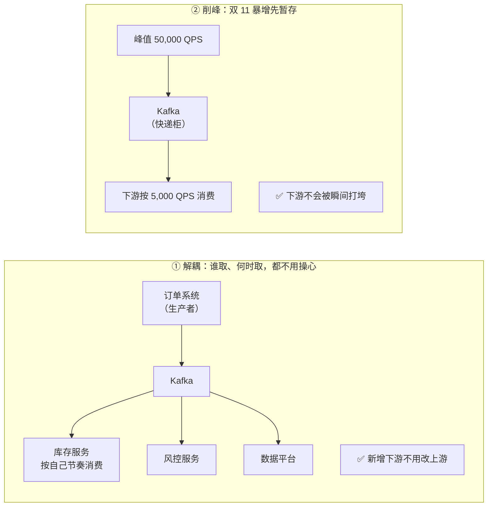

| 价值 | 说明 | 视频里的比喻 |
| --- | --- | --- |
| **解耦** | 生产者不需要知道谁消费、有几个消费者 | "收件人什么时候取、谁来取，你都不用操心" |
| **削峰** | 峰值先堆在 Kafka，下游按自己能力消费 | "双 11 消息量暴增，快递柜帮你暂存着" |
| （异步） | 生产者发完即走，不必同步等待下游 | — |
| （缓冲/重放） | 消息留存一段时间，可按 offset 重放 | — |

---

## 二、物理底座：Broker 集群 → Topic → Partition → Offset

> 视频对话："这地图上**好多个仓库，它们之间是联通的**——每个 broker 就是一个服务器节点，组成集群；**数据被分散存储，一个挂了别的能顶上**。"

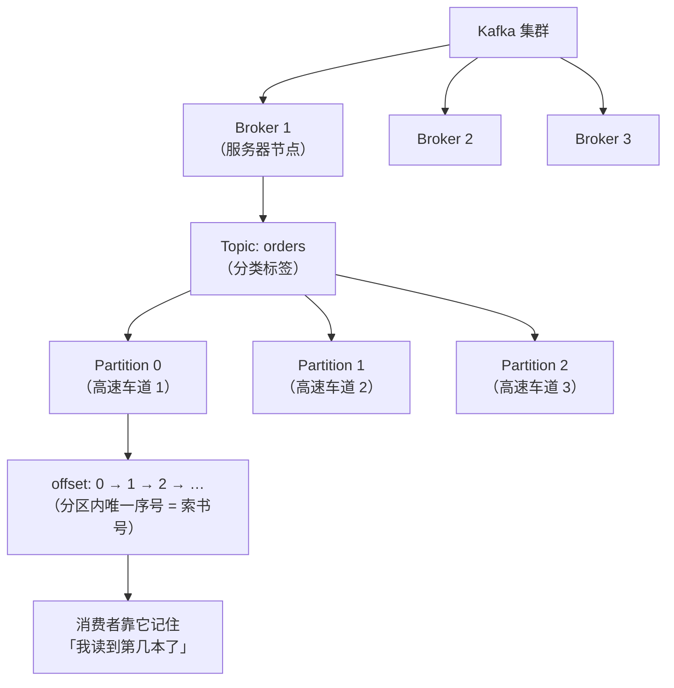

| 概念 | 视频比喻 | 准确含义 |
| --- | --- | --- |
| **Broker** | 地图上的仓库 | 一个服务器节点；多节点组成集群，**数据分散存储，一个挂了别的能顶上** |
| **Topic** | 分类标签（所有订单消息放一起） | 逻辑分类；⭐ **"一个 Topic 不是铁板一块"**——它下面还有分区 |
| **Partition** | 高速公路上的**不同车道** | 物理分片，是**并行、存储、有序**的基本单位 |
| **Offset** | 图书馆的**索书号** | ⭐ **消息在分区内的唯一序号**（从 0 递增）；消费者靠它记录进度 |

> [!important] 这一节是后面三条链路的"物理前提"
> - 有**分区** → 才有多分区并行（[§六 消积压](#六基本盘之四不积压分区并行与-rebalance-治理)）；
> - 有**分区内 offset 有序** → 才有"分区内有序"（[§五 顺序性](#五基本盘之三顺序性局部有序--全局并行)）；
> - 有**多 Broker 副本** → 才有"防丢靠副本"（[§三](#三基本盘之一不丢消息acks-的完整推导)）。

---

## 三、基本盘之一：不丢消息（acks 的完整推导）

视频用 **"acks=0 → acks=1 → acks=all"** 三档，把"消息怎么会丢、怎么才能不丢"推了个遍——这是本篇最扎实的一条链。

### 3.1 第一档：`acks=0` —— 最快但最危险

> 视频对话："我看到消息直接没了！—— **这就是 `acks=0` 的代价**：消息往网络上一扔，**连 broker 收没收到都不确认**；broker 恰好这时候崩了，**消息在传输途中蒸发，你连个报错都收不到**。"

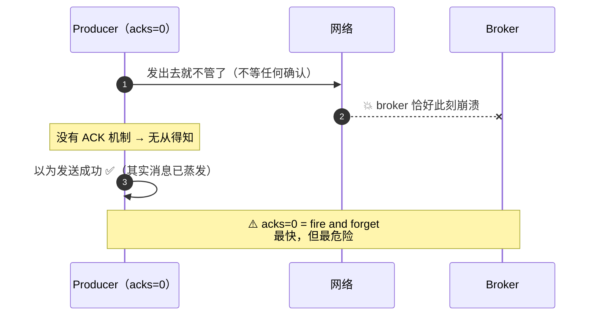

| 特性 | 说明 |
| --- | --- |
| 机制 | 发出即返回，**不等任何确认** |
| 速度 | ⭐ 最快（没有等待） |
| 可靠性 | ❌ 网络丢包、broker 崩溃都会**静默丢消息**（**连报错都没有**） |
| 适用 | 允许丢数据的场景（埋点、监控指标） |

### 3.2 第二档：`acks=1` —— leader 确认，但仍有漏洞

> 视频对话："`acks=1` 是**一直等 leader 确认**；但如果 **leader 刚返回 ACK 就挂了**，**follower 还没同步完**，消息也丢了。"

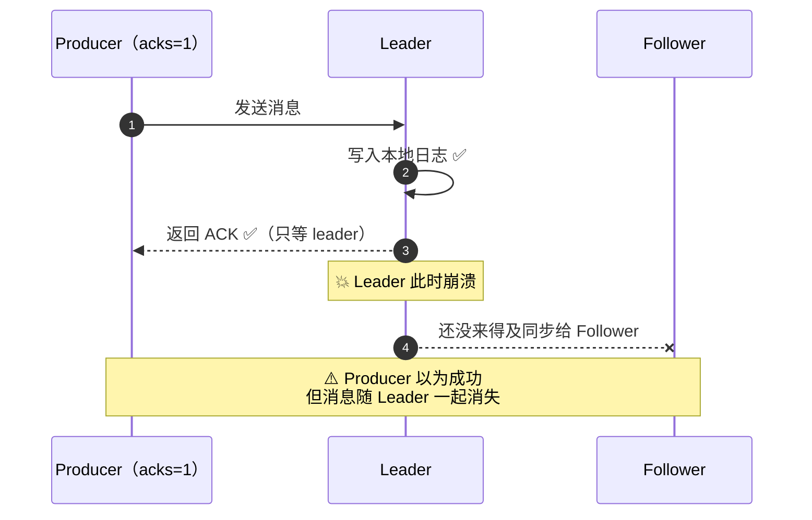

| 特性 | 说明 |
| --- | --- |
| 机制 | **只等 leader 写入本地日志**就返回 ACK |
| 漏洞 | ⭐ **leader 返回 ACK 后立刻崩溃**，且 follower 尚未同步 → **消息丢** |
| 适用 | 对性能敏感、能容忍极小概率丢失的场景 |

### 3.3 第三档（生产标准）：`acks=all` + `min.insync.replicas=2`

> 视频对话："`acks=all` 表示**等 ISR 中所有副本都确认后才返回**；再加上 **`min.insync.replicas=2`**，意思是 **ISR 最少得有两个副本才能写入**——这样**即使一个副本挂了，你还有冗余**。
> **`acks=all` + `min.insync.replicas=2` 是生产环境的标准配置。**"

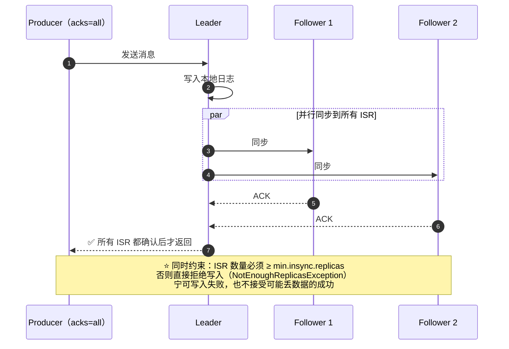

**三档对比**：

| 配置 | 等谁确认 | 丢消息风险 | 性能 | 适用 |
| --- | --- | --- | --- | --- |
| `acks=0` | 谁都不等 | ❌❌ 高（静默丢） | 最快 | 埋点/日志 |
| `acks=1` | 只等 leader | ⚠️ 中（leader 崩溃即丢） | 中 | 一般场景 |
| ⭐ **`acks=all`** | **所有 ISR** | ✅ 低（配合副本） | 最慢 | ⭐ 订单/支付等关键业务 |

> [!important] 为什么必须补上 `min.insync.replicas`？
> **单独设 `acks=all` 是"假安全"**：如果 ISR 缩到只剩 leader 一个，`acks=all` 就退化成"等 leader 自己确认"——**和 `acks=1` 一样危险**。
> `min.insync.replicas=2` 就是那道保险：**ISR 少于 2 个就直接拒绝写入**（`NotEnoughReplicasException`）——**宁可写不进去，也不接受"可能丢的成功"**。
> ⭐ 标准组合：**`replication.factor=3` + `min.insync.replicas=2` + `acks=all`** → 可容忍 **1 个 Broker 故障而不丢数据**。

### 3.4 防丢的完整清单（三道防线）

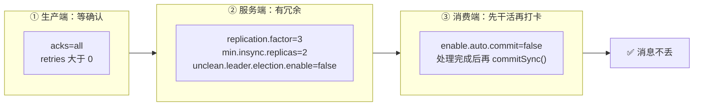

---

## 四、基本盘之二：不重复（幂等、事务与"先干活再打卡"）

### 4.1 重复从哪来：重试 + ACK 丢失

> 视频对话："消息发到一半网络抖了一下……producer 有 **retries 机制会自动重发**；但如果第一条消息 **broker 其实已经收到了，只是 ACK 丢了**，你重试一次，**broker 就收到了两条一模一样的消息**——**重复下单**！"

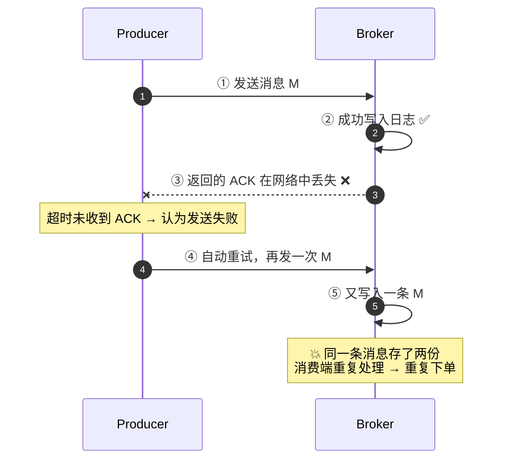

### 4.2 幂等生产者：PID + 序列号自动去重

> 视频对话："所以 Kafka 提供了**幂等生产者**——开启后**每条消息会带上 producer id 和序列号**，broker 检测到**相同的 PID + 序列号**就**自动去重**。"

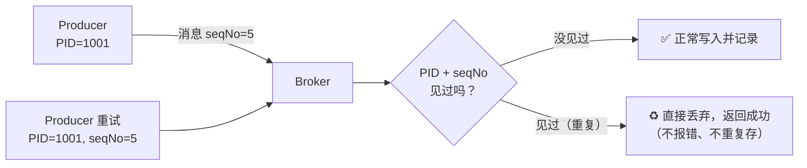

| 组成 | 作用 |
| --- | --- |
| **PID**（Producer ID） | 标识"哪个生产者会话" |
| **序列号**（sequence number） | 该生产者往该分区发送的**第几条**（每分区独立递增） |
| broker 的处理 | 维护 `<PID, 分区> → 最大序列号`，**重复的直接丢弃**，乱序的拒绝 |

> [!tip] 开幂等会"顺带"帮你配好三件事
> `enable.idempotence=true` 会**隐式**要求并设置：`acks=all`、`retries>0`（实际为 Integer.MAX_VALUE）、`max.in.flight.requests.per.connection ≤ 5`。
> 也就是说：**开启幂等 = 同时拿到了"不丢 + 不重 + 不乱序（在途 ≤5 时）"**——生产环境的性价比极高。

### 4.3 幂等的边界：只在"单个会话"内有效

> 视频对话："但注意，**幂等只在单个 producer 会话内有效**；**跨会话的精确一次得用事务 API**。"

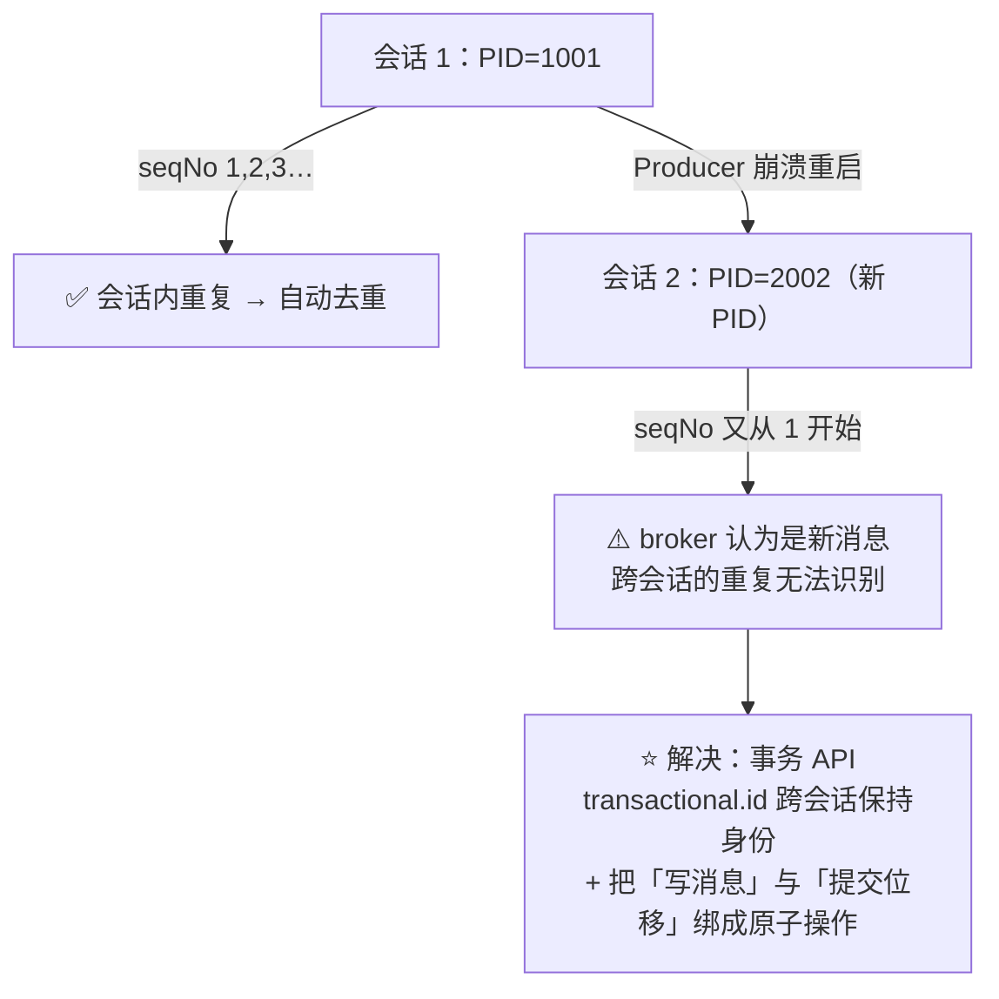

| 机制 | 作用域 | 能解决 |
| --- | --- | --- |
| **幂等生产者** | **单个会话（单 PID）** | 重试导致的重复、分区内乱序 |
| **事务（事务 API）** | **跨会话、跨分区** | 跨会话重复；"消费-处理-生产"的端到端精确一次 |

深读：[[6-事务与Exactly-Once]]（Transaction Coordinator、LSO、`read_committed`）。

### 4.4 消费端的重复与丢失：auto commit 的坑

> 视频对话："天哪，**消息 4~9 虽然没处理完，但 offset 已经提交到 10 了**！——这就是 **auto commit** 的问题：它**按固定时间间隔自动提交，不管你消息有没有真处理完**。
> 正确做法是**关掉自动提交，改用手动提交**——在你**确认消息处理成功之后**再调用 `commitSync()`。**核心原则就是：先干活，再打卡，顺序不能反。**"

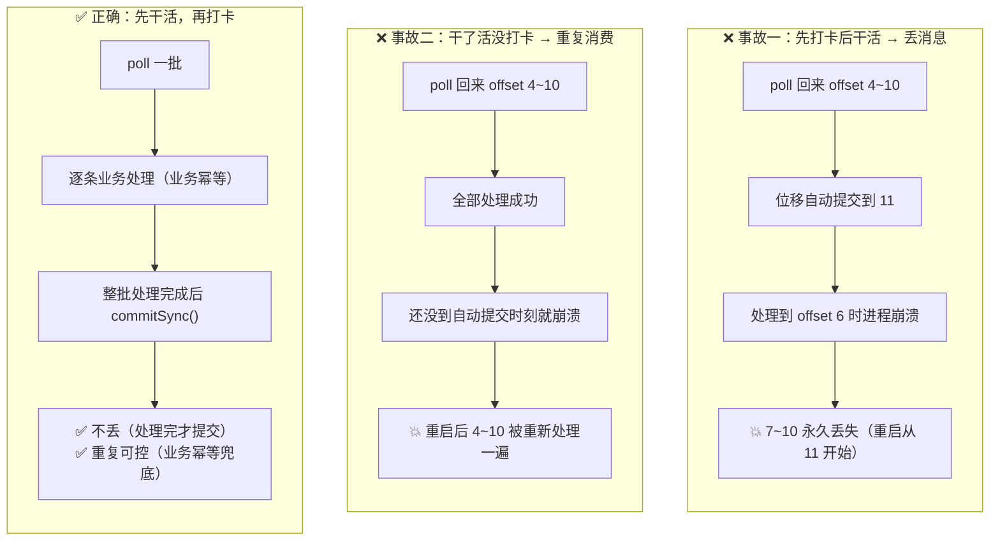

| 项 | 配置 | 说明 |
| --- | --- | --- |
| 默认行为 | `enable.auto.commit=true`，`auto.commit.interval.ms=5000` | ⚠️ 每 5 秒"定时打卡"，**与处理进度无关** |
| 线上做法 | ⭐ **`enable.auto.commit=false`** | 手动提交，**处理成功后再 `commitSync()`** |
| 口诀 | ⭐ **"先干活，再打卡，顺序不能反"** | 先处理业务，再提交位移 |

> [!important] 手动提交也不等于"不重复"
> 手动提交解决了"**因为自动打卡时机不对**"造成的丢/重，但**处理成功、提交位移前崩溃**这类重复**依然存在**——所以必须配**业务幂等**（唯一键、去重表、状态机）。
> **结论：位移提交只能保证"至少一次"，"恰好一次"要靠业务幂等或事务。**

---

## 五、基本盘之三：顺序性（局部有序 + 全局并行）

### 5.1 Kafka 只保证"分区内有序"

> 视频对话："我听说 Kafka 能保证消息顺序？—— **不完全对**。Kafka **只保证单个分区内的消息有序，跨分区是没有全局顺序的**。"

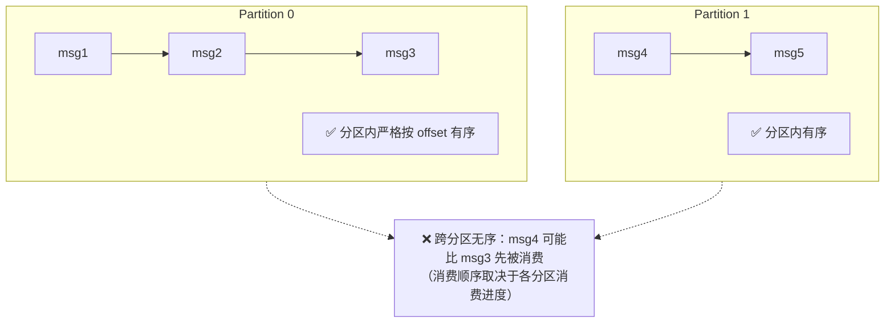

### 5.2 用 key 实现"单用户有序 + 多分区并行"

> 视频对话："大部分场景其实**不需要全局有序**。比如你的订单系统，**只需要保证同一个用户的订单是有序的**，不同用户的订单之间不需要排序。
> 所以你用 **`user_id` 作为消息的 key**，Kafka 就会把**同一用户的消息都路由到同一个分区**——这样就**保证了单用户有序，又实现了多分区并行，鱼和熊掌兼得**。"

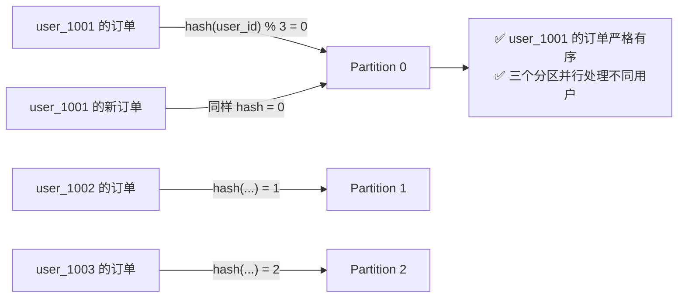

| 需求 | 方案 | 代价 |
| --- | --- | --- |
| **局部有序**（同用户/同订单） | ⭐ **业务主键作 key** | 无（还能多分区并行） |
| **全局有序** | 整个 Topic **只用一个分区** | ❌ 彻底放弃并行（吞吐骤降），一般不推荐 |
| 无顺序要求 | key 留空（轮询均匀分配） | 无 |

### 5.3 在途请求数也会打破顺序

> 视频对话："网上说 `max.in.flight.requests.per.connection` 也会影响顺序？—— **对**。如果这个参数**大于 1 且有重试**，可能导致**后发先至**；**严格顺序场景下设为一**，但**最好配合幂等性使用**，兼顾顺序和吞吐。"

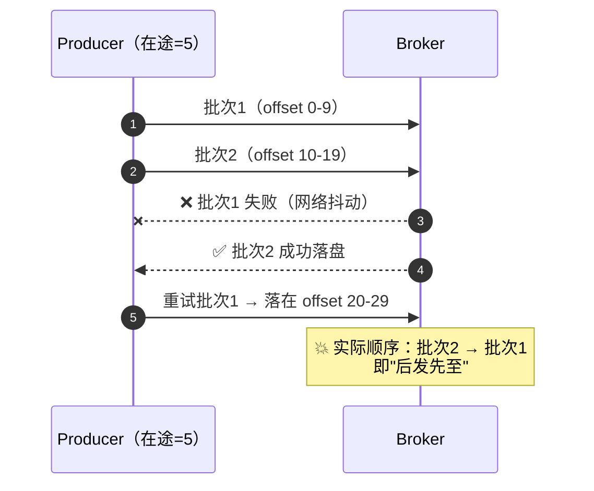

| 配置 | 顺序保证 | 吞吐 | 建议 |
| --- | --- | --- | --- |
| `max.in.flight = 1` | ✅ 严格有序 | ❌ 低（串行等待） | 无幂等时的唯一选择 |
| ⭐ `max.in.flight ≤ 5` + **幂等开启** | ✅ **有序**（序列号保证） | ✅ 高 | ⭐ **推荐**：兼顾顺序与吞吐 |
| `max.in.flight > 1` + 无幂等 | ❌ 可能乱序 | 高 | ⚠️ 禁止用于顺序敏感场景 |

---

## 六、基本盘之四：不积压（分区并行与 Rebalance 治理）

### 6.1 Rebalance 是什么、代价是什么

> 视频对话："**Rebalance 是什么感觉？——消费者老是暂停。** 当 consumer group 里有成员**加入、退出或崩了**，就会触发 Rebalance **重新分配分区**，**这期间所有消费者都暂停消费**。"

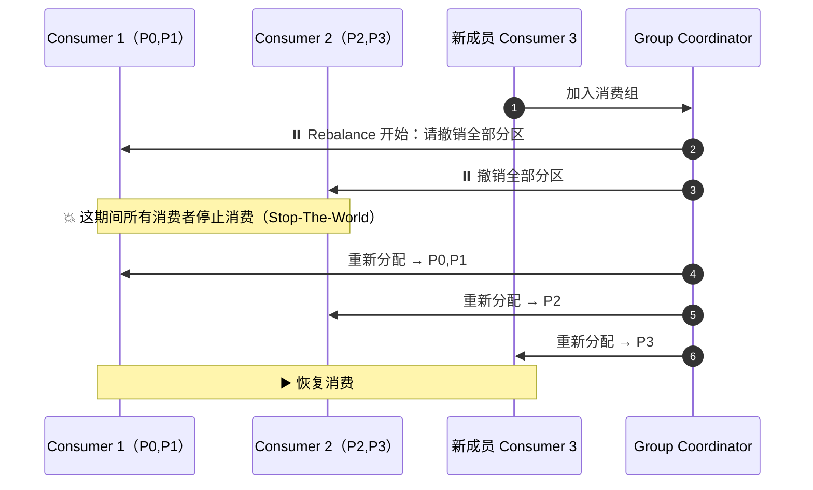

### 6.2 Rebalance 风暴 → 下游积压

> 视频对话："**频繁 Rebalance 就形成风暴**——消费者**根本没时间消费**，导致下游**大量积压**。"

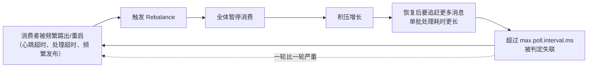

### 6.3 治理：短期扩容 + 长期根治

> 视频对话："解决积压，**短期可以加消费者**，但**消费者数量不能超过分区数**；**长期看要从根源上避免 Rebalance 风暴**——比如用 **CooperativeStickyAssignor 增量再均衡**、**合理设置超时参数**。"

| 时间尺度 | 手段 | 说明 |
| --- | --- | --- |
| **短期止血** | ⭐ **加消费者** | 但**不能超过分区数**（多出来的会空闲）；不够就先**扩分区** |
| **短期止血** | 消费逻辑异步化 | 把慢逻辑（远程调用、写库）批量化/异步化，缩短单批处理时间 |
| **长期根治** | ⭐ **`CooperativeStickyAssignor`** | **增量式协作再均衡**：成员**一个一个退**，不用全组停 |
| **长期根治** | 合理设置超时 | `max.poll.interval.ms` 调大 + `max.poll.records` 调小（避免处理超时被踢） |
| **长期根治** | **静态成员** | `group.instance.id`：短暂重启不触发 Rebalance |
| **长期根治** | 减少无谓重启 | 发布/重启走滚动，避免整组同时下线 |

深读：[[4-消费者与Rebalance]]（Rebalance 协议、Eager vs Cooperative、分配策略）。

---

## 七、四条口诀：答题框架

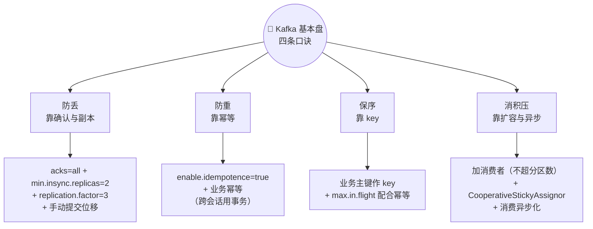

| 口诀 | 一句话原理 | 配置清单 | 最容易犯的错 |
| --- | --- | --- | --- |
| **防丢靠确认与副本** | 生产端等确认 + 服务端有冗余 | `acks=all`、`min.insync.replicas=2`、`RF=3`、`unclean.leader.election.enable=false`、`enable.auto.commit=false` | 只设 `acks=all` 忘了 `min.insync.replicas`；用自动提交 |
| **防重靠幂等** | PID + 序列号去重；跨会话靠事务 | `enable.idempotence=true`、跨会话用 `transactional.id`、消费端**业务幂等** | 以为幂等能管跨会话；忽略消费端重复 |
| **保序靠 key** | 相同 key 同分区 → 分区内有序 | 业务主键作 key；`max.in.flight` 配幂等 | 追求"全局有序"而把分区设为 1 |
| **消积压靠扩容与异步** | 并行 + 少暂停 + 快处理 | 消费者数 = 分区数、`CooperativeStickyAssignor`、`max.poll.interval.ms` 调大、消费逻辑异步化 | 消费者数超过分区数；放任 Rebalance 风暴 |

> 视频结尾："做到这些，**90% 的生产事故都能避免**。"

### 面试速答模板（30 秒版）

> **"Kafka 的可靠性基本盘就是四件事：不丢、不重、有序、不积压。**
> **不丢**——生产端 `acks=all` 配合 `min.insync.replicas=2` 和 `RF=3`，消费端关闭自动提交、处理完再提交位移；
> **不重**——开启幂等生产者（PID + 序列号去重），跨会话用事务，消费端再做业务幂等兜底；
> **有序**——用业务主键（如 `user_id`）作 key，保证同一实体进同一分区，从而"局部有序 + 多分区并行"；
> **不积压**——消费者数对齐分区数，用 `CooperativeStickyAssignor` 和静态成员治理 Rebalance 风暴，同时把慢逻辑异步化。**"

---

## 附录 A：语音转写（ASR）勘误对照

| 原始转写 | 应为 |
| --- | --- |
| CASA / KFK / cf c / KAFKA | **Kafka** |
| **薛峰** | **削峰** |
| **X 等于零 / X 等于一 / X 等于 O** | **`acks=0` / `acks=1` / `acks=all`** |
| ex 就挂了（leader 刚返回 ex） | **ACK** 就挂了（leader 刚返回 **ACK**） |
| **IS2** | **ISR** |
| main in sync replicas / main sync replicas | **`min.insync.replicas`** |
| RETRICE 机制 | **`retries`** 机制 |
| ACG 丢了 | **ACK** 丢了 |
| 密等生产者 / me 等 | **幂等**生产者 / **幂等** |
| pad 加 SCHNO | **PID + 序列号（sequence number）** |
| 单个 producer **绘画**内有效 / 跨**绘画** | 单个 producer **会话**内有效 / 跨**会话** |
| auto commit / commit sink | **auto commit** / **`commitSync()`** |
| REBALANCE | **Rebalance** |
| cooperative DK 赛诺增量再均衡 | **CooperativeStickyAssignor** 增量再均衡 |
| max in the flight requests per connection | **`max.in.flight.requests.per.connection`** |
| 且有**重视** | 且有**重试** |
| 后发先**制** | 后发先**至** |
| **保续**靠 key | **保序**靠 key |
| 图书馆的**所述号** | 图书馆的**索书号** |
| 一个 topic 不是个**笼子** | ⚠️ 语义推测：**"一个 Topic 不是铁板一块"**（指 Topic 内部还分 Partition） |
| 消息 **4~9** 没处理完，offset 提交到 **10** | 指 **offset 4~9**（一条消息一个 offset） |
| 保序靠 key 与单线程消积压 | 保序靠 key；消积压靠扩容与异步（原文两句粘连） |

## 附录 B：最小可用配置模板

```properties
# ============ 生产端：防丢 + 防重 + 保序 ============
bootstrap.servers=kafka-1:9092,kafka-2:9092,kafka-3:9092
acks=all                                  # ① 防丢：等所有 ISR 确认
enable.idempotence=true                   # ② 防重：PID + 序列号去重（隐含 acks=all、retries>0、in.flight≤5）
retries=2147483647                        # 配合幂等，重试安全
max.in.flight.requests.per.connection=5   # ③ 保序：幂等模式下 ≤5 有序
key.serializer=org.apache.kafka.common.serialization.StringSerializer
value.serializer=org.apache.kafka.common.serialization.StringSerializer
# 关键：发送时指定 key（如 user_id），保证同一实体进同一分区

# ============ 消费端：不丢 + 不重 + 不积压 ============
group.id=order-service
enable.auto.commit=false                  # ① 关闭自动提交
auto.offset.reset=earliest                # 无位移时的策略（按业务选）
max.poll.records=200                      # ④ 单批条数（配合处理耗时）
max.poll.interval.ms=600000               # ④ 给足处理时间，防被踢
partition.assignment.strategy=org.apache.kafka.clients.consumer.CooperativeStickyAssignor  # ④ 增量再均衡
group.instance.id=order-consumer-1        # ④ 静态成员，短暂离线不触发 Rebalance
# 业务代码：整批处理完成后再 commitSync()；且业务逻辑必须幂等

# ============ Broker 端：冗余 ============
replication.factor=3                      # 副本冗余
min.insync.replicas=2                     # ⭐ 防丢关键：ISR 少于 2 拒绝写入
unclean.leader.election.enable=false      # 不干净的选举：宁可停服不丢数据
```

## 附录 C：一页速查

| 问题 | 一句话答案 |
| --- | --- |
| Kafka 的价值 | **解耦**（谁取、何时取不用管）+ **削峰**（峰值先暂存）+ 异步 + 重放 |
| 物理结构 | Broker 集群 → Topic → **Partition**（车道）→ **Offset**（分区内唯一序号/索书号） |
| 消息怎么会丢（生产端） | `acks=0` 不确认；`acks=1` 只等 leader（leader 崩了还没同步就丢） |
| 生产标准配置 | ⭐ **`acks=all` + `min.insync.replicas=2` + `replication.factor=3`**（容忍 1 个 Broker 故障） |
| 消息怎么重复 | 网络抖动 → **retries 重发**，但首次其实已写入（只是 ACK 丢了） |
| 幂等怎么去重 | 消息带 **PID + 序列号**，broker 检测到重复直接丢弃 |
| 幂等的边界 | ⭐ **只在单个 producer 会话内有效**；跨会话用**事务 API** |
| auto commit 的坑 | 按时间"定时打卡"，**与处理进度无关** → 可能丢（打卡在前）或重复（干活未完） |
| 位移的正确姿势 | ⭐ **"先干活，再打卡"**：`enable.auto.commit=false`，处理成功后 `commitSync()` |
| 顺序性保证范围 | ⭐ **只保证分区内有序**，跨分区无全局顺序 |
| 怎么兼顾有序与并行 | ⭐ **业务主键作 key**（如 `user_id`）→ 同一实体同分区 → 局部有序 + 多分区并行 |
| 谁还会破坏顺序 | `max.in.flight.requests.per.connection > 1` + 重试 → **后发先至**；设为 1 或**配合幂等**（≤5） |
| Rebalance 是什么 | 组成员变化时**重新分配分区**，期间**所有消费者暂停** |
| Rebalance 风暴后果 | 消费者**没时间消费** → 下游大量积压 |
| 积压怎么治 | 短期**加消费者（不超分区数）**；长期用 **`CooperativeStickyAssignor`** + 调超时 + **静态成员** + 消费异步化 |
| 四条口诀 | **防丢靠确认与副本、防重靠幂等、保序靠 key、消积压靠扩容与异步** |
