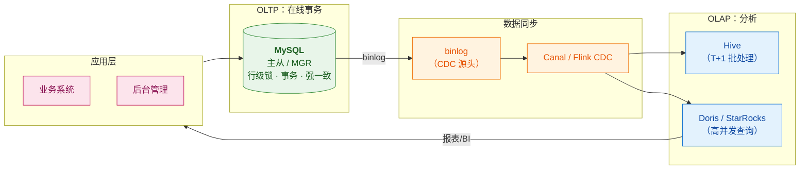

# 🐬 MySQL 总览

> 这是 MySQL 系列笔记的**总入口（MOC）**，也是 `4-db/` 目录的导航页。
> 系列回答五个层次：**① SQL 进来后怎么被处理（架构）② 为什么查得快（索引与 B+ 树）③ 并发下怎么不出错（事务、MVCC、锁）④ 宕机了数据为什么还在（日志）⑤ 线上慢了怎么治（调优）**。
> 关联：[[5-bigdata/1-doris/0-Doris总览|Doris 系列]]（OLAP 对比）、[[1-java/10-数据仓库/0-数据仓库总览|数据仓库系列]]、[[服务器巡检-192.168.0.106/巡检报告|106 巡检环境]]（MGR 实战）。

> [!note] 版本口径
> 以 **MySQL 8.0 + InnoDB 为基线**表述；涉及 5.6/5.7 的关键差异（ICP 引入、`ONLY_FULL_GROUP_BY`、默认隔离级别）会明确标注。
> 你自己的环境：[[服务器巡检-192.168.0.106/巡检报告|106 大数据机]] 上跑着 MySQL（MGR 集群），可以直接动手验证。

> [!important] ⭐ 本系列与已有 3 个文件的分工（**先看这个，别重复读**）
> `4-db/` 下已经有三个 MySQL 文件，本系列是它们的**体系化展开**，不是替代：
>
> | 已有文件 | 是什么 | 与本系列的关系 |
> |---|---|---|
> | [[MySQL深度优化与MGR高可用面试题]] | **面试突击稿**：索引/慢查询/MGR 的问答骨架 | **互补**：它给"怎么答"，本系列给"为什么" |
> | **MySQL面试不背书：用故事讲透索引事务锁.txt** | **视频字幕原稿**（转写，错别字多） | ⭐ 本系列是它的**详细整理版** |
> | [[MYSQL.excalidraw]] | 手绘架构图 | 图纸，本系列提供**文字详解** |
>
> 👉 **本系列的定位**：把视频里"**用故事讲透**"的叙事，展开成**可查、可深挖、图文对应**的知识体系。

---

## 一、系列导航

| # | 笔记 | 一句话定位 | 核心内容 |
|---|---|---|---|
| 1 | **[[1-架构与执行流程]]** | 一条 SQL 的旅程 | **Server 层四关**（连接器/分析器/优化器/执行器）+ **存储引擎层**、插件式架构、InnoDB vs MyISAM vs Memory |
| 2 | **[[2-索引与B+树]]** | ⭐ 为什么查得快 | **为什么是 B+ 树**（磁盘 IO 的账）、聚簇/二级索引、**回表与覆盖索引**、最左前缀、**ICP 索引下推** |
| 3 | **[[3-事务与MVCC]]** | ⭐ 并发下怎么不出错 | **ACID 的真身**、四种隔离级别、**版本链 + Read View 可见性判断**、RC 与 RR 的根本差异 |
| 4 | **[[4-锁机制]]** | ⭐ 谁挡住了谁 | **Record / Gap / Next-Key Lock 三重境界**、退化规则、当前读 vs 快照读、死锁 |
| 5 | **[[5-日志与持久化]]** | 宕机了数据为什么还在 | **undo / redo / binlog 三兄弟**、WAL、**两阶段提交**、**Double Write**、崩溃恢复 |
| 6 | **[[6-慢查询与调优]]** | 线上慢了怎么治 | **诊疗三步**（慢日志→EXPLAIN→手术）、**索引失效六宗罪**、深分页、Buffer Pool、count 优化 |

---

> [!tip] 画图约定
> 本库支持 Mermaid（已装 mermaid-popup / mermaid-zoom）。本系列的图**优先用 Mermaid**，只有"依赖精确对齐"的图（B+ 树页内布局、日志字节、EXPLAIN 输出样本）才保留 ASCII。规范详见 [[1-java/0-知识点/0-Java总览|Java 总览]] §七「文档写作约定」。

## 二、按需求的阅读路径

> [!tip] 四条路径
> **面试突击（1 天）**：[[2-索引与B+树]]（回表/覆盖/最左前缀）→ [[3-事务与MVCC]]（可见性判断）→ [[4-锁机制]]（Next-Key）→ [[6-慢查询与调优]]（EXPLAIN + 失效六宗罪）
> **吃透原理（3～5 天）**：1 → 2 → 3 → 4 → 5 顺序精读；**2、3 是根基**，值得反复读
> **线上排障（按需查）**：[[6-慢查询与调优]]（诊疗三步）→ [[4-锁机制]]（死锁/锁等待）→ [[5-日志与持久化]]（崩溃恢复）
> **纯面试稿**：直接看已有的 [[MySQL深度优化与MGR高可用面试题]]

---

## 三、30 秒速查表

| 问题 | 一句话答案 | 详见 |
|---|---|---|
| 一条 SQL 经过哪四关 | **连接器 → 分析器 → 优化器 → 执行器**（Server 层），再到存储引擎 | [[1-架构与执行流程]] |
| InnoDB 为什么是默认引擎 | ⭐ **不是特性多，而是解决了 OLTP 的核心痛点：并发写入 + 数据安全** | [[1-架构与执行流程]] |
| MyISAM 还能用吗 | ⚠️ **5.6 后 InnoDB 支持全文索引，MyISAM 基本退役** | [[1-架构与执行流程]] |
| Memory 引擎适合什么 | **临时表 / 缓存**，但**重启即丢**，且**哈希索引不支持范围查询** | [[1-架构与执行流程]] |
| ⭐⭐ 为什么索引是 B+ 树 | **磁盘 IO 是瓶颈**：3 层 B+ 树可存约 17 亿行，2000 万行只需 **3 次 IO**；红黑树要 **25 次** | [[2-索引与B+树]] |
| 为什么不用哈希索引 | **不支持范围查询 / 排序 / 最左前缀**，而业务 80% 是范围与排序 | [[2-索引与B+树]] |
| 聚簇索引 vs 二级索引 | ⭐ **房产证 vs 租房合同**：聚簇索引叶子存**整行**；二级索引叶子存**主键值** | [[2-索引与B+树]] |
| 什么是回表 | 走二级索引拿到主键后，**再回聚簇索引查整行** | [[2-索引与B+树]] |
| ⭐ 怎么避免回表 | **覆盖索引**——查询字段都在索引里，不用回表 | [[2-索引与B+树]] |
| 为什么禁止 `SELECT *` | ⭐ **它永远无法走覆盖索引** | [[2-索引与B+树]] |
| 什么是最左前缀 | 联合索引 `(a,b,c)` 按 a→b→c 排序，**跳过中间列就断** | [[2-索引与B+树]] |
| 口诀"遇范围则停" | ⭐ `a=1 AND b>2 AND c=3`：索引**用到 b 就停**，c 无法定位 | [[2-索引与B+树]] |
| ICP 是什么 | **索引下推**（5.6+）：在**索引层就过滤**，减少回表次数 | [[2-索引与B+树]] |
| ACID 怎么实现的 | ⭐ **原子性→undo log，持久性→redo log，隔离性→MVCC+锁，一致性→前三者共同达成** | [[3-事务与MVCC]] |
| MySQL 默认隔离级别 | **RR（可重复读）** | [[3-事务与MVCC]] |
| RC 和 RR 的本质区别 | ⭐ **Read View 生成时机**：RC 每次 select 都生成；RR 只在第一次生成 | [[3-事务与MVCC]] |
| RR 怎么防幻读 | **快照读靠 MVCC**；**当前读靠 Next-Key Lock** | [[3-事务与MVCC]]、[[4-锁机制]] |
| 三重锁是什么 | ⭐ **Record（锁行）/ Gap（锁间隙）/ Next-Key（组合）** | [[4-锁机制]] |
| Gap Lock 何时存在 | ⚠️ **只在 RR 级别**，RC 下没有 | [[4-锁机制]] |
| Next-Key 何时退化 | ⭐ **唯一索引等值且记录存在 → Record Lock**；**不存在 → Gap Lock** | [[4-锁机制]] |
| 三个日志怎么分工 | ⭐ **undo（回滚+MVCC）/ redo（崩溃恢复）/ binlog（主从复制）** | [[5-日志与持久化]] |
| 为什么要两阶段提交 | **让 redo 和 binlog 原子**，否则主从数据不一致 | [[5-日志与持久化]] |
| redo log 能救所有崩溃吗 | ❌ **救不了页撕裂**（partial page write）→ 需要 **Double Write** | [[5-日志与持久化]] |
| 慢查询怎么治 | ⭐ **诊疗三步：慢日志问诊 → EXPLAIN 体检 → 对症手术** | [[6-慢查询与调优]] |
| EXPLAIN 看哪三列 | **type（ALL=全表）/ key（NULL=没索引）/ Extra（Using filesort）** | [[6-慢查询与调优]] |
| 索引失效六宗罪 | **函数 / 隐式转换 / 前导 % / OR 非索引列 / 否定条件 / 违反最左前缀** | [[6-慢查询与调优]] |
| 深分页怎么优化 | **延迟关联**：先用覆盖索引取 id，再回表（回表从 100 万降到 10 次） | [[6-慢查询与调优]] |
| Buffer Pool 为什么不是普通 LRU | ⭐ **防缓存污染**：分 young/old 两区，新页先进 old，存活超 1 秒才晋升 | [[6-慢查询与调优]] |

---

## 四、核心概念最小记忆集

| 概念 | 精确定义 | 常见误解 |
|---|---|---|
| **Server 层 / 引擎层** | 上面管 SQL 解析与优化，下面管数据存取 | 以为 MySQL 是一个整体 |
| **插件式架构** | 换引擎，Server 层四关不变 | 以为换引擎要改 SQL |
| **B+ 树** | **多叉平衡树**，非叶只存键+指针，叶子存数据且**有链表** | 以为和 B 树一样 |
| **聚簇索引** | InnoDB 主键索引，**叶子存整行** → "索引组织表" | 以为索引和数据分开 |
| **二级索引** | 叶子存**主键值**，查非索引列要**回表** | 以为叶子也存整行 |
| **回表** | 二级索引 → 主键 → 聚簇索引查整行 | 以为走索引就一定快 |
| **覆盖索引** | 查询的列**都在索引里**，无需回表 | 以为只有联合索引能覆盖 |
| **最左前缀** | 联合索引按定义顺序排序，**不能跳列** | 以为列顺序无所谓 |
| **ICP（索引下推）** | 存储引擎在索引层**先过滤**，减少回表 | 以为是 5.0 就有的 |
| **MVCC** | 多版本并发控制：**读写不阻塞** | 以为 MVCC 能解决所有并发问题 |
| **Read View** | 快照，含**活跃事务列表/最小活跃 id/下一个 id/自身 id** | 以为是"复制了一份数据" |
| **当前读 vs 快照读** | `SELECT` 普通查询是快照读；`FOR UPDATE`/`UPDATE` 是当前读 | 混为一谈 |
| **Next-Key Lock** | **Record + Gap** 的组合，左开右闭 | 以为是两种锁叠加而已 |
| **WAL** | Write-Ahead Logging：**先写日志再写数据页** | 以为日志是事后补记 |
| **两阶段提交** | redo `prepare` → binlog → redo `commit` | 以为只是"写两次" |
| **Double Write** | 脏页刷盘前先写双写区，**防页撕裂** | 以为 redo log 能兜住一切 |
| **Buffer Pool** | 内存缓冲池，**分 young/old 两区防污染** | 以为是普通 LRU |

> [!warning] 六个最经典的认知误区
> 1. **"InnoDB 因为特性多才成为默认引擎"** —— ❌ 更准确的说法是：**它解决了 OLTP 的核心痛点**
>    （并发写入 + 事务 + 崩溃不丢数据）。**MyISAM 这三样一个都没有。**
> 2. **"走索引就一定快"** —— ❌ **回表可能比全表扫描更贵**。
>    走二级索引查 1000 行、每行都回表 = **1000 次随机 IO**，还真不如顺序全扫。
> 3. **"MVCC 解决了幻读"** —— ⚠️ 不完整。**快照读**靠 MVCC 防幻读；
>    **当前读**（`FOR UPDATE`）必须靠 **Next-Key Lock** 才防得住。
> 4. **"RR 完全不会幻读"** —— ⚠️ 在 RR 下：**快照读不会**（读的是快照），
>    **但当前读仍可能**，除非锁覆盖到位。
> 5. **"redo log 能保证不丢数据"** —— ⚠️ **它救不了页撕裂**（partial page write），
>    所以还需要 **Double Write** 兜底。**是"双保险"，不是"一个就够"。**
> 6. **"`SELECT *` 只是多读几列"** —— ❌ 更严重的是 ⭐ **它永远无法走覆盖索引**，
>    **必然回表**。这是性能问题，不只是"浪费带宽"。

---

## 五、MySQL 在大数据版图里的位置

> [!important] MySQL 的定位（要说准）
> **MySQL 是"OLTP 的王者"**——**为高并发小事务、强一致、行级更新而生**。
>
> | 需求 | 选谁 |
> |---|---|
> | **在线交易、强一致、行级更新** | ⭐ **MySQL** |
> | **海量 T+1 批处理、ETL** | Hive |
> | **秒级高并发分析查询** | Doris / StarRocks |
> | **按 key 随机读写、点查** | HBase |
>
> **共性认知**：**MySQL 是数据的"源"，数仓是数据的"汇"**——
> **binlog 是这两者之间的桥梁**（CDC 同步的源头，见 [[5-日志与持久化]]）。

---

## 六、学习检查清单

- [ ] ⭐ 能画出**一条 SQL 的完整执行流程**（Server 层四关 + 引擎层）
- [ ] 能说清**为什么 InnoDB 是默认引擎**（不是特性多，而是解决 OLTP 痛点）
- [ ] 能对比 **InnoDB / MyISAM / Memory** 三种引擎并给出选型
- [ ] ⭐⭐ 能用**磁盘 IO 的账**讲清**为什么是 B+ 树**（3 层 vs 25 层）
- [ ] 能说清**为什么不用哈希索引**（三个致命伤）
- [ ] ⭐ 能用"**房产证 vs 租房合同**"讲清聚簇索引与二级索引
- [ ] ⭐ 能说清**回表**的代价，并说出**避免回表的手段**（覆盖索引）
- [ ] ⭐ 能说清**最左前缀**与"**遇范围则停**"，并能判断给定 SQL 走了几列
- [ ] 能说清 **ICP 索引下推**解决什么问题
- [ ] ⭐ 能用一句话说清 **ACID 各自的实现技术**
- [ ] 能说清**四种隔离级别**各自防了什么、适用什么场景
- [ ] ⭐⭐ 能说清 **RC 与 RR 的本质区别**（Read View 生成时机）
- [ ] ⭐⭐ 能完整讲出 **MVCC 可见性判断的三条规则**
- [ ] ⭐ 能说清**三重锁**（Record/Gap/Next-Key）及**退化规则**
- [ ] 能区分**当前读与快照读**
- [ ] ⭐ 能说清 **undo / redo / binlog** 各自的作用与所属层
- [ ] ⭐ 能解释**为什么要两阶段提交**
- [ ] ⭐ 能说清 **Double Write** 解决什么问题
- [ ] ⭐ 能背出**慢查询诊疗三步**
- [ ] ⭐ 能背出**索引失效六宗罪**
- [ ] 能说清 **EXPLAIN 重点看哪三列**
- [ ] 能说清**深分页的延迟关联优化**
- [ ] 能说清 **Buffer Pool 为什么不用普通 LRU**

---
> [!question] 还需要补充什么？
> 可继续扩展的方向：**主从复制与 MGR 深入**（已有 [[MySQL深度优化与MGR高可用面试题]] 覆盖面试角度）、
> **分库分表与 ShardingSphere**、**读写分离与一致性**、**MySQL 8.0 新特性**（CTE、窗口函数、Hash Join）、
> **Online DDL 与 gh-ost/pt-osc**、**连接池与连接数治理**、**MySQL on K8s**。
> 需要哪块就新开一篇并在上方导航表登记。

#MySQL #InnoDB #索引 #事务 #MVCC #锁 #MOC

---

## 附录 A：语音转写（ASR）勘误对照

> 原稿 `MySQL面试不背书：用故事讲透索引事务锁.txt` 是语音转写，**错误较多**。
> 阅读原始字幕稿时对照此表。

| 原稿（错） | 正确 | 说明 |
|---|---|---|
| **毕加树 / B 加数 / 毕加数** | **B+ 树** | 全文多处（最典型） |
| **删除率** | **扇出（fan-out）** | "16KB 页约 1200 个指针" |
| **液 / 叶** | **页 / 叶子节点** | "一个 16KB 的液" |
| **据速索引 / 巨促索引** | **聚簇索引** | 全文多处 |
| **中介所** | **中介 / 房管局**（比喻语境） | 回表比喻 |
| **必加数遍历** | **B+ 树遍历** | "一次回表等于额外一次 B+ 树遍历" |
| **NBCC / MBCC / n b cc / NVCC** | **MVCC** | 全文多处 |
| **review / read view** | **Read View** | MVCC 快照 |
| **T2X 杠 id / DB 杠 roll 杠 PTR** | **`trx_id` / `DB_ROLL_PTR`** | 版本链字段 |
| **get log / get 锁** | **Gap Lock（间隙锁）** | 锁机制章节 |
| **next key log** | **Next-Key Lock** | 锁机制章节 |
| **record log** | **Record Lock** | 锁机制章节 |
| **行所** | **行锁** | "行锁让千人同时下单" |
| **叫燕唯一性** | **校验唯一性** | Change Buffer 段落 |
| **毒磁盘** | **读磁盘** | "不傻等磁盘" |
| **index condition push down / CP** | **ICP（Index Condition Pushdown）** | 索引下推 |
| **O2 / O 二** | **OR** | "OR 连接非索引列" |
| **is not now** | **IS NOT NULL** | 否定条件 |
| **bar char** | **VARCHAR** | 隐式类型转换 |
| **放患毒 / 防患毒** | **防幻读** | RR 级别段落 |
| **radio log / Redo log** | **redo log** | 日志章节 |
| **blog / been log** | **binlog** | 日志章节 |
| **wall writer head login** | **WAL（Write-Ahead Logging）** | "预写日志" |
| **double ride / 双写区** | **Double Write** | 防页撕裂 |
| **部分夜视效 / Partial page right** | **页撕裂 / Partial Page Write** | 崩溃恢复 |
| **man secreo / man 慢查询** | **慢查询（slow query）** | 调优章节 |
| **rose** | **rows（扫描行数）** | EXPLAIN 列名 |
| **t now / key 等于 now** | **key 为 NULL** | EXPLAIN 列 |
| **firesort** | **filesort** | `Using filesort` |
| **buffer pool 数据验** | **Buffer Pool（缓冲池）** | 内存章节 |
| **直达 LRU** | **只答 LRU** | "只答 LRU 面试官觉得你没看过源码" |
| **两区 young / old** | **young / old 区** | 此处原文基本正确 |
| **延迟关联 / 延迟关联** | **延迟关联（deferred join）** | 深分页优化 |
| **AI 酸 / ACID** | **ACID** | 事务章节 |
| **一致性是目标** | **一致性是目标** | 此处原文正确 |
| **readview / review** | **Read View** | 全文多处 |
| **innodb_old_blocks_time** | 同上（原文提到"默认一秒"，正确） | —— |

> [!success] 六条叙事策略（转写稿结尾强调的，值得保留）
> 1. **先抛结论**定基调
> 2. **再讲流程**展逻辑
> 3. **挖底层**修源码级细节
> 4. **聊生产场景和避坑**证明你干过
> 5. **用数字讲话**（"16K 页、扇出 1200、3 层存 17 亿"）
> 6. **用比喻讲抽象概念**（房产证/租房合同、交响乐、时光隧道）
>
> **"同样的弹药用不同的枪打出去，杀伤力天差地别。"**
> ——正式知识是弹药，**叙事是枪**。
