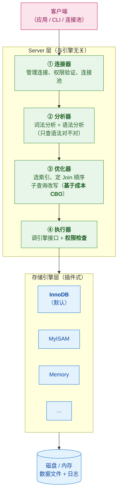
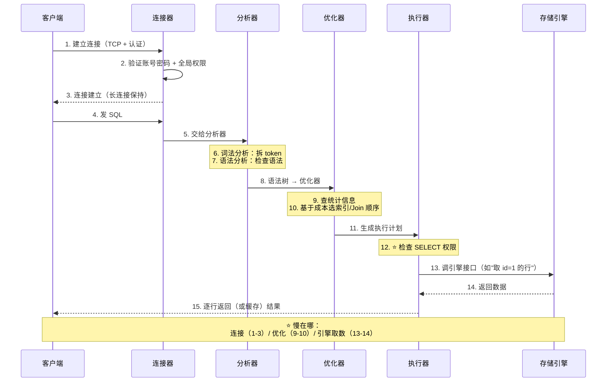
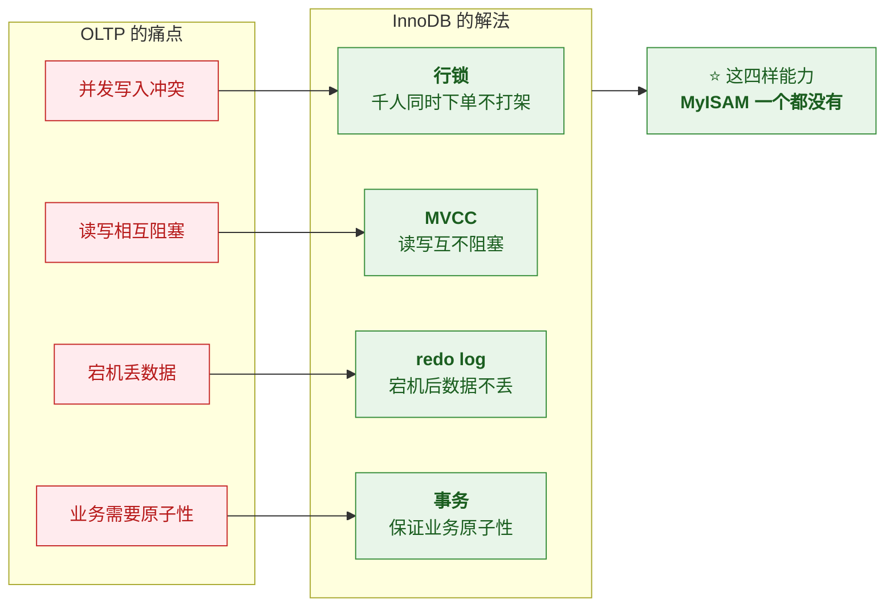

# 🏗️ 一、MySQL 架构与执行流程

> 本篇回答四个问题：**一条 SQL 从发出到返回结果，经过了哪些关卡**？
> **Server 层和存储引擎层怎么分工**？**为什么 InnoDB 是默认引擎**？以及**三种引擎怎么选**？
> 系列导航见 [[0-MySQL总览]]；索引见 [[2-索引与B+树]]；事务见 [[3-事务与MVCC]]。

---

## 一、分层架构：一条 SQL 的旅程

> [!important] ⭐ 核心认知：MySQL 是**两层**的
> | 层 | 负责什么 | 组件 |
> |---|---|---|
> | **Server 层** | **SQL 的解析、优化、执行调度**（与引擎无关） | 连接器、分析器、优化器、执行器 |
> | **存储引擎层** | **数据的实际存取**（插件式，可替换） | InnoDB、MyISAM、Memory… |
>
> **关键**：**两层解耦**——换引擎，**Server 层四关一模一样**。这就是"插件式架构"。

### 1.1 全景图



### 1.2 四关详解

| 关卡 | 别名 | 做什么 | **不做什么** |
|---|---|---|---|
| **① 连接器** | 门卫 | **TCP 握手 + 身份认证 + 权限验证**；管理连接（`wait_timeout` 超时断开） | 不碰 SQL 内容 |
| **② 分析器** | 语文老师 | **词法分析**（拆 token：`select` 是关键字、`users` 是表名）+ **语法分析**（检查语法） | ⭐ **只查语法，不查语义**（如"表存不存在"） |
| **③ 优化器** | 策略大师 | **选索引、定 Join 顺序、子查询改写**——⭐ **基于成本模型（CBO）** | 不执行 |
| **④ 执行器** | 干活的人 | **调引擎接口取数** + ⭐ **隐藏职责：先检查该表的 SELECT 权限** | 不解析语法 |

> [!tip] 三个容易被忽略的细节（说出来就显专业）
> **① 连接器：一定要提"连接池"**
> 面试官听到"连接池"就知道你**真上过生产**——因为**连接是宝贵资源**，
> 频繁新建/销毁连接的开销很大，生产必须用连接池。
>
> **② 分析器只做"语法"检查，不做"语义"检查**
> `SELECT * FORM users`（拼错 `FROM`）→ 分析器报错；
> 但 `SELECT * FROM 不存在的表` → **分析器通过**，要到**执行阶段**才报错。
>
> **③ 执行器有"权限检查"这个隐藏职责**
> ⭐ **很多人漏掉这一步**。执行器在**调存储引擎之前**，
> 先检查"当前用户有没有这张表的 SELECT 权限"。
>
> **为什么在这么晚才查权限？** 因为**表名要到解析完成才知道**——
> 而**连接时只能验证"库级/全局权限"**。

> [!success] "插件式架构"这一句很值钱
> **Server 层和存储引擎层是解耦的**——
> **你换成 MyRocks、TiKV，上面这四关一模一样。**
>
> **这就是"插件式架构的威力"**：
> SQL 层的实现（解析、优化、权限）**与数据怎么存无关**。

### 1.3 完整的执行时序



### 1.4 为什么"同一条 SQL 有时快有时慢"

> [!important] 从执行流程能推出三个"性能不稳定"的根源

| 根源 | 说明 |
|---|---|
| **① 优化器选错索引** | 统计信息过期 → CBO 估错 → **选了个更差的索引** |
| **② 引擎层的锁等待** | 执行器调引擎时**被别的锁挡住** → 时间花在等待 |
| **③ 数据不在 Buffer Pool** | 要读磁盘（冷数据）vs 命中内存——**差几个数量级** |

> [!tip] 面试常问："为什么这条 SQL 昨天很快，今天就慢了？"
> 可以从这三个角度答：
> **① 统计信息变了**（数据量涨了）→ 优化器换了执行计划
> **② Buffer Pool 被别的查询污染了**（热数据被挤出去）
> **③ 并发上来了**，锁等待变长
>
> **能说出"同一 SQL 执行计划可能变"，就比"索引没建好"深刻得多。**

---

## 二、⭐ 为什么 InnoDB 是默认引擎

> [!important] ⭐ 转变思路：不要背特性清单
> **不是"因为 InnoDB 特性多"，而是"它解决了 OLTP 的核心痛点"。**
>
> **OLTP 的核心痛点是什么？**
> 1. **并发写入**——千万人同时下单，不能互相打架
> 2. **数据安全**——宕机后已提交的数据不能丢
> 3. **业务原子性**——转账不能只扣不加

### 2.1 InnoDB 的四大能力（对应四个痛点）



> [!success] ⭐ 一段可以直接背的答法
> **"InnoDB 成为默认引擎，不是因为它特性多，而是因为它解决了 OLTP 的核心痛点：**
> **并发写入和数据安全。**
> - **行锁**让千人同时下单不打架
> - **MVCC** 让读写互不阻塞
> - **redo log** 让宕机后数据不丢
> - **事务**保证业务原子性
>
> **这四样能力，MyISAM 一个都没有。"**

### 2.2 三大引擎对比

| 维度 | **InnoDB** | **MyISAM** | **Memory** |
|---|---|---|---|
| **事务** | ✅ **支持** | ❌ 不支持 | ❌ 不支持 |
| **锁粒度** | ⭐ **行锁** | **表锁** | 表锁 |
| **MVCC** | ✅ | ❌ | ❌ |
| **崩溃恢复** | ✅ **redo log** | ❌ | ❌ **重启即丢** |
| **外键** | ✅ | ❌ | ❌ |
| **索引结构** | **B+ 树（聚簇）** | B+ 树（**非聚簇**） | ⚠️ **哈希索引**（默认） |
| **全文索引** | ✅ **5.6+ 支持** | ✅（曾是其独有优势） | ❌ |
| **存储** | 磁盘 | 磁盘 | ⚠️ **内存** |
| **现状** | ⭐ **默认，生产首选** | ⚠️ **基本退役** | 特殊场景 |

> [!warning] ⚠️ 关于 MyISAM 的正确说法
> **面试时你说"MyISAM 适合读多写少的场景"是对的，但必须补一句：
> "现在生产环境几乎不用了。"** —— 这才叫与时俱进。
>
> **为什么退役？**
> - **5.6 之后 InnoDB 也支持全文索引**——MyISAM 最后的独有优势没了
> - **MyISAM 不支持事务、只有表锁、崩溃后可能损坏**
> - **唯一残存的合理性**：**读多写少的日志场景，开销更小**（但收益已不值得）

> [!note] Memory 引擎：特种兵
> **数据全在内存、速度极快，但重启就没了。**
> - ✅ **适合**：会话缓存、临时中间表
> - ⚠️ **注意**：**它默认用哈希索引，不支持范围查询**
> - ⚠️ **面试提到它说明知识广度够，但别把它当主力推荐**

**选型速查**：

```sql
-- 建表指定引擎
CREATE TABLE t (...) ENGINE=InnoDB;      -- ⭐ 默认，几乎总是这个
CREATE TABLE t (...) ENGINE=MyISAM;      -- 基本不用
CREATE TABLE t (...) ENGINE=MEMORY;      -- 临时表

-- 查表的引擎
SHOW TABLE STATUS LIKE 't'\G            -- 看 Engine 列
```

---

## 三、Server 层的三个高频考点

### 3.1 长连接与连接池

> [!warning] 长连接的坑
> **MySQL 连接建立后是长连接**（避免频繁握手开销），但：
> - **连接数会累积**——`wait_timeout`（默认 8 小时）后才断开
> - **内存泄漏风险**——长连接里累积的临时内存不释放
>
> **解法**：
> 
> | 手段 | 说明 |
> |---|---|
> | **定期断开长连接** | 或执行 `mysql_reset_connection` 重置会话 |
> | **用连接池** | ⭐ **生产必须**——复用连接、控制总量、防打满 |

### 3.2 优化器：CBO 与"选错索引"

> [!important] 优化器的决策依据是**成本模型（Cost-Based Optimizer）**
> 它会估算多条执行路径的成本，选**成本最低的**：
> - 用哪个索引（或不用索引）
> - 多表 Join 的顺序
> - 子查询怎么改写
>
> **成本估算依赖"统计信息"**（索引基数、行数等）——
> **统计信息过期，就会选错。**

**优化器选错索引的三种典型情况**：

| 情况 | 为什么 | 怎么查/修 |
|---|---|---|
| **统计信息过期** | 数据涨了但统计没更新 → 估错行数 | `ANALYZE TABLE t;` |
| **索引区分度低** | 该列重复值太多（如性别）→ 走索引不如全扫 | 建更合适的联合索引 |
| **`ORDER BY`/`LIMIT` 干扰** | 优化器为了"避免排序"选了个差索引 | `FORCE INDEX` 强制 |

```sql
-- 强制用某个索引（排查用，别当常规手段）
SELECT * FROM t FORCE INDEX(idx_name) WHERE ...;

-- 让优化器"忽略"某索引
SELECT * FROM t IGNORE INDEX(idx_name) WHERE ...;

-- 更新统计信息
ANALYZE TABLE t;
```

> [!tip] `FORCE INDEX` 的正确用法
> **它是"诊断工具"而不是"解决方案"**——
> **如果必须靠 `FORCE INDEX` 才能走对索引，说明索引设计或统计信息有问题**，
> 应该从根上解决（比如建更合适的索引、`ANALYZE`）。

### 3.3 执行器与"引擎接口"

> [!note] 执行器是怎么"要数据"的
> 执行器**不直接读磁盘**，而是**调存储引擎提供的接口**：
> - "取满足 `id=1` 的第一行"
> - "取满足条件的下一行"
>
> **这个接口是"逐行"的**——所以**执行器是"边取边判断"**：
> 引擎返回一行 → 执行器检查是否符合条件 → 符合就发给客户端，不符合就继续要下一行。
>
> 👉 **由此推出一个重要结论**：
> **如果索引只能过滤一部分条件，剩下的要在 Server 层逐行判断**——
> **这就是"回表 + 逐行过滤"可能很慢的原因**（也是 ICP 想解决的，见 [[2-索引与B+树]]）。

---

## 四、查询缓存：一个已被移除的组件

> [!warning] ⚠️ 版本提醒：**MySQL 8.0 已移除查询缓存**
> **5.7 及之前**有 Query Cache（把 SQL 文本 + 结果的映射缓存起来），
> 但**8.0 直接删掉了**。

**为什么被删**：

| 问题 | 说明 |
|---|---|
| **失效太频繁** | ⭐ **表上任何一次写，该表所有缓存全失效**——写多的库命中率极低 |
| **粒度太粗** | 按"SQL 文本"精确匹配，**多一个空格就不命中** |
| **全局锁开销** | 缓存维护需要全局锁，**反而成为瓶颈** |
| **收益不匹配** | 大多数 OLTP 场景命中率很低 |

> [!important] 现在该怎么做缓存
> **推荐在应用层做**（Redis 等）——
> **可以按业务语义精确控制失效策略**，比 MySQL 的粗粒度缓存有效得多。
>
> ⚠️ **面试时如果还提"查询缓存"，会被认为知识没更新。**

---

## 五、30 秒速查表

| 问题 | 一句话答案 |
|---|---|
| MySQL 分几层 | **Server 层**（SQL 处理）+ **存储引擎层**（数据存取） |
| Server 层四关 | ⭐ **连接器 → 分析器 → 优化器 → 执行器** |
| 连接器做什么 | **TCP + 认证 + 全局权限**；管理连接（长连接/连接池） |
| 分析器做什么 | **词法分析 + 语法分析**——⭐ **只查语法，不查语义** |
| 优化器做什么 | ⭐ **基于成本（CBO）**选索引、定 Join 顺序、改子查询 |
| 执行器做什么 | 调引擎接口 + ⭐ **隐藏职责：检查 SELECT 权限** |
| 插件式架构的含义 | ⭐ **换引擎，Server 层四关不变** |
| 为什么权限检查在执行器 | 因为**表名要解析后才知道**，连接时只能验证全局权限 |
| ⭐ InnoDB 为什么是默认 | **不是特性多，而是解决了 OLTP 痛点：并发写入 + 数据安全** |
| InnoDB 四大能力 | **行锁 / MVCC / redo log / 事务**——⭐ **MyISAM 一个都没有** |
| MyISAM 现状 | ⚠️ **基本退役**（5.6 后 InnoDB 也支持全文索引） |
| Memory 引擎注意点 | **重启即丢** + ⚠️ **哈希索引不支持范围查询** |
| 引擎怎么指定 | `CREATE TABLE ... ENGINE=InnoDB`（默认） |
| 优化器为什么选错索引 | ⭐ **统计信息过期 / 区分度低 / ORDER BY 干扰** |
| 统计信息怎么更新 | `ANALYZE TABLE t;` |
| `FORCE INDEX` 是什么 | ⭐ **诊断工具**，不是解决方案 |
| 同一条 SQL 为什么时快时慢 | **优化器换计划 / Buffer Pool 被污染 / 锁等待** |
| MySQL 8.0 移除了什么 | ⭐ **查询缓存**（失效太频繁、粒度太粗、全局锁开销） |
| 现在怎么缓存 | **应用层缓存**（Redis），可精确控制失效策略 |

---

## 六、学习检查清单

- [ ] ⭐ 能画出**两层架构图**并说清各层职责
- [ ] ⭐⭐ 能按顺序讲出**四关各自做什么、不做什么**
- [ ] 能说出**连接器为什么一定要提连接池**
- [ ] ⭐ 能说清**分析器"只查语法不查语义"**（举 `SELECT * FORM` 的例子）
- [ ] ⭐ 能说清**执行器的隐藏职责**（权限检查）以及它为什么在这么晚
- [ ] 能解释**"插件式架构"**的含义与价值
- [ ] ⭐ 能讲出**完整的执行时序图**，并指出性能瓶颈可能在哪
- [ ] ⭐ 能回答"**同一条 SQL 为什么昨天快今天慢**"（三个角度）
- [ ] ⭐⭐ 能说清**InnoDB 为什么是默认引擎**（四个痛点对应四种能力）
- [ ] 能对比 **InnoDB / MyISAM / Memory** 并给出选型建议
- [ ] ⚠️ 能说出 **MyISAM 退役的原因**，并会"补一句现在几乎不用"
- [ ] 能说出 **Memory 引擎的两个注意点**（重启丢、哈希索引）
- [ ] ⭐ 能说清**优化器选错索引的三种情况**及应对
- [ ] 能说出 **`FORCE INDEX` 是诊断工具而非解决方案**
- [ ] ⚠️ 能说出**查询缓存为什么在 8.0 被移除**，以及现在该怎么做缓存

---
> 下一篇 → [[2-索引与B+树]] ｜ 返回 [[0-MySQL总览]]
> 面试冲刺 → [[MySQL深度优化与MGR高可用面试题]]
