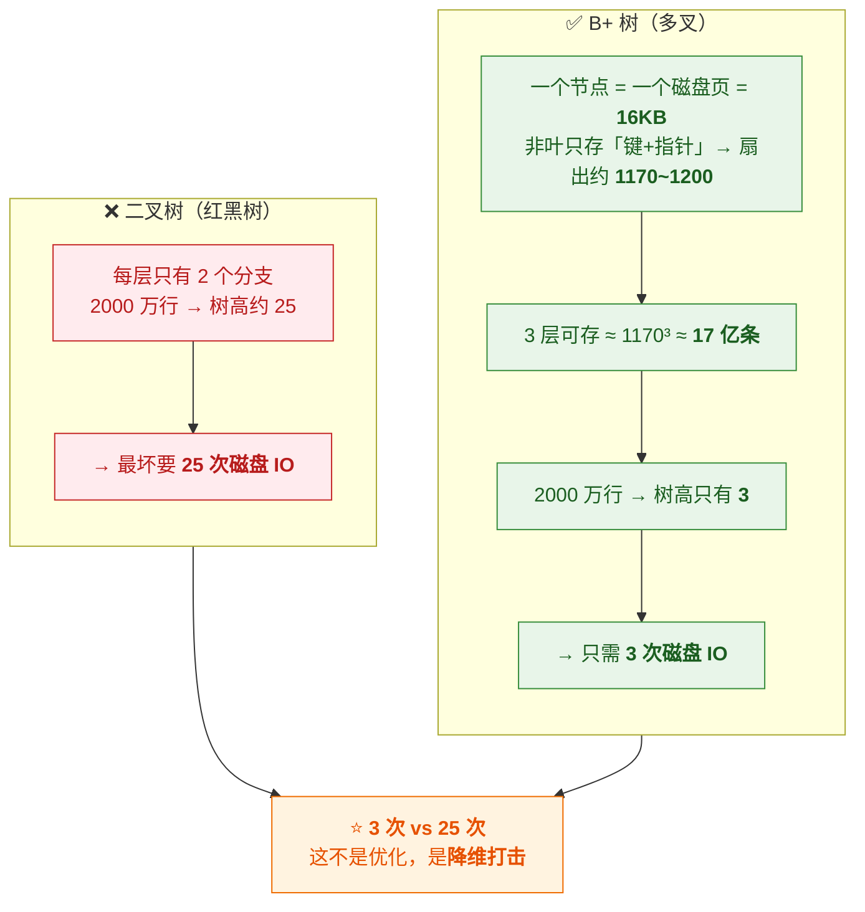
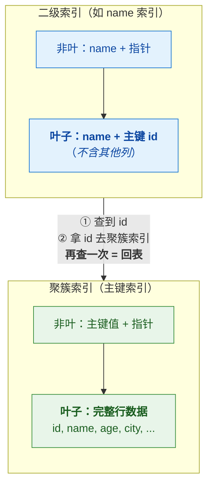
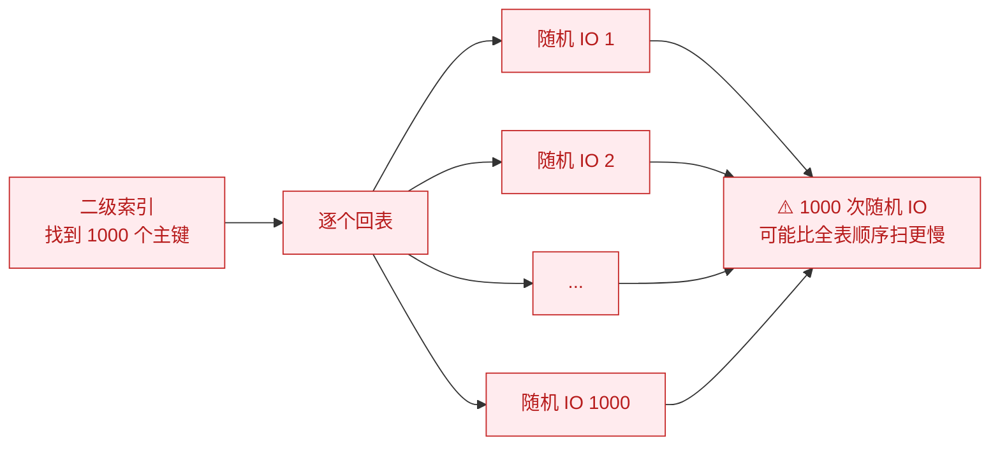
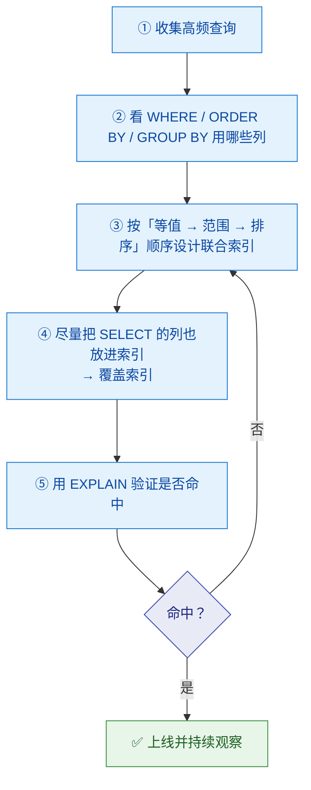
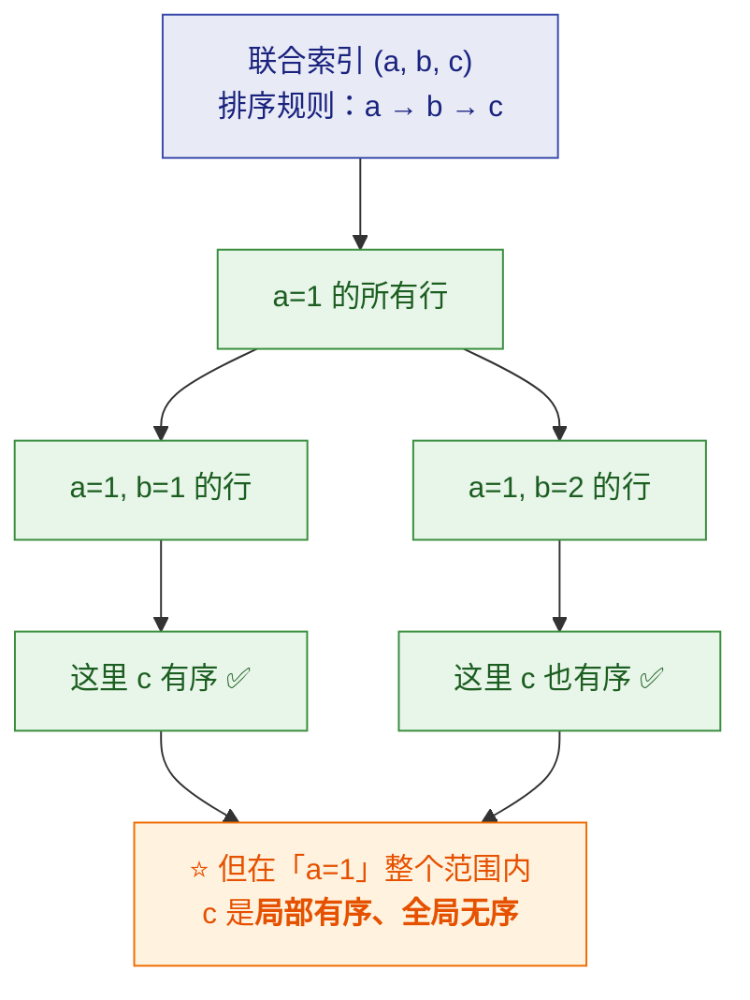
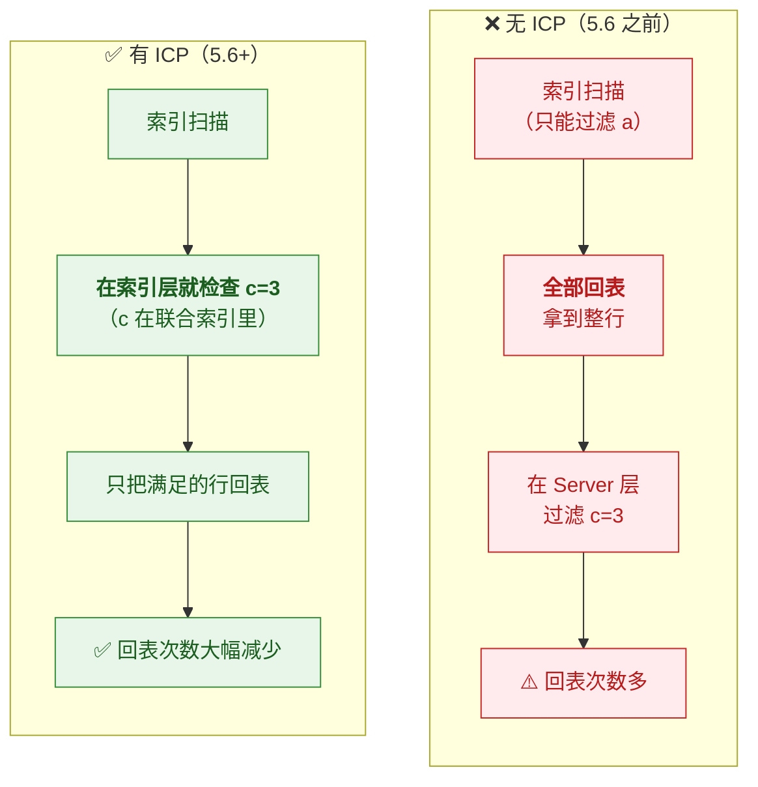

# 🌳 二、索引与 B+ 树

> 本篇回答六个问题：**为什么是 B+ 树**（而不是红黑树/哈希）？
> **聚簇索引和二级索引什么关系**？**回表为什么贵、怎么避免**？
> **最左前缀怎么判断**？**ICP 是什么**？以及**索引怎么设计**。
> 前置见 [[1-架构与执行流程]]；调优见 [[6-慢查询与调优]]。

---

## 一、⭐ 为什么是 B+ 树：先算一笔账

> [!important] ⭐ 关键认知：**数据库的瓶颈不是 CPU，是磁盘**
> | 操作 | 耗时 | 量级 |
> |---|---|---|
> | **一次磁盘寻道** | ~**10ms** | 10⁻² s |
> | **一次内存访问** | ~**100ns** | 10⁻⁷ s |
> | **差多少** | ⭐ **约 10 万倍**（**5 个数量级**） | —— |
>
> **所以索引结构的设计目标只有一个：尽可能减少磁盘 IO 次数。**

### 1.1 为什么"矮胖"的多叉树赢

**核心思路**：**让每个节点尽量装更多键，从而降低树高。**



### 1.2 两种算法都能"震慑"面试官

> [!tip] 面试时随口报一个就够（转写稿原话："两个算法都对"）

**算法一：按"指针立方"估上限**
```
16KB 页 ÷ 每单元约 14B（8B 指针 + 6B 键）≈ 1170 个指针
3 层：1170 × 1170 × 1170 ≈ 1.6 × 10⁹ ≈ 17 亿条
```

**算法二：按"叶子页能放多少记录"估**
```
非叶扇出 ≈ 1170；叶子页每页约放 16 条记录
3 层：1170 × 1170 × 16 ≈ 2.19 × 10⁷ ≈ 2190 万条
```

| 算法 | 结果 | 含义 |
|---|---|---|
| 指针立方 | **约 17 亿** | 估的是**理论上限** |
| 叶子记录数 | **约 2190 万** | 更贴近**实际数据行数** |

> [!success] 面试怎么用
> **"一个 16KB 的页能放约 1200 个指针，三层 B+ 树就是 1200 的立方，
> 约 17 亿条数据——而 2000 万行的表树高只有 3。
> 红黑树是二叉的，2000 万行树高约 25 层。**
> **25 次磁盘 IO 对比 3 次，性能差接近一个数量级——这不是优化，是降维打击。"**
>
> ⭐ **"用数字讲"比"背定义"有杀伤力得多**——因为面试官听过 1 万遍"B+ 树是平衡多叉树"，
> 但没听过有人用 16KB 扇出算出 17 亿。

### 1.3 为什么不是其他结构

| 结构 | 为什么不选 |
|---|---|
| **红黑树 / 二叉搜索树** | ⭐ **树太高**（2000 万行约 25 层 → 25 次 IO） |
| **哈希索引** | ⭐ **三个致命伤**：① **不支持范围查询** ② **不支持排序** ③ **不支持最左前缀匹配** |
| **B 树** | 非叶节点也存数据 → **同样 16KB，扇出更小、树更高**；且范围查询要中序遍历（跳来跳去） |
| **跳表 / LSM 树** | LSM 写优读劣（适合写密集，如 HBase）；MySQL 是读写均衡 |

> [!important] ⭐ 哈希索引的三个致命伤（要能背）
> **① 不支持范围查询**——`WHERE id > 100` 没法用哈希
> **② 不支持排序**——`ORDER BY` 用不上
> **③ 不支持最左前缀匹配**——联合索引用不了
>
> **而业务查询 80% 是范围和排序**——
> **所以哈希索引只在"等值查询"场景有优势，而那种场景 B+ 树也不慢。**
>
> ⚠️ **补充**：InnoDB 有一个**自适应哈希索引（AHI）**——
> **引擎内部偷偷用、对用户不可见**，是给热点页加速的优化。

### 1.4 为什么 B+ 树比 B 树好

| 维度 | B 树 | **B+ 树** |
|---|---|---|
| 非叶节点存什么 | **键 + 数据** | ⭐ **只存键 + 指针** |
| 单页扇出 | 小（数据占地方） | ⭐ **大**（同 16KB 能放更多指针） |
| 树高 | 更高 | ⭐ **更矮** |
| 数据在哪 | 所有节点 | ⭐ **只在叶子** |
| 范围查询 | 要中序遍历整棵树 | ⭐ **叶子有链表，顺序扫** |
| 查询稳定性 | 快慢不一 | ⭐ **每次都是"树高"次 IO** |

> [!success] 一句话总结
> **"B+ 树把数据全放到叶子、非叶只留键和指针——
> 这样同样的页能装更多指针、树更矮；叶子还有链表，范围查询顺序扫就行。"**

---

## 二、⭐ 聚簇索引与二级索引

> [!important] ⭐ 用转写稿的比喻（很好记）
> | | 比喻 | 真实结构 |
> |---|---|---|
> | **聚簇索引** | **房产证** | 叶子节点存**整行完整数据** |
> | **二级索引** | **租房合同**（只写房东身份证号） | 叶子节点存**主键值** |
> | **回表** | 拿身份证**去房管局查房产证** | 用主键**再查一次聚簇索引** |

### 2.1 结构对比



> [!important] ⭐ 两个关键结论
> **① InnoDB 表本身就是"按主键组织的 B+ 树"** → 所以叫 **索引组织表（Index-Organized Table）**。
> **② 二级索引的叶子一定含主键值**——
> 这是"回表"能实现的前提（否则拿到二级索引也不知道去哪找整行）。

### 2.2 回表：为什么贵

> [!danger] ⭐ 回表的代价
> **一次回表 = 额外一次 B+ 树遍历**。
>
> **如果查 1000 条数据、每条都要回表 → 1000 次随机 IO。**
> ⚠️ **而随机 IO 恰恰是磁盘最怕的**（每次都要寻道）。
>
> **极端情况**：走二级索引 + 大量回表，**可能比全表扫描（顺序 IO）还慢**
> ——因为全表扫描是**顺序读**，而回表是**大量随机读**。



> [!warning] ⚠️ 这解释了"为什么走索引不一定快"
> **优化器放弃索引改走全表扫描，有时是明智的**——
> 当**回表行数占比很高**时（比如要查全表 30% 的行），
> **顺序全扫确实更快。**
>
> **所以不要无脑 `FORCE INDEX`。**

### 2.3 覆盖索引：避免回表的正解

> [!success] ⭐⭐ 核心手段
> **如果查询需要的列"都在索引里"，就不用回表**——这叫**覆盖索引**。

```sql
-- 表：users(id, name, age, city)，有索引 idx_name(name)
-- 二级索引 idx_name 的叶子是 (name, id)

-- ❌ 回表：要查 age，索引里没有
SELECT name, age FROM users WHERE name = 'Tom';
-- 过程：idx_name 找到 id → 回表查 age

-- ✅ 覆盖索引：只有 name（索引里有）和 id（叶子自带）
SELECT id, name FROM users WHERE name = 'Tom';
-- 过程：直接在 idx_name 上拿到结果，<b>不回表</b>
```

> [!important] ⭐ 为什么二级索引叶子"自带主键"
> **因为 InnoDB 二级索引的叶子存的就是 `(索引列, 主键值)`**——
> **所以 `SELECT id, name` 天然被覆盖。**
>
> **这也解释了为什么"查询主键 id"通常很快**。

**判断是否覆盖的口诀**：

| 查询 | 能否覆盖 |
|---|---|
| `SELECT id FROM t WHERE name=?` | ✅ 能（叶子含 id） |
| `SELECT id, name FROM t WHERE name=?` | ✅ 能（叶子含两者） |
| `SELECT id, name, age FROM t WHERE name=?` | ❌ **不能**（age 不在，要回表） |

> [!danger] ⚠️ 由此推出一条生产铁律
> **`SELECT *` 永远无法走覆盖索引**（因为它要所有列）——
> **必然回表**。
>
> **所以生产代码禁止 `SELECT *`**——
> ⚠️ **这不只是"浪费带宽"，而是"放弃了覆盖索引优化的可能"。**

### 2.4 索引设计要"服务于查询模式"

> [!success] ⭐ 这句话说出来就加分
> **"我会根据高频查询设计联合索引，尽量让查询走覆盖索引、避免回表。"**
> ——**比单纯解释概念强 100 倍**（转写稿原话）。
>
> **索引不是"给每个字段都建一个"，而是"为查询模式量身定做"。**

**设计步骤**：



---

## 三、⭐ 最左前缀原则

### 3.1 原理：联合索引"按定义顺序排序"

> [!important] ⭐ 把它想成"字典"
> **联合索引 `(a, b, c)` 相当于一本字典：**
> **先按 a 排序 → a 相同再按 b 排序 → b 相同再按 c 排序。**
>
> **所以"跳过 b 直接找 c"是做不到的**——
> 在 `a=1` 的范围内，**c 不是全局有序的**（只在 b 相同的局部有序）。



### 3.2 三种典型情况的判断

> [!important] ⭐ 逐个判断（面试常直接给 SQL 让你说走几列）

**情况一：`WHERE a=1 AND c=3`（跳过 b）**
```
索引 (a,b,c)
→ 只能定位到 a=1 的范围
→ c=3 无法用于"索引定位"，只能在内存里过滤
✅ 用到 1 列（a）
```

**情况二：`WHERE a=1 AND b>2 AND c=3`（遇范围）**
```
→ a=1 精确匹配 ✅
→ b>2 是范围查询，此时 c 在"b>2 的范围内"又无序了
→ ⭐ 索引用到 b 就停
✅ 用到 2 列（a, b）
⚠️ 但 c 仍可作为"过滤条件"在索引层执行 → 这就是 ICP
```

**情况三：`WHERE a=1 AND b=2 AND c=3`（全等值）**
```
→ 三列全用上
✅ 用到 3 列
```

> [!success] ⭐ 口诀："**遇范围则停**"
> **一旦遇到范围查询（`>`、`<`、`BETWEEN`、`LIKE 'x%'`），
> 后面的列就不能用于索引定位了。**
>
> ⚠️ **但要注意**：
> - **`=`、`IN` 算"等值"**，不算范围
> - **`ORDER BY` 也可以利用索引**（如果顺序匹配）
> - 停止定位**不代表没用**——后面列仍可**在索引层过滤**（见 ICP）

### 3.3 索引列顺序怎么排

| 原则 | 说明 |
|---|---|
| ⭐ **等值列在前，范围列在后** | 范围列后面的列无法定位 |
| **区分度高的在前** | 能过滤掉更多数据（但**要看实际查询**） |
| **考虑 `ORDER BY`** | 如果排序列能接在等值列后面，可**免排序** |
| **考虑覆盖** | 把 SELECT 的列加进索引，实现覆盖 |

```sql
-- 例：查询 WHERE status=1 AND create_time > '2026-01-01' ORDER BY create_time
-- 联合索引顺序：status（等值）→ create_time（范围 + 排序）
CREATE INDEX idx_status_time ON orders(status, create_time);
```

---

## 四、ICP：索引下推（5.6+）

> [!note] 它解决什么问题
> **在 ICP 之前**：索引扫描后**必须先回表**，拿到整行才能过滤剩余条件。
> **有了 ICP**：**存储引擎在索引遍历时就直接检查**，不满足的**干脆不回表**。



**配合"遇范围则停"一起理解**：

```sql
-- 索引 (a, b, c)
WHERE a=1 AND b>2 AND c=3
```
| 阶段 | 发生什么 |
|---|---|
| **索引定位** | 只用到 `a`、`b`（遇范围则停，**c 不能定位**） |
| ⭐ **ICP 生效** | **c=3 在索引层过滤**（因为 c 在索引里）→ **减少回表** |

> [!success] 面试怎么说
> **"提到 ICP 说明你关注过执行细节，不是只会背原则。"**
> ——**"c 虽然不能用于索引定位，但可以在索引层过滤，这就是 ICP。"**

**验证 ICP 是否生效**：
```sql
EXPLAIN SELECT * FROM t WHERE a=1 AND b>2 AND c=3;
-- Extra 列看到：Using index condition   ← ✅ ICP 生效
```

---

## 五、索引的代价与常见误区

### 5.1 索引不是越多越好

| 代价 | 说明 |
|---|---|
| **占用空间** | 每个索引都是一棵 B+ 树 |
| ⭐ **拖慢写入** | 每次 `INSERT/UPDATE/DELETE` 都要**维护所有索引** |
| **优化器负担** | 索引多了，优化器选择成本变高（可能选错） |

> [!important] 唯一索引 vs 普通索引的写入差异（⭐ 高频考点）
> **唯一索引插入更慢**，根因是 **Change Buffer 用不了**：
>
> | | 普通（二级）索引 | 唯一索引 |
> |---|---|---|
> | 目标页不在内存 | ✅ **先记在 Change Buffer**，等页被读入时再合并 | ❌ **必须立刻读盘**校验唯一性 |
> | 代价 | 省掉随机读 IO | ⭐ **每次插入都可能触发随机读** |
>
> **Change Buffer 的意义**：
> **更新非唯一二级索引时，如果目标页不在内存，InnoDB 不傻等磁盘，
> 而是把更新先记在 Change Buffer 里，等该页被读入内存时再合并（merge）——
> "攒着一起干"，省掉大量随机读 IO。**
>
> ⚠️ **但唯一索引不能用**——因为**必须立刻读盘校验唯一性**。

### 5.2 主键怎么选

| 建议 | 理由 |
|---|---|
| ⭐ **用自增 `BIGINT`** | **顺序插入** → 减少页分裂；**占用小** → 二级索引也小 |
| ⚠️ **别用 UUID** | 随机插入 → **频繁页分裂**；**16 字节** → 所有二级索引都变大 |
| **别用业务字段** | 业务变更会影响所有二级索引 |

> [!tip] 为什么主键要"短"
> **因为二级索引的叶子存主键值**——
> **主键越长，所有二级索引就越大。**
> **用 UUID（16B）代替 BIGINT（8B），会让每个二级索引都变大。**

### 5.3 区分度与前缀索引

| 概念 | 说明 |
|---|---|
| **区分度（基数）** | `COUNT(DISTINCT col) / COUNT(*)`，越接近 1 越好 |
| **前缀索引** | 长字符串只索引前 N 个字符：`INDEX(name(10))`——省空间但**可能增加回表** |

> [!warning] ⚠️ 前缀索引不能用于覆盖索引
> **因为它不含"完整值"**，所以无法判断查询列是否被覆盖。

---

## 六、30 秒速查表

| 问题 | 一句话答案 |
|---|---|
| ⭐⭐ 为什么是 B+ 树 | **磁盘 IO 是瓶颈**——3 层可存约 17 亿行，2000 万行只需 **3 次 IO**；红黑树要 **25 次** |
| 磁盘 vs 内存差多少 | **约 10 万倍（5 个数量级）**：10ms vs 100ns |
| B+ 树一个节点多大 | ⭐ **等于一个磁盘页 = 16KB** |
| 扇出怎么算 | 16KB ÷ 每单元约 14B（8B 指针 + 6B 键）≈ **1170~1200** |
| 3 层能存多少 | 按指针立方 ≈ **17 亿**；按叶子记录 ≈ **2200 万** |
| 为什么不用红黑树 | ⭐ **树太高**（2000 万行约 25 层 → 25 次 IO） |
| 哈希索引三个致命伤 | ⭐ **不支持范围 / 不支持排序 / 不支持最左前缀** |
| 业务查询 80% 是什么 | **范围和排序**——所以哈希不合适 |
| 自适应哈希索引 AHI | **InnoDB 内部用、对用户不可见** |
| B+ 树比 B 树好在哪 | ⭐ **非叶只存键+指针 → 扇出大、树矮**；**叶子有链表 → 范围查询顺序扫** |
| 聚簇索引是什么 | ⭐ **主键索引，叶子存整行** → InnoDB 是"**索引组织表**" |
| 二级索引叶子存什么 | ⭐ **索引列 + 主键值** |
| ⭐ 什么是回表 | 二级索引拿主键后，**再查一次聚簇索引** |
| 回表为什么贵 | ⭐ **每次都是一次随机 IO**；查 1000 条 = 1000 次 |
| 走索引一定快吗 | ❌ **回表多时可能比全表顺序扫更慢** |
| ⭐⭐ 怎么避免回表 | **覆盖索引**——查询列都在索引里 |
| 为什么禁止 `SELECT *` | ⭐ **它永远无法覆盖索引，必然回表** |
| 最左前缀原则 | 联合索引**按定义顺序排序**，**不能跳列** |
| ⭐ 口诀"遇范围则停" | `a=1 AND b>2 AND c=3`：**索引用到 b 就停** |
| `IN` 算范围吗 | ❌ **算等值**，不触发"停" |
| ICP 是什么 | ⭐ **索引下推**（5.6+）：**在索引层就过滤**，减少回表 |
| ICP 怎么验证 | `EXPLAIN` 的 Extra 显示 **`Using index condition`** |
| 索引越多越好吗 | ❌ **拖慢写入**（每次写都要维护所有索引）+ 占空间 |
| ⭐ 唯一索引为什么插入慢 | **Change Buffer 用不了**——必须立刻读盘校验唯一性 |
| Change Buffer 干什么 | 非唯一二级索引的目标页不在内存时，**先记下来，等页读入再合并** |
| 主键怎么选 | ⭐ **自增 BIGINT**；别用 UUID（随机插入 + 占空间大） |
| 主键为什么不能太长 | **二级索引叶子存主键**——主键越长所有二级索引越大 |
| 前缀索引的局限 | ⚠️ **不能用于覆盖索引**（不含完整值） |

---

## 七、学习检查清单

- [ ] ⭐⭐ 能用**磁盘 IO 的账**讲清为什么是 B+ 树（含具体数字推算）
- [ ] 能说出**磁盘与内存的延迟差距**（10ms vs 100ns，约 5 个数量级）
- [ ] ⭐ 能算出**3 层 B+ 树的容量**（两种算法）
- [ ] 能说清**为什么不用红黑树**（25 层 vs 3 层）
- [ ] ⭐ 能背出**哈希索引的三个致命伤**
- [ ] 能解释**为什么业务 80% 是范围排序** → 哈希不合适
- [ ] 能说清 **B+ 树比 B 树好的两个原因**（扇出大、叶子链表）
- [ ] ⭐ 能用"**房产证 vs 租房合同**"讲清聚簇索引与二级索引
- [ ] 能说清**二级索引叶子为什么含主键值**
- [ ] ⭐ 能说清**回表的代价**（随机 IO），并解释"走索引不一定快"
- [ ] ⭐⭐ 能说清**覆盖索引**的原理，并能判断给定 SQL 是否被覆盖
- [ ] ⭐ 能解释**为什么 `SELECT *` 永远无法覆盖索引**
- [ ] ⭐⭐ 能对给定 SQL **判断用了联合索引的几列**（含"遇范围则停"）
- [ ] 能说出**索引列顺序的三个原则**（等值在前、区分度、考虑排序与覆盖）
- [ ] ⭐ 能说清 **ICP 解决什么问题**，并知道怎么验证
- [ ] 能解释 **ICP 与"遇范围则停"如何配合**
- [ ] 能说出**索引过多的三重代价**
- [ ] ⭐ 能说清**唯一索引插入慢的根因**（Change Buffer 用不了）
- [ ] 能解释 **Change Buffer 的作用**
- [ ] ⭐ 能说出**主键选择的建议**并解释"主键要短"的原因

---
> 上一篇 → [[1-架构与执行流程]] ｜ 下一篇 → [[3-事务与MVCC]] ｜ 返回 [[0-MySQL总览]]
