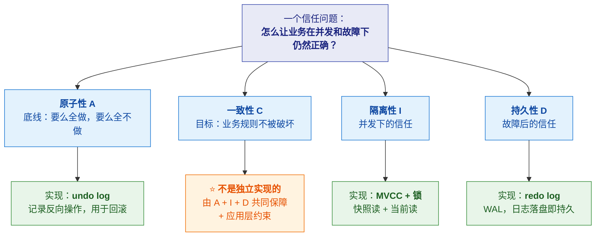
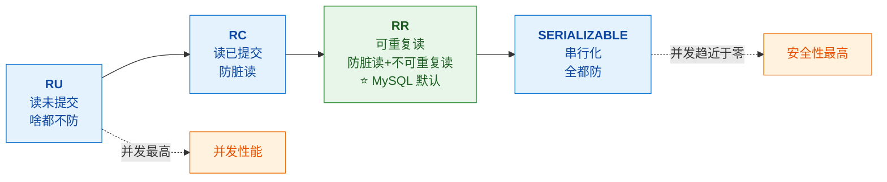
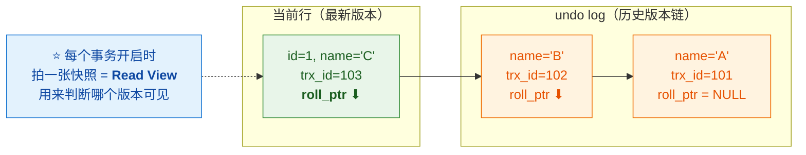
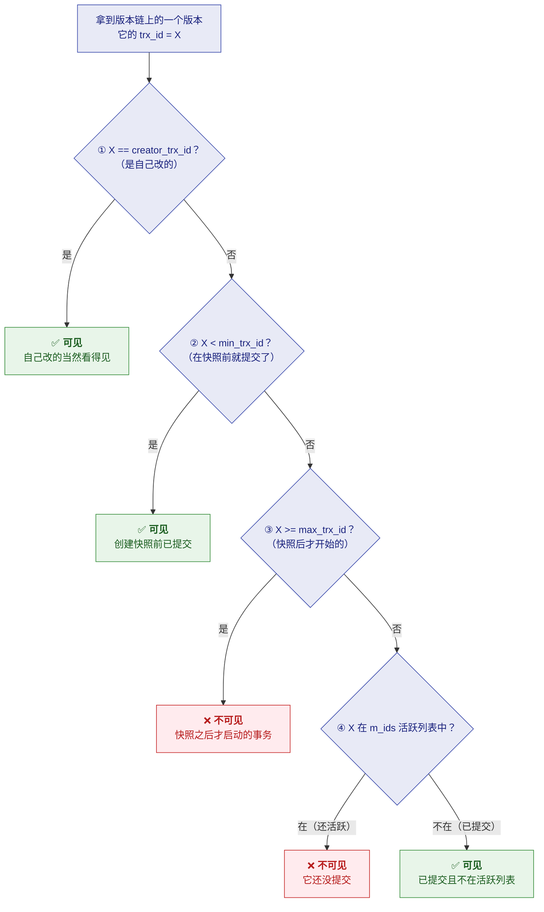
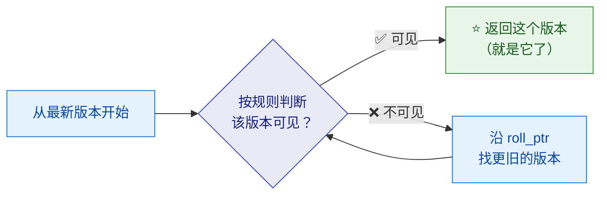
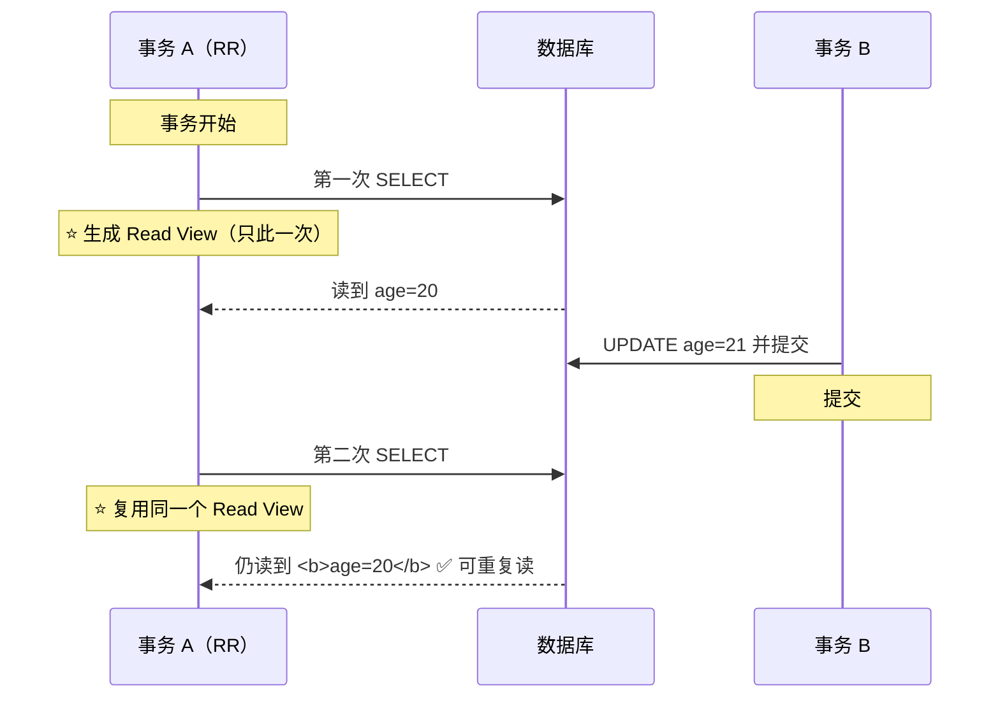
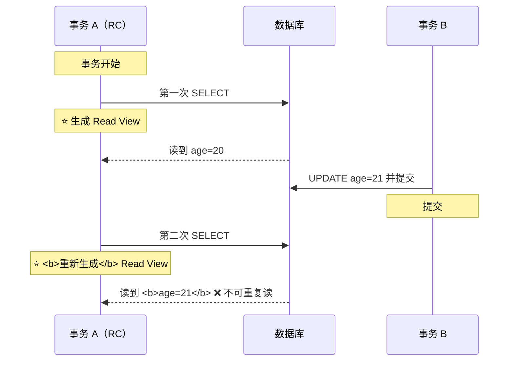

# 🔄 三、事务与 MVCC

> 本篇回答五个问题：**ACID 到底是什么关系**（不是四个独立的东西）？
> **四种隔离级别怎么选**？⭐ **MVCC 的版本链和 Read View 怎么工作**？
> ⭐ **RC 和 RR 的本质区别在哪**？以及**RR 到底能不能防幻读**？
> 前置见 [[1-架构与执行流程]]；锁见 [[4-锁机制]]；日志见 [[5-日志与持久化]]。

---

## 一、⭐ ACID 不是四个独立的东西

> [!important] ⭐ 核心认知（转写稿的关键洞察）
> **ACID 是"同一个信任问题的四个维度"，不是四个并列的定义。**



| 特性 | 含义（业务视角） | 实现技术 |
|---|---|---|
| **原子性 A** | 要么全做，要么全不做 | ⭐ **undo log**（记录反向操作，用于回滚） |
| **一致性 C** | 业务规则不被破坏 | ⭐ **不是独立技术**——**A + I + D 共同保障 + 应用层约束** |
| **隔离性 I** | 并发事务之间不互相干扰 | ⭐ **MVCC（快照读）+ 锁（当前读）** |
| **持久性 D** | 提交了就不能丢 | ⭐ **redo log**（WAL：修改前先写日志） |

> [!success] ⭐ 一段"胜过 10 分钟背书"的答法
> **"ACID 不是四个独立的东西，是同一个信任问题的四个维度：**
> - **原子性是底线**——要么全做要么全不做，靠 **undo log** 记录反向操作实现回滚
> - **隔离性是并发下的信任**——多个事务同时跑，彼此不能看到半成品，
>   靠 **MVCC 快照读 + 锁**实现
> - **持久性是故障后的信任**——提交了就不能丢，靠 **redo log** 预写日志
> - **一致性是目标**——它**由前三者共同达成**，加上应用层的约束
>
> **所以：原子性靠 undo log，持久性靠 redo log，隔离性靠 MVCC + 锁，
> 一致性是前三者共同达成的业务目标。**"

---

## 二、四种隔离级别

> [!important] ⭐ 核心矛盾：**安全 vs 并发**
> **隔离级别越高 → 越安全 → 并发性能越低。** 这是一个跷跷板。



### 2.1 三种"读"问题

| 问题 | 现象 | 例子 |
|---|---|---|
| **脏读** | 读到**别的事务未提交**的数据 | A 改了但没提交，B 读到了；A 回滚 → B 读到"从不存在"的数据 |
| **不可重复读** | **同一事务内两次读同一行，结果不同** | A 事务内先读 `age=20`，B 改了并提交，A 再读变成 `21` |
| **幻读** | **同一事务内两次"范围查询"，行数变了** | A 查 `age>20` 有 5 行，B 插入一行并提交，A 再查变 6 行 |

> [!tip] 不可重复读 vs 幻读的区别
> - **不可重复读**：针对**同一行**的**值**变了（`UPDATE`）
> - **幻读**：针对**一个范围**的**行数**变了（`INSERT`/`DELETE`）

### 2.2 四种级别对比

| 隔离级别 | 脏读 | 不可重复读 | 幻读 | 并发 | 适用场景 |
|---|---|---|---|---|---|
| **RU**（读未提交） | ❌ 会 | ❌ 会 | ❌ 会 | ⭐ 最高 | **批量导数据** |
| **RC**（读已提交） | ✅ 防 | ❌ 会 | ❌ 会 | 高 | **对一致性要求不高的报表** |
| ⭐ **RR**（可重复读） | ✅ 防 | ✅ 防 | ✅ **基本防** | 中 | ⭐ **MySQL 默认，99% 的 OLTP** |
| **SERIALIZABLE** | ✅ 防 | ✅ 防 | ✅ 防 | ❌ 几乎为零 | **金融监管要求绝对可序列化的极端场景** |

> [!important] ⭐ 生产怎么选（体现工程判断力）
> **"生产环境默认 RR，特殊场景按需调整。"**
>
> | 场景 | 建议 |
> |---|---|
> | **绝大多数 OLTP** | ⭐ **RR（默认）** ——够用 |
> | **批量导入、对账报表** | **RC** ——减少锁冲突、提高并发 |
> | **极端一致性要求** | SERIALIZABLE ——⚠️ **但性能接近归零，慎用** |
>
> ⚠️ **注意**：很多互联网公司**主动把默认改成 RC**——
> 因为 RC **没有 Gap Lock**（锁范围更小、并发更高），
> 且配合 binlog 的 `ROW` 格式也能保证主从一致。
> **这是一个真实的工程取舍，能说出来很加分。**

### 2.3 RR 到底能不能防幻读（⭐ 必考）

> [!danger] ⭐⭐ 这是最容易答错的题
> **答案要分两种"读"来说：**
>
> | 读的类型 | 触发方式 | 靠什么防幻读 |
> |---|---|---|
> | **快照读** | 普通 `SELECT` | ⭐ **MVCC**（读的是快照，根本看不到新插入的行） |
> | **当前读** | `SELECT ... FOR UPDATE`、`UPDATE`、`DELETE` | ⭐ **Next-Key Lock**（锁住区间，不让插入） |
>
> **所以完整答案是**：
> **"RR 下，快照读靠 MVCC 防幻读；当前读靠 Next-Key Lock 防幻读。**
> **缺一不可——只讲 MVCC 是不完整的。"**

> [!warning] ⚠️ 一个容易忽略的点
> **RR 下"快照读"看起来防住了幻读，但其实是"假装防住"**——
> **你在同一事务里看不到新插入的行**，但**它们真的存在**。
> **如果你之后做了 `UPDATE`（当前读），就会"突然"看到它们**——
> 这就是所谓的"**RR 下的幻读仍可能出现**"。

---

## 三、⭐ MVCC：版本链 + Read View

> [!important] ⭐ 用转写稿的比喻：**时光隧道**
> **每次 `UPDATE` 不是覆盖旧数据，而是把旧版本存到 undo log 里，
> 用 `DB_ROLL_PTR` 串成一条版本链。**
> **最新版本在隧道入口，越往里越旧。**

### 3.1 版本链是怎么形成的



**关键字段**：

| 字段 | 作用 |
|---|---|
| **`trx_id`** | 这行是**哪个事务**改的 |
| **`DB_ROLL_PTR`** | ⭐ **指向 undo log 里的上一个版本**（形成链） |
| **`DB_TRX_ID`** | 最近修改该行的事务 ID |

### 3.2 Read View 的四个关键信息

> [!important] ⭐ Read View 里记了什么
> | 字段 | 含义 |
> |---|---|
> | **`m_ids`** | ⭐ **当前活跃（未提交）的事务 ID 列表** |
> | **`min_trx_id`** | 活跃事务中的**最小 ID** |
> | **`max_trx_id`** | **下一个将要分配的事务 ID**（不是最大活跃 ID！） |
> | **`creator_trx_id`** | **创建该 Read View 的事务自己的 ID** |

### 3.3 ⭐⭐ 可见性判断规则（必须背）

> [!important] ⭐ 逐条判断某个版本（`trx_id`）是否可见



**用文字复述**：

| # | 条件 | 结论 | 为什么 |
|---|---|---|---|
| **①** | `trx_id == creator_trx_id` | ✅ **可见** | 自己改的，自己看得见 |
| **②** | `trx_id < min_trx_id` | ✅ **可见** | 在快照创建**之前**就已提交 |
| **③** | `trx_id >= max_trx_id` | ❌ **不可见** | 在快照创建**之后**才开始 |
| **④** | `trx_id` **在** `m_ids` 中 | ❌ **不可见** | 它**还活跃**（未提交） |
| **⑤** | `trx_id` **不在** `m_ids` 中 | ✅ **可见** | 已提交，且不在活跃列表 |

> [!success] 记忆窍门
> **"自己改的可见；早于快照的可见；晚于快照的不可见；
> 在活跃列表里的不可见；不在活跃列表里的可见。"**
>
> ⚠️ **最容易搞错的是 `max_trx_id`**——
> **它是"下一个要分配的 ID"，不是"最大活跃 ID"。**

### 3.4 遍历版本链的过程



> [!important] ⭐ 一句话总结 MVCC
> **"从最新版本开始，沿版本链往回找，找到第一个'对当前 Read View 可见'的版本。"**
>
> **所以 MVCC 实现"读写不阻塞"的秘密是**：
> **读操作不需要加锁**——它只是**在自己的快照上找一个可见版本**，
> **完全不影响写操作**（写操作继续产生新版本）。

---

## 四、⭐ RC 与 RR 的本质区别

> [!important] ⭐⭐ 就一句话：**Read View 的生成时机不同**

| | **RC（读已提交）** | **RR（可重复读）** |
|---|---|---|
| **Read View 生成时机** | ⭐ **每次 `SELECT` 都重新生成** | ⭐ **只在事务第一次 `SELECT` 时生成一次** |
| **效果** | 能看到**别的事务新提交**的数据 | 同一事务内**看到的快照不变** |
| **所以** | **不可重复读会发生** | **不可重复读不会发生** |





> [!success] ⭐ 这句就是答案
> **"RC 和 RR 在 MVCC 上的区别，就是 Read View 的生成时机：
> RC 每次 SELECT 都重新生成，所以能看到别人新提交的版本；
> RR 只在事务第一次 SELECT 时生成一次，后续复用，
> 所以同一事务内看到的快照不变。
> 这就是'不可重复读能否发生'的根源。"**

---

## 五、快照读 vs 当前读（⭐ 必须分清）

> [!important] ⭐ 两种"读"决定了你看到什么、加什么锁

| | **快照读** | **当前读** |
|---|---|---|
| **SQL** | 普通 `SELECT` | `SELECT ... FOR UPDATE`<br/>`SELECT ... LOCK IN SHARE MODE`<br/>`UPDATE` / `DELETE` / `INSERT` |
| **读什么** | ⭐ **Read View 里的可见版本** | ⭐ **最新已提交版本** |
| **加锁吗** | ❌ **不加锁** | ✅ **加锁**（Next-Key Lock 等） |
| **靠什么防幻读** | **MVCC** | **Next-Key Lock** |

```sql
-- 快照读：不加锁，读 Read View 可见的版本
SELECT * FROM t WHERE id = 1;

-- 当前读：加锁，读最新版本
SELECT * FROM t WHERE id = 1 FOR UPDATE;
UPDATE t SET name='x' WHERE id = 1;

-- ⭐ 注意：UPDATE 的 WHERE 也是"当前读"！
-- 它会先"当前读"出符合条件的行，然后再改
```

> [!danger] ⚠️ 一个非常容易踩的坑
> ```sql
> -- 快照读（不加锁）
> SELECT * FROM t WHERE id = 1;   -- 读到 age=20
>
> -- 但如果你执行 UPDATE，它会"当前读"最新版本！
> UPDATE t SET age = age + 1 WHERE id = 1;  -- 基于 age=21 计算
> ```
> **这会导致"在 RR 下看起来没变，一更新却发现变了"的困惑**——
> **因为读是快照读、写是当前读。**

---

## 六、30 秒速查表

| 问题 | 一句话答案 |
|---|---|
| ⭐ ACID 是四个独立的东西吗 | ❌ **是同一信任问题的四个维度** |
| 原子性靠什么 | ⭐ **undo log**（记录反向操作） |
| 持久性靠什么 | ⭐ **redo log**（WAL） |
| 隔离性靠什么 | ⭐ **MVCC（快照读）+ 锁（当前读）** |
| 一致性靠什么 | ⭐ **不是独立技术**——A+I+D 共同 + 应用层约束 |
| 隔离级别的核心矛盾 | ⭐ **安全 vs 并发**（跷跷板） |
| 脏读是什么 | 读到**别的事务未提交**的数据 |
| 不可重复读是什么 | 同一事务内**两次读同一行值不同** |
| 幻读是什么 | 同一事务内**两次范围查询行数不同** |
| 不可重复读 vs 幻读 | **前者针对行的值（UPDATE），后者针对范围的行数（INSERT）** |
| MySQL 默认级别 | ⭐ **RR** |
| RC 适合什么 | **批量导入、一致性要求不高的报表** |
| ⭐ 很多公司为什么改 RC | **RC 没有 Gap Lock → 锁范围更小、并发更高** |
| SERIALIZABLE 何时用 | **金融监管要求绝对可序列化**——⚠️ 性能接近归零 |
| ⭐⭐ RR 怎么防幻读 | **快照读靠 MVCC；当前读靠 Next-Key Lock**（缺一不可） |
| MVCC 是什么 | **多版本并发控制**，靠**版本链 + Read View** |
| 版本链怎么形成 | 每次 UPDATE **把旧版本存 undo log**，用 `roll_ptr` 串起来 |
| Read View 四个字段 | **`m_ids`（活跃列表）/ `min_trx_id` / `max_trx_id`（下一个待分配）/ `creator_trx_id`** |
| ⚠️ `max_trx_id` 是什么 | ⭐ **下一个将要分配的 ID**，不是最大活跃 ID |
| 可见性规则① | `trx_id == creator` → ✅ 可见 |
| 可见性规则② | `trx_id < min_trx_id` → ✅ 可见（快照前已提交） |
| 可见性规则③ | `trx_id >= max_trx_id` → ❌ 不可见（快照后才开始） |
| 可见性规则④⑤ | **在 `m_ids` 中 → 不可见；不在 → 可见** |
| 怎么找可见版本 | ⭐ 从最新开始**沿链回退**，找第一个可见的 |
| MVCC 为什么读写不阻塞 | ⭐ **读不加锁**（只在自己快照上找版本） |
| ⭐⭐ RC 与 RR 的本质区别 | **Read View 生成时机**：RC 每次 SELECT 生成；RR 只第一次生成 |
| 快照读是什么 | 普通 `SELECT`——**不加锁，读 Read View 版本** |
| 当前读是什么 | `FOR UPDATE` / `UPDATE`——**加锁，读最新版本** |
| ⚠️ UPDATE 的 WHERE 是哪种读 | ⭐ **当前读**（所以能看到快照读看不到的新数据） |

---

## 七、学习检查清单

- [ ] ⭐⭐ 能讲清 **ACID 是四个维度**，并说出各自的实现技术
- [ ] ⭐ 能说清**一致性为什么不是独立技术**
- [ ] 能说出**隔离级别的核心矛盾**（安全 vs 并发）
- [ ] 能区分**脏读 / 不可重复读 / 幻读**（并说清后两者的区别）
- [ ] 能背出**四种隔离级别各防什么、适用什么**
- [ ] ⭐ 能说出"**生产环境默认 RR，特殊场景按需调整**"并解释
- [ ] ⭐ 能说清**很多公司为什么主动改成 RC**（无 Gap Lock）
- [ ] ⭐⭐ 能完整回答"**RR 能不能防幻读**"（分快照读与当前读）
- [ ] ⚠️ 能说出 **RR 下幻读"仍可能出现"的场景**（快照读 + 后续 UPDATE）
- [ ] ⭐ 能说清**版本链是怎么形成的**（undo log + `roll_ptr`）
- [ ] ⭐ 能说出 **Read View 的四个字段**，尤其 `max_trx_id` 的准确含义
- [ ] ⭐⭐ 能**完整背出可见性判断的五条规则**并解释每条的理由
- [ ] 能说清**遍历版本链找可见版本**的过程
- [ ] ⭐ 能说清 **MVCC 为什么能实现"读写不阻塞"**
- [ ] ⭐⭐ 能用一句话说清 **RC 与 RR 的本质区别**（Read View 生成时机）
- [ ] 能画出 **RC 与 RR 的两个时序对比图**
- [ ] ⭐ 能区分**快照读与当前读**，并说出各自加不加锁
- [ ] ⚠️ 能说出 **`UPDATE` 的 `WHERE` 是当前读**这个坑

---
> 上一篇 → [[2-索引与B+树]] ｜ 下一篇 → [[4-锁机制]] ｜ 返回 [[0-MySQL总览]]
> 日志与持久化 → [[5-日志与持久化]] ｜ 面试冲刺 → [[MySQL深度优化与MGR高可用面试题]]
