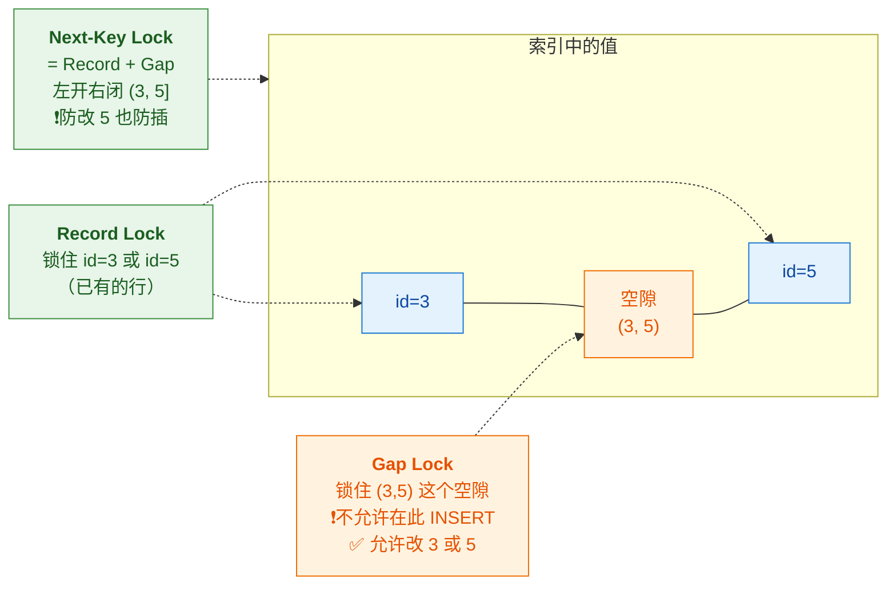
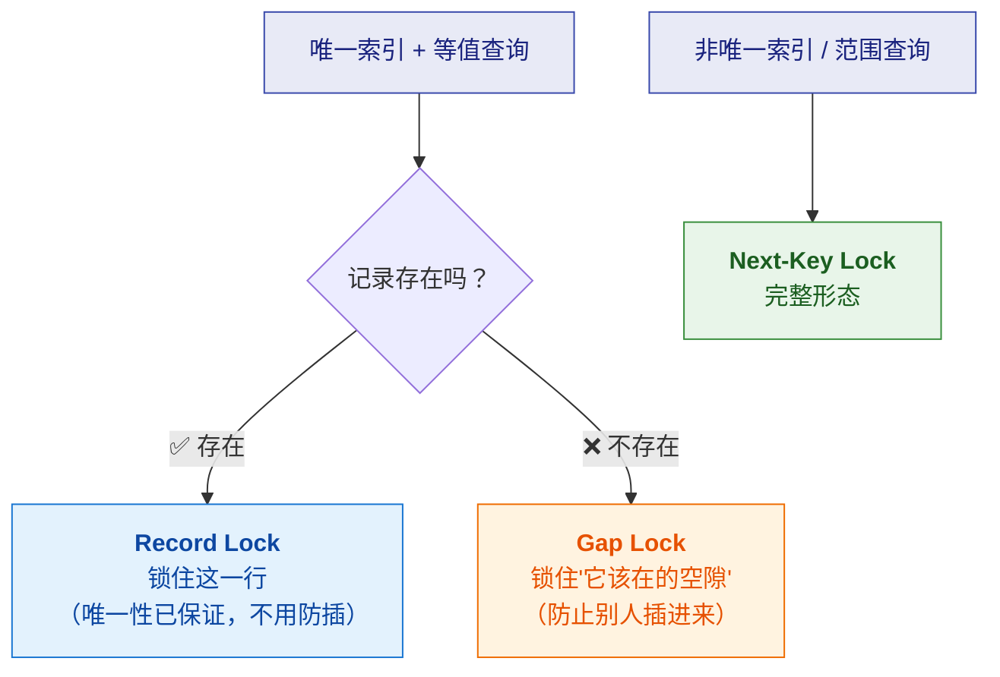
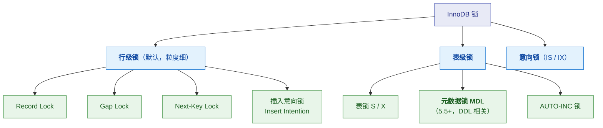
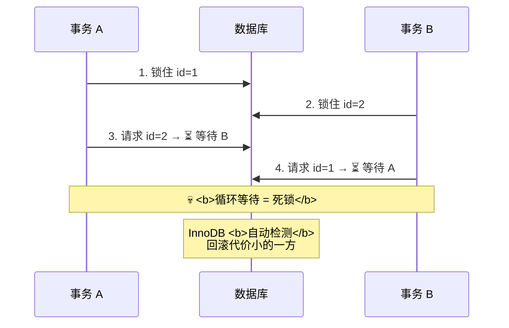

# 🔒 四、MySQL 锁机制

> 本篇回答五个问题：**InnoDB 有哪些锁**？⭐ **Record / Gap / Next-Key 三重锁什么关系**？
> ⭐ **Next-Key Lock 什么时候退化**？**加锁规则怎么判断**？以及**死锁怎么排查**？
> 前置见 [[3-事务与MVCC]]（快照读/当前读）；索引见 [[2-索引与B+树]]。

---

## 一、⭐ 三重境界：Record / Gap / Next-Key

> [!important] ⭐ 用转写稿的比喻："武功的三重境界"
> | 重数 | 锁 | 锁什么 | 防什么 | 漏洞 |
> |---|---|---|---|---|
> | **第一重** | **Record Lock** | **已有的行** | 别人 `UPDATE`/`DELETE` 这行 | ⚠️ **可以在旁边 INSERT 新行**（幻读漏洞） |
> | **第二重** | **Gap Lock** | **两个值之间的空隙** | 别人在空隙里 `INSERT` | ⚠️ **允许改动已有的行** |
> | **第三重** | **Next-Key Lock** | **Record + Gap 的组合** | 既防改、又防插 | —— |



### 1.1 逐个说清

| 锁 | 锁的对象 | 允许什么 | 禁止什么 |
|---|---|---|---|
| **Record Lock** | ⭐ **已有的索引记录** | 别人**可以在旁边 INSERT** | 改/删**这一行** |
| **Gap Lock** | ⭐ **两个值之间的"空隙"** | 别人**可以改已有的行** | 在空隙里 **INSERT** |
| **Next-Key Lock** | ⭐ **Record + Gap**（左开右闭 `(3,5]`） | —— | **既防改 id=5，又防插入 (3,5)** |

> [!important] ⭐ Gap Lock 的关键特性
> **它锁的不是数据，是"空隙"。**
> - ✅ `UPDATE id=3` 或 `UPDATE id=5` —— **允许**（这是 Record 的事）
> - ❌ `INSERT id=4` —— **禁止**（落在空隙里）
>
> ⚠️ **Gap Lock 只在 RR 级别存在**——
> **RC 级别下没有 Gap Lock**（这也是很多公司改用 RC 的原因，见 [[3-事务与MVCC]]）。

### 1.2 为什么需要 Gap Lock

> [!note] 它解决的是**幻读**
> **如果只有 Record Lock**：
> - A 锁住了 `id=5` 这行
> - B 仍然可以 `INSERT id=4` → **A 再查范围时行数变了 = 幻读**
>
> **Gap Lock 锁住空隙 → 不让插 → 防住幻读。**

---

## 二、⭐ Next-Key Lock 的退化规则

> [!important] ⭐⭐ 这是"研究过源码行为"的加分项
> **Next-Key Lock 不是永远都是"Record + Gap"**，
> **在特定条件下会"退化"成单纯的 Record Lock 或 Gap Lock。**

### 2.1 退化规则表

| 场景 | 实际加的锁 | 为什么 |
|---|---|---|
| ⭐ **唯一索引 + 等值查询 + 记录存在** | **Record Lock** | 唯一索引已保证唯一 → **不需要防插入** |
| ⭐ **唯一索引 + 等值查询 + 记录不存在** | **Gap Lock** | 只需锁住"它该在的那个空隙" |
| **非唯一索引 + 等值查询** | **Next-Key Lock** + 后续 Gap Lock | 可能有多条同值记录，要防插 |
| **范围查询** | ⭐ **完整的 Next-Key Lock** | 要防范围内的插入 |



### 2.2 为什么"记录存在就不用防插"

> [!important] ⭐ 逻辑推理（理解了这个就不用背）
> **唯一索引保证"值唯一"**——
> **既然 `id=5` 已经存在，别人就插不进另一个 `id=5`。**
> **所以不需要 Gap Lock 来防插** → **退化成 Record Lock 就够了。**
>
> **反之**，如果 `id=5` **不存在**，别人可能插进来 →
> **必须用 Gap Lock 锁住"它该在的位置"。**

> [!success] 面试怎么说
> **"面试时把退化规则说出来，面试官会觉得你真的研究过源码行为。"**
> ——**转写稿原话**。这是区分"背过"和"研究过"的关键细节。

---

## 三、加锁分析：一个完整的例子

> [!example] 给定 SQL，判断加什么锁

```sql
-- 表 t：id 主键，age 普通索引
-- 数据：id = 5, 10, 15, 20；age = 5, 10, 15, 20

-- 例 1：唯一索引 + 等值 + 存在
SELECT * FROM t WHERE id = 10 FOR UPDATE;
-- ⭐ 加 Record Lock（只锁 id=10 这一行）
-- 原因：唯一索引保证不会重复插 10

-- 例 2：唯一索引 + 等值 + 不存在
SELECT * FROM t WHERE id = 12 FOR UPDATE;
-- ⭐ 加 Gap Lock，锁住 (10, 15)
-- 原因：锁住 12 该在的位置，防止别人插 12

-- 例 3：范围查询
SELECT * FROM t WHERE id >= 10 AND id < 15 FOR UPDATE;
-- ⭐ 加 Next-Key Lock，锁住 (5,10]、(10,15)、(15,20]
-- 注意：会一直锁到第一个不满足条件的值（"到 20 停"）

-- 例 4：非唯一索引 + 等值
SELECT * FROM t WHERE age = 10 FOR UPDATE;
-- ⭐ 加 Next-Key Lock：锁住 (5,10] + Gap (10,15)
-- 原因：age 可能有多条 =10 的记录，要防插
```

> [!warning] ⚠️ 一个反直觉的点
> **例 3 的范围查询会"多锁"**：
> `id >= 10 AND id < 15` **实际会锁到 `id=15` 为止**（Next-Key 是左开右闭）。
> **这叫"锁到第一个不满足条件的记录"。**
>
> **这也是"范围查询容易造成锁范围过大"的原因。**

---

## 四、表级锁与其他锁

### 4.1 锁的层级



### 4.2 意向锁（IS / IX）

> [!note] 它解决什么问题
> **表级锁和行级锁要"兼容性检查"**——
> 如果我要加表锁，怎么知道"有没有行锁"？
> **总不能逐行检查**（太慢）。
>
> **意向锁的作用**：**用表级的"意向"来快速判断**。
> - `IS`（意向共享锁）：**我打算在某些行上加 S 锁**
> - `IX`（意向排他锁）：**我打算在某些行上加 X 锁**
>
> **加表锁时只需看"有没有意向锁"**，不用逐行扫。

> [!important] 意向锁的两个特点
> 1. ✅ **它们之间相互兼容**（IS 和 IX 不冲突）——因为大家只是"打算"，目标行可能不同
> 2. ✅ **由 InnoDB 自动加，用户不用管**

### 4.3 元数据锁 MDL（⭐ 线上常见坑）

> [!danger] ⚠️ MDL 是"Online DDL 卡住"的常见原因
> **当你对一个表做 DDL（ALTER），MySQL 会加 MDL 写锁。**
> **如果此时有长事务在跑（持有 MDL 读锁），DDL 就会等待。**
> **更糟的是**：**后续所有请求都会排在 DDL 后面**（MDL 有队列）→ **整张表被阻塞。**
>
> **典型现象**：
> - 一个 `ALTER TABLE` 执行很久没结束
> - 同时**该表的所有查询都卡住**
>
> **排查**：
> ```sql
> -- 看当前的 MDL 等待
> SELECT * FROM performance_schema.metadata_locks;
> -- 看长事务
> SELECT * FROM information_schema.innodb_trx ORDER BY trx_started;
> ```
>
> **预防**：
> - ⭐ **DDL 用 `pt-online-schema-change` / `gh-ost`**（先建影子表再切换）
> - ⭐ **先 `kill` 长事务，再执行 DDL**
> - **避开业务高峰做 DDL**

### 4.4 AUTO-INC 锁

| 模式 | 行为 | 性能 |
|---|---|---|
| **传统模式** | 每次插入都要锁（语句级） | 差 |
| ⭐ **`innodb_autoinc_lock_mode=2`（交错）** | **不锁**，多个事务可并发生成自增值 | 好（但自增值可能不连续） |

> [!tip] 8.0 的默认值
> **MySQL 8.0 默认 `innodb_autoinc_lock_mode=2`**（交错模式）——
> 这也是 8.0 插入性能提升的原因之一。

---

## 五、死锁（⭐ 线上高频）

### 5.1 死锁是怎么产生的



### 5.2 死锁的四个必要条件

| 条件 | 说明 |
|---|---|
| **互斥** | 资源同一时刻只能被一个事务持有 |
| **持有并等待** | 持有 A 的同时请求 B |
| **不可剥夺** | 不能强行抢走别人持有的锁 |
| **循环等待** | ⭐ **形成环** |

> [!important] 打破任意一个条件就能避免死锁
> **但数据库层面能做的很有限**（互斥、不可剥夺是锁的本质）——
> **实践中主要是打破"循环等待"**：
> **让所有事务按相同顺序访问资源。**

### 5.3 怎么排查死锁

```sql
-- ⭐ 查看最近一次死锁的详细信息
SHOW ENGINE INNODB STATUS\G
-- 找 "LATEST DETECTED DEADLOCK" 段

-- 查看当前锁等待
SELECT * FROM performance_schema.data_locks;
SELECT * FROM performance_schema.data_lock_waits;

-- 查看正在运行的事务
SELECT * FROM information_schema.innodb_trx\G
```

**`SHOW ENGINE INNODB STATUS` 的死锁段会给出**：

| 内容 | 说明 |
|---|---|
| **两个事务的 SQL** | ⭐ **各持有什么锁、在等什么锁** |
| **等待的锁类型** | Record / Gap / Next-Key |
| **被回滚的事务** | InnoDB 选了"代价小的"回滚 |

### 5.4 减少死锁的实践

| 手段 | 说明 |
|---|---|
| ⭐ **固定加锁顺序** | 所有事务按同一顺序访问表/行（如都按 id 升序） |
| ⭐ **缩短事务** | 事务越短，持锁时间越短，冲突概率越低 |
| **一次锁定所需全部资源** | 避免"持有并等待" |
| **降低隔离级别** | RC 无 Gap Lock → 锁范围小 → 死锁概率低 |
| **用好索引** | ⚠️ **没走索引会锁更多行**（甚至锁全表） |
| **避免大事务** | 拆小；避免在事务里做远程调用/耗时操作 |

> [!danger] ⚠️ "没走索引"导致的锁扩大
> **如果 `UPDATE` 的 `WHERE` 条件没走索引**，
> **InnoDB 无法定位到具体行，只能锁住"扫描过的所有行"**——
> **极端情况下相当于锁全表。**
>
> **所以"索引没建好"不只是慢，还可能造成严重的锁冲突。**

### 5.5 死锁了怎么办

> [!important] 处理策略
> | 层 | 做法 |
> |---|---|
> | **数据库** | InnoDB **自动检测并回滚**代价小的事务 → 应用会收到 `Deadlock found` 错误 |
> | ⭐ **应用层** | **捕获死锁异常并重试**（这是标准做法） |
> | **根因** | 用 `SHOW ENGINE INNODB STATUS` 分析 → **调整加锁顺序/缩短事务/加索引** |

> [!success] 面试可以直接说
> **"死锁在 InnoDB 里是自动检测并处理的——它会回滚代价较小的事务，
> 应用侧收到 `Deadlock found` 异常后应该重试。**
> **但重试只是治标——根因要靠分析死锁日志来定位，
> 通常是加锁顺序不一致、事务太长，或者没走索引导致锁范围过大。"**

---

## 六、锁的监控与诊断

```sql
-- ① 看锁等待（8.0）
SELECT * FROM performance_schema.data_lock_waits\G
SELECT * FROM performance_schema.data_locks\G

-- ② 看事务（含持锁情况）
SELECT trx_id, trx_state, trx_started, trx_rows_locked, trx_query
FROM information_schema.innodb_trx ORDER BY trx_started\G

-- ③ 看锁等待超时设置
SHOW VARIABLES LIKE 'innodb_lock_wait_timeout';   -- 默认 50 秒

-- ④ 开启死锁日志（默认已开）
SHOW VARIABLES LIKE 'innodb_print_all_deadlocks';
```

| 参数 | 说明 |
|---|---|
| `innodb_lock_wait_timeout` | 锁等待超时（默认 50s）——⚠️ **太大会让请求长时间 hang** |
| `innodb_deadlock_detect` | 死锁检测开关（**8.0 可关**，高并发下检测本身耗 CPU） |
| `innodb_print_all_deadlocks` | 是否把所有死锁打到 error log |

> [!tip] 一个高并发下的取舍（8.0 特性）
> **死锁检测本身在超高并发下会成为 CPU 瓶颈。**
> **8.0 提供 `innodb_deadlock_detect=OFF`**——
> **关掉检测，改用 `innodb_lock_wait_timeout` 兜底。**
>
> **这是"检测开销 vs 超时延迟"的取舍**——能说出来显得有深度。

---

## 七、30 秒速查表

| 问题 | 一句话答案 |
|---|---|
| 三重锁是什么 | ⭐ **Record（锁已有行）/ Gap（锁空隙）/ Next-Key（组合，左开右闭）** |
| Record Lock 的漏洞 | ⚠️ **别人可以在旁边 INSERT** → 幻读 |
| Gap Lock 锁什么 | ⭐ **锁"空隙"，不是数据**——禁止 INSERT，但允许改已有行 |
| Gap Lock 何时存在 | ⚠️ **只在 RR 级别**（RC 下没有） |
| Gap Lock 解决什么 | **幻读**（不让插入） |
| Next-Key Lock 是什么 | ⭐ **Record + Gap 组合**，左开右闭 `(3,5]` |
| ⭐ 唯一索引+等值+**存在** | **退化为 Record Lock**（唯一性已保证，不用防插） |
| ⭐ 唯一索引+等值+**不存在** | **退化为 Gap Lock**（锁"它该在的空隙"） |
| 非唯一索引+等值 | **Next-Key Lock**（可能有多条同值，要防插） |
| 范围查询加什么锁 | ⭐ **完整 Next-Key Lock**，且**会多锁到第一个不满足的值** |
| 意向锁干什么 | ⭐ **用表级"意向"快速判断有没有行锁**，避免逐行检查 |
| 意向锁之间兼容吗 | ✅ **IS 和 IX 相互兼容** |
| MDL 是什么 | **元数据锁**（DDL 相关）——⭐ **Online DDL 卡住的常见原因** |
| MDL 为什么会阻塞查询 | ⭐ **长事务持有 MDL 读锁 → DDL 等待 → 后续请求排队** |
| DDL 卡住怎么办 | **先 kill 长事务**；用 **pt-osc / gh-ost** 做 Online DDL |
| AUTO-INC 锁 8.0 默认 | **交错模式（mode=2）**，不锁（自增值可能不连续） |
| 死锁四个必要条件 | **互斥 / 持有并等待 / 不可剥夺 / 循环等待** |
| 实践中最常打破哪个 | ⭐ **循环等待**（固定加锁顺序） |
| 死锁怎么查 | ⭐ **`SHOW ENGINE INNODB STATUS`** 看 `LATEST DETECTED DEADLOCK` |
| InnoDB 怎么处理死锁 | **自动检测，回滚代价小的事务** |
| 应用该怎么办 | ⭐ **捕获异常并重试** |
| 减少死锁的手段 | **固定顺序 / 缩短事务 / 一次锁全 / 降隔离级别 / 走索引** |
| ⚠️ 没走索引会怎样 | ⭐ **锁住"扫描过的所有行"**，极端情况相当于锁全表 |
| 锁等待超时默认多少 | **50 秒**（`innodb_lock_wait_timeout`） |
| 8.0 死锁检测能关吗 | ✅ `innodb_deadlock_detect=OFF`（高并发下省 CPU） |

---

## 八、学习检查清单

- [ ] ⭐ 能说清**三重锁各自锁什么、防什么、漏洞在哪**
- [ ] ⭐ 能说清 **Gap Lock 锁的是"空隙"而非数据**，并举例说明允许/禁止什么
- [ ] ⚠️ 能说出 **Gap Lock 只在 RR 存在**（以及它对"改用 RC"的影响）
- [ ] 能解释 **Gap Lock 如何解决幻读**
- [ ] ⭐⭐ 能背出 **Next-Key Lock 的退化规则**（唯一索引等值存在/不存在）
- [ ] ⭐ 能**推理出**"记录存在就不用防插"的逻辑
- [ ] 能对给定 SQL **判断加什么锁**（并注意范围查询"多锁"）
- [ ] 能画出**锁的层级关系**（行级/表级/意向/插入意向/MDL/AUTO-INC）
- [ ] ⭐ 能说清**意向锁解决什么问题**（避免逐行检查行锁）
- [ ] 能说出**意向锁相互兼容**这个特点
- [ ] ⭐ 能说清 **MDL 导致 Online DDL 卡住**的完整链路
- [ ] 能说出 **DDL 卡住时的排查与预防手段**
- [ ] 能说出 **8.0 的 AUTO-INC 默认模式**
- [ ] ⭐ 能说清**死锁的四个必要条件**，以及实践中最常打破哪个
- [ ] ⭐ 能说清**怎么查死锁**（`SHOW ENGINE INNODB STATUS`）
- [ ] 能说清 **InnoDB 处理死锁的方式**与应用层的正确做法（重试）
- [ ] 能列出**至少五种减少死锁的手段**
- [ ] ⚠️ 能说清**"没走索引导致锁范围扩大"**这个隐藏风险
- [ ] 能说出**关键锁相关参数**（超时、检测开关）

---
> 上一篇 → [[3-事务与MVCC]] ｜ 下一篇 → [[5-日志与持久化]] ｜ 返回 [[0-MySQL总览]]
> 面试冲刺 → [[MySQL深度优化与MGR高可用面试题]]
