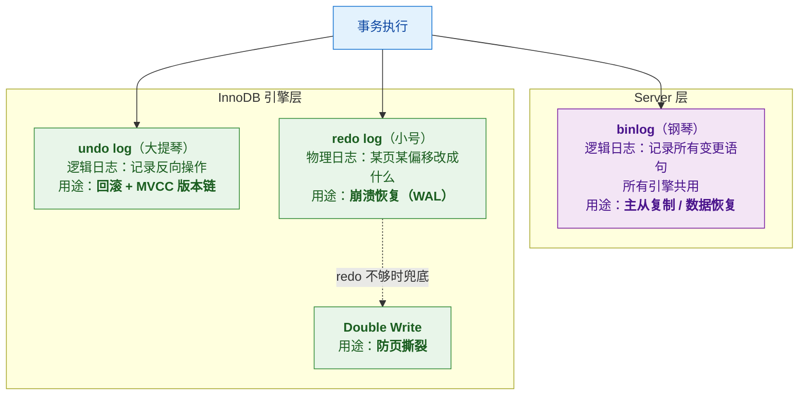
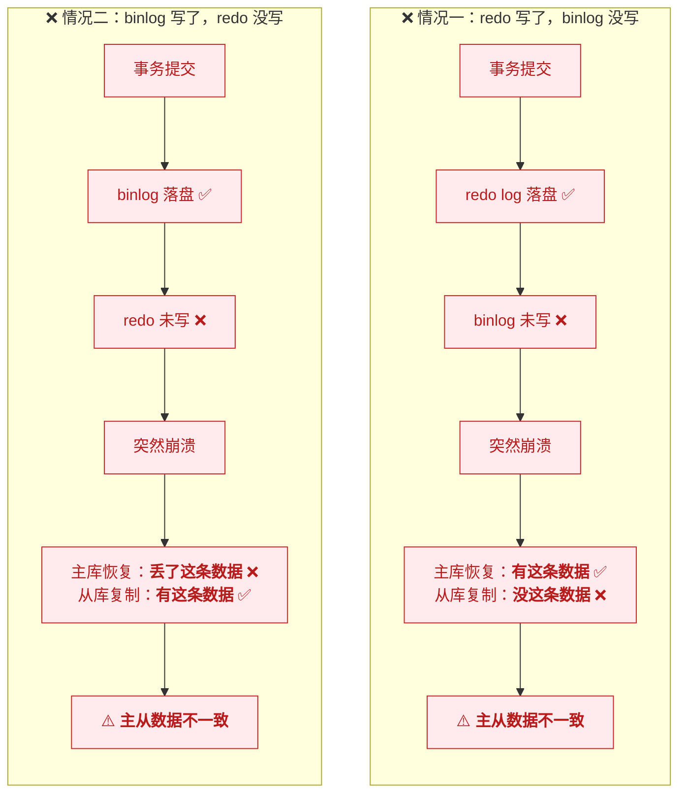
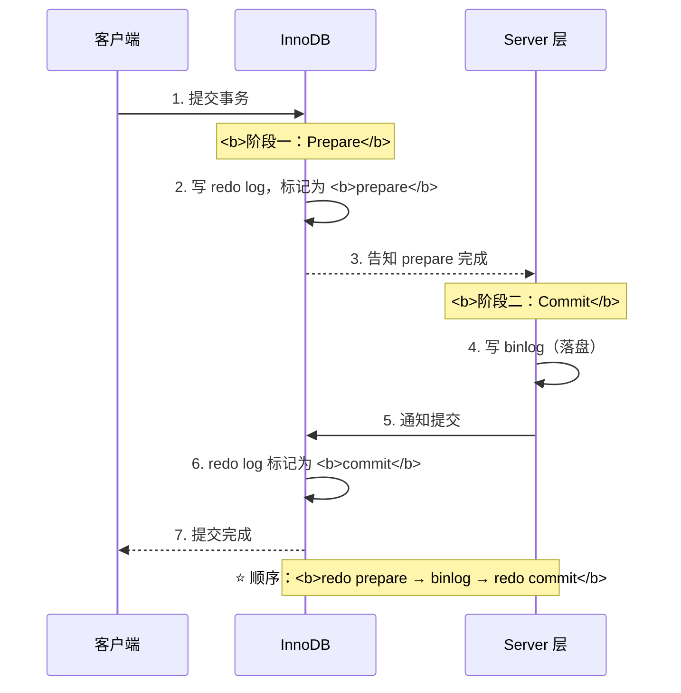
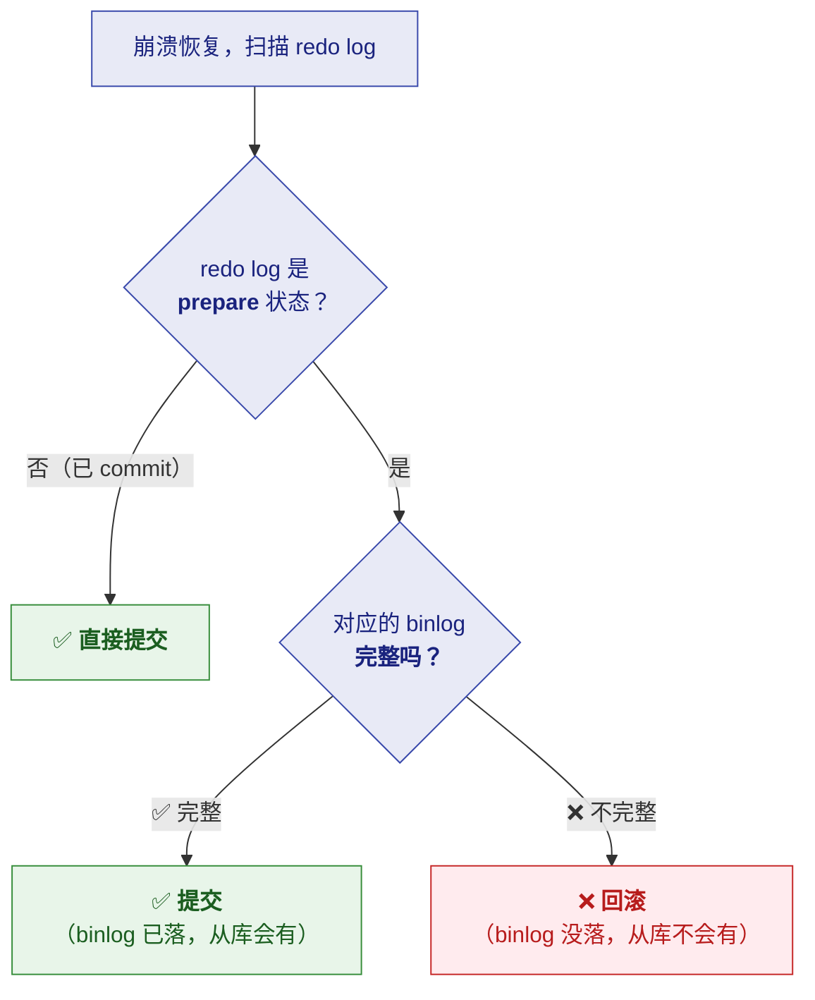
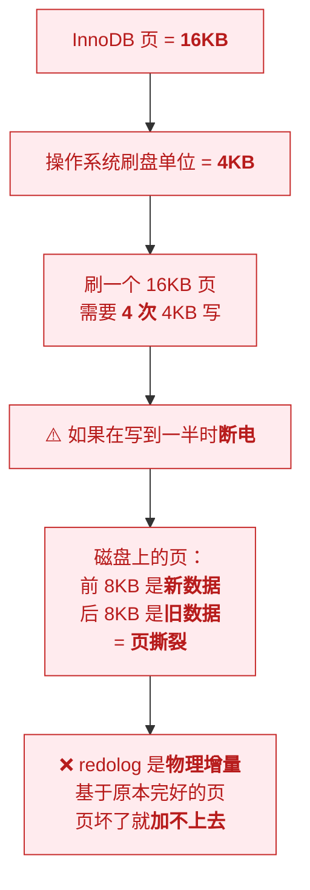
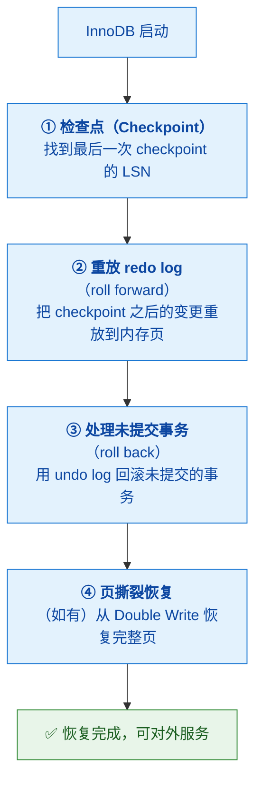

# 📝 五、MySQL 日志与持久化

> 本篇回答五个问题：⭐ **undo / redo / binlog 三兄弟各自干什么**？
> **为什么需要两阶段提交**？**redo log 能救所有崩溃吗**（Double Write 是什么）？
> **崩溃后怎么恢复**？以及**WAL 到底快在哪**？
> 前置见 [[3-事务与MVCC]]；运维见 [[6-慢查询与调优]]。

---

## 一、⭐ 三个日志的分工

> [!important] ⭐ 用转写稿的"交响乐"比喻
> | 日志 | 角色 | 属于哪层 | 类型 | 作用 |
> |---|---|---|---|---|
> | **undo log** | 🎻 **大提琴**（全程低音伴奏） | InnoDB | **逻辑日志** | **回滚 + MVCC** |
> | **redo log** | 🎺 **小号**（关键时刻独奏） | **InnoDB 引擎层** | **物理日志** | **崩溃恢复** |
> | **binlog** | 🎹 **钢琴**（独立声部） | **Server 层** | **逻辑日志** | **主从复制 + 数据恢复** |



### 1.1 undo log（回滚 + MVCC）

| 项 | 内容 |
|---|---|
| **类型** | ⭐ **逻辑日志**——记录"**反向操作**" |
| **记什么** | `DELETE` 的哪一行、`UPDATE` 前的值是什么 |
| **何时写** | ⭐ **事务开始时**就记录 |
| **两大用途** | ① **回滚**（`ROLLBACK` 时反向执行）② ⭐ **MVCC 的版本链**（见 [[3-事务与MVCC]]） |

> [!important] ⭐ undo log 的双重身份
> **它不只是"回滚用的"**——**它还是 MVCC 版本链的物理载体**。
> **每个旧版本就存在 undo log 里，用 `DB_ROLL_PTR` 串起来。**
>
> **所以：undo log 一旦被清理，MVCC 就找不到历史版本了**
> （这就是"长事务会撑大 undo 表空间"的原因）。

### 1.2 redo log（崩溃恢复）

| 项 | 内容 |
|---|---|
| **类型** | ⭐ **物理日志**——记录"**哪个数据页的哪个偏移量改成了什么**" |
| **属于** | ⭐ **InnoDB 引擎层**（不是 Server 层） |
| **机制** | ⭐ **WAL（Write-Ahead Logging）**：**修改前先写日志** |
| **用途** | **崩溃恢复**——保证"已提交的事务不丢" |
| **特点** | **固定大小、循环写**（`ib_logfile0`、`ib_logfile1`） |

> [!important] ⭐ WAL：redo log 快在哪
> **核心思路：把"随机写"变成"顺序写"。**
>
> | 做法 | 说明 |
> |---|---|
> | ❌ **直接改数据页** | 数据页在磁盘上**分散** → **随机 IO**（要寻道） |
> | ✅ **先写 redo log** | redo log 是**顺序追加** → **顺序 IO**（快得多） |
>
> **所以流程是**：
> **① 修改内存中的页（Buffer Pool）→ ② 顺序写 redo log → ③ 日志落盘就算提交成功
> → ④ 数据页可以"慢慢刷"到磁盘。**
>
> ⭐ **这就是"数据页还没刷盘，但事务已经提交成功"的原因。**

### 1.3 binlog（主从复制）

| 项 | 内容 |
|---|---|
| **类型** | ⭐ **逻辑日志**——记录**所有变更语句** |
| **属于** | ⭐ **Server 层**（**所有引擎共用**） |
| **格式** | `STATEMENT`（记 SQL）/ `ROW`（记行变更，推荐）/ `MIXED` |
| **用途** | ⭐ **主从复制 + 数据恢复** |
| **特点** | ⚠️ **只追加写**——**没有 `prepare`/`commit` 状态** |

> [!important] ⭐ binlog 与 redo log 的三个关键差异
> | 维度 | **redo log** | **binlog** |
> |---|---|---|
> | **所属层** | **InnoDB 引擎层** | ⭐ **Server 层**（所有引擎共用） |
> | **日志类型** | **物理**（页+偏移+值） | **逻辑**（SQL 或行变更） |
> | **写入方式** | **循环写**（固定大小） | ⭐ **追加写**（不覆盖，可归档） |
> | **状态** | 有 **`prepare` / `commit`** | ⚠️ **没有中间状态** |
> | **用途** | 崩溃恢复 | **主从复制**、数据恢复 |

> [!tip] 一个实用判断
> **"需要主从复制 → 必须开 binlog；只需要本机崩溃恢复 → 有 redo log 就够。"**
> ⚠️ 但**生产一定开 binlog**（否则无法搭从库、无法做数据恢复/CDC）。

---

## 二、⭐ 两阶段提交（2PC）

> [!important] ⭐ 核心问题：**redo log 和 binlog 是两个独立的日志**
> **必须保证它们"要么都成功、要么都失败"**——否则主从数据不一致。

### 2.1 不两阶段会怎样



### 2.2 两阶段提交的流程



### 2.3 崩溃后的判断规则（⭐ 关键）

> [!important] ⭐⭐ 这是两阶段提交的"灵魂"
> **崩溃恢复时，InnoDB 怎么判断该提交还是回滚？看 redo log 的状态：**



| redo log 状态 | binlog 状态 | 动作 |
|---|---|---|
| **已 commit** | —— | ✅ **提交** |
| **prepare** | ✅ **完整** | ✅ **提交** |
| **prepare** | ❌ **不完整** | ❌ **回滚** |

> [!success] 一句话总结
> **"redo prepare → binlog → redo commit。**
> **崩溃后：如果 redo 是 prepare 状态且 binlog 完整，就提交；binlog 不完整就回滚。
> 这样主从永远一致。"**
>
> ⭐ **这就是"让两个独立日志原子化"的手段。**

> [!note] 参数：`innodb_flush_log_at_trx_commit` 与 `sync_binlog`
> 两个"双 1"配置是**最安全的**：
> | 参数 | 值 | 含义 |
> |---|---|---|
> | `innodb_flush_log_at_trx_commit` | ⭐ **1** | 每次提交都 **fsync redo log**（不丢） |
> | `sync_binlog` | ⭐ **1** | 每次提交都 **fsync binlog**（不丢） |
>
> ⚠️ **代价是每次提交两次 fsync**（性能下降）——
> **所以有"双 1"和"非双 1"的安全/性能取舍。**

---

## 三、Double Write：redo log 救不了的那种崩溃

> [!danger] ⭐⭐ 一个反直觉的点：**redo log 不能救所有崩溃**
> **它救不了"页撕裂"（partial page write）。**

### 3.1 页撕裂是什么



> [!important] ⭐ 为什么 redo log 救不了
> **redo log 是"物理增量"**——记录的是"**在这个完好页的基础上，某个偏移改成了什么**"。
> **如果页本身就撕裂了（一半新一半旧），redo log 就没法往上"叠加"**。
>
> **类比**：redo log 像是"在照片上贴贴纸"——
> **如果照片本身被撕成两半，贴纸就贴不上去了。**

### 3.2 Double Write 的解法


> [!success] ⭐ 一句话说清
> **"Double Write 是数据安全的兜底、双保险：**
> **脏页刷盘前先完整拷到双写区，再写数据文件。**
> **崩溃了先从双写区恢复出完整的页，然后再用 redo log 加增量。**
> **顺序写双写区（开销小），是拿一点性能换数据安全。"**

---

## 四、崩溃恢复：InnoDB 启动时做什么



| 阶段 | 做什么 | 用哪个日志 |
|---|---|---|
| **① 找检查点** | 确定从哪个 LSN 开始恢复 | —— |
| **② roll forward** | **重放 redo log**，把已提交的变更补上 | **redo log** |
| **③ roll back** | **回滚未提交**的事务 | **undo log** |
| **④ 页修复** | 从双写区恢复撕裂的页 | **Double Write** |

> [!important] ⭐ 记住这个"恢复三步曲"
> **"先重放（redo）补上已提交的，再回滚（undo）撤销未提交的，页坏了用双写兜底。"**
>
> **"已提交的不丢、未提交的不留"**——这就是崩溃恢复要保证的。

---

## 五、几个高频追问

### 5.1 redo log 的容量与循环写

| 项 | 说明 |
|---|---|
| **组成** | `ib_logfile0` + `ib_logfile1`（**大小固定**） |
| **写入方式** | ⭐ **循环写**（写满就回头覆盖） |
| **为什么要 checkpoint** | ⭐ **覆盖前必须保证"对应的脏页已经刷盘"** |
| **如果写满了但脏页没刷完** | ⚠️ **必须停下来刷脏页**（造成"抖动"） |

> [!warning] ⚠️ redo log 太小会导致性能抖动
> **redo log 太小 → 频繁写满 → 频繁强制刷脏页 → 出现"sharp checkpoint" → 性能抖动。**
> **这就是"redo log 该调大"的原因**（8.0.30+ 支持动态调整）。

### 5.2 为什么 binlog 要做 `ROW` 格式

| 格式 | 记什么 | 优点 | 缺点 |
|---|---|---|---|
| **STATEMENT** | SQL 语句 | 日志小 | ⚠️ **不确定函数（如 `NOW()`）会导致主从不一致** |
| ⭐ **ROW** | **每行的前后值** | ⭐ **绝对一致、可做 CDC** | 日志大 |
| **MIXED** | 自动选 | 折中 | 复杂 |

> [!tip] 生产建议
> **用 `ROW` 格式**——虽然日志大，但**能保证主从绝对一致**，
> 而且**是 CDC（Canal/Flink CDC）的基础**（见 [[0-MySQL总览]] 的数据同步图）。

### 5.3 undo 表空间膨胀（长事务的危害）

> [!danger] ⚠️ 长事务为什么危险
> **undo log 不能被清理，直到"不再有事务需要看到那些旧版本"。**
> **如果有一个长事务一直开着**：
> - ⭐ **它启动之后产生的所有 undo 都不能清理**（因为它可能还要读旧版本）
> - → **undo 表空间持续膨胀**
> - → **磁盘暴涨 + MVCC 遍历版本链变慢**
>
> **排查长事务**：
> ```sql
> SELECT trx_id, trx_started, TIMESTAMPDIFF(SECOND, trx_started, NOW()) AS secs, trx_query
> FROM information_schema.innodb_trx
> ORDER BY trx_started LIMIT 10;
> ```
>
> **预防**：① ⭐ **事务要短** ② 设 `wait_timeout` / `MAX_EXECUTION_TIME` ③ 监控长事务告警

### 5.4 三个日志的"顺序"

> [!important] 一次事务提交，日志的写入顺序
> ```
> ① undo log（事务开始时就写，记录反向操作）
> ② 修改 Buffer Pool 中的数据页（内存中）
> ③ redo log（prepare 状态）        ← WAL
> ④ binlog（落盘）
> ⑤ redo log（commit 状态）
> ```
> **⭐ 关键是 ③④⑤ 的顺序**——这就是两阶段提交。

---

## 六、30 秒速查表

| 问题 | 一句话答案 |
|---|---|
| 三个日志是 | ⭐ **undo（大提琴）/ redo（小号）/ binlog（钢琴）** |
| undo log 干什么 | ⭐ **回滚 + MVCC 版本链** |
| undo log 类型 | **逻辑日志**（记录反向操作） |
| undo log 何时写 | ⭐ **事务开始时就写** |
| redo log 干什么 | ⭐ **崩溃恢复**（保证已提交不丢） |
| redo log 类型 | ⭐ **物理日志**（页 + 偏移 + 值） |
| redo log 属于哪层 | ⭐ **InnoDB 引擎层** |
| binlog 干什么 | ⭐ **主从复制 + 数据恢复** |
| binlog 属于哪层 | ⭐ **Server 层**（所有引擎共用） |
| binlog 特点 | ⚠️ **只追加写，没有 prepare/commit 状态** |
| binlog 推荐格式 | ⭐ **ROW**（保证主从一致 + 支持 CDC） |
| ⭐ WAL 快在哪 | **把随机写变成顺序写**（数据页分散 vs 日志追加） |
| WAL 的流程 | 改内存页 → **顺序写 redo** → 日志落盘即提交 → 数据页慢慢刷 |
| ⭐ 为什么要两阶段提交 | **让 redo 和 binlog 原子**——否则主从不一致 |
| ⭐ 两阶段顺序 | **redo prepare → binlog → redo commit** |
| 崩溃后怎么判断 | **redo 是 prepare 且 binlog 完整 → 提交；binlog 不完整 → 回滚** |
| 两个"双 1"参数 | `innodb_flush_log_at_trx_commit=1` + `sync_binlog=1`（最安全） |
| ⚠️ redo log 能救所有崩溃吗 | ❌ **救不了页撕裂（partial page write）** |
| 页撕裂怎么产生 | InnoDB 页 **16KB**，OS 刷盘 **4KB**——写一半断电 |
| 为什么 redo 救不了 | ⭐ redo 是**物理增量**，**基于完好的页**；页坏了加不上去 |
| Double Write 干什么 | ⭐ **防页撕裂**——刷盘前先完整拷到双写区 |
| Double Write 恢复流程 | 先从双写区恢复**完整页**，再用 redo 加增量 |
| 崩溃恢复三步 | ⭐ **roll forward（redo）→ roll back（undo）→ 双写兜底** |
| 恢复保证什么 | ⭐ **已提交的不丢，未提交的不留** |
| redo log 怎么写的 | ⭐ **循环写**（固定大小，写满覆盖） |
| 为什么要 checkpoint | ⭐ **覆盖前必须保证对应脏页已刷盘** |
| redo log 太小会怎样 | ⚠️ **频繁强制刷脏页 → 性能抖动**（所以该调大） |
| ⚠️ 长事务的危害 | ⭐ **undo 不能清理 → 表空间膨胀 + 版本链变长** |
| 一次提交的日志顺序 | **undo → 改内存页 → redo prepare → binlog → redo commit** |

---

## 七、学习检查清单

- [ ] ⭐ 能用"**交响乐**"比喻说清三个日志的分工
- [ ] ⭐ 能说清 **undo log 的双重身份**（回滚 + MVCC）
- [ ] 能说出 **undo log 是逻辑日志、事务开始时就写**
- [ ] ⭐ 能说清 **redo log 是物理日志、属于 InnoDB 引擎层**
- [ ] ⭐ 能说清 **binlog 属于 Server 层、所有引擎共用、只追加**
- [ ] ⭐ 能对比 **redo log 与 binlog 的四个差异**
- [ ] ⭐⭐ 能解释 **WAL 为什么快**（随机写 → 顺序写）
- [ ] ⭐⭐ 能说清**为什么需要两阶段提交**（举两种不一致的情况）
- [ ] ⭐ 能背出**两阶段的顺序**（redo prepare → binlog → redo commit）
- [ ] ⭐⭐ 能说清**崩溃后的判断规则**（prepare + binlog 完整 → 提交）
- [ ] 能说出**两个"双 1"参数**及其取舍
- [ ] ⭐⭐ 能说清**页撕裂是什么、为什么 redo log 救不了**
- [ ] ⭐ 能说清 **Double Write 如何解决页撕裂**
- [ ] ⭐ 能背出**崩溃恢复的三步**（roll forward → roll back → 双写兜底）
- [ ] 能说清**崩溃恢复保证什么**（已提交不丢、未提交不留）
- [ ] 能说清 **redo log 的循环写与 checkpoint 的关系**
- [ ] ⚠️ 能说出 **redo log 太小导致性能抖动**的原因
- [ ] ⭐ 能说出 **binlog 三种格式**的取舍与生产建议
- [ ] ⚠️ 能说清**长事务为什么危险**（undo 膨胀）+ 排查 SQL
- [ ] ⭐ 能按顺序说出**一次提交的日志写入顺序**

---
> 上一篇 → [[4-锁机制]] ｜ 下一篇 → [[6-慢查询与调优]] ｜ 返回 [[0-MySQL总览]]
> MVCC 版本链 → [[3-事务与MVCC]] ｜ 面试冲刺 → [[MySQL深度优化与MGR高可用面试题]]
