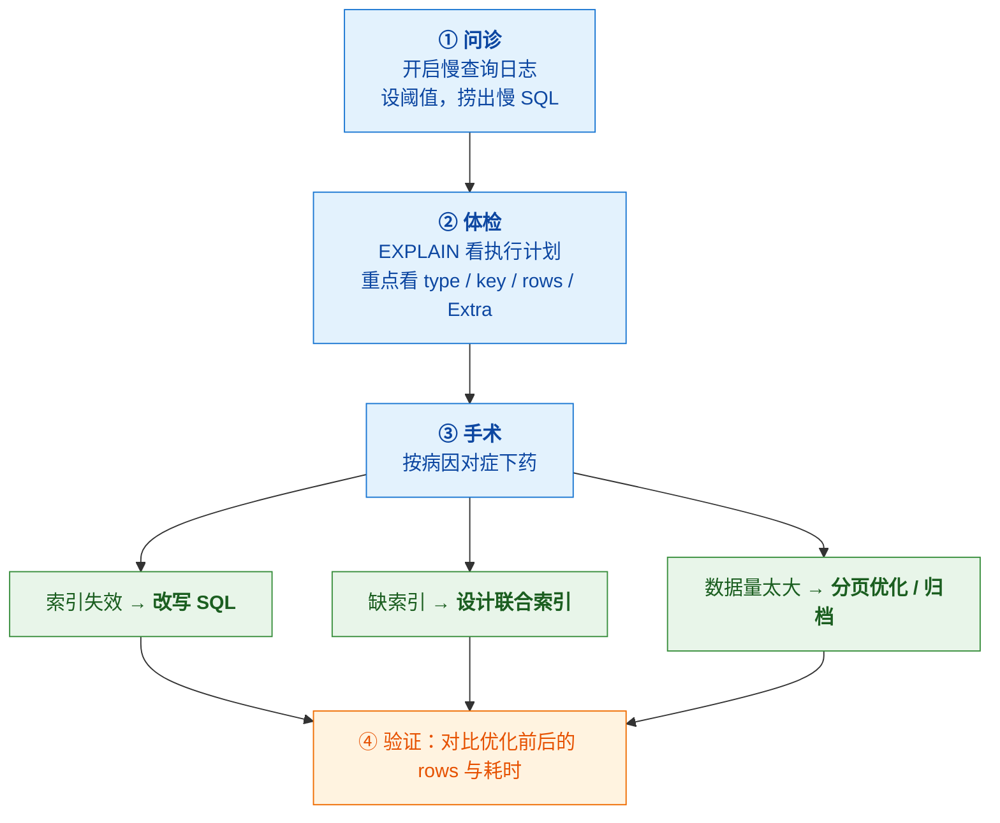
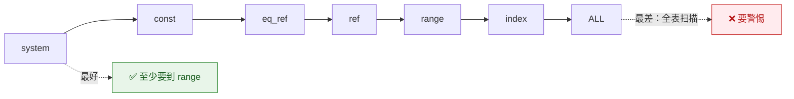
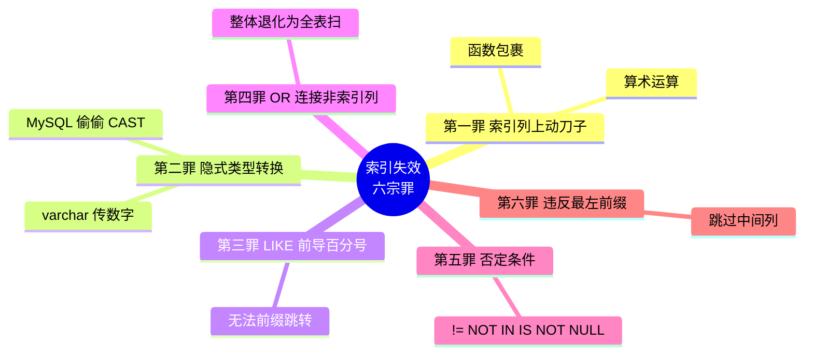
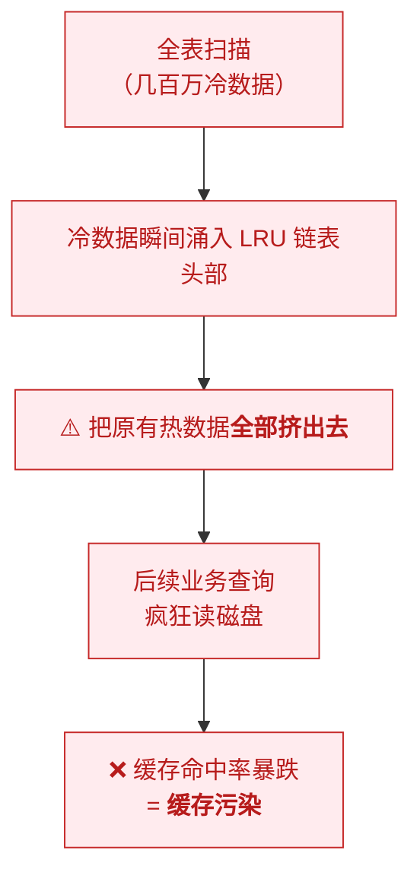
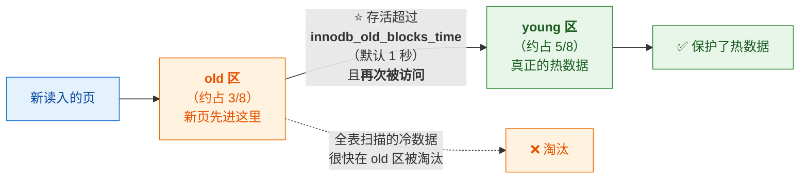

# ⚡ 六、慢查询与调优

> 本篇回答六个问题：⭐ **慢查询的诊疗三步是什么**？
> ⭐ **索引失效有哪六宗罪**？**EXPLAIN 该看哪三列**？
> **深分页怎么优化**？**Buffer Pool 为什么不用普通 LRU**？**count 为什么慢**？
> 前置见 [[2-索引与B+树]]；锁等待见 [[4-锁机制]]。

---

## 一、⭐ 诊疗三步（核心方法论）

> [!important] ⭐ 把它当"看病流程"记
> **① 问诊**（找问题 SQL）→ **② 体检**（看执行计划）→ **③ 手术**（对症下药）



### 1.1 问诊：开启慢查询日志

```sql
-- 开启慢查询日志
SET GLOBAL slow_query_log = ON;
-- 阈值（超过多久算慢）
SET GLOBAL long_query_time = 1;            -- 单位秒
-- 日志文件位置
SHOW VARIABLES LIKE 'slow_query_log_file';

-- ⭐ 记录"没走索引"的 SQL（很有用）
SET GLOBAL log_queries_not_using_indexes = ON;
```

**配置文件方式**：
```ini
[mysqld]
slow_query_log = 1
long_query_time = 1
slow_query_log_file = /var/log/mysql/slow.log
log_queries_not_using_indexes = 1
```

> [!tip] 怎么从慢日志里"捞出"最重要的 SQL
> **别一条条看**——用工具聚合：
> ```bash
> # ⭐ 强烈推荐：按总耗时排序
> pt-query-digest /var/log/mysql/slow.log
> # 或 mysqldumpslow
> mysqldumpslow -s t -t 10 /var/log/mysql/slow.log
> ```
> **重点看"总耗时最高"的**——因为一条中等慢但调用百万次的 SQL，
> **总体影响可能远超一条偶尔很慢的 SQL。**

### 1.2 体检：EXPLAIN 看什么

```sql
EXPLAIN SELECT * FROM users WHERE age > 20 AND city = 'BJ';
-- 8.0 还可以看实际执行情况：
EXPLAIN ANALYZE SELECT ...;      -- ⭐ 输出真实耗时
```

> [!important] ⭐⭐ 重点看这四列
> | 列 | 看什么 | ⚠️ 危险信号 |
> |---|---|---|
> | **`type`** | 访问类型 | ⭐ **`ALL` = 全表扫描**；目标至少 `range`/`ref` |
> | **`key`** | 实际用的索引 | ⭐ **`NULL` = 没走索引** |
> | **`rows`** | **预估扫描行数** | 越大越危险；与实际行数差太多说明统计信息过期 |
> | **`Extra`** | 额外信息 | ⭐ **`Using filesort`（文件排序）/ `Using temporary`（临时表）** |

**`type` 的优劣顺序**（从好到坏）：



| type | 含义 |
|---|---|
| `system` / `const` | 常量查询（主键或唯一索引等值）——最快 |
| `eq_ref` | 唯一索引关联 |
| `ref` | 非唯一索引等值 |
| **`range`** | ⭐ **范围扫描（通常可接受）** |
| `index` | 全索引扫描（比 ALL 好，但仍扫全部） |
| **`ALL`** | ⭐ **全表扫描——要警惕** |

> [!danger] ⚠️ `Using filesort` 与 `Using temporary`
> | Extra | 含义 | 为什么危险 |
> |---|---|---|
> | **`Using filesort`** | ⭐ **排序没走索引**，要用额外排序 | 数据量大时**内存/磁盘排序**极慢 |
> | **`Using temporary`** | ⭐ **用了临时表**（常见于 `GROUP BY`/`DISTINCT`/`UNION`） | 临时表开销大 |
> | `Using index` | ✅ **覆盖索引**（好事） | —— |
> | `Using index condition` | ✅ **ICP 生效**（好事） | —— |
> | `Using where` | 在 Server 层过滤 | 中性（可能是没下推） |

> [!success] 面试怎么说（工程思维的表述）
> **"我会用 EXPLAIN 验证索引是否生效，重点关注 type、key、rows、Extra 四列。**
> **看到 type=ALL、key=NULL，或者 Extra 出现 Using filesort / Using temporary，
> 就需要警惕。"**

---

## 二、⭐⭐ 索引失效六宗罪

> [!important] ⭐ 记这六条（转写稿的"六个高危罪名"）



### 2.1 逐个详解

| # | 罪名 | ❌ 反例 | ✅ 正解 |
|---|---|---|---|
| **1** | ⭐ **索引列上做运算/函数** | `WHERE YEAR(create_time)=2026` | `WHERE create_time >= '2026-01-01' AND create_time < '2027-01-01'` |
| **2** | ⭐ **隐式类型转换** | `WHERE phone=13800138000`（phone 是 varchar） | `WHERE phone='13800138000'` |
| **3** | ⭐ **`LIKE` 前导 `%`** | `WHERE name LIKE '%Tom'` | `WHERE name LIKE 'Tom%'`（前缀匹配可用索引） |
| **4** | ⭐ **`OR` 连接非索引列** | `WHERE a=1 OR b=2`（b 无索引） | 给 b 建索引，或改 `UNION` |
| **5** | ⭐ **否定条件** | `WHERE status != 1`、`NOT IN`、`IS NOT NULL` | 改成正向条件，或用其他手段 |
| **6** | ⭐ **违反最左前缀** | 索引 `(a,b,c)`，`WHERE b=2` | 补齐 a 的条件，或调整索引顺序 |

### 2.2 为什么"隐式转换"会失效

> [!danger] ⭐ 这是最隐蔽的一条
> ```sql
> -- phone 是 VARCHAR，索引 idx_phone
> SELECT * FROM users WHERE phone = 13800138000;   -- ❌ 传了数字
> ```
> **MySQL 会把字符串侧转成数字来比较**，等价于：
> ```sql
> WHERE CAST(phone AS SIGNED) = 13800138000   -- ⭐ 索引列被函数包裹了！
> ```
> **→ 索引失效。**
>
> ⚠️ **反过来的方向通常没问题**：
> ```sql
> -- age 是 INT
> WHERE age = '20';     -- ✅ 这样是可以走索引的（数字列 vs 字符串常量）
> ```
> **规则**：**字符集/类型转换发生在"索引列"上就会失效。**

### 2.3 关于"否定条件"的澄清

> [!note] 为什么否定条件容易失效
> **优化器要"排除"某些值**——如果**要排除的值很多**，
> 走索引**不如直接全表扫**（因为走索引要扫的区间太多，还要回表）。
>
> ⚠️ **但这不是绝对的**：
> - 如果 `status != 1` 里 **`status=1` 占绝大多数**，那"排除"后剩很少 → 索引反而有用
> - **优化器会基于统计信息权衡**——**所以"!= 一定失效"是过度简化**
>
> **更准确的说法**：**否定条件通常导致优化器放弃索引，
> 但最终取决于选择率与统计信息。**

### 2.4 关于 `OR` 的补充

```sql
-- ✅ 如果 OR 两边都是索引列，8.0 可以用 index merge
WHERE a = 1 OR b = 2;    -- a、b 都有索引 → 可能用 index_merge

-- ❌ 只要一边没索引，整体就退化为全表扫描
WHERE a = 1 OR b = 2;    -- b 没索引 → 全表扫
```

---

## 三、⭐ 深分页优化

### 3.1 问题：`LIMIT` 越大越慢

```sql
-- ❌ 扫 100 万零 10 条，然后<b>扔掉前 100 万</b>
SELECT * FROM orders ORDER BY id LIMIT 1000000, 10;
```

> [!danger] ⚠️ 为什么慢
> **MySQL 必须先"取出"前 1000010 条、再丢掉前 1000000 条**——
> **前面那些行的读取和排序成本全都白花了。**
> ⚠️ **而且如果 `SELECT *`，还要回表 100 万次。**

### 3.2 优化方案

**方案一：延迟关联（最常用）**

```sql
-- ✅ 先用覆盖索引只取主键 id，再回表取完整数据
SELECT o.* FROM orders o
INNER JOIN (
    SELECT id FROM orders ORDER BY id LIMIT 1000000, 10
) t ON o.id = t.id;
```


**方案二：游标/书签（keyset pagination）**

```sql
-- ✅ 记住上一页最后一个 id，下一页从它之后开始
SELECT * FROM orders WHERE id > 1000000 ORDER BY id LIMIT 10;
```
> ⚠️ **限制**：**只能顺序翻页，不能跳页**（比如直接跳第 1000 页）。
> **适合"无限滚动"场景**（信息流、日志列表）。

**方案三：业务上限制**

> ⭐ **"很多业务其实不需要翻到第 10 万页"**——
> **限制最大页数**，或引导用户**用筛选条件缩小范围**（这才是架构思维）。

| 方案 | 适用 |
|---|---|
| ⭐ **延迟关联** | 通用，需保留跳页能力 |
| **游标（keyset）** | 无限滚动，性能最好 |
| **限制页数 / 引导筛选** | 业务上其实不需要深翻 |

---

## 四、Buffer Pool：为什么不用普通 LRU

> [!important] ⭐ 核心问题：**缓存污染**
> **如果只是"能背出 LRU"，面试官会觉得你没看过源码。**

### 4.1 普通 LRU 的致命弱点



> [!note] 为什么会这样
> **LRU 假设"最近访问的最可能再被访问"**——
> **但全表扫描访问的数据"最近被访问过，却不会再被访问"**，
> **它把真正热的数据挤出去了。**

### 4.2 InnoDB 的解法：分两区 + 时间门槛



| 机制 | 说明 |
|---|---|
| **分两区** | **young（约 5/8，热）+ old（约 3/8，冷）** |
| ⭐ **新页先进 old** | 而不是直接进 young |
| ⭐ **时间门槛** | **在 old 区存活超过 `innodb_old_blocks_time`（默认 1 秒）** 且**再次被访问**，才晋升 young |
| **效果** | **全表扫描的冷数据在 old 区待不到 1 秒就被淘汰**，污染不了 young 区 |

> [!success] ⭐ 面试怎么说
> **"InnoDB 的 Buffer Pool 不是普通 LRU，它把链表分成 young 和 old 两区。**
> **新页先进 old，只有在 old 区存活超过 1 秒（`innodb_old_blocks_time`）
> 且再次被访问，才晋升到 young 区。**
> **这样全表扫描带来的冷数据会很快在 old 区被淘汰，保护了 young 区的热数据
> ——这就是防缓存污染。"**

> [!tip] 这个设计能推广成一个通用原则
> **"任何会被'突发大批量访问'冲击的缓存，都要考虑防污染。"**
> 类似思想也见于：**Redis 的 LFU 淘汰策略、MySQL 的 Change Buffer**——
> **都是"不要因为一次性的访问把真正有价值的数据挤出去"。**

---

## 五、其他高频优化点

### 5.1 `count(*)` 为什么慢

> [!note] InnoDB 没有"存总行数"
> **MyISAM 会把行数存在元数据里，`COUNT(*)` 直接返回；
> InnoDB 因为 MVCC（每行可能有多个版本），必须"逐行判断可见性"再计数。**

| 优化手段 | 说明 |
|---|---|
| ⭐ **走最小的二级索引** | 二级索引比聚簇索引小 → **IO 更少** |
| **用近似值** | ⭐ `EXPLAIN` 的 rows 估算、或维护计数表 |
| ⭐ **换个思路** | **业务真的需要绝对精确的实时 count 吗？** 用 Redis `INCR` 维护、或用 ES 近似——**这是架构式思维** |

```sql
-- 8.0 的优化：count(*) 会选最小的索引
EXPLAIN SELECT COUNT(*) FROM orders;
-- 看 key 列，通常选了最小的二级索引
```

> [!success] ⭐ "架构式思维"的表述很加分
> **"如果 count 还是很慢，我会问一句：业务真的需要绝对精确的实时 count 吗？**
> **如果不必须，可以用 Redis 计数器维护、或用 ES 的近似统计——
> 把'精确但慢'换成'近似但快'，这是架构层面的取舍。"**

### 5.2 `ORDER BY` 怎么走索引

| 情况 | 能否用索引排序 |
|---|---|
| `ORDER BY` 列 = 索引最左列 | ✅ |
| `WHERE a=? ORDER BY b`（索引 `(a,b)`） | ✅ |
| `ORDER BY a, b`（索引 `(a,b)`） | ✅ |
| `ORDER BY b, a` | ❌ 顺序不符 |
| `ORDER BY a ASC, b DESC`（8.0 前） | ❌ 混合方向（8.0+ 支持降序索引） |
| `WHERE a>? ORDER BY a` | ✅ 通常可以 |

**消除 `Using filesort` 的思路**：
1. **让排序列走进索引**（注意最左前缀）
2. **调整联合索引顺序**（等值列在前，排序列在后）
3. **`ORDER BY` + `LIMIT` 时**，如果数据量不大，filesort 也可接受

### 5.3 Join 优化

| 要点 | 说明 |
|---|---|
| ⭐ **小表驱动大表** | 减少外层循环次数 |
| ⭐ **关联列都要有索引** | 被驱动表的关联列必须有索引，否则**每次都是全表扫** |
| ⚠️ **避免 `JOIN` 太多表** | 一般不超过 3 张（优化器可能选错） |
| **`ON` 与 `WHERE` 分清** | `LEFT JOIN` 的过滤写在 `ON` 才不会退化 |
| **8.0 的 Hash Join** | 无索引的等值 Join 也能快（替代 BNL） |

### 5.4 表结构与归档

| 手段 | 说明 |
|---|---|
| ⭐ **冷热分离 / 归档** | **历史数据迁走**（数据量是根本瓶颈） |
| **分区表** | 按时间分区，查询可**分区裁剪** |
| **合适的字段类型** | `INT` 而非 `VARCHAR` 存数字；`TIMESTAMP` vs `DATETIME` |
| **避免大字段** | `TEXT`/`BLOB` 放独立表（避免影响主表 IO） |
| **合理冗余** | 适度反范式减少 Join |

---

## 六、一个完整的优化案例

> [!example] 转写稿里的真实案例

```sql
-- ❌ 优化前（函数包裹索引列）
SELECT * FROM orders
WHERE YEAR(create_time) = 2026 AND status = 1;

-- ✅ 优化后（改成范围查询）+ 建联合索引
SELECT * FROM orders
WHERE create_time >= '2026-01-01' AND create_time < '2027-01-01'
  AND status = 1;

-- 联合索引（等值列 status 在前，范围列 create_time 在后）
CREATE INDEX idx_status_time ON orders(status, create_time);

-- 如果查询列较少，还可以做成覆盖索引
CREATE INDEX idx_status_time_cover ON orders(status, create_time, amount);
```

**效果（转写稿数据）**：
| 指标 | 优化前 | 优化后 |
|---|---|---|
| **`type`** | `ALL`（全表扫描） | **`range`** |
| **`rows`** | **50 万** | **120** |
| **响应时间** | ~2 秒 | **~50ms** |

> [!success] ⭐ 面试怎么讲这个案例（不像背书的说法）
> **"我遇到过类似案例：通过慢日志定位到一条 SQL，
> 用 EXPLAIN 分析发现是索引列上套了函数导致失效。**
> **改成范围查询并补了联合索引后，
> type 从 ALL 变成 range，扫描行数从 50 万降到 120，
> 响应时间从 2 秒降到 50ms。**
>
> **有数据、有过程、有结果——这就是实战经验。"**

---

## 七、30 秒速查表

| 问题 | 一句话答案 |
|---|---|
| ⭐ 慢查询诊疗三步 | **问诊（慢日志）→ 体检（EXPLAIN）→ 手术（对症下药）** |
| 怎么开慢日志 | `slow_query_log=ON` + `long_query_time` |
| 怎么捞重点 SQL | ⭐ **`pt-query-digest` 按总耗时排序**（不只看单次慢） |
| ⭐⭐ EXPLAIN 看哪四列 | **`type`（ALL 危险）/ `key`（NULL 没索引）/ `rows`（扫描行数）/ `Extra`** |
| `type` 的合格线 | ⭐ **至少 `range`**；`ALL` 是全表扫描 |
| ⭐ 两个危险 Extra | **`Using filesort`（排序没走索引）**、**`Using temporary`（临时表）** |
| 两个"好"的 Extra | **`Using index`（覆盖索引）**、**`Using index condition`（ICP）** |
| ⭐⭐ 索引失效六宗罪 | **函数运算 / 隐式转换 / 前导 % / OR 非索引列 / 否定条件 / 违反最左前缀** |
| ⭐ 隐式转换为什么失效 | **在索引列上做了 `CAST`**——如 varchar 列传数字 |
| `!=` 一定失效吗 | ⚠️ **不绝对**——取决于选择率与统计信息 |
| `OR` 两边都有索引呢 | 8.0 可能用 **index_merge**；一边没索引则全表扫 |
| ⭐ 深分页为什么慢 | **先取出 LIMIT+M 条再扔掉前 M 条**，白读 + 回表 |
| ⭐⭐ 深分页怎么优化 | **延迟关联**——先用覆盖索引取 id，再回表（100 万次 → 10 次） |
| 游标分页的局限 | ⚠️ **只能顺序翻页，不能跳页**（适合无限滚动） |
| ⭐ Buffer Pool 为什么不用普通 LRU | **防缓存污染**——全表扫描会把热数据挤出去 |
| ⭐ InnoDB 的解法 | **分 young/old 两区 + 时间门槛**：新页进 old，存活超 **1 秒**且再被访问才晋升 |
| `count(*)` 为什么慢 | ⭐ **InnoDB 因 MVCC 必须逐行判断可见性**（不像 MyISAM 有现成行数） |
| `count(*)` 怎么优化 | **走最小的二级索引**；或用近似值（Redis/ES） |
| ⭐ count 的架构式思维 | **"业务真的需要绝对精确的实时 count 吗？"** |
| `ORDER BY` 走索引的条件 | **排序列要在索引里且符合最左前缀/顺序** |
| ⭐ Join 优化要点 | **小表驱动大表 + 关联列都要有索引** |
| 数据量太大的根本解 | ⭐ **冷热分离 / 归档 / 分区** |
| ⭐ 案例效果怎么讲 | **"type 从 ALL 变 range，rows 从 50 万降到 120，耗时 2s → 50ms"** |

---

## 八、学习检查清单

- [ ] ⭐ 能背出**慢查询诊疗三步**
- [ ] 能说出**开启慢日志的关键参数**（含 `log_queries_not_using_indexes`）
- [ ] ⭐ 能说出用 **`pt-query-digest` 按总耗时聚合**，并解释为什么不只看单次最慢
- [ ] ⭐⭐ 能说出 **EXPLAIN 重点看的四列**及各自的危险信号
- [ ] 能背出 **`type` 的优劣顺序**，并说出合格线是 `range`
- [ ] ⭐ 能说清 **`Using filesort` 与 `Using temporary`** 的含义与危害
- [ ] 能识别 **`Using index` 与 `Using index condition`** 是好事
- [ ] ⭐⭐ 能背出**索引失效六宗罪**并各给一个正解
- [ ] ⭐ 能说清**隐式类型转换导致失效**的机制（`CAST` 套在索引列上）
- [ ] ⚠️ 能澄清"**`!=` 一定失效**"是过度简化
- [ ] 能说出 **`OR` 两边都有索引时** 8.0 的处理（index_merge）
- [ ] ⭐ 能说清**深分页慢的原因**（白读 + 回表）
- [ ] ⭐⭐ 能写出**延迟关联**的 SQL 并解释为什么快
- [ ] 能说出**游标分页**的适用与局限
- [ ] ⭐ 能说出**"限制页数/引导筛选"是架构思维**
- [ ] ⭐⭐ 能说清 **Buffer Pool 为什么不用普通 LRU**（缓存污染）
- [ ] ⭐ 能完整讲出**young/old 两区 + 时间门槛**的机制
- [ ] 能把这个设计**推广成通用原则**（防一次性大批量访问污染缓存）
- [ ] ⭐ 能说清 **`count(*)` 为什么在 InnoDB 慢**（MVCC）
- [ ] 能说出 **count 的三种优化思路**，尤其"架构式思维"那条
- [ ] 能说出 **`ORDER BY` 走索引的条件**
- [ ] ⭐ 能说出 **Join 优化的两个要点**
- [ ] ⭐ 能说出**数据量太大的根本解**（归档/分区）
- [ ] ⭐ 能用一个**带数字的完整案例**讲优化效果

---
> 上一篇 → [[5-日志与持久化]] ｜ 返回 [[0-MySQL总览]]
> 索引原理 → [[2-索引与B+树]] ｜ 面试冲刺 → [[MySQL深度优化与MGR高可用面试题]]
