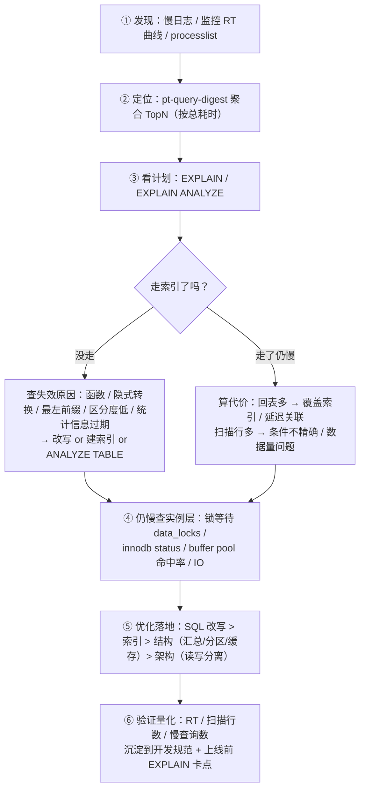
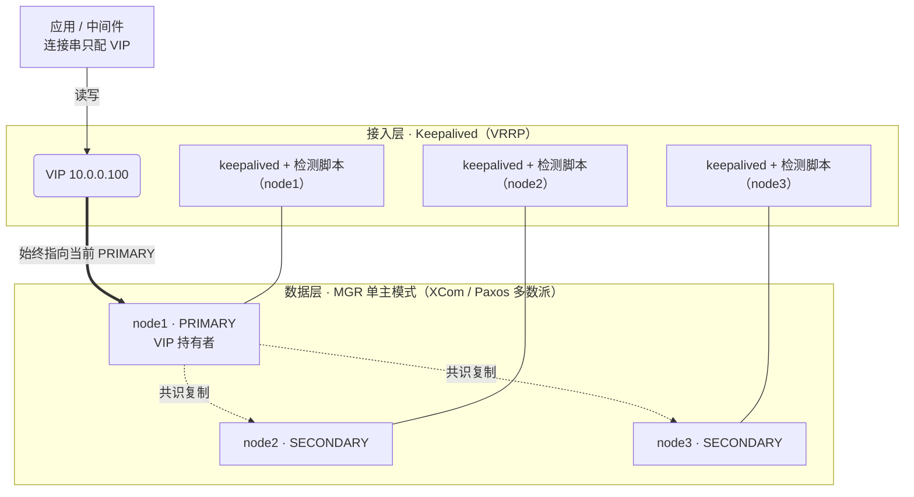

# 🎤 MySQL 深度优化与 MGR 高可用 · 面试准备

> [!abstract] 对应简历核心能力
> "MySQL深度索引优化、慢查询调优，熟悉MGR/Keepalived高可用架构；Oracle/PL/SQL复杂存储过程"
> 面试官看到这条的出题逻辑：**原理 → 实战案例 → 极限追问**。写了"深度"一定会深挖，写了"熟悉"一定会让你画架构图。

> [!warning] 铁律：每个关键词 = 一道必考题 + 一个 3 分钟真实案例
> 答不出案例，"深度"二字就从加分项变成减分项。第五节有 STAR 模板，先填好再往下背。

## 0️⃣ 出题地图

| 简历关键词 | 必考题 | 追问链方向 |
| --- | --- | --- |
| 深度索引优化 | 为什么用 B+ 树？联合索引怎么设计？ | EXPLAIN 逐字段 → key_len 计算 → 失效场景 |
| 慢查询调优 | 一条 SQL 慢了怎么排查？ | 排查 SOP → 深分页 → count → 锁等待 |
| MGR/Keepalived | 画一下你们的高可用架构 | Paxos → 脑裂 → VIP 漂移 → 主从延迟 |
| Oracle/PL/SQL | 说一个复杂存储过程的例子 | BULK COLLECT → 异常处理 → 自治事务 |

---

## 一、索引深度优化

### 必问清单

- [ ] Q1 InnoDB 为什么用 B+ 树，不用 B-Tree / Hash / 红黑树？
- [ ] Q2 聚簇索引和二级索引？什么是回表、覆盖索引？
- [ ] Q3 最左前缀原则：(a,b,c) 联合索引哪些查询能走？
- [ ] Q4 索引失效有哪些场景？（背熟 8 条）
- [ ] Q5 为什么推荐自增主键？UUID / 雪花 ID 做主键有什么问题？
- [ ] Q6 什么是索引下推 ICP？
- [ ] Q7 前缀索引怎么定长度？什么是索引区分度？
- [ ] Q8 EXPLAIN 怎么看？key_len 怎么算？
- [ ] Q9 索引是不是越多越好？为什么？
- [ ] Q10 ORDER BY / GROUP BY 为什么会 filesort / temporary？

### Q1 为什么是 B+ 树？（高频第一题，3 分钟脱稿）

**先给结论**：B+ 树矮胖、扇出大、叶子有序，是最契合"磁盘按页读写"的结构。

- **数据组织**：InnoDB 按页管理数据，默认 16KB/页。非叶子节点只存"主键 + 页指针"，不存整行 → 一页能放约 1170 个指针（16KB ÷ 14B，bigint 主键 8B + 指针 6B）。
- **容量**：假设叶子页每行 1KB（一页 16 行）→ 树高 3 层可存 1170 × 1170 × 16 ≈ **2190 万行**。根节点常驻内存，所以千万级表一次主键查询只需 1~3 次磁盘 IO。
- **vs B-Tree**：B- 树非叶节点也存数据 → 每页能放的指针变少 → 树更高 → IO 更多。B+ 树叶子节点间还有**双向链表**，范围扫描、排序天然友好。
- **vs Hash**：等值 O(1) 但不支持范围查询、排序、最左前缀。（InnoDB 有自适应哈希 AHI，属于内部机制，不受 SQL 控制。）
- **vs 红黑树/跳表**：二叉/多叉的窄高结构层多，一次查询 IO 次数等于树高 → 磁盘场景必输。跳表适合内存结构（如 Redis ZSet）。

### Q2 聚簇索引 / 回表 / 覆盖索引

- **聚簇索引（主键索引）**：叶子节点存整行数据，表本身就是按主键组织的 B+ 树 → "索引即数据"。
- **二级索引（普通索引）**：叶子节点存"索引列 + 主键值"。
- **回表**：二级索引查到主键后，再去聚簇索引查整行 = 每条记录多一次树查找。
- **覆盖索引**：select 的列全部包含在索引里 → `Extra: Using index`，免回表。
- **实战意识**：高频查询 `select id,b from t where a=?` 建联合索引 `(a,b)` 直接覆盖，比单列索引 `(a)` 快一个量级。
- 追问"没有主键怎么办"：用第一个非空唯一索引；都没有则用隐藏 row_id（全局共享计数器，不可引用、不可利用）→ **永远显式建主键**。

### Q3 最左前缀原则

- 索引 `(a,b,c)`：`a`、`a,b`、`a,b,c` 有效；单独 `b`、`b,c` 不走（8.0.13+ 的 Skip Scan 可部分缓解，能提一句加分）。
- **范围查询右侧列失效**：`where a>? and b=?` → 只有 a 用于定位，b 只能靠 ICP 过滤。
- **设计口诀**：等值列在前、范围列在后；区分度高的在前；考虑排序需求让索引序代替排序。
- 排序也要满足最左前缀的"连续性"，否则 filesort。

### Q4 索引失效场景（背熟 8 条）

1. 对索引列做**函数或运算**：`year(dt)=2023`、`id+1=10`、`substring()`。
2. **隐式类型转换**：varchar 列用数字等值查（`phone=13800001380`）；反向（int 列用字符串查）不失效，因为优化器转的是常量。
3. **前导模糊**：`like '%x'` 不走（`'x%'` 可以）。
4. **or 两侧任一列无索引** → 全表。
5. **不满足最左前缀**。
6. **join 列字符集/排序规则不一致**（utf8 vs utf8mb4）。
7. `!=` / `not in` / `not exists` **视成本而定，不保证失效**——纠正面试官预期，主动说这条是常见误区。
8. **优化器主动放弃**：区分度太低（如性别列）或预估回表代价过高 → 可用 `force index` 验证。

> [!tip] 高级答法
> 索引失效的统一本质：**索引本身是有序结构，条件必须能转化为"在索引序上定位一段连续区间"才能用它**。函数/类型转换/前导模糊都破坏了这种可定位性。这样答直接上档次。

### Q5 主键选择

- **自增主键**：顺序追加写入，页写满自然裂新页，无页分裂、缓存命中高。
- **UUID**：随机插入 → 频繁页分裂、页利用率低、36 字节占索引空间（二级索引叶子还存主键 → 放大到全表所有索引）。
- **雪花 ID**：趋势递增可接受，bigint 存储；注意时钟回拨问题。
- 追问"自增 ID 用尽"：int unsigned 上限约 42.9 亿，可 online DDL 改 bigint。

### Q6 索引下推 ICP（5.6+）

- 旧行为：二级索引定位第一条就回表，回 Server 层过滤剩余条件。
- ICP：把 where 中**索引列能判断的条件**下推到存储引擎层，在索引里先过滤 → 大幅减少回表次数。
- `Extra: Using index condition`。
- 例子：索引 `(name,age)`，`where name like '张%' and age=10`。

### Q7 区分度与前缀索引

- 区分度 = `count(distinct col) / count(*)`，< 0.1 一般不值得单建。
- 长字符串（如 URL）用前缀索引：按区分度拐点选长度；`count(distinct left(col,n))/count(*)` 逐步逼近。
- 前缀索引的代价：不能覆盖索引、不能用于排序。

### Q8 EXPLAIN 速查（必背）

| 字段 | 看什么 |
| --- | --- |
| type | system > const > eq_ref > **ref** > **range** > index > ALL，生产至少 range，杜绝 ALL |
| key / key_len | 实际用的索引 + 用了几列 |
| rows / filtered | 预估扫描行数 / 过滤后比例，两者相乘 ≈ 最终行数 |
| Extra | Using index（覆盖）/ Using index condition（ICP）/ Using where / **Using filesort** / **Using temporary** |

**key_len 计算法则**（utf8mb4）：

| 类型 | 长度 | 说明 |
| --- | --- | --- |
| int | 4 | bigint 8 |
| char(n) | 4n | 定长 |
| varchar(n) | 4n + 2 | +2 是变长长度字节 |
| 可空列 | 再 +1 | NULL 标记位 |
| date / timestamp / datetime | 3 / 4 / 5 | 不含小数秒 |

例：`idx(a int not null, b varchar(20) null)` → key_len = 4 + (80+2+1) = **87**，说明 a、b 两列都用上了。

> [!tip] 8.0 加分项
> 8.0.18+ 的 `EXPLAIN ANALYZE` 会**真实执行**并显示每个算子的实际耗时/行数（仅 SELECT），用来对照"估算 vs 实际"，是诊断执行计划跑偏的利器。

### Q9 索引不是越多越好

- 每个索引都是一棵独立的 B+ 树：写入要维护所有索引（写放大）、占磁盘、占用 buffer pool。
- 优化器选择成本上升，还可能选错。
- 经验值：单表 ≤ 5 个索引、单索引 ≤ 5 列（讲得出理由即可，别说是铁律）。
- 唯一索引 vs 普通索引：读几乎无差；写时唯一索引必须读页校验唯一性，高并发写场景普通索引更友好（change buffer 是历史缓解机制，答概念即可，别纠结版本）。

### Q10 排序与分组

- 索引序满足最左前缀连续且方向一致 → 免 filesort；否则内存/磁盘排序。
- group by 出现 `Using temporary`：建覆盖索引；8.0 已取消 group by 隐式排序（5.7 有，迁移注意）。

---

## 二、慢查询调优

### 排查 SOP（背成肌肉记忆，这是本节最重要的一张图）



### 必问清单

- [ ] Q1 一条 SQL 突然变慢，你的排查思路？（答案就是上面这张图）
- [ ] Q2 慢查询日志怎么配？怎么分析？
- [ ] Q3 深分页 `limit 100000,10` 为什么慢？怎么优化？
- [ ] Q4 `count(*)` 慢怎么办？
- [ ] Q5 join 慢怎么优化？hash join 了解吗？
- [ ] Q6 不止单条 SQL，整个实例都慢，什么原因？
- [ ] Q7 锁 / MVCC 引起的慢怎么查？死锁怎么办？
- [ ] Q8 慢日志参数怎么定？

### Q2 慢日志配置

```sql
SET GLOBAL slow_query_log = ON;
SET GLOBAL long_query_time = 0.5;              -- 治理期压到 0.5s 甚至 0.1s
SET GLOBAL log_queries_not_using_indexes = ON; -- 记录没走索引的（配 min_examined_row_limit 过滤噪音）
```

分析工具：`mysqldumpslow`（自带）→ `pt-query-digest`（按指纹聚合，看总耗时排名而不是单次耗时）→ `performance_schema.events_statements_summary_by_digest` / sys 库 `statement_analysis`。

### Q3 深分页（必考）

- **为什么慢**：`limit 100000,10` 要在索引上定位并回表前 100010 行，再丢掉前 100000 行。
- **优化 1 书签/游标**：`where id > 上次最大id limit 10`，要求按主键顺序翻页（无限滚屏场景最佳）。
- **优化 2 延迟关联**：子查询走覆盖索引只取主键，再回表 10 行：

```sql
SELECT t.* FROM t
JOIN (SELECT id FROM t WHERE a=? ORDER BY id LIMIT 100000,10) x ON t.id = x.id;
```

- **优化 3 产品层**：限制跳页、限制最大页码（ES 深翻页同理）。

### Q4 count(*)

- `count(*)` ≈ `count(1)`（优化器等价，8.0 不会真取字段值）≥ `count(id)` > `count(普通列)`（要判 NULL）。
- MyISAM 无条件 count 走元数据秒回；**InnoDB 必须扫**（MVCC 下不同事务看到的行数不同，无法缓存）。
- 方案：EXPLAIN 估算（不精确）/ 汇总表定时刷新 / Redis 计数（注意一致性）/ 产品折衷"999+"。

### Q5 join 优化

- 驱动表选择：**小结果集**驱动大表（不是小表，是过滤后行数小）。
- 被驱动表 join 列有索引 → NLJ（嵌套循环）逐行探测，效率高。
- 无索引：旧版本 BNL 块嵌套循环；**8.0.18 引入 hash join，8.0.20 起全面替代 BNL** → 无索引 join 也有救，但仍远不如加索引。
- 加分点：join 列类型/字符集一致、减少返回列（配合覆盖索引）、`straight_join` 强制驱动顺序。

### Q6 实例级整体变慢

排查顺序：**连接层 → 锁等待 → 缓存 → 刷脏 → OS**。

- `Threads_running` 高、连接堆积 → 并发问题。
- 锁等待：8.0 查 `performance_schema.data_locks` / `sys.innodb_lock_waits`；长事务看 `information_schema.innodb_trx`。
- buffer pool 命中率：`Innodb_buffer_pool_reads / Innodb_buffer_pool_read_requests` 应 < 0.1%；参数一般设物理内存的 50%~75%。
- 刷脏停顿：脏页比例高、redo 写满强制 checkpoint → 请求卡顿；调 `innodb_io_capacity`、加大 redo（8.0.30+ 用 `innodb_redo_log_capacity`）。
- OS 层：`iostat -x` 的 util%、swap、网络。

### Q7 锁与 MVCC

- 快照读（普通 select，MVCC + undo 版本链）vs 当前读（`for update` / `lock in share mode` / update / delete）。
- RR 靠 **next-key lock（记录锁+间隙锁）** 防幻读；间隙锁是并发插入死锁高发区 → 索引尽量精确、事务尽量小。
- 死锁排查：`SHOW ENGINE INNODB STATUS` 的 `LATEST DETECTED DEADLOCK` 段；两事务按相反顺序加锁 → 统一加锁顺序。
- 长事务危害：undo 链无法 purge、锁持有久、拖垮回滚段 → 监控 `information_schema.innodb_trx` 的 `trx_started`。

---

## 三、MGR + Keepalived 高可用（简历最大亮点，准备白板）

### 必问清单

- [ ] Q1 介绍一下你们生产的高可用架构？（开场必问，见 30 秒模板）
- [ ] Q2 MGR 和传统主从有什么区别？为什么选 MGR？
- [ ] Q3 MGR 的原理？Paxos 起什么作用？
- [ ] Q4 单主 vs 多主？你们用哪个，为什么？
- [ ] Q5 主库宕机后切换流程是什么？多久？会不会丢数据？
- [ ] Q6 脑裂怎么防？
- [ ] Q7 Keepalived 是干什么的？VRRP 原理？
- [ ] Q8 MGR 已经自动选主了，为什么还要 Keepalived？
- [ ] Q9 MGR 有哪些限制和坑？
- [ ] Q10 主从延迟怎么处理？

### 30 秒开场答案（背熟）

> "我们生产是 **3 节点 MGR 单主模式 + Keepalived 浮动 VIP** 的架构：MGR 负责数据层，基于 Paxos 多数派共识做复制、自动选主和脑裂防护；Keepalived 负责接入层，应用只连 VIP，检测脚本实时判断本机是否为 MGR 的 PRIMARY，VIP 永远漂在当前主库上。主库故障时，MGR 几秒内完成选主，VIP 跟随漂移，应用重连后无感恢复，已提交事务零丢失。"

### 从复制演进讲起（答"为什么用 MGR"）

| 方案 | 机制 | 缺陷 |
| --- | --- | --- |
| 异步复制 | 主提交即返回 | 主宕机时未传出的 binlog 全丢 |
| 半同步 | ≥1 个从库**收到** relay log 才回包 | 超时自动降级异步；只保证"收到"不保证"执行完" |
| MGR | 写操作经**多数派共识**确认后才提交 | 少数派节点自动只读，牺牲一点可用性换一致性 |

> MGR 的取舍一句话：**没有多数派宁可拒绝服务，也不允许两脑同时写**（CAP 里选了 CP）。

### MGR 核心原理

- **组成**：XCom 组通信引擎（Paxos 变体，负责定序与共识）+ Group Replication 插件（负责认证与复制）。
- **写路径**：事务先在本地乐观执行 → 提交时提取 write set 广播组内 → 共识层定全序 → 各节点做**认证 certification**（与已执行事务比对主键冲突）→ 无冲突则 apply，有冲突则回滚发起方（多主模式才会发生）。
- **单主模式（生产主流）**：只有 PRIMARY 接受写，SECONDARY 全部 `super_read_only=1`（MGR 自动管理）。
- **自动选主**：PRIMARY 故障 → 成员视图变化 → ONLINE 的从库中选新主；8.0.13+ 按 `group_replication_member_weight` 加权，默认选 server_uuid 字典序最小的。
- **多数派**：3 节点容 1 台、5 节点容 2 台 → **永远用奇数节点**（4 节点也只容 1 台，浪费）。
- **脑裂防护**：少数派得不到多数派确认，事务无法提交，自动只读 → **数据层不可能出现双主**，这是相对"主从+Keepalived"的本质优势。
- **新主不丢数据**：已提交事务必然已到达多数派节点（RPO=0）；新主切换瞬间可能有 backlog 未回放，可设 `group_replication_consistency=BEFORE_ON_PRIMARY_FAILOVER`，新主先追平 backlog 再放行读写（读旧数据/假回滚都被阻止）。
- **一致性级别**（8.0+）：`EVENTUAL`（默认）< `BEFORE_ON_PRIMARY_FAILOVER` < `BEFORE`（读前等追平，"写后读"）< `AFTER`（写在全组生效）< `BEFORE_AND_AFTER`；可 session 级设置，只给关键语句加强一致，避免全局限速。
- **恢复**：成员掉线后增量恢复自动补 binlog；8.0.17+ 用 Clone Plugin 全量自动重建；8.0.16+ 支持掉线自动重连（`group_replication_autorejoin_tries`，默认 3 次）。

### Keepalived 原理（VRRP）

- 本质是 **VRRP（虚拟路由冗余协议）**：多节点共享一个 **VIP**，MASTER 周期性（`advert_int`，默认 1s）发通告，BACKUP 超过约 3 个周期收不到就接管。
- 关键配置：`virtual_router_id`（同网段唯一）、`priority`（大者当选）、`nopreempt`（不抢占）、`vrrp_script` + `track_script`（自定义健康检查）、`notify_master/backup`（状态变化钩子脚本）。
- 云环境坑：很多 VPC 不让用 VRRP 组播 → 用 `unicast_peer` 点对点单播。

### 架构图 + 讲述脚本（白板）



**讲述脚本（按 1→5 讲）**：
1. 应用永远只连 VIP，不感知谁是主库。
2. 三个节点都跑 keepalived，核心是**检测脚本**：每 1~2 秒执行下面的 SQL，判断"本机是否为 ONLINE 的 PRIMARY"。
3. 是 PRIMARY → 保持/提升权重持有 VIP；不是 → 让出 VIP（脚本失败让 keepalived 进 FAULT 状态）。
4. 主库宕机 → MGR 自动选新主（秒级）→ 新主节点的检测脚本通过 → VIP 漂移过来 → 应用重连恢复。
5. 配合 `nopreempt` 非抢占：VIP 跟随 MGR 的选主结果，避免旧主恢复时 VIP 反复震荡。

```sql
-- 检测脚本核心 SQL
SELECT member_state, member_role
FROM performance_schema.replication_group_members
WHERE member_id = @@server_uuid;
-- member_state = 'ONLINE' AND member_role = 'PRIMARY' → 健康，持有 VIP
```

**双 VIP（裂脑）防线**：MGR 层不可能双主；但 VRRP 通告丢失可能让两台都自认 MASTER 抢 VIP → 检测脚本保证"不是 PRIMARY 的节点绝不持有 VIP"，再加对端互 ping / 网关仲裁探测即可兜底。

### MGR 的限制与坑（答"有什么坑"）

- 硬性要求：**GTID 必开、binlog_format=ROW、每表必须有主键、仅 InnoDB**。
- 网络敏感：每次写都要组内共识往返 → 官方建议同机房低延迟局域网，跨机房写延迟会被直接放大。
- 大事务限制：`group_replication_transaction_size_limit` 默认 150000000 字节（约 150MB），超限报错；大事务会撑爆认证队列 → 拆小。
- Flow control：某个成员 apply 变慢 → 全组被限流 → 监控 `COUNT_..._DISTANCE` 系列指标，必要时扩容。
- DDL 不走认证协调：DDL 在各成员并发执行，风险高 → 低峰操作。
- 多主模式坑更多（不支持 SERIALIZABLE、级联外键并发风险、死锁率高）→ 生产选单主。
- 8.0 替代方案认知：MySQL Router / ProxySQL 也能做流量导向（感知 PRIMARY 角色自动路由读写）→ 用 Keepalived 是因为它更轻、无中间件单点、老应用连接串不用改。能讲出这个取舍是加分项。

### 主从延迟（追问率极高）

- 根因：apply 侧串行能力。演进：5.6 库级并行 → 5.7 组提交并行（LOGICAL_CLOCK）→ **8.0 WRITESET 并行**（`binlog_transaction_dependency_tracking=WRITESET` + `replica_parallel_workers`）。
- 半同步**不解决**延迟（只保证收到）。
- 应对：拆大事务、开 WRITESET 并行复制、**"写后读"强制走主**（GTID：`WAIT_FOR_EXECUTED_GTID_SET`）、关键业务读主、监控 MGR 的 apply 队列与流控指标而不是 `Seconds_Behind_Master`。

---

## 四、Oracle / PL/SQL（简历后半句，至少备 1 个复杂案例）

### 必问清单

- [ ] Q1 说说你写过的复杂存储过程，复杂在哪？（必考案例）
- [ ] Q2 存储过程和函数的区别？什么时候用？
- [ ] Q3 游标有哪几种？百万行数据怎么处理？
- [ ] Q4 BULK COLLECT / FORALL 为什么快？
- [ ] Q5 异常处理怎么写？自治事务是什么？
- [ ] Q6 触发器什么时候不该用？
- [ ] Q7 Oracle 里 SQL 怎么调优？

### 知识点速览

- **块结构**：`DECLARE → BEGIN → EXCEPTION → END`；过程（OUT 参数、调用做事）vs 函数（必须 RETURN、可在 SQL 中调用但有纯度限制）vs **包 package**（规格/体分离，会话级状态，工程化的正确组织方式）。
- **游标**：隐式 `FOR r IN (SELECT ...) LOOP`（自动开关）；显式 `OPEN/FETCH/CLOSE` + `%FOUND/%NOTFOUND/%ROWCOUNT`；**REF CURSOR（sys_refcursor）** 给 Java 返回结果集。
- **性能核心（必答）**：**BULK COLLECT 批量收集 + FORALL 批量执行 + LIMIT 分批**。原理：逐行处理每次都要 PL/SQL↔SQL 引擎切换（context switch），批量后每批切换一次 → 百万行从小时级到分钟级。`FORALL ... SAVE EXCEPTIONS` 可收集异常继续执行。
- **异常**：预定义 `NO_DATA_FOUND / TOO_MANY_ROWS / DUP_VAL_ON_INDEX / ZERO_DIVIDE`；自定义 + `RAISE_APPLICATION_ERROR(-20000 ~ -20999)`；`OTHERS` 分支必须记日志（日志表/UTL_FILE）再 RAISE，**绝不吞异常**。
- **自治事务**：`PRAGMA AUTONOMOUS_TRANSACTION` —— 主事务回滚、日志仍保留（审计场景经典答案）；注意其中 COMMIT 只提交自治块自身。
- **触发器**：语句级/行级 × BEFORE/AFTER、视图上的 INSTEAD OF。坑：行级触发逐行性能差、级联触发难排查、逻辑隐晦 → 生产慎用，逻辑放应用层。
- **调优入口**：`EXPLAIN PLAN FOR` + `DBMS_XPLAN.DISPLAY`；`SET AUTOTRACE TRACEONLY`；`DBMS_XPLAN.DISPLAY_CURSOR`（看真实计划）；**AWR**（快照 → DB Time 模型 → Top SQL，默认 1 小时一快照）。
- **语法高频题**：`MERGE INTO`（upsert）；rownum 三层嵌套分页（12c 可用 `OFFSET ... FETCH`）；分析函数 `ROW_NUMBER/RANK/DENSE_RANK OVER(PARTITION BY ... ORDER BY ...)`。
- **加分答法**：和 MySQL 对照讲——Oracle 一致性读靠 undo，MySQL MVCC 同样靠 undo 版本链；能迁移着答说明真的懂原理。

---

## 五、案例准备（STAR + 量化，先做这个）

> [!important] 面试官："简历上写深度索引优化，讲一个实际优化的例子？"
> 没有案例 = 直接减分。用模板提前填好，数字可以量级化但要自洽。

**STAR 模板（索引优化示范）：**

```
背景（S）：订单表 8000 万行，用户维度查订单列表 P99 2.3s，业务投诉
任务（T）：我负责慢查询治理，目标 P99 < 300ms
行动（A）：
  1. 慢日志 + pt-query-digest 定位 Top3 SQL（占慢查询总量 70%）
  2. EXPLAIN 发现：优化器选错索引（区分度低的 status 索引）+ 回表 12 万行
  3. 新建联合索引 (user_id, create_time) 覆盖高频查询，消灭回表
  4. 深分页改延迟关联；实时 count 改汇总表
结果（R）：P99 2.3s → 180ms，扫描行数下降 95%，慢查询量 -90%
```

**待填案例清单（每个关键词一个故事）：**

- [ ] 索引优化案例：表规模 / 问题 SQL / EXPLAIN 前后 / 量化收益
- [ ] 慢查询治理案例：慢 SQL 数量从 X 降到 Y，治理 SOP 是怎么落地的
- [ ] 高可用案例：一次真实故障切换（谁挂了、几秒恢复、丢没丢数据、应用影响、事后复盘）
- [ ] 存储过程案例：业务逻辑、数据量、BULK COLLECT 提效多少倍

## 六、高频追问链（模拟连环炮）

> [!tip] 面试官会沿着一条链连续追问，每一层答顺了才放下一层。下面三条链自己先过一遍。

- **索引链**：为什么 B+ 树 → 为什么不用红黑树 → 一个页多大 → 三层存多少行 → 为什么自增主键 → UUID 有什么问题 → 雪花 ID 结构知道吗
- **调优链**：SQL 慢怎么排查 → EXPLAIN 看什么 → rows 估算准吗 → 统计信息怎么更新（ANALYZE TABLE / 8.0 直方图）→ 执行计划不稳定怎么办（hint / force index）
- **高可用链**：Paxos 了解吗 → 为什么节点用奇数 → 3 节点挂 2 台会怎样（少数派全组不可写）→ 新主怎么保证不丢数据 → 切换瞬间会不会读到旧数据（BEFORE_ON_PRIMARY_FAILOVER）→ Keepalived 跟 MGR 选主打架吗（nopreempt + 检测脚本跟随）

## ✅ 验收标准

- [ ] B+ 树与索引体系：3 分钟脱稿
- [ ] 慢查询排查 SOP：3 分钟脱稿 + mermaid 图能画
- [ ] MGR + Keepalived 架构：白板 5 分钟 + 30 秒开场答案
- [ ] 每个简历关键词配 1 个 STAR 量化案例
- [ ] 三条追问链每条都能接住 3 层以上

## 🏷️ 标签

#MySQL #Oracle #数据库面试 #高可用 #MGR #索引优化 #慢查询调优 #STAR

---

关联笔记：[[面试准备]] · [[05-求职与面试]] · [[6-ai/AI 学习规划/01-学习路径总览]]
