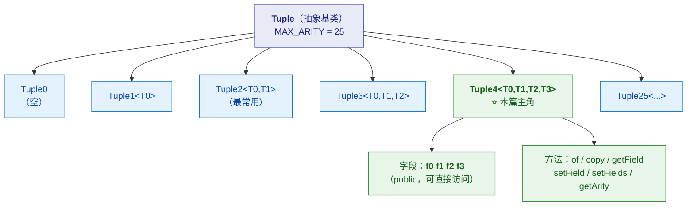
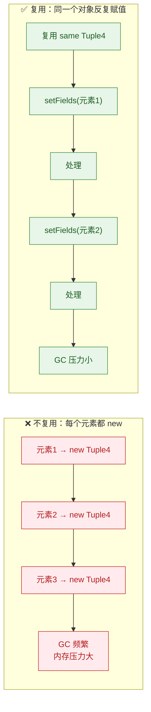
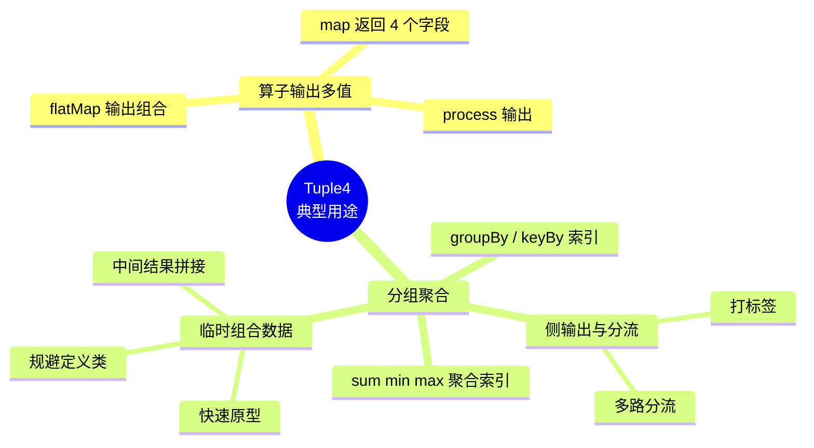
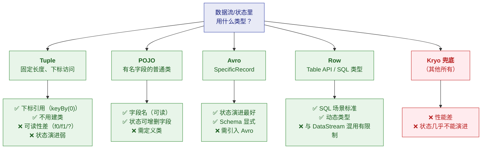
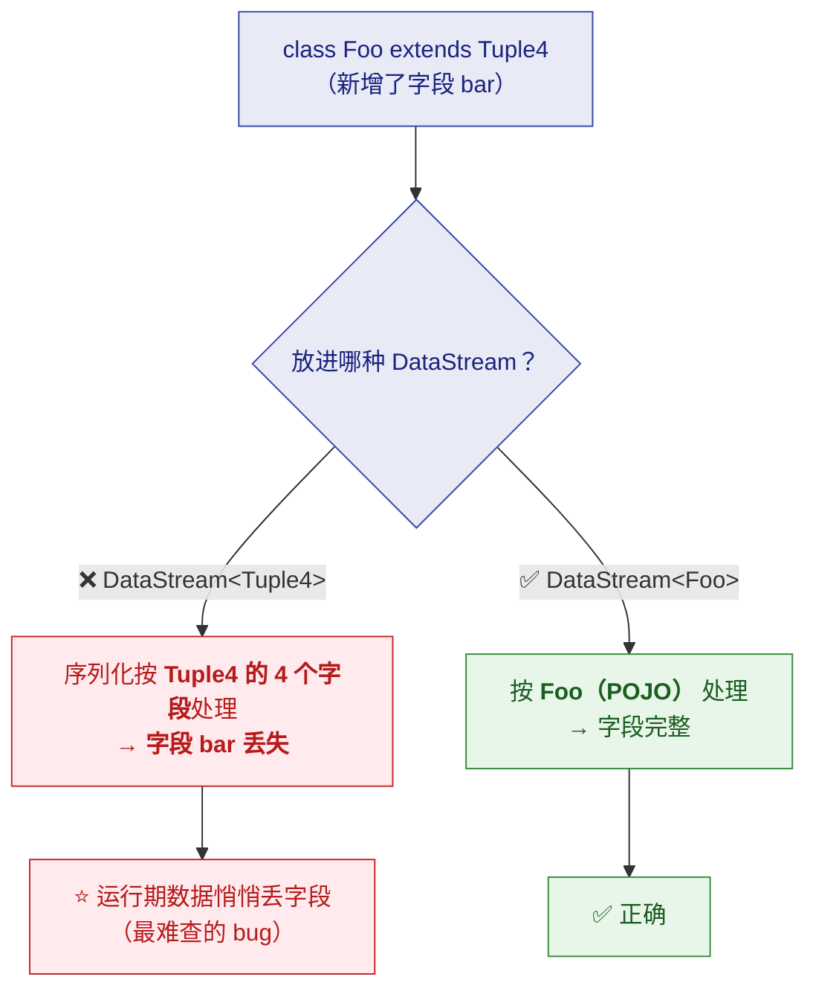
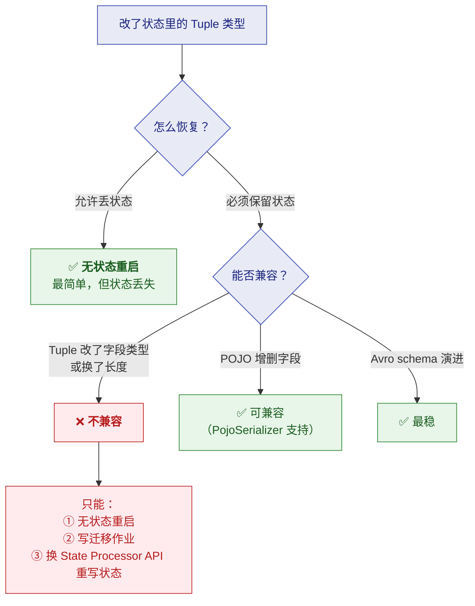

# 📦 十二、Flink Tuple 与 Tuple4

> [!abstract] 本篇解决什么
> **`Tuple4` 是 Flink `Tuple` 家族里"4 个字段"的那个**——
> 本篇把 **Tuple 类型体系**讲清：它是什么、怎么用、什么时候用、
> **为什么现代 Flink 代码里越来越少见**，以及**它和其他类型的取舍**。
>
> **定位**：这是**类型与序列化**主题的补充篇。
> 状态序列化见 [[3-状态管理]]（§8.3 的序列化器对照）；SQL 类型见 [[8-FlinkSQL与TableAPI]]。

---

## 一、Tuple 是什么

### 1.1 一句话定义

> [!note] 定义
> **Tuple 是 Flink 提供的"固定长度、强类型、字段可异构"的轻量容器。**
> - **固定长度**：`Tuple0` ~ `Tuple25`，**长度在类型里就定死了**
> - **强类型**：每个字段类型独立（`Tuple4<String, Integer, Long, Double>`）
> - **字段可异构**：4 个字段可以是 4 种不同类型

**包路径**：`org.apache.flink.api.java.tuple.Tuple4`

**类签名**：

```java
public class Tuple4<T0, T1, T2, T3> extends Tuple
        implements Serializable
```

| 类型参数 | 含义 |
|---|---|
| `T0` | 第 0 个字段的类型 |
| `T1` | 第 1 个字段的类型 |
| `T2` | 第 2 个字段的类型 |
| `T3` | 第 3 个字段的类型 |

> [!important] ⭐ 三个必须记住的特性
> **① 字段是 public 的直接访问**（`f0`/`f1`/`f2`/`f3`），不用 getter
> **② 可变（mutable）**——字段可以重新赋值，**这能让算子复用对象以减少 GC 压力**
> **③ 索引从 0 开始**——`getField(0)` 取的是 `f0`

### 1.2 家族全景



> [!warning] ⚠️ 长度是类型的一部分
> **`Tuple4` 和 `Tuple5` 是两个不同的类，不能互相赋值。**
> 想加一个字段，**必须换类型**（`Tuple4` → `Tuple5`）——
> 这在**状态里是破坏性变更**（见第六节）。

---

## 二、Tuple4 的完整 API

### 2.1 字段（Field）

| 字段 | 类型 | 说明 |
|---|---|---|
| `f0` | `T0` | 第 0 个字段（**public**） |
| `f1` | `T1` | 第 1 个字段 |
| `f2` | `T2` | 第 2 个字段 |
| `f3` | `T3` | 第 3 个字段 |

> [!tip] 直接访问 vs `getField`
> **`f0` 直接访问更快、更清晰**，是推荐方式。
> **`getField(int)` 用于"按位置动态取"的场景**（比如泛型工具代码）——
> 代价是**返回 `T`，需要强转**。

### 2.2 构造与方法

| 方法 | 签名 | 说明 |
|---|---|---|
| **构造** | `Tuple4()` | 所有字段为 `null` |
| **构造** | `Tuple4(T0 f0, T1 f1, T2 f2, T3 f3)` | 直接赋值 |
| ⭐ **静态工厂** | `Tuple4.of(f0, f1, f2, f3)` | ⭐ **推荐**——编译器能推断泛型，**不用写类型参数** |
| `getArity()` | `int` | 返回字段数（Tuple4 恒为 **4**） |
| `getField(int pos)` | `<T> T` | 按下标取字段（0 起） |
| `setField(T value, int pos)` | `<T> void` | 按下标设字段 |
| `setFields(T0,T1,T2,T3)` | `void` | 一次设置全部字段 |
| `copy()` | `Tuple4<T0,T1,T2,T3>` | ⭐ **浅拷贝**（字段引用复制，不深拷贝） |
| `toString()` | `String` | 形如 `(f0, f1, f2, f3)` |
| `equals(Object)` | `boolean` | ⭐ **深比较**（逐字段调 `equals`） |
| `hashCode()` | `int` | 与 `equals` 配套 |

> [!important] ⭐ `of` 为什么比 `new` 好
> ```java
> // ❌ 啰嗦：必须写全泛型
> Tuple4<String, Integer, Long, Double> t =
>         new Tuple4<String, Integer, Long, Double>("a", 1, 2L, 3.0);
>
> // ✅ 推荐：编译器自动推断
> Tuple4<String, Integer, Long, Double> t = Tuple4.of("a", 1, 2L, 3.0);
> ```
> **官方文档明确说 `of` 比构造器更方便，因为编译器能隐式推断泛型参数。**

### 2.3 代码示例

```java
import org.apache.flink.api.java.tuple.Tuple4;

// ① 创建
Tuple4<String, Integer, Long, Double> order =
        Tuple4.of("order-1001", 3, 29900L, 0.85);

// ② 读取（直接访问 public 字段）
String orderId = order.f0;   // "order-1001"
Integer qty    = order.f1;   // 3
Long    amount = order.f2;   // 29900
Double  rate   = order.f3;   // 0.85

// ③ 修改（可变！）
order.f1 = 5;

// ④ 按位置访问
Integer alsoQty = order.getField(1);

// ⑤ 设置
order.setFields("order-1002", 1, 9900L, 1.0);

// ⑥ 复制（浅拷贝）
Tuple4<String, Integer, Long, Double> copy = order.copy();

// ⑦ 相等性（深比较）
boolean same = order.equals(copy);   // true

// ⑧ toString
System.out.println(order);
// 输出：(order-1002, 1, 9900, 1.0)
```

> [!warning] ⚠️ `copy()` 是**浅拷贝**
> **字段如果是可变对象（如 `List`、自定义对象），两个 Tuple 会共享同一个引用。**
> 需要独立副本时要自己深拷贝。
>
> **这在 Flink 里尤其重要**——因为 **Tuple 是可变的、会被复用**（见 2.4）。

### 2.4 ⭐ 可变性与对象复用（容易被忽略的重点）

> [!important] 官方为什么把 Tuple 设计成可变的
> **官方原话**：Tuple 是可变类型，字段可以被重新赋值。
> **"这允许处理 Tuple 的函数复用对象，以减少垃圾回收的压力。"**
>
> **这是 Flink 在处理海量数据时的性能考量**：
> 每个元素都 `new` 一个对象 → **GC 压力巨大** → 复用同一对象能显著减轻。



> [!danger] ⚠️ 但复用有代价：**引用会"变"**
> ```java
> Tuple4<...> reused = Tuple4.of(...);
> List<Tuple4<...>> collected = new ArrayList<>();
> for (Element e : elements) {
>     reused.setFields(e.a(), e.b(), e.c(), e.d());
>     collected.add(reused);   // ⚠️ 加进去的是同一个对象的引用！
> }
> // 结果：collected 里全是最后一条的值
> ```
> **这是 Flink 里非常经典的坑。**
> **要收集就得 `copy()`**，或者干脆每次都 `new`。

---

## 三、Tuple4 在 Flink 里的典型用途

### 3.1 四类场景



### 3.2 ① 算子输出与字段索引

**这是 Tuple 最经典的用法**——**用整数下标引用字段**：

```java
DataStream<Tuple4<String, String, Long, Double>> result = input
    .map(new MapFunction<Order, Tuple4<String, String, Long, Double>>() {
        @Override
        public Tuple4<String, String, Long, Double> map(Order o) {
            return Tuple4.of(o.getUserId(), o.getCategory(),
                            o.getAmount(), o.getDiscount());
        }
    });

// ⭐ 按字段位置分组（索引 0 = userId）
result.keyBy(0)
      .sum(2)              // 对索引 2（amount）求和
      .print();
```

| 用法 | 说明 |
|---|---|
| `keyBy(0)` | 按**第 0 个字段**分组 |
| `keyBy(0, 1)` | 按第 0、1 个字段（复合键） |
| `sum(2)` / `min(1)` / `max(3)` | 对**指定索引**的字段做聚合 |

> [!important] ⭐ 这是 Tuple 在 Flink 里最主要的"存在理由"
> **因为 Dataset/DataStream API 的 `keyBy(int...)`、`sum(int)` 等要引用字段位置。**
> **用 POJO 就得写字段名（`keyBy("userId")`），用 Tuple 就写下标（`keyBy(0)`）。**
>
> ⚠️ **但下标的可读性差**：`sum(2)` 是什么？三个月后没人记得。
> **所以这也是 Tuple 被 POJO 取代的原因之一**（见第四节）。

### 3.3 ② 侧输出（Side Output）

**给流打标签时，Tuple 很常见**：

```java
// 输出：<标签, 主体, 时间戳, 附加信息>
DataStream<Tuple4<String, String, Long, String>> tagged = ...
```

### 3.4 ③ 快速原型

**不想为临时结构专门定义一个类时**，Tuple 很省事：

```java
// 临时把 4 个值凑一起传下去，不值得建 POJO
DataStream<Tuple4<String, Integer, Integer, String>> tmp = ...
```

> [!tip] 但"省事"是有代价的
> **原型阶段用 Tuple 没问题，但生产代码要谨慎**——
> 因为**可读性差、状态兼容性弱**（见第四、六节）。

---

## 四、⭐ Tuple vs 其他类型（关键取舍）

### 4.1 四类候选类型



### 4.2 序列化与状态演进能力对照

> [!important] ⭐ 这张表决定"状态里该用什么"（与 [[3-状态管理]] §8.3 呼应）

| 类型 | 序列化器 | **状态 schema 演进能力** | 说明 |
|---|---|---|---|
| **基本类型** | 专用序列化器 | 无（单值，无所谓） | 最快 |
| **POJO** | `PojoSerializer` | ✅ **增删字段、换顺序** | ⭐ 推荐 |
| **Avro** | `AvroSerializer` | ✅ **最好**（Avro schema 演进） | ⭐ 跨版本最稳 |
| **Tuple** | `TupleSerializer` | ⚠️ **有限** | 见下方警告 |
| **Row** | `RowSerializer` | ⚠️ 有限（动态） | Table API 内部用 |
| **其他**（`Object`、`Map<String,Object>`、匿名/非静态内部类） | ⚠️ **`KryoSerializer`** | ❌ **基本不支持** | ⚠️ 尽量避免 |

> [!danger] ⚠️ Tuple 的状态演进能力"有限"——具体是什么
> **`TupleSerializer` 通过"字段位置"来序列化**，所以：
> | 变更 | 是否安全 |
> |---|---|
> | **改字段类型** | ❌ **不安全**（位置还在，类型不兼容） |
> | **在末尾加字段**（`Tuple4` → `Tuple5`） | ⚠️ **换类型了**，不兼容 |
> | **改名** | 无所谓（Tuple 本来就没名字） |
> | **重排字段** | ⚠️ **语义全乱**（位置变了） |
>
> **本质问题**：**Tuple 用"位置"标识字段，而 POJO/Avro 用"名字"标识。**
> **名字是稳定的，位置是脆弱的**——插一个字段，后面全错位。
>
> 👉 **所以"状态里放 Tuple"意味着：以后几乎没有安全演进的空间。**
> **这正是官方推荐 POJO/Avro 的原因**（见 [[3-状态管理]] §8.2 的三条原则）。

### 4.3 怎么选（决策建议）

| 场景 | 推荐 |
|---|---|
| **临时中间结果、快速原型** | ✅ **Tuple**（省事） |
| **需要 `keyBy(0)`/`sum(2)` 这类下标引用** | ✅ **Tuple**（或 Dataset API 的习惯） |
| ⭐ **会被存进状态（KeyedState）** | ❌ **不要用 Tuple** → **用 POJO 或 Avro** |
| **生产代码、需要长期维护** | ✅ **POJO**（可读性 + 演进能力） |
| **SQL/Table API 场景** | ✅ **`Row`** |
| **跨团队/跨版本数据契约** | ✅ **Avro SpecificRecord** |

> [!success] 一句话总结选择逻辑
> **"Tuple 适合'短命'的数据（中间结果、临时组合）；
> POJO/Avro 适合'长命'的数据（进状态、跨版本）。"**
>
> **判断标准是：这份数据会不会被持久化到状态里、会不会跨越作业版本？**
> - **会** → POJO / Avro
> - **不会** → Tuple 也行

---

## 五、⚠️ 继承 Tuple4 的坑（官方明确警告）

> [!danger] 官方原文警告
> **"如果你继承 `Tuple4`，请务必：**
> - **不要新增任何字段**，或者
> - **把它做成 POJO，并且始终把 DataStream/DataSet 的元素类型声明为你的子类。**
>
> **也就是说：如果你写 `class Foo extends Tuple4`，
> 不要把 `Foo` 的实例放进 `DataStream<Tuple4>`，
> 而要声明成 `DataStream<Foo>`。"**

**为什么？**



> [!tip] 最佳实践：**别继承 Tuple**
> **想让字段有名字，直接写 POJO 就行**，不需要继承 Tuple：
> ```java
> // ❌ 别扭：继承 Tuple4 又加字段
> public class Order extends Tuple4<String, Integer, Long, Double> {
>     public String extra;   // ← 危险
> }
>
> // ✅ 直接写 POJO，可读性和演进能力都好得多
> public class Order {
>     public String orderId;
>     public int qty;
>     public long amount;
>     public double rate;
>     public String extra;
> }
> ```

---

## 六、Tuple 与状态兼容性（⭐ 生产重点）

### 6.1 为什么这件事重要

> [!danger] ⚠️ 状态里的类型变更 = 兼容性问题
> **Flink 的状态会随 checkpoint 持久化。**
> **如果你改了状态里的类型，从旧 checkpoint 恢复时可能失败或数据错乱。**
>
> 而 **Tuple 的演进能力"有限"**（4.2 节），
> **所以"状态用 Tuple"是给自己埋雷。**

### 6.2 三种恢复场景



> [!important] ⭐ 由此得出的工程原则
> **"状态里存的类型必须显式、稳定。用 POJO 或 Avro SpecificRecord，
> 绝不要用 Kryo 兜底的泛型。"**（引自 [[3-状态管理]] §8.2）
>
> **补充一条**：**状态里也尽量不要用 Tuple**——
> 它的"位置标识"让字段变更变得危险，**而 POJO 用名字标识，增删字段是安全的。**

### 6.3 如果已经用了 Tuple 怎么办

| 情况 | 应对 |
|---|---|
| **状态还没上线** | ✅ **趁早换成 POJO**（成本最低的时机） |
| **已上线，要改类型** | ① 无状态重启（可接受丢状态时）② 写**迁移作业**（新旧同时跑） |
| **需要用历史状态** | **State Processor API** 读旧状态 → 转新结构 → 写回 |

---

## 七、常见误区与实战坑

| # | 坑 | 说明 | 正确做法 |
|---|---|---|---|
| 1 | ⭐ **复用对象后收集引用** | 复用同一个 Tuple 并 add 进 List → **全是最后一条** | 收集前 `copy()`，或每次 `new` |
| 2 | ⭐ **状态里放 Tuple** | 后续无法安全演进 | 用 **POJO / Avro** |
| 3 | **继承 Tuple 并加字段** | 声明成 `DataStream<Tuple4>` 会**丢字段** | 别继承，直接写 POJO |
| 4 | **`copy()` 当深拷贝用** | 它是**浅拷贝**，字段引用共享 | 需要独立副本时自己深拷贝 |
| 5 | **`getField()` 忘了强转** | 返回 `T`，实际是 `Object` | 明确类型或直接用 `f0` |
| 6 | **下标可读性差** | `sum(2)` 是什么？三个月后没人懂 | 生产用**具名 POJO** |
| 7 | **`Tuple4` ⇄ `Tuple5` 互转** | 类型不同，不能赋值 | 显式构造新对象 |
| 8 | **`Tuple4.of()` 传 null** | 字段可以为 null，但下游可能 NPE | 明确 null 语义 |

> [!warning] ⭐ 坑 1 值得单独强调（最高频）
> ```java
> // ❌ 经典错误
> Tuple4<String,Integer,Long,Double> reuse = new Tuple4<>();
> List<Tuple4<...>> list = new ArrayList<>();
> for (Order o : orders) {
>     reuse.setFields(o.id, o.qty, o.amt, o.rate);
>     list.add(reuse);     // 全是同一个引用！
> }
> // list 里所有元素都是最后一条 Order 的值
>
> // ✅ 正确
> list.add(reuse.copy());   // 或者直接 Tuple4.of(...) 新建
> ```
> **根因**：Tuple **可变 + 会被复用**是 Flink 的性能设计，
> **但"引用语义"要求你必须显式复制。**

---

## 八、30 秒速查表

| 问题 | 一句话答案 |
|---|---|
| Tuple4 是什么 | **固定 4 字段、强类型、字段可异构**的轻量容器，继承自 `Tuple` |
| 包路径 | `org.apache.flink.api.java.tuple.Tuple4` |
| 字段怎么访问 | ⭐ **`f0`/`f1`/`f2`/`f3`（public，直接访问）** |
| 长度范围 | **`Tuple0` ~ `Tuple25`**，长度是**类型的一部分** |
| 推荐构造方式 | ⭐ **`Tuple4.of(a,b,c,d)`**（编译器推断泛型，比 `new` 简洁） |
| `getArity()` 返回 | Tuple4 恒为 **4** |
| `copy()` 是深拷贝吗 | ❌ **浅拷贝**——字段引用共享 |
| `equals` 怎么比 | **深比较**（逐字段调 `equals`） |
| `toString` 格式 | `(f0, f1, f2, f3)` |
| 为什么设计成可变 | ⭐ 让算子**复用对象以减少 GC 压力** |
| 可变带来的坑 | ⭐ **复用后收集引用 → 全是最后一条**（要 `copy()`） |
| 最经典用途 | **算子输出 + `keyBy(0)`/`sum(2)` 下标引用** |
| 用什么序列化器 | **`TupleSerializer`** |
| ⭐ 状态演进能力 | ⚠️ **有限**——用"位置"标识字段，**改类型/换长度都不兼容** |
| 和 POJO 的关键差异 | **Tuple 用位置标识；POJO 用名字标识** → POJO 可安全增删字段 |
| ⭐ 状态里该用什么 | **POJO 或 Avro**，❌ **不要用 Tuple** |
| 继承 Tuple4 的风险 | ⚠️ 加字段后若声明成 `DataStream<Tuple4>` → **字段丢失** |
| 最佳实践 | **别继承 Tuple**——要有名字段就直接写 POJO |
| 什么时候用 Tuple | **短命数据**：中间结果、快速原型、需要下标引用 |
| 什么时候用 POJO | **长命数据**：进状态、跨版本、生产代码 |
| 选择判断标准 | ⭐ **这份数据会不会进状态/跨版本？会 → POJO/Avro** |

---

## 九、学习检查清单

- [ ] 能说清 **Tuple 的三个特性**（固定长度、强类型、字段可异构）
- [ ] 能说出 **Tuple4 的四个字段名**与**推荐构造方式**（`of`）
- [ ] ⭐ 能解释**为什么官方推荐 `Tuple4.of()` 而不是 `new Tuple4<>()`**
- [ ] 能说出 **Tuple4 的完整 API**（`copy`/`getField`/`setField`/`setFields`/`getArity`/`equals`）
- [ ] ⭐ 能说清 **`copy()` 是浅拷贝**及其影响
- [ ] ⭐ 能解释**为什么 Tuple 被设计成可变的**（GC 压力）
- [ ] ⭐⭐ 能说出**可变性带来的经典坑**（复用 + 收集引用）及正确做法
- [ ] 能说出 **Tuple4 的四类典型用途**
- [ ] ⭐ 能解释**为什么 `keyBy(0)`/`sum(2)` 是 Tuple 的主要存在理由**
- [ ] ⭐ 能对比 **Tuple / POJO / Avro / Row / Kryo** 的演进能力
- [ ] ⭐⭐ 能解释**为什么 Tuple 的状态演进能力弱**（位置标识 vs 名字标识）
- [ ] ⚠️ 能说出**继承 Tuple4 的风险**与官方警告
- [ ] ⭐ 能给出**"状态里该用什么类型"**的明确建议及理由
- [ ] 能说出**改了状态类型后的三种恢复场景**
- [ ] 能列出**至少五个实战坑**并给出正确做法
- [ ] ⭐ 能用一句话总结 **Tuple 与 POJO 的选择逻辑**（短命 vs 长命）

---
> 关联：[[3-状态管理]]（§8.3 序列化器对照、状态演进原则）· [[8-FlinkSQL与TableAPI]]（`Row` 类型）· [[4-容错与ExactlyOnce]]（状态与恢复）
> 返回 → [[0-Flink总览]]
> 官方 API：[Tuple4 (Flink 2.1 API)](https://nightlies.apache.org/flink/flink-docs-release-2.1/api/java/org/apache/flink/api/java/tuple/Tuple4.html)
