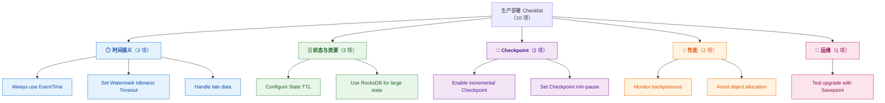
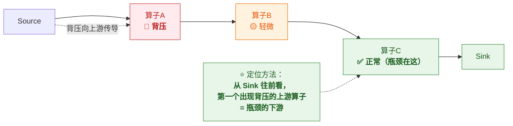

# ✅ 十三、生产部署 Checklist 逐项解析

> [!abstract] 这篇是什么
> 这是**上线前的一张自检表**——把 10 项容易漏的配置逐条拆开：
> **不做的后果 → 怎么配 → 推荐值 → 怎么验证**。
>
> **定位**：这是**汇总型速查篇**。每项都指向对应深度笔记，
> **上线前照着勾一遍；出问题按"验证方法"那一列定位。**
> 原始 checklist 只有 10 行，本篇把它展开成可执行的部署清单。

---

## 一、先给 checklist 分个类

原始 10 项按你的标注可以归到 **5 个维度**。
**但你的标注有一处分类偏差**，先说结论：



> [!warning] ⚠️ 两处标注需要修正
> **① "Avoid object allocation in functions" 你标在「性能」，这没错，但它更准确的归属是「序列化/对象复用」。**
> 它的根本原因不在"省内存"，而在 **Flink 的对象复用机制（object reuse）与引用语义**——
> 配错了会**数据错乱**，不只是慢。（详见第 10 项）
>
> **② "Handle late data" 你标「时间」，正确；但它同时是「正确性」问题。**
> **晚到的数据如果被静默丢弃，结果是错的**——这不是性能问题，是数据准确性问题。

### 优先级分级（⭐ 上线前按这个顺序检查）

| 级别 | 含义 | 项 |
|---|---|---|
| 🔴 **P0 必须** | 不配会**出错或丢数据** | EventTime、State TTL、迟到数据、Savepoint 升级测试 |
| 🟠 **P1 强烈建议** | 不配会**生产事故**（OOM/慢/不稳定） | Idleness、RocksDB、增量 CK、min-pause |
| 🟡 **P2 运行期持续** | **上线后持续监控/优化** | 背压监控、对象复用 |

> [!tip] 一句话记忆
> **P0 = 正确性，P1 = 稳定性，P2 = 效率。**
> **先保证对，再保证稳，最后才是快。**

---

## 二、⏱️ 时间语义（3 项）

### ① Always use EventTime

| 项 | 内容 |
|---|---|
| **原句** | `Always use EventTime` |
| **是什么** | 用**事件本身发生的时间**（数据里带的时间戳）做窗口与计算，**而不是用系统处理时间** |
| **不做的后果** | ⭐ **结果不可复现、乱序/延迟数据算错**。用 ProcessingTime 时，**重跑同样一批数据会得到不同结果**——这在排查问题和补数时是灾难 |
| **怎么配** | 设时间语义 + **从数据里提取时间戳** + **生成 Watermark** |
| **推荐值** | `TimeCharacteristic.EventTime`（1.12+ 默认已是 EventTime）；时间戳用**业务发生时间**，不是入库时间 |
| **验证方法** | ① 查数据里的 `event_time` 是不是业务时间；② 重放同一份数据，**结果应该一致** |

```java
// 1.12 之前需要显式设置；1.12+ 默认就是 EventTime
env.setStreamTimeCharacteristic(TimeCharacteristic.EventTime);

// 从数据里提取事件时间 + 生成 watermark
WatermarkStrategy<Event> strategy = WatermarkStrategy
        .<Event>forBoundedOutOfOrderness(Duration.ofSeconds(5))   // 容忍 5 秒乱序
        .withTimestampAssigner((e, ts) -> e.getEventTime());
```

> [!danger] ⭐ 为什么这条是 P0
> **ProcessingTime 的窗口边界取决于"数据什么时候到"，而不是"事情什么时候发生"。**
> - 补数时数据集中灌进来 → 窗口会**挤在一起**
> - 故障恢复重放 → **窗口结果会变**
> - 跨时区/跨机房 → **结果不可比**
>
> **EventTime 是"可复现计算"的前提。**
> 详见 [[2-时间与窗口]]

---

### ② Set Watermark Idleness Timeout

| 项 | 内容 |
|---|---|
| **原句** | `Set Watermark Idleness Timeout` |
| **是什么** | **某个分区长时间没数据时，把它标记为 idle，不让它拖住全局 watermark** |
| **不做的后果** | ⭐ **watermark 停止推进 → 窗口永不触发 → 下游什么都不输出**（典型的"作业活着但没结果"） |
| **怎么配** | `.withIdleness(Duration)`；**SQL 用 `table.exec.source.idle-timeout`** |
| **推荐值** | **1 分钟**起步（`Duration.ofMinutes(1)`），按业务空窗期调整 |
| **验证方法** | ① Web UI 看 `currentWatermark` **是否在推进**；② 看各 source subtask 的 `numRecordsIn`，**找出归零的那个** |

```java
WatermarkStrategy.<Event>forBoundedOutOfOrderness(Duration.ofSeconds(5))
        .withIdleness(Duration.ofMinutes(1))    // 1 分钟无数据 → 标记 idle
        .withTimestampAssigner(...);
```

```yaml
# SQL 作业
table.exec.source.idle-timeout: 1min
```

> [!danger] ⚠️ 典型症状识别（记这个）
> **"窗口该输出却不输出，watermark 卡在一个值不动"** → **十有八九是某个分区空闲**。
>
> **根因**：多分区 source（如 Kafka 多 partition）的 watermark 取**所有分区的最小值**。
> **只要有一个分区没数据，全局 watermark 就卡住。**
>
> **排查**：Web UI 看每个 source subtask 的 `numRecordsIn`，
> **找出那个归零的**——它就是把大家拖住的元凶。
>
> ⚠️ **注意副作用**：标记 idle 后，如果该分区**后来又来了迟到很久的数据**，
> 这部分数据可能**被判为迟到**（丢进侧输出）。
> **所以 idle 时长不能设得太短。** 详见 [[2-时间与窗口]]

---

### ③ Handle late data（allowedLateness + Side Output）

| 项 | 内容 |
|---|---|
| **原句** | `Handle lat data(allowedLateness+side Output)` |
| **是什么** | **窗口已经触发后，又来了属于该窗口的迟到数据**——怎么处理 |
| **不做的后果** | ⭐ **数据被静默丢弃 → 结果偏小**。而且**没有任何告警**，你根本不知道少算了 |
| **怎么配** | ① `allowedLateness` 允许窗口**延迟销毁**并**重算**；② **侧输出流**接住更晚的数据 |
| **推荐值** | `allowedLateness` **按业务容忍度**（常见几分钟～几小时）；**侧输出必须接** |
| **验证方法** | ① 侧输出流里**有数据**说明确实有迟到；② 对比"开/关 allowedLateness"的结果差异 |

```java
OutputTag<Event> lateTag = new OutputTag<Event>("late-data"){};

SingleOutputStreamOperator<Result> result = stream
    .keyBy(...)
    .window(TumblingEventTimeWindows.of(Time.minutes(5)))
    .allowedLateness(Time.minutes(10))       // 窗口触发后再保留 10 分钟
    .sideOutputLateData(lateTag)             // ⭐ 更晚的进侧输出，不丢
    .aggregate(...);

// ⭐ 必须把侧输出接出来，否则等于没处理
DataStream<Event> lateStream = result.getSideOutput(lateTag);
lateStream.addSink(...);   // 落库 / 告警 / 人工核对
```

> [!important] ⭐ 迟到数据的"三件套"（这是完整方案）
> | 手段 | 作用 | 代价 |
> |---|---|---|
> | **Watermark 容忍乱序** | 挡住**常规**乱序 | 延迟增加（水位推进变慢） |
> | **allowedLateness** | 窗口触发后**还能重算** | 状态保留更久（**内存/状态压力**） |
> | ⭐ **侧输出流** | 接住**更晚**的，**绝不丢** | 需要下游处理逻辑 |
>
> **三层是递进的**：能容忍 → 能重算 → 兜底不丢。
>
> ⚠️ **最危险的做法是"只设 watermark 容忍，不设 allowedLateness，也不接侧输出"**——
> **超出容忍范围的数据会直接丢，而且你不会有任何感觉。**
> 详见 [[2-时间与窗口]]

---

## 三、🗄️ 状态与资源（3 项）

### ④ Configure State TTL

| 项 | 内容 |
|---|---|
| **原句** | `Configure State TTL` |
| **是什么** | 给状态设**过期时间**，让旧状态自动清理 |
| **不做的后果** | ⭐ **状态无限膨胀 → 内存/RocksDB 撑爆 → checkpoint 越来越慢 → 最终 OOM 或 CK 超时失败** |
| **怎么配** | `StateTtlConfig` 绑到 descriptor；**SQL 用 `table.exec.state.ttl`** |
| **推荐值** | **按业务语义定**（常见 7 天）；⚠️ **不要设 `Time.days(1)` 这种拍脑袋值** |
| **验证方法** | ① 看 **state size 指标**是否稳定（不持续增长）；② 看 CK 大小是否收敛 |

```java
StateTtlConfig ttlConfig = StateTtlConfig
        .newBuilder(Time.days(7))                                    // ① TTL 时长
        .setUpdateType(StateTtlConfig.UpdateType.OnCreateAndWrite)   // ② 读不刷新
        .setStateVisibility(StateTtlConfig.StateVisibility.NeverReturnExpired) // ③ 过期不返回
        .cleanupIncrementally(10, false)                             // ④ 增量清理
        .cleanupInRocksdbCompactFilter(1000)                         // ⑤ RocksDB 清理
        .build();

ValueStateDescriptor<String> desc = new ValueStateDescriptor<>("user", String.class);
desc.enableTimeToLive(ttlConfig);      // ⭐ 别忘了绑定，否则 TTL 不生效
```

```yaml
# SQL 作业
table.exec.state.ttl: 7d
```

> [!danger] ⭐ 四个最容易踩的坑
> **① 忘了"绑定到 descriptor"**——配了 `StateTtlConfig` 却没 `enableTimeToLive()`，**TTL 完全不生效**。
>
> **② 以为 TTL 能让 checkpoint 立刻变小**——❌ **错**。
> **TTL 清理是"惰性"的**：过期数据要等**下一次访问或清理触发**才被真正删掉。
> **所以 checkpoint 可能仍然很大**——这是最反直觉的一点。
>
> **③ `OnReadAndWrite` 有隐藏成本**——读也刷新时间戳，**RocksDB 下是额外写放大**。
>
> **④ SQL 作业最容易漏**——很多人以为"SQL 没有状态"，
> **恰恰相反：每个 `GROUP BY`、`JOIN`、`DISTINCT` 都是大状态算子。**
> **SQL 上线前必须显式评估 `table.exec.state.ttl`**（尤其 join 两侧的保留时间）。
>
> 详见 [[3-状态管理]]、[[8-FlinkSQL与TableAPI]]

---

### ⑤ Use RocksDB for large state

| 项 | 内容 |
|---|---|
| **原句** | `Use RocksDb for large state` |
| **是什么** | 状态后端从**堆内存（HashMapStateBackend）**换成 **EmbeddedRocksDBStateBackend** |
| **不做的后果** | 状态超过内存 → **OOM / GC 频繁**（大状态必然撑爆堆） |
| **怎么配** | `state.backend: rocksdb` |
| **推荐值** | **状态可能超过内存时就用 RocksDB**；小状态用 HashMap 更快 |
| **验证方法** | ① 看 **state size vs 容器内存**；② 看 GC 时间占比 |

```yaml
state.backend: rocksdb
state.backend.incremental: true        # ⭐ 配合增量 CK（见第 6 项）
state.backend.rocksdb.localdir: /data/flink/rocksdb   # 本地盘（SSD！）
```

> [!important] ⭐ 怎么判断"大状态"
> | 信号 | 说明 |
> |---|---|
> | **state size 接近或超过容器内存** | 最直接 |
> | **GC 时间长 / Full GC 频繁** | 堆内存被状态占用 |
> | **CK 大且慢** | 大状态快照必然慢 |
> | **状态里有 Map/List 且 key 基数高** | 会持续增长 |
>
> **经验法则**：**状态量级"几十 GB 以上"或"会持续增长"，直接上 RocksDB。**

> [!warning] ⚠️ RocksDB 的代价（不是免费的）
> | 代价 | 说明 |
> |---|---|
> | **序列化开销** | 每次读写都要序列化/反序列化 → **单次访问比堆内存慢** |
> | **需要本地盘** | 要挂 SSD，**且要监控磁盘** |
> | **要调优** | block cache、write buffer 等参数 |
> | **遍历方法要注意** | ⚠️ `entries()` 可能**把整个 Map 拉进堆内存** → 用 `iterator()` **流式遍历** |
>
> ⭐ **特别提醒**：在 RocksDB 后端下，
> **遍历大 MapState 用错方法会直接 OOM**——超过几万条就用 `iterator()`。
>
> 详见 [[3-状态管理]]

---

## 四、💾 Checkpoint（2 项）

### ⑥ Enable incremental Checkpoint

| 项 | 内容 |
|---|---|
| **原句** | `Enable incremental Checkpoint` |
| **是什么** | **只快照"变化的部分"**，而不是每次都全量快照 |
| **不做的后果** | 大状态下**每次 CK 都全量** → CK 极慢、占带宽 → **CK 频繁超时失败** |
| **怎么配** | `state.backend.incremental: true` |
| **推荐值** | **用 RocksDB 就开**（前提条件见下） |
| **验证方法** | ① 看 **CK 大小是否明显小于 state size**；② 看 CK 耗时是否下降 |

```yaml
state.backend: rocksdb
state.backend.incremental: true
```

> [!danger] ⚠️ 两个前提条件，缺一不可
> **① 只有 RocksDB 状态后端支持增量 CK**（堆内存后端不支持）。
> **② 必须是"状态后端与 CK 存储解耦"的架构**（1.13+），
> 且 CK 要存在**支持增量文件系统的位置**（如 HDFS/S3）。
>
> **如果状态后端是 hashmap，配 `incremental: true` 是无效的**——
> 不会报错，但**不会有任何效果**（这是个隐形坑）。

> [!important] 增量 CK 的本质
> **RocksDB 是 LSM-tree，数据按 SST 文件分层。**
> **增量 CK 只上传"新增的 SST 文件"，不复用旧的。**
>
> **好处**：CK 数据量大幅下降（大状态下可能降一个数量级）。
> **代价**：⚠️ **恢复时需要读"全量基线 + 所有增量"** → **恢复可能更慢**；
> 且**增量链条长了之后，CK 存储占用会上升**（需要 compaction 配合）。
>
> 👉 **所以"CK 快"和"恢复快"是一对权衡。** 详见 [[5-Checkpoint与Savepoint]]

---

### ⑦ Set Checkpoint min-pause

| 项 | 内容 |
|---|---|
| **原句** | `Set Checkpoint min-pause` |
| **是什么** | **两次 checkpoint 之间的最小间隔** |
| **不做的后果** | CK **一个接一个**（尤其 CK 变慢时）→ **CK 抢占资源 → 吞吐被吃掉** → 恶性循环 |
| **怎么配** | `execution.checkpointing.min-pause` |
| **推荐值** | **30 秒 ~ 1 分钟**（配合 interval 1~5 分钟） |
| **验证方法** | 看 CK 触发频率是否稳定；**吞吐是否因 CK 抖动** |

```yaml
execution.checkpointing.interval: 60s          # 期望间隔
execution.checkpointing.min-pause: 30s         # ⭐ 最小间隔（硬下限）
execution.checkpointing.timeout: 10min
execution.checkpointing.max-concurrent-checkpoints: 1   # 并发度必须设 1
execution.checkpointing.tolerable-failed-checkpoints: 3
execution.checkpointing.externalized-checkpoint-retention: RETAIN_ON_CANCELLATION
```

> [!important] ⭐ 为什么 min-pause 是"缓解 CK 拖垮吞吐"的首选参数
> **场景**：CK 耗时从 10 秒涨到 50 秒，interval 是 60 秒。
> **没有 min-pause 时**：上一个 CK 刚结束，下一个立刻开始 → **CK 占了几乎一半时间** → 吞吐掉一半。
> **有 min-pause=30s 时**：CK 结束后**至少留 30 秒给数据处理** → 吞吐有保障。
>
> **代价**：高负载下**CK 触发频率下降** → 故障时**要重放的数据更多**。
> **这是"吞吐"与"恢复代价"的权衡。**

> [!warning] ⚠️ 相关联的两个配置
> | 配置 | 建议 |
> |---|---|
> | `max-concurrent-checkpoints` | ⚠️ **设为 1**——>1 会**放宽一致性语义**，且多个 CK 互相干扰 |
> | `tolerable-failed-checkpoints` | 设 3 左右——**CK 偶发失败不要立刻让作业挂**，但也不能放任 |
>
> **这四个参数是一组，要一起调**，不能只改 min-pause。
> 详见 [[5-Checkpoint与Savepoint]]、[[6-背压与性能调优]]

---

## 五、🚀 性能（2 项）

### ⑧ Monitor backpressure

| 项 | 内容 |
|---|---|
| **原句** | `Monitor backpressure` |
| **是什么** | 监控**背压（反压）**——下游处理不过来时，压力会**向上游传导** |
| **不做的后果** | ⭐ **吞吐上不去、CK 超时、延迟累积**，但**你不知道瓶颈在哪** |
| **怎么配** | 开监控（Web UI / Metrics）+ **告警** |
| **推荐值** | 背压等级 **持续 > 0.5 就排查**；`ok` 为正常 |
| **验证方法** | ⭐ **从最后一个算子往前找，第一个背压的算子就是瓶颈** |



> [!important] ⭐ 背压定位的正确读法（很容易搞反）
> **背压是"从下游往上游"传导的。**
> **所以：`ok` 的算子**（C）**才是瓶颈**——
> 它慢，导致它上游的 B 和 A 都被压住。
>
> **读法**：**从 Sink 往前逐个看，第一个"背压"的上游算子，
> 它下游那个"正常"的算子就是瓶颈。**
>
> ⚠️ **常见误读**："看到 A 背压就去优化 A" —— **错，A 可能只是被 B/C 拖累的无辜者。**

**背压的常见根因**：

| 根因 | 表现 | 对策 |
|---|---|---|
| **数据倾斜** | 个别 subtask 慢 | 调整 key、加盐、两阶段聚合 |
| **外部系统慢** | Sink 写入慢（DB/消息队列） | 批量写、异步 IO、加资源 |
| **算子逻辑重** | 单条处理耗时长 | 异步 IO、优化逻辑、加并行度 |
| **资源不足** | 内存/CPU 打满 | 加资源、调内存比例 |
| **CK 抢占** | CK 期间吞吐掉 | ⭐ **`min-pause`**（第 7 项） |

> [!tip] 背压与 CK 的恶性循环（要能讲出来）
> **背压 → Barrier 对齐变慢 → CK 变慢 → CK 占用更多资源 → 背压更严重**
>
> **打破循环的手段**：① `min-pause` 给业务让路；
> ② **非对齐 Checkpoint**（背压下避免对齐等待）；
> ③ **从根因解决背压**。
>
> 详见 [[6-背压与性能调优]]

---

### ⑨ Avoid object allocation in functions

> [!warning] ⚠️ 修正：这条的根本风险不是"慢"，而是**数据错乱**
> 你的标注是「性能」——**优化对象创建确实是为了性能**，
> **但配错了会直接导致结果错误**，这是比性能严重得多的问题。

| 项 | 内容 |
|---|---|
| **原句** | `Avoid object allocation in functions` |
| **是什么** | 在算子函数里**复用对象**而不是每次 `new`，减少 GC 压力 |
| **不做的后果** | ① **GC 压力大、性能下降**（原本的目的）；② ⚠️ **复用后没 copy → 数据全变成最后一条**（引用语义坑） |
| **怎么配** | 开启对象复用 + **在必须留存时 `copy()`** |
| **推荐值** | 高频/大吞吐链路**开启复用**；⚠️ **凡是"要收集/缓存/跨算子持有"的地方必须 copy** |
| **验证方法** | ① 看 GC 指标；② ⚠️ **比对新旧结果是否一致**（防引用坑） |

```yaml
# 开启对象复用（默认关闭）
pipeline.object-reuse: true
```

```java
// ⭐ 关键：复用对象时，要留存必须先 copy
Tuple4<...> reuse = new Tuple4<>();
List<Tuple4<...>> collected = new ArrayList<>();
for (Event e : events) {
    reuse.setFields(e.a(), e.b(), e.c(), e.d());
    collected.add(reuse.copy());   // ⚠️ 不 copy 的话，全是最后一条
}
```

> [!danger] ⭐ 这个坑为什么危险
> **它不报错，只是数据悄悄不对。**
> - 开了 `object-reuse` 后，**同一个对象会跨记录复用**
> - 如果你把它**存进了 List / Map / 状态 / 异步回调**，**拿到的是同一个引用**
> - 最终**所有条目都指向最后写入的值**
>
> **这类 bug 极难排查**（因为逻辑看起来完全正确）。
>
> **安全原则**：
> | 场景 | 是否安全 |
> |---|---|
> | 立即使用、不跨记录持有 | ✅ 安全 |
> | 放进 List/Map/队列 | ❌ **必须 copy** |
> | 存进状态 | ❌ **必须 copy** |
> | 传给异步 IO / 回调 | ❌ **必须 copy** |
> | 作为侧输出发出 | ⚠️ 建议 copy（下游可能持有） |
>
> 详见 [[12-Tuple与Tuple4]]（可变性与复用的完整坑）

---

## 六、🔧 运维（1 项）

### ⑩ Test upgrade with Savepoint

| 项 | 内容 |
|---|---|
| **原句** | `Test upgrade with Savepoint` |
| **是什么** | **上线前，用 Savepoint 演练一次"停旧作业 → 起新作业"的升级流程** |
| **不做的后果** | ⭐ **真升级时才发现状态不兼容/起不来** → 只能**无状态重启（丢状态）** 或**紧急回滚** |
| **怎么配** | ① 作业开 **externalized checkpoint**；② 演练 stop-with-savepoint → 从 Savepoint 恢复 |
| **推荐值** | **每次有状态变更的发布都必须演练**；Savepoint 路径要**独立于 CK 目录** |
| **验证方法** | 从新 Savepoint 恢复后：**状态是否完整、结果是否连续、能否再产出 CK** |

```bash
# ① 停止作业并生成 savepoint
flink stop --savepointPath hdfs:///flink/savepoints <jobId>
# 或（1.15+）
flink stop -p hdfs:///flink/savepoints <jobId>

# ② 从 savepoint 启动新版本
flink run -s hdfs:///flink/savepoints/savepoint-xxxx -c com.Main app.jar
```

> [!important] ⭐ 为什么必须"演练"而不是"直接上"
> **因为状态兼容性问题只在恢复时才暴露：**
> | 变更 | 风险 |
> |---|---|
> | **改了状态类型**（如 Tuple → POJO） | ⚠️ 可能不兼容 |
> | **改了算子顺序/拓扑** | ⚠️ 需要 `--allowNonRestoredState`，可能**丢状态** |
> | **改了 UID** | ⚠️ **状态对不上**（必须用 `uid()` 显式指定） |
> | **加了新算子** | ⚠️ 可能恢复失败 |
>
> 👉 **不演练 = 把风险留到生产窗口。**

> [!danger] ⚠️ 两个必须做的事
> **① 给所有算子显式设 `uid()`**
> ```java
> stream.map(...).uid("map-1")     // ⭐ 不设 uid，改代码后状态就找不到
> ```
> **Flink 默认用算子哈希做标识，代码一改就变** → 状态无法恢复。
>
> **② Savepoint 目录与 Checkpoint 目录分开**
> **CK 会被自动清理，Savepoint 是人工管理的长期资产**——
> 放一起容易误删。

> [!tip] 上线前的升级演练清单
> - [ ] 生成 Savepoint 成功
> - [ ] 从 Savepoint **能启动新版本**
> - [ ] 恢复后**状态完整**（抽样对比）
> - [ ] 恢复后**能正常产出新 CK**
> - [ ] **回滚路径也演练过**（新 → 旧）
>
> 详见 [[5-Checkpoint与Savepoint]]、[[9-部署与运维]]

---

## 七、⭐ 一页速查表（可直接贴到工单）

> [!important] 上线前逐项勾（附推荐值）

| ✅ | # | 项 | 关键配置 | 推荐值 | 归属 |
|---|---|---|---|---|---|
| [ ] | 1 | **EventTime** | 时间戳 + Watermark | 用业务事件时间 | ⏱️ P0 |
| [ ] | 2 | **Idleness** | `.withIdleness()` / `source.idle-timeout` | **1 min** | ⏱️ P1 |
| [ ] | 3 | **迟到数据** | `allowedLateness` + **侧输出** | 按业务；**侧输出必接** | ⏱️ P0 |
| [ ] | 4 | **State TTL** | `StateTtlConfig` / `table.exec.state.ttl` | 按业务（常见 7d） | 🗄️ P0 |
| [ ] | 5 | **RocksDB** | `state.backend: rocksdb` | 状态 > 内存时 | 🗄️ P1 |
| [ ] | 6 | **增量 CK** | `state.backend.incremental: true` | RocksDB 就开 | 💾 P1 |
| [ ] | 7 | **min-pause** | `execution.checkpointing.min-pause` | **30s ~ 1min** | 💾 P1 |
| [ ] | 8 | **背压监控** | Web UI / Metrics + 告警 | 持续 > 0.5 排查 | 🚀 P2 |
| [ ] | 9 | **对象复用** | `pipeline.object-reuse` + `copy()` | 高频链路开；⚠️ 必 copy | 🚀 P2 |
| [ ] | 10 | **Savepoint 升级演练** | 算子 `uid()` + stop/restore | 有状态变更必演练 | 🔧 P0 |

### 完整配置模板（可直接复制）

```yaml
# ========== flink-conf.yaml ==========
# --- Checkpoint（第 6、7 项）---
execution.checkpointing.interval: 60s
execution.checkpointing.mode: EXACTLY_ONCE
execution.checkpointing.timeout: 10min
execution.checkpointing.min-pause: 30s                    # ⭐ 第 7 项
execution.checkpointing.max-concurrent-checkpoints: 1
execution.checkpointing.tolerable-failed-checkpoints: 3
execution.checkpointing.externalized-checkpoint-retention: RETAIN_ON_CANCELLATION
state.checkpoints.dir: hdfs:///flink/checkpoints

# --- 状态后端（第 5、6 项）---
state.backend: rocksdb                                    # ⭐ 第 5 项
state.backend.incremental: true                           # ⭐ 第 6 项
state.backend.rocksdb.localdir: /data/flink/rocksdb        # SSD

# --- 对象复用（第 9 项）---
pipeline.object-reuse: true                               # ⚠️ 注意 copy

# --- SQL 作业额外（第 2、4 项）---
table.exec.state.ttl: 7d                                  # ⭐ 第 4 项
table.exec.source.idle-timeout: 1min                      # ⭐ 第 2 项
```

```java
// ========== 代码侧必做 ==========
// 第 1 项：EventTime + Watermark
WatermarkStrategy.<Event>forBoundedOutOfOrderness(Duration.ofSeconds(5))
        .withIdleness(Duration.ofMinutes(1))              // ⭐ 第 2 项
        .withTimestampAssigner((e, ts) -> e.getEventTime());

// 第 3 项：迟到数据兜底
OutputTag<Event> lateTag = new OutputTag<Event>("late"){};
...allowedLateness(Time.minutes(10))
   .sideOutputLateData(lateTag);                          // ⭐ 必须接出来

// 第 4 项：State TTL
desc.enableTimeToLive(ttlConfig);                         // ⚠️ 别忘绑定

// 第 10 项：算子 uid（状态恢复的前提）
stream.map(...).uid("order-map-1");                       // ⭐ 必设
```

---

## 八、30 秒速查表

| # | 项 | 一句话核心 | 不做会怎样 |
|---|---|---|---|
| 1 | **EventTime** | 用业务事件时间，不用处理时间 | ⭐ **结果不可复现、乱序算错** |
| 2 | **Idleness** | 分区空闲就标记 idle，别拖住水位 | ⭐ **watermark 卡住 → 窗口永不触发** |
| 3 | **迟到数据** | watermark 容忍 + allowedLateness + **侧输出** | ⭐ **数据静默丢弃，结果偏小** |
| 4 | **State TTL** | 给状态设过期，防空闲膨胀 | ⭐ **状态撑爆 → CK 变慢 → OOM** |
| 5 | **RocksDB** | 大状态用 RocksDB 落盘 | ⭐ **堆内存 OOM / GC 频繁** |
| 6 | **增量 CK** | 只快照变化部分 | **全量 CK 极慢、频繁超时** |
| 7 | **min-pause** | CK 之间留最小间隔 | ⭐ **CK 抢占资源 → 吞吐被吃** |
| 8 | **背压监控** | 从 Sink 往前找瓶颈 | **吞吐上不去但不知瓶颈在哪** |
| 9 | **对象复用** | 复用对象省 GC，⚠️ **留存必 copy** | 性能下降；⚠️ **或数据全错** |
| 10 | **Savepoint 演练** | 上线前演练升级 | ⭐ **真升级起不来，只能丢状态** |

> [!important] 三条最高频的"隐形坑"
> **① TTL 配了但没 `enableTimeToLive()` 绑定** → 完全不生效
> **② 增量 CK 在 HashMap 后端上配了** → 静默无效
> **③ 对象复用后没 copy** → 数据全变成最后一条，**不报错**

---

## 九、学习检查清单

- [ ] 能说出 checklist 的**五个维度**与**三项分类修正**
- [ ] ⭐ 能按 **P0/P1/P2** 给 10 项分级，并解释分级依据（正确性/稳定性/效率）
- [ ] ⭐ 能说清 **EventTime 为什么是 P0**（可复现性）
- [ ] ⭐ 能识别"**窗口不输出、watermark 卡住**"这个症状并说出排查方法
- [ ] ⭐ 能说出**迟到数据三件套**及三层递进关系
- [ ] ⚠️ 能说出 **State TTL 的四个坑**（尤其"惰性清理不等于 CK 变小"）
- [ ] 能判断**什么时候该上 RocksDB**，并说出它的**四项代价**
- [ ] ⚠️ 能说出**增量 CK 的两个前提条件**（RocksDB + 解耦架构）
- [ ] ⭐ 能解释 **min-pause 为什么是"CK 拖垮吞吐"的首选参数**
- [ ] ⭐⭐ 能正确**读背压定位**（从 Sink 往前，第一个背压的上游 vs 正常的下游）
- [ ] 能说出背压的**五种常见根因**
- [ ] ⭐ 能说出**背压与 CK 的恶性循环**及打破手段
- [ ] ⚠️ 能说清**对象复用的引用坑**，并列出**必须 copy 的五种场景**
- [ ] ⭐ 能说出 **Savepoint 升级演练**要检查的五件事
- [ ] ⚠️ 能说出**不设 `uid()` 的后果**（改代码后状态找不到）
- [ ] 能直接**背诵/套用第七节的配置模板**

---
> 关联：[[2-时间与窗口]]（1/2/3 项）· [[3-状态管理]]（4/5 项）· [[5-Checkpoint与Savepoint]]（6/7/10 项）· [[6-背压与性能调优]]（7/8 项）· [[12-Tuple与Tuple4]]（9 项）· [[9-部署与运维]]（10 项）
> 返回 → [[0-Flink总览]]
