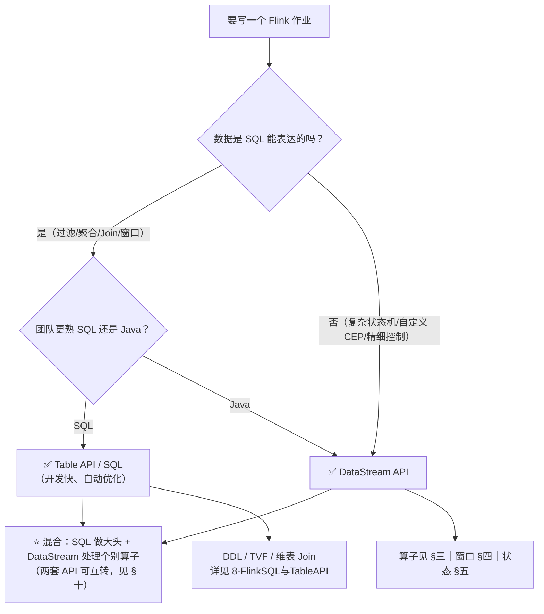
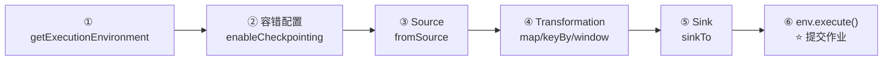
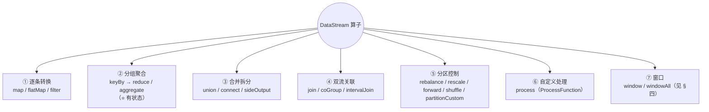
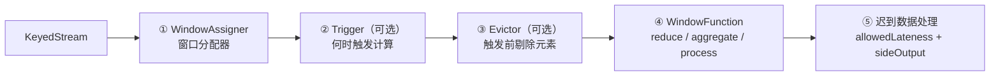
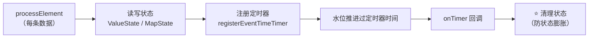
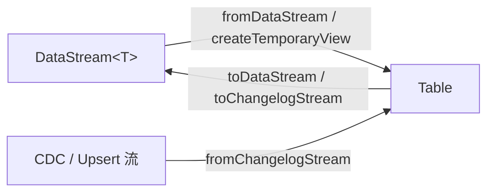

# 🧰 十四、Flink 开发常用 API 速查

> 本篇是**写代码时手边要翻的那一页**：把 Flink 开发中真正高频用到的 API 按"作业生命周期"顺序排好，**每个都标出 1.20 与 2.x 的差异**。
> 与系列其他篇的分工：本篇**只讲"怎么写"**（API 签名、模板、易错点）；**"为什么"**由 [[1-架构与运行时]]（运行时）、[[2-时间与窗口]]（时间语义）、[[3-状态管理]]（状态）、[[5-Checkpoint与Savepoint]]（容错）、[[8-FlinkSQL与TableAPI]]（SQL 深入）负责。

> [!warning] 先看版本：Flink 2.x 有一批**破坏性 API 变更**
> | 变更 | 1.20 | ⚠️ 2.x |
> | --- | --- | --- |
> | **Java 版本** | 8 / 11 | ⭐ **17+**（21 实验性） |
> | **Source** | `SourceFunction` + `env.addSource()` | ⭐ **只有新 Source API（FLIP-27）**：`env.fromSource()` |
> | **Sink** | `SinkFunction` + `stream.addSink()` | ⭐ **只有 Sink V2（FLIP-143）**：`stream.sinkTo()` |
> | **时间** | `Time.seconds(10)` | ⭐ **`Duration.ofSeconds(10)`**（`Time` 废弃） |
> | **时间语义** | `setStreamTimeCharacteristic()` | ⭐ **`TimeCharacteristic` 移除**（只剩事件时间语义） |
> | **函数 open()** | `open(Configuration)` | ⭐ **`open(OpenContext)`**（所有 `RichFunction` 子类） |
> | **配置 API** | `conf.setInteger("key", v)` | ⭐ **`conf.set(RestOptions.PORT, v)`**（类型安全 `ConfigOption`） |
> | **配置文件** | `flink-conf.yaml`（扁平 key） | ⭐ **`config.yaml`**（标准嵌套 YAML） |
> | **DataSet API** | 存在（已废弃） | ⭐ **整体移除** |
> | **Scala API** | 存在 | ⭐ **整体移除** |
> | **其它移除** | — | `IterativeStream`、`keyBy(0)`/`keyBy("f")`、`readTextFile/writeAsText`、`env.setStateBackend`、`env.setRestartStrategy`、env 上的 Kryo 注册方法 |
>
> 依据：[Flink 2.0 Release Notes](https://nightlies.apache.org/flink/flink-docs-release-2.0/release-notes/flink-2.0/)、[Flink 2.x Migration Guide](https://github.com/aws/agent-toolkit-for-aws/blob/ed19c44c46c9c3a12ef0ff5bbf88161b75d3efbe/skills/specialized-skills/analytics-skills/developing-applications-on-managed-service-for-apache-flink/references/flink-2x-migration.md)。逐项迁移对照见 [附录 A](#附录-a10--2x-迁移逐项对照)。

---

## 〇、API 全景：选 DataStream 还是 Table/SQL？



**同一件事的两种写法**（对照记忆）：

| 需求 | DataStream API | Table API / SQL |
| --- | --- | --- |
| 过滤 | `stream.filter(e -> e.amount > 100)` | `SELECT * FROM t WHERE amount > 100` |
| 分组聚合 | `.keyBy(e -> e.uid).sum("amount")` | `SELECT uid, SUM(amount) FROM t GROUP BY uid` |
| 事件时间窗口聚合 | `.window(TumblingEventTimeWindows.of(...)).aggregate(...)` | `TABLE(TUMBLE(TABLE t, DESCRIPTOR(ts), INTERVAL '1' MINUTE))` |
| 双流 Join | `.intervalJoin(...)` / `.join(...)` | `JOIN ... ON a.uid = b.uid AND a.ts BETWEEN ...` |
| 维表关联 | `RichAsyncFunction` 手写 | ⭐ **Lookup Join**（`FOR SYSTEM_TIME AS OF`） |
| 去重 | 手写 `KeyedProcessFunction` + 状态 | ⭐ **`ROW_NUMBER() OVER (PARTITION BY ...)`** |
| 读 Kafka | `KafkaSource` | `'connector' = 'kafka'` |
| 写 Kafka | `KafkaSink` | `'connector' = 'kafka'` |

> [!tip] 选型口诀
> **能用 SQL 表达就用 SQL**（自动优化、状态管理更省心）；**SQL 表达不了才下沉到 DataStream**；两者可以互转（§十），不必二选一。

---

## 一、环境与作业骨架

### 1.1 DataStream 作业骨架（可直接复制）

```java
public class MyJob {
    public static void main(String[] args) throws Exception {
        // ① 环境（本地 IDE 直接跑，提交到集群时自动用集群环境）
        StreamExecutionEnvironment env = StreamExecutionEnvironment.getExecutionEnvironment();
        env.setParallelism(4);

        // ② 容错（生产必开）
        env.enableCheckpointing(60_000, CheckpointingMode.EXACTLY_ONCE);
        CheckpointConfig cp = env.getCheckpointConfig();
        cp.setMinPauseBetweenCheckpoints(30_000);
        cp.setCheckpointTimeout(10 * 60_000);
        cp.setMaxConcurrentCheckpoints(1);
        cp.setTolerableCheckpointFailureNumber(3);
        cp.setExternalizedCheckpointRetention(
                ExternalizedCheckpointRetention.RETAIN_ON_CANCELLATION);
        cp.setCheckpointStorage("s3://my-bucket/flink/ckp");

        // ③ Source
        KafkaSource<Order> source = KafkaSource.<Order>builder()
                .setBootstrapServers("kafka-1:9092,kafka-2:9092")
                .setTopics("orders")
                .setGroupId("order-job")
                // ⭐ 生产用 committedOffsets：优先续上次位点，没有才回退 earliest
                .setStartingOffsets(OffsetsInitializer.committedOffsets(
                        OffsetResetStrategy.EARLIEST))
                .setDeserializer(KafkaRecordDeserializationSchema.of(new OrderDeserializer()))
                .build();

        DataStream<Order> orders = env.fromSource(
                source,
                WatermarkStrategy.<Order>forBoundedOutOfOrderness(Duration.ofSeconds(5))
                        .withTimestampAssigner((e, ts) -> e.getEventTime())
                        .withIdleness(Duration.ofMinutes(1)),   // 空闲分区不拖住水位
                "kafka-orders");

        // ④ 转换
        DataStream<OrderStat> stat = orders
                .filter(o -> o.getAmount() > 0)
                .keyBy(Order::getUserId)
                .window(TumblingEventTimeWindows.of(Duration.ofMinutes(1)))
                .aggregate(new AmountAggregate(), new ResultProcessWindowFunction());

        // ⑤ Sink
        stat.sinkTo(KafkaSink.<OrderStat>builder()
                .setBootstrapServers("kafka-1:9092")
                .setRecordSerializer(KafkaRecordSerializationSchema.builder()
                        .setTopic("order-stats")
                        .setValueSerializationSchema(new OrderStatSchema())
                        .build())
                .setDeliveryGuarantee(DeliveryGuarantee.EXACTLY_ONCE)
                .setTransactionalIdPrefix("order-stat-tx-")   // Exactly-Once 必填
                .build());

        // ⑥ 触发执行（⭐ 不调用 execute 作业不会跑）
        env.execute("order-stat-job");
    }
}
```



### 1.2 Table/SQL 作业骨架

```java
public static void main(String[] args) {
    StreamExecutionEnvironment env = StreamExecutionEnvironment.getExecutionEnvironment();
    EnvironmentSettings settings = EnvironmentSettings.newInstance()
            .inStreamingMode()          // 或 .inBatchMode()
            .build();
    StreamTableEnvironment tEnv = StreamTableEnvironment.create(env, settings);

    // 执行配置（SQL 层参数，等价于 SQL Client 里的 SET）
    tEnv.getConfig().set("table.exec.state.ttl", "24h");
    tEnv.getConfig().set("table.exec.mini-batch.enabled", "true");
    tEnv.getConfig().set("table.exec.mini-batch.allow-latency", "5s");

    // DDL 建表（详见 [[8-FlinkSQL与TableAPI]]）
    tEnv.executeSql("""
        CREATE TABLE orders (
          order_id   BIGINT,
          user_id    BIGINT,
          amount     DECIMAL(10,2),
          ts         TIMESTAMP(3),
          WATERMARK FOR ts AS ts - INTERVAL '5' SECOND
        ) WITH (
          'connector' = 'kafka',
          'topic' = 'orders',
          'properties.bootstrap.servers' = 'kafka-1:9092',
          'properties.group.id' = 'order-job',
          'scan.startup.mode' = 'group-offsets',
          'format' = 'json'
        )
        """);

    // 查询 + 写出（INSERT INTO 直接提交作业；也可 sqlQuery 拿 Table 再转换）
    tEnv.executeSql("""
        INSERT INTO order_stats
        SELECT user_id, window_start, window_end, SUM(amount) AS total
        FROM TABLE(TUMBLE(TABLE orders, DESCRIPTOR(ts), INTERVAL '1' MINUTE))
        GROUP BY user_id, window_start, window_end
        """);
}
```

### 1.3 环境常用方法

| 方法 | 作用 | 备注 |
| --- | --- | --- |
| `getExecutionEnvironment()` | ⭐ **唯一入口** | 本地跑用本地环境，提交作业用集群环境 |
| `createLocalEnvironment(int)` | 本地指定并行度 | 仅调试 |
| `setParallelism(n)` | 作业级并行度 | 算子级用 `.setParallelism(n)` |
| `enableCheckpointing(ms)` | 开启 Checkpoint | 见 §九 |
| `setRuntimeMode(RuntimeExecutionMode.BATCH)` | 切换批模式 | ⭐ 流批一体 |
| `getConfig().setAutoWatermarkInterval(ms)` | 水位生成周期 | 默认 **200ms** |
| `registerCachedFile(...)` | 分发文件到 TM | 小配置文件场景 |
| `env.execute("name")` | ⭐ **触发执行** | 不调用作业不会跑；`executeAsync()` 返回 `JobClient` |

---

## 二、Source：数据源

### 2.1 新 Source API（1.12+，2.x 唯一方式）

```java
// ① Kafka（最常用）—— 详见 §十二 依赖
KafkaSource<String> kafka = KafkaSource.<String>builder()
        .setBootstrapServers("localhost:9092")
        .setTopics("topic-a", "topic-b")           // 或 setTopicPattern(Pattern)
        .setGroupId("my-group")
        .setStartingOffsets(OffsetsInitializer.committedOffsets(OffsetResetStrategy.LATEST))
        .setBounded(OffsetsInitializer.latest())   // ⭐ 有界读 → 批模式
        .setValueOnlyDeserializer(new SimpleStringSchema())
        .setProperty("partition.discovery.interval.ms", "60000")  // 动态发现新分区
        .build();

DataStream<String> stream = env.fromSource(
        kafka, WatermarkStrategy.noWatermarks(), "kafka-source");
```

### 2.2 便捷 Source（测试/示例用）

| 方法 | 用途 | 版本提示 |
| --- | --- | --- |
| ⭐ `env.fromData(T...)` | **从内存集合造流**（推荐） | **1.19+ 新增**，替代下面两个 |
| `env.fromElements(T...)` | 同上 | ⚠️ 1.19 起废弃，2.x 建议改用 `fromData` |
| `env.fromCollection(Collection)` | 同上 | ⚠️ 同上 |
| `env.fromSequence(start, end)` | 数字序列 | 有界 |
| `env.socketTextStream(host, port)` | Socket 调试 | 仅调试 |
| `env.fromSource(new DataGeneratorSource<>(...))` | 造数（生产压测） | ⭐ 推荐替代手写造数 |

> [!warning] `env.addSource(...)` 在 2.x **已移除**
> 1.x：
> ```java
> env.addSource(new FlinkKafkaConsumer<>("topic", new SimpleStringSchema(), props));
> ```
> 2.x：**`addSource` 不存在，必须写 `env.fromSource(kafkaSource, watermarkStrategy, name)`**。
> 迁移时最典型的编译错误就是 `SourceFunction` 找不到（见 [附录 B](#附录-b常见报错速查)）。

### 2.3 CDC Source

| 方式 | 写法 | 适用 |
| --- | --- | --- |
| **DataStream 层** | `MySqlSource.<String>builder()...build()` + `env.fromSource(...)` | 需要在下游写 DataStream 逻辑 |
| ⭐ **SQL 层**（更常用） | `'connector' = 'mysql-cdc'` DDL | 直接进 SQL 管道 |

详见 [[7-FlinkCDC与实时数仓]]。

---

## 三、Transformation：算子速查



### 3.1 常用算子与语义

| 算子 | 作用 | 是否 Keyed | 是否改分区 | 备注 |
| --- | --- | --- | --- | --- |
| `map` | 1 → 1 转换 | ✗ | ✗ | 可成链 |
| `flatMap` | 1 → N（含 0） | ✗ | ✗ | 拆分/过滤合一 |
| `filter` | 过滤 | ✗ | ✗ | — |
| ⭐ `keyBy(KeySelector)` | 按 key 分组 | ✅ **变 KeyedStream** | ✅ shuffle | ⚠️ **2.x 移除 `keyBy(0)` / `keyBy("field")`** |
| `reduce` | 滚动聚合 | ✅ 必须 | ✗ | 输入输出同类型 |
| ⭐ `aggregate(AggregateFunction)` | 增量聚合 | ✅ 必须 | ✗ | **比 reduce 灵活**（中间态与结果类型可不同） |
| `process(ProcessFunction)` | 底层 API | 可选 | ✗ | KeyedStream 上用 `KeyedProcessFunction` |
| `union` | 多流合并 | ✗ | ✗ | **类型必须相同** |
| `connect` | 两流连接 | ✗ | ✗ | 类型可不同，需 `CoProcessFunction` |
| `sideOutput` | 侧输出分流 | — | — | 见 3.3 |
| `join` / `coGroup` | 双流关联 | ✅ | ✅ | 基于窗口/状态 |
| `intervalJoin` | 区间 Join | ✅ | ✅ | ⭐ 状态更省，优先用它 |
| `rebalance` | 轮询分区 | ✗ | ✅ | 打散倾斜 |
| `rescale` | 局部轮询 | ✗ | ✅ | 比 rebalance 轻 |
| `forward` | 同并行度直传 | ✗ | ✗ | 上下游并行度必须一致 |
| `shuffle` | 随机分区 | ✗ | ✅ | — |
| `partitionCustom` | 自定义分区器 | ✗ | ✅ | ⚠️ 2.x 移除字段位置重载 |

### 3.2 分组聚合三种写法

```java
// ① reduce：输入输出同类型（最简）
stream.keyBy(Order::getUserId)
      .reduce((a, b) -> new Order(a.getUserId(), a.getAmount() + b.getAmount()));

// ② ⭐ aggregate：增量聚合（推荐，状态小、性能好）
stream.keyBy(Order::getUserId)
      .aggregate(new AggregateFunction<Order, BigDecimal, BigDecimal>() {
          public BigDecimal createAccumulator() { return BigDecimal.ZERO; }
          public BigDecimal add(Order o, BigDecimal acc) { return acc.add(o.getAmount()); }
          public BigDecimal getResult(BigDecimal acc) { return acc; }
          public BigDecimal merge(BigDecimal a, BigDecimal b) { return a.add(b); }
      });

// ③ process：要拿到窗口元信息 + 全量数据时（状态最大，慎用）
stream.keyBy(Order::getUserId)
      .window(TumblingEventTimeWindows.of(Duration.ofMinutes(1)))
      .process(new ProcessWindowFunction<Order, Result, Long, TimeWindow>() {
          public void process(Long key, Context ctx, Iterable<Order> elems, Collector<Result> out) {
              // ctx.window() 拿到窗口起止；elems 是窗口内全量数据（⚠️ 状态成本高）
          }
      });

// ④ ⭐ aggregate + ProcessWindowFunction：既增量聚合、又能拿窗口元信息（最佳组合）
stream.keyBy(Order::getUserId)
      .window(TumblingEventTimeWindows.of(Duration.ofMinutes(1)))
      .aggregate(new AmountAggregate(), new ResultProcessWindowFunction());
```

### 3.3 侧输出流（分流不丢数据）

```java
// 定义标签
OutputTag<Order> LATE = new OutputTag<Order>("late-data") {};

SingleOutputStreamOperator<Result> main = stream
        .keyBy(Order::getUserId)
        .window(TumblingEventTimeWindows.of(Duration.ofMinutes(1)))
        .allowedLateness(Duration.ofSeconds(30))
        .sideOutputLateData(LATE)                   // ⭐ 迟到数据进侧流
        .aggregate(new AmountAggregate());

DataStream<Order> late = main.getSideOutput(LATE);  // 取出侧流
late.sinkTo(lateSink);                               // 单独处理（补算/告警）
```

### 3.4 双流 Join 三种写法对比

| 方式 | 状态成本 | 语义 | 推荐度 |
| --- | --- | --- | --- |
| `join`（窗口 Join） | 高（窗口内全量） | 内连接，仅窗口内匹配 | 中 |
| ⭐ `intervalJoin` | 中（按区间保留） | 按时间区间关联 + 可选外连接 | ⭐ **优先** |
| `coGroup` | 高 | 完全控制，可做外连接 | 特殊需求 |
| ⭐ **SQL Regular Join / Lookup Join / Window Join** | 看写法 | 表达力最强 | ⭐ **能用 SQL 就用 SQL** |

详见 [[8-FlinkSQL与TableAPI]] §六、§七。

---

## 四、窗口 API

### 4.1 窗口 API 的组成



### 4.2 窗口分配器速查（⚠️ `Time` → `Duration`）

| 类型 | 1.20 及以前（旧写法） | ⭐ **2.x / 推荐写法** |
| --- | --- | --- |
| 滚动（事件时间） | `TumblingEventTimeWindows.of(Time.minutes(5))` | ⭐ `TumblingEventTimeWindows.of(Duration.ofMinutes(5))` |
| 滑动（事件时间） | `SlidingEventTimeWindows.of(Time.minutes(10), Time.minutes(1))` | ⭐ `SlidingEventTimeWindows.of(Duration.ofMinutes(10), Duration.ofMinutes(1))` |
| 会话（事件时间） | `EventTimeSessionWindows.withGap(Time.minutes(5))` | ⭐ `EventTimeSessionWindows.withGap(Duration.ofMinutes(5))` |
| 滚动（处理时间） | `TumblingProcessingTimeWindows.of(Time.seconds(10))` | ⭐ `...of(Duration.ofSeconds(10))` |
| 全局窗口 | `.window(GlobalWindows.create())` + 自定义 Trigger | 同 |
| 计数窗口 | `.countWindow(100)` / `.countWindow(100, 10)` | 同（快捷方法） |

> [!warning] DataStream 窗口 API 的现状
> 1.14 起 `Time` 被 `Duration` 取代；**2.x 里 `Time` 已废弃**。
> 另外**新项目更推荐用 SQL 的窗口 TVF**（`TUMBLE` / `HOP` / `CUMULATE` / `SESSION`）——它自带算子优化（mini-batch、状态清理），详见 [[8-FlinkSQL与TableAPI]] §四。

### 4.3 完整窗口写法模板

```java
DataStream<Result> result = stream
        .keyBy(Order::getUserId)
        .window(TumblingEventTimeWindows.of(Duration.ofMinutes(1)))
        .allowedLateness(Duration.ofSeconds(30))            // ⭐ 迟到数据再给机会
        .sideOutputLateData(LATE_TAG)                        // ⭐ 超出容忍的进侧流
        .trigger(ContinuousEventTimeTrigger.of(Duration.ofSeconds(10)))  // 可选：提前触发
        .evictor(CountEvictor.of(100))                       // 可选：只保留最后 100 条
        .aggregate(new AmountAggregate(), new ResultProcessWindowFunction());
```

| 配置 | 作用 | 常见取值 |
| --- | --- | --- |
| `allowedLateness` | 窗口触发后再保留一段时间，迟到数据仍可更新结果 | 10s~1min（电商），分钟级（金融对账） |
| `sideOutputLateData` | 超出容忍的数据进侧流 | 必配（否则静默丢弃） |
| `Trigger` | 何时触发窗口计算 | 默认事件时间水位触发；`ContinuousEventTimeTrigger` 可提前 |
| `Evictor` | 触发前剔除元素 | 少用（有状态成本） |

> 迟到的三层保障（水位 P99 + allowedLateness + 侧输出）详见 [[2-时间与窗口]]。

---

## 五、状态与定时器 API

### 5.1 状态类型速查

| 状态类型 | 存什么 | 获取方式 |
| --- | --- | --- |
| `ValueState<T>` | 单值（累计值、标志位） | `getRuntimeContext().getState(new ValueStateDescriptor<>("n", T.class))` |
| `ListState<T>` | 列表（最近 N 条） | `getListState(new ListStateDescriptor<>("n", T.class))` |
| `MapState<K,V>` | 映射（去重集合、关联表） | `getMapState(new MapStateDescriptor<>("n", K.class, V.class))` |
| `ReducingState<T>` | 滚动聚合 | `getReducingState(new ReducingStateDescriptor<>("n", reduceFn, T.class))` |
| `AggregatingState<I,O>` | 增量聚合 | `getAggregatingState(...)` |
| ⭐ **`MapState` 替代大 Map** | **不要用 `ValueState<Map<...>>`** | 见 §13 迁移坑 |

### 5.2 KeyedProcessFunction 模板（状态 + 定时器）

```java
public class OrderMonitor extends KeyedProcessFunction<Long, Order, Alert> {

    private transient ValueState<Long> countState;
    private transient MapState<String, Long> lastSeenState;

    // ⭐ 2.x 签名是 open(OpenContext)；1.x 是 open(Configuration)
    @Override
    public void open(OpenContext ctx) {
        ValueStateDescriptor<Long> d = new ValueStateDescriptor<>("count", Long.class);
        // TTL：⚠️ 2.x 用 Duration，1.x 用 Time
        d.enableTimeToLive(StateTtlConfig.newBuilder(Duration.ofHours(24))
                .setUpdateType(StateTtlConfig.UpdateType.OnReadAndWrite)
                .setStateVisibility(StateTtlConfig.StateVisibility.NeverReturnExpired)
                .build());
        countState = getRuntimeContext().getState(d);
        lastSeenState = getRuntimeContext().getMapState(
                new MapStateDescriptor<>("lastSeen", String.class, Long.class));
    }

    @Override
    public void processElement(Order o, Context ctx, Collector<Alert> out) throws Exception {
        Long c = countState.value();
        c = (c == null ? 1L : c + 1);
        countState.update(c);
        lastSeenState.put(o.getChannel(), ctx.timestamp());

        // ⭐ 注册事件时间定时器（水位过了这个时间就会回调 onTimer）
        ctx.timerService().registerEventTimeTimer(ctx.timestamp() + 60_000);
        // 处理时间定时器：registerProcessingTimeTimer(System.currentTimeMillis() + 60000)

        if (c > 100) out.collect(new Alert(o.getUserId(), "高频下单", c));
    }

    @Override
    public void onTimer(long ts, OnTimerContext ctx, Collector<Alert> out) throws Exception {
        countState.clear();                 // ⭐ 定时器里记得清理，否则状态膨胀
        out.collect(new Alert(ctx.getCurrentKey(), "窗口结束", ts));
    }
}
```



> [!warning] 三个高频坑
> ① **定时器必须在 `onTimer` 里清理状态**，否则状态只增不减（[[3-状态管理]]）；
> ② **`ValueState<Map<K,V>>` 是大坑**：Flink 2.x 迁移时这类泛型集合状态**序列化不兼容**，且内存效率差 → **改用 `MapState`**；
> ③ **TTL 只管"读过/写过"的 key**，不会让 Checkpoint 立刻变小（[[13-生产部署Checklist逐项解析]]）。

### 5.3 广播状态（BroadcastState）

| 场景 | 模式 |
| --- | --- |
| 动态规则/配置下发 | 一条广播流（规则）+ 一条业务流 → `BroadcastProcessFunction` |
| 注意 | ⚠️ 广播状态在**运行时只读**（只能在广播侧修改）；Checkpoint 需 `MapStateDescriptor` 一致 |

---

## 六、Watermark API

```java
// ① 有界乱序（最常用）
WatermarkStrategy.<Order>forBoundedOutOfOrderness(Duration.ofSeconds(5))
        .withTimestampAssigner((e, ts) -> e.getEventTime());

// ② 单调递增（理想情况）
WatermarkStrategy.<Order>forMonotonousTimestamps()
        .withTimestampAssigner((e, ts) -> e.getEventTime());

// ③ 不生成水位（处理时间语义）
WatermarkStrategy.noWatermarks();

// ④ ⭐ 多分区空闲问题：某个分区长时间无数据会拖住全局水位
WatermarkStrategy.<Order>forBoundedOutOfOrderness(Duration.ofSeconds(5))
        .withTimestampAssigner((e, ts) -> e.getEventTime())
        .withIdleness(Duration.ofMinutes(1));      // 标记空闲分区
```

| 要点 | 说明 |
| --- | --- |
| 水位怎么设 | 统计"到达时间 − 事件时间"分布，**取 P99**（[[2-时间与窗口]]） |
| 多输入取 min | 算子有多个输入时，水位取**最小值** |
| 生成周期 | `env.getConfig().setAutoWatermarkInterval(200)`（默认 200ms） |
| ⭐ **2.x 变化** | `Time` → **`Duration`**；`TimeCharacteristic` **移除**（只剩事件时间语义） |

---

## 七、Sink：输出

### 7.1 Sink V2（1.12+，2.x 唯一方式）

```java
// ① Kafka（Exactly-Once 两阶段提交）
KafkaSink<String> kafkaSink = KafkaSink.<String>builder()
        .setBootstrapServers("localhost:9092")
        .setRecordSerializer(KafkaRecordSerializationSchema.builder()
                .setTopic("out-topic")
                .setValueSerializationSchema(new SimpleStringSchema())
                .build())
        .setDeliveryGuarantee(DeliveryGuarantee.EXACTLY_ONCE)
        .setTransactionalIdPrefix("my-app-tx-")     // ⭐ EOS 必填
        .setProperty("transaction.timeout.ms", "900000")  // 需 ≤ broker 的 max.transaction.timeout.ms
        .build();
stream.sinkTo(kafkaSink);

// ② 文件（FileSink，天然 Exactly-Once）
FileSink<String> fileSink = FileSink
        .forRowFormat(new Path("s3://bucket/out"), new SimpleStringEncoder<String>("UTF-8"))
        .withRollingPolicy(DefaultRollingPolicy.builder()
                .withMaxPartSize(MemorySize.ofMebiBytes(128))
                .withRolloverInterval(Duration.ofMinutes(10))
                .build())
        .withBucketAssigner(new DateTimeBucketAssigner<>("yyyy-MM-dd/HH"))
        .build();
stream.sinkTo(fileSink);

// ③ 调试：打印到标准输出
stream.print("debug");           // 或 .printToErr()
```

### 7.2 常见 Sink 与一致性

| Sink | 写法 | Exactly-Once | 备注 |
| --- | --- | --- | --- |
| **Kafka** | `KafkaSink` + `sinkTo` | ✅（两阶段提交） | 需 `transactionalIdPrefix` |
| ⭐ **文件 / 对象存储** | `FileSink` | ✅（提交时原子 rename） | 推荐 HDFS/S3 |
| **JDBC / MySQL** | `JdbcSink.sink(sql, builder, execOpts, connOpts)` | ⚠️ **至少要幂等**（`INSERT ... ON DUPLICATE KEY UPDATE`） | ⚠️ **2.x 尚无官方 JDBC connector 版本** |
| **Elasticsearch** | `Elasticsearch7SinkBuilder` | ⚠️ 幂等（按 doc id 覆盖） | — |
| **Doris** | `DorisSink.doris(...)` | ✅（两阶段提交） | 需 `flink-doris-connector` |
| `print` / `printToErr` | 标准输出 | ✗ | 仅调试 |

> [!important] 端到端 Exactly-Once 的前提
> **① Source 可重放**（Kafka 位点）+ **② 内部 Checkpoint 开启** + **③ Sink 支持事务或幂等**——三者缺一不可。
> 详见 [[11-端到端一致性]]、[[4-容错与ExactlyOnce]]。

> ⚠️ `stream.addSink(...)` 在 2.x **已移除**（`SinkFunction` 没了），必须用 `sinkTo(Sink)`。

---

## 八、异步 I/O（Async I/O）

```java
// 把"一条一条同步查外部系统"改成"并发批量查"
DataStream<Enriched> enriched = AsyncDataStream.unorderedWait(
        orders,
        new AsyncDatabaseRequest(),   // 实现 AsyncFunction
        5, TimeUnit.SECONDS,          // ⭐ 超时（超时走异常或降级）
        100);                         // ⭐ 最大并发请求数（capacity）

// 有序版本（结果顺序与输入一致，延迟更高）
AsyncDataStream.orderedWait(orders, fn, 5, TimeUnit.SECONDS, 100);
```

```java
public class AsyncDatabaseRequest extends RichAsyncFunction<Order, Enriched> {
    private transient DbClient client;

    @Override
    public void open(OpenContext ctx) {          // 1.x：open(Configuration)
        client = new DbClient();                  // ⭐ 连接池在 open 里初始化
    }

    @Override
    public void asyncInvoke(Order o, ResultFuture<Enriched> future) {
        client.query(o.getUserId())
              .whenComplete((r, e) -> {
                  if (e != null) future.completeExceptionally(e);
                  else future.complete(Collections.singleton(new Enriched(o, r)));
              });
    }

    @Override
    public void timeout(Order o, ResultFuture<Enriched> future) {
        future.complete(Collections.emptyList());  // ⭐ 超时降级：丢弃或补默认值
    }
}
```

| 参数 | 含义 | 建议 |
| --- | --- | --- |
| `timeout` | 单请求超时 | 略大于下游 P99；必配 `timeout()` 降级 |
| `capacity` | 并发上限 | ⭐ **注意下游连接池要 ≥ capacity**，否则请求排队 |
| `unorderedWait` vs `orderedWait` | 是否保序 | 不要求顺序就用 unordered（延迟低、吞吐高） |
| ⚠️ 前提 | 用**异步客户端** | 同步客户端套异步 IO **无效**（照样阻塞） |

---

## 九、容错配置 API

```java
// ① 开启 Checkpoint
env.enableCheckpointing(60_000, CheckpointingMode.EXACTLY_ONCE);

// ② CheckpointConfig 全量配置
CheckpointConfig cp = env.getCheckpointConfig();
cp.setCheckpointTimeout(10 * 60_000);                        // 超时（建议 ≥ 间隔 × 3）
cp.setMinPauseBetweenCheckpoints(30_000);                    // ⭐ 两次 CK 最小间隔
cp.setMaxConcurrentCheckpoints(1);                           // ⭐ 必须 1
cp.setTolerableCheckpointFailureNumber(3);                   // 容忍几次失败
cp.setExternalizedCheckpointRetention(
        ExternalizedCheckpointRetention.RETAIN_ON_CANCELLATION);  // 取消时保留
cp.setCheckpointStorage("s3://bucket/flink/ckp");            // Checkpoint 存储
cp.enableUnalignedCheckpoints();                             // 背压下：非对齐 CK
cp.setAlignedCheckpointTimeout(Duration.ofSeconds(30));      // 对齐超时后转非对齐

// ③ 重启策略（⚠️ 2.x：env.setRestartStrategy 已移除 → 走配置）
// 1.x 写法（2.x 不再可用）：
// env.setRestartStrategy(RestartStrategies.fixedDelayRestart(3, Duration.ofSeconds(10)));
```

```properties
# 2.x：重启策略改为配置项（config.yaml）
restart-strategy:
  type: fixed-delay
  attempts: 3
  delay: 10s
# 其它类型：exponential-delay / failure-rate / none
```

| 配置项 | 推荐值 | 说明 |
| --- | --- | --- |
| `checkpointing.interval` | ≥ 1min | 太小抢资源，太大故障回退多 |
| `checkpointing.timeout` | ≥ 间隔 × 3 | 容忍抖动 |
| `min-pause-between` | 30s~1min | 避免 CK 连轴转 |
| `max-concurrent-checkpoints` | **1** | >1 会放宽一致性 |
| `tolerable-failed-checkpoints` | 3 | 别一次失败就挂作业 |
| 状态后端 | 大状态用 **RocksDB**；2.x 可用 **ForSt**（存算分离） | [[3-状态管理]] |

> 生产配置清单详见 [[13-生产部署Checklist逐项解析]]。

---

## 十、Table/SQL API 与 DataStream 互转



```java
// ① DataStream → Table
Table t1 = tEnv.fromDataStream(orders, $("orderId"), $("userId"), $("amount"),
        $("ts").rowtime());                       // ⭐ 用 .rowtime() 声明事件时间列
tEnv.createTemporaryView("orders_view", orders, $("userId"), $("amount"));  // 或注册成视图

// ② Table → DataStream
DataStream<Row> ds = tEnv.toDataStream(table);
DataStream<Row> changelog = tEnv.toChangelogStream(table);   // ⭐ 保留 +I/-U/+U/-D 语义
// ③ Changelog → Table（比如 CDC 结果再回灌）
Table back = tEnv.fromChangelogStream(changelog);

// ④ 查询
Table r1 = tEnv.sqlQuery("SELECT userId, SUM(amount) FROM orders_view GROUP BY userId");
Table r2 = tEnv.from("orders_view").filter($("amount").isGreater(100)).groupBy($("userId"))
        .select($("userId"), $("amount").sum().as("total"));
```

| 需求 | API |
| --- | --- |
| 拿流做 SQL | `fromDataStream` / `createTemporaryView` |
| 取回流继续写 DataStream 逻辑 | `toDataStream` / `toChangelogStream` |
| 保留更新语义（聚合结果） | ⭐ **`toChangelogStream`** |
| UDF | `createTemporarySystemFunction` + `call()`；或 SQL 里注册 |
| 窗口聚合 | ⭐ **窗口 TVF**：`TABLE(TUMBLE(TABLE t, DESCRIPTOR(ts), INTERVAL '1' MINUTE))` |
| 去重 | `ROW_NUMBER() OVER (PARTITION BY ... ORDER BY ...) = 1` |
| 维表 | `FOR SYSTEM_TIME AS OF a.proc_time AS b`（Lookup Join） |

> [!tip] 两套 API 混用的推荐姿势
> **SQL 做主干（过滤、聚合、Join）→ `toChangelogStream` 取回 → DataStream 做个别精细算子（如自定义告警、异步 IO）→ `sinkTo` 写回**。
> 转换点越少越好（每次转换都有序列化成本）。

---

## 十一、配置 API（⚠️ 2.x 大变）

```java
// ⭐ 2.x：类型安全的 ConfigOption
Configuration conf = new Configuration();
conf.set(RestOptions.PORT, 8081);
conf.set(WebOptions.SUBMIT_ENABLE, true);
conf.set(CheckpointingOptions.CHECKPOINT_STORAGE, "filesystem");
StreamExecutionEnvironment env = StreamExecutionEnvironment.getExecutionEnvironment(conf);

// SQL 层配置（运行时参数）
tEnv.getConfig().set("table.exec.state.ttl", "24h");

// 运行时参数（RichFunction 里读）
ParameterTool params = ParameterTool.fromArgs(args);
String broker = params.get("kafka.brokers", "localhost:9092");
```

```yaml
# 2.x：config.yaml（标准嵌套 YAML，替代扁平的 flink-conf.yaml）
jobmanager:
  rpc:
    address: localhost
    port: 6123
  memory:
    process:
      size: 1600m
taskmanager:
  memory:
    process:
      size: 1728m
  numberOfTaskSlots: 4
parallelism:
  default: 4
```

| 常用运行参数 | 说明 |
| --- | --- |
| `parallelism.default` | 默认并行度 |
| `execution.checkpointing.interval` | CK 间隔 |
| `execution.runtime-mode` | `STREAMING` / `BATCH` / `AUTOMATIC` |
| `pipeline.auto-watermark-interval` | 水位生成周期 |
| `table.exec.mini-batch.enabled` | SQL 微批（聚合优化） |
| `taskmanager.memory.process.size` | TM 总内存 |
| `taskmanager.numberOfTaskSlots` | Slot 数 |

⚠️ 旧写法 `conf.setInteger("rest.port", 8081)` 在 2.x **已移除**。

---

## 十二、依赖坐标速查

```xml
<properties>
    <flink.version>2.0.1</flink.version>      <!-- 1.20.x 也支持；按集群版本对齐 -->
    <java.version>17</java.version>           <!-- ⭐ 2.x 要求 17+ -->
</properties>

<dependencies>
    <!-- 核心（2.x 建议 compile；提交 fat-jar 时也可 provided+打包插件） -->
    <dependency>
        <groupId>org.apache.flink</groupId>
        <artifactId>flink-streaming-java</artifactId>
        <version>${flink.version}</version>
    </dependency>
    <dependency>
        <groupId>org.apache.flink</groupId>
        <artifactId>flink-clients</artifactId>   <!-- ⭐ 本地跑必须，否则 No ExecutorFactory -->
        <version>${flink.version}</version>
    </dependency>

    <!-- Kafka 连接器（⭐ 版本号带 Flink 版本后缀） -->
    <dependency>
        <groupId>org.apache.flink</groupId>
        <artifactId>flink-connector-kafka</artifactId>
        <!-- 1.20 → 3.4.0-1.20 ；2.0+ → 4.0.1-2.0 -->
        <version>4.0.1-2.0</version>
    </dependency>

    <!-- 文件 Sink -->
    <dependency>
        <groupId>org.apache.flink</groupId>
        <artifactId>flink-connector-files</artifactId>
        <version>${flink.version}</version>
    </dependency>

    <!-- Table API / SQL（三件套：bridge + planner-loader + runtime） -->
    <dependency>
        <groupId>org.apache.flink</groupId>
        <artifactId>flink-table-api-java-bridge</artifactId>
        <version>${flink.version}</version>
    </dependency>
    <dependency>
        <groupId>org.apache.flink</groupId>
        <artifactId>flink-table-planner-loader</artifactId>
        <version>${flink.version}</version>
    </dependency>
    <dependency>
        <groupId>org.apache.flink</groupId>
        <artifactId>flink-table-runtime</artifactId>
        <version>${flink.version}</version>
    </dependency>

    <!-- 状态后端：1.x RocksDB -->
    <!-- <artifactId>flink-statebackend-rocksdb</artifactId> -->
</dependencies>
```

| 连接器 | 1.20 版本 | 2.x 版本 | 备注 |
| --- | --- | --- | --- |
| Kafka | `flink-connector-kafka` 3.4.0-1.20 | 4.0.1-2.0 | ✅ 已支持 2.x |
| FileSystem | 内置 | 内置 | ✅ |
| **JDBC** | `flink-connector-jdbc` 3.3.0-1.20 | ⚠️ **暂无 2.x 版本** | 迁移前先确认 |
| Elasticsearch | ES7 connector | ⚠️ 暂无 2.x | 可考虑转 OpenSearch |
| Doris | `flink-doris-connector`（按 Flink 版本选 artifact） | 按官方矩阵 | ✅ 见 [[5-bigdata/1-doris/10-面试高频题\|Doris 笔记]] |

---

## 附录 A：1.0 → 2.x 迁移逐项对照

```mermaid
flowchart LR
    A["Flink 1.20 作业"] --> B{"用了下列 API 吗？"}
    B -->|"SourceFunction / addSource"| C["⭐ 改 fromSource(Source)"]
    B -->|"SinkFunction / addSink"| D["⭐ 改 sinkTo(Sink V2)"]
    B -->|"Time.seconds()"| E["⭐ 改 Duration.ofSeconds()"]
    B -->|"open(Configuration)"| F["⭐ 改 open(OpenContext)"]
    B -->|"keyBy(0) / keyBy(\"f\")"| G["⭐ 改 KeySelector"]
    B -->|"readTextFile / writeAsText"| H["⭐ 改 FileSource / FileSink"]
    B -->|"DataSet API"| I["⭐ 改 DataStream 或 SQL"]
    B -->|"setStateBackend / setRestartStrategy"| J["⭐ 改配置项"]
    C --> K["✅ 编译通过 + 状态兼容性验证"]
    D --> K
    E --> K
    F --> K
    G --> K
    H --> K
    I --> K
    J --> K
```

| 1.x 写法 | ⭐ 2.x 写法 |
| --- | --- |
| `env.addSource(new MySourceFunction<>())` | `env.fromSource(mySource, watermarkStrategy, "name")` |
| `stream.addSink(new MySinkFunction<>())` | `stream.sinkTo(mySinkV2)` |
| `TumblingEventTimeWindows.of(Time.minutes(5))` | `...of(Duration.ofMinutes(5))` |
| `env.setStreamTimeCharacteristic(TimeCharacteristic.EventTime)` | **删除**（只剩事件时间语义） |
| `open(Configuration parameters)` | `open(OpenContext openContext)` |
| `stream.keyBy(0)` / `stream.keyBy("field")` | `stream.keyBy(KeySelector)` |
| `env.readTextFile("path")` | `env.fromSource(new FileSource.../FileSource.forRecordStreamFormat(...))` |
| `stream.writeAsText("path")` | `stream.sinkTo(FileSink.forRowFormat(...).build())` |
| `stream.timeWindowAll(Time.seconds(10))` | `.windowAll(TumblingProcessingTimeWindows.of(Duration.ofSeconds(10)))` |
| `conf.setInteger("rest.port", 8081)` | `conf.set(RestOptions.PORT, 8081)` |
| `env.setStateBackend(new RocksDBStateBackend(...))` | ⭐ **配置项**（`state.backend.type`）+ 2.x 的 ForSt |
| `env.setRestartStrategy(RestartStrategies.fixedDelayRestart(...))` | ⭐ **配置项** `restart-strategy.type` |
| `env.registerTypeWithKryoSerializer(...)` | ⭐ **移除**，改用 `env.getConfig()` 等价方法或专用序列化器 |
| `stream.iterate()`（IterativeStream） | ⭐ **移除**，需改写（状态机/循环算子在 SQL 或 process 里实现） |
| `flink-conf.yaml`（扁平 key） | ⭐ **`config.yaml`**（嵌套 YAML，官方提供迁移工具） |
| DataSet API（`ExecutionEnvironment`） | ⭐ **移除**，改用 DataStream（有界流）或 Table API |
| Scala API / Scala case class 状态 | ⭐ **Scala API 移除**；⚠️ Scala case class 状态**跨版本不兼容** |

> [!danger] 迁移的**状态兼容性**才是真正的坑（比编译错误更危险）
> Flink 2.x 把 **Kryo 2.x 升到 5.x**，并且为 **Map/List/Set 引入了专用序列化器**，导致**三类状态无法从 1.x 恢复到 2.x**：
> | 不兼容模式 | 报错特征 |
> | --- | --- |
> | 直接 Kryo 注册（`registerTypeWithKryoSerializer`） | `IndexOutOfBoundsException: Index 116 out of bounds` |
> | ⭐ **泛型集合状态**（`ValueState<List<T>>` / `Map<K,V>` / `Set<T>`） | `ClassNotFoundException: value2` |
> | ⭐ **POJO 里含集合字段**（`List` / `Map` / `Set` / `Queue`） | `StateMigrationException: PojoSerializer ... incompatible` |
>
> **最坑的是**：升级后作业**先显示 RUNNING，恢复状态时才失败**，然后进入**无限重启循环**——只有当 `numRestarts` 涨、`runningTime` 不涨时才发现。
> **规避手段**（写新代码时就照做）：
> ① ⭐ **用 `MapState` 而不是 `ValueState<Map<...>>`**；
> ② POJO **避免集合字段**（或改用 Avro/Protobuf）；
> ③ 开发期用 `env.getConfig().disableGenericTypes()` ⭐ **主动让 Kryo 兜底报错**，别等到升级才发现。
>
> 详见 [[3-状态管理]]（状态序列化与演进）、[[5-Checkpoint与Savepoint]]（状态兼容与迁移）。

## 附录 B：常见报错速查

| 报错 | 原因 | 解法 |
| --- | --- | --- |
| `ClassNotFoundException: SourceFunction` | 2.x 已移除旧 Source API | 改 `env.fromSource(newSource, wm, name)` |
| `NoSuchMethodError: open(Configuration)` | 2.x 签名改为 `open(OpenContext)` | 改签名（所有 `RichFunction` 子类） |
| `No ExecutorFactory found` | 缺 `flink-clients` 依赖 | 加 `flink-clients` |
| `The generic type ... cannot be used as a POJO type` | 类型不是合法 POJO / 走到 Kryo 兜底 | 实现 `Serializable` + 无参构造，或用 `AvroTypeInfo` |
| `Generic types have been disabled` | 主动开了 `disableGenericTypes()` | 说明该类型会用 Kryo → 改成受支持类型 |
| `StateMigrationException: PojoSerializer ... incompatible` | 1.x → 2.x 状态序列化不兼容 | 见附录 A（改 MapState / Avro / 重跑状态） |
| `Caused by: java.lang.IllegalArgumentException: WindowAssigner must be on a keyed stream` | 在非 keyed 流上用带 key 的窗口 | 先 `keyBy`，或改用 `windowAll` |
| 窗口一直不触发 | **没有水位**（未分配事件时间/没有事件数据） | 检查 `WatermarkStrategy` 与时间戳字段 |
| 数据莫名丢失 | 迟到数据被丢弃 | 配 `allowedLateness` + `sideOutputLateData` |
| Checkpoint 一直超时 | 状态太大 / 背压 / 间隔太短 | 见 [[5-Checkpoint与Savepoint]]、[[6-背压与性能调优]] |

## 附录 C：一页速查（最常用的 30 行）

```java
// 环境
StreamExecutionEnvironment env = StreamExecutionEnvironment.getExecutionEnvironment();
env.setParallelism(4);
env.enableCheckpointing(60_000, CheckpointingMode.EXACTLY_ONCE);

// Source
DataStream<T> s = env.fromSource(source, WatermarkStrategy.forBoundedOutOfOrderness(Duration.ofSeconds(5))
        .withTimestampAssigner((e, ts) -> e.ts).withIdleness(Duration.ofMinutes(1)), "src");
// 便捷 source：env.fromData(...)（1.19+ 推荐）

// 转换
s.map(f).flatMap(f).filter(p)
 .keyBy(KeySelector)
 .window(TumblingEventTimeWindows.of(Duration.ofMinutes(1)))
 .allowedLateness(Duration.ofSeconds(30)).sideOutputLateData(tag)
 .aggregate(aggFn, processWindowFn)
 .process(new KeyedProcessFunction<...>() { ... });

// 状态（KeyedProcessFunction 内）
ValueState<V> st = getRuntimeContext().getState(new ValueStateDescriptor<>("n", V.class));
MapState<K,V> ms = getRuntimeContext().getMapState(new MapStateDescriptor<>("m", K.class, V.class));
ctx.timerService().registerEventTimeTimer(ts);

// Sink
out.sinkTo(KafkaSink.<T>builder().setBootstrapServers(...)
        .setRecordSerializer(...).setDeliveryGuarantee(DeliveryGuarantee.EXACTLY_ONCE)
        .setTransactionalIdPrefix("tx-").build());

// 执行
env.execute("job");
```

| 类别 | 最常用 API |
| --- | --- |
| 环境 | `getExecutionEnvironment()` / `enableCheckpointing()` / `execute(name)` |
| Source | ⭐ `fromSource(source, wm, name)` / `fromData(...)` |
| 转换 | `map` / `flatMap` / `filter` / ⭐ `keyBy(KeySelector)` / `aggregate` |
| 窗口 | ⭐ `Tumbling/Sliding/EventTimeSessionWindows.of(Duration)` + `allowedLateness` + `sideOutputLateData` |
| 状态 | ⭐ `getState/getListState/getMapState`（**别用 `ValueState<Map>`**）+ `StateTtlConfig` |
| 定时器 | `registerEventTimeTimer` / `registerProcessingTimeTimer` / `onTimer` |
| 水位 | ⭐ `forBoundedOutOfOrderness(Duration)` + `withTimestampAssigner` + `withIdleness` |
| Sink | ⭐ `sinkTo(KafkaSink/FileSink)` / `JdbcSink.sink(...)` / `print()` |
| 异步 | `AsyncDataStream.unorderedWait(stream, fn, timeout, unit, capacity)` |
| SQL | `StreamTableEnvironment.create` / `executeSql` / `sqlQuery` / ⭐ `toChangelogStream` |
| 互转 | `fromDataStream` / `toDataStream` / `toChangelogStream` / `fromChangelogStream` |

> [!note] 相关笔记
> [[0-Flink总览]]（MOC）｜[[1-架构与运行时]]｜[[2-时间与窗口]]｜[[3-状态管理]]｜[[4-容错与ExactlyOnce]]｜[[5-Checkpoint与Savepoint]]｜[[6-背压与性能调优]]｜[[7-FlinkCDC与实时数仓]]｜[[8-FlinkSQL与TableAPI]]｜[[9-部署与运维]]｜[[11-端到端一致性]]｜[[12-Tuple与Tuple4]]｜[[13-生产部署Checklist逐项解析]]｜[[Flink入门：1条河讲透实时数据处理（详细整理版）]]
