# 🎯 十五、Flink CEP 复杂事件处理

> 本篇回答三件事：**① CEP 为什么会出现（背景与要解决的问题）② 它到底在做什么（用"事件流的正则表达式"讲通俗）③ API 怎么用（Pattern API + 检测输出 + 实战案例）**。
> 相关笔记：[[0-flink.excalidraw]]（CEP 概念脑图）、[[8-FlinkSQL与TableAPI]] §5.6（SQL 版 `MATCH_RECOGNIZE`）、[[3-状态管理]]（CEP 状态为什么容易爆）、[[2-时间与窗口]]（时间语义与迟到）、[[14-开发常用API速查]]（DataStream 基础 API）。

---

## 一、背景：为什么会有 CEP

### 1.1 从"看单个事件"到"看事件之间的关系"

流处理要解决的问题，按复杂度其实是**三层递进**的：

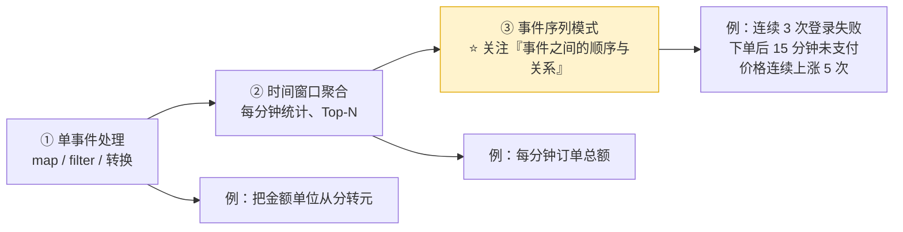

**关键洞察**：前两层关注的是**单个事件的属性**或**一段时间内的统计量**；而第三层关注的是 —— ⭐ **"一串事件按某种顺序、在某个时间范围内出现"**。

这类需求在真实业务里极其常见：

| 业务 | 模式（事件序列） |
| --- | --- |
| **风控** | 同一用户 5 分钟内**连续 3 次登录失败**；**异地登录后立刻大额转账** |
| **电商漏斗** | **浏览 → 加购 → 下单 → 支付**（哪一步流失了？） |
| **交易监控** | **下单后 15 分钟仍未支付**（要催单 / 关单） |
| **行情** | 某支股票**连续 5 个周期上涨**（技术形态） |
| **IoT / 运维** | 设备 **温度报警 → 重启 → 再次报警**（判定硬件故障） |

### 1.2 不用 CEP 会怎样？——手写状态机的痛苦

这类需求**不是不能做**，而是用普通算子做起来非常别扭。

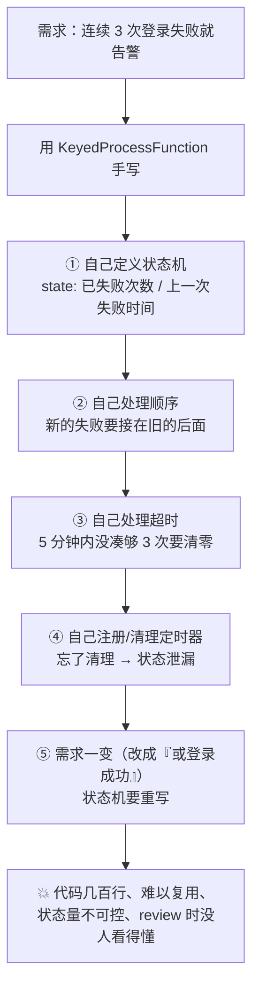

| 维度 | 手写 `KeyedProcessFunction` | ⭐ 用 CEP |
| --- | --- | --- |
| 表达方式 | 命令式：手动维护状态机、定时器 | ⭐ **声明式**：直接把"模式"描述出来 |
| 顺序/间隔/重复 | 全要自己判断 | 框架负责（`next`/`followedBy`/`times`/`within`） |
| 需求变更 | 状态机推倒重写 | 改几行模式定义 |
| 状态管理 | 自己设计，极易泄漏 | 框架统一管理（但**仍需关注容量**，见 §七） |
| 可读性 | 差（业务规则埋在代码里） | ⭐ 好（模式即文档） |

> [!important] CEP 出现的根本原因（一句话）
> **当业务需求从"算出某个值"变成"识别某种事件序列"时，命令式的状态机写法就撑不住了——于是需要一种"声明式描述事件模式"的能力。这就是 CEP 的背景。**

### 1.3 概念来源与在 Flink 里的位置

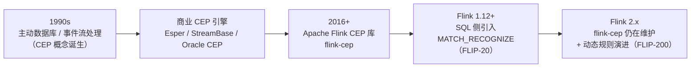

| 时间 | 事件 |
| --- | --- |
| 1990s | CEP 概念在**主动数据库**与事件流处理领域诞生（Esper、StreamBase 等商业引擎） |
| Flink 1.x | 提供 **`flink-cep` 库**，用 **Pattern API** 在 DataStream 上做模式匹配 |
| Flink 1.12+ | 通过 [FLIP-20](https://cwiki.apache.org/confluence/display/FLINK/FLIP-20%3A+Integration+of+SQL+and+CEP) 把 CEP 能力引入 SQL：**`MATCH_RECOGNIZE`** |
| Flink 2.x | `flink-cep` 仍在（**需单独加依赖**，不在发行版里）；[FLIP-200](https://cwiki.apache.org/confluence/display/FLINK/FLIP-200) 在推进**多规则与动态规则**能力 |

> [!warning] 两个容易搞错的点
> ① ⭐ **`flink-cep` 不在 Flink 发行版里**，必须自己加 Maven 依赖（`org.apache.flink:flink-cep`）；
> ② 库的 `Pattern` API 与 SQL 的 `MATCH_RECOGNIZE` 是**两套独立实现**，语义相似但不完全等价（选型见 [§九](#九选型cep-库-vs-match_recognize-vs-手写-processfunction)）。

### 1.4 CEP 的四类典型场景

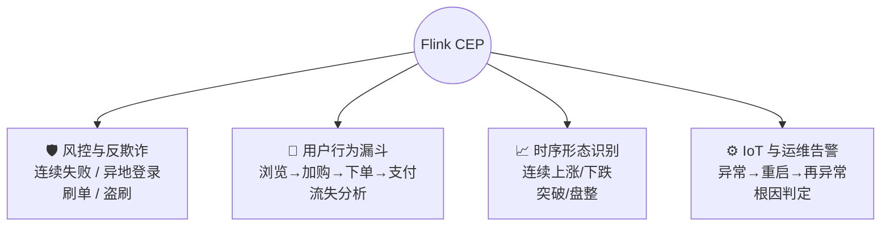

---

## 二、通俗理解：CEP 就是"事件流的正则表达式"

### 2.1 一个类比打通全部概念

你如果写过正则表达式，那 CEP 就已经会了 —— ⭐ **CEP 把"字符串"换成了"事件流"，把"字符"换成了"事件"**。

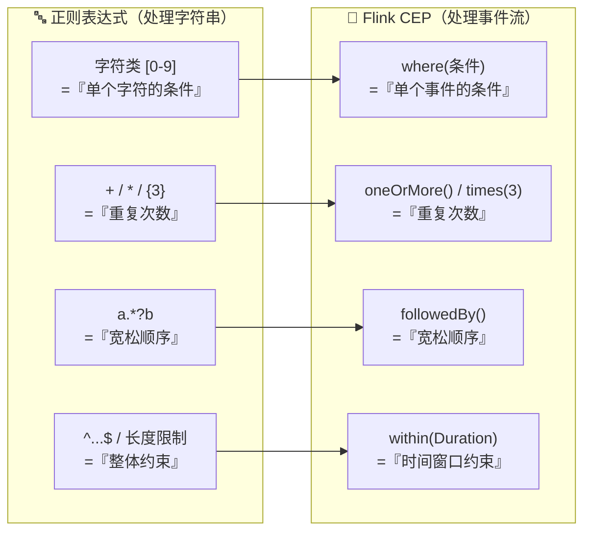

**正则语法 ↔ CEP API 完整对照表**（背下这张表就懂了 80%）：

| 需求（自然语言） | 正则写法 | ⭐ CEP API |
| --- | --- | --- |
| 一个满足条件的事件 | `[a-z]` | `Pattern.begin("start").where(cond)` |
| **严格**紧挨着的下一个 | `ab` | `.next("b")` |
| **宽松**的（中间可以夹别的事件） | `a.*?b` | `.followedBy("b")` |
| 同上，但允许一个事件参与多个匹配 | （正则无直接对应） | `.followedByAny("b")` |
| 后面**不能**跟着某个事件 | `a(?!x)` | `.notFollowedBy("x")` |
| 重复 **1 次或多次** | `a+` | `.oneOrMore()` |
| 重复**恰好 n 次** | `a{3}` | `.times(3)` |
| 重复 **n 到 m 次** | `a{2,5}` | `.times(2, 5)` |
| 重复**至少 n 次** | `a{3,}` | `.timesOrMore(3)` |
| 可选（出现 0 或 1 次） | `a?` | `.optional()` |
| 贪婪匹配 | `a+?` → 贪婪用 `+` | `.oneOrMore().greedy()` |
| 匹配必须**在一定长度内完成** | 长度限制 | ⭐ `.within(Duration.ofMinutes(5))` |
| 一次匹配成功后从哪里继续找 | 全局 `g` 标志 | ⭐ `.withAfterMatchSkipStrategy(...)` |

> [!tip] 用这个类比理解"连续 3 次登录失败"
> **正则版**：`失败 失败 失败`（且三次发生在 5 分钟内）
> **CEP 版**：
> ```java
> Pattern.<LoginEvent>begin("first").where(fail)
>     .next("second").where(fail)          // next = 严格紧挨着
>     .next("third").where(fail)
>     .within(Duration.ofMinutes(5));      // 整体时间约束
> ```
> **读起来就是对业务的直译**——这就是"声明式"的价值。

### 2.2 三种"连续性"是 CEP 最核心的区分（务必搞清）

同样是"匹配 A 然后 B"，**中间能不能夹别的事件**，决定了用哪个方法：

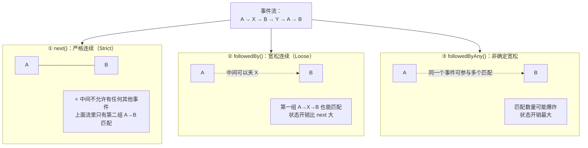

| 方法 | 语义 | 中间能否有其他事件 | 一个事件能否参与多个匹配 | 状态开销 |
| --- | --- | --- | --- | --- |
| ⭐ `.next("b")` | **严格连续** | ❌ 不能 | — | 最小 |
| ⭐ `.followedBy("b")` | **宽松连续** | ✅ 能 | 默认不能 | 中 |
| `.followedByAny("b")` | **非确定宽松** | ✅ 能 | ⭐ **能** | ⚠️ **最大** |
| `.notNext("b")` / `.notFollowedBy("b")` | **负模式**（不能出现） | — | — | 中 |

> [!important] 选择口诀
> **能用 `next` 就别用 `followedBy`，能用 `followedBy` 就别用 `followedByAny`** —— 因为状态开销依次递增（见 [§七](#七状态与性能cep-最容易踩的坑)）。
> 业务上"严格连续"往往也是更准确的定义（比如"连续 3 次失败"通常是**严格**连续）。

---

## 三、API 全景图

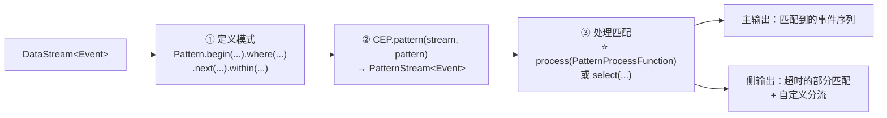

三个步骤：**定义模式（Pattern）→ 检测（CEP.pattern）→ 处理（process/select）**。

---

## 四、Pattern API 详解

### 4.1 起始：`begin`

```java
Pattern<Event, ?> pattern = Pattern.<Event>begin("start");   // 名字要唯一，后面按名字取事件
```

> ⚠️ **第一个模式必须用 `begin` 创建**；每个模式的名字（如 `"start"`）是**从匹配结果里取事件列表的 key**。

### 4.2 条件：`where` / `or` / `until` / `subtype`

```java
// ① 最常用：单个事件的条件（SimpleCondition，无状态）
Pattern.<Event>begin("start")
    .where(SimpleCondition.of(e -> e.getType().equals("login") && e.isFail()));

// ② 多个 where 之间是 AND（追加条件）
.where(SimpleCondition.of(e -> e.getUserId() != null))

// ③ or：OR 条件（同一事件满足任一即可）
.where(SimpleCondition.of(e -> e.getLevel() > 5))
    .or(SimpleCondition.of(e -> e.isVip()))

// ④ subtype：按事件子类过滤（Event 的子类 SpecialEvent）
.next("special").subtype(SpecialEvent.class)
    .where(SimpleCondition.of(se -> se.getVolume() > 10));

// ⑤ ⭐ IterativeCondition：能访问"前面已匹配的事件"（有状态条件）
.next("total")
    .where(new IterativeCondition<Event>() {
        @Override
        public boolean filter(Event e, Context<Event> ctx) throws Exception {
            double sum = e.getAmount();
            for (Event prev : ctx.getEventsForPattern("start")) {  // ⭐ 拿到 start 匹配到的事件
                sum += prev.getAmount();
            }
            return sum > 1000;                                     // 累计金额超过 1000
        }
    });
```

| 条件类型 | 能力 | 开销 | 场景 |
| --- | --- | --- | --- |
| ⭐ `SimpleCondition` | 只看**当前事件** | 最低 | 90% 的场景 |
| `IterativeCondition` | 能看**已匹配的历史事件**（`ctx.getEventsForPattern(name)`） | ⚠️ 高（要遍历历史） | 累计金额、连续上涨 |
| `AndCondition` / `OrCondition` / `NotCondition` | 组合条件 | 中 | 复杂布尔逻辑 |

> [!note] 版本提示：`where(FilterFunction)` 已废弃
> 早期写法是 `.where(e -> e.isFail())`（直接传 `FilterFunction` lambda）。因为 Java lambda 的**类型擦除**导致重载歧义，新版本**推荐显式用 `SimpleCondition.of(...)`**（官方 2.0 文档即此写法）。
> 老代码可能长这样：`.where(new SimpleCondition<Event>() { public boolean filter(Event e) {...} })` —— 仍然可用。

### 4.3 量词（Quantifier）：让模式"重复"

```java
// 连续 3 次失败（严格）
Pattern.<Event>begin("fail").where(fail).times(3);

// 2~5 次之间
Pattern.<Event>begin("fail").where(fail).times(2, 5);

// 至少 3 次
Pattern.<Event>begin("fail").where(fail).timesOrMore(3);

// 1 次或多次（至少 1 次）
Pattern.<Event>begin("up").where(rising).oneOrMore();

// 可选（0 或 1 次）
Pattern.<Event>begin("coupon").where(isCoupon).optional();

// 贪婪：尽量匹配更多次
Pattern.<Event>begin("up").where(rising).oneOrMore().greedy();

// 同一事件可被多个匹配复用（默认 false，慎用）
Pattern.<Event>begin("up").where(rising).oneOrMore().allowCombinations();
```

| 量词 | 含义 | 正则对应 |
| --- | --- | --- |
| `.oneOrMore()` | 1 次或多次 | `+` |
| `.times(n)` | 恰好 n 次 | `{n}` |
| `.times(from, to)` | from ~ to 次 | `{from,to}` |
| `.timesOrMore(n)` | 至少 n 次 | `{n,}` |
| `.optional()` | 0 或 1 次 | `?` |
| `.greedy()` | 贪婪（配 `oneOrMore`/`times` 用） | 默认贪婪/非贪婪相反 |

> ⚠️ **量词会放大状态**：`oneOrMore()` 意味着框架要为每个 key 保存"当前已累积的匹配序列"，如果没有 `within` 限制，这个序列可能**无限增长**。

### 4.4 时间约束：`within(Duration)` —— ⭐ 最关键的参数

```java
Pattern.<LoginEvent>begin("first").where(fail)
    .next("second").where(fail)
    .next("third").where(fail)
    .within(Duration.ofMinutes(5));      // ⭐ 整个序列必须在 5 分钟内完成
```

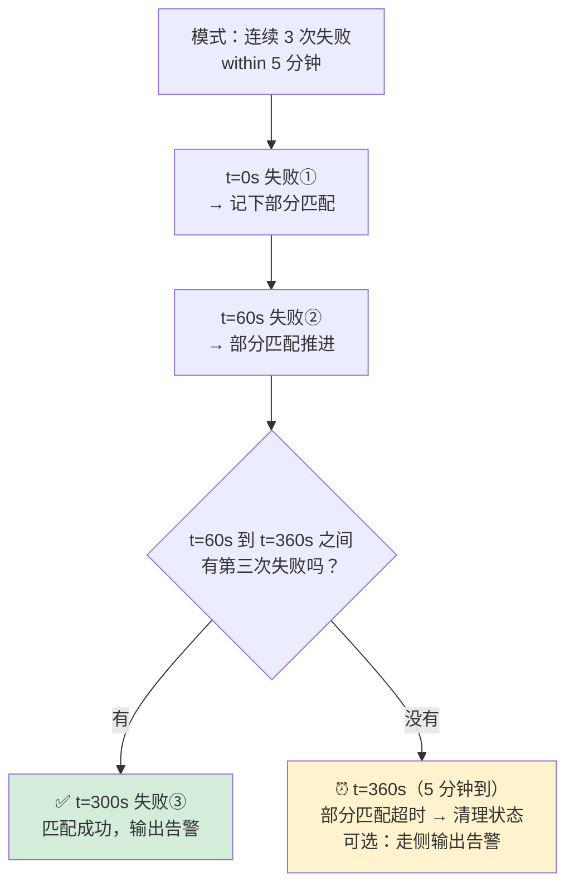

| 要点 | 说明 |
| --- | --- |
| 作用 | ⭐ **限制整个模式匹配的总时长**（不是单个事件之间） |
| 另一个作用 | ⭐ **决定状态保留多久**——超时后框架会清理部分匹配状态 |
| 不配会怎样 | ⚠️ **状态可能无限增长**（尤其 `oneOrMore` 或宽松连续），最终 Checkpoint 变大、OOM |
| 超时了想看数据 | 实现 `TimedOutPartialMatchHandler`，走**侧输出**告警（见 §5.4） |
| 与 `allowedLateness` | CEP 里**不建议**再叠加 `allowedLateness`；`within` 已经承担了"等多久"的职责 |

> [!important] 生产铁律
> **凡是有 `oneOrMore` / `followedBy` / `followedByAny` 的模式，必须配 `within()`**；否则状态量不可控——这是 CEP 上线最常见的事故原因（[[13-生产部署Checklist逐项解析]]）。

### 4.5 匹配后跳过策略：`AfterMatchSkipStrategy`

一个匹配成功后，**从哪里继续找下一个匹配**？这直接决定**匹配数量和状态**。

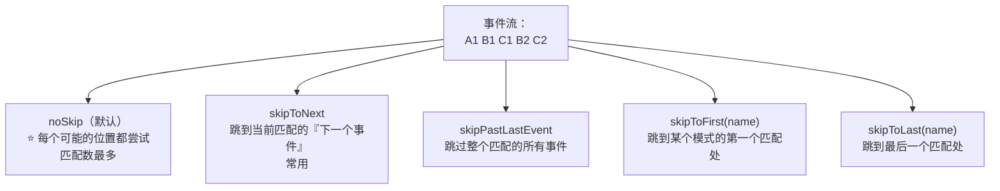

```java
// ⭐ 正确写法（1.13+）：把跳过策略挂在【模式的第一个 begin】上
AfterMatchSkipStrategy skip = AfterMatchSkipStrategy.skipPastLastEvent();
Pattern<Event, ?> pattern = Pattern.<Event>begin("start", skip)
        .where(SimpleCondition.of(...))
        .next("end").where(SimpleCondition.of(...));

// SKIP_TO_FIRST / SKIP_TO_LAST 还可以要求「指定的模式名没匹配到就抛异常」
AfterMatchSkipStrategy.skipToFirst("start").throwExceptionOnMiss();
```

> [!warning] 一个极易写错的点（编译期才会发现）
> `CEP.pattern` **只有两个重载**：`pattern(input, pattern)` 和 `pattern(input, pattern, EventComparator)`。
> **没有"第三个参数是跳过策略"的重载**——老博客里常见的
> `CEP.pattern(stream, pattern, AfterMatchSkipStrategy.skipPastLastEvent())` **编译不过**。
> 跳过策略的唯一正确位置是 **`Pattern.begin(name, skipStrategy)`**（作用于整个模式）。

| 策略 | 语义 | 匹配数量 | 状态开销 | 适用 |
| --- | --- | --- | --- | --- |
| ⭐ `noSkip()`（**默认**） | 所有可能都算 | ⚠️ 最多 | 大 | 需要穷举（少见） |
| `skipToNext()` | 跳到下一个事件继续 | 中 | 中 | 多数业务 |
| ⭐ `skipPastLastEvent()` | 跳过整个匹配 | ✅ 最少 | 小 | **风控告警**（报一次就够） |
| `skipToFirst("name")` | 跳到指定模式的首个匹配 | 少 | 小 | 精细控制 |
| `skipToLast("name")` | 跳到指定模式的末个匹配 | 少 | 小 | 精细控制 |

> ⚠️ 使用 `skipToFirst` / `skipToLast` **必须指定一个已存在的 pattern 名字**，否则报错。
> 💡 经验：**`noSkip` 是默认值，但很少是你想要的**——风控告警通常用 `skipPastLastEvent`。

### 4.6 模式组（PatternGroup）：把一组模式当整体重复

```java
// 想表达"（下单 → 支付）重复 2 次"
Pattern<Event, ?> group = Pattern.<Event>begin("order")
        .where(isOrder)
        .next("pay").where(isPay);

Pattern<Event, ?> pattern = Pattern.<Event>begin("loop", group)
        .times(2)
        .within(Duration.ofMinutes(10));
```

---

## 五、检测与输出 API

### 5.1 检测：`CEP.pattern`

```java
// ① 基础用法（必须 keyBy：CEP 的匹配是按 key 独立进行的）
PatternStream<LoginEvent> ps = CEP.pattern(
        stream.keyBy(LoginEvent::getUserId), pattern);

// ② 带自定义事件比较器（默认用 equals）
PatternStream<Event> ps2 = CEP.pattern(stream, pattern, new MyEventComparator());

// ③ 时间语义（1.x 需要显式声明；2.x 事件时间是默认）
ps2.inEventTime();        // 事件时间（推荐）
ps2.inProcessingTime();   // 处理时间
```

> ⚠️ **三件事必须做对**：
> ① **必须 `keyBy`** —— CEP 模式匹配在**每个 key 内独立进行**（按用户/设备分组），否则所有事件混在一个模式里；
> ② 事件类**必须正确实现 `equals()` / `hashCode()`** —— 官方文档明确要求，CEP 用它们比较与匹配事件，**没实现会导致匹配行为诡异**（这是非常隐蔽的坑）；
> ③ 时间语义要与水位配置一致。

### 5.2 处理匹配：`select`（旧） vs ⭐ `process`（推荐）

```java
// ========== 方式 A：select（旧 API）==========
// 1.x 写法
ps.select((Map<String, List<LoginEvent>> match) -> {
    LoginEvent first = match.get("first").get(0);
    return new Alert(first.getUserId(), "连续3次失败");
});

// ⚠️ 2.x：需要显式提供 TypeInformation（lambda 返回值类型无法推断）
ps.select(
    (Map<String, List<LoginEvent>> match) -> new Alert(...),
    TypeInformation.of(new TypeHint<Alert>() {}));

// ========== 方式 B：⭐ process（推荐，能力最全）==========
SingleOutputStreamOperator<Alert> alerts = ps.process(
    new PatternProcessFunction<LoginEvent, Alert>() {
        @Override
        public void processMatch(Map<String, List<LoginEvent>> match,
                                 Context ctx,
                                 Collector<Alert> out) {
            // match: 模式名 → 该模式匹配到的事件列表（量词会给出多个）
            List<LoginEvent> first = match.get("first");
            out.collect(new Alert(first.get(0).getUserId(), "连续3次失败"));

            // 拿时间信息
            Long ts = ctx.timestamp();                 // 事件时间
            Long now = ctx.currentProcessingTime();    // 处理时间

            // 侧输出分流
            ctx.output(SUSPICIOUS_TAG, first.get(0));
        }
    });
```

| 维度 | `select` | ⭐ `process` |
| --- | --- | --- |
| 函数类型 | `PatternSelectFunction` / `PatternFlatSelectFunction` | ⭐ **`PatternProcessFunction`** |
| 拿时间信息 | ✗ | ✅ `ctx.timestamp()` / `ctx.currentProcessingTime()` |
| 侧输出 | ✗ | ✅ `ctx.output(tag, event)` |
| 处理**超时**的部分匹配 | ✗ | ✅ 实现 `TimedOutPartialMatchHandler` |
| 2.x 类型推断 | ⚠️ 需显式 `TypeInformation` | 一般可推断（也有显式重载） |

> [!tip] 结论：**新代码统一用 `process(PatternProcessFunction)`**。

### 5.3 处理"超时的部分匹配"：`TimedOutPartialMatchHandler`

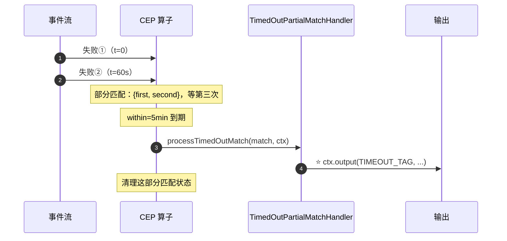

```java
public class LoginFailAlert extends PatternProcessFunction<LoginEvent, Alert>
        implements TimedOutPartialMatchHandler<LoginEvent> {

    @Override
    public void processMatch(Map<String, List<LoginEvent>> match, Context ctx, Collector<Alert> out) {
        out.collect(new Alert(ctx.getCurrentKey(), "连续失败", match.get("first")));
    }

    @Override
    public void processTimedOutMatch(Map<String, List<LoginEvent>> match, Context ctx) {
        // ⭐ 没凑够次数就超时的部分匹配，走侧输出（用于观察/补算/降级告警）
        List<LoginEvent> first = match.get("first");
        ctx.output(TIMEOUT_TAG, new PartialAlert(ctx.getCurrentKey(), first.size()));
    }
}
```

> 💡 **超时部分匹配的用途**：① 观测"差一点就命中"的行为（调阈值用）；② 降级告警；③ 数据补算。**不做超时处理的话，这些部分匹配就默默被丢弃了**。

---

## 六、时间与迟到处理

CEP 的时间语义跟随**流的时间特性**（`inEventTime()` / `inProcessingTime()`；2.x 下事件时间是默认）。

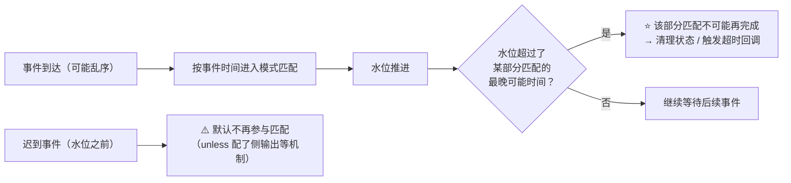

| 场景 | CEP 的行为 |
| --- | --- |
| **事件乱序** | 只要在 `within` 窗口内、且水位未推进过头，仍可正确匹配 |
| **`within` 到期** | 部分匹配**必然被清理**（并可按需触发 `processTimedOutMatch`） |
| ⚠️ **迟到事件** | 默认只做"水位之后不再接受"，**建议用 `sideOutputLateData` + 上游水位策略兜底**，而不是指望 CEP 处理极端迟到 |
| `allowedLateness` | ⚠️ CEP 场景中**不推荐**叠加（语义会和 `within` 冲突），要在上游用 `allowedLateness` + 侧输出 |

> 时间语义与水位详见 [[2-时间与窗口]]；迟到三层保障（水位 P99 + allowedLateness + 侧输出）同篇。

---

## 七、状态与性能：CEP 最容易踩的坑

### 7.1 CEP 的状态长什么样

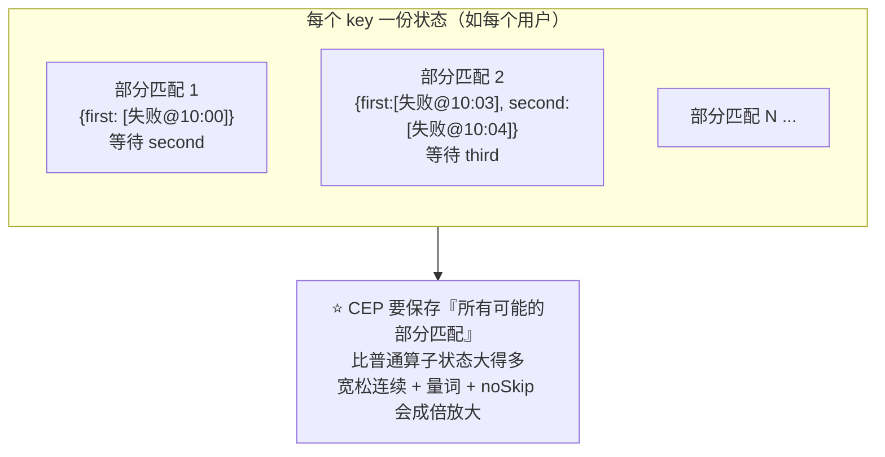

### 7.2 各种写法对状态的影响

| 写法 | 相对状态开销 | 说明 |
| --- | --- | --- |
| `next` | 最小 | 不需要缓存中间事件 |
| `followedBy` | 中 | 需要保留"可能被跳过"的事件 |
| `followedByAny` | ⚠️ **最大** | 每个事件都要尝试所有匹配组合 |
| `oneOrMore` / `times` | 大 | 累积的序列越长状态越大 |
| `IterativeCondition` | 中~大 | 每次判定要遍历历史事件（CPU 也涨） |
| `noSkip`（默认） | ⚠️ 成倍放大匹配数 | 建议改 `skipPastLastEvent` |
| ⭐ **`within`** | ✅ **决定状态上界** | 有它才有"过期清理" |

### 7.3 五条调优与防爆建议

> [!important] CEP 上线的五条纪律
> ① ⭐ **必配 `within()`**：所有含量词或宽松连续的模式都要有总时长约束；
> ② ⭐ **改默认的跳过策略**：`noSkip` → `skipPastLastEvent()` / `skipToNext()`；
> ③ **能用 `next` 就別用 `followedBy`，能用 `followedBy` 就别用 `followedByAny`**；
> ④ **`keyBy` 的基数要可控**：按 `userId` 分组的模式，会为**每个活跃用户**维护部分匹配状态——DAU 千万时状态量惊人；
> ⑤ **配置状态 TTL 与监控**：给算子配 `table.exec.state.ttl`（SQL）或状态 TTL；监控 **Checkpoint 大小 / 状态大小 / 算子 busy 时间**，配合 [[6-背压与性能调优]]、[[5-Checkpoint与Savepoint]]。

### 7.4 常见坑清单

| 坑 | 现象 | 解法 |
| --- | --- | --- |
| ⭐ **事件类没实现 `equals`/`hashCode`** | 匹配行为诡异、漏匹配或重复匹配 | **必须正确实现**（官方明确要求） |
| ⭐ **没配 `within`** | Checkpoint 越来越大、最终 OOM | 加 `within` |
| 忘记 `keyBy` | 所有用户的事件混在一个模式里匹配 | 先 `keyBy` 再 `CEP.pattern` |
| 默认 `noSkip` | 一次行为产生海量告警 | 换 `skipPastLastEvent` |
| `IterativeCondition` 里遍历太多 | 算子 busy 100%、背压 | 改用 `SimpleCondition` + 状态/或用聚合方式重写 |
| 2.x 迁移 `select` 编译报错 | 类型推断失败 | 显式传 `TypeInformation` |
| 以为 CEP 能动态改规则 | 规则写死在代码里 | ⭐ **动态规则**：广播状态 + 手写、或用 Table API / FLIP-200 能力 |

---

## 八、实战案例

> [!tip] 本章共 **7 个案例 + 1 篇调试指南**
> 每个案例 = **一句业务痛点 + 事件轨迹图 + 可运行代码 + 坑点**。覆盖 Pattern API 的全部常用能力。

| 案例 | 场景 | 用到的核心 API |
| --- | --- | --- |
| [8.1](#81-案例一连续-3-次登录失败风控最经典) | 登录风控 | `next` + `within` + `skipPastLastEvent` |
| [8.2](#82-案例二下单后-15-分钟未支付超时类模式) | 掉单催付 | `followedBy` / `notFollowedBy` + 超时思路 |
| [8.3](#83-案例三金额连续上涨量词--迭代条件) | 行情识别 | `IterativeCondition` + `timesOrMore` + `greedy` |
| [8.4](#84-案例四电商转化漏斗followedBy-宽连续) | 漏斗分析 | ⭐ `followedBy` ×3 + `within(24h)` |
| [8.5](#85-案例五异地登录后大额转账跨事件条件) | 交易风控 | ⭐ **跨事件条件**（读取前面匹配的事件） |
| [8.6](#86-案例六设备反复报警直到维修oneor-more--until) | IoT 故障 | ⭐ `oneOrMore().until(...)` |
| [8.7](#87-案例七物流超时未更新超时回调完整可运行) | 物流催派 | ⭐ `TimedOutPartialMatchHandler` + 侧输出 |
| [8.8](#88-本地测试与调试不接-kafka-也能验证-cep) | 开发调试 | `fromData` + `executeAndCollect()` |

### 8.1 案例一：连续 3 次登录失败（风控，最经典）

```java
public class LoginFailDetection {
    public static void main(String[] args) throws Exception {
        StreamExecutionEnvironment env = StreamExecutionEnvironment.getExecutionEnvironment();
        env.setParallelism(2);

        DataStream<LoginEvent> logins = env
                .fromSource(loginSource, WatermarkStrategy
                        .<LoginEvent>forBoundedOutOfOrderness(Duration.ofSeconds(3))
                        .withTimestampAssigner((e, ts) -> e.getEventTime()), "logins");

        // ① 定义模式：严格连续 3 次失败，5 分钟内；匹配后跳过整个序列防重复告警
        Pattern<LoginEvent, ?> pattern = Pattern.<LoginEvent>begin("first",
                AfterMatchSkipStrategy.skipPastLastEvent())
                .where(SimpleCondition.of(LoginEvent::isFail))
                .next("second")
                .where(SimpleCondition.of(LoginEvent::isFail))
                .next("third")
                .where(SimpleCondition.of(LoginEvent::isFail))
                .within(Duration.ofMinutes(5));       // ⭐ 必配

        // ② 检测（按用户分组）
        PatternStream<LoginEvent> ps = CEP.pattern(
                logins.keyBy(LoginEvent::getUserId), pattern);

        // ③ 输出
        SingleOutputStreamOperator<Alert> alerts = ps.process(new LoginFailAlert());
        alerts.sinkTo(alertSink);

        env.execute("login-fail-cep");
    }
}

public class LoginFailAlert extends PatternProcessFunction<LoginEvent, Alert>
        implements TimedOutPartialMatchHandler<LoginEvent> {

    @Override
    public void processMatch(Map<String, List<LoginEvent>> match, Context ctx, Collector<Alert> out) {
        LoginEvent f = match.get("first").get(0);
        LoginEvent l = match.get("third").get(0);
        out.collect(new Alert(f.getUserId(), "5分钟内连续3次登录失败",
                l.getEventTime() - f.getEventTime()));
    }

    @Override
    public void processTimedOutMatch(Map<String, List<LoginEvent>> match, Context ctx) {
        ctx.output(TIMEOUT_TAG, new Partial(ctx.getCurrentKey(), match.get("first").size()));
    }
}
```

### 8.2 案例二：下单后 15 分钟未支付（超时类模式）

```java
// 思路：模式 = 下单 → 15 分钟内没有支付
// 用 within(15min) 表示"支付必须发生在 15 分钟内"；没匹配上就是"未支付"
Pattern<OrderEvent, ?> unpaid = Pattern.<OrderEvent>begin("create")
        .where(SimpleCondition.of(e -> e.getType() == Type.CREATE))
        .followedBy("pay")                        // 宽松：中间可能有别的行为
        .where(SimpleCondition.of(e -> e.getType() == Type.PAY))
        .within(Duration.ofMinutes(15));

// 但业务要的是"没有支付" → 用负模式更直观：
Pattern<OrderEvent, ?> notPaid = Pattern.<OrderEvent>begin("create")
        .where(SimpleCondition.of(e -> e.getType() == Type.CREATE))
        .notFollowedBy("pay")
        .where(SimpleCondition.of(e -> e.getType() == Type.PAY))
        .within(Duration.ofMinutes(15));
// ⚠️ 负模式：在 15 分钟内"没有出现支付"，配合超时回调即可触发催单
```

> 💡 更常见的做法是**用超时部分匹配**：定义 `create → pay` 的模式并 `within(15min)`，然后在 `processTimedOutMatch` 里发"催单"事件——**语义更清晰、也更好实现**。

### 8.3 案例三：金额连续上涨（量词 + 迭代条件）

```java
Pattern<PriceEvent, ?> rising = Pattern.<PriceEvent>begin("rise",
                AfterMatchSkipStrategy.skipPastLastEvent())   // ⭐ 策略挂在 begin 上
        .where(new IterativeCondition<PriceEvent>() {
            @Override
            public boolean filter(PriceEvent cur, Context<PriceEvent> ctx) throws Exception {
                PriceEvent last = null;
                for (PriceEvent p : ctx.getEventsForPattern("rise")) {
                    last = p;                          // 取序列里最后一个已匹配事件
                }
                return last == null || cur.getPrice() > last.getPrice();   // 严格递增
            }
        })
        .timesOrMore(3)                                // 至少 3 个
        .greedy()
        .within(Duration.ofMinutes(30));               // ⭐ 状态上界

PatternStream<PriceEvent> ps = CEP.pattern(prices.keyBy(PriceEvent::getSymbol), rising);
```

---

### 8.4 案例四：电商转化漏斗（followedBy 宽连续）

**业务痛点**：运营要看"浏览 → 加购 → 下单 → 支付"的转化率。但真实用户**中间会夹杂大量无关行为**（看详情、比价、逛别的商品）——如果模式写成 `next`（严格连续），会漏掉绝大部分转化，漏斗数据严重失真。

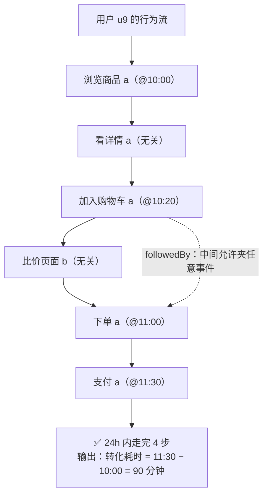

```java
Pattern<UserAction, ?> funnel = Pattern.<UserAction>begin("browse",
                AfterMatchSkipStrategy.skipPastLastEvent())
        .where(SimpleCondition.of(a -> "browse".equals(a.getAction())))
        .followedBy("cart")          // ⭐ 宽松：中间可夹别的行为（用 next 会漏大量转化）
        .where(SimpleCondition.of(a -> "cart".equals(a.getAction())))
        .followedBy("order")
        .where(SimpleCondition.of(a -> "order".equals(a.getAction())))
        .followedBy("pay")
        .where(SimpleCondition.of(a -> "pay".equals(a.getAction())))
        .within(Duration.ofHours(24));   // ⭐ 24 小时转化口径 = 状态上界

SingleOutputStreamOperator<Conversion> out = CEP
        .pattern(actions.keyBy(UserAction::getUid), funnel)
        .process(new PatternProcessFunction<UserAction, Conversion>() {
            @Override
            public void processMatch(Map<String, List<UserAction>> m, Context ctx, Collector<Conversion> c) {
                UserAction start = m.get("browse").get(0);
                UserAction pay   = m.get("pay").get(0);
                c.collect(new Conversion(ctx.getCurrentKey(), start.getTime(),
                        pay.getTime() - start.getTime()));
            }
        });
```

> [!important] 这个案例的三个决策
> ① **用 `followedBy` 而不是 `next`**——用户会穿插无关行为，`next` 会漏匹配（漏斗数据失真）；
> ② **`within(24h)` 一箭双雕**——既是业务口径（24 小时内完成才算转化），又是**状态上界**；
> ③ **没转化的用户 = 流失信号**——在 `processTimedOutMatch` 里可以拿到"走到第几步才流失"，这是漏斗分析最有价值的数据（但注意：`begin` 级超时拿到的是**第一个模式之后的部分匹配**，实际工程里常把"流失"做成"独立的超时算子"）。
> ⚠️ 状态提醒：`followedBy` 会为**每个 uid** 保留部分匹配 → key 基数 ≈ 活跃用户数（DAU），大 DAU 场景必须评估内存。

### 8.5 案例五：异地登录后大额转账（跨事件条件）

**业务痛点**：风控规则——**"刚在 A 城登录，10 分钟内就发生 B 城大额转账"**。注意"大额 + 异地"这两个条件需要**同时看两个事件**（登录事件的城市、转账事件的城市与金额）。

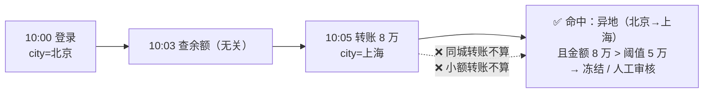

```java
Pattern<Op, ?> risk = Pattern.<Op>begin("login",
                AfterMatchSkipStrategy.skipPastLastEvent())
        .where(SimpleCondition.of(o -> o.getType() == OpType.LOGIN))
        .followedBy("transfer")
        .where(new IterativeCondition<Op>() {
            @Override
            public boolean filter(Op cur, Context<Op> ctx) throws Exception {
                if (cur.getType() != OpType.TRANSFER || cur.getAmount() == null) return false;
                // ⭐ 跨事件条件：拿到"已匹配的登录事件"，和当前转账事件一起判断
                Op login = ctx.getEventsForPattern("login").iterator().next();
                return cur.getAmount().compareTo(new BigDecimal("50000")) > 0        // 大额
                        && !Objects.equals(cur.getCity(), login.getCity());          // 异地
            }
        })
        .within(Duration.ofMinutes(10));
```

> [!important] 这个案例的两个要点
> ① **跨事件条件是 `IterativeCondition` 的专属能力**（`ctx.getEventsForPattern(name)` 能读到"已匹配的历史事件"）；`SimpleCondition` 只看当前事件；
> ② ⭐ **生产上的降本技巧：能不在 CEP 里跨事件，就不要跨**。
> `IterativeCondition` 每次判定都要**遍历历史事件**（CPU 随序列变长而涨）。
> 更优做法是**上游 enrichment**：用状态/维表把"该用户**最近一次登录的城市与时间**"先写到每条事件上，CEP 里就只剩 `SimpleCondition` 判断——**零历史遍历，状态还小**。
> ```java
> // ⭐ 更优：上游先 enrich，CEP 只做单事件判断
> .where(SimpleCondition.of(o -> o.getType() == OpType.TRANSFER
>         && o.getAmount().compareTo(THRESHOLD) > 0
>         && !Objects.equals(o.getCity(), o.getLastLoginCity())   // 信息已带在事件上
>         && o.getEventTime() - o.getLastLoginTime() < 10 * 60_000L));
> ```

### 8.6 案例六：设备反复报警直到维修（oneOrMore + until）

**业务痛点**：IoT 场景——设备温度**反复报警**，直到运维"维修完成"事件出现为止。这段"**报警 → 报警 → … → 维修**"就是一个**故障段**，要输出"报警次数 + 持续时长"。

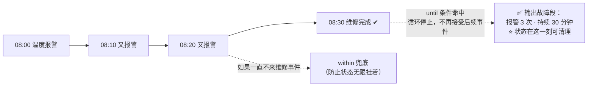

```java
Pattern<DeviceEvent, ?> fault = Pattern.<DeviceEvent>begin("alarm",
                AfterMatchSkipStrategy.skipPastLastEvent())
        .where(SimpleCondition.of(DeviceEvent::isAlarm))  // 温度超标
        .oneOrMore()                                      // ⭐ 官方限定：until 只能配 oneOrMore()
        .until(SimpleCondition.of(DeviceEvent::isRepaired));  // 出现"维修完成"即停止

SingleOutputStreamOperator<FaultReport> reports = CEP
        .pattern(events.keyBy(DeviceEvent::getDeviceId), fault)
        .process(new PatternProcessFunction<DeviceEvent, FaultReport>() {
            @Override
            public void processMatch(Map<String, List<DeviceEvent>> m, Context ctx, Collector<FaultReport> c) {
                List<DeviceEvent> alarms = m.get("alarm");
                DeviceEvent first = alarms.get(0);
                DeviceEvent last  = alarms.get(alarms.size() - 1);
                c.collect(new FaultReport(ctx.getCurrentKey(), alarms.size(),
                        last.getTime() - first.getTime()));
            }
        });
```

> [!important] `until` 的准确语义（官方 2.0 文档原文口径）
> ① **停止条件**：until 条件的事件出现后，**不再有更多事件被接受进这个模式**（循环即停）；
> ② ⭐ **官方限定：只能与 `oneOrMore()` 连用**（不能配 `times`）；
> ③ **隐藏价值**：官方文档明确指出 until 会带来一个好处——**"基于事件清理对应模式的状态"**（维修完成一到，部分匹配状态立刻可清，不必干等 `within` 超时）。
> **与 `within` 的关系**：until 管"**业务何时结束**"（事件驱动），within 管"**最长等多久**"（时间兜底）——**两者可以同时配**：`within(Duration.ofHours(12))` 防止"设备再也没报修事件"导致状态永久挂着。

### 8.7 案例七：物流超时未更新（超时回调完整可运行）

**业务痛点**：快递揽收后 **24 小时内必须出现"妥投"**，否则要催派。注意"**没发生什么**"本身就是信号——这正是 `TimedOutPartialMatchHandler` 的主场。

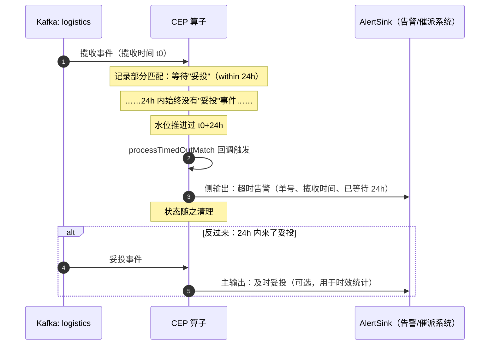

**完整可运行代码**：

```java
// ========== ① 事件类（⚠️ 必须正确实现 equals/hashCode，CEP 官方要求）==========
public class LogisticsEvent implements Serializable {
    private String waybill;   // 运单号（= key）
    private String action;    // PICKUP 揽收 / SIGNED 妥投
    private long eventTime;   // 事件时间（毫秒）
    // 构造方法 + getter ……
}

// ========== ② 主作业 ==========
public class WaybillTimeoutJob {
    public static final OutputTag<TimeoutAlert> TIMEOUT_TAG =
            new OutputTag<>("waybill-timeout") {};

    public static void main(String[] args) throws Exception {
        StreamExecutionEnvironment env = StreamExecutionEnvironment.getExecutionEnvironment();
        env.enableCheckpointing(60_000, CheckpointingMode.EXACTLY_ONCE);

        KafkaSource<LogisticsEvent> source = KafkaSource.<LogisticsEvent>builder()
                .setBootstrapServers("kafka-1:9092")
                .setTopics("logistics")
                .setGroupId("waybill-timeout-job")
                .setStartingOffsets(OffsetsInitializer.committedOffsets(OffsetResetStrategy.EARLIEST))
                .setDeserializer(KafkaRecordDeserializationSchema.of(new LogisticsJsonDeserializer()))
                .build();

        DataStream<LogisticsEvent> events = env.fromSource(source, WatermarkStrategy
                .<LogisticsEvent>forBoundedOutOfOrderness(Duration.ofMinutes(2))
                .withTimestampAssigner((e, t) -> e.getEventTime()), "logistics");

        // ⭐ 模式：揽收 → 24h 内妥投
        Pattern<LogisticsEvent, ?> signedWithin24h = Pattern.<LogisticsEvent>begin("pickup",
                AfterMatchSkipStrategy.skipPastLastEvent())
                .where(SimpleCondition.of(e -> "PICKUP".equals(e.getAction())))
                .followedBy("signed")
                .where(SimpleCondition.of(e -> "SIGNED".equals(e.getAction())))
                .within(Duration.ofHours(24));

        SingleOutputStreamOperator<TimeoutAlert> alerts = CEP
                .pattern(events.keyBy(LogisticsEvent::getWaybill), signedWithin24h)
                .process(new WaybillAlertFunction());

        alerts.sinkTo(alertSink);                       // 主输出：及时妥投指标
        alerts.getSideOutput(TIMEOUT_TAG).sinkTo(escalationSink);  // ⭐ 侧输出：催派
        env.execute("waybill-timeout-job");
    }
}

// ========== ③ 处理函数（含超时回调）==========
public class WaybillAlertFunction extends PatternProcessFunction<LogisticsEvent, TimeoutAlert>
        implements TimedOutPartialMatchHandler<LogisticsEvent> {

    @Override
    public void processMatch(Map<String, List<LogisticsEvent>> match, Context ctx, Collector<TimeoutAlert> out) {
        LogisticsEvent pickup = match.get("pickup").get(0);
        LogisticsEvent signed = match.get("signed").get(0);
        out.collect(TimeoutAlert.ok(pickup.getWaybill(), signed.getEventTime() - pickup.getEventTime()));
    }

    @Override
    public void processTimedOutMatch(Map<String, List<LogisticsEvent>> match, Context ctx) {
        // ⭐ 关键：24h 内没等到妥投 → 走侧输出催派
        LogisticsEvent pickup = match.get("pickup").get(0);
        ctx.output(WaybillTimeoutJob.TIMEOUT_TAG,
                TimeoutAlert.timeout(pickup.getWaybill(), pickup.getEventTime()));
    }
}
```

| 输出 | 触发时机 | 去向 |
| --- | --- | --- |
| 主输出 `ok(waybill, 用时)` | 24h 内妥投 | 时效统计指标 |
| ⭐ 侧输出 `timeout(waybill, 揽收时间)` | `within` 到期仍未妥投 | **催派系统 / 告警群** |
| （可选）侧输出其他 | 业务分流 | 按需 |

> 💡 这是"**用超时表达否定语义**"的标准姿势：**"24 小时没有发生某事"用窗口超时来表达**，比手写定时器 + 状态管理干净得多。

### 8.8 本地测试与调试：不接 Kafka 也能验证 CEP

**开发时最痛的是什么？** 改一行模式就得起 Kafka、灌数据、等匹配——太慢。其实 **CEP 的逻辑完全可以离线验证**：

```java
public class CepLocalTest {
    public static void main(String[] args) throws Exception {
        StreamExecutionEnvironment env = StreamExecutionEnvironment.getExecutionEnvironment();
        env.setParallelism(1);                    // ⭐ 固定并行度，输出顺序稳定
        env.getConfig().disableGenericTypes();    // ⭐ 故意禁掉 Kryo 兜底：POJO 不合格直接报错

        // ⭐ 造数据（1.19+ 用 fromData；老版本用 fromElements）——有界流，作业会自己跑完
        DataStream<LoginEvent> logins = env.fromData(
                new LoginEvent("u1", false, 1000L),   // 失败
                new LoginEvent("u1", false, 2000L),   // 失败
                new LoginEvent("u9", false, 2100L),   // ⚠️ 干扰：别的用户的失败
                new LoginEvent("u1", true,  2500L),   // ✅ u1 登录成功 → 三连败被打断
                new LoginEvent("u2", false, 3000L),
                new LoginEvent("u2", false, 3100L),
                new LoginEvent("u2", false, 3200L));  // ✅ u2 三连败 → 应产出 1 条告警

        // ……放 §8.1 的 pattern 与 CEP.pattern（不需要 sink）……

        List<Alert> alerts = ps.process(new LoginFailAlert()).executeAndCollect();
        for (Alert a : alerts) {
            System.out.println(">>> " + a);
        }
        // 期望输出只有 1 条：>>> Alert{userId=u2, reason=5分钟内连续3次登录失败}
    }
}
```

**六个调试技巧**：

| 技巧 | 说明 |
| --- | --- |
| ⭐ `executeAndCollect()` | 不写 Sink，把结果直接收进 `List` 断言（最适合单测/本地验证） |
| `print()` | 粗暴有效：把 `PatternStream` 直接 `.print("cep")` 看轨迹 |
| `env.setParallelism(1)` | 测试固定并行度，避免输出顺序乱跳 |
| ⭐ `disableGenericTypes()` | 让"POJO 不合格 → 静默走 Kryo"变成**启动即报错**，别把这个坑留到生产 |
| 测**超时**逻辑 | 有界源结束时水位会推到"最大时间"→ **`within` 超时回调在测试里会自然触发**，很方便 |
| 测**匹配数量** | 记住默认是 `NO_SKIP`：同一段事件可能产出多条匹配——断言前先想清楚 skip 策略，否则"多了几条"不是 bug |

> [!warning] 本地测试的三个注意
> ① `fromData` 是**有界流**，作业跑完就退出（不像 Kafka 常驻）；
> ② 事件类的 `equals/hashCode` 坑**最容易在测试中暴露**（表现为"明明数据对却匹配不上"）；
> ③ `within` 用**毫秒级小窗口**（如 5000ms）测试，别用 24h——有界源的水位虽会推进，但小窗口调试更直观。

---

## 九、选型：CEP 库 vs MATCH_RECOGNIZE vs 手写 ProcessFunction

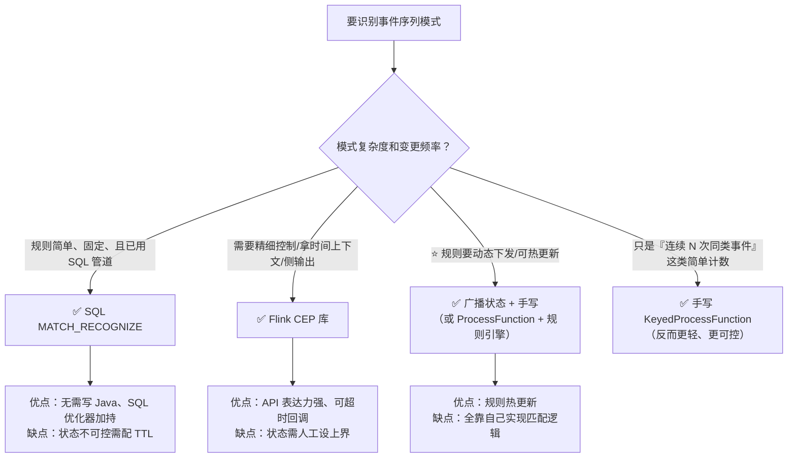

| 维度 | ⭐ Flink CEP 库 | SQL `MATCH_RECOGNIZE` | 手写 `ProcessFunction` |
| --- | --- | --- | --- |
| 表达方式 | Java 声明式 | SQL 声明式 | 命令式 |
| 上手成本 | 中 | 低（会 SQL 即可） | 高 |
| 拿时间上下文 | ✅ | 部分 | ✅ |
| 侧输出 / 超时回调 | ✅ 完善 | ⚠️ 有限 | ✅ 自行实现 |
| 状态控制 | 需 `within` 兜底 | ⚠️ 需 `table.exec.state.ttl` | 完全自控（但也全靠自己） |
| 动态规则 | ⚠️ 不支持（FLIP-200 演进中） | ✗ | ✅ 可做（广播状态） |
| 适用 | 复杂形态、要精细控制 | 常规模式、已在 SQL 管道里 | 简单计数、或强动态需求 |

> [!important] 一句话选型
> **能用 SQL 表达就用 `MATCH_RECOGNIZE`（省事、可优化）；需要超时回调/侧输出/复杂迭代条件就用 CEP 库；规则要热更新就只能广播状态手写。**
> `MATCH_RECOGNIZE` 的写法与状态注意事项见 [[8-FlinkSQL与TableAPI]] §5.6。

---

## 附录 A：API 速查表

| 分类 | API | 说明 |
| --- | --- | --- |
| **模式起点** | `Pattern.<T>begin("name")` | ⭐ 必须第一个 |
| | `Pattern.<T>begin("name", AfterMatchSkipStrategy...)` | ⭐ **跳过策略的唯一挂载点** |
| | `Pattern.<T>begin("groupName", patternGroup)` | 模式组 |
| **连接** | `.next("name")` | ⭐ 严格连续 |
| | `.followedBy("name")` | ⭐ 宽松连续 |
| | `.followedByAny("name")` | 非确定宽松（状态最大） |
| | `.notNext("name")` / `.notFollowedBy("name")` | 负模式 |
| **条件** | `.where(SimpleCondition.of(...))` | ⭐ 单事件条件（现代写法） |
| | `.where(IterativeCondition)` | 可访问已匹配事件 |
| | `.or(condition)` | 或条件 |
| | `.subtype(Class)` | 按子类过滤 |
| | `.until(condition)` | ⭐ 停止条件：**官方限定只能配 `oneOrMore()`**；触发后不再接受事件，且**可基于事件清理状态** |
| **量词** | `.oneOrMore()` / `.times(n)` / `.times(a,b)` / `.timesOrMore(n)` / `.optional()` / `.greedy()` | 重复次数 |
| **时间约束** | `.within(Duration)` | ⭐ 总时长 + 状态上界 |
| **跳过策略** | `AfterMatchSkipStrategy.noSkip()` / `.skipToNext()` / `.skipPastLastEvent()` / `.skipToFirst("n")` / `.skipToLast("n")` | 匹配后从哪里继续；⚠️ **必须传给 `Pattern.begin`**，没有别的入口 |
| **检测** | `CEP.pattern(keyedStream, pattern)` | ⭐ 必须先 `keyBy` |
| | `CEP.pattern(keyedStream, pattern, EventComparator)` | 自定义事件比较器（**仅此一个额外重载**） |
| | `patternStream.inEventTime()` / `.inProcessingTime()` | 时间语义 |
| **输出** | ⭐ `patternStream.process(PatternProcessFunction)` | 推荐 |
| | `patternStream.select(fn[, TypeInformation])` | 旧 API，2.x 需显式类型 |
| | `TimedOutPartialMatchHandler#processTimedOutMatch` | 超时部分匹配 |
| | `PatternProcessFunction.Context#output(tag, event)` | 侧输出 |
| **上下文** | `ctx.getEventsForPattern("name")` | 取已匹配事件（`IterativeCondition` / 处理函数内） |
| | `ctx.timestamp()` / `ctx.currentProcessingTime()` / `ctx.getCurrentKey()` | 时间与 key |

## 附录 B：依赖与版本

```xml
<dependency>
    <groupId>org.apache.flink</groupId>
    <artifactId>flink-cep</artifactId>
    <version>${flink.version}</version>   <!-- 如 1.20.x / 2.0.x -->
</dependency>
```

| 事项 | 说明 |
| --- | --- |
| ⚠️ **不在发行版里** | 官方明确："FlinkCEP is not part of the binary distribution"——**必须显式加依赖** |
| 2.x 迁移 | `Time` → **`Duration`**；`select` 需显式 **`TypeInformation`**；`TimeCharacteristic` 移除（事件时间默认） |
| 事件类要求 | ⭐ **必须正确实现 `equals()` / `hashCode()`** |
| `within` 参数 | 1.x `Time.minutes(5)` → 2.x `Duration.ofMinutes(5)` |

## 附录 C：面试问答

| 问题 | 回答要点 |
| --- | --- |
| **CEP 是什么，为什么需要它** | 从无界事件流中**检测事件模式**的库。背景是：普通算子（map/filter/窗口聚合）只能表达"单事件"和"时间窗统计"，而**"连续 N 次失败""下单后未支付"这类序列模式**用命令式状态机写非常别扭 → CEP 用**声明式**方式表达模式，由框架管理状态、顺序与时间约束 |
| CEP 和正则的关系 | ⭐ **CEP 就是"事件流的正则表达式"**：`where`=字符类、`next`=严格连续、`followedBy`=`.*?`、`oneOrMore`=`+`、`times(3)`=`{3}`、`within`=整体约束 |
| `next` / `followedBy` / `followedByAny` 区别 | 严格连续（中间不能有别的事件）/ 宽松连续（可夹别的）/ 非确定宽松（同一事件可参与多个匹配）；**状态开销依次递增** |
| `within` 的作用 | ① 限制**整个匹配的总时长**；② ⭐ **决定状态保留上界**——不配就可能状态无限增长 |
| CEP 的状态为什么容易爆 | 它要保存**所有可能的部分匹配**；`followedByAny`、`oneOrMore`、默认的 `noSkip` 都会成倍放大；`keyBy` 基数 × 部分匹配数 = 状态量 |
| 怎么防止状态爆炸 | 必配 `within`、改 `skipPastLastEvent`、优先 `next`、控制 key 基数、配状态 TTL 并监控 Checkpoint 大小 |
| 超时的部分匹配怎么拿到 | 实现 `TimedOutPartialMatchHandler#processTimedOutMatch`，在 `within` 到期时回调，通常走**侧输出** |
| `select` 和 `process` 选哪个 | ⭐ 用 `process(PatternProcessFunction)`：能拿时间上下文、能侧输出、能处理超时；`select` 是旧 API 且 2.x 需显式 `TypeInformation` |
| CEP 有什么坑 | 事件类**必须实现 `equals`/`hashCode`**；必须先 `keyBy`；默认 `noSkip` 会产生海量匹配；CEP **不支持动态规则**（要动态用广播状态） |
| CEP 和 SQL `MATCH_RECOGNIZE` 怎么选 | 常规模式且已在 SQL 管道 → `MATCH_RECOGNIZE`；要超时回调/侧输出/复杂条件 → CEP 库；要动态规则 → 广播状态手写 |
| 状态机手写 vs CEP | 手写：命令式、状态自管易泄漏、需求变更要重写；CEP：声明式、框架管状态（但需设上界）、可读性好 |

> [!note] 相关笔记
> [[0-Flink总览]]（MOC）｜[[2-时间与窗口]]｜[[3-状态管理]]｜[[5-Checkpoint与Savepoint]]｜[[6-背压与性能调优]]｜[[8-FlinkSQL与TableAPI]]（§5.6 `MATCH_RECOGNIZE`）｜[[13-生产部署Checklist逐项解析]]｜[[14-开发常用API速查]]｜[[0-flink.excalidraw]]
