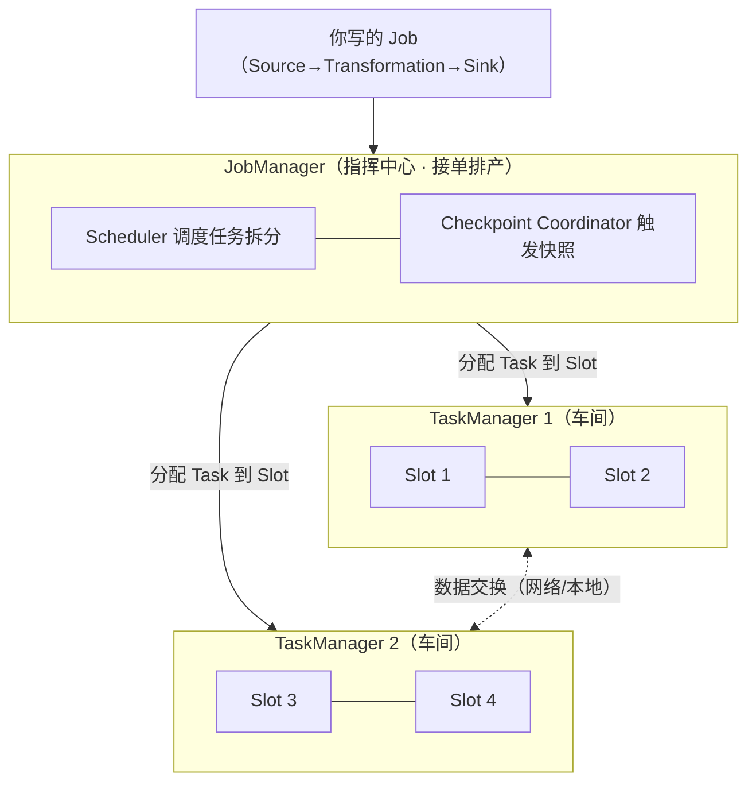
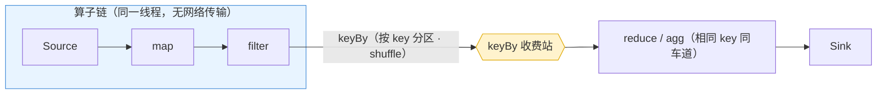
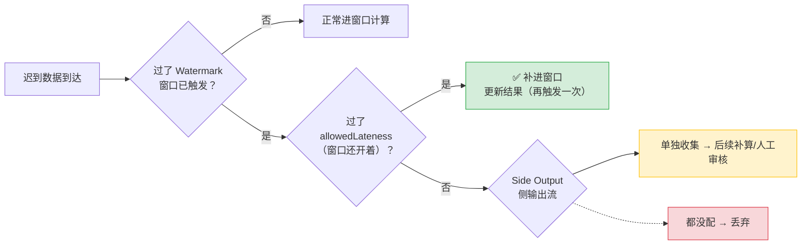
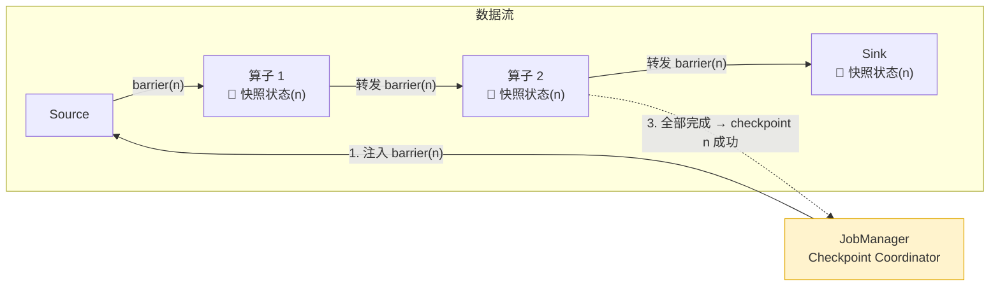
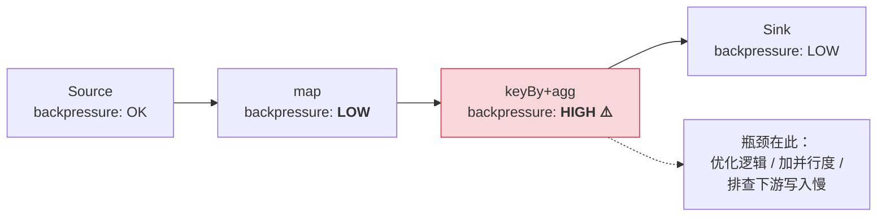

# 🌊 Flink 入门：1 条河讲透实时数据处理（详细整理版）

> 本篇是对 [B 站视频《Flink入门：1条河讲透实时数据处理》](https://www.bilibili.com/video/BV11yux66EfG/)（约 14 分钟）的**逐段深度整理**：把口语化的字幕稿修正错漏后，按知识结构重新组织，并补齐了每个概念的细节、原理图与选型表。
> 定位：**零基础入门第一篇**——用一条河的比喻串起 Flink 全部核心概念。读完本篇，再进 [[1-架构与运行时]]～[[6-背压与性能调优]] 就有了骨架。
> 原始字幕稿（未整理）：[[Flink入门：1条河讲透实时数据处理]]。相关：[[0-Flink总览]]（MOC）、[[10-面试高频题]]、[[13-生产部署Checklist逐项解析]]。

---

## 〇、本篇地图与视频时间轴

视频的叙事主线是一条"**批流之别 → 架构 → 数据流 → 时间 → 窗口 → 状态 → 容错 → 三大坑 → 上线清单 → 知识地图**"的完整链路，本篇按同样顺序展开：

| 时间轴 | 主题 | 本篇章节 |
| --- | --- | --- |
| 00:00 | 开场：报表跑了一宿 vs 老板要看实时 | 一 |
| 00:20 | 水库与河流：批处理 vs 流处理的根本差异 | 一 |
| 00:49 | 框架选型：Spark Streaming / Storm / Flink | 二 |
| 01:31 | 架构：把 Flink 想象成一座工厂 | 三 |
| 02:15 | 高速公路：并行度、keyBy 收费站、算子链 | 四 |
| 03:02 | 编程模型：Source → Transformation → Sink | 五 |
| 03:47 | 三个钟：事件/处理/摄入时间 | 六 |
| 04:36 | Watermark：对迟到的容忍度 | 七 |
| 05:14 | 迟到数据三件套 | 七 |
| 06:07 | 三种窗口：滚动/滑动/会话 | 八 |
| 07:16 | 状态：流处理的记忆 | 九 |
| 08:00 | State Backend：状态存哪 | 十 |
| 09:11 | Checkpoint：分布式存档点与 Exactly-Once | 十一 |
| 10:02 | 坑一：数据倾斜 | 十二 · 1 |
| 10:56 | 坑二：Watermark 怎么设（P99 法） | 十二 · 2 |
| 11:52 | 坑三：状态膨胀与 TTL | 十二 · 3 |
| 13:00 | 生产上线前检查清单（并行度/网络缓冲/反压） | 十三 |
| 13:46 | 知识地图：骨架与肌肉、下一步实战 | 十四 |

> [!tip] 阅读方式
> 时间紧只看各章开头的**加粗结论**和表格；准备面试则重点读六、七、九、十一（时间/水位/状态/容错——流计算三大基石的一半江山）；上线前翻十三对照 [[13-生产部署Checklist逐项解析]]。

---

## 一、批处理 vs 流处理：水库与河流

**开场场景**：T+1 报表跑了一宿才出来，老板突然要看实时数据，而数据还在 Kafka 里排队。

### 1.1 核心比喻

> [!important] 记住这个比喻，后面所有概念都能往里套
> **批处理 = 水库**：先攒够一批，再统一开闸处理。好处是简单粗暴，坏处是用户得等。
> **流处理 = 河流**：数据来了就处理，来一条算一条，用户秒级看到结果。实时大屏用的就是这个思路。

### 1.2 对比表

| 维度 | 批处理（水库） | 流处理（河流） |
| --- | --- | --- |
| 处理单位 | 一整批 | 一条条（非微批） |
| 触发时机 | 攒够一批才开闸 | 数据到达即处理 |
| 结果延迟 | 小时/天级（T+1） | 秒级/亚秒级 |
| 数据边界 | 有界（读完就结束） | **无界**（永远不停） |
| 代表框架 | Spark、Hive、MapReduce | **Flink**、Spark Structured Streaming、Storm |
| 典型场景 | 离线报表、数仓 ETL | 实时大屏、风控、推荐、实时数仓 |

### 1.3 关键结论

**流处理不是"跑得更快的批处理"，而是根本思路不同**——对底层哲学不一样。

> [!note] 与后续章节的呼应
> 正因为流是**无界的**，才有"什么时候出结果"的问题 → 引出 [[#六、时间语义：三个钟]] 与 [[#八、窗口：把无界流切成有界数据]]；
> 正因为**来一条算一条**，才有"记住之前算过什么"的问题 → 引出 [[#九、状态：流处理的记忆]]。

---

## 二、流处理框架选型：为什么是 Flink

### 2.1 三框架对比

| 框架 | 定位 | 优点 | 短板 |
| --- | --- | --- | --- |
| Spark Streaming | 微批流处理 | 与 Spark 生态一体、批流接口统一 | **微批模型，延迟有天花板**（秒级起步，本质是小批） |
| Storm | 老牌真流处理 | 出名早、纯逐条 | **太老、API 不友好**，状态与精确一次支持弱 |
| **Flink** | 真正的逐条流处理 | **流处理领域的"六边形战士"**：真一条条处理非微批、**Event Time 支持最完整**、**状态管理最成熟** | 学习曲线略陡（概念多） |

### 2.2 选型结论

> [!tip] 一句话选型
> 在**低延迟 + 复杂状态 + 精确一次（Exactly-Once）语义**的场景下，Flink 是当前最优解。
> 电商实时大屏、风控、推荐这些场景里，Flink 基本是首选。

注意视频的措辞很克制："**至少在需要低延迟、复杂状态、精确一次语义的场景下，它是当前最优解**"——Spark Structured Streaming 在微批可接受、且深度绑定 Spark 生态时依然是合理选择。延伸对比见 [[10-面试高频题]]、[[1-架构与运行时]]（流批一体执行模式）。

---

## 三、架构：把 Flink 想象成一座工厂

### 3.1 工厂比喻

| 工厂角色 | Flink 组件 | 职责 |
| --- | --- | --- |
| 🏭 指挥中心 | **JobManager** | 就一个职责：**接单排产**。接收你写好的 Flink 程序（一个 Job），把任务拆成小块分配下去，协调整个作业达成目标 |
| 🔧 车间 | **TaskManager** | 真正干活的工人。每个 TaskManager 手里有固定数量的资源 |
| 🪑 工位 | **Slot** | TaskManager 内的资源单位，一个 Task 被分配到一个 Slot 上执行 |
| 👷 想处理更快 | **并行度** | 多招车间（加 TaskManager）、多加工位（加 Slot/并行度） |

**"所以我以后调性能就是给工厂多招人"——加工位比喻到位。但工位多了，协调也复杂**（并行度、网络交换、反压随之而来，见 [[#十三、生产上线前检查清单]] 与 [[6-背压与性能调优]]）。

### 3.2 架构图



> [!note] 深入阅读
> Slot 是**逻辑隔离**（不隔离内存，共享 JVM 堆）、Slot 共享模型、作业提交全流程，见 [[1-架构与运行时]]。

---

## 四、数据流：高速公路、keyBy 收费站与算子链

### 4.1 高速公路比喻

- **三条车道 = 并行度为 3**：每条车道上的小车（数据）互不干扰；
- **keyBy = 收费站**：它的作用是**把相同 key 的车赶到同一条道上**；
- 所以 **keyBy 之后并行度不变，但数据分区变了**——相同 key 保证进入同一个下游 subtask，这是后面"状态按 key 分区"和"数据倾斜"两个话题的共同根基。

### 4.2 算子链（Operator Chain）优化

map 和 filter 之间那条"发光的链子"就是**算子链**：

> [!tip] 算子链规则
> 如果两个算子之间**没有 shuffle**（上下游并行度相同、分区方式不触发网络交换），Flink 会把它们**串连在一起，在同一个线程里执行**，省掉序列化与网络传输。链越长性能越好。
> 这是 Flink **自动完成**的，你不用操心，但**必须知道它的存在**——调试并行度时才不会懵（改了并行度导致链断开、性能变化，要知道为什么）。

**一个常见误区**：不是每个算子占一个线程，而是**能连就练（能链就链）**。

### 4.3 数据流示意



| 算子/操作 | 是否改变分区 | 是否断链 |
| --- | --- | --- |
| map / filter / flatMap | 否（forward） | 否，可成链 |
| keyBy / rebalance / rescale | **是**（shuffle） | **是** |
| 并行度上下游不一致 | 是（forward 失败） | 是 |

延伸：算子链调优、`chaining` 开关、通过 Web UI 看链的分组，见 [[1-架构与运行时]]、[[6-背压与性能调优]]。

---

## 五、编程模型：Source → Transformation → Sink

### 5.1 三步流水线

Flink 的编程模型就三步——一条流水线：

| 阶段 | 位置 | 常见实现 |
| --- | --- | --- |
| **Source**（进料口） | 左侧进料 | Kafka、文件、Socket、数据库（CDC） |
| **Transformation**（加工） | 中间加工 | `map`、`filter`、`keyBy`、窗口、聚合 |
| **Sink**（出料口） | 右侧出料 | MySQL、Redis、Elasticsearch，或再写回 Kafka |

### 5.2 与 Java Stream 的区别（重要）

API 风格像"链式调用"，但**底层完全不同**：

| 维度 | Java Stream | Flink |
| --- | --- | --- |
| 执行环境 | 单机内存 | **分布式集群**（map 在机器 A、reduce 在机器 B，中间走网络） |
| 数据边界 | 有界，`collect()` 等它结束 | **无界，数据永远不停**，不能等结束 |
| 状态 | 无（一次性消费） | **有状态**，跨记录/跨批次记忆 |
| 容错 | 无 | Checkpoint 分布式快照 |
| 语义 | 进程内即算即得 | Exactly-Once 需要整条链路配合 |

> [!question] 无界流什么时候出结果？
> **一条来就算一次？**——不完全对，答案是：**窗口**（见 [[#八、窗口：把无界流切成有界数据]]）。但在聊窗口之前，必须先定"时间"的坐标轴，否则窗口无从切起 → 先看 [[#六、时间语义：三个钟]]。

---

## 六、时间语义：三个钟

同一条数据有三个时间戳，**选错了，指标口径就错了**。

### 6.1 三个钟的定义

| 时间语义 | 含义 | 谁决定 | 示例（用户 10:01 下单，网络卡了 10:05 才到系统） |
| --- | --- | --- | --- |
| **Event Time**（事件时间） | 事件**真正发生**的时刻，如用户下单那一秒 | 数据自身携带 | **10:01** |
| **Ingestion Time**（摄入时间） | 数据**进入 Flink** 的时刻 | Source | **10:05** |
| **Processing Time**（处理时间） | Flink **算子处理**这条数据的机器本地时钟 | 操作系统 | **10:05 或更晚** |

### 6.2 乱序问题

> [!warning] 更要命的是：到达顺序 ≠ 发生顺序
> 10:03 的订单可能比 10:01 的**更早**到达。乱序是常态，不是异常。

### 6.3 怎么选

| 业务诉求 | 选择 | 说明 |
| --- | --- | --- |
| 关心"用户几点下单"（准确口径） | **Event Time** | **绝大多数场景的正确选择**；代价是要处理乱序与迟到 |
| 只是粗略统计"这一秒处理了多少条" | Processing Time | 最简单、延迟最低；口径是"系统什么时候算的" |

Event Time 虽然准确，**处理起来也最复杂**——乱序和迟到这个难题，Flink 用一个精妙的机制解决，叫 Watermark。

深读：[[2-时间与窗口]]（时间语义在 1.12 后由是否使用 watermark 决定、时间戳与水位的生成传播）。

---

## 七、Watermark：对迟到的容忍度

### 7.1 大白话定义

> [!important] Watermark = 你对数据迟到的容忍度
> 设定规则：**当前最大事件时间 − 5 秒**。
> 含义：我已经看到最大事件时间是 10:05 了，那就认为 **10:05 − 5s = 10:04:55 之前的数据都到齐了**，可以放心触发计算。

### 7.2 权衡公式

**Watermark 越大（容忍越久）→ 越安全但延迟越高；越小 → 越快但丢数据。这是准确性和延迟之间永远的权衡（Tradeoff）。**

| 场景 | 建议 Watermark | 理由 |
| --- | --- | --- |
| 电商实时大屏 | **1～5 秒** | 追求秒级可见，少量迟到可容忍 |
| 金融对账 | **几分钟甚至更久** | 准确性优先，宁可慢不能错 |

### 7.3 迟到数据三件套

Watermark 到了、窗口触发之后才来的数据怎么办？三层保障，**现实中经常组合使用**：



| 机制 | 大白话 | 效果 |
| --- | --- | --- |
| **丢弃**（默认） | 迟到就迟到，不等了 | 最简单，结果可能少算 |
| **allowedLateness（允许迟到）** | 窗口触发后**再开一条命**（如再等 30 秒），期间到的迟到数据仍能更新窗口 | 多一次更新机会 |
| **Side Output（侧输出）** | 没赶上的数据**单独收集**，事后补算或人工审核 | 兜底，一条不丢 |

> [!tip] 生产标准姿势（见 [[#十二 · 2 Watermark 怎么设（P99 法）]]）
> **Watermark（P99）+ allowedLateness（续命）+ Side Output（兜底）三层叠加**。

深读：[[2-时间与窗口]]（水位生成策略、多输入取 min、迟到三件套的相互关系）。

---

## 八、窗口：把无界流切成有界数据

> [!important] 窗口的本质就一句话
> **把无界流切成有界的数据**——这是"无界流什么时候出结果"的正式答案。

### 8.1 三种窗口（用场景记）

| 窗口 | 英文 | 切法 | 例子 | 特点与场景 |
| --- | --- | --- | --- | --- |
| **滚动窗口** | Tumbling | 按固定长度切，**不重叠** | 每 5 秒统计一次订单数，就像每 5 秒拍一张快照 | 最简单；计数/求和大屏首选 |
| **滑动窗口** | Sliding | 每 5 秒划一次，但窗口大小 10 秒 → **有重叠** | 任何一个事件会被统计两次 | 适合**趋势平滑**（连续滑动均值） |
| **会话窗口** | Session | **不按时间切，按活跃度切** | 逛淘宝点了几下，停 3 分钟没动静 → 会话结束统计一次；再来 → 新会话 | **每个人的行为窗口大小都不一样，全靠数据本身驱动** |

> [!tip] 场景对应
> **电商分析用户行为 → Session Window 是最经典的应用**（视频原话）。
> 补充：窗口与 Watermark、触发器、窗口状态的关系全部落在 [[2-时间与窗口]]；SQL 写法（窗口 TVF）见 [[8-FlinkSQL与TableAPI]]。

### 8.2 窗口与状态的关系（承上启下）

窗口之所以能"拍快照"，是因为**窗口里存着数据**——窗口状态。下一章的"状态"就是它的推广。

---

## 九、状态：流处理的记忆

### 9.1 为什么需要状态

> [!question] 试一试：统计每个用户到目前为止的累计消费金额怎么算？
> 每来一条订单，**把它加到之前的总额上**——你必须**记住之前的总额**。这个"之前的总额"就是**状态（State）**。

**没有状态，每条数据都是孤岛，来了就忘；有了状态，流处理才能做累加、计数、模式匹配这些需要"记忆"的操作。**

### 9.2 两大类状态

| 分类 | 存储键 | 典型用途 | 常用类型 |
| --- | --- | --- | --- |
| **Keyed State**（键控状态） | **按 key 分区存储**，比如每个用户一份状态 | 最常用（90% 场景） | ValueState、ListState、MapState、ReducingState、AggregatingState |
| **Operator State**（算子状态） | **跟算子绑定，与 key 无关** | 底层场景，如 Source 的 offset 管理 | ListState（统一列表）、BroadcastState |

### 9.3 Keyed State 的数据结构（按业务选）

| 数据结构 | 存什么 | 例子 |
| --- | --- | --- |
| **ValueState** | 单个值 | 每个用户的累计消费总额 |
| **ListState** | 列表 | 某用户的最近十条订单 |
| **MapState** | key→value 映射 | 每个商品到购买次数 |

**选哪个取决于你的业务逻辑。**

> [!warning] 状态会越攒越多
> 状态的天然趋势是**只增不减**（尤其按用户 id 存）→ 埋下 [[#十二 · 3 状态膨胀：跑一天就 OOM]] 的伏笔。

深读：[[3-状态管理]]（key group、状态演进、TTL 细节、Flink 2.0 Disaggregated State）。

---

## 十、State Backend：状态存哪

> [!question] 状态全放内存不会撑爆吗？
> 这就是 **State Backend** 要解决的问题——决定状态存内存还是磁盘、Checkpoint 怎么落盘。

### 10.1 三种后端对比

| State Backend | 状态存放 | Checkpoint 方式 | 优点 | 缺点 | 适用 |
| --- | --- | --- | --- | --- | --- |
| **MemoryStateBackend**（内存后端） | 全在 JVM 堆内存 | 直接在 JobManager 内存生成快照 | 快 | **不靠谱，挂了就丢**；受堆大小限制 | **仅本地开发测试** |
| **FsStateBackend**（文件系统后端） | 运行时在内存 | **定期快照到文件系统**，恢复时从快照加载 | 够用、恢复快 | 状态**不能超过单机内存** | 中小状态、对延迟敏感 |
| **RocksDBStateBackend** | **磁盘上的嵌入式 KV 存储**（带内存缓存） | **增量 Checkpoint**：每次只同步变化部分，不用全量快照 | **状态到 TB 级也能扛** | 序列化开销比纯内存大 | **生产标配**、大状态 |

### 10.2 选型：不是无脑 RocksDB

> [!important] 选型没有银弹，只有 Tradeoff
> - **大部分场景**：确实无脑 RocksDB（生产标配）；
> - **状态很小（几百 MB 以内）**：FsStateBackend 反而更快——RocksDB 的序列化/反序列化开销在小状态下得不偿失。

> [!note] 版本注记
> 视频用的是老命名（Memory/Fs/RocksDB State Backend）。Flink 1.13 起**状态存哪（Backend）与 Checkpoint 存哪（Checkpoint Storage）解耦**：`HashMapStateBackend`（对应 Memory/Fs 的内存运行时）+ `FileSystemCheckpointStorage`/`JobManagerCheckpointStorage`；RocksDB 更名为 `EmbeddedRocksDBStateBackend`。概念一致，名称以 [[3-状态管理]]、[[5-Checkpoint与Savepoint]] 为准。

---

## 十一、Checkpoint：分布式存档点与 Exactly-Once

### 11.1 游戏存档点

Flink 能在生产站稳脚跟靠的就是容错机制，核心是 **Checkpoint = 定时保存状态的游戏存档点**。

> [!question] "我用 Redis 也能做啊？"
> **不一样。** Flink 的 Checkpoint 是**分布式一致性快照**：它不光保存状态，还保证**所有算子在同一时刻的状态一致性**。Redis 存的只是你手动同步过去的"某一份数据"，没有"同一时刻"的概念。

### 11.2 Barrier：一致性快照怎么达成

靠一个叫 **Barrier（屏障）** 的标记：

1. **JobManager 定期往数据流里注入 Barrier**；
2. Barrier **流经每个算子**时，触发该算子**异步保存自己的状态**（本地快照）；
3. **所有算子都保存完，这个 Checkpoint 才算成功**（各算子向 JobManager 的 Checkpoint Coordinator ACK）。



### 11.3 Exactly-Once 到底保证什么

> [!warning] 关键澄清（面试高频）
> **Exactly-Once = 计算结果的精确一次，不是"数据只处理一次"。**
> Flink 保证的是：**从 Checkpoint 恢复后，每条数据的计算结果恰好被反映一次**（可能重算，但结果不重不漏）。

### 11.4 端到端 Exactly-Once（Sink 侧的两个后手）

快照只覆盖 Flink 内部；数据写出到外部系统（MySQL/Kafka/Redis）那一段要自己保证：

| 手段 | 原理 | 例子 |
| --- | --- | --- |
| **幂等写入** | **重复写也不影响结果**（同一份数据覆盖写） | 结果表以业务主键 upsert，或 Redis `SET` 同 key 同值 |
| **两阶段提交（2PC）** | 先预提交、Checkpoint 成功后才提交，恢复后可回滚/续提交 | Kafka 事务 Sink、JDBC 事务 Sink |

两者配合 → 实现**端到端（End-to-End）Exactly-Once**。

深读：[[4-容错与ExactlyOnce]]（Chandy-Lamport、Barrier 对齐/非对齐、重启恢复）、[[5-Checkpoint与Savepoint]]（触发/增量/恢复与调优）、[[11-端到端一致性]]（各环节配置与验证方法）。

---

## 十二、三大经典坑

### 12 · 1 数据倾斜：一个 TaskManager 内存爆了，其他都好好的

**诊断思路（视频原话：十有八九是数据倾斜）：**

- 某个 key 的数据量**远超其他 key**，导致分到同一个算子的数据堆积；
- `keyBy` 的铁律：**相同 key 一定在同一个 subtask 上处理**——热门 key 太多，一个 subtask 就撑不住了。

**解决方案（按实用度排序）：**

| 方案 | 做法 | 说明 |
| --- | --- | --- |
| **⭐ 两阶段聚合**（最实用） | ① 给热点 key **加随机后缀（加盐）**→ 做一次**局部聚合**，把压力打散到多个 subtask；② **去掉后缀**→ 做**全局聚合** | 热点 key 的压力被均摊 |
| rebalance | 强制**轮询分配**，不分 key | 简单粗暴，但会**破坏 keyBy 的状态语义**，只在无状态场景用 |
| 自定义 Partitioner | 自己写分区逻辑 | 灵活，可控性最强 |

**两阶段聚合示意：**

```java
// 第一阶段：加盐 → 局部聚合（打散到多个 subtask）
DataStream<Sum> partial = orders
        .keyBy(o -> o.userId + "_" + salt(o.userId))   // 加随机后缀
        .sum("amount");
// 第二阶段：去盐 → 全局聚合（结果与直接聚合一致）
partial
        .keyBy(o -> o.userId.replaceAll("_\\d+$", "")) // 去掉后缀
        .sum("amount");
```

**怎么提前发现倾斜？**——看 **Flink Web UI 里各 subtask 的处理数据量和耗时**，如果某一个远高于其他，那就是了。

> [!tip] 监控先行，优化在后。

深读：[[6-背压与性能调优]]（倾斜与背压的区分）、[[10-面试高频题]]（倾斜场景设计题）。

### 12 · 2 Watermark 怎么设：P99 分位法

调优里最让人纠结的问题之一。**设错了两头都疼**：

| 设太大会怎样 | 设太小会怎样 |
| --- | --- |
| 窗口迟迟不触发，下游等得花儿都谢了，**实时大屏变成准实时大屏** | 大量迟到数据被丢弃，**统计结果不准** |

**标准做法（上线前做一件事）：**

1. **统计你的数据延迟分布**——每条数据的 `到达时间 − 事件时间` 的差值；
2. **画一条分布曲线**，**取 P99 分位值作为 Watermark**；
3. 含义：**99% 的正常数据都能兜住，只有 1% 的极端迟到会被丢掉**。

**那 1% 就不管了？——不是不管，三层保障叠加（生产标准姿势）：**

| 层 | 机制 | 配置示例 |
| --- | --- | --- |
| 第 1 层 | Watermark 取 P99 | `forBoundedOutOfOrderness(p99)` |
| 第 2 层 | `allowedLateness` 给窗口**续一条命**：watermark 过了窗口之后再等 30 秒，这期间到的迟到数据仍能更新窗口 | `.allowedLateness(Time.seconds(30))` |
| 第 3 层 | **Side Output** 收集超过 30 秒还迟到的数据，后续补算或人工审核 | `.sideOutputLateData(lateTag)` |


### 12 · 3 状态膨胀：跑一天越来越慢，最后崩了

**现象**：任务跑了一天之后越来越慢，最后崩了（OOM），**但数据量没变啊**。

**原因（八成是状态膨胀）**：Keyed State 按 key 存，如果 **key 不断增加**（比如用户 id，每天都有新用户），**状态只会增长不会减少**——时间一长，几十 GB 的状态把内存和 Checkpoint 都拖垮。

**解法（三板斧）：**

| 手段 | 配置/做法 | 作用 |
| --- | --- | --- |
| **① 状态 TTL** | `StateTtlConfig.newBuilder(Time.hours(24))`——超过 24 小时没被访问的 key 自动清理；SQL 里是 `table.exec.state.ttl` | "一行配置能救你的命"（配置） |
| **② 控制列表长度** | 对 ListState 这种易膨胀类型**定期裁剪**（如只留最近 N 条） | 治理单 key 内膨胀 |
| **③ 换大容量后端** | RocksDB（状态在磁盘不吃堆）+ **增量 Checkpoint** + 合理的 **write buffer / block cache 调优** | 状态到 TB 级也能稳定运行 |

```java
// ① 状态 TTL：24 小时未访问的 key 自动过期
StateTtlConfig ttl = StateTtlConfig.newBuilder(Time.hours(24))
        .setUpdateType(StateTtlConfig.UpdateType.OnReadAndWrite)
        .setStateVisibility(StateTtlConfig.StateVisibility.NeverReturnExpired)
        .build();
env.getConfig().setStateTtlConfig(ttl);   // DataStream API
```

```sql
-- SQL 方式（Flink SQL 常用）
-- 'table.exec.state.ttl' = '86400'
```

> [!important] 核心原则（视频原话）
> **任何长期运行的 Flink 任务，必须有状态退出机制。**
> 没有 TTL 的状态，就是一颗定时炸弹——这也是 [[13-生产部署Checklist逐项解析]] 里的必查项。

---

## 十三、生产上线前检查清单

视频说"**六条，每条都很关键**"，重点展开了以下几条（完整 10 项清单见 [[13-生产部署Checklist逐项解析]]）：

### 13.1 并行度

- 概念见 [[#三、架构：把 Flink 想象成一座工厂]]（加工位）；
- 上线前确认：各算子并行度是否匹配数据量，是否有算子被"卡脖子"。

### 13.2 网络缓冲区（Network Buffer）

| 项 | 说明 |
| --- | --- |
| 是什么 | Flink **算子之间传输数据**用的缓冲区 |
| 默认值 | 对大部分场景够用 |
| 何时要调大 | **数据量特别大**或**大量 shuffle** 场景 |
| 不调的后果 | 缓冲区满 → 产生**反压** → 上游被迫降速等下游，**吞吐直接腰斩** |

### 13.3 反压（Backpressure）怎么看

1. **Flink Web UI 里直接有反压指示器**；
2. 看到某个算子频繁出现 **High 反压** → 它就是瓶颈；
3. 处理三选一：**优化这个算子的逻辑 / 给它加并行度 / 解决下游写入慢的问题**。

> [!tip] 反压是性能调优的第一信号——看到它就说明有优化空间。



深读：[[6-背压与性能调优]]（Credit 反压机制、指标定位法）、[[9-部署与运维]]（网络内存配置）。

---

## 十四、知识地图与下一步

### 14.1 我们走过的地图


### 14.2 骨架与肌肉

> [!note] 视频的原话很精彩
> 今天掌握的是**骨架**；**CEP（复杂事件处理）、Table API、Flink SQL、CDC 数据集成**是骨架上的肌肉——**但没有骨架，肌肉无处附着**。

| 已掌握（骨架） | 待学（肌肉） | 对应笔记 |
| --- | --- | --- |
| 架构、时间、水位、窗口、状态、Checkpoint、三大坑 | Table API / Flink SQL | [[8-FlinkSQL与TableAPI]] |
| | CDC 数据集成、实时数仓 | [[7-FlinkCDC与实时数仓]] |
| | CEP 复杂事件处理 | 面试题中的场景设计，[[10-面试高频题]] |
| | 部署、运维、扩缩容 | [[9-部署与运维]] |

### 14.3 下一步：写一个真实的 Flink Job（视频留的作业）

**"打开 IDE 写一个真实的 Flink job——从你自己的业务开始"**，把那张 T+1 报表改成实时的：

| 步骤 | 做什么 | 对应本篇章节 |
| --- | --- | --- |
| 1 | **Source**：读 Kafka，按用户 id `keyBy` | 五、四 |
| 2 | 开一个**一分钟的滚动窗口**做聚合 | 八 |
| 3 | **Sink** 写到你的大屏数据源 | 五 |
| 4 | 原理能跑通 = 入门了 ✅ | — |

> 视频结尾："好我先去搭个 docker 环境……等等，我本地有 docker 吗？这就是下一步的故事了。"——本地起 Flink 集群（`docker run flink`）正是这个作业的第一步。

---

## 附录 A：语音转写（ASR）勘误对照

原始字幕稿由 vCaptions 自动生成，存在较多同音字错误。整理时按下表修正，阅读原始稿 [[Flink入门：1条河讲透实时数据处理]] 时可对照：

| 原始转写 | 应为 |
| --- | --- |
| KEBA（收费站） | **keyBy** |
| test manager | **TaskManager** |
| frank 的状态 / frank web ui | **Flink** 的状态 / **Flink Web UI** |
| a窗口有重叠 | **滑动窗口 Sliding**（转写漏了窗口名，只留了特征） |
| 新的绘画开始 | 新的**会话（session）**开始 |
| kid state | **Keyed State** |
| this state 存一个列表 | **ListState** |
| memory stick backend | **MemoryStateBackend** |
| fs state bend / FSSTBEND | **FsStateBackend** |
| rocks dB | **RocksDB** |
| 密等写入 | **幂等**写入 |
| 两阶段提交 RPC | **两阶段提交（2PC）** |
| exactly ones / exactly once 语义 | **Exactly-Once** |
| aloud lenness / alound lenness | **allowedLateness** |
| Sex dt t l time hours（括号24） | **StateTtlConfig**(Time.hours(24)) |
| right buffer block cash | **write buffer / block cache**（RocksDB 调优） |
| 最后忘了（越来越慢最后…） | 最后**崩了**（OOM） |
| sap 复杂事件处理 | **CEP**（Complex Event Processing） |
| my SQL redis | **MySQL、Redis** |
| 读 KAFKAP8 用户 id | 读 **Kafka**、**keyBy 用户 id**（据上下文推断） |
| 能练就练 | **能链就链**（算子链） |
| Flink 之所以… 只有 TRADEOFF | **Tradeoff（取舍）** |

## 附录 B：30 秒速查

| 问题 | 一句话答案 |
| --- | --- |
| 批 vs 流 | 水库（攒一批开闸）vs 河流（来一条算一条）；**根本思路不同，不是更快的批处理** |
| 为什么选 Flink | 低延迟 + 复杂状态 + Exactly-Once 场景下的**当前最优解**（真逐条、事件时间最完整、状态最成熟） |
| JobManager / TaskManager | 指挥中心（接单排产）/ 车间（干活的工人，资源单位是 Slot） |
| keyBy 改变什么 | **并行度不变，数据分区变**：相同 key 必进同一 subtask |
| 算子链 | 无 shuffle 的算子连成一条链，**同一线程**执行，省网络传输 |
| 三个钟 | 事件时间（数据自带）/ 摄入时间（进 Flink 时）/ 处理时间（算子处理时） |
| Watermark | **最大事件时间 − 容忍度**；越大越准但越慢，电商 1~5s，金融分钟级 |
| 迟到三件套 | 丢弃 / allowedLateness / Side Output，**生产用三层叠加** |
| 窗口本质 | **把无界流切成有界数据**；滚动=快照、滑动=重叠平滑、会话=按活跃度 |
| 状态 | 流处理的**记忆**；Keyed State（按 key，常用）/ Operator State（按算子） |
| State Backend | 小状态用 Fs、**生产标配 RocksDB**（磁盘 + 增量 Checkpoint，TB 级能扛）；几百 MB 内 Fs 更快 |
| Checkpoint | **Barrier 触发的分布式一致性快照**，所有算子同一时刻才算成功 |
| Exactly-Once | **计算结果精确一次**，非数据只处理一次；端到端还要 Sink **幂等或 2PC** |
| 数据倾斜 | 相同 key 同 subtask；**两阶段聚合（加盐→局部聚合→去盐→全局聚合）**最实用；看 Web UI subtask 指标 |
| Watermark 调优 | 统计 `到达−事件` 延迟分布，**取 P99**；再叠 allowedLateness + Side Output |
| 状态膨胀 | 必须有**状态退出机制**：TTL(24h) + 列表裁剪 + RocksDB/增量 Checkpoint |
| 反压 | Web UI 反压指示器，**High 的算子就是瓶颈**：优化逻辑/加并行度/查下游写入 |
