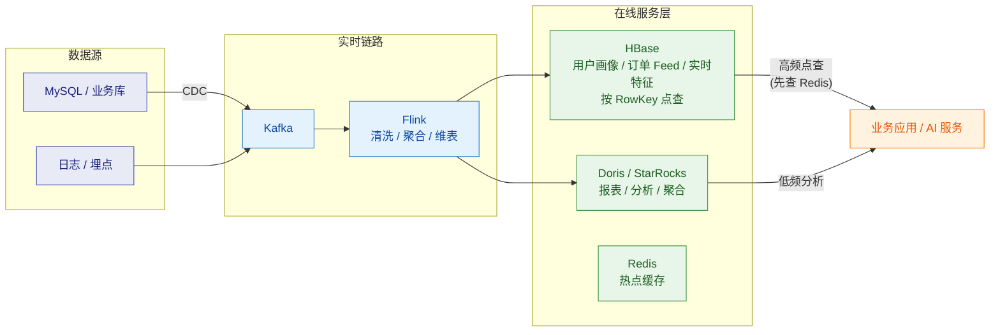

# 🗄️ HBase 总览

> 这是 Apache HBase 系列笔记的**总入口（MOC）**，对应大数据存储版图里的「**按 RowKey 高并发随机读写**」这一环。
> 系列回答四个层次：**① 集群怎么运转（架构）② 表怎么设计（数据模型与 RowKey）③ 代码怎么写（开发 API）④ 生产怎么不踩坑（坑与调优）**。
> 关联：[[5-bigdata/0-flink/0-Flink总览|Flink 系列]]（上游计算）、[[5-bigdata/1-doris/0-Doris总览|Doris 系列]]（OLAP 对比）、[[5-bigdata/3-StarRocks/0-StarRocks总览|StarRocks 系列]]。
> 简历口径（"精通 Hadoop/Hive/HBase"）的速答版见 [[面试准备/专业技能/05-大数据与流计算|05-大数据与流计算]]，本系列是它的深度展开。

> [!note] 版本口径
> 以 **HBase 2.x（2.4 ~ 2.6）为基线**表述；涉及 1.x 差异（hbck、老客户端 API、AssignmentManager v1）会明确标注。
> 你自己的自测环境：[[服务器巡检-192.168.0.106/巡检报告|106 大数据机]] 上 Docker 跑着 **HBase 2.6.6**，可以直接动手验证。

---

## 一、系列导航

| # | 笔记 | 一句话定位 | 核心内容 |
|---|---|---|---|
| 1 | **[[1-架构与原理]]** | 集群怎么运转 | Master/RegionServer/ZK/HDFS 四角色、写路径与读路径、WAL、Flush/Compaction/Split、HFile 结构、故障恢复 |
| 2 | **[[2-数据模型与RowKey设计]]** | 表怎么设计 | 稀疏宽表、版本/TTL/删除语义、**RowKey 设计六大手法**、建表参数速查、订单表实战 |
| 3 | **[[3-开发API]]** | 代码怎么写 | Connection/Table 生命周期、Put/Get/Scan/Delete、Filter 体系、原子操作、批量与异步、协处理器 |
| 4 | **[[4-生产坑与调优]]** | 集群怎么不炸 | **23 个生产坑**（现象→根因→定位→修复）、参数速查表、排障决策树、上线 Checklist |

### 按需求的阅读路径

> [!tip] 三条路径
> **面试突击（半天）**：本篇速查表 → [[1-架构与原理]]（读写路径）→ [[2-数据模型与RowKey设计]]（RowKey 设计）→ [[4-生产坑与调优]]（只看坑目录）
> **上手干活（2~3 天）**：[[1-架构与原理]] → [[2-数据模型与RowKey设计]] → [[3-开发API]] → [[4-生产坑与调优]]
> **线上排障（当手册用）**：[[4-生产坑与调优]] 的「现象 → 定位命令 → 修复」速查表 + 排障决策树

---

## 二、30 秒速查表

| 问题 | 一句话答案 | 详见 |
|---|---|---|
| HBase 是什么 | 面向**列族**的分布式 KV 数据库（BigTable 开源实现）：按 RowKey **强一致随机读写**，数据最终落在 HDFS | [[1-架构与原理]] |
| 和 HDFS 什么关系 | HDFS 只负责**顺序存储与容错**；HBase 用 LSM + 多级索引 + 缓存在其上"变出"随机读写能力 | [[1-架构与原理]] |
| 什么时候用 | 按 RowKey 的**点查/短范围扫 + 海量宽表 + 无 join**：用户画像、订单/消息 Feed、实时特征存储 | [[1-架构与原理]] |
| 什么时候别用 | 复杂条件组合查询、join、聚合分析 → 用 Doris/StarRocks；小数据量 → 用 MySQL | [[1-架构与原理]] |
| 为什么写快 | **WAL 顺序写 + MemStore 内存攒批**（LSM），磁盘上只有顺序 IO | [[1-架构与原理]] |
| 读为什么比写复杂 | 多路合并扫描（MemStore + 多个 HFile），靠 Bloom + BlockCache + 多级索引救回来 | [[1-架构与原理]] |
| Region 是什么 | 表按 RowKey **范围**的水平分片，分布、均衡、切分的基本单位 | [[1-架构与原理]] |
| 一条数据怎么定位 | ZK 找 hbase:meta 位置 → 查 meta 表 → 直连目标 RegionServer（客户端缓存，之后不再绕路） | [[1-架构与原理]] |
| RowKey 设计一句话 | **散列前缀防热点 + 长度适中 + 查询维度都拼进前缀** | [[2-数据模型与RowKey设计]] |
| 删除立即生效吗 | 不。先打**墓碑**，读时被屏蔽，**Major Compaction 才物理清理** | [[2-数据模型与RowKey设计]] |
| 列族多少个合适 | **1~3 个，最好 1 个**；列族是 flush/配置/物理存储的边界 | [[2-数据模型与RowKey设计]] |
| 连接怎么管理 | Connection 是**重对象、线程安全、JVM 单例**；Table 轻量、非线程安全、用完就关 | [[3-开发API]] |
| 全表扫会怎样 | BlockCache 全污染 + RPC 风暴，**生产禁全表 Scan** | [[4-生产坑与调优]] |
| 2.x 与 1.x 最大区别 | Procedure V2 治理 RIT、AsyncFSWAL、Async 客户端、hbck 换 **HBCK2** | [[1-架构与原理]] |

---

## 三、核心概念最小记忆集

| 概念 | 精确定义 | 常见误解 |
|---|---|---|
| **Table / Namespace** | 表属于某命名空间（类似 MySQL 的库） | 以为 namespace 有性能含义 |
| **RowKey** | 唯一主键，**字节序字典序**排序，最长 64KB（实际应 ≤ 100B） | 以为字符串按数值排序（`'10' < '2'`！） |
| **Column Family（CF）** | **物理存储与配置单元**：TTL/版本/压缩/Bloom 都在 CF 级 | 以为只是逻辑分组 |
| **Qualifier** | CF 下的逻辑列，**免 schema**、可不定义、稀疏存 NULL 不占空间 | 以为要预先建列 |
| **Cell** | 由 `RowKey + CF + Qualifier + Timestamp` 定位的 KeyValue | 以为是"字段" |
| **Version / Timestamp** | 同一 Cell 按 Timestamp 多版本；**默认只保留 1 个** | 以为 HBase 天生多版本（默认 VERSIONS=1！） |
| **Region** | 表按 RowKey 范围的水平分片 `[startKey, endKey)` | 与 HDFS 的 block 混淆 |
| **Store** | Region × CF = 一个 Store，物理目录与 HFile 的归属单位 | 以为按行存文件夹 |
| **MemStore** | 写入的内存缓冲（LSM 的内存层），**每 Store 一个** | 以为全 RegionServer 共享 |
| **WAL** | 写前日志，先记 WAL 再写 MemStore；2.x 默认 **AsyncFSWAL** | 以为可以随便关（SKIP_WAL 丢数据） |
| **HFile** | MemStore flush 出的 LSM 磁盘文件：数据块 + 多级索引 + 可选 Bloom | 以为读一次数据就是一次磁盘 IO |
| **BlockCache** | 读缓存：索引/Bloom 与数据块分层缓存（可堆外 BucketCache） | 以为 MemStore 也参与缓存读（它是写缓冲） |
| **hbase:meta** | 系统表：记录每个 Region 在哪个 RegionServer（它自己也是个 Region） | 以为 meta 在 Master 内存里 |
| **Flush / Minor / Major** | 内存刷盘 / 小文件合并 / 全合并+清墓碑 | 以为删除和 compaction 无关 |
| **Split / 预分区** | Region 太大自动对半切；建表时按 RowKey 前缀**预切好** | 以为建表必须从 1 个 Region 起步 |

> [!warning] 五个最经典的生产陷阱（面试说出来就是加分）
> 1. **RowKey 单调递增**（自增 ID、时间戳开头）→ 全部写入压在一个 Region 上形成热点 → 加盐/哈希/反转 + 预分区。
> 2. **以为 HBase 默认多版本** → 默认 `VERSIONS=1`，覆盖写历史直接丢；需要历史要显式设置。
> 3. **Scan 不设起止 RowKey + 不关 Scanner** → 全表扫描 + 句柄泄漏，两件事都能打死 RegionServer。
> 4. **每次写请求 new 一个 Connection** → 连接风暴（ZK 会话 + 线程池 + meta 缓存全被浪费）；Connection 必须 JVM 单例。
> 5. **以为 Delete 立即释放空间** → 墓碑先屏蔽、Major Compaction 才物理删除；小文件堆积时"删了还占空间"是正常现象。

---

## 四、HBase 在数据平台生态中的位置

**分工逻辑**（一句面试话术）：

- **Flink 算好结果**，写 **HBase**（按主键 KV、行级强一致、服务高并发点查）和 **Doris**（SQL 分析、报表）。
- **Redis 挡最热的点查**，未命中再打 HBase——HBase 比 Redis 慢但容量大、可持久化。
- **别让 HBase 干 OLAP 的活**：全表 Scan/聚合在 HBase 是灾难级用法，那活是 Doris/StarRocks 的。

---

## 五、学习检查清单

- [ ] 能白板画出集群架构：客户端为什么不经过 Master，ZK / meta / RegionServer 各自负责什么
- [ ] 能讲清写路径三步（WAL → MemStore → ACK）与读路径的合并扫描
- [ ] 能解释 Flush / Minor Compaction / Major Compaction / Split 四者的关系与触发条件
- [ ] 能给"按用户查最近 N 条订单"设计 RowKey（含散列前缀 + 反转时间戳）
- [ ] 能说清默认 VERSIONS=1、删除墓碑、TTL 清理时机这三个语义坑
- [ ] 能写出 Connection 单例 + try-with-resources 的标准客户端代码
- [ ] 能说出至少 6 个生产坑的"现象 + 根因 + 修复"
- [ ] 知道 2.x 出 RIT 用 HBCK2，**绝不能在 2.x 跑 1.x 的 hbck -fix**

---

> 下一篇 → [[1-架构与原理]]：先把集群和读写路径的图画出来。
